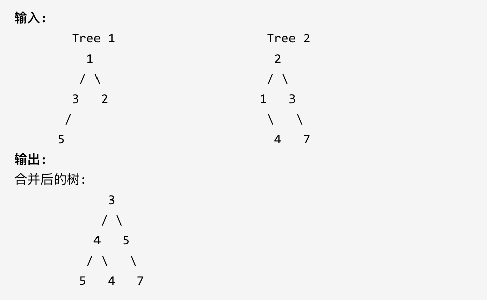
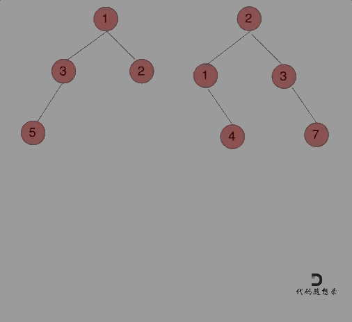

* [做專案（多個 C++、Java、Go、測試開發、前端（front end）專案）](https://www.programmercarl.com/other/kstar.html)
* [刷演算法（兩個月高強度學演算法）](https://www.programmercarl.com/xunlian/xunlianying.html)
* [背八股（40 天挑戰高頻面試題）](https://www.programmercarl.com/xunlian/bagu.html)


# 617. 合併二元樹（binary tree）

[LeetCode 題目連結](https://leetcode.com/problems/merge-two-binary-trees/)

給定兩個二元樹，想像當你將它們中的一個覆蓋到另一個上時，兩個二元樹的一些節點（node）便會重疊。

你需要將它們合併為一個新的二元樹。合併的規則是如果兩個節點重疊，那麼將它們的值相加作為節點合併後的新值，否則不為 NULL 的節點將直接作為新二元樹的節點。

範例 1:



注意: 合併必須從兩個樹的根節點（root node）開始。

## 演算法公開課

**[《程式碼隨想錄》演算法影片公開課](https://programmercarl.com/other/gongkaike.html)：[一起操作兩個二元樹？有點懵！| LeetCode：617.合併二元樹](https://www.bilibili.com/video/BV1m14y1Y7JK)，相信結合影片再看本篇題解，更有助於大家對本題的理解**。


## 解題思路

相信這道題目很多同學疑惑的點是如何同時遍歷（traversal）兩個二元樹呢？

其實和遍歷一個樹邏輯是一樣的，只不過傳入兩個樹的節點，同時操作。

### 遞迴（recursion）

二元樹使用遞迴，就要想使用前中後哪種遍歷方式？

**本題使用哪種遍歷都是可以的！**

我們下面以前序遍歷（preorder traversal）為例。

動畫如下：



那麼我們來按照遞迴三部曲來解決：

1. **確定遞迴函數（recursive function）的參數（parameter）和轉回值（return value）：**

首先要合入兩個二元樹，那麼參數至少是要傳入兩個二元樹的根節點，轉回值就是合併之後二元樹的根節點。

程式碼如下：

```
TreeNode* mergeTrees(TreeNode* t1, TreeNode* t2) {
```

2. **確定終止條件（termination condition）：**

因為是傳入了兩個樹，那麼就有兩個樹遍歷的節點 t1 和 t2，如果 t1 == NULL 了，兩個樹合併就應該是 t2 了（如果 t2 也為 NULL 也無所謂，合併之後就是 NULL）。

反過來如果 t2 == NULL，那麼兩個樹合併就是 t1（如果 t1 也為 NULL 也無所謂，合併之後就是 NULL）。

程式碼如下：

```
if (t1 == NULL) return t2; // 如果 t1 為空，合併之後就應該是 t2
if (t2 == NULL) return t1; // 如果 t2 為空，合併之後就應該是 t1
```


3. **確定單層遞迴的邏輯：**

單層遞迴的邏輯就比較好寫了，這裡我們重複利用一下 t1 這個樹，t1 就是合併之後樹的根節點（就是修改了原來樹的結構）。

那麼單層遞迴中，就要把兩棵樹的元素（element）加到一起。
```
t1->val += t2->val;
```

接下來 t1 的左子樹（left subtree）是：合併 t1 左子樹 t2 左子樹之後的左子樹。

t1 的右子樹（right subtree）：是合併 t1 右子樹 t2 右子樹之後的右子樹。

最終 t1 就是合併之後的根節點。

程式碼如下：

```
t1->left = mergeTrees(t1->left, t2->left);
t1->right = mergeTrees(t1->right, t2->right);
return t1;
```

此時前序遍歷，完整程式碼就寫出來了，如下：

```CPP
class Solution {
public:
    TreeNode* mergeTrees(TreeNode* t1, TreeNode* t2) {
        if (t1 == NULL) return t2; // 如果 t1 為空，合併之後就應該是 t2
        if (t2 == NULL) return t1; // 如果 t2 為空，合併之後就應該是 t1
        // 修改了 t1 的數值和結構
        t1->val += t2->val;                             // 中
        t1->left = mergeTrees(t1->left, t2->left);      // 左
        t1->right = mergeTrees(t1->right, t2->right);   // 右
        return t1;
    }
};
```

那麼中序橫過（inorder traversal）也是可以的，程式碼如下：

```CPP
class Solution {
public:
    TreeNode* mergeTrees(TreeNode* t1, TreeNode* t2) {
        if (t1 == NULL) return t2; // 如果 t1 為空，合併之後就應該是 t2
        if (t2 == NULL) return t1; // 如果 t2 為空，合併之後就應該是 t1
        // 修改了 t1 的數值和結構
        t1->left = mergeTrees(t1->left, t2->left);      // 左
        t1->val += t2->val;                             // 中
        t1->right = mergeTrees(t1->right, t2->right);   // 右
        return t1;
    }
};
```

後序遍歷（post-order traversal）依然可以，程式碼如下：

```CPP
class Solution {
public:
    TreeNode* mergeTrees(TreeNode* t1, TreeNode* t2) {
        if (t1 == NULL) return t2; // 如果 t1 為空，合併之後就應該是 t2
        if (t2 == NULL) return t1; // 如果 t2 為空，合併之後就應該是 t1
        // 修改了 t1 的數值和結構
        t1->left = mergeTrees(t1->left, t2->left);      // 左
        t1->right = mergeTrees(t1->right, t2->right);   // 右
        t1->val += t2->val;                             // 中
        return t1;
    }
};
```

**但是前序遍歷是最好理解的，我建議大家用前序遍歷來做就 OK。**

如上的方法修改了 t1 的結構，當然也可以不修改 t1 和 t2 的結構，重新定義一個樹。

不修改輸入樹的結構，前序遍歷，程式碼如下：

```CPP
class Solution {
public:
    TreeNode* mergeTrees(TreeNode* t1, TreeNode* t2) {
        if (t1 == NULL) return t2;
        if (t2 == NULL) return t1;
        // 重新定義新的節點，不修改原有兩個樹的結構
        TreeNode* root = new TreeNode(0);
        root->val = t1->val + t2->val;
        root->left = mergeTrees(t1->left, t2->left);
        root->right = mergeTrees(t1->right, t2->right);
        return root;
    }
};
```

### 疊代（iteration）法

使用疊代法，如何同時處理兩棵樹呢？

思路我們在[二元樹：我對稱麼？](./0101.對稱二叉樹.md)中的疊代法已經講過一次了，求二元樹對稱的時候就是把兩個樹的節點同時加入佇列（queue）進行比較。

本題我們也使用佇列，模擬的層次序走訪（level order traversal），程式碼如下：

```CPP
class Solution {
public:
    TreeNode* mergeTrees(TreeNode* t1, TreeNode* t2) {
        if (t1 == NULL) return t2;
        if (t2 == NULL) return t1;
        queue<TreeNode*> que;
        que.push(t1);
        que.push(t2);
        while(!que.empty()) {
            TreeNode* node1 = que.front(); que.pop();
            TreeNode* node2 = que.front(); que.pop();
            // 此時兩個節點一定不為空，val 相加
            node1->val += node2->val;

            // 如果兩棵樹左節點都不為空，加入佇列
            if (node1->left != NULL && node2->left != NULL) {
                que.push(node1->left);
                que.push(node2->left);
            }
            // 如果兩棵樹右節點都不為空，加入佇列
            if (node1->right != NULL && node2->right != NULL) {
                que.push(node1->right);
                que.push(node2->right);
            }

            // 當 t1 的左節點為空，t2 左節點不為空，就賦值過去
            if (node1->left == NULL && node2->left != NULL) {
                node1->left = node2->left;
            }
            // 當 t1 的右節點為空，t2 右節點不為空，就賦值過去
            if (node1->right == NULL && node2->right != NULL) {
                node1->right = node2->right;
            }
        }
        return t1;
    }
};
```

## 拓展

當然也可以秀一波指標（pointer）的操作，這是我的野路子寫法，大家就隨便看看就行了，以防被帶偏了。

如下程式碼中，想要更改二元樹的值，應該傳入指向指標的指標。

程式碼如下：（前序遍歷）
```CPP
class Solution {
public:
    void process(TreeNode** t1, TreeNode** t2) {
        if ((*t1) == NULL && (*t2) == NULL) return;
        if ((*t1) != NULL && (*t2) != NULL) {
            (*t1)->val += (*t2)->val;
        }
        if ((*t1) == NULL && (*t2) != NULL) {
            *t1 = *t2;
            return;
        }
        if ((*t1) != NULL && (*t2) == NULL) {
            return;
        }
        process(&((*t1)->left), &((*t2)->left));
        process(&((*t1)->right), &((*t2)->right));
    }
    TreeNode* mergeTrees(TreeNode* t1, TreeNode* t2) {
        process(&t1, &t2);
        return t1;
    }
};
```

## 總結

合併二元樹，也是二元樹操作的經典題目，如果沒有接觸過的話，其實並不簡單，因為我們習慣了操作一個二元樹，一起操作兩個二元樹，還會覺得有點懵。

這不是我們第一次操作兩棵二元樹了，在[二元樹：我對稱麼？](./0101.對稱二叉樹.md)中也一起操作了兩棵二元樹。

疊代法中，一般一起操作兩個樹都是使用佇列模擬類似層次序走訪，同時處理兩個樹的節點，這種方式最好理解，如果用模擬遞迴的思路的話，要複雜一些。

最後拓展中，我給了一個操作指標的野路子做法，大家隨便看看就行了，如果學習 C++ 的話，可以再去研究研究。


## 其他語言版本


### Java 

```Java
class Solution {
    // 遞迴
    public TreeNode mergeTrees(TreeNode root1, TreeNode root2) {
        if (root1 == null) return root2;
        if (root2 == null) return root1;

        root1.val += root2.val;
        root1.left = mergeTrees(root1.left,root2.left);
        root1.right = mergeTrees(root1.right,root2.right);
        return root1;
    }
}
```

```Java
class Solution {
    // 使用堆疊疊代
    public TreeNode mergeTrees(TreeNode root1, TreeNode root2) {
        if (root1 == null) {
            return root2;
        }
        if (root2 == null) {
            return root1;
        }
        Stack<TreeNode> stack = new Stack<>();
        stack.push(root2);
        stack.push(root1);
        while (!stack.isEmpty()) {
            TreeNode node1 = stack.pop();
            TreeNode node2 = stack.pop();
            node1.val += node2.val;
            if (node2.right != null && node1.right != null) {
                stack.push(node2.right);
                stack.push(node1.right);
            } else {
                if (node1.right == null) {
                    node1.right = node2.right;
                }
            }
            if (node2.left != null && node1.left != null) {
                stack.push(node2.left);
                stack.push(node1.left);
            } else {
                if (node1.left == null) {
                    node1.left = node2.left;
                }
            }
        }
        return root1;
    }
}
```
```java
class Solution {
    // 使用佇列疊代
    public TreeNode mergeTrees(TreeNode root1, TreeNode root2) {
        if (root1 == null) return root2;
        if (root2 ==null) return root1;
        Queue<TreeNode> queue = new LinkedList<>();
        queue.offer(root1);
        queue.offer(root2);
        while (!queue.isEmpty()) {
            TreeNode node1 = queue.poll();
            TreeNode node2 = queue.poll();
            // 此時兩個節點一定不為空，val 相加
            node1.val = node1.val + node2.val;
            // 如果兩棵樹左節點都不為空，加入佇列
            if (node1.left != null && node2.left != null) {
                queue.offer(node1.left);
                queue.offer(node2.left);
            }
            // 如果兩棵樹右節點都不為空，加入佇列
            if (node1.right != null && node2.right != null) {
                queue.offer(node1.right);
                queue.offer(node2.right);
            }
            // 若 node1 的左節點為空，直接賦值
            if (node1.left == null && node2.left != null) {
                node1.left = node2.left;
            }
            // 若 node1 的右節點為空，直接賦值
            if (node1.right == null && node2.right != null) {
                node1.right = node2.right;
            }
        }
        return root1;
    }
}
```

### Python 
(版本一) 遞迴 - 前序 - 修改 root1
```python
# Definition for a binary tree node.
# class TreeNode:
#     def __init__(self, val=0, left=None, right=None):
#         self.val = val
#         self.left = left
#         self.right = right
class Solution:
    def mergeTrees(self, root1: TreeNode, root2: TreeNode) -> TreeNode:
        # 遞迴終止條件: 
        #  但凡有一個節點為空, 就立刻回傳另外一個. 如果另外一個也為 None 就直接回傳 None. 
        if not root1: 
            return root2
        if not root2: 
            return root1
        # 上面的遞迴終止條件保證了程式碼執行到這裡 root1, root2 都非空. 
        root1.val += root2.val # 中
        root1.left = self.mergeTrees(root1.left, root2.left) # 左
        root1.right = self.mergeTrees(root1.right, root2.right) # 右
        
        return root1 # ⚠️ 注意: 本題我們重複使用了題目給出的節點而不是建立新節點. 節省時間, 空間. 

```
(版本二) 遞迴 - 前序 - 新建 root
```python
# Definition for a binary tree node.
# class TreeNode:
#     def __init__(self, val=0, left=None, right=None):
#         self.val = val
#         self.left = left
#         self.right = right
class Solution:
    def mergeTrees(self, root1: TreeNode, root2: TreeNode) -> TreeNode:
        # 遞迴終止條件: 
        #  但凡有一個節點為空, 就立刻回傳另外一個. 如果另外一個也為 None 就直接回傳 None. 
        if not root1: 
            return root2
        if not root2: 
            return root1
        # 上面的遞迴終止條件保證了程式碼執行到這裡 root1, root2 都非空. 
        root = TreeNode() # 建立新節點
        root.val += root1.val + root2.val# 中
        root.left = self.mergeTrees(root1.left, root2.left) # 左
        root.right = self.mergeTrees(root1.right, root2.right) # 右
        
        return root # ⚠️ 注意: 本題我們建立了新節點. 

```

(版本三) 疊代
```python
class Solution:
    def mergeTrees(self, root1: TreeNode, root2: TreeNode) -> TreeNode:
        if not root1: 
            return root2
        if not root2: 
            return root1

        queue = deque()
        queue.append(root1)
        queue.append(root2)

        while queue: 
            node1 = queue.popleft()
            node2 = queue.popleft()
            # 更新 queue
            # 只有兩個節點都有左節點時, 再往 queue 裡面放.
            if node1.left and node2.left: 
                queue.append(node1.left)
                queue.append(node2.left)
            # 只有兩個節點都有右節點時, 再往 queue 裡面放.
            if node1.right and node2.right: 
                queue.append(node1.right)
                queue.append(node2.right)

            # 更新當前節點. 同時改變當前節點的左右子節點. 
            node1.val += node2.val
            if not node1.left and node2.left: 
                node1.left = node2.left
            if not node1.right and node2.right: 
                node1.right = node2.right

        return root1
```
(版本四) 疊代 + 程式碼最佳化
```python
# Definition for a binary tree node.
# class TreeNode:
#     def __init__(self, val=0, left=None, right=None):
#         self.val = val
#         self.left = left
#         self.right = right
from collections import deque

class Solution:
    def mergeTrees(self, root1: TreeNode, root2: TreeNode) -> TreeNode:
        if not root1:
            return root2
        if not root2:
            return root1

        queue = deque()
        queue.append((root1, root2))

        while queue:
            node1, node2 = queue.popleft()
            node1.val += node2.val

            if node1.left and node2.left:
                queue.append((node1.left, node2.left))
            elif not node1.left:
                node1.left = node2.left

            if node1.right and node2.right:
                queue.append((node1.right, node2.right))
            elif not node1.right:
                node1.right = node2.right

        return root1


```
### Go 

```go
// 前序遍歷
func mergeTrees(root1 *TreeNode, root2 *TreeNode) *TreeNode {
    if root1 == nil {
        return root2
    }
    if root2 == nil {
        return root1
    }
    root1.Val += root2.Val
    root1.Left = mergeTrees(root1.Left, root2.Left)
    root1.Right = mergeTrees(root1.Right, root2.Right)
    return root1
}

// 疊代版本
func mergeTrees(root1 *TreeNode, root2 *TreeNode) *TreeNode {
    queue := make([]*TreeNode,0)
    if root1 == nil{
        return root2
    }
    if root2 == nil{
        return root1
    }
    queue = append(queue,root1)
    queue = append(queue,root2)

    for size := len(queue); size>0; size=len(queue) {
        node1 := queue[0]
        queue = queue[1:]
        node2 := queue[0]
        queue = queue[1:]
        node1.Val += node2.Val
        // 左子樹都不為空
        if node1.Left != nil && node2.Left != nil {
            queue = append(queue,node1.Left)
            queue = append(queue,node2.Left)
        }
        // 右子樹都不為空
        if node1.Right !=nil && node2.Right !=nil {
            queue = append(queue, node1.Right)
            queue = append(queue, node2.Right)
        }
        // 樹 1 的左子樹為 nil，直接接上樹 2 的左子樹
        if node1.Left == nil {
            node1.Left = node2.Left
        }
        // 樹 1 的右子樹為 nil，直接接上樹 2 的右子樹
        if node1.Right == nil {
            node1.Right = node2.Right
        }
    }
    return root1
}
```

### JavaScript 

> 遞迴法：

```javascript
/**
 * Definition for a binary tree node.
 * function TreeNode(val, left, right) {
 *     this.val = (val===undefined ? 0 : val)
 *     this.left = (left===undefined ? null : left)
 *     this.right = (right===undefined ? null : right)
 * }
 */
/**
 * @param {TreeNode} root1
 * @param {TreeNode} root2
 * @return {TreeNode}
 */
var mergeTrees = function (root1, root2) {
    const preOrder = (root1, root2) => {
        if (!root1)
            return root2
        if (!root2)
            return root1;
        root1.val += root2.val;
        root1.left = preOrder(root1.left, root2.left);
        root1.right = preOrder(root1.right, root2.right);
        return root1;
    }
    return preOrder(root1, root2);
};
```
> 疊代法：

```javascript

/**
 * Definition for a binary tree node.
 * function TreeNode(val, left, right) {
 *     this.val = (val===undefined ? 0 : val)
 *     this.left = (left===undefined ? null : left)
 *     this.right = (right===undefined ? null : right)
 * }
 */
/**
 * @param {TreeNode} root1
 * @param {TreeNode} root2
 * @return {TreeNode}
 */
var mergeTrees = function(root1, root2) {
    if (root1 === null) return root2;
    if (root2 === null) return root1;

    let queue = [];
    queue.push(root1);
    queue.push(root2);
    while (queue.length) {
        let node1 = queue.shift();
        let node2 = queue.shift();;
        node1.val += node2.val;
        if (node1.left !== null && node2.left !== null) {
            queue.push(node1.left);
            queue.push(node2.left);
        }
        if (node1.right !== null && node2.right !== null) {
            queue.push(node1.right);
            queue.push(node2.right);
        }
        if (node1.left === null && node2.left !== null) {
            node1.left = node2.left;
        }
        if (node1.right === null && node2.right !== null) {
            node1.right = node2.right;
        } 
    }
    return root1;
};

```

### TypeScript

> 遞迴法：

```typescript
function mergeTrees(root1: TreeNode | null, root2: TreeNode | null): TreeNode | null {
    if (root1 === null) return root2;
    if (root2 === null) return root1;
    const resNode: TreeNode = new TreeNode(root1.val + root2.val);
    resNode.left = mergeTrees(root1.left, root2.left);
    resNode.right = mergeTrees(root1.right, root2.right);
    return resNode;
};
```

> 疊代法：

```typescript
function mergeTrees(root1: TreeNode | null, root2: TreeNode | null): TreeNode | null {
    if (root1 === null) return root2;
    if (root2 === null) return root1;
    const helperQueue1: TreeNode[] = [],
        helperQueue2: TreeNode[] = [];
    helperQueue1.push(root1);
    helperQueue2.push(root2);
    let tempNode1: TreeNode,
        tempNode2: TreeNode;
    while (helperQueue1.length > 0) {
        tempNode1 = helperQueue1.shift()!;
        tempNode2 = helperQueue2.shift()!;
        tempNode1.val += tempNode2.val;
        if (tempNode1.left !== null && tempNode2.left !== null) {
            helperQueue1.push(tempNode1.left);
            helperQueue2.push(tempNode2.left);
        } else if (tempNode1.left === null) {
            tempNode1.left = tempNode2.left;
        }
        if (tempNode1.right !== null && tempNode2.right !== null) {
            helperQueue1.push(tempNode1.right);
            helperQueue2.push(tempNode2.right);
        } else if (tempNode1.right === null) {
            tempNode1.right = tempNode2.right;
        }
    }
    return root1;
};
```

### Scala

遞迴:
```scala
object Solution {
  def mergeTrees(root1: TreeNode, root2: TreeNode): TreeNode = {
    if (root1 == null) return root2 // 如果 root1 為空，回傳 root2
    if (root2 == null) return root1 // 如果 root2 為空，回傳 root1
    // 新建一個節點，值為兩個節點的和
    var node = new TreeNode(root1.value + root2.value)
    // 往下遞迴
    node.left = mergeTrees(root1.left, root2.left)
    node.right = mergeTrees(root1.right, root2.right)
    node // 回傳 node，return 關鍵字可以省略
  }
}
```

疊代:
```scala
object Solution {
  import scala.collection.mutable
  def mergeTrees(root1: TreeNode, root2: TreeNode): TreeNode = {
    if (root1 == null) return root2
    if (root2 == null) return root1
    var stack = mutable.Stack[TreeNode]()
    // 先放 node2 再放 node1
    stack.push(root2)
    stack.push(root1)
    while (!stack.isEmpty) {
      var node1 = stack.pop()
      var node2 = stack.pop()
      node1.value += node2.value
      if (node1.right != null && node2.right != null) {
        stack.push(node2.right)
        stack.push(node1.right)
      } else {
        if(node1.right == null){
          node1.right = node2.right
        }
      }
      if (node1.left != null && node2.left != null) {
        stack.push(node2.left)
        stack.push(node1.left)
      } else {
        if(node1.left == null){
          node1.left = node2.left
        }
      }
    }
    root1
  }
}
```

### Rust

遞迴：

```rust
use std::cell::RefCell;
use std::rc::Rc;
impl Solution {
    pub fn merge_trees(
        root1: Option<Rc<RefCell<TreeNode>>>,
        root2: Option<Rc<RefCell<TreeNode>>>,
    ) -> Option<Rc<RefCell<TreeNode>>> {
        if root1.is_none() {
            return root2;
        }
        if root2.is_none() {
            return root1;
        }
        let binding = root1.clone();
        let mut node1 = binding.as_ref().unwrap().borrow_mut();
        let node2 = root2.as_ref().unwrap().borrow_mut();
        node1.left = Self::merge_trees(node1.left.clone(), node2.left.clone());
        node1.right = Self::merge_trees(node1.right.clone(), node2.right.clone());
        node1.val += node2.val;

        root1
    }
}
```

疊代：

```rust
impl Solution {
    pub fn merge_trees(
        root1: Option<Rc<RefCell<TreeNode>>>,
        root2: Option<Rc<RefCell<TreeNode>>>,
    ) -> Option<Rc<RefCell<TreeNode>>> {
        if root1.is_none() {
            return root2;
        }
        if root2.is_none() {
            return root1;
        }
        let mut stack = vec![];
        stack.push(root2);
        stack.push(root1.clone());
        while !stack.is_empty() {
            let node1 = stack.pop().unwrap().unwrap();
            let node2 = stack.pop().unwrap().unwrap();
            let mut node1 = node1.borrow_mut();
            let node2 = node2.borrow();
            node1.val += node2.val;
            if node1.left.is_some() && node2.left.is_some() {
                stack.push(node2.left.clone());
                stack.push(node1.left.clone());
            }
            if node1.right.is_some() && node2.right.is_some() {
                stack.push(node2.right.clone());
                stack.push(node1.right.clone());
            }
            if node1.left.is_none() && node2.left.is_some() {
                node1.left = node2.left.clone();
            }
            if node1.right.is_none() && node2.right.is_some() {
                node1.right = node2.right.clone();
            }
        }
        root1
    }
}
```
### C#
```csharp
public TreeNode MergeTrees(TreeNode root1, TreeNode root2)
{
    if (root1 == null) return root2;
    if (root2 == null) return root1;

    root1.val += root2.val;
    root1.left = MergeTrees(root1.left, root2.left);
    root1.right = MergeTrees(root1.right, root2.right);

    return root1;
}
```


