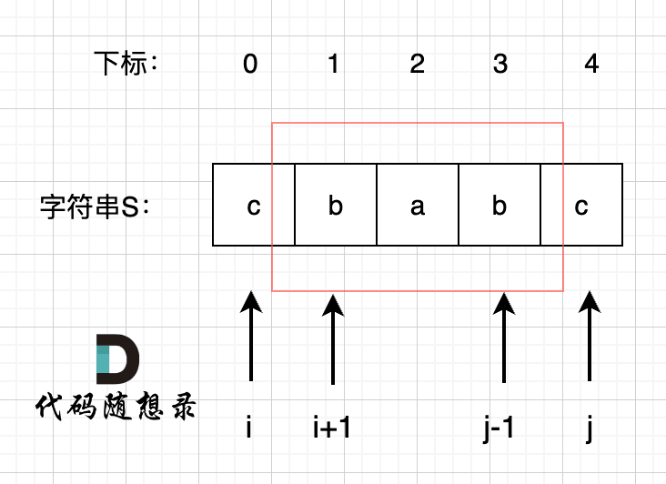
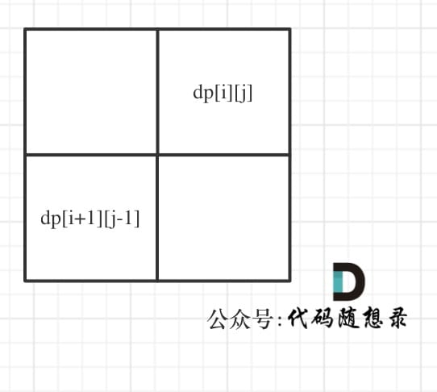
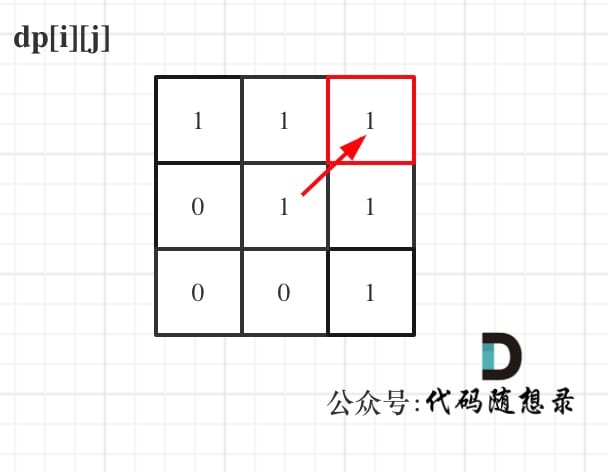

* [做專案（多個 C++、Java、Go、測試開發、前端（front end）專案）](https://www.programmercarl.com/other/kstar.html)
* [刷演算法（兩個月高強度學演算法）](https://www.programmercarl.com/xunlian/xunlianying.html)
* [背八股（40 天挑戰高頻面試題）](https://www.programmercarl.com/xunlian/bagu.html)

# 647. 回文（palindrome）子字串（substring）

[LeetCode 題目連結](https://leetcode.cn/problems/palindromic-substrings/)

給定一個字串（string），你的任務是計算這個字串中有多少個回文子字串。

具有不同開始位置或結束位置的子字串，即使是由相同的字元（character）組成，也會被視作不同的子字串。

範例 1：

* 輸入："abc"
* 輸出：3
* 解釋：三個回文子字串: "a", "b", "c"

範例 2：

* 輸入："aaa"
* 輸出：6
* 解釋：6 個回文子字串: "a", "a", "a", "aa", "aa", "aaa"

提示：輸入的字串長度不會超過 1000 。

## 演算法公開課

**[《程式碼隨想錄》演算法影片公開課](https://programmercarl.com/other/gongkaike.html)：[動態規劃（dynamic programming, DP），字串性質決定了 DP 陣列（array）的定義 | LeetCode：647.回文子字串](https://www.bilibili.com/video/BV17G4y1y7z9/)，相信結合影片再看本篇題解，更有助於大家對本題的理解**。

## 解題思路

### 蠻力法（brute force method）

兩層 for 迴圈（for-loop），遍歷（traversal）區間（interval）起始位置和終止位置，然後還需要一層遍歷判斷這個區間是不是回文。所以時間複雜度（time complexity）：O(n^3)

### 動態規劃

動態規劃（dynamic programming, DP）五部曲：

1. 確定 dp 陣列（dp table）以及下標（subscript）的含義

如果大家做了很多這種次序列（subsequence）相關的題目，在定義 dp 陣列的時候很自然就會想題目求什麼，我們就如何定義 dp 陣列。

絕大多數題目確實是這樣，不過本題如果我們定義，dp[i] 為下標 i 結尾的字串有 dp[i] 個回文串的話，我們會發現很難找到遞迴關係（recurrence relation）。 

dp[i] 和 dp[i-1]，dp[i + 1] 看上去都沒什麼關係。 

所以我們要看回文串的性質。如圖： 



我們在判斷字串 S 是否是回文，那麼如果我們知道 s[1]、s[2]、s[3] 這個子字串是回文的，那麼只需要比較 s[0] 和 s[4] 這兩個元素（element）是否相同，如果相同的話，這個字串 s 就是回文串。 


那麼此時我們是不是能找到一種遞迴關係，也就是判斷一個子字串（字串下標範圍 [i,j]）是否回文，依賴於子字串（下標範圍 [i + 1, j - 1]）是否是回文。 

所以為了明確這種遞迴關係，我們的 dp 陣列是要定義成一個二維（two-dimensional）dp 陣列。

布林（Boolean）類型的 dp[i][j]：表示區間範圍 [i,j]（注意是左閉右閉）的子字串是否是回文子字串，如果是 dp[i][j] 為 true，否則為 false。


2. 確定遞迴公式（recurrence formula）

在確定遞迴公式時，就要分析如下幾種情況。

整體上是兩種，就是 s[i] 與 s[j] 相等，s[i] 與 s[j] 不相等這兩種。

當 s[i] 與 s[j] 不相等，那沒什麼好說的了，dp[i][j] 一定是 false。

當 s[i] 與 s[j] 相等時，這就複雜一些了，有如下三種情況

* 情況一：下標 i 與 j 相同，同一個字元例如 a，當然是回文子字串
* 情況二：下標 i 與 j 相差為 1，例如 aa，也是回文子字串
* 情況三：下標 i 與 j 相差大於 1 的時候，例如 cabac，此時 s[i] 與 s[j] 已經相同了，我們看 i 到 j 區間是不是回文子字串就看 aba 是不是回文就可以了，那麼 aba 的區間就是 i+1 與 j-1 區間，這個區間是不是回文就看 dp[i + 1][j - 1] 是否為 true。

以上三種情況分析完了，那麼遞迴公式如下：

```CPP
if (s[i] == s[j]) {
    if (j - i <= 1) { // 情況一 和 情況二
        result++;
        dp[i][j] = true;
    } else if (dp[i + 1][j - 1]) { // 情況三
        result++;
        dp[i][j] = true;
    }
}
```

result 就是統計回文子字串的數量。

注意這裡我沒有列出當 s[i] 與 s[j] 不相等的時候，因為在下面 dp[i][j] 初始化（initialization）的時候，就初始為 false。

3. dp 陣列如何初始化

dp[i][j] 可以初始化為 true 嗎？當然不行，怎麼能剛開始就全都匹配上了。

所以 dp[i][j] 初始化為 false。

4. 確定遍歷順序

遍歷順序可就有點講究了。

首先從遞迴公式中可以看出，情況三是根據 dp[i + 1][j - 1] 是否為 true，再對 dp[i][j] 進行賦值 true 的。

dp[i + 1][j - 1] 在 dp[i][j] 的左下角，如圖：



如果這矩陣（matrix）是從上到下，從左到右遍歷，那麼會用到沒有計算過的 dp[i + 1][j - 1]，也就是根據不確定是不是回文的區間 [i+1,j-1]，來判斷了 [i,j] 是不是回文，那結果一定是不對的。

**所以一定要從下到上，從左到右遍歷，這樣保證 dp[i + 1][j - 1] 都是經過計算的**。

有的程式碼實作是優先遍歷行（column），然後遍歷列（row），其實也是一個道理，都是為了保證 dp[i + 1][j - 1] 都是經過計算的。

程式碼如下：

```CPP
for (int i = s.size() - 1; i >= 0; i--) {  // 注意遍歷順序
    for (int j = i; j < s.size(); j++) {
        if (s[i] == s[j]) {
            if (j - i <= 1) { // 情況一 和 情況二
                result++;
                dp[i][j] = true;
            } else if (dp[i + 1][j - 1]) { // 情況三
                result++;
                dp[i][j] = true;
            }
        }
    }
}
```

5. 舉例推導 dp 陣列

舉例，輸入："aaa"，dp[i][j] 狀態如下：



圖中有 6 個 true，所以就是有 6 個回文子字串。

**注意因為 dp[i][j] 的定義，所以 j 一定是大於等於 i 的，那麼在填充 dp[i][j] 的時候一定是只填充右上半部分**。

以上分析完畢，C++ 程式碼如下：

```CPP
class Solution {
public:
    int countSubstrings(string s) {
        vector<vector<bool>> dp(s.size(), vector<bool>(s.size(), false));
        int result = 0;
        for (int i = s.size() - 1; i >= 0; i--) {  // 注意遍歷順序
            for (int j = i; j < s.size(); j++) {
                if (s[i] == s[j]) {
                    if (j - i <= 1) { // 情況一 和 情況二
                        result++;
                        dp[i][j] = true;
                    } else if (dp[i + 1][j - 1]) { // 情況三
                        result++;
                        dp[i][j] = true;
                    }
                }
            }
        }
        return result;
    }
};
```
以上程式碼是為了凸顯情況一二三，當然是可以簡潔一下的，如下：

```CPP
class Solution {
public:
    int countSubstrings(string s) {
        vector<vector<bool>> dp(s.size(), vector<bool>(s.size(), false));
        int result = 0;
        for (int i = s.size() - 1; i >= 0; i--) {
            for (int j = i; j < s.size(); j++) {
                if (s[i] == s[j] && (j - i <= 1 || dp[i + 1][j - 1])) {
                    result++;
                    dp[i][j] = true;
                }
            }
        }
        return result;
    }
};
```

* 時間複雜度：O(n^2)
* 空間複雜度（space complexity）：O(n^2)

### 雙指標（two pointers） 法

DP的空間複雜度是偏高的，我們再看一下 雙指標 法。

首先確定回文串，就是找中心然後向兩邊擴散看是不是對稱的（symmetric）就可以了。

**在遍歷中心點的時候，要注意中心點有兩種情況**。

一個元素可以作為中心點，兩個元素也可以作為中心點。

那麼有同學問了，三個元素還可以做中心點呢。其實三個元素就可以由一個元素左右添加元素得到，四個元素則可以由兩個元素左右添加元素得到。

所以我們在計算的時候，要注意一個元素為中心點和兩個元素為中心點的情況。

**這兩種情況可以放在一起計算，但分別計算思路更清晰，我傾向於分別計算**，程式碼如下：

```CPP
class Solution {
public:
    int countSubstrings(string s) {
        int result = 0;
        for (int i = 0; i < s.size(); i++) {
            result += extend(s, i, i, s.size()); // 以 i 為中心
            result += extend(s, i, i + 1, s.size()); // 以 i 和 i+1 為中心
        }
        return result;
    }
    int extend(const string& s, int i, int j, int n) {
        int res = 0;
        while (i >= 0 && j < n && s[i] == s[j]) {
            i--;
            j++;
            res++;
        }
        return res;
    }
};
```

* 時間複雜度：O(n^2)
* 空間複雜度：O(1)

## 其他語言版本

### Java：

DP：

```java
class Solution {
    public int countSubstrings(String s) {
        char[] chars = s.toCharArray();
        int len = chars.length;
        boolean[][] dp = new boolean[len][len];
        int result = 0;
        for (int i = len - 1; i >= 0; i--) {
            for (int j = i; j < len; j++) {
                if (chars[i] == chars[j]) {
                    if (j - i <= 1) { // 情況一 和 情況二
                        result++;
                        dp[i][j] = true;
                    } else if (dp[i + 1][j - 1]) { //情況三
                        result++;
                        dp[i][j] = true;
                    }
                }
            }
        }
        return result;
    }
}

```

DP：簡潔版
```java
class Solution {
    public int countSubstrings(String s) {
        boolean[][] dp = new boolean[s.length()][s.length()];
        
        int res = 0;
        for (int i = s.length() - 1; i >= 0; i--) {
            for (int j = i; j < s.length(); j++) {
                if (s.charAt(i) == s.charAt(j) && (j - i <= 1 || dp[i + 1][j - 1])) {
                    res++;
                    dp[i][j] = true;
                }
            }
        }
        return res;
    }
}
```

中心擴散法：

```java
class Solution {
    public int countSubstrings(String s) {
        int len, ans = 0;
        if (s == null || (len = s.length()) < 1) return 0;
        //總共有 2 * len - 1 個中心點
        for (int i = 0; i < 2 * len - 1; i++) {
            //透過遍歷每個回文中心，向兩邊擴散，並判斷是否為回文字串
            //有兩種情況，left == right，right = left + 1，這兩種回文中心是不一樣的
            int left = i / 2, right = left + i % 2;
            while (left >= 0 && right < len && s.charAt(left) == s.charAt(right)) {
                //如果目前是一個回文串，則記錄數量
                ans++;
                left--;
                right++;
            }
        }
        return ans;
    }
}
```
LeetCode 5. Longest Palindromic Substring(LeetCode 647. 同一題的思路改一下、加一點，就能通過 LeetCode 5)
```java
class Solution {
    public String longestPalindrome(String s) {
        //題目要求要return 最長的回文連續子串，故需要記錄當前最長的連續回文子串長度、最終起點、最終終點。
        int finalStart = 0; 
        int finalEnd = 0;
        int finalLen = 0;

        char[] chars = s.toCharArray();
        int len = chars.length;

        boolean[][] dp = new boolean[len][len];
        for (int i = len - 1; i >= 0; i--) {
            for (int j = i; j < len; j++) {
                if (chars[i] == chars[j] && (j - i <= 1 || dp[i + 1][j - 1]))
                        dp[i][j] = true;
                //和LeetCode 647，差別就在這個if statement。
                //如果當前[i, j]範圍內的substring是回文子串(dp[i][j]) 且(&&) 長度大於當前要記錄的最終長度(j - i + 1 > finalLen)
                //我們就更新 當前最長的連續回文子串長度、最終起點、最終終點
                if (dp[i][j] && j - i + 1 > finalLen) {
                    finalLen = j - i + 1;
                    finalStart = i;
                    finalEnd = j;
                }
            }
        }
        //String.substring這個method的用法是[起點, 終點)，包含起點，不包含終點（左閉右開區間），故終點 + 1。
        return s.substring(finalStart, finalEnd + 1);
    }
}
```

### Python：

> DP：
```python
class Solution:
    def countSubstrings(self, s: str) -> int:
        dp = [[False] * len(s) for _ in range(len(s))]
        result = 0
        for i in range(len(s)-1, -1, -1): #注意遍歷順序
            for j in range(i, len(s)):
                if s[i] == s[j]:
                    if j - i <= 1: #情況一 和 情況二
                        result += 1
                        dp[i][j] = True
                    elif dp[i+1][j-1]: #情況三
                        result += 1
                        dp[i][j] = True
        return result
```

> DP：簡潔版
```python
class Solution:
    def countSubstrings(self, s: str) -> int:
        dp = [[False] * len(s) for _ in range(len(s))]
        result = 0
        for i in range(len(s)-1, -1, -1): #注意遍歷順序
            for j in range(i, len(s)):
                if s[i] == s[j] and (j - i <= 1 or dp[i+1][j-1]): 
                    result += 1
                    dp[i][j] = True
        return result
```

> 雙指標 法：
```python
class Solution:
    def countSubstrings(self, s: str) -> int:
        result = 0
        for i in range(len(s)):
            result += self.extend(s, i, i, len(s)) #以 i 為中心
            result += self.extend(s, i, i+1, len(s)) #以 i 和 i+1 為中心
        return result
    
    def extend(self, s, i, j, n):
        res = 0
        while i >= 0 and j < n and s[i] == s[j]:
            i -= 1
            j += 1
            res += 1
        return res
```

### Go：
> DP：

```Go
func countSubstrings(s string) int {
    res:=0
    dp:=make([][]bool,len(s))
    for i:=0;i<len(s);i++{
        dp[i]=make([]bool,len(s))
    }

    for i:=len(s)-1;i>=0;i--{
        for j:=i;j<len(s);j++{
            if s[i]==s[j]{
                if j-i<=1{
                    res++
                    dp[i][j]=true
                }else if dp[i+1][j-1]{
                    res++
                    dp[i][j]=true
                }
            }
        }
    }
    return res
}
```
> DP：簡潔版
```Go
func countSubstrings(s string) int {
	res := 0
	dp := make([][]bool, len(s))
	for i := 0; i < len(s); i++ {
		dp[i] = make([]bool, len(s))
	}

	for i := len(s) - 1; i >= 0; i-- {
		for j := i; j < len(s); j++ {
			if s[i] == s[j] && (j-i <= 1 || dp[i+1][j-1]) {
				res++
				dp[i][j] = true
			}
		}
	}
	return res
}
```

> 雙指標 法：
```Go
func countSubstrings(s string) int {
	extend := func(i, j int) int {
		res := 0
		for i >= 0 && j < len(s) && s[i] == s[j] {
			i --
			j ++
			res ++
		}
		return res
	}
	res := 0
	for i := 0; i < len(s); i++ {
		res += extend(i, i)  // 以 i 為中心
		res += extend(i, i+1) // 以 i 和 i+1 為中心
	}
	return res
}
```

### JavaScript：

> DP
```javascript
const countSubstrings = (s) => {
    const strLen = s.length;
    let numOfPalindromicStr = 0;
    let dp = Array.from(Array(strLen), () => Array(strLen).fill(false));

    for(let j = 0; j < strLen; j++) {
        for(let i = 0; i <= j; i++) {
            if(s[i] === s[j]) {
                if((j - i) < 2) {
                    dp[i][j] = true;
                } else {
                    dp[i][j] = dp[i+1][j-1];
                }
                numOfPalindromicStr += dp[i][j] ? 1 : 0;
            }
        }
    }

    return numOfPalindromicStr;
}
```

> 雙指標 法：
```javascript
const countSubstrings = (s) => {
    const strLen = s.length;
    let numOfPalindromicStr = 0;

    for(let i = 0; i < 2 * strLen - 1; i++) {
        let left = Math.floor(i/2);
        let right = left + i % 2;

        while(left >= 0 && right < strLen && s[left] === s[right]){
            numOfPalindromicStr++;
            left--;
            right++;
        }
    }

    return numOfPalindromicStr;
}
```

### TypeScript：

> DP：

```typescript
function countSubstrings(s: string): number {
    /**
        dp[i][j]: [i,j] 區間內的字串是否為回文(左閉右閉)
     */
    const length: number = s.length;
    const dp: boolean[][] = new Array(length).fill(0)
        .map(_ => new Array(length).fill(false));
    let resCount: number = 0;
    // 由下而上，由左向右遍歷
    for (let i = length - 1; i >= 0; i--) {
        for (let j = i; j < length; j++) {
            if (
                s[i] === s[j] &&
                (j - i <= 1 || dp[i + 1][j - 1] === true)
            ) {
                dp[i][j] = true;
                resCount++;
            }
        }
    }
    return resCount;
};
```

> 雙指標 法：

```typescript
function countSubstrings(s: string): number {
    const length: number = s.length;
    let resCount: number = 0;
    for (let i = 0; i < length; i++) {
        resCount += expandRange(s, i, i);
        resCount += expandRange(s, i, i + 1);
    }
    return resCount;
};
function expandRange(s: string, left: number, right: number): number {
    let palindromeNum: number = 0;
    while (
        left >= 0 && right < s.length &&
        s[left] === s[right]
    ) {
        palindromeNum++;
        left--;
        right++;
    }
    return palindromeNum;
}
```

Rust：

```rust
impl Solution {
    pub fn count_substrings(s: String) -> i32 {
        let mut dp = vec![vec![false; s.len()]; s.len()];
        let mut res = 0;

        for i in (0..s.len()).rev() {
            for j in i..s.len() {
                if s[i..=i] == s[j..=j] && (j - i <= 1 || dp[i + 1][j - 1]) {
                    dp[i][j] = true;
                    res += 1;
                }
            }
        }
        res
    }
}
```

> 雙指標

```rust
impl Solution {
    pub fn count_substrings(s: String) -> i32 {
        let mut res = 0;
        for i in 0..s.len() {
            res += Self::extend(&s, i, i, s.len());
            res += Self::extend(&s, i, i + 1, s.len());
        }
        res
    }

    fn extend(s: &str, mut i: usize, mut j: usize, len: usize) -> i32 {
        let mut res = 0;
        while i < len && j < len && s[i..=i] == s[j..=j] {
            res += 1;
            i = i.wrapping_sub(1);
            j += 1;
        }
        res
    }
}
```

