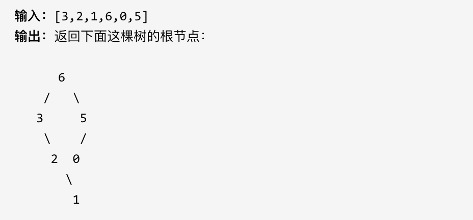
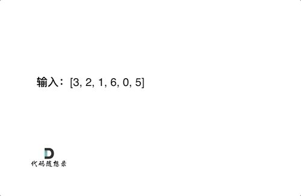

* [做專案（多個 C++、Java、Go、測試開發、前端（front end）專案）](https://www.programmercarl.com/other/kstar.html)
* [刷演算法（algorithm）（兩個月高強度學演算法）](https://www.programmercarl.com/xunlian/xunlianying.html)
* [背八股（40 天挑戰高頻面試題）](https://www.programmercarl.com/xunlian/bagu.html)


# 654.最大二元樹（binary tree）

[LeetCode 題目網址](https://leetcode.cn/problems/maximum-binary-tree/)

給定一個不含重複元素（element）的整數（integer）陣列（array）。一個以此陣列建構的最大二元樹定義如下：

* 二元樹的根是陣列中的最大元素。
* 左子樹（left subtree）是透過陣列中最大值左邊部分建構出的最大二元樹。
* 右子樹（right subtree）是透過陣列中最大值右邊部分建構出的最大二元樹。

透過給定的陣列建構最大二元樹，並且輸出這個樹（tree）的根節點（root node）。

範例 ：



提示：

給定的陣列的大小在 [1, 1000] 之間。

## 演算法公開課

**[《程式碼隨想錄》演算法影片公開課](https://programmercarl.com/other/gongkaike.html)：[又是構造二元樹，又有很多陷阱！| LeetCode：654.最大二元樹](https://www.bilibili.com/video/BV1MG411G7ox)，相信結合影片再看本篇題解，更有助於大家對本題的理解**。


## 解題思路

最大二元樹的建構過程如下：



建構樹一般採用的是前序遍歷（preorder traversal），因為先建構中間節點（node），然後遞迴（recursion）建構左子樹和右子樹。

* 確定遞迴函數（recursive function）的參數（parameter）和轉回值（return value）

參數傳入的是存放元素的陣列，回傳該陣列建構的二元樹的頭節點（head node），傳回類型（return type）是指向節點的指標（pointer）。

程式碼如下：

```CPP
TreeNode* constructMaximumBinaryTree(vector<int>& nums)

```
* 確定終止條件（termination condition）

題目中說了輸入的陣列大小一定是大於等於 1 的，所以我們不用考慮小於 1 的情況，那麼當遞迴遍歷（traversal）的時候，如果傳入的陣列大小為 1，說明遍歷到了葉節點（leaf node）了。

那麼應該定義一個新的節點，並把這個陣列的數值賦給新的節點，然後回傳這個節點。這表示一個陣列大小是 1 的時候，建構了一個新的節點，並回傳。

程式碼如下：

```CPP
TreeNode* node = new TreeNode(0);
if (nums.size() == 1) {
    node->val = nums[0];
    return node;
}
```

* 確定單層遞迴的邏輯

這裡有三步工作

1. 先要找到陣列中最大的值和對應的下標（subscript），最大的值建構根節點，下標用來下一步分割陣列。

程式碼如下：
```CPP
int maxValue = 0;
int maxValueIndex = 0;
for (int i = 0; i < nums.size(); i++) {
    if (nums[i] > maxValue) {
        maxValue = nums[i];
        maxValueIndex = i;
    }
}
TreeNode* node = new TreeNode(0);
node->val = maxValue;
```

2. 最大值所在的下標左區間（interval）建構左子樹

這裡要判斷 maxValueIndex > 0，因為要保證左區間至少有一個數值。

程式碼如下：
```CPP
if (maxValueIndex > 0) {
    vector<int> newVec(nums.begin(), nums.begin() + maxValueIndex);
    node->left = constructMaximumBinaryTree(newVec);
}
```

3. 最大值所在的下標右區間建構右子樹

判斷 maxValueIndex < (nums.size() - 1)，確保右區間至少有一個數值。

程式碼如下：
```CPP
if (maxValueIndex < (nums.size() - 1)) {
    vector<int> newVec(nums.begin() + maxValueIndex + 1, nums.end());
    node->right = constructMaximumBinaryTree(newVec);
}
```
這樣我們就分析完了，整體程式碼如下：（詳細註解）

```CPP
class Solution {
public:
    TreeNode* constructMaximumBinaryTree(vector<int>& nums) {
        TreeNode* node = new TreeNode(0);
        if (nums.size() == 1) {
            node->val = nums[0];
            return node;
        }
        // 找到陣列中最大的值和對應的下標
        int maxValue = 0;
        int maxValueIndex = 0;
        for (int i = 0; i < nums.size(); i++) {
            if (nums[i] > maxValue) {
                maxValue = nums[i];
                maxValueIndex = i;
            }
        }
        node->val = maxValue;
        // 最大值所在的下標左區間 建構左子樹
        if (maxValueIndex > 0) {
            vector<int> newVec(nums.begin(), nums.begin() + maxValueIndex);
            node->left = constructMaximumBinaryTree(newVec);
        }
        // 最大值所在的下標右區間 建構右子樹
        if (maxValueIndex < (nums.size() - 1)) {
            vector<int> newVec(nums.begin() + maxValueIndex + 1, nums.end());
            node->right = constructMaximumBinaryTree(newVec);
        }
        return node;
    }
};
```

以上程式碼比較冗餘，效率也不高，每次切割的時候都要定義新的 vector（也就是陣列），但邏輯比較清晰。

和文章[二元樹：構造二元樹登場！](https://programmercarl.com/0106.从中序与后序遍历序列构造二叉树.html)中一樣的最佳化（optimization）思路，就是每次分隔不用定義新的陣列，而是透過下標索引（index）直接在原陣列上操作。

最佳化後程式碼如下：

```CPP
class Solution {
private:
    // 在左閉右開區間 [left, right)，建構二元樹
    TreeNode* traversal(vector<int>& nums, int left, int right) {
        if (left >= right) return nullptr;

        // 分割點下標：maxValueIndex
        int maxValueIndex = left;
        for (int i = left + 1; i < right; ++i) {
            if (nums[i] > nums[maxValueIndex]) maxValueIndex = i;
        }

        TreeNode* root = new TreeNode(nums[maxValueIndex]);

        // 左閉右開：[left, maxValueIndex)
        root->left = traversal(nums, left, maxValueIndex);

        // 左閉右開：[maxValueIndex + 1, right)
        root->right = traversal(nums, maxValueIndex + 1, right);

        return root;
    }
public:
    TreeNode* constructMaximumBinaryTree(vector<int>& nums) {
        return traversal(nums, 0, nums.size());
    }
};
```

## 拓展

可以發現上面的程式碼看上去簡潔一些，**主要是因為第二版其實是允許空節點進入遞迴，所以不用在遞迴的時候加判斷節點是否為空**

第一版遞迴過程：（加了 if 判斷，為了不讓空節點進入遞迴）
```CPP

if (maxValueIndex > 0) { // 這裡加了判斷是為了不讓空節點進入遞迴
    vector<int> newVec(nums.begin(), nums.begin() + maxValueIndex);
    node->left = constructMaximumBinaryTree(newVec);
}

if (maxValueIndex < (nums.size() - 1)) { // 這裡加了判斷是為了不讓空節點進入遞迴
    vector<int> newVec(nums.begin() + maxValueIndex + 1, nums.end());
    node->right = constructMaximumBinaryTree(newVec);
}
```

第二版遞迴過程：（如下程式碼就沒有加 if 判斷）

```
root->left = traversal(nums, left, maxValueIndex);

root->right = traversal(nums, maxValueIndex + 1, right);
```

第二版程式碼是允許空節點進入遞迴，所以沒有加 if 判斷，當然終止條件也要有相應的改變。

第一版終止條件，是遇到葉節點就終止，因為空節點不會進入遞迴。

第二版相應的終止條件，是遇到空節點，也就是陣列區間為 0，就終止了。

## 總結


這道題目其實和 [二元樹：構造二元樹登場！](https://programmercarl.com/0106.从中序与后序遍历序列构造二叉树.html) 是一個思路，比[二元樹：構造二元樹登場！](https://programmercarl.com/0106.从中序与后序遍历序列构造二叉树.html) 還簡單一些。

**注意類似用陣列建構二元樹的題目，每次分隔盡量不要定義新的陣列，而是透過下標索引直接在原陣列上操作，這樣可以節約時間和空間上的開銷。**

一些同學也會疑惑，什麼時候遞迴函數前面加 if，什麼時候不加 if，這個問題我在最後也給出了解釋。

其實就是不同程式碼風格的實作，**一般情況來說：如果讓空節點（空指標（null pointer））進入遞迴，就不加 if，如果不讓空節點進入遞迴，就加 if 限制一下，終止條件也會相應的調整。**

## 其他語言版本


### Java

```Java
class Solution {
    public TreeNode constructMaximumBinaryTree(int[] nums) {
        return constructMaximumBinaryTree1(nums, 0, nums.length);
    }

    public TreeNode constructMaximumBinaryTree1(int[] nums, int leftIndex, int rightIndex) {
        if (rightIndex - leftIndex < 1) {// 沒有元素了
            return null;
        }
        if (rightIndex - leftIndex == 1) {// 只有一個元素
            return new TreeNode(nums[leftIndex]);
        }
        int maxIndex = leftIndex;// 最大值所在位置
        int maxVal = nums[maxIndex];// 最大值
        for (int i = leftIndex + 1; i < rightIndex; i++) {
            if (nums[i] > maxVal){
                maxVal = nums[i];
                maxIndex = i;
            }
        }
        TreeNode root = new TreeNode(maxVal);
        // 根據 maxIndex 劃分左右子樹
        root.left = constructMaximumBinaryTree1(nums, leftIndex, maxIndex);
        root.right = constructMaximumBinaryTree1(nums, maxIndex + 1, rightIndex);
        return root;
    }
}
```

### Python 
(版本一) 基礎版
```python
# Definition for a binary tree node.
# class TreeNode:
#     def __init__(self, val=0, left=None, right=None):
#         self.val = val
#         self.left = left
#         self.right = right
class Solution:
    def constructMaximumBinaryTree(self, nums: List[int]) -> TreeNode:
        if len(nums) == 1:
            return TreeNode(nums[0])
        node = TreeNode(0)
        # 找到陣列中最大的值和對應的下標
        maxValue = 0
        maxValueIndex = 0
        for i in range(len(nums)):
            if nums[i] > maxValue:
                maxValue = nums[i]
                maxValueIndex = i
        node.val = maxValue
        # 最大值所在的下標左區間 建構左子樹
        if maxValueIndex > 0:
            new_list = nums[:maxValueIndex]
            node.left = self.constructMaximumBinaryTree(new_list)
        # 最大值所在的下標右區間 建構右子樹
        if maxValueIndex < len(nums) - 1:
            new_list = nums[maxValueIndex+1:]
            node.right = self.constructMaximumBinaryTree(new_list)
        return node
        
```
(版本二) 使用下標 
```python

class Solution:
    def traversal(self, nums: List[int], left: int, right: int) -> TreeNode:
        if left >= right:
            return None
        maxValueIndex = left
        for i in range(left + 1, right):
            if nums[i] > nums[maxValueIndex]:
                maxValueIndex = i
        root = TreeNode(nums[maxValueIndex])
        root.left = self.traversal(nums, left, maxValueIndex)
        root.right = self.traversal(nums, maxValueIndex + 1, right)
        return root

    def constructMaximumBinaryTree(self, nums: List[int]) -> TreeNode:
        return self.traversal(nums, 0, len(nums))

```

(版本三) 使用切片（slicing）

```python

class Solution:
    def constructMaximumBinaryTree(self, nums: List[int]) -> TreeNode:
        if not nums:
            return None
        max_val = max(nums)
        max_index = nums.index(max_val)
        node = TreeNode(max_val)
        node.left = self.constructMaximumBinaryTree(nums[:max_index])
        node.right = self.constructMaximumBinaryTree(nums[max_index+1:])
        return node
        
```
### Go


```go
func constructMaximumBinaryTree(nums []int) *TreeNode {
    if len(nums) == 0 {
        return nil 
    }
    // 找到最大值
    index := findMax(nums)
    // 建構二元樹
    root := &TreeNode {
        Val: nums[index],
        Left: constructMaximumBinaryTree(nums[:index]),   //左半邊
        Right: constructMaximumBinaryTree(nums[index+1:]),//右半邊
        }
    return root
}
func findMax(nums []int) (index int) {
    for i, v := range nums {
        if nums[index] < v {
            index = i
        }
    }
    return 
}
```

### JavaScript 

```javascript
/**
 * Definition for a binary tree node.
 * function TreeNode(val, left, right) {
 *     this.val = (val===undefined ? 0 : val)
 *     this.left = (left===undefined ? null : left)
 *     this.right = (right===undefined ? null : right)
 * }
 */
/**
 * @param {number[]} nums
 * @return {TreeNode}
 */
var constructMaximumBinaryTree = function (nums) {
    const BuildTree = (arr, left, right) => {
        if (left > right)
            return null;
        let maxValue = -1;
        let maxIndex = -1;
        for (let i = left; i <= right; ++i) {
            if (arr[i] > maxValue) {
                maxValue = arr[i];
                maxIndex = i;
            }
        }
        let root = new TreeNode(maxValue);
        root.left = BuildTree(arr, left, maxIndex - 1);
        root.right = BuildTree(arr, maxIndex + 1, right);
        return root;
    }
    let root = BuildTree(nums, 0, nums.length - 1);
    return root;
};
```

### TypeScript

> 新建陣列法：

```typescript
function constructMaximumBinaryTree(nums: number[]): TreeNode | null {
    if (nums.length === 0) return null;
    let maxIndex: number = 0;
    let maxVal: number = nums[0];
    for (let i = 1, length = nums.length; i < length; i++) {
        if (nums[i] > maxVal) {
            maxIndex = i;
            maxVal = nums[i];
        }
    }
    const rootNode: TreeNode = new TreeNode(maxVal);
    rootNode.left = constructMaximumBinaryTree(nums.slice(0, maxIndex));
    rootNode.right = constructMaximumBinaryTree(nums.slice(maxIndex + 1));
    return rootNode;
};
```

> 使用陣列索引法：

```typescript
function constructMaximumBinaryTree(nums: number[]): TreeNode | null {
    // 左閉右開區間 [begin, end)
    function recur(nums: number[], begin: number, end: number): TreeNode | null {
        if (begin === end) return null;
        let maxIndex: number = begin;
        let maxVal: number = nums[begin];
        for (let i = begin + 1; i < end; i++) {
            if (nums[i] > maxVal) {
                maxIndex = i;
                maxVal = nums[i];
            }
        }
        const rootNode: TreeNode = new TreeNode(maxVal);
        rootNode.left = recur(nums, begin, maxIndex);
        rootNode.right = recur(nums, maxIndex + 1, end);
        return rootNode;
    }
    return recur(nums, 0, nums.length);
};
```


### C

```c
struct TreeNode* traversal(int* nums, int left, int right) {
    //若左邊界大於右邊界，回傳 NULL
    if(left >= right)
        return NULL;
    
    //找出陣列中最大數坐標
    int maxIndex = left;
    int i;
    for(i = left + 1; i < right; i++) {
        if(nums[i] > nums[maxIndex])
            maxIndex = i;
    }
    
    //開闢節點
    struct TreeNode* node = (struct TreeNode*)malloc(sizeof(struct TreeNode));
    //將節點的值設為陣列最大元素
    node->val = nums[maxIndex];
    //遞迴定義左子節點和右子節點
    node->left = traversal(nums, left, maxIndex);
    node->right = traversal(nums, maxIndex + 1, right);
    return node;
}

struct TreeNode* constructMaximumBinaryTree(int* nums, int numsSize){
    return traversal(nums, 0, numsSize);
}
```

### Swift
```swift
func constructMaximumBinaryTree(_ nums: inout [Int]) -> TreeNode? {
    return traversal(&nums, 0, nums.count)
}

func traversal(_ nums: inout [Int], _ left: Int, _ right: Int) -> TreeNode? {
    if left >= right {
        return nil
    }
    
    var maxValueIndex = left
    for i in (left + 1)..<right {
        if nums[i] > nums[maxValueIndex] {
            maxValueIndex = i
        }
    }
    
    let root = TreeNode(nums[maxValueIndex])
    
    root.left = traversal(&nums, left, maxValueIndex)
    root.right = traversal(&nums, maxValueIndex + 1, right)
    return root
}
```

### Scala

```scala
object Solution {
  def constructMaximumBinaryTree(nums: Array[Int]): TreeNode = {
    if (nums.size == 0) return null
    // 找到陣列最大值
    var maxIndex = 0
    var maxValue = Int.MinValue
    for (i <- nums.indices) {
      if (nums(i) > maxValue) {
        maxIndex = i
        maxValue = nums(i)
      }
    }

    // 建構一棵樹
    var root = new TreeNode(maxValue, null, null)

    // 遞迴尋找左右子樹
    root.left = constructMaximumBinaryTree(nums.slice(0, maxIndex))
    root.right = constructMaximumBinaryTree(nums.slice(maxIndex + 1, nums.length))

    root // 回傳 root
  }
}
```

### Rust

新建陣列：

```rust
use std::cell::RefCell;
use std::rc::Rc;
impl Solution{
    pub fn construct_maximum_binary_tree(mut nums: Vec<i32>) -> Option<Rc<RefCell<TreeNode>>> {
        if nums.is_empty() {
            return None;
        }
        let mut max_value_index = 0;
        for i in 0..nums.len() {
            if nums[max_value_index] < nums[i] {
                max_value_index = i;
            }
        }
        let right = Self::construct_maximum_binary_tree(nums.split_off(max_value_index + 1));
        let root = nums.pop().unwrap();
        let left = Self::construct_maximum_binary_tree(nums);
        Some(Rc::new(RefCell::new(TreeNode {
            val: root,
            left,
            right,
        })))
    }
}
```

陣列索引：
```rust
use std::cell::RefCell;
use std::rc::Rc;
impl Solution {
    pub fn construct_maximum_binary_tree(nums: Vec<i32>) -> Option<Rc<RefCell<TreeNode>>> {
        Self::traversal(&nums, 0, nums.len())
    }

    pub fn traversal(nums: &Vec<i32>, left: usize, right: usize) -> Option<Rc<RefCell<TreeNode>>> {
        if left >= right {
            return None;
        }
        let mut max_value_index = left;
        for i in left + 1..right {
            if nums[max_value_index] < nums[i] {
                max_value_index = i;
            }
        }
        let mut root = TreeNode::new(nums[max_value_index]);
        root.left = Self::traversal(nums, left, max_value_index);
        root.right = Self::traversal(nums, max_value_index + 1, right);
        Some(Rc::new(RefCell::new(root)))
    }
}
```
### C#
```csharp
public TreeNode ConstructMaximumBinaryTree(int[] nums)
{
    if (nums.Length == 0) return null;
    int rootValue = nums.Max();
    TreeNode root = new TreeNode(rootValue);
    int rootIndex = Array.IndexOf(nums, rootValue);

    root.left = ConstructMaximumBinaryTree(nums.Take(rootIndex).ToArray());
    root.right = ConstructMaximumBinaryTree(nums.Skip(rootIndex + 1).ToArray());
    return root;

}
```


