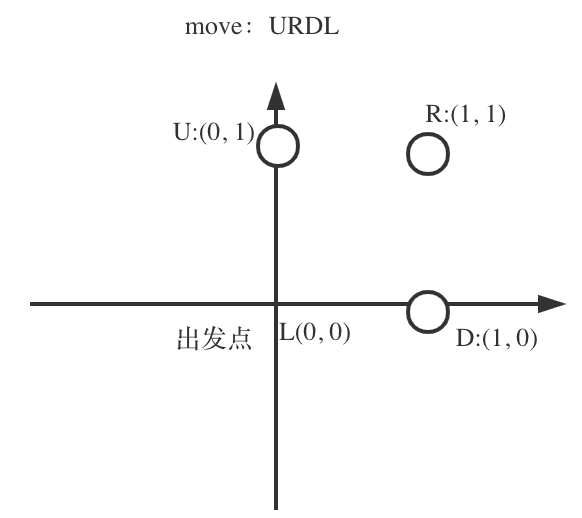

* [做專案（多個 C++、Java、Go、測試開發、前端（front end）專案）](https://www.programmercarl.com/other/kstar.html)
* [刷演算法（兩個月高強度學演算法）](https://www.programmercarl.com/xunlian/xunlianying.html)
* [背八股（40 天挑戰高頻面試題）](https://www.programmercarl.com/xunlian/bagu.html)


# 657. 機器人能否返回原點

[LeetCode 題目連結](https://leetcode.cn/problems/robot-return-to-origin/)

在二維（two-dimensional）平面上，有一個機器人從原點 (0, 0) 開始。給出它的移動順序，判斷這個機器人在完成移動後是否在 (0, 0) 處結束。

移動順序由字串（string）表示。字元（character） move[i] 表示其第 i 次移動。機器人的有效動作有 R（右），L（左），U（上）和 D（下）。如果機器人在完成所有動作後返回原點，則回傳 true。否則，回傳 false。

注意：機器人「面朝」的方向無關緊要。「R」將始終使機器人向右移動一次，「L」將始終向左移動等。此外，假設每次移動機器人的移動幅度相同。

 

範例 1:
* 輸入: "UD"
* 輸出: true
* 解釋：機器人向上移動一次，然後向下移動一次。所有動作都具有相同的幅度，因此它最終回到它開始的原點。因此，我們回傳 true。

範例 2:
* 輸入: "LL"
* 輸出: false
* 解釋：機器人向左移動兩次。它最終位於原點的左側，距原點有兩次「移動」的距離。我們回傳 false，因為它在移動結束時沒有返回原點。


## 解題思路

這道題目還是挺簡單的，大家不要想複雜了，一波雜湊（hash）法又一波圖論（graph theory）演算法之類的。

其實就是，x，y 坐標（coordinate），初始為 0，然後：
* if (moves[i] == 'U') y++;
* if (moves[i] == 'D') y--;
* if (moves[i] == 'L') x--;
* if (moves[i] == 'R') x++;

最後判斷一下 x，y 是否回到了 (0, 0) 位置就可以了。

如圖所示：
 </img></div>

C++ 程式碼如下：

```CPP
class Solution {
public:
    bool judgeCircle(string moves) {
        int x = 0, y = 0;
        for (int i = 0; i < moves.size(); i++) {
            if (moves[i] == 'U') y++;
            if (moves[i] == 'D') y--;
            if (moves[i] == 'L') x--;
            if (moves[i] == 'R') x++;
        }
        if (x == 0 && y == 0) return true;
        return false;
    }
};
```


## 其他語言版本

### Java

```java
// 時間複雜度：O(n)
// 空間複雜度：如果採用 toCharArray，則是 O(n)；如果使用 charAt，則是 O(1)
class Solution {
    public boolean judgeCircle(String moves) {
        int x = 0;
        int y = 0;
        for (char c : moves.toCharArray()) {
            if (c == 'U') y++;
            if (c == 'D') y--;
            if (c == 'L') x++;
            if (c == 'R') x--;
        }
        return x == 0 && y == 0;
    }
}
```

### Python

```python
# 時間複雜度：O(n)
# 空間複雜度：O(1)
class Solution:
    def judgeCircle(self, moves: str) -> bool:
        x = 0 # 記錄當前位置
        y = 0
        for i in range(len(moves)):
            if (moves[i] == 'U'):
                y += 1
            if (moves[i] == 'D'):
                y -= 1
            if (moves[i] == 'L'):
                x += 1
            if (moves[i] == 'R'):
                x -= 1
        return x == 0 and y == 0
```

### Go

```go
func judgeCircle(moves string) bool {
    x := 0
    y := 0
    for i := 0; i < len(moves); i++ {
        if moves[i] == 'U' {
            y++
        }
        if moves[i] == 'D' {
            y--
        }
        if moves[i] == 'L' {
            x++
        }
        if moves[i] == 'R' {
            x--
        }
    }
    return x == 0 && y == 0;
}
```

### JavaScript

```js
// 時間複雜度：O(n)
// 空間複雜度：O(1)
var judgeCircle = function(moves) {
    var x = 0; // 記錄當前位置
    var y = 0;
    for (var i = 0; i < moves.length; i++) {
        if (moves[i] == 'U') y++;
        if (moves[i] == 'D') y--;
        if (moves[i] == 'L') x++;
        if (moves[i] == 'R') x--;
    }
    return x == 0 && y == 0;
};
```


### TypeScript

```ts
var judgeCircle = function (moves) {
  let x = 0
  let y = 0
  for (let i = 0; i < moves.length; i++) {
    switch (moves[i]) {
      case 'L': {
        x--
        break
      }
      case 'R': {
        x++
        break
      }
      case 'U': {
        y--
        break
      }
      case 'D': {
        y++
        break
      }
    }
  }
  return x === 0 && y === 0
};
```


