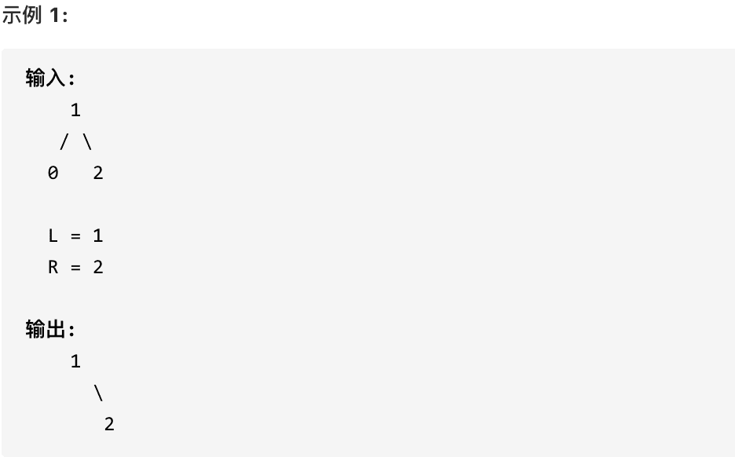
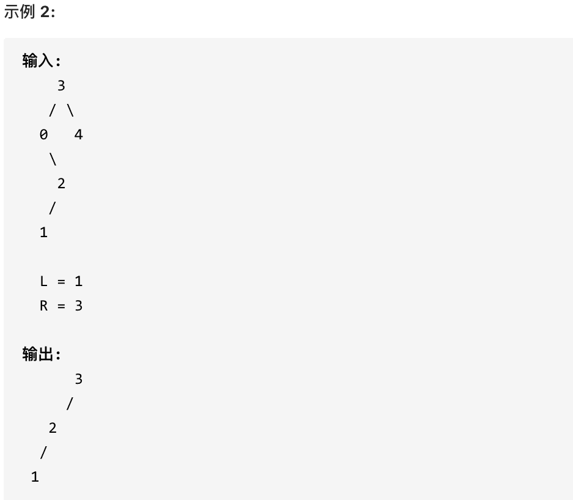
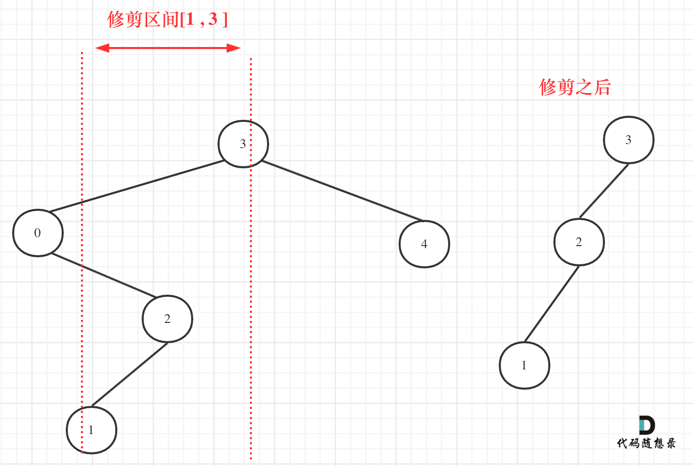
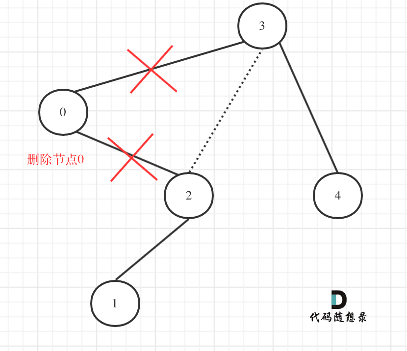

* [做專案（多個 C++、Java、Go、測試開發、前端（front end）專案）](https://www.programmercarl.com/other/kstar.html)
* [刷演算法（兩個月高強度學演算法）](https://www.programmercarl.com/xunlian/xunlianying.html)
* [背八股（40 天挑戰高頻面試題）](https://www.programmercarl.com/xunlian/bagu.html)


> 如果不對遞迴（recursion）有深刻的理解，本題有點難
> 單純移除一個節點（node）那還不夠，要修剪！

# 669. 修剪二元搜尋樹（binary search tree, BST）

[LeetCode 題目連結](https://leetcode.cn/problems/trim-a-binary-search-tree/)

給定一個二元搜尋樹（binary search tree, BST），同時給定最小邊界（boundary） L 和最大邊界 R。透過修剪BST，使得所有節點的值在 [L, R] 中 (R>=L)。你可能需要改變樹的根節點（root node），所以結果應當回傳修剪好的BST的新的根節點。





## 演算法公開課

**[《程式碼隨想錄》演算法影片公開課](https://programmercarl.com/other/gongkaike.html)：[你修剪的方式不對，我來給你糾正一下！| LeetCode：669. 修剪二元搜尋樹](https://www.bilibili.com/video/BV17P41177ud?share_source=copy_web)，相信結合影片再看本篇題解，更有助於大家對本題的理解**。

## 解題思路

相信看到這道題目大家都感覺是一道簡單題（事實上 LeetCode 上也標明是簡單）。

但還真的不簡單！

### 遞迴法

直接想法就是：遞迴處理，然後遇到 `root->val < low || root->val > high` 的時候直接 return NULL，一波修改，乾淨俐落。

不難寫出如下程式碼：

```CPP
class Solution {
public:
    TreeNode* trimBST(TreeNode* root, int low, int high) {
        if (root == nullptr || root->val < low || root->val > high) return nullptr;
        root->left = trimBST(root->left, low, high);
        root->right = trimBST(root->right, low, high);
        return root;
    }
};
```

**然而 [1, 3] 區間（interval）在BST中可不是單純的節點 3 和左子節點（child node） 0 就決定的，還要考慮節點 0 的右子樹（right subtree）**。

我們再重新關注一下第二個範例，如圖：



**所以以上的程式碼是不可行的！**

從圖中可以看出需要重構二元樹（binary tree），想想是不是本題就有點複雜了。

其實不用重構那麼複雜。

在上圖中我們發現節點 0 並不符合區間要求，那麼將節點 0 的右子節點 節點 2 直接賦給 節點 3 的左子節點就可以了（就是把節點 0 從二元樹中移除），如圖：




理解了最關鍵部分了我們再遞迴三部曲：

* 確定遞迴函數（recursive function）的參數（parameter）以及轉回值（return value）

這裡我們為什麼需要轉回值呢？

因為是要遍歷（traversal）整棵樹，做修改，其實不需要轉回值也可以，我們也可以完成修剪（其實就是從二元樹中移除節點）的操作。

但是有轉回值，更方便，可以透過遞迴函數的轉回值來移除節點。

這樣的做法在[二元樹：搜尋樹中的插入操作](https://programmercarl.com/0701.二叉搜索树中的插入操作.html)和[二元樹：搜尋樹中的刪除操作](https://programmercarl.com/0450.删除二叉搜索树中的节点.html)中大家已經了解過了。

程式碼如下：

```cpp
TreeNode* trimBST(TreeNode* root, int low, int high)
```

* 確定終止條件（termination condition）

修剪的操作並不是在終止條件上進行的，所以就是遇到空節點回傳就可以了。

```cpp
if (root == nullptr ) return nullptr;
```

* 確定單層遞迴的邏輯

如果 root（當前節點）的元素（element）小於 low 的數值，那麼應該遞迴右子樹，並回傳右子樹符合條件的頭節點（head node）。

程式碼如下：

```cpp
if (root->val < low) {
    TreeNode* right = trimBST(root->right, low, high); // 尋找符合區間 [low, high] 的節點
    return right;
}
```

如果 root（當前節點）的元素大於 high 的，那麼應該遞迴左子樹（left subtree），並回傳左子樹符合條件的頭節點。

程式碼如下：

```cpp
if (root->val > high) {
    TreeNode* left = trimBST(root->left, low, high); // 尋找符合區間 [low, high] 的節點
    return left;
}
```

接下來要將下一層處理完左子樹的結果賦給 root->left，處理完右子樹的結果賦給 root->right。

最後回傳 root 節點，程式碼如下：

```cpp
root->left = trimBST(root->left, low, high); // root->left 串接符合條件的左子節點
root->right = trimBST(root->right, low, high); // root->right 串接符合條件的右子節點
return root;
```

此時大家是不是還沒發現這多餘的節點究竟是如何從二元樹中移除的呢？

再回顧一下上面的程式碼，針對下圖中二元樹的情況：


如下程式碼相當於把節點 0 的右子節點（節點 2）回傳給上一層，

```cpp
if (root->val < low) {
    TreeNode* right = trimBST(root->right, low, high); // 尋找符合區間 [low, high] 的節點
    return right;
}
```

然後如下程式碼相當於用節點 3 的左子節點把下一層回傳的 節點 0 的右子節點（節點 2）接住。

``` cpp
root->left = trimBST(root->left, low, high);
```

此時節點 3 的左子節點就變成了節點 2，將節點 0 從二元樹中移除了。

最後整體程式碼如下：

```CPP
class Solution {
public:
    TreeNode* trimBST(TreeNode* root, int low, int high) {
        if (root == nullptr ) return nullptr;
        if (root->val < low) {
            TreeNode* right = trimBST(root->right, low, high); // 尋找符合區間 [low, high] 的節點
            return right;
        }
        if (root->val > high) {
            TreeNode* left = trimBST(root->left, low, high); // 尋找符合區間 [low, high] 的節點
            return left;
        }
        root->left = trimBST(root->left, low, high); // root->left 串接符合條件的左子節點
        root->right = trimBST(root->right, low, high); // root->right 串接符合條件的右子節點
        return root;
    }
};
```

精簡之後程式碼如下：

```CPP
class Solution {
public:
    TreeNode* trimBST(TreeNode* root, int low, int high) {
        if (root == nullptr) return nullptr;
        if (root->val < low) return trimBST(root->right, low, high);
        if (root->val > high) return trimBST(root->left, low, high);
        root->left = trimBST(root->left, low, high);
        root->right = trimBST(root->right, low, high);
        return root;
    }
};
```

只看程式碼，其實不太好理解節點是如何移除的，這一塊大家可以自己再模擬（simulation）模擬！

### 疊代（iteration）法

因為BST的有序性，不需要使用堆疊（stack）模擬遞迴的過程。

在修剪法（pruning）的時候，可以分為三步：

* 將 root 移動到 [L, R] 範圍內，注意是左閉右閉區間
* 修剪左子樹
* 修剪右子樹

程式碼如下：

```CPP
class Solution {
public:
    TreeNode* trimBST(TreeNode* root, int L, int R) {
        if (!root) return nullptr;

        // 處理頭節點，讓 root 移動到 [L, R] 範圍內，注意是左閉右閉
        while (root != nullptr && (root->val < L || root->val > R)) {
            if (root->val < L) root = root->right; // 小於 L 往右走
            else root = root->left; // 大於 R 往左走
        }
        TreeNode *cur = root;
        // 此時 root 已經在 [L, R] 範圍內，處理左子節點元素小於 L 的情況
        while (cur != nullptr) {
            while (cur->left && cur->left->val < L) {
                cur->left = cur->left->right;
            }
            cur = cur->left;
        }
        cur = root;

        // 此時 root 已經在 [L, R] 範圍內，處理右子節點大於 R 的情況
        while (cur != nullptr) {
            while (cur->right && cur->right->val > R) {
                cur->right = cur->right->left;
            }
            cur = cur->right;
        }
        return root;
    }
};
```

## 總結

修剪BST其實並不難，但在遞迴法中大家可看出我費了很大的功夫來講解如何刪除節點的，這個思路其實是比較繞的。

最終的程式碼倒是很簡潔。

**如果不對遞迴有深刻的理解，這道題目還是有難度的！**

本題我依然給出遞迴法和疊代法，初學者掌握遞迴就可以了，如果想進一步學習，就把疊代法也寫一寫。

## 其他語言版本


### Java

**遞迴**

```Java
class Solution {
    public TreeNode trimBST(TreeNode root, int low, int high) {
        if (root == null) {
            return null;
        }
        if (root.val < low) {
            return trimBST(root.right, low, high);
        }
        if (root.val > high) {
            return trimBST(root.left, low, high);
        }
        // root 在 [low,high] 範圍內
        root.left = trimBST(root.left, low, high);
        root.right = trimBST(root.right, low, high);
        return root;
    }
}

```

**疊代**

```Java
class Solution {
    //iteration
    public TreeNode trimBST(TreeNode root, int low, int high) {
        if(root == null)
            return null;
        while(root != null && (root.val < low || root.val > high)){
            if(root.val < low)
                root = root.right;
            else
                root = root.left;
        }

        TreeNode curr = root;
        
        //deal with root's left sub-tree, and deal with the value smaller than low.
        while(curr != null){
            while(curr.left != null && curr.left.val < low){
                curr.left = curr.left.right;
            }
            curr = curr.left;
        }
        //go back to root;
        curr = root;

        //deal with root's righg sub-tree, and deal with the value bigger than high.
        while(curr != null){
            while(curr.right != null && curr.right.val > high){
                curr.right = curr.right.left;
            }
            curr = curr.right;
        }
        return root;
    }
}

````

### Python

遞迴法（版本一）
```python
class Solution:
    def trimBST(self, root: TreeNode, low: int, high: int) -> TreeNode:
        if root is None:
            return None
        if root.val < low:
            # 尋找符合區間 [low, high] 的節點
            return self.trimBST(root.right, low, high)
        if root.val > high:
            # 尋找符合區間 [low, high] 的節點
            return self.trimBST(root.left, low, high)
        root.left = self.trimBST(root.left, low, high)  # root.left 串接符合條件的左子節點
        root.right = self.trimBST(root.right, low, high)  # root.right 串接符合條件的右子節點
        return root

```
疊代法
```python
class Solution:
    def trimBST(self, root: TreeNode, L: int, R: int) -> TreeNode:
        if not root:
            return None
        
        # 處理頭節點，讓 root 移動到 [L, R] 範圍內，注意是左閉右閉
        while root and (root.val < L or root.val > R):
            if root.val < L:
                root = root.right  # 小於 L 往右走
            else:
                root = root.left  # 大於 R 往左走
        
        cur = root
        
        # 此時 root 已經在 [L, R] 範圍內，處理左子節點元素小於 L 的情況
        while cur:
            while cur.left and cur.left.val < L:
                cur.left = cur.left.right
            cur = cur.left
        
        cur = root
        
        # 此時 root 已經在 [L, R] 範圍內，處理右子節點大於 R 的情況
        while cur:
            while cur.right and cur.right.val > R:
                cur.right = cur.right.left
            cur = cur.right
        
        return root

```

### Go

```go
// 遞迴
func trimBST(root *TreeNode, low int, high int) *TreeNode {
    if root == nil {
        return nil
    }
    if root.Val < low {     //如果該節點值小於最小值，則該節點更換為該節點的右節點值，繼續遍歷
        right := trimBST(root.Right, low, high)
        return right
    }
    if root.Val > high {    //如果該節點的值大於最大值，則該節點更換為該節點的左節點值，繼續遍歷
        left := trimBST(root.Left, low, high)
        return left
    }
    root.Left = trimBST(root.Left, low, high)
    root.Right = trimBST(root.Right, low, high)
    return root
}

// 疊代
func trimBST(root *TreeNode, low int, high int) *TreeNode {
    if root == nil {
        return nil
    }
    // 處理 root，讓 root 移動到 [low, high] 範圍內，注意是左閉右閉
    for root != nil && (root.Val < low || root.Val > high) {
        if root.Val < low {
            root = root.Right
        } else {
            root = root.Left
        }
    }
    cur := root
    // 此時 root 已經在 [low, high] 範圍內，處理左子節點元素小於 low 的情況（左節點是一定小於 root.Val，因此天然小於 high）
    for cur != nil {
        for cur.Left != nil && cur.Left.Val < low {
            cur.Left = cur.Left.Right
        }
        cur = cur.Left
    }
    cur = root
    // 此時 root 已經在 [low, high] 範圍內，處理右子節點大於 high 的情況
    for cur != nil {
        for cur.Right != nil && cur.Right.Val > high {
            cur.Right = cur.Right.Left
        }
        cur = cur.Right
    }
    return root
}
```


### JavaScript

疊代：

```js
var trimBST = function(root, low, high) {
   if(root === null) {
       return null;
   }
   while(root !== null && (root.val < low || root.val > high)) {
       if(root.val < low) {
           root = root.right;
       }else {
           root = root.left;
       }
   }
   let cur = root;
   while(cur !== null) {
       while(cur.left && cur.left.val < low) {
           cur.left = cur.left.right;
       }
       cur = cur.left;
   }
   cur =  root;
   //判斷右子樹大於 high 的情況
   while(cur !== null) {
       while(cur.right && cur.right.val > high) {
           cur.right = cur.right.left;
       }
       cur = cur.right;
   }
   return root;
};
```

遞迴：

```js
var trimBST = function (root,low,high) {
    if(root === null) {
        return null;
    }
    if(root.val < low) {
        let right = trimBST(root.right, low, high);
        return right;
    }
    if(root.val > high) {
        let left = trimBST(root.left, low, high);
        return left;
    }
    root.left = trimBST(root.left, low, high);
    root.right = trimBST(root.right, low, high);
    return root;
 }
```

### TypeScript

> 遞迴法

```typescript
function trimBST(root: TreeNode | null, low: number, high: number): TreeNode | null {
    if (root === null) return null;
    if (root.val < low) {
        return trimBST(root.right, low, high);
    }
    if (root.val > high) {
        return trimBST(root.left, low, high);
    }
    root.left = trimBST(root.left, low, high);
    root.right = trimBST(root.right, low, high);
    return root;
};
```

> 疊代法

```typescript
function trimBST(root: TreeNode | null, low: number, high: number): TreeNode | null {
    while (root !== null && (root.val < low || root.val > high)) {
        if (root.val < low) {
            root = root.right;
        } else if (root.val > high) {
            root = root.left;
        }
    }
    let curNode: TreeNode | null = root;
    while (curNode !== null) {
        while (curNode.left !== null && curNode.left.val < low) {
            curNode.left = curNode.left.right;
        }
        curNode = curNode.left;
    }
    curNode = root;
    while (curNode !== null) {
        while (curNode.right !== null && curNode.right.val > high) {
            curNode.right = curNode.right.left;
        }
        curNode = curNode.right;
    }
    return root;
};
```

### Scala

遞迴法:

```scala
object Solution {
  def trimBST(root: TreeNode, low: Int, high: Int): TreeNode = {
    if (root == null) return null
    if (root.value < low) return trimBST(root.right, low, high)
    if (root.value > high) return trimBST(root.left, low, high)
    root.left = trimBST(root.left, low, high)
    root.right = trimBST(root.right, low, high)
    root
  }
}
```

### Rust

// 遞迴

```rust
impl Solution {
    pub fn trim_bst(
        root: Option<Rc<RefCell<TreeNode>>>,
        low: i32,
        high: i32,
    ) -> Option<Rc<RefCell<TreeNode>>> {
        root.as_ref()?;
        let mut node = root.as_ref().unwrap().borrow_mut();
        if node.val < low {
            return Self::trim_bst(node.right.clone(), low, high);
        }
        if node.val > high {
            return Self::trim_bst(node.left.clone(), low, high);
        }

        node.left = Self::trim_bst(node.left.clone(), low, high);
        node.right = Self::trim_bst(node.right.clone(), low, high);
        drop(node);
        root
    }
}
```
### C#
```csharp
// 遞迴
public TreeNode TrimBST(TreeNode root, int low, int high)
{
    if (root == null) return null;
    if (root.val < low)
        return TrimBST(root.right, low, high);

    if (root.val > high)
        return TrimBST(root.left, low, high);

    root.left = TrimBST(root.left, low, high);
    root.right = TrimBST(root.right, low, high);
    return root;
}
```


