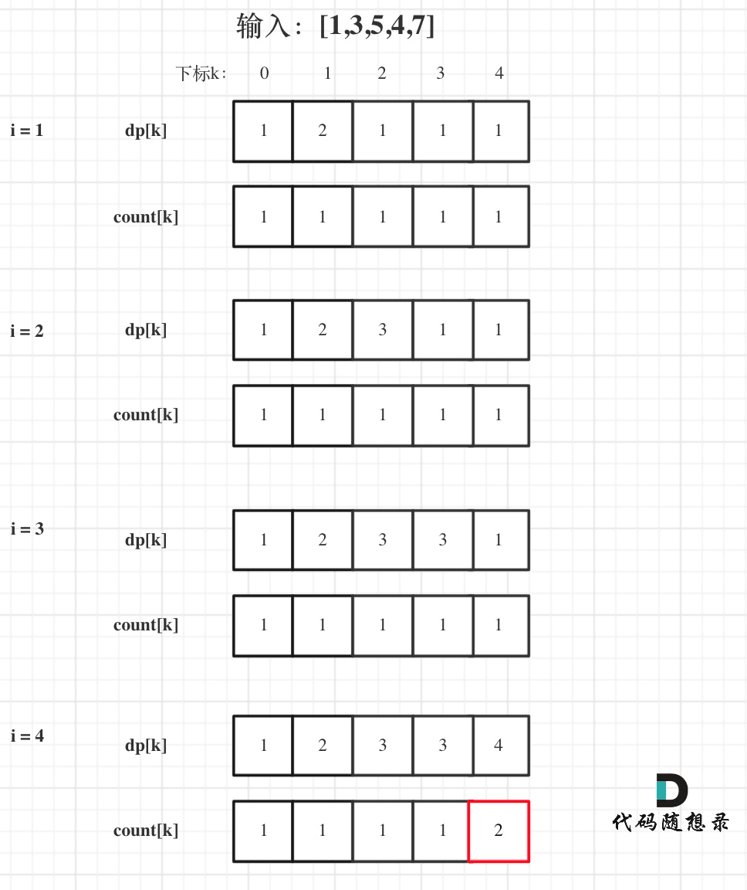

* [做專案（多個 C++、Java、Go、測試開發、前端（front end）專案）](https://www.programmercarl.com/other/kstar.html)
* [刷演算法（algorithm）（兩個月高強度學演算法）](https://www.programmercarl.com/xunlian/xunlianying.html)
* [背八股（40 天挑戰面試必考題（八股文））](https://www.programmercarl.com/xunlian/bagu.html)


# 673. longest increasing subsequence 的個數


[LeetCode 題目連結](https://leetcode.cn/problems/number-of-longest-increasing-subsequence/)


給定一個未排序的整數（integer）陣列（array），找出 `longest increasing subsequence` 的個數。

範例 1：
* 輸入: [1,3,5,4,7]
* 輸出: 2
* 解釋: 有兩個 `longest increasing subsequence`，分別是 [1, 3, 4, 7] 和 [1, 3, 5, 7]。

範例 2：
* 輸入: [2,2,2,2,2]
* 輸出: 5
* 解釋: `longest increasing subsequence` 的長度是 1，並且存在 5 個次序列（subsequence）的長度為 1，因此輸出 5。


## 解題思路

這道題可以說是 [300.最長上升子序列](https://programmercarl.com/0300.最长上升子序列.html) 的進階版本

1. 確定 `dp` 陣列（`dp` table）以及下標（subscript）的含義

這道題目我們要一起維護兩個陣列。

`dp[i]`：`i` 之前（包括 `i`）`longest increasing subsequence` 的長度為 `dp[i]`

`count[i]`：以 `nums[i]` 為結尾的字串（string），`longest increasing subsequence` 的個數為 `count[i]`

2. 確定遞迴公式（recurrence formula）

在 300.最長上升子序列 中，我們給出的狀態變遷（state transition）是：

`if (nums[i] > nums[j]) dp[i] = max(dp[i], dp[j] + 1);`

即：位置 `i` 的 `longest increasing subsequence` 長度 等於 `j` 從 0 到 `i-1` 各個位置的最長升序（ascending）次序列 + 1 的最大值。

本題就沒那麼簡單了，我們要考慮兩個維度，一個是 `dp[i]` 的更新，一個是 `count[i]` 的更新。

那麼如何更新 `count[i]` 呢？

以 `nums[i]` 為結尾的字串，`longest increasing subsequence` 的個數為 `count[i]`。

那麼在 `nums[i] > nums[j]` 前提下，如果在 `[0, i-1]` 的範圍內，找到了 `j`，使得 `dp[j] + 1 > dp[i]`，說明找到了一個更長的遞增次序列。

那麼以 `j` 為結尾的子字串（substring）的 `longest increasing subsequence` 的個數，就是最新的以 `i` 為結尾的子字串的 `longest increasing subsequence` 的個數，即：`count[i] = count[j]`。

在 `nums[i] > nums[j]` 前提下，如果在 `[0, i-1]` 的範圍內，找到了 `j`，使得 `dp[j] + 1 == dp[i]`，說明找到了兩個相同長度的遞增次序列。

那麼以 `i` 為結尾的子字串的 `longest increasing subsequence` 的個數 就應該加上以 `j` 為結尾的子字串的 `longest increasing subsequence` 的個數，即：`count[i] += count[j];`

程式碼如下：

```CPP
if (nums[i] > nums[j]) {
    if (dp[j] + 1 > dp[i]) {
        count[i] = count[j];
    } else if (dp[j] + 1 == dp[i]) {
        count[i] += count[j];
    }
    dp[i] = max(dp[i], dp[j] + 1);
}
```

當然也可以這麼寫：

```CPP
if (nums[i] > nums[j]) {
    if (dp[j] + 1 > dp[i]) {
        dp[i] = dp[j] + 1; // 更新 dp[i] 放在這裡，就不用 max 了
        count[i] = count[j];
    } else if (dp[j] + 1 == dp[i]) {
        count[i] += count[j];
    }
}
```

這裡 `count[i]` 記錄了以 `nums[i]` 為結尾的字串，`longest increasing subsequence` 的個數。`dp[i]` 記錄了 `i` 之前（包括 `i`）最長遞增序列（sequence）的長度。

題目要求最長遞增序列的長度的個數，我們應該把最長長度記錄下來。

程式碼如下：

```CPP
for (int i = 1; i < nums.size(); i++) {
    for (int j = 0; j < i; j++) {
        if (nums[i] > nums[j]) {
            if (dp[j] + 1 > dp[i]) {
                count[i] = count[j];
            } else if (dp[j] + 1 == dp[i]) {
                count[i] += count[j];
            }
            dp[i] = max(dp[i], dp[j] + 1);
        }
        if (dp[i] > maxCount) maxCount = dp[i]; // 記錄最長長度
    }
}
```

3. `dp` 陣列如何初始化（initialization）

再回顧一下 `dp[i]` 和 `count[i]` 的定義

`count[i]` 記錄了以 `nums[i]` 為結尾的字串，`longest increasing subsequence` 的個數。

那麼最少也就是 1 個，所以 `count[i]` 初始為 1。

`dp[i]` 記錄了 `i` 之前（包括 `i`）最長遞增序列的長度。

最小的長度也是 1，所以 `dp[i]` 初始為 1。

程式碼如下：

```
vector<int> dp(nums.size(), 1);
vector<int> count(nums.size(), 1);
```

**其實動態規劃（dynamic programming, DP）的題目中，初始化很有講究，也很考驗對 `dp` 陣列定義的理解**。

4. 確定遍歷（traversal）順序

`dp[i]` 是由 0 到 `i-1` 各個位置的最長升序次序列 推導而來，那麼遍歷 `i` 一定是從前向後遍歷。

`j` 其實就是 0 到 `i-1`，遍歷 `i` 的迴圈（loop）在（外）層，遍歷 `j` 則在內層，程式碼如下：

```CPP
for (int i = 1; i < nums.size(); i++) {
    for (int j = 0; j < i; j++) {
        if (nums[i] > nums[j]) {
            if (dp[j] + 1 > dp[i]) {
                count[i] = count[j];
            } else if (dp[j] + 1 == dp[i]) {
                count[i] += count[j];
            }
            dp[i] = max(dp[i], dp[j] + 1);
        }
        if (dp[i] > maxCount) maxCount = dp[i];
    }
}
```


最後還要再遍歷一遍 `dp[i]`，把最長遞增序列長度對應的 `count[i]` 累計下來就是結果了。

程式碼如下：

```CPP
for (int i = 1; i < nums.size(); i++) {
    for (int j = 0; j < i; j++) {
        if (nums[i] > nums[j]) {
            if (dp[j] + 1 > dp[i]) {
                count[i] = count[j];
            } else if (dp[j] + 1 == dp[i]) {
                count[i] += count[j];
            }
            dp[i] = max(dp[i], dp[j] + 1);
        }
        if (dp[i] > maxCount) maxCount = dp[i];
    }
}
int result = 0; // 統計結果
for (int i = 0; i < nums.size(); i++) {
    if (maxCount == dp[i]) result += count[i];
}
```

統計結果，可能有的同學又有點看懵了，那麼就再回顧一下 `dp[i]` 和 `count[i]` 的定義。

5. 舉例推導 `dp` 陣列

輸入：[1,3,5,4,7]



**如果程式碼寫出來了，怎麼改都通過不了，那麼把 `dp` 和 `count` 印出來看看對不對！**

以上分析完畢，C++ 整體程式碼如下：

```CPP
class Solution {
public:
    int findNumberOfLIS(vector<int>& nums) {
        if (nums.size() <= 1) return nums.size();
        vector<int> dp(nums.size(), 1);
        vector<int> count(nums.size(), 1);
        int maxCount = 0;
        for (int i = 1; i < nums.size(); i++) {
            for (int j = 0; j < i; j++) {
                if (nums[i] > nums[j]) {
                    if (dp[j] + 1 > dp[i]) {
                        dp[i] = dp[j] + 1;
                        count[i] = count[j];
                    } else if (dp[j] + 1 == dp[i]) {
                        count[i] += count[j];
                    }
                }
                if (dp[i] > maxCount) maxCount = dp[i];
            }
        }
        int result = 0;
        for (int i = 0; i < nums.size(); i++) {
            if (maxCount == dp[i]) result += count[i];
        }
        return result;
    }
};
```

* 時間複雜性（time complexity）：$O(n^2)$
* 空間複雜度（space complexity）：$O(n)$

還有 $O(n\log n)$ 的解法，使用 `binary indexed tree`，今天有點忙就先不寫了，感興趣的同學可以自行學習一下，這裡有我之前寫的 `binary indexed tree` 系列部落格：https://blog.csdn.net/youngyangyang04/category_871105.html  （十年前的陳年老文了）

## 其他語言版本

### Java

```java
class Solution {
    public int findNumberOfLIS(int[] nums) {
        if (nums.length <= 1) return nums.length;
        int[] dp = new int[nums.length];
        for(int i = 0; i < dp.length; i++) dp[i] = 1;
        int[] count = new int[nums.length];
        for(int i = 0; i < count.length; i++) count[i] = 1;

        int maxCount = 0;
        for (int i = 1; i < nums.length; i++) {
            for (int j = 0; j < i; j++) {
                if (nums[i] > nums[j]) {
                    if (dp[j] + 1 > dp[i]) {
                        dp[i] = dp[j] + 1;
                        count[i] = count[j];
                    } else if (dp[j] + 1 == dp[i]) {
                        count[i] += count[j];
                    }
                }
                if (dp[i] > maxCount) maxCount = dp[i];
            }
        }
        int result = 0;
        for (int i = 0; i < nums.length; i++) {
            if (maxCount == dp[i]) result += count[i];
        }
        return result;
    }
}
```

### Python

```python
class Solution:
    def findNumberOfLIS(self, nums: List[int]) -> int:
        size = len(nums)
        if size<= 1: return size

        dp = [1 for i in range(size)]
        count = [1 for i in range(size)]

        maxCount = 0
        for i in range(1, size):
            for j in range(i):
                if nums[i] > nums[j]:
                    if dp[j] + 1 > dp[i] :
                        dp[i] = dp[j] + 1
                        count[i] = count[j]
                    elif dp[j] + 1 == dp[i] :
                        count[i] += count[j]
                if dp[i] > maxCount:
                    maxCount = dp[i];
        result = 0
        for i in range(size):
            if maxCount == dp[i]:
                result += count[i]
        return result;
```

### Go

```go

func findNumberOfLIS(nums []int) int {
	size := len(nums)
	if size <= 1  {
		return size
	}

	dp := make([]int, size);
	for i, _ := range dp {
		dp[i] = 1
	}
	count := make([]int, size);
	for i, _ := range count {
		count[i] = 1
	}

	maxCount := 0
	for i := 1; i < size; i++ {
		for j := 0; j < i; j++ {
			if nums[i] > nums[j] {
				if dp[j] + 1 > dp[i] {
					dp[i] = dp[j] + 1
					count[i] = count[j]
				} else if dp[j] + 1 == dp[i] {
					count[i] += count[j]
				}
			}
			if dp[i] > maxCount {
				maxCount = dp[i]
			}
		}
	}

	result := 0
	for i := 0; i < size; i++ {
		if maxCount == dp[i] {
			result += count[i]
		}
	}
	return result
}
```

### JavaScript

```js
var findNumberOfLIS = function(nums) {
    const len = nums.length;
    if(len <= 1) return len;
    let dp = new Array(len).fill(1); // i 之前（包括 i）最長遞增子序列的長度為 dp[i]
    let count = new Array(len).fill(1); // 以 nums[i] 為結尾的字串，最長遞增子序列的個數為 count[i]
    let res = 0;
    for(let i = 1; i < len; i++){
        for(let j = 0; j < i; j++){
            if(nums[i] > nums[j]){
                if(dp[j] + 1 > dp[i]){ // 第 j 個數字為前一個數字的子序列是否更長
                    dp[i] = dp[j] + 1; // 更新 dp[i] 
                    count[i] = count[j]; // 重置 count[i]
                } else if(dp[j] + 1 === dp[i]){ // 和原來一樣長
                    count[i] += count[j]; // 更新 count[i]
                }
            }
        }
    }
    let max = Math.max(...dp); // 展開運算子找到最大長度
    for(let i = 0; i < len; i++) if(dp[i] === max) res += count[i]; // 累加
    return res;
};
```


