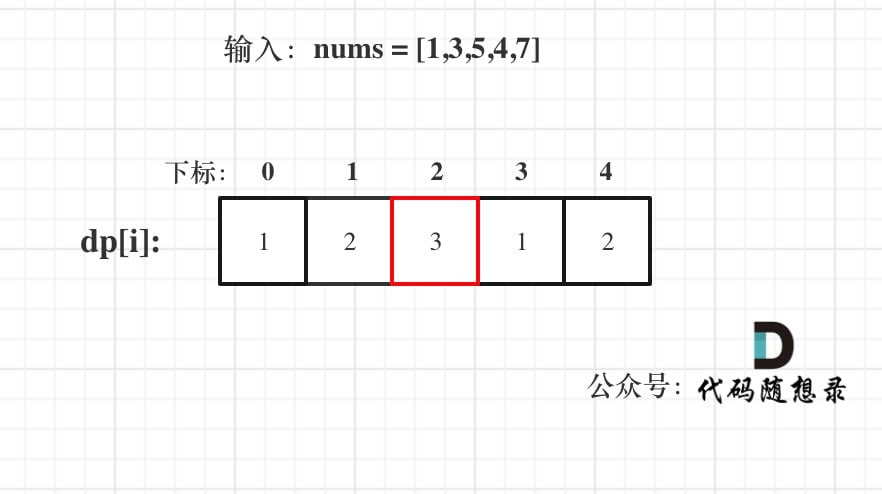

* [做專案（多個 C++、Java、Go、測試開發、前端（front end）專案）](https://www.programmercarl.com/other/kstar.html)
* [刷演算法（兩個月高強度學演算法）](https://www.programmercarl.com/xunlian/xunlianying.html)
* [背八股（40 天挑戰面試必考題（八股文））](https://www.programmercarl.com/xunlian/bagu.html)

# 674. 最長連續遞增序列

[LeetCode 題目連結](https://leetcode.com/problems/longest-continuous-increasing-subsequence/)

給定一個未經排序（sorting）的整數（integer）陣列（array），找到最長且 連續遞增的次序列（subsequence），並回傳該序列（sequence）的長度。

連續遞增的次序列 可以由兩個下標（subscript）`l` 和 `r`（`l < r`）確定，如果對於每個 `l <= i < r`，都有 `nums[i] < nums[i + 1]` ，那麼次序列 `[nums[l], nums[l + 1], ..., nums[r - 1], nums[r]]` 就是連續遞增次序列。

範例 1：
* 輸入：`nums = [1,3,5,4,7]`
* 輸出：3
* 解釋：最長連續遞增序列是 `[1,3,5]`, 長度為 3。儘管 `[1,3,5,7]` 也是升序（ascending）的次序列, 但它不是連續的，因為 5 和 7 在原陣列裡被 4 隔開。

範例 2：
* 輸入：`nums = [2,2,2,2,2]`
* 輸出：1
* 解釋：最長連續遞增序列是 `[2]`, 長度為 1。

提示：

* `0 <= nums.length <= 10^4`
* `-10^9 <= nums[i] <= 10^9`

## 演算法影片公開課

**[《程式碼隨想錄》演算法影片公開課](https://programmercarl.com/other/gongkaike.html)：[動態規劃之子序列問題，重點在於連續！| LeetCode：674.最長連續遞增序列](https://www.bilibili.com/video/BV1bD4y1778v)，相信結合影片再看本篇題解，更有助於大家對本題的理解**。


## 解題思路

本題相對於昨天的[動態規劃：300.最長遞增子序列](./0300.最長上升次序列.md)最大的區別在於「連續」。

本題要求的是最長**連續**遞增序列

### 動態規劃（dynamic programming, DP）

動態規劃（dynamic programming, DP）五部曲分析如下：

1. 確定 `dp` 陣列（`dp` table）以及下標的含義

**`dp[i]`：以下標 `i` 為結尾的連續遞增的次序列長度為 `dp[i]`**。

注意這裡的定義，一定是以下標 `i` 為結尾，並不是說一定以下標 0 為起始位置。

2. 確定遞迴公式（recurrence formula）

如果 `nums[i] > nums[i - 1]`，那麼以 `i` 為結尾的連續遞增的次序列長度 一定等於 以 `i - 1` 為結尾的連續遞增的次序列長度 + 1 。

即：`dp[i] = dp[i - 1] + 1;`

**注意這裡就體現出和[動態規劃：300.最長遞增子序列](./0300.最長上升次序列.md)的區別！**

因為本題要求連續遞增次序列，所以就只要比較 `nums[i]` 與 `nums[i - 1]`，而不用去比較 `nums[j]` 與 `nums[i]` （`j` 是在 0 到 `i` 之間遍歷（traversal））。

既然不用 `j` 了，那麼也不用兩層 `for` 迴圈（for-loop），本題一層 `for` 迴圈就行，比較 `nums[i]` 和 `nums[i - 1]`。

這裡大家要好好體會一下！

3. `dp` 陣列如何初始化（initialization）

以下標 `i` 為結尾的連續遞增的次序列長度最少也應該是 1，即就是 `nums[i]` 這一個元素（element）。

所以 `dp[i]` 應該初始 1;

4. 確定遍歷順序

從遞迴公式上可以看出，`dp[i + 1]` 依賴 `dp[i]`，所以一定是從前向後遍歷。

本文在確定遞迴公式的時候也說明了為什麼本題只需要一層 `for` 迴圈，程式碼如下：

```CPP
for (int i = 1; i < nums.size(); i++) {
    if (nums[i] > nums[i - 1]) { // 連續記錄
        dp[i] = dp[i - 1] + 1;
    }
}
```

5. 舉例推導 `dp` 陣列

以輸入 `nums = [1,3,5,4,7]` 為例，`dp` 陣列狀態（state）如下：




**注意這裡要取 `dp[i]` 裡的最大值，所以 `dp[2]` 才是結果！**

以上分析完畢，C++ 程式碼如下：

```CPP
class Solution {
public:
    int findLengthOfLCIS(vector<int>& nums) {
        if (nums.size() == 0) return 0;
        int result = 1;
        vector<int> dp(nums.size() ,1);
        for (int i = 1; i < nums.size(); i++) {
            if (nums[i] > nums[i - 1]) { // 連續記錄
                dp[i] = dp[i - 1] + 1;
            }
            if (dp[i] > result) result = dp[i];
        }
        return result;
    }
};

```

* 時間複雜度（time complexity）：$O(n)$
* 空間複雜度（space complexity）：$O(n)$

### 貪心法（greedy）

這道題目也可以用貪心法來做，也就是遇到 `nums[i] > nums[i - 1]` 的情況，`count` 就 `++`，否則 `count` 為 1，記錄 `count` 的最大值就可以了。

程式碼如下：

```CPP
class Solution {
public:
    int findLengthOfLCIS(vector<int>& nums) {
        if (nums.size() == 0) return 0;
        int result = 1; // 連續子序列最少也是 1
        int count = 1;
        for (int i = 1; i < nums.size(); i++) {
            if (nums[i] > nums[i - 1]) { // 連續記錄
                count++;
            } else { // 不連續，count 從頭開始
                count = 1;
            }
            if (count > result) result = count;
        }
        return result;
    }
};
```
* 時間複雜度：$O(n)$
* 空間複雜度：$O(1)$

## 總結

本題也是DP裡次序列問題的經典題目，但也可以用貪心法來做，大家也會發現貪心法好像更簡單一點，而且空間複雜度僅是 $O(1)$。

在DP分析中，關鍵是要理解和[動態規劃：300.最長遞增子序列](./0300.最長上升次序列.md)的區別。

**要聯動起來，才能理解遞增次序列怎麼求，遞增連續次序列又要怎麼求**。

概括來說：不連續遞增次序列的跟前 `0-i` 個狀態有關，連續遞增的次序列只跟前一個狀態有關

本篇我也把區別所在之處重點介紹了，關鍵在遞迴公式和遍歷方法（method）上，大家可以仔細體會一波！

## 其他語言版本

### Java：

> DP：
```java
 /**
     * 1.dp[i] 代表目前下標最大連續值
     * 2.遞迴公式 if（nums[i+1]>nums[i]） dp[i+1] = dp[i]+1
     * 3.初始化 都為 1
     * 4.遍歷方向，從前往後
     * 5.結果推導 。。。。
     * @param nums
     * @return
     */
    public static int findLengthOfLCIS(int[] nums) {
        int[] dp = new int[nums.length];
        for (int i = 0; i < dp.length; i++) {
            dp[i] = 1;
        }
        int res = 1;
	//可以注意到，這邊的 i 是從 0 開始，所以會出現和卡哥的C++ code有差異的地方，在一些地方會看到有 i + 1 的偏移。
        for (int i = 0; i < nums.length - 1; i++) {
            if (nums[i + 1] > nums[i]) {
                dp[i + 1] = dp[i] + 1;
            }
            res = res > dp[i + 1] ? res : dp[i + 1];
        }
        return res;
    }
```
> DP `state compression`
```java
class Solution {
    public int findLengthOfLCIS(int[] nums) {
        // 記錄以 前一個元素結尾的最長連續遞增序列的長度 和 以目前 結尾的......
        int beforeOneMaxLen = 1, currentMaxLen = 0;
        // res 賦最小值回傳的最小值 1
        int res = 1;
        for (int i = 1; i < nums.length; i ++) {
            currentMaxLen = nums[i] > nums[i - 1] ? beforeOneMaxLen + 1 : 1;
            beforeOneMaxLen = currentMaxLen;
            res = Math.max(res, currentMaxLen);
        }
        return res;
    }
}
```
> 貪心法：

```Java
public static int findLengthOfLCIS(int[] nums) {
    if (nums.length == 0) return 0;
    int res = 1; // 連續子序列最少也是 1
    int count = 1;
    for (int i = 0; i < nums.length - 1; i++) {
        if (nums[i + 1] > nums[i]) { // 連續記錄
            count++;
        } else { // 不連續，count 從頭開始
            count = 1;
        }
        if (count > res) res = count;
    }
    return res;
}
```

### Python：

DP
```python
class Solution:
    def findLengthOfLCIS(self, nums: List[int]) -> int:
        if len(nums) == 0:
            return 0
        result = 1
        dp = [1] * len(nums)
        for i in range(len(nums)-1):
            if nums[i+1] > nums[i]: #連續記錄
                dp[i+1] = dp[i] + 1
            result = max(result, dp[i+1])
        return result
```

DP(最佳化版)
```python
class Solution:
    def findLengthOfLCIS(self, nums: List[int]) -> int:
        if not nums:
            return 0

        max_length = 1
        current_length = 1

        for i in range(1, len(nums)):
            if nums[i] > nums[i - 1]:
                current_length += 1
                max_length = max(max_length, current_length)
            else:
                current_length = 1

        return max_length

```
貪心法
```python
class Solution:
    def findLengthOfLCIS(self, nums: List[int]) -> int:
        if len(nums) == 0:
            return 0
        result = 1 #連續子序列最少也是 1
        count = 1
        for i in range(len(nums)-1):
            if nums[i+1] > nums[i]: #連續記錄
                count += 1
            else: #不連續，count 從頭開始
                count = 1
            result = max(result, count)
        return result
```

### Go：

> DP：
```go
func findLengthOfLCIS(nums []int) int {
	if len(nums) == 0 {return 0}
	res, count := 1, 1
	for i := 0; i < len(nums)-1; i++ {
		if nums[i+1] > nums[i] {
			count++
		}else {
			count = 1
		}
		if count > res {
			res = count
		}
	}
	return res
}
```

> 貪心演算法（greedy algorithm）：
```go
func findLengthOfLCIS(nums []int) int {
	if len(nums) == 0 {return 0}
	dp := make([]int, len(nums))
	for i := 0; i < len(dp); i++ {
		dp[i] = 1
	}
	res := 1
	for i := 0; i < len(nums)-1; i++ {
		if nums[i+1] > nums[i] {
			dp[i+1] = dp[i] + 1
		}
		if dp[i+1] > res {
			res = dp[i+1]
		}
	}
	return res
}
```


### Rust:
>DP
```rust
pub fn find_length_of_lcis(nums: Vec<i32>) -> i32 {
    if nums.is_empty() {
        return 0;
    }
    let mut result = 1;
    let mut dp = vec![1; nums.len()];
    for i in 1..nums.len() {
        if nums[i - 1] < nums[i] {
            dp[i] = dp[i - 1] + 1;
            result = result.max(dp[i]);
        }
    }
    result
}
```


> 貪心法

```rust
impl Solution {
    pub fn find_length_of_lcis(nums: Vec<i32>) -> i32 {
        let (mut res, mut count) = (1, 1);
        for i in 1..nums.len() {
            if nums[i] > nums[i - 1] {
                count += 1;
                res = res.max(count);
                continue;
            }
            count = 1;
        }
        res
    }
}
```


### JavaScript：

> DP：
```javascript
const findLengthOfLCIS = (nums) => {
    let dp = new Array(nums.length).fill(1);


    for(let i = 0; i < nums.length - 1; i++) {
        if(nums[i+1] > nums[i]) {
            dp[i+1] = dp[i]+ 1;
        }
    }

    return Math.max(...dp);
};
```

> 貪心法：
```javascript
const findLengthOfLCIS = (nums) => {
    if(nums.length === 1) {
        return 1;
    }

    let maxLen = 1;
    let curMax = 1;
    let cur = nums[0];

    for(let num of nums) {
        if(num > cur) {
            curMax += 1;
            maxLen =  Math.max(maxLen, curMax);
        } else {
            curMax = 1;
        }
        cur = num;
    }

    return maxLen;
};
```

### TypeScript：

> DP：

```typescript
function findLengthOfLCIS(nums: number[]): number {
    /**
        dp[i]: 前 i 個元素，以 nums[i] 結尾，最長連續子序列的長度
     */
    const dp: number[] = new Array(nums.length).fill(1);
    let resMax: number = 1;
    for (let i = 1, length = nums.length; i < length; i++) {
        if (nums[i] > nums[i - 1]) {
            dp[i] = dp[i - 1] + 1;
        }
        resMax = Math.max(resMax, dp[i]);
    }
    return resMax;
};
```

> 貪心法：

```typescript
function findLengthOfLCIS(nums: number[]): number {
    let resMax: number = 1;
    let count: number = 1;
    for (let i = 0, length = nums.length; i < length - 1; i++) {
        if (nums[i] < nums[i + 1]) {
            count++;
        } else {
            count = 1;
        }
        resMax = Math.max(resMax, count);
    }
    return resMax;
};
```

### C：

> DP：

```c
int findLengthOfLCIS(int* nums, int numsSize) {
    if(numsSize == 0){
        return 0;
    }
    int dp[numsSize];
    for(int i = 0; i < numsSize; i++){
        dp[i] = 1;
    }
    int result = 1;
    for (int i = 1; i < numsSize; ++i) {
        if(nums[i] > nums[i - 1]){
            dp[i] = dp[i - 1] + 1;
        }
        if(dp[i] > result){
            result = dp[i];
        }
    }
    return result;
}
```


> 貪心法:

```c
int findLengthOfLCIS(int* nums, int numsSize) {
    int result = 1;
    int count = 1;
    if(numsSize == 0){
        return result;
    }
    for (int i = 1; i < numsSize; ++i) {
        if(nums[i] > nums[i - 1]){
            count++;
        } else{
            count = 1;
        }
        if(count > result){
            result = count;
        }
    }
    return result;
}
```

### Cangjie

```cangjie
func findLengthOfLCIS(nums: Array<Int64>): Int64 {
    let n = nums.size
    if (n <= 1) {
        return n
    }
    let dp = Array(n, repeat: 1)
    var res = 0
    for (i in 1..n) {
        if (nums[i] > nums[i - 1]) {
            dp[i] = dp[i - 1] + 1
        }
        res = max(res, dp[i])
    }
    return res
}
```


