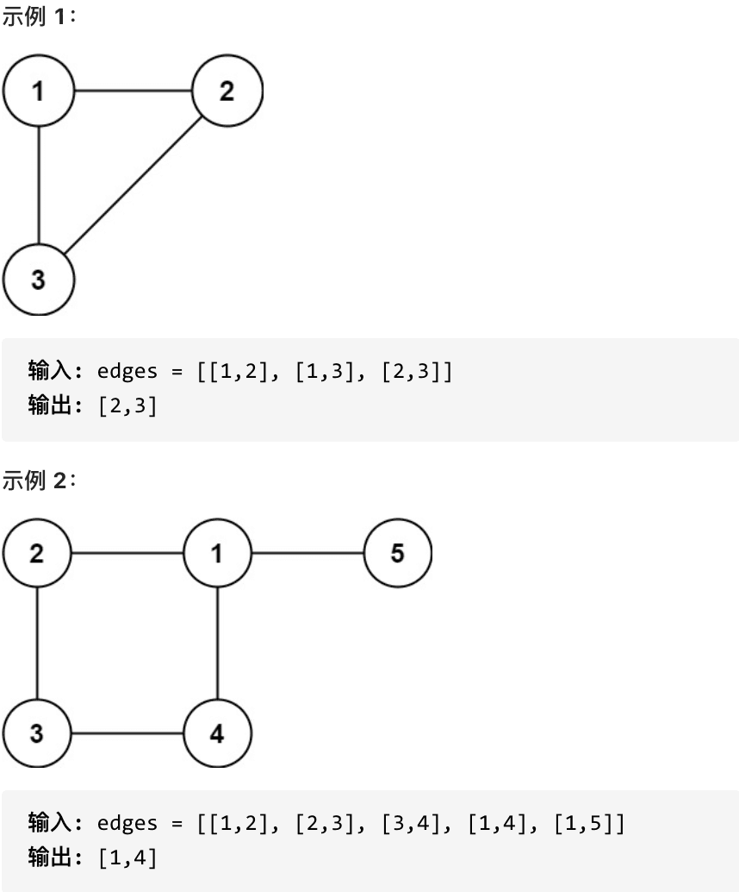
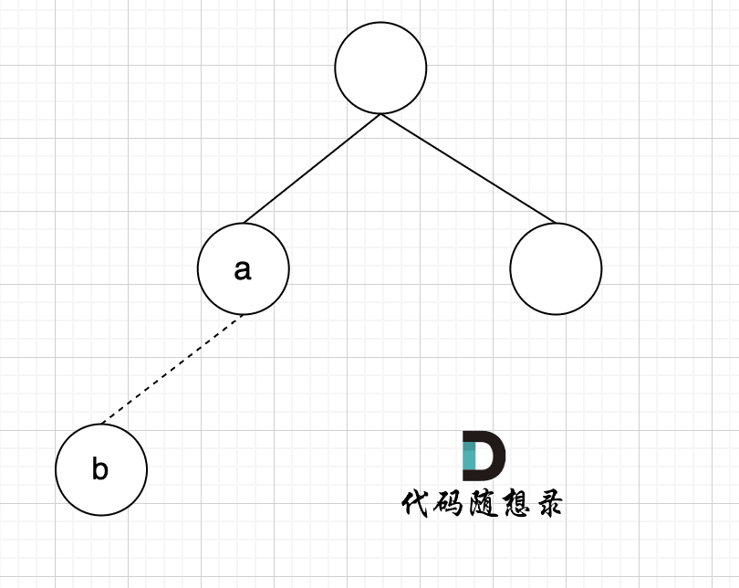
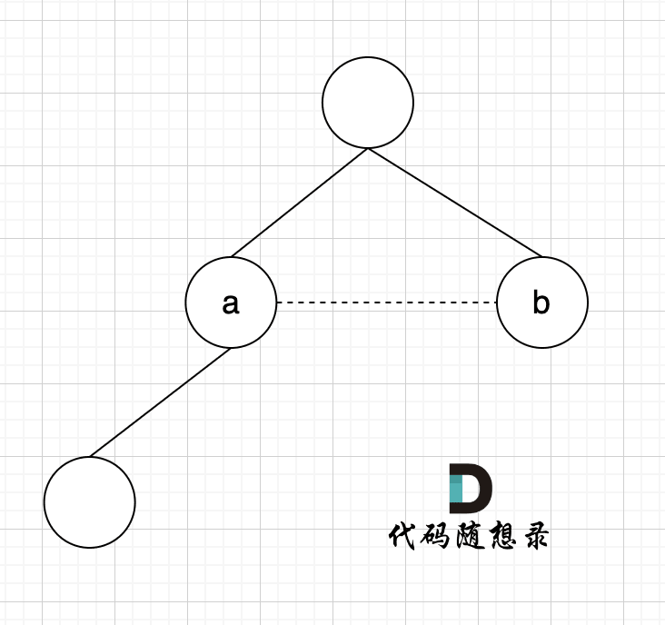

* [做專案（多個 C++、Java、Go、測試開發、前端（front end）專案）](https://www.programmercarl.com/other/kstar.html)
* [刷演算法（兩個月高強度學演算法）](https://www.programmercarl.com/xunlian/xunlianying.html)
* [背八股（40 天挑戰面試必考題（八股文））](https://www.programmercarl.com/xunlian/bagu.html)

# 684.冗餘連結

[LeetCode 題目連結](https://leetcode.cn/problems/redundant-connection/)

樹（tree）可以看成是一個連通且 無環 的 無向圖（undirected graph）。

給定往一棵 `n` 個節點（node） (節點值 1～`n`) 的樹中添加一條邊（edge）後的圖（graph）。添加的邊的兩個頂點（vertex）包含在 1 到 `n` 中間，且這條附加的邊不屬於樹中已存在的邊。圖的資訊記錄於長度為 `n` 的二維（2D）陣列（array） `edges` ，`edges[i] = [ai, bi]` 表示圖中在 `ai` 和 `bi` 之間存在一條邊。

請找出一條可以刪去的邊，刪除（delete）後可使得剩餘部分是一個有著 `n` 個節點的樹。如果有多個答案，則回傳陣列 `edges` 中最後出現的邊。



提示:
* `n == edges.length`
* `3 <= n <= 1000`
* `edges[i].length == 2`
* `1 <= ai < bi <= edges.length`
* `ai != bi`
* `edges` 中無重複（duplicate）元素（element）
* 給定的圖是連通的 

## 解題思路

這道題目也是互斥集（disjoint set）基礎題目。

首先要知道互斥集可以解決什麼問題呢？

主要就是集合（set）問題，兩個節點在不在一個集合，也可以將兩個節點添加到一個集合中。

這裡整理出我的互斥集模板（template）如下：

```CPP
int n = 1005; // n 根據題目中節點數量而定，一般比節點數量大一點就好
vector<int> father = vector<int> (n, 0); // C++ 裡的一種陣列結構

// 互斥集初始化
void init() {
    for (int i = 0; i < n; ++i) {
        father[i] = i;
    }
}
// 互斥集裡尋根的過程
int find(int u) {
    return u == father[u] ? u : father[u] = find(father[u]); // 路徑壓縮
}

// 判斷 u 和 v 是否找到同一個根
bool isSame(int u, int v) {
    u = find(u);
    v = find(v);
    return u == v;
}

// 將 v->u 這條邊加入互斥集
void join(int u, int v) {
    u = find(u); // 尋找 u 的根
    v = find(v); // 尋找 v 的根
    if (u == v) return ; // 如果發現根相同，則說明在一個集合，不用兩個節點相連直接回傳
    father[v] = u;
}

```

以上模板 只要修改 `n` 就可以了，本題 節點數量不會超過 1000。

互斥集主要有三個功能。

1. 尋找根節點（root node），函數（function）：`find(int u)`，也就是判斷這個節點的上代節點（ancestor node）是哪個
2. 將兩個節點串接到同一個集合，函數：`join(int u, int v)`，將兩個節點連在同一個根節點上
3. 判斷兩個節點是否在同一個集合，函數：`isSame(int u, int v)`，就是判斷兩個節點是不是同一個根節點

如果還不了解互斥集，可以看這裡：[互斥集理論基礎](https://programmercarl.com/kamacoder/图论并查集理论基础.html)

我們再來看一下這道題目。

題目說是無向圖，回傳一條可以刪去的邊，使得結果圖是一個有著 N 個節點的樹（即：只有一個根節點）。

如果有多個答案，則回傳二維陣列中最後出現的邊。

那麼我們就可以從前向後遍歷（traversal）每一條邊（因為優先讓前面的邊連上），邊的兩個節點如果不在同一個集合，就加入集合（即：同一個根節點）。

如圖所示： 



節點 A 和節點 B 不在同一個集合，那麼就可以將兩個 節點連在一起。

（如果題目中說：如果有多個答案，則回傳二維陣列中最前出現的邊。 那我們就要 從後向前遍歷每一條邊了）

如果邊的兩個節點已經出現在同一個集合裡，說明這條邊的兩個節點已經連在一起了，再加入這條邊一定就出現環了。

如圖所示： 



已經判斷 節點 A 和 節點 B 在同一個集合（同一個根），如果將 節點 A 和 節點 B 連在一起就一定會出現環。 

這個思路清晰之後，程式碼就很好寫了。

互斥集 C++ 程式碼如下：

```CPP
class Solution {
private:
    int n = 1005; // 節點數量 3 到 1000
    vector<int> father = vector<int> (n, 0); // C++ 裡的一種陣列結構

    // 互斥集初始化
    void init() {
        for (int i = 0; i < n; ++i) {
            father[i] = i;
        }
    }
    // 互斥集裡尋根的過程
    int find(int u) {
        return u == father[u] ? u : father[u] = find(father[u]);
    }
    // 判斷 u 和 v 是否找到同一個根
    bool isSame(int u, int v) {
        u = find(u);
        v = find(v);
        return u == v;
    }
    // 將 v->u 這條邊加入互斥集
    void join(int u, int v) {
        u = find(u); // 尋找 u 的根
        v = find(v); // 尋找 v 的根
        if (u == v) return ; // 如果發現根相同，則說明在一個集合，不用兩個節點相連直接回傳
        father[v] = u;
}
public:
    vector<int> findRedundantConnection(vector<vector<int>>& edges) {
        init();
        for (int i = 0; i < edges.size(); i++) {
            if (isSame(edges[i][0], edges[i][1])) return edges[i];
            else join(edges[i][0], edges[i][1]);
        }
        return {};
    }
};

```

可以看出，主函數的程式碼很少，就判斷一下邊的兩個節點在不在同一個集合就可以了。


## 其他語言版本

### Java

```java
class Solution {
    private int n;  // 節點數量 3 到 1000
    private int[] father;
    public Solution() {
        n = 1005;
        father = new int[n];

        // 互斥集初始化
        for (int i = 0; i < n; ++i) {
            father[i] = i;
        }
    }

    // 互斥集裡尋根的過程
    private int find(int u) {
        if(u == father[u]) {
            return u;
        }
        father[u] = find(father[u]);
        return father[u];
    }

    // 將 v->u 這條邊加入互斥集
    private void join(int u, int v) {
        u = find(u);
        v = find(v);
        if (u == v) return ;
        father[v] = u;
    }

    // 判斷 u 和 v 是否找到同一個根，本題用不上
    private Boolean same(int u, int v) {
        u = find(u);
        v = find(v);
        return u == v;
    }

    public int[] findRedundantConnection(int[][] edges) {
        for (int i = 0; i < edges.length; i++) {
            if (same(edges[i][0], edges[i][1])) {
                return edges[i];
            } else  {
                join(edges[i][0], edges[i][1]);
            }
        }
        return null;
    }
}
```

### Python

```python

class Solution:

    def __init__(self):
        """
        初始化
        """
        self.n = 1005
        self.father = [i for i in range(self.n)]


    def find(self, u):
        """
        互斥集裡尋根的過程
        """
        if u == self.father[u]:
            return u
        self.father[u] = self.find(self.father[u])
        return self.father[u]

    def join(self, u, v):
        """
        將 v->u 這條邊加入互斥集
        """
        u = self.find(u)
        v = self.find(v)
        if u == v : return
        self.father[v] = u
        pass


    def same(self, u, v ):
        """
        判斷 u 和 v 是否找到同一個根，本題用不上
        """
        u = self.find(u)
        v = self.find(v)
        return u == v

    def findRedundantConnection(self, edges: List[List[int]]) -> List[int]:
        for i in range(len(edges)):
            if self.same(edges[i][0], edges[i][1]) :
                return edges[i]
            else :
                self.join(edges[i][0], edges[i][1])
        return []
```

### Python 簡潔寫法：

```python
class Solution:
    def findRedundantConnection(self, edges: List[List[int]]) -> List[int]:
        n = len(edges)
        p = [i for i in range(n+1)]
        def find(i):
            if p[i] != i:
                p[i] = find(p[i])
            return p[i]
        for u, v in edges:
            if p[find(u)] == find(v):
                return [u, v]
            p[find(u)] = find(v)
```

### Go

```go

// 全域變數
var (
    n = 1005 // 節點數量 3 到 1000
    father = make([]int, 1005)
)

// 互斥集初始化
func initialize() {
	for i := 0; i < n; i++ {
		father[i] = i
	}
}

// 互斥集裡尋根的過程
func find(u int) int {
	if u == father[u] {
		return u
	}
	father[u] = find(father[u])
	return father[u]
}

// 將 v->u 這條邊加入互斥集
func join(u, v int) {
	u = find(u)
	v = find(v)
	if u == v {
		return
	}
	father[v] = u
}

// 判斷 u 和 v 是否找到同一個根，本題用不上
func same(u, v int) bool {
	u = find(u)
	v = find(v)
	return u == v
}

func findRedundantConnection(edges [][]int) []int {
	initialize()
	for i := 0; i < len(edges); i++ {
		if same(edges[i][0], edges[i][1]) {
			return edges[i]
		} else {
			join(edges[i][0], edges[i][1])
		}
	}
	return []int{}
}
```

### JavaScript

```js
const n = 1005;
const father = new Array(n);
// 互斥集裡尋根的過程
const find = u => {
    return u == father[u] ? u : father[u] = find(father[u]);
};

// 將 v->u 這條邊加入互斥集
const join = (u, v) => {
    u = find(u);
    v = find(v);
    if(u == v) return;
    father[v] = u;
};

// 判斷 u 和 v 是否找到同一個根，本題用不上
const same = (u, v) => {
    u = find(u);
    v = find(v);
    return u == v;
};

/**
 * @param {number[][]} edges
 * @return {number[]}
 */
var findRedundantConnection = function(edges) {
    // 互斥集初始化
    for(let i = 0; i < n; i++){
        father[i] = i;
    }
    for(let i = 0; i < edges.length; i++){
        if(same(edges[i][0], edges[i][1])) return edges[i];
        else join(edges[i][0], edges[i][1]);
    }
    return null;
};
```


