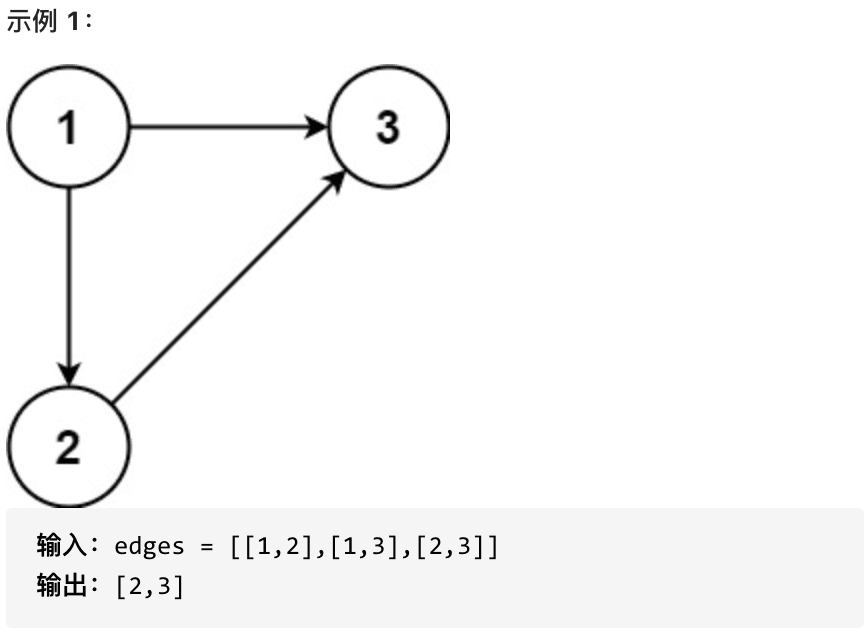
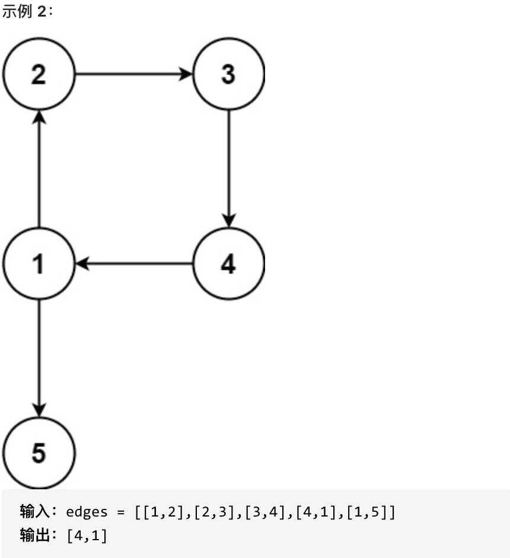
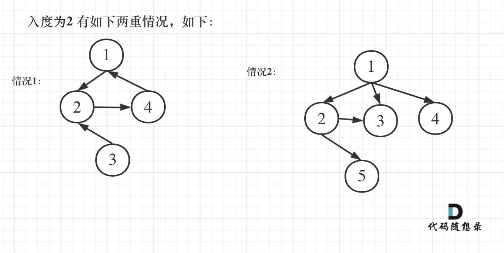
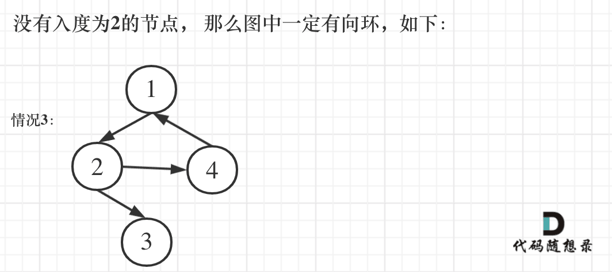

* [做專案（多個 C++、Java、Go、測試開發、前端（front end）專案）](https://www.programmercarl.com/other/kstar.html)
* [刷演算法（兩個月高強度學演算法）](https://www.programmercarl.com/xunlian/xunlianying.html)
* [背八股（40 天挑戰面試必考題（八股文））](https://www.programmercarl.com/xunlian/bagu.html)


# 685.冗餘連結 II

[LeetCode 題目連結](https://leetcode.com/problems/redundant-connection-ii/)

在本問題中，有根樹（rooted tree）指滿足以下條件的 有向圖（directed graph）。該樹（tree）只有一個根節點（root node），所有其他節點（node）都是該根節點的後繼。該樹除了根節點之外的每一個節點都有且只有一個父節點（father node），而根節點沒有父節點。

輸入一個有向圖，該圖由一個有著 `n` 個節點（節點值不重複（duplicate），從 1 到 `n`）的樹及一條附加的有向邊（edge）構成。附加的邊包含在 1 到 `n` 中的兩個不同頂點（vertex）間，這條附加的邊不屬於樹中已存在的邊。

結果圖（graph）是一個以邊組成的二維（2D）陣列（array） `edges` 。 每個元素（element）是一對 `[ui, vi]`，用以表示 有向圖中連接頂點 `ui` 和頂點 `vi` 的邊，其中 `ui` 是 `vi` 的一個父節點。

回傳一條能刪除（delete）的邊，使得剩下的圖是有 `n` 個節點的有根樹。若有多個答案，回傳最後出現在給定二維陣列的答案。






提示：

* `n == edges.length`
* `3 <= n <= 1000`
* `edges[i].length == 2`
* `1 <= ui, vi <= n`

## 解題思路

先重點讀懂題目中的這句**該圖由一個有著 N 個節點 (節點值不重複 1, 2, ..., N) 的樹及一條附加的邊構成。附加的邊的兩個頂點包含在 1 到 N 中間，這條附加的邊不屬於樹中已存在的邊。**

**這說明題目中的圖原本是一棵樹，只不過在不增加節點的情況下多加了一條邊！**

還有**若有多個答案，回傳最後出現在給定二維陣列的答案。**這說明在兩條邊都可以刪除的情況下，要刪順序靠後的！


那麼有如下三種情況，前兩種情況是出現輸入度（in degree）為 2 的點，如圖：

 </img></div>

且只有一個節點輸入度為 2，為什麼不看外度數（out degree）呢，外度數沒有意義，一棵樹中隨便一個父節點就有多個外度數。

第三種情況是沒有輸入度為 2 的點，那麼圖中一定出現了有向環（**注意這裡強調是有向環！**）

如圖：

 </img></div>


首先先計算節點的輸入度，這裡不少讀者／錄友在計算輸入度的時候就搞懵了，分不清 `edges[i][j]` 表示的都是什麼。

例如題目範例一給的是：`edges = [[1,2],[1,3],[2,3]]` 

那大家很自然就想 對應二維陣列的數值是：`edges[1][2]` ，`edges[1][3]`，`edges[2][3]`，但又想不出來 `edges[1][2]` 數值又是什麼呢？ 越想越懵。

其實 `edges = [[1,2],[1,3],[2,3]]`，表示的是 

`edges[0][0] = 1`，`edges[0][1] = 2`， 

`edges[1][0] = 1`，`edges[1][1] = 3`，

`edges[2][0] = 2`，`edges[2][1] = 3`， 

二維陣列大家都學過，但是往往和圖結合在一起的時候，就非常容易搞混，哪裡是陣列，哪裡是下標（subscript）了。

搞清楚之後，我們如何統計輸入度呢？ 

即 `edges[i][1]` 表示的節點都是 箭頭指向的節點，即這個節點有一個輸入度！ （如果想統計外度數，那麼就是 `edges[i][0]`）。

所以，統計輸入度的程式碼如下：

```cpp
int inDegree[N] = {0}; // 記錄節點輸入度
n = edges.size(); // 邊的數量
for (int i = 0; i < n; i++) {
    inDegree[edges[i][1]]++; // 統計輸入度
}
```

前兩種輸入度為 2 的情況，一定是刪除指向輸入度為 2 的節點的兩條邊其中的一條，如果刪了一條，判斷這個圖是一個樹，那麼這條邊就是答案，同時注意要從後向前遍歷（traversal），因為如果兩條邊刪哪一條都可以成為樹，就刪最後那一條。

程式碼如下：

```cpp
vector<int> vec; // 記錄輸入度為 2 的邊（如果有的話就兩條邊）
// 找輸入度為 2 的節點所對應的邊，注意要倒序，因為優先回傳最後出現在二維陣列中的答案
for (int i = n - 1; i >= 0; i--) {
    if (inDegree[edges[i][1]] == 2) {
        vec.push_back(i);
    }
}
// 處理圖中情況 1 和 情況 2
// 如果有輸入度為 2 的節點，那麼一定是兩條邊裡刪一個，看刪哪個可以構成樹
if (vec.size() > 0) {
    if (isTreeAfterRemoveEdge(edges, vec[0])) {
        return edges[vec[0]];
    } else {
        return edges[vec[1]];
    }
}
```

再來看情況三，明確沒有輸入度為 2 的情況，那麼一定有有向環，找到構成環的邊就是要刪除的邊。

可以定義一個函數（function），程式碼如下：

```cpp
// 在有向圖裡找到刪除的那條邊，使其變成樹，回傳值就是要刪除的邊
vector<int> getRemoveEdge(const vector<vector<int>>& edges)
```

大家應該知道了，我們要實作兩個最為關鍵的函數：

* `isTreeAfterRemoveEdge()` 判斷刪一個邊之後是不是樹了
* `getRemoveEdge` 確定圖中一定有了有向環，那麼要找到需要刪除的那條邊

此時應該是用到**互斥集（disjoint set）**了，互斥集為什麼可以判斷 一個圖是不是樹呢？

**因為如果兩個點所在的邊在添加圖之前就可以在互斥集裡找到了相同的根，那麼這條邊添加上之後 這個圖一定不是樹了**

如果還不了解互斥集，可以看這裡：[互斥集理論基礎](./kamacoder/圖論並查集理論基礎.md)

本題 C++ 程式碼如下：（詳細註解了）


```cpp
class Solution {
private:
    static const int N = 1010; // 如題：二維陣列大小的在 3 到 1000 範圍內
    int father[N];
    int n; // 邊的數量
    // 互斥集初始化
    void init() {
        for (int i = 1; i <= n; ++i) {
            father[i] = i;
        }
    }
    // 互斥集裡尋根的過程
    int find(int u) {
        return u == father[u] ? u : father[u] = find(father[u]);
    }
    // 將 v->u 這條邊加入互斥集
    void join(int u, int v) {
        u = find(u);
        v = find(v);
        if (u == v) return ;
        father[v] = u;
    }
    // 判斷 u 和 v 是否找到同一個根
    bool same(int u, int v) {
        u = find(u);
        v = find(v);
        return u == v;
    }
    // 在有向圖裡找到刪除的那條邊，使其變成樹
    vector<int> getRemoveEdge(const vector<vector<int>>& edges) {
        init(); // 初始化互斥集
        for (int i = 0; i < n; i++) { // 遍歷所有的邊
            if (same(edges[i][0], edges[i][1])) { // 構成有向環了，就是要刪除的邊
                return edges[i];
            }
            join(edges[i][0], edges[i][1]);
        }
        return {};
    }

    // 刪一條邊之後判斷是不是樹
    bool isTreeAfterRemoveEdge(const vector<vector<int>>& edges, int deleteEdge) {
        init(); // 初始化互斥集
        for (int i = 0; i < n; i++) {
            if (i == deleteEdge) continue;
            if (same(edges[i][0], edges[i][1])) { // 構成有向環了，一定不是樹
                return false;
            }
            join(edges[i][0], edges[i][1]);
        }
        return true;
    }
public:

    vector<int> findRedundantDirectedConnection(vector<vector<int>>& edges) {
        int inDegree[N] = {0}; // 記錄節點輸入度
        n = edges.size(); // 邊的數量
        for (int i = 0; i < n; i++) {
            inDegree[edges[i][1]]++; // 統計輸入度
        }
        vector<int> vec; // 記錄輸入度為 2 的邊（如果有的話就兩條邊）
        // 找輸入度為 2 的節點所對應的邊，注意要倒序，因為優先回傳最後出現在二維陣列中的答案
        for (int i = n - 1; i >= 0; i--) {
            if (inDegree[edges[i][1]] == 2) {
                vec.push_back(i);
            }
        }
        // 處理圖中情況 1 和 情況 2
        // 如果有輸入度為 2 的節點，那麼一定是兩條邊裡刪一個，看刪哪個可以構成樹
        if (vec.size() > 0) {
            if (isTreeAfterRemoveEdge(edges, vec[0])) {
                return edges[vec[0]];
            } else {
                return edges[vec[1]];
            }
        }
        // 處理圖中情況 3
        // 明確沒有輸入度為 2 的情況，那麼一定有有向環，找到構成環的邊回傳就可以了
        return getRemoveEdge(edges);

    }
};
```


## 其他語言版本

### Java

```java

class Solution {

    private static final int N = 1010;  // 如題：二維陣列大小的在 3 到 1000 範圍內
    private int[] father;
    public Solution() {
        father = new int[N];

        // 互斥集初始化
        for (int i = 0; i < N; ++i) {
            father[i] = i;
        }
    }

    // 互斥集裡尋根的過程
    private int find(int u) {
        if(u == father[u]) {
            return u;
        }
        father[u] = find(father[u]);
        return father[u];
    }

    // 將 v->u 這條邊加入互斥集
    private void join(int u, int v) {
        u = find(u);
        v = find(v);
        if (u == v) return ;
        father[v] = u;
    }

    // 判斷 u 和 v 是否找到同一個根，本題用不上
    private Boolean same(int u, int v) {
        u = find(u);
        v = find(v);
        return u == v;
    }

    /**
     * 初始化互斥集
     */
    private void initFather() {
        // 互斥集初始化
        for (int i = 0; i < N; ++i) {
            father[i] = i;
        }
    }

    /**
     * 在有向圖裡找到刪除的那條邊，使其變成樹
     * @param edges
     * @return 要刪除的邊
     */
    private int[] getRemoveEdge(int[][] edges) {
        initFather();
        for(int i = 0; i < edges.length; i++) {
            if(same(edges[i][0], edges[i][1])) { // 構成有向環了，就是要刪除的邊
                return edges[i];
            }
            join(edges[i][0], edges[i][1]);
        }
        return null;
    }

    /**
     * 刪一條邊之後判斷是不是樹
     * @param edges
     * @param deleteEdge 要刪除的邊
     * @return  true: 是樹， false： 不是樹
     */
    private Boolean isTreeAfterRemoveEdge(int[][] edges, int deleteEdge)
    {
        initFather();
        for(int i = 0; i < edges.length; i++)
        {
            if(i == deleteEdge) continue;
            if(same(edges[i][0], edges[i][1])) { // 構成有向環了，一定不是樹
                return false;
            }
            join(edges[i][0], edges[i][1]);
        }
        return true;
    }

    public int[] findRedundantDirectedConnection(int[][] edges) {
        int[] inDegree = new int[N];
        for(int i = 0; i < edges.length; i++)
        {
            // 輸入度
            inDegree[ edges[i][1] ] += 1;
        }

        // 找輸入度為 2 的節點所對應的邊，注意要倒序，因為優先回傳最後出現在二維陣列中的答案
        ArrayList<Integer> twoDegree = new ArrayList<Integer>();
        for(int i = edges.length - 1; i >= 0; i--)
        {
            if(inDegree[edges[i][1]] == 2) {
                twoDegree.add(i);
            }
        }

        // 處理圖中情況 1 和 情況 2
        // 如果有輸入度為 2 的節點，那麼一定是兩條邊裡刪一個，看刪哪個可以構成樹
        if(!twoDegree.isEmpty())
        {
            if(isTreeAfterRemoveEdge(edges, twoDegree.get(0))) {
                return edges[ twoDegree.get(0)];
            }
            return edges[ twoDegree.get(1)];
        }

        // 明確沒有輸入度為 2 的情況，那麼一定有有向環，找到構成環的邊回傳就可以了
        return getRemoveEdge(edges);
    }
}
```

### Python

```python

class Solution:

    def __init__(self):
        self.n = 1010
        self.father = [i for i in range(self.n)]


    def find(self, u: int):
        """
        互斥集裡尋根的過程
        """
        if u == self.father[u]:
            return u
        self.father[u] = self.find(self.father[u])
        return self.father[u]

    def join(self, u: int, v: int):
        """
        將 v->u 這條邊加入互斥集
        """
        u = self.find(u)
        v = self.find(v)
        if u == v : return
        self.father[v] = u
        pass


    def same(self, u: int, v: int ):
        """
        判斷 u 和 v 是否找到同一個根，本題用不上
        """
        u = self.find(u)
        v = self.find(v)
        return u == v

    def init_father(self):
        self.father = [i for i in range(self.n)]
        pass

    def getRemoveEdge(self, edges: List[List[int]]) -> List[int]:
        """
        在有向圖裡找到刪除的那條邊，使其變成樹
        """

        self.init_father()
        for i in range(len(edges)):
            if self.same(edges[i][0], edges[i][1]): # 構成有向環了，就是要刪除的邊
                return edges[i]
            self.join(edges[i][0], edges[i][1]);
        return []

    def isTreeAfterRemoveEdge(self, edges: List[List[int]], deleteEdge: int) -> bool:
        """
        刪一條邊之後判斷是不是樹
        """

        self.init_father()
        for i in range(len(edges)):
            if i == deleteEdge: continue
            if self.same(edges[i][0], edges[i][1]): #  構成有向環了，一定不是樹
                return False
            self.join(edges[i][0], edges[i][1]);
        return True

    def findRedundantDirectedConnection(self, edges: List[List[int]]) -> List[int]:
        inDegree = [0 for i in range(self.n)]

        for i in range(len(edges)):
            inDegree[ edges[i][1] ] += 1

        # 找輸入度為 2 的節點所對應的邊，注意要倒序，因為優先回傳最後出現在二維陣列中的答案
        towDegree = []
        for i in range(len(edges))[::-1]:
            if inDegree[edges[i][1]] == 2 :
                towDegree.append(i)

        # 處理圖中情況 1 和 情況 2
        # 如果有輸入度為 2 的節點，那麼一定是兩條邊裡刪一個，看刪哪個可以構成樹
        if len(towDegree) > 0:
            if(self.isTreeAfterRemoveEdge(edges, towDegree[0])) :
                return edges[towDegree[0]]
            return edges[towDegree[1]]

        # 明確沒有輸入度為 2 的情況，那麼一定有有向環，找到構成環的邊回傳就可以了
        return self.getRemoveEdge(edges)
```

### Go

```go

// 全域變數
var (
	n      = 1010// 節點數量 3 到 1000
	father = make([]int, n)
)

// 互斥集初始化
func initialize() {
	for i := 0; i < n; i++ {
		father[i] = i
	}
}

// 互斥集裡尋根的過程
func find(u int) int {
	if u == father[u] {
		return u
	}
	father[u] = find(father[u])
	return father[u]
}

// 將 v->u 這條邊加入互斥集
func join(u, v int) {
	u = find(u)
	v = find(v)
	if u == v {
		return
	}
	father[v] = u
}

// 判斷 u 和 v 是否找到同一個根，本題用不上
func same(u, v int) bool {
	u = find(u)
	v = find(v)
	return u == v
}

// getRemoveEdge 在有向圖裡找到刪除的那條邊，使其變成樹
func getRemoveEdge(edges [][]int) []int {
	initialize()
	for i := 0; i < len(edges); i++ { // 遍歷所有的邊
		if same(edges[i][0], edges[i][1]) { // 構成有向環了，就是要刪除的邊
			return edges[i]
		}
		join(edges[i][0], edges[i][1])
	}
	return []int{}
}

// isTreeAfterRemoveEdge 刪一條邊之後判斷是不是樹
func isTreeAfterRemoveEdge(edges [][]int, deleteEdge int) bool {
	initialize()
	for i := 0; i < len(edges); i++ {
		if i == deleteEdge {
			continue
		}
		if same(edges[i][0], edges[i][1]) { // 構成有向環了，一定不是樹
			return false
		}
		join(edges[i][0], edges[i][1])
	}
	return true
}

func findRedundantDirectedConnection(edges [][]int) []int {
	inDegree := make([]int, len(father))
	for i := 0; i < len(edges); i++ {
		// 統計輸入度
		inDegree[edges[i][1]] += 1
	}
	// 記錄輸入度為 2 的邊（如果有的話就兩條邊）
	// 找輸入度為 2 的節點所對應的邊，注意要倒序，因為優先回傳最後出現在二維陣列中的答案
	twoDegree := make([]int, 0)
	for i := len(edges) - 1; i >= 0; i-- {
		if inDegree[edges[i][1]] == 2 {
			twoDegree = append(twoDegree, i)
		}
	}

	// 處理圖中情況 1 和 情況 2
	// 如果有輸入度為 2 的節點，那麼一定是兩條邊裡刪一個，看刪哪個可以構成樹
	if len(twoDegree) > 0 {
		if isTreeAfterRemoveEdge(edges, twoDegree[0]) {
			return edges[twoDegree[0]]
		}
		return edges[twoDegree[1]]
	}

	// 處理圖中情況 3
 	// 明確沒有輸入度為 2 的情況，那麼一定有有向環，找到構成環的邊回傳就可以了
	return getRemoveEdge(edges)
}

```

### JavaScript

```js
const N = 1010; // 如題：二維陣列大小的在 3 到 1000 範圍內
const father = new Array(N);
let n; // 邊的數量

// 互斥集裡尋根的過程
const find = u => {
    return u == father[u] ? u : father[u] = find(father[u]);
};

// 將 v->u 這條邊加入互斥集
const join = (u, v) => {
    u = find(u);
    v = find(v);
    if(u == v) return;
    father[v] = u;
};

// 判斷 u 和 v 是否找到同一個根
const same = (u, v) => {
    u = find(u);
    v = find(v);
    return u == v;
};

// 在有向圖裡找到刪除的那條邊，使其變成樹
const getRemoveEdge = edges => {
    // 初始化互斥集
    for (let i = 1; i <= n; i++) {
        father[i] = i;
    }
    for (let i = 0; i < n; i++) { // 遍歷所有的邊
        if (same(edges[i][0], edges[i][1])) { // 構成有向環了，就是要刪除的邊
            return edges[i];
        }
        join(edges[i][0], edges[i][1]);
    }
    return [];
}

// 刪一條邊之後判斷是不是樹
const isTreeAfterRemoveEdge = (edges, deleteEdge) => {
    // 初始化互斥集
    for (let i = 1; i <= n; i++) {
        father[i] = i;
    }
    for (let i = 0; i < n; i++) {
        if (i == deleteEdge) continue;
        if (same(edges[i][0], edges[i][1])) { // 構成有向環了，一定不是樹
            return false;
        }
        join(edges[i][0], edges[i][1]);
    }
    return true;
}

/**
 * @param {number[][]} edges
 * @return {number[]}
 */
var findRedundantDirectedConnection = function(edges) {
    n = edges.length;// 邊的數量
    const inDegree = new Array(n+1).fill(0); // 記錄節點輸入度
    for (let i = 0; i < n; i++) {
        inDegree[edges[i][1]]++; // 統計輸入度
    }
    let vec = [];// 記錄輸入度為 2 的邊（如果有的話就兩條邊）
    // 找輸入度為 2 的節點所對應的邊，注意要倒序，因為優先回傳最後出現在二維陣列中的答案
    for (let i = n - 1; i >= 0; i--) {
        if (inDegree[edges[i][1]] == 2) {
            vec.push(i);
        }
    }
    // 處理圖中情況 1 和 情況 2
    // 如果有輸入度為 2 的節點，那麼一定是兩條邊裡刪一個，看刪哪個可以構成樹
    if (vec.length > 0) {
        if (isTreeAfterRemoveEdge(edges, vec[0])) {
            return edges[vec[0]];
        } else {
            return edges[vec[1]];
        }
    }
    // 處理圖中情況 3
    // 明確沒有輸入度為 2 的情況，那麼一定有有向環，找到構成環的邊回傳就可以了
    return getRemoveEdge(edges);
};
```


