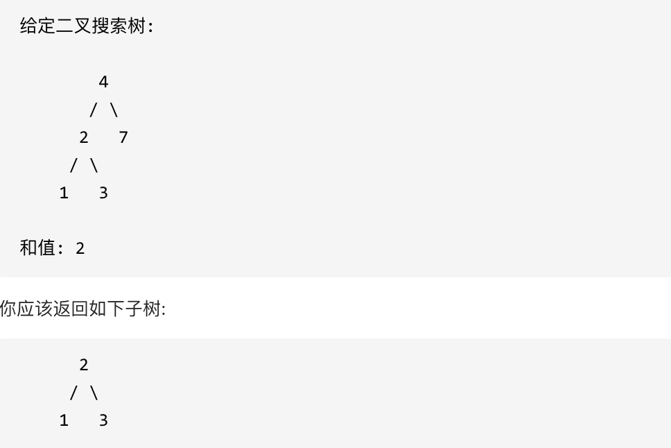
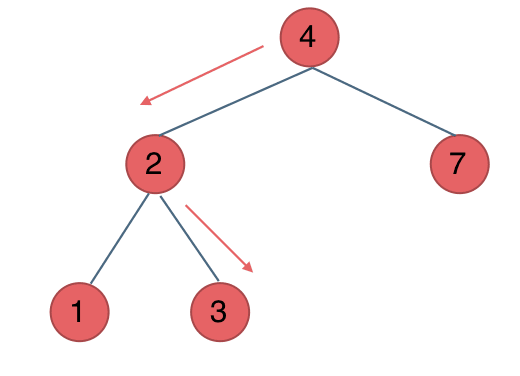

* [做專案（多個 C++、Java、Go、測試開發、前端（front end）專案）](https://www.programmercarl.com/other/kstar.html)
* [刷演算法（兩個月高強度學演算法）](https://www.programmercarl.com/xunlian/xunlianying.html)
* [背八股（40 天挑戰面試必考題（八股文））](https://www.programmercarl.com/xunlian/bagu.html)


# 700.二元搜尋樹中的搜尋

[LeetCode 題目位址](https://leetcode.cn/problems/search-in-a-binary-search-tree/)

給定二元搜尋樹（binary search tree, BST）的根節點（root node）和一個值（value）。 你需要在 BST 中找到節點（node）值等於給定值的節點。 回傳以該節點為根的子樹（subtree）。 如果節點不存在，則回傳 `NULL`。

例如，




在上述範例中，如果要找的值是 5，但因為沒有節點值為 5，我們應該回傳 `NULL`。

## 演算法影片公開課

**[《程式碼隨想錄》演算法影片公開課](https://programmercarl.com/other/gongkaike.html)：[不愧是搜尋樹，這次搜尋有方向了！| LeetCode：700.二元搜尋樹中的搜尋](https://www.bilibili.com/video/BV1wG411g7sF)，相信結合影片再看本篇題解，更有助於大家對本題的理解**。


## 解題思路

之前我們講的都是普通二元樹（binary tree），那麼接下來看看BST。

在[關於二元樹，你該了解這些！](https://programmercarl.com/二叉树理论基础.html)中，我們已經講過了BST。

BST是一個有序（ordered）樹（tree）：

* 若它的左子樹（left subtree）不空，則左子樹上所有節點的值均小於它的根節點的值；
* 若它的右子樹（right subtree）不空，則右子樹上所有節點的值均大於它的根節點的值；
* 它的左、右子樹也分別為BST

這就決定了，BST，遞迴（recursion）遍歷（traversal）和疊代（iteration）遍歷和普通二元樹都不一樣。

本題，其實就是在BST中搜尋一個節點。那麼我們來看看應該如何遍歷。

### 遞迴法

1. 確定遞迴函數（recursive function）的參數（parameter）和轉回值（return value）

遞迴函數的參數傳入的就是根節點和要搜尋的數值，回傳的就是以這個搜尋數值所在的節點。

程式碼如下：

```CPP 
TreeNode* searchBST(TreeNode* root, int val)
```

2. 確定終止條件（termination condition）

如果 `root` 為空，或者找到這個數值了，就回傳 `root` 節點。

```CPP 
if (root == NULL || root->val == val) return root;
```

3. 確定單層遞迴的邏輯

看看BST的單層遞迴邏輯有何不同。

因為BST的節點是有序的，所以可以有方向的去搜尋。

如果 `root->val > val`，搜尋左子樹，如果 `root->val < val`，就搜尋右子樹，最後如果都沒有搜尋到，就回傳 `NULL`。

程式碼如下：

```CPP
TreeNode* result = NULL;
if (root->val > val) result = searchBST(root->left, val);
if (root->val < val) result = searchBST(root->right, val);
return result;
```

很多讀者／錄友寫遞迴函數的時候 習慣直接寫 `searchBST(root->left, val)`，卻忘了 遞迴函數還有轉回值。 

遞迴函數的轉回值是什麼? 是 左子樹如果搜尋到了 `val`，要將該節點回傳。 如果不用一個變數（variable）將其接住，那麼轉回值不就沒了。

所以要 `result = searchBST(root->left, val)`。 

整體程式碼如下：

```CPP
class Solution {
public:
    TreeNode* searchBST(TreeNode* root, int val) {
        if (root == NULL || root->val == val) return root;
        TreeNode* result = NULL;
        if (root->val > val) result = searchBST(root->left, val);
        if (root->val < val) result = searchBST(root->right, val);
        return result;
    }
};
```

或者我們也可以這麼寫 

```CPP
class Solution {
public:
    TreeNode* searchBST(TreeNode* root, int val) {
        if (root == NULL || root->val == val) return root;
        if (root->val > val) return searchBST(root->left, val);
        if (root->val < val) return searchBST(root->right, val);
        return NULL;
    }
};
```


### 疊代法

一提到二元樹遍歷的疊代法，可能立刻想起使用堆疊（stack）來模擬（simulation）深度遍歷（depth-first traversal），使用佇列（queue）來模擬廣度遍歷（breadth-first traversal）。

對於BST可就不一樣了，因為BST的特殊性，也就是節點的有序性，可以不使用輔助堆疊或者佇列就可以寫出疊代法。

對於一般二元樹，遞迴過程中還有回溯（backtracking）的過程，例如走一個左方向的分支（branch）走到頭了，那麼要調頭，再走右分支。

而**對於BST，不需要回溯的過程，因為節點的有序性就幫我們確定了搜尋的方向。**

例如要搜尋元素（element）為 3 的節點，**我們不需要搜尋其他節點，也不需要做回溯，尋找的路徑（path）已經規劃好了。**

中間節點如果大於 3 就向左走，如果小於 3 就向右走，如圖：



所以疊代法程式碼如下：

```CPP
class Solution {
public:
    TreeNode* searchBST(TreeNode* root, int val) {
        while (root != NULL) {
            if (root->val > val) root = root->left;
            else if (root->val < val) root = root->right;
            else return root;
        }
        return NULL;
    }
};
```

第一次看到了如此簡單的疊代法，是不是感動得痛哭流涕，哭一會~

## 總結

本篇我們介紹了BST的遍歷方式，因為BST的有序性，遍歷的時候要比普通二元樹簡單很多。

但是一些同學很容易忽略BST的特性，所以寫出遍歷的程式碼就未必真的簡單了。

所以針對BST的題目，一樣要利用其特性。

文中我依然給出遞迴和疊代兩種方式，可以看出寫法都非常簡單，就是利用了BST有序的特點。


## 其他語言版本

### Java 

```Java
class Solution {
    // 遞迴，普通二元樹
    public TreeNode searchBST(TreeNode root, int val) {
        if (root == null || root.val == val) {
            return root;
        }
        TreeNode left = searchBST(root.left, val);
        if (left != null) {
            return left;
        }
        return searchBST(root.right, val);
    }
}

class Solution {
    // 遞迴，利用二元搜尋樹特點，最佳化
    public TreeNode searchBST(TreeNode root, int val) {
        if (root == null || root.val == val) {
            return root;
        }
        if (val < root.val) {
            return searchBST(root.left, val);
        } else {
            return searchBST(root.right, val);
        }
    }
}

class Solution {
    // 疊代，普通二元樹
    public TreeNode searchBST(TreeNode root, int val) {
        if (root == null || root.val == val) {
            return root;
        }
        Stack<TreeNode> stack = new Stack<>();
        stack.push(root);
        while (!stack.isEmpty()) {
            TreeNode pop = stack.pop();
            if (pop.val == val) {
                return pop;
            }
            if (pop.right != null) {
                stack.push(pop.right);
            }
            if (pop.left != null) {
                stack.push(pop.left);
            }
        }
        return null;
    }
}

class Solution {
    // 疊代，利用二元搜尋樹特點，最佳化，可以不需要堆疊
    public TreeNode searchBST(TreeNode root, int val) {
        while (root != null)
            if (val < root.val) root = root.left;
            else if (val > root.val) root = root.right;
            else return root;
        return null;
    }
}
```

### Python 

（方法一）遞迴

```python
class Solution:
    def searchBST(self, root: TreeNode, val: int) -> TreeNode:
        # 為什麼要有轉回值: 
        #   因為搜尋到目標節點就要立即 return，
        #   這樣才是找到節點就回傳（搜尋某一條邊），如果不加 return，就是遍歷整棵樹了。

        if not root or root.val == val: 
            return root

        if root.val > val: 
            return self.searchBST(root.left, val)

        if root.val < val: 
            return self.searchBST(root.right, val)

```

（方法二）疊代

```python
class Solution:
    def searchBST(self, root: TreeNode, val: int) -> TreeNode:
        while root:
            if val < root.val: root = root.left
            elif val > root.val: root = root.right
            else: return root
        return None
```

(方法三) 堆疊-遍歷
```python
class Solution:
    def searchBST(self, root: TreeNode, val: int) -> TreeNode:
        stack = [root]
        while stack:
            node = stack.pop()
            # 根據 TreeNode 的定義
            # node 攜帶有三類資訊 node.left/node.right/node.val
            # 找到 val 直接回傳 node 即是找到了該節點為根的子樹
            # 此處 node.left/node.right/val 的前後順序可打亂
            if node.val == val: 
                return node
            if node.right:
                stack.append(node.right)
            if node.left:
                stack.append(node.left)
        return None
```


### Go 

遞迴法：

```go
 //遞迴法
func searchBST(root *TreeNode, val int) *TreeNode {
    if root == nil || root.Val == val {
        return root
    }
    if root.Val > val {
        return searchBST(root.Left, val)
    }
    return searchBST(root.Right, val)
}
```

疊代法：

```go
 //疊代法
func searchBST(root *TreeNode, val int) *TreeNode {
    for root != nil {
        if root.Val > val {
            root = root.Left
        } else if root.Val < val {
            root = root.Right
        } else {
            return root
        }
    }
    return nil
}
```

### JavaScript

遞迴：

```javascript
/**
 * Definition for a binary tree node.
 * function TreeNode(val, left, right) {
 *     this.val = (val===undefined ? 0 : val)
 *     this.left = (left===undefined ? null : left)
 *     this.right = (right===undefined ? null : right)
 * }
 */
/**
 * @param {TreeNode} root
 * @param {number} val
 * @return {TreeNode}
 */
var searchBST = function (root, val) {
    if (!root || root.val === val) {
        return root;
    }
    if (root.val > val)
        return searchBST(root.left, val);
    if (root.val < val)
        return searchBST(root.right, val);
};
```

疊代：

```javascript
/**
 * Definition for a binary tree node.
 * function TreeNode(val, left, right) {
 *     this.val = (val===undefined ? 0 : val)
 *     this.left = (left===undefined ? null : left)
 *     this.right = (right===undefined ? null : right)
 * }
 */
/**
 * @param {TreeNode} root
 * @param {number} val
 * @return {TreeNode}
 */
var searchBST = function (root, val) {
    while (root !== null) {
        if (root.val > val)
            root = root.left;
        else if (root.val < val)
            root = root.right;
        else 
            return root;
    }
    return null;
};
```

### TypeScript

> 遞迴法

```typescript
function searchBST(root: TreeNode | null, val: number): TreeNode | null {
    if (root === null || root.val === val) return root;
    if (root.val < val) return searchBST(root.right, val);
    if (root.val > val) return searchBST(root.left, val);
    return null;
};
```

> 疊代法

```typescript
function searchBST(root: TreeNode | null, val: number): TreeNode | null {
    let resNode: TreeNode | null = root;
    while (resNode !== null) {
        if (resNode.val === val) return resNode;
        if (resNode.val < val) {
            resNode = resNode.right;
        } else {
            resNode = resNode.left;
        }
    }
    return null;
};
```

### Scala

遞迴:
```scala
object Solution {
  def searchBST(root: TreeNode, value: Int): TreeNode = {
    if (root == null || value == root.value) return root
    // 相當於三元運算式，在 Scala 中 if...else 有轉回值
    if (value < root.value) searchBST(root.left, value) else searchBST(root.right, value)
  }
}
```

疊代:
```scala
object Solution {
  def searchBST(root: TreeNode, value: Int): TreeNode = {
    // 因為 root 是不可變變數，所以需要賦值給一個可變變數
    var node = root
    while (node != null) {
      if (value < node.value) node = node.left
      else if (value > node.value) node = node.right
      else return node
    }
    null // 沒有回傳就回傳空
  }
}
```

### Rust

遞迴：

```rust
use std::cell::RefCell;
use std::rc::Rc;
impl Solution {
    pub fn search_bst(
        root: Option<Rc<RefCell<TreeNode>>>,
        val: i32,
    ) -> Option<Rc<RefCell<TreeNode>>> {
        if root.is_none() || root.as_ref().unwrap().borrow().val == val {
            return root;
        }
        let node_val = root.as_ref().unwrap().borrow().val;
        if node_val > val {
            return Self::search_bst(root.as_ref().unwrap().borrow().left.clone(), val);
        }
        if node_val < val {
            return Self::search_bst(root.unwrap().borrow().right.clone(), val);
        }
        None
    }
}
```

疊代：

```rust
use std::cell::RefCell;
use std::rc::Rc;
use std::cmp;
impl Solution {
    pub fn search_bst(
        mut root: Option<Rc<RefCell<TreeNode>>>,
        val: i32,
    ) -> Option<Rc<RefCell<TreeNode>>> {
        while let Some(ref node) = root.clone() {
            match val.cmp(&node.borrow().val) {
                cmp::Ordering::Less => root = node.borrow().left.clone(),
                cmp::Ordering::Equal => return root,
                cmp::Ordering::Greater => root = node.borrow().right.clone(),
            };
        }
        None
    }
}
```
### C#
```csharp
// 遞迴
public TreeNode SearchBST(TreeNode root, int val)
{
    if (root == null || root.val == val) return root;
    if (root.val > val) return SearchBST(root.left, val);
    if (root.val < val) return SearchBST(root.right, val);
    return null;
}
//  疊代
public TreeNode SearchBST(TreeNode root, int val)
{
    while (root != null)
    {
        if (root.val > val) root = root.left;
        else if (root.val < val) root = root.right;
        else return root;
    }
    return null;
}
```


