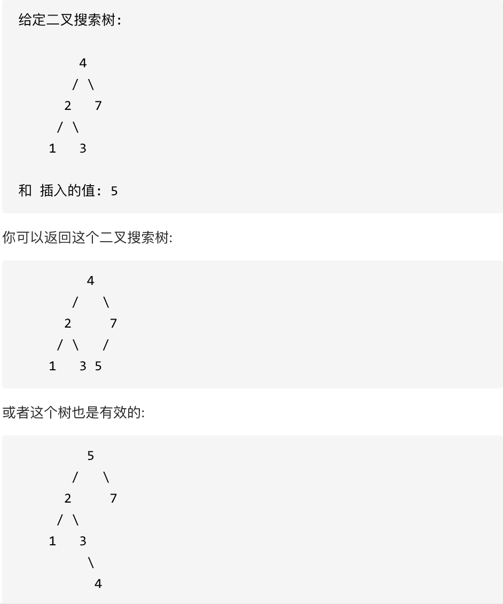
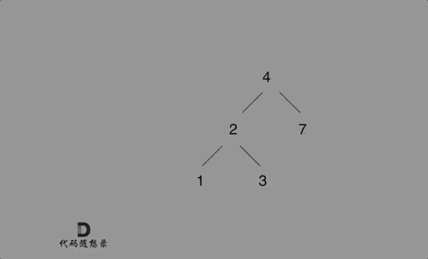

* [做專案（多個 C++、Java、Go、測試開發、前端（front end）專案）](https://www.programmercarl.com/other/kstar.html)
* [刷演算法（兩個月高強度學演算法）](https://www.programmercarl.com/xunlian/xunlianying.html)
* [背八股（40 天挑戰面試必考題（八股文））](https://www.programmercarl.com/xunlian/bagu.html)


# 701.二元搜尋樹中的插入操作

[LeetCode 題目連結](https://leetcode.cn/problems/insert-into-a-binary-search-tree/)

給定二元搜尋樹（binary search tree, BST）的根節點（root node）和要插入樹（tree）中的值（value），將值插入BST。 回傳插入後BST的根節點。 輸入資料保證，新值和原始BST中的任意節點（node）值都不同。

注意，可能存在多種有效的插入方式，只要樹在插入後仍保持為BST即可。 你可以回傳任意有效的結果。




提示：

* 給定的樹上的節點數介於 0 和 `10^4` 之間
* 每個節點都有一個唯一整數（integer）值，取值範圍從 0 到 `10^8`
* `-10^8 <= val <= 10^8`
* 新值和原始BST中的任意節點值都不同

## 演算法影片公開課 

**[《程式碼隨想錄》演算法影片公開課](https://programmercarl.com/other/gongkaike.html)：[原來這麼簡單？ | LeetCode：701.二元搜尋樹中的插入操作](https://www.bilibili.com/video/BV1Et4y1c78Y?share_source=copy_web)，相信結合影片再看本篇題解，更有助於大家對本題的理解**。

## 解題思路

這道題目其實是一道簡單題目，**但是題目中的提示：有多種有效的插入方式，還可以重構（refactoring）BST，一下子嚇退了不少人**，瞬間感覺題目複雜了很多。

其實**可以不考慮題目中提示所說的改變樹的結構的插入方式。**

如下演示影片中可以看出：只要按照BST的規則去遍歷（traversal），遇到空節點（`null node`）就插入節點就可以了。



例如插入元素（element） 10 ，需要找到末尾節點插入便可，一樣的道理來插入元素 15，插入元素 0，插入元素 6，**需要調整二元樹（binary tree）的結構麼？ 並不需要。**

只要遍歷BST，找到 `null node` 插入元素就可以了，那麼這道題其實就簡單了。

接下來就是遍歷BST的過程了。

### 遞迴（recursion）

遞迴三部曲：

* 確定遞迴函數（recursive function）參數（parameter）以及轉回值（return value）

參數就是根節點指標（pointer），以及要插入元素，這裡遞迴函數要不要有轉回值呢？

可以有，也可以沒有，但遞迴函數如果沒有轉回值的話，實作是比較麻煩的，下面也會給出其具體實作程式碼。

**有轉回值的話，可以利用轉回值完成新加入的節點與其父節點（father node）的賦值操作**。（下面會進一步解釋）

遞迴函數的傳回類型（return type）為節點類型 `TreeNode *` 。

程式碼如下：

```cpp
TreeNode* insertIntoBST(TreeNode* root, int val)
```

* 確定終止條件（termination condition）

終止條件就是找到遍歷的節點為 `null` 的時候，就是要插入節點的位置了，並把插入的節點回傳。

程式碼如下：

```cpp
if (root == NULL) {
    TreeNode* node = new TreeNode(val);
    return node;
}
```

這裡把添加的節點回傳給上一層，就完成了父子節點的賦值操作了，詳細再往下看。

* 確定單層遞迴的邏輯

此時要明確，需要遍歷整棵樹麼？

別忘了這是搜尋樹，遍歷整棵搜尋樹簡直是對搜尋樹的侮辱。

搜尋樹是有方向的，可以根據插入元素的數值，決定遞迴方向。

程式碼如下：

```cpp
if (root->val > val) root->left = insertIntoBST(root->left, val);
if (root->val < val) root->right = insertIntoBST(root->right, val);
return root;
```

**到這裡，大家應該能感受到，如何透過遞迴函數轉回值完成了新加入節點的父子關係賦值操作了，下一層將加入節點回傳，本層用 `root->left` 或者 `root->right` 將其接住**。


整體程式碼如下：

```CPP
class Solution {
public:
    TreeNode* insertIntoBST(TreeNode* root, int val) {
        if (root == NULL) {
            TreeNode* node = new TreeNode(val);
            return node;
        }
        if (root->val > val) root->left = insertIntoBST(root->left, val);
        if (root->val < val) root->right = insertIntoBST(root->right, val);
        return root;
    }
};
```

可以看出程式碼並不複雜。

剛剛說了遞迴函數不用轉回值也可以，找到插入的節點位置，直接讓其父節點指向插入節點，結束遞迴，也是可以的。

那麼遞迴函數定義如下：

```cpp
TreeNode* parent; // 記錄遍歷節點的父節點
void traversal(TreeNode* cur, int val)
```

沒有轉回值，需要記錄上一個節點（`parent`），遇到 `null node` 了，就讓 `parent` 左子節點（child node）或者右子節點指向新插入的節點。然後結束遞迴。

程式碼如下：

```CPP
class Solution {
private:
    TreeNode* parent;
    void traversal(TreeNode* cur, int val) {
        if (cur == NULL) {
            TreeNode* node = new TreeNode(val);
            if (val > parent->val) parent->right = node;
            else parent->left = node;
            return;
        }
        parent = cur;
        if (cur->val > val) traversal(cur->left, val);
        if (cur->val < val) traversal(cur->right, val);
        return;
    }

public:
    TreeNode* insertIntoBST(TreeNode* root, int val) {
        parent = new TreeNode(0);
        if (root == NULL) {
            root = new TreeNode(val);
        }
        traversal(root, val);
        return root;
    }
};
```

可以看出還是麻煩一些的。

我之所以舉這個例子，是想說明透過遞迴函數的轉回值完成父子節點的賦值是可以帶來便利的。

**網上千篇一律的程式碼，可能會誤導大家認為透過遞迴函數回傳節點 這樣的寫法是天經地義，其實這裡是有最佳化的！**


### 疊代（iteration）

再來看看疊代法，對BST疊代寫法不熟悉，可以看這篇：[二元樹：二元搜尋樹登場！](https://programmercarl.com/0700.二叉搜索树中的搜索.html)

在疊代法遍歷的過程中，需要記錄一下目前遍歷的節點的父節點，這樣才能做插入節點的操作。

在[二元樹：搜尋樹的最小絕對差](https://programmercarl.com/0530.二叉搜索树的最小绝对差.html)和[二元樹：我的 `mode` 是多少？](https://programmercarl.com/0501.二叉搜索树中的众数.html)中，都是用了記錄 `pre` 和 `cur` 兩個指標的技巧，本題也是一樣的。

程式碼如下：

```CPP
class Solution {
public:
    TreeNode* insertIntoBST(TreeNode* root, int val) {
        if (root == NULL) {
            TreeNode* node = new TreeNode(val);
            return node;
        }
        TreeNode* cur = root;
        TreeNode* parent = root; // 這個很重要，需要記錄上一個節點，否則無法賦值新節點
        while (cur != NULL) {
            parent = cur;
            if (cur->val > val) cur = cur->left;
            else cur = cur->right;
        }
        TreeNode* node = new TreeNode(val);
        if (val < parent->val) parent->left = node;// 此時是用 parent 節點進行賦值
        else parent->right = node;
        return root;
    }
};
```

## 總結

首先在BST中的插入操作，大家不用恐懼其重構搜尋樹，其實根本不用重構。

然後在遞迴中，我們重點講了如何透過遞迴函數的轉回值完成新加入節點和其父節點的賦值操作，並強調了搜尋樹的有序性。

最後依然給出了疊代的方法（method），疊代的方法就需要記錄目前遍歷節點的父節點了，這個和沒有轉回值的遞迴函數實作的程式碼邏輯是一樣的。


## 其他語言版本

### Java 

```java
class Solution {
    public TreeNode insertIntoBST(TreeNode root, int val) {
        if (root == null) return new TreeNode(val);
        TreeNode newRoot = root;
        TreeNode pre = root;
        while (root != null) {
            pre = root;
            if (root.val > val) {
                root = root.left;
            } else if (root.val < val) {
                root = root.right;
            } 
        }
        if (pre.val > val) {
            pre.left = new TreeNode(val);
        } else {
            pre.right = new TreeNode(val);
        }

        return newRoot;
    }
}
```

遞迴法

```java
class Solution {
    public TreeNode insertIntoBST(TreeNode root, int val) {
        if (root == null) // 如果目前節點為空，也就意味著 val 找到了合適的位置，此時建立節點直接回傳。
            return new TreeNode(val);
            
        if (root.val < val){
            root.right = insertIntoBST(root.right, val); // 遞迴建立右子樹
        }else if (root.val > val){
            root.left = insertIntoBST(root.left, val); // 遞迴建立左子樹
        }
        return root;
    }
}
```
-----
### Python 

遞迴法（版本一）
```python
class Solution:
    def __init__(self):
        self.parent = None

    def traversal(self, cur, val):
        if cur is None:
            node = TreeNode(val)
            if val > self.parent.val:
                self.parent.right = node
            else:
                self.parent.left = node
            return

        self.parent = cur
        if cur.val > val:
            self.traversal(cur.left, val)
        if cur.val < val:
            self.traversal(cur.right, val)

    def insertIntoBST(self, root, val):
        self.parent = TreeNode(0)
        if root is None:
            return TreeNode(val)
        self.traversal(root, val)
        return root
```

遞迴法（版本二）
```python
class Solution:
    def insertIntoBST(self, root: Optional[TreeNode], val: int) -> Optional[TreeNode]:
        if root is None or root.val == val:
            return TreeNode(val)
        elif root.val > val:
            if root.left is None:
                root.left = TreeNode(val)
            else:
                self.insertIntoBST(root.left, val)
        elif root.val < val:
            if root.right is None:
                root.right = TreeNode(val)
            else:
                self.insertIntoBST(root.right, val)
        return root
```

遞迴法（版本三）
```python
class Solution:
    def insertIntoBST(self, root, val):
        if root is None:
            node = TreeNode(val)
            return node

        if root.val > val:
            root.left = self.insertIntoBST(root.left, val)
        if root.val < val:
            root.right = self.insertIntoBST(root.right, val)

        return root
```

疊代法（版本一）
```python
class Solution:
    def insertIntoBST(self, root, val):
        if root is None:  # 如果根節點為空，建立新節點作為根節點並回傳
            node = TreeNode(val)
            return node

        cur = root
        parent = root  # 記錄上一個節點，用於連接新節點
        while cur is not None:
            parent = cur
            if cur.val > val:
                cur = cur.left
            else:
                cur = cur.right

        node = TreeNode(val)
        if val < parent.val:
            parent.left = node  # 將新節點連接到父節點的左子樹
        else:
            parent.right = node  # 將新節點連接到父節點的右子樹

        return root            
```

疊代法（版本二）
```python
class Solution:
    def insertIntoBST(self, root, val):
        if root is None:
            return TreeNode(val)
        parent = None
        cur = root
        while cur:
            parent = cur
            if val < cur.val:
                cur = cur.left
            else:
                cur = cur.right
        if val < parent.val:
            parent.left = TreeNode(val)
        else:
            parent.right = TreeNode(val)
        return root
```

疊代法（精簡）
```python
class Solution:
    def insertIntoBST(self, root: Optional[TreeNode], val: int) -> Optional[TreeNode]:
        if not root: # 如果根節點為空，建立新節點作為根節點並回傳
            return TreeNode(val)
        cur = root
        while cur:
            if val < cur.val:
                if not cur.left: # 如果此時父節點的左子樹為空
                    cur.left = TreeNode(val) # 將新節點連接到父節點的左子樹
                    return root
                else:
                    cur = cur.left
            elif val > cur.val:
                if not cur.right: # 如果此時父節點的右子樹為空
                    cur.right = TreeNode(val) # 將新節點連接到父節點的右子樹
                    return root
                else:
                    cur = cur.right

```

-----
### Go 

遞迴法

```Go
func insertIntoBST(root *TreeNode, val int) *TreeNode {
    if root == nil {
        root = &TreeNode{Val: val}
        return root
    }
    if root.Val > val {
        root.Left = insertIntoBST(root.Left, val)
    } else {
        root.Right = insertIntoBST(root.Right, val)
    }
    return root
}
```

疊代法 

```go
func insertIntoBST(root *TreeNode, val int) *TreeNode {
    if root == nil {
        return &TreeNode{Val:val}
    }
    node := root
    var pnode *TreeNode
    for node != nil {
        if val > node.Val {
            pnode = node
            node = node.Right
        } else {
            pnode = node
            node = node.Left
        }
    }
    if val > pnode.Val {
        pnode.Right = &TreeNode{Val: val}
    } else {
        pnode.Left = &TreeNode{Val: val}
    }
    return root
}
```
-----
### JavaScript 

有轉回值的遞迴寫法

```javascript
/**
 * Definition for a binary tree node.
 * function TreeNode(val, left, right) {
 *     this.val = (val===undefined ? 0 : val)
 *     this.left = (left===undefined ? null : left)
 *     this.right = (right===undefined ? null : right)
 * }
 */
/**
 * @param {TreeNode} root
 * @param {number} val
 * @return {TreeNode}
 */
var insertIntoBST = function (root, val) {
    const setInOrder = (root, val) => {
        if (root === null) {
            let node = new TreeNode(val);
            return node;
        }
        if (root.val > val)
            root.left = setInOrder(root.left, val);
        else if (root.val < val)
            root.right = setInOrder(root.right, val);
        return root;
    }
    return setInOrder(root, val);
};
```

無轉回值的遞迴

```javascript
/**
 * Definition for a binary tree node.
 * function TreeNode(val, left, right) {
 *     this.val = (val===undefined ? 0 : val)
 *     this.left = (left===undefined ? null : left)
 *     this.right = (right===undefined ? null : right)
 * }
 */
/**
 * @param {TreeNode} root
 * @param {number} val
 * @return {TreeNode}
 */
var insertIntoBST = function (root, val) {
    let parent = new TreeNode(0);
    const preOrder = (cur, val) => {
        if (cur === null) {
            let node = new TreeNode(val);
            if (parent.val > val)
                parent.left = node;
            else
                parent.right = node;
            return;
        }
        parent = cur;
        if (cur.val > val)
            preOrder(cur.left, val);
        if (cur.val < val)
            preOrder(cur.right, val);
    }
    if (root === null)
        root = new TreeNode(val);
    preOrder(root, val);
    return root;
};
```

疊代

```javascript
/**
 * Definition for a binary tree node.
 * function TreeNode(val, left, right) {
 *     this.val = (val===undefined ? 0 : val)
 *     this.left = (left===undefined ? null : left)
 *     this.right = (right===undefined ? null : right)
 * }
 */
/**
 * @param {TreeNode} root
 * @param {number} val
 * @return {TreeNode}
 */
var insertIntoBST = function (root, val) {
    if (root === null) {
        root = new TreeNode(val);
    } else {
        let parent = new TreeNode(0);
        let cur = root;
        while (cur) {
            parent = cur;
            if (cur.val > val)
                cur = cur.left;
            else
                cur = cur.right;
        }
        let node = new TreeNode(val);
        if (parent.val > val)
            parent.left = node;
        else
            parent.right = node;
    }
    return root;
};
```

### TypeScript

> 遞迴-有轉回值

```typescript
function insertIntoBST(root: TreeNode | null, val: number): TreeNode | null {
    if (root === null) return new TreeNode(val);
    if (root.val > val) {
        root.left = insertIntoBST(root.left, val);
    } else {
        root.right = insertIntoBST(root.right, val);
    }
    return root;
};
```

> 遞迴-無轉回值

```typescript
function insertIntoBST(root: TreeNode | null, val: number): TreeNode | null {
    if (root === null) return new TreeNode(val);
    function recur(root: TreeNode | null, val: number) {
        if (root === null) {
            if (parentNode.val > val) {
                parentNode.left = new TreeNode(val);
            } else {
                parentNode.right = new TreeNode(val);
            }
            return;
        }
        parentNode = root;
        if (root.val > val) recur(root.left, val);
        if (root.val < val) recur(root.right, val);
    }
    let parentNode: TreeNode = root;
    recur(root, val);
    return root;
};
```

> 疊代法

```typescript
function insertIntoBST(root: TreeNode | null, val: number): TreeNode | null {
    if (root === null) return new TreeNode(val);
    let curNode: TreeNode | null = root;
    let parentNode: TreeNode = root;
    while (curNode !== null) {
        parentNode = curNode;
        if (curNode.val > val) {
            curNode = curNode.left
        } else {
            curNode = curNode.right;
        }
    }
    if (parentNode.val > val) {
        parentNode.left = new TreeNode(val);
    } else {
        parentNode.right = new TreeNode(val);
    }
    return root;
};
```


### Scala

遞迴:

```scala
object Solution {
  def insertIntoBST(root: TreeNode, `val`: Int): TreeNode = {
    if (root == null) return new TreeNode(`val`)
    if (`val` < root.value) root.left = insertIntoBST(root.left, `val`) 
    else root.right = insertIntoBST(root.right, `val`)
    root  // 回傳根節點
  }
}
```

疊代:

```scala
object Solution {
  def insertIntoBST(root: TreeNode, `val`: Int): TreeNode = {
    if (root == null) {
      return new TreeNode(`val`)
    }
    var parent = root   // 記錄目前節點的父節點
    var curNode = root
    while (curNode != null) {
      parent = curNode
      if(`val` < curNode.value) curNode = curNode.left
      else curNode = curNode.right
    }
    if(`val` < parent.value) parent.left = new TreeNode(`val`)
    else parent.right = new TreeNode(`val`)
    root  // 最後回傳根節點
  }
}
```

### Rust

疊代：

```rust
impl Solution {
    pub fn insert_into_bst(
        root: Option<Rc<RefCell<TreeNode>>>,
        val: i32,
    ) -> Option<Rc<RefCell<TreeNode>>> {
        if root.is_none() {
            return Some(Rc::new(RefCell::new(TreeNode::new(val))));
        }
        let mut cur = root.clone();
        let mut pre = None;
        while let Some(node) = cur.clone() {
            pre = cur;
            if node.borrow().val > val {
                cur = node.borrow().left.clone();
            } else {
                cur = node.borrow().right.clone();
            };
        }
        let r = Some(Rc::new(RefCell::new(TreeNode::new(val))));
        let mut p = pre.as_ref().unwrap().borrow_mut();
        if val < p.val {
            p.left = r;
        } else {
            p.right = r;
        }

        root
    }
}
```

遞迴：

```rust
impl Solution {
    pub fn insert_into_bst(
        root: Option<Rc<RefCell<TreeNode>>>,
        val: i32,
    ) -> Option<Rc<RefCell<TreeNode>>> {
        if let Some(node) = &root {
            if node.borrow().val > val {
                let left = Self::insert_into_bst(node.borrow_mut().left.take(), val);
                node.borrow_mut().left = left;
            } else {
                let right = Self::insert_into_bst(node.borrow_mut().right.take(), val);
                node.borrow_mut().right = right;
            }
            root
        } else {
            Some(Rc::new(RefCell::new(TreeNode::new(val))))
        }
    }
}
```
### C#
``` C#
// 遞迴
public TreeNode InsertIntoBST(TreeNode root, int val) {
    if (root == null) return new TreeNode(val);

    if (root.val > val) root.left = InsertIntoBST(root.left, val);
    if (root.val < val) root.right = InsertIntoBST(root.right, val);
    return root;
}
```


