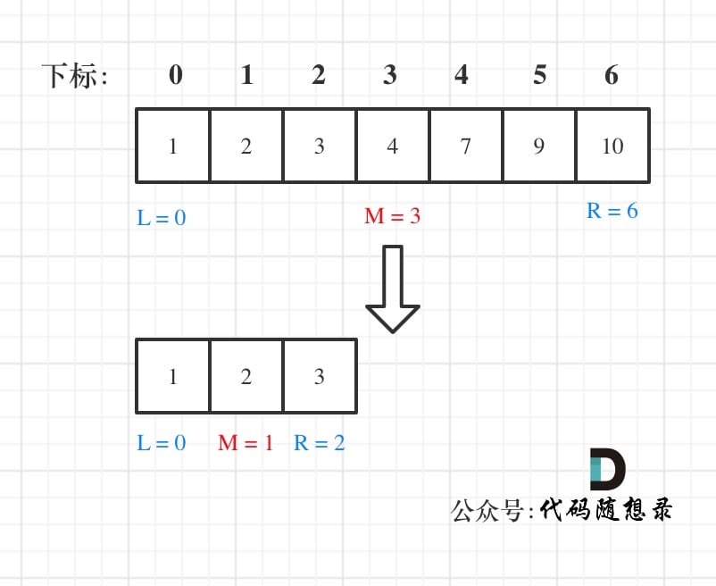
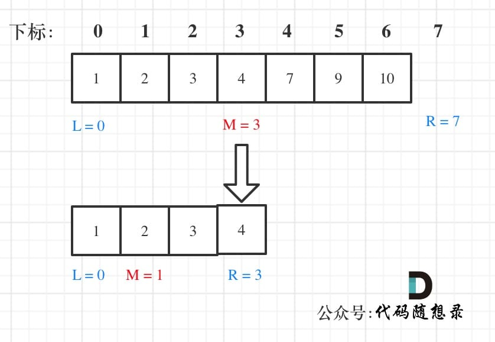

* [做專案（多個 C++、Java、Go、測試開發、前端專案）](https://www.programmercarl.com/other/kstar.html)
* [刷演算法（兩個月高強度學習演算法）](https://www.programmercarl.com/xunlian/xunlianying.html)
* [背八股（40 天挑戰高頻面試題）](https://www.programmercarl.com/xunlian/bagu.html)


# 704. 二元搜尋（binary search）

[LeetCode 題目連結](https://leetcode.cn/problems/binary-search/)

給定一個 n 個元素（element）有序（ordered）的（升序（ascending））整數（integer）陣列（array） nums 和一個目標值 target ，寫一個函式（function）搜尋 nums 中的 target，如果目標值存在回傳下標（subscript），否則回傳 -1。

範例 1:        

```
輸入: nums = [-1,0,3,5,9,12], target = 9     
輸出: 4       
解釋: 9 出現在 nums 中並且下標為 4     
```

範例 2:    

```
輸入: nums = [-1,0,3,5,9,12], target = 2     
輸出: -1        
解釋: 2 不存在 nums 中因此回傳 -1        
```

提示：    

* 你可以假設 nums 中的所有元素是不重複的。
* n 將在 [1, 10000] 之間。
* nums 的每個元素都將在 [-9999, 9999] 之間。

## 演算法公開課

**[《程式碼隨想錄》演算法影片公開課](https://programmercarl.com/other/gongkaike.html)：[手把手帶你撕出正確的二元搜尋法](https://www.bilibili.com/video/BV1fA4y1o715)，相信結合影片再看本篇題解，更有助於大家對本題的理解**。


## 解題思路

**這道題目的前提是陣列為有序陣列（ordered array）**，同時題目還強調**陣列中無重複元素**，因為一旦有重複元素，使用二元搜尋法回傳的元素下標可能不是唯一的，這些都是使用二元搜尋法的前提條件，當大家看到題目描述滿足如上條件的時候，可要想一想是不是可以用二元搜尋法了。

二元搜尋涉及很多的邊界條件（boundary condition），邏輯比較簡單，但就是寫不好。例如到底是 `while(left < right)` 還是 `while(left <= right)`，到底是 `right = middle` 呢，還是要 `right = middle - 1` 呢？

大家寫二元搜尋法經常寫亂，主要是因為**對區間（interval）的定義沒有想清楚，區間的定義就是不變量**。要在二元搜尋的過程中，保持不變量，就是在 while 尋找中每一次邊界（boundary）的處理都要堅持根據區間的定義來操作，這就是 **loop invariant** 規則。

寫二元搜尋法，區間的定義一般為兩種，左閉右閉即 [left, right]，或者左閉右開即 [left, right)。

下面我用這兩種區間的定義分別講解兩種不同的二元搜尋寫法。

### 二元搜尋法第一種寫法

第一種寫法，我們定義 target 是在一個左閉右閉的區間裡，**也就是 [left, right] （這個很重要非常重要）**。

區間的定義就決定了二元搜尋法的程式碼應該如何寫，**因為定義 target 在 [left, right] 區間，所以有如下兩點：**

* while (left <= right) 要使用 <= ，因為 left == right 是有意義的，所以使用 <=
* if (nums[middle] > target) right 要賦值為 middle - 1，因為當前這個 nums[middle] 一定不是 target，那麼接下來要搜尋的左區間結束下標位置就是 middle - 1

例如在陣列：1,2,3,4,7,9,10 中搜尋元素 2，如圖所示：



程式碼如下：（詳細註解）

```CPP
// 版本一
class Solution {
public:
    int search(vector<int>& nums, int target) {
        int left = 0;
        int right = nums.size() - 1; // 定義target在左閉右閉的區間裡，[left, right]
        while (left <= right) { // 當left==right，區間[left, right]依然有效，所以用 <=
            int middle = left + ((right - left) / 2);// 防止溢位 等同於(left + right)/2
            if (nums[middle] > target) {
                right = middle - 1; // target 在左區間，所以[left, middle - 1]
            } else if (nums[middle] < target) {
                left = middle + 1; // target 在右區間，所以[middle + 1, right]
            } else { // nums[middle] == target
                return middle; // 陣列中找到目標值，直接回傳下標
            }
        }
        // 未找到目標值
        return -1;
    }
};

```
* 時間複雜性（time complexity）：O(log n)
* 空間複雜度（space complexity）：O(1)


### 二元搜尋法第二種寫法

如果說定義 target 是在一個左閉右開的區間裡，也就是 [left, right) ，那麼二元搜尋法的邊界處理方式則截然不同。

有如下兩點：

* while (left < right)，這裡使用 < ，因為 left == right 在區間 [left, right) 是沒有意義的
* if (nums[middle] > target) right 更新為 middle，因為當前 nums[middle] 不等於 target，去左區間繼續尋找，而尋找區間是左閉右開區間，所以 right 更新為 middle，即：下一個查詢區間不會去比較 nums[middle]

在陣列：1,2,3,4,7,9,10 中搜尋元素 2，如圖所示：（**注意和方法一的區別**）




程式碼如下：（詳細註解）

```CPP
// 版本二
class Solution {
public:
    int search(vector<int>& nums, int target) {
        int left = 0;
        int right = nums.size(); // 定義target在左閉右開的區間裡，即：[left, right)
        while (left < right) { // 因為left == right的時候，在[left, right)是無效的空間，所以使用 <
            int middle = left + ((right - left) >> 1);
            if (nums[middle] > target) {
                right = middle; // target 在左區間，在[left, middle)中
            } else if (nums[middle] < target) {
                left = middle + 1; // target 在右區間，在[middle + 1, right)中
            } else { // nums[middle] == target
                return middle; // 陣列中找到目標值，直接回傳下標
            }
        }
        // 未找到目標值
        return -1;
    }
};
```
* 時間複雜性：O(log n)
* 空間複雜度：O(1)


## 總結

二元搜尋法是非常重要的基礎演算法，為什麼很多同學對於二元搜尋法都是**一看就會，一寫就廢**？

其實主要就是對區間的定義沒有理解清楚，在迴圈（loop）中沒有始終堅持根據搜尋區間的定義來做邊界處理。

區間的定義就是不變量，那麼在迴圈中堅持根據搜尋區間的定義來做邊界處理，就是 loop invariant 規則。

本篇根據兩種常見的區間定義，給出了兩種二元搜尋法的寫法，每一個邊界為什麼這麼處理，都根據區間的定義做了詳細介紹。

相信看完本篇應該對二元搜尋法有更深刻的理解了。

## 相關題目推薦

* [35.搜尋插入位置](https://programmercarl.com/0035.搜索插入位置.html)
* [34.在排序陣列中查找元素的第一個和最後一個位置](https://programmercarl.com/0034.%E5%9C%A8%E6%8E%92%E5%BA%8F%E6%95%B0%E7%BB%84%E4%B8%AD%E6%9F%A5%E6%89%BE%E5%85%83%E7%B4%A0%E7%9A%84%E7%AC%AC%E4%B8%80%E4%B8%AA%E5%92%8C%E6%9C%80%E5%90%8E%E4%B8%80%E4%B8%AA%E4%BD%8D%E7%BD%AE.html)
* [69.x 的平方根](https://leetcode.cn/problems/sqrtx/)
* [367.有效的完全平方數](https://leetcode.cn/problems/valid-perfect-square/)


## 其他語言版本

### **Java：**

（版本一）左閉右閉區間

```java
class Solution {
    public int search(int[] nums, int target) {
        // 避免當 target 小於nums[0] nums[nums.length - 1]時多次迴圈運算
        if (target < nums[0] || target > nums[nums.length - 1]) {
            return -1;
        }
        int left = 0, right = nums.length - 1;
        while (left <= right) {
            int mid = left + ((right - left) >> 1);
            if (nums[mid] == target) {
                return mid;
            }
            else if (nums[mid] < target) {
                left = mid + 1;
            }
            else { // nums[mid] > target
                right = mid - 1;
            }
        }
        // 未找到目標值
        return -1;
    }
}
```

（版本二）左閉右開區間

```java
class Solution {
    public int search(int[] nums, int target) {
        int left = 0, right = nums.length;
        while (left < right) {
            int mid = left + ((right - left) >> 1);
            if (nums[mid] == target) {
                return mid;
            }
            else if (nums[mid] < target) {
                left = mid + 1;
            }
            else { // nums[mid] > target
                right = mid;
            }
        }
        // 未找到目標值
        return -1;
    }
}
```

### **Python：**

（版本一）左閉右閉區間

```python
class Solution:
    def search(self, nums: List[int], target: int) -> int:
        left, right = 0, len(nums) - 1  # 定義target在左閉右閉的區間裡，[left, right]

        while left <= right:
            middle = left + (right - left) // 2
            
            if nums[middle] > target:
                right = middle - 1  # target在左區間，所以[left, middle - 1]
            elif nums[middle] < target:
                left = middle + 1  # target在右區間，所以[middle + 1, right]
            else:
                return middle  # 陣列中找到目標值，直接回傳下標
        return -1  # 未找到目標值
```

（版本二）左閉右開區間

```python
class Solution:
    def search(self, nums: List[int], target: int) -> int:
        left, right = 0, len(nums)  # 定義target在左閉右開的區間裡，即：[left, right)

        while left < right:  # 因為left == right的時候，在[left, right)是無效的空間，所以使用 <
            middle = left + (right - left) // 2

            if nums[middle] > target:
                right = middle  # target 在左區間，在[left, middle)中
            elif nums[middle] < target:
                left = middle + 1  # target 在右區間，在[middle + 1, right)中
            else:
                return middle  # 陣列中找到目標值，直接回傳下標
        return -1  # 未找到目標值
```

### **Go：**

（版本一）左閉右閉區間

```go
// 時間複雜性 O(logn)
func search(nums []int, target int) int {
	// 初始化左右邊界
	left := 0
	right := len(nums) - 1

	// 迴圈逐步縮小區間範圍
	for left <= right {
		// 求區間中點
		mid := left + (right-left)>>1

		// 根據 nums[mid] 和 target 的大小關係
		// 調整區間範圍
		if nums[mid] == target {
			return mid
		} else if nums[mid] < target {
			left = mid + 1
		} else {
			right = mid - 1
		}
	}

	// 在輸入陣列內沒有找到值等於 target 的元素
	return -1
}
```

（版本二）左閉右開區間

```go
// 時間複雜性 O(logn)
func search(nums []int, target int) int {
	// 初始化左右邊界
	left := 0
	right := len(nums)

	// 迴圈逐步縮小區間範圍
	for left < right {
		// 求區間中點
		mid := left + (right-left)>>1

		// 根據 nums[mid] 和 target 的大小關係
		// 調整區間範圍
		if nums[mid] == target {
			return mid
		} else if nums[mid] < target {
			left = mid + 1
		} else {
			right = mid
		}
	}

	// 在輸入陣列內沒有找到值等於 target 的元素
	return -1
}
```

### **JavaScript:**
（版本一）左閉右閉區間 [left, right]

```js
/**
 * @param {number[]} nums
 * @param {number} target
 * @return {number}
 */
var search = function(nums, target) {
    // right是陣列最後一個數的下標，num[right]在搜尋範圍內，是左閉右閉區間
    let mid, left = 0, right = nums.length - 1;
    // 當left=right時，由於nums[right]在搜尋範圍內，所以要包括此情況
    while (left <= right) {
        // 按位元運算 + 防止大數溢位
        mid = left + ((right - left) >> 1);
        // 如果中間數大於目標值，要把中間數排除搜尋範圍，所以右邊界更新為mid-1；如果右邊界更新為mid，那中間數還在下次搜尋範圍內
        if (nums[mid] > target) {
            right = mid - 1;  // 去左面閉區間尋找
        } else if (nums[mid] < target) {
            left = mid + 1;   // 去右面閉區間尋找
        } else {
            return mid;
        }
    }
    return -1;
};
```
（版本二）左閉右開區間 [left, right)

```js
/**
 * @param {number[]} nums
 * @param {number} target
 * @return {number}
 */
var search = function(nums, target) {
    // right是陣列最後一個數的下標+1，nums[right]不在搜尋範圍內，是左閉右開區間
    let mid, left = 0, right = nums.length;    
    // 當left=right時，由於nums[right]不在搜尋範圍，所以不必包括此情況
    while (left < right) {
        // 按位元運算 + 防止大數溢位
        mid = left + ((right - left) >> 1);
        // 如果中間值大於目標值，中間值不應在下次搜尋的範圍內，但中間值的前一個值應在；
        // 由於right本來就不在搜尋範圍內，所以將右邊界更新為中間值，如果更新右邊界為mid-1則將中間值的前一個值也踢出了下次尋找範圍
        if (nums[mid] > target) {
            right = mid;  // 去左區間尋找
        } else if (nums[mid] < target) {
            left = mid + 1;   // 去右區間尋找
        } else {
            return mid;
        }
    }
    return -1;
};
```

### **TypeScript**

（版本一）左閉右閉區間

```typescript
function search(nums: number[], target: number): number {
    let mid: number, left: number = 0, right: number = nums.length - 1;
    while (left <= right) {
        // 按位元運算 + 防止大數溢位
        mid = left + ((right - left) >> 1);
        if (nums[mid] > target) {
            right = mid - 1;
        } else if (nums[mid] < target) {
            left = mid + 1;
        } else {
            return mid;
        }
    }
    return -1;
};
```

（版本二）左閉右開區間

```typescript
function search(nums: number[], target: number): number {
    let mid: number, left: number = 0, right: number = nums.length;
    while (left < right) {
        // 按位元運算 + 防止大數溢位
        mid = left +((right - left) >> 1);
        if (nums[mid] > target) {
            right = mid;
        } else if (nums[mid] < target) {
            left = mid + 1;
        } else {
            return mid;
        }
    }
    return -1;
};
```

### **Ruby:**

```ruby
# （版本一）左閉右閉區間

def search(nums, target)
  left, right = 0, nums.length - 1
  while left <= right	# 由於定義target在一個左閉右閉的區間裡，因此極限情況下存在left==right
    middle = (left + right) / 2
    if nums[middle] > target
      right = middle - 1
    elsif nums[middle] < target
      left = middle + 1
    else
      return middle	# return兼具回傳與跳出迴圈的作用
    end
  end
  -1
end

# （版本二）左閉右開區間

def search(nums, target)
  left, right = 0, nums.length
  while left < right	# 由於定義target在一個左閉右開的區間裡，因此極限情況下right=left+1
    middle = (left + right) / 2
    if nums[middle] > target
      right = middle
    elsif nums[middle] < target
      left = middle + 1
    else
      return middle
    end
  end
  -1
end
```

### **Swift:**

```swift
// （版本一）左閉右閉區間
func search(nums: [Int], target: Int) -> Int {
    // 1. 先定義區間。這裡的區間是[left, right]
    var left = 0
    var right = nums.count - 1

    while left <= right {// 因為taeget是在[left, right]中，包括兩個邊界值，所以這裡的left == right是有意義的
        // 2. 計算區間中間的下標（如果left、right都比較大的情況下，left + right就有可能會溢位）
        // let middle = (left + right) / 2
        // 防溢位：
         let middle = left + (right - left) / 2

        // 3. 判斷
        if target < nums[middle] {
            // 當目標在區間左側，就需要更新右邊的邊界值，新區間為[left, middle - 1]
            right = middle - 1
        } else if target > nums[middle] {
            // 當目標在區間右側，就需要更新左邊的邊界值，新區間為[middle + 1, right]
            left = middle + 1
        } else { 
            // 當目標就是在中間，則回傳中間值的下標
            return middle
        }
    }

    // 如果找不到目標，則回傳-1
    return -1
}
    
// （版本二）左閉右開區間
func search(nums: [Int], target: Int) -> Int {
    var left = 0
    var right = nums.count

    while left < right {
        let middle = left + ((right - left) >> 1)

        if target < nums[middle] {
            right = middle
        } else if target > nums[middle] {
            left = middle + 1
        } else {
            return middle
        }
    }

    return -1
}

```

### **Rust:**

（版本一）左閉右閉區間

```rust
use std::cmp::Ordering;
impl Solution {
    pub fn search(nums: Vec<i32>, target: i32) -> i32 {
        let (mut left, mut right) = (0_i32, nums.len() as i32 - 1);
        while left <= right {
            let mid = (right + left) / 2;
            match nums[mid as usize].cmp(&target) {
                Ordering::Less => left = mid + 1,
                Ordering::Greater => right = mid - 1,
                Ordering::Equal => return mid,
            }
        }
        -1
    }
}
```

//（版本二）左閉右開區間

```rust
use std::cmp::Ordering;
impl Solution {
    pub fn search(nums: Vec<i32>, target: i32) -> i32 {
        let (mut left, mut right) = (0_i32, nums.len() as i32);
        while left < right {
            let mid = (right + left) / 2;
            match nums[mid as usize].cmp(&target) {
                Ordering::Less => left = mid + 1,
                Ordering::Greater => right = mid,
                Ordering::Equal => return mid,
            }
        }
        -1
    }
}
```

### **C:**

```c
// (版本一) 左閉右閉區間 [left, right]
int search(int* nums, int numsSize, int target){
    int left = 0;
    int right = numsSize-1;
    int middle = 0;
    //若left小於等於right，說明區間中元素不為0
    while(left<=right) {
        //更新搜尋下標middle的值
        middle = (left+right)/2;
        //此時target可能會在[left,middle-1]區間中
        if(nums[middle] > target) {
            right = middle-1;
        } 
        //此時target可能會在[middle+1,right]區間中
        else if(nums[middle] < target) {
            left = middle+1;
        } 
        //當前下標元素等於target值時，回傳middle
        else if(nums[middle] == target){
            return middle;
        }
    }
    //若未找到target元素，回傳-1
    return -1;
}
```
```C
// (版本二) 左閉右開區間 [left, right)
int search(int* nums, int numsSize, int target){
    int length = numsSize;
    int left = 0;
    int right = length;	//定義target在左閉右開的區間裡，即：[left, right)
    int middle = 0;
    while(left < right){  // left == right時，區間[left, right)屬於空集合，所以用 < 避免該情況
        int middle = left + (right - left) / 2;
        if(nums[middle] < target){
            //target位於(middle , right) 中為保證集合區間的左閉右開性，可等價為[middle + 1,right)
            left = middle + 1;
        }else if(nums[middle] > target){
            //target位於[left, middle)中
            right = middle ;
        }else{	// nums[middle] == target ，找到目標值target
            return middle;
        }
    }
    //未找到目標值，回傳-1
    return -1;
}
```

### **PHP:**

```php
// 左閉右閉區間
class Solution {
    /**
     * @param Integer[] $nums
     * @param Integer $target
     * @return Integer
     */
    function search($nums, $target) {
        if (count($nums) == 0) {
            return -1;
        }
        $left = 0;
        $right = count($nums) - 1;
        while ($left <= $right) {
            $mid = floor(($left + $right) / 2);
            if ($nums[$mid] == $target) {
                return $mid;
            }
            if ($nums[$mid] > $target) {
                $right = $mid - 1;
            }
            else {
                $left = $mid + 1;
            }
        }
        return -1;
    }
}
```

### **C#:**

```csharp
//左閉右閉
public class Solution {  
    public int Search(int[] nums, int target) {
        int left = 0;
        int right = nums.Length - 1;
        while(left <= right){
            int mid = (right - left ) / 2 + left;
            if(nums[mid] == target){
                return mid;
            }
            else if(nums[mid] < target){
                left = mid+1;
            }
            else if(nums[mid] > target){
                right = mid-1;
            }
        }
        return -1;
    }
}

//左閉右開
public class Solution{
    public int Search(int[] nums, int target){
        int left = 0;
        int right = nums.Length;
        while(left < right){
            int mid = (right - left) / 2 + left;
            if(nums[mid] == target){
                return mid;
            }
            else if(nums[mid] < target){
                left = mid + 1;
            }
            else if(nums[mid] > target){
                right = mid;
            }
        }
        return -1;
    }
}
```

### **Kotlin:**

```kotlin
class Solution {
    fun search(nums: IntArray, target: Int): Int {
	// leftBorder
        var left:Int = 0
	// rightBorder
        var right:Int = nums.size - 1
	// 使用左閉右閉區間
        while (left <= right) {
            var middle:Int = left + (right - left)/2
	    // taget 在左邊
            if (nums[middle] > target) {
                right = middle - 1
            }
            else {
		// target 在右邊
                if (nums[middle] < target) {
                    left = middle + 1
                }
		// 找到了，回傳
                else   return middle
                }
            }
	    // 沒找到，回傳
            return -1   
        }
}
```

### **Kotlin:**

```Kotlin
// （版本一）左閉右開區間
class Solution {
    fun search(nums: IntArray, target: Int): Int {
        var left = 0
        var right = nums.size // [left,right) 右側為開區間，right 設定為 nums.size
        while (left < right) {
            val mid = (left + right) / 2
            if (nums[mid] < target) left = mid + 1
            else if (nums[mid] > target) right = mid // 程式碼的核心，迴圈中 right 是開區間，這裡也應是開區間
            else return mid
        }
        return -1 // 沒有找到 target ，回傳 -1
    }
}
// （版本二）左閉右閉區間
class Solution {
    fun search(nums: IntArray, target: Int): Int {
        var left = 0
        var right = nums.size - 1 // [left,right] 右側為閉區間，right 設定為 nums.size - 1
        while (left <= right) {
            val mid = (left + right) / 2
            if (nums[mid] < target) left = mid + 1
            else if (nums[mid] > target) right = mid - 1 // 程式碼的核心，迴圈中 right 是閉區間，這裡也應是閉區間
            else return mid
        }
        return -1 // 沒有找到 target ，回傳 -1
    }
}
```
### **Scala:**

（版本一）左閉右閉區間
```scala
object Solution {
  def search(nums: Array[Int], target: Int): Int = {
    var left = 0
    var right = nums.length - 1
    while (left <= right) {
      var mid = left + ((right - left) / 2)
      if (target == nums(mid)) {
        return mid
      } else if (target < nums(mid)) {
        right = mid - 1
      } else {
        left = mid + 1
      }
    }
    -1
  }
}
```
（版本二）左閉右開區間
```scala
object Solution {
  def search(nums: Array[Int], target: Int): Int = {
    var left = 0
    var right = nums.length
    while (left < right) {
      val mid = left + (right - left) / 2
      if (target == nums(mid)) {
        return mid
      } else if (target < nums(mid)) {
        right = mid
      } else {
        left = mid + 1
      }
    }
    -1
  }
}
```
**Dart:**


```dart
（版本一）左閉右閉區間
class Solution {
  int search(List<int> nums, int target) {
    int left = 0;
    int right = nums.length - 1;
    while (left <= right) {
      int middle = ((left + right)/2).truncate();
      switch (nums[middle].compareTo(target)) {
        case 1:
          right = middle - 1;
          continue;
        case -1:
          left = middle + 1;
          continue;
        default:
          return middle;
      }
    }
    return -1;
  }
}

（版本二）左閉右開區間
class Solution {
  int search(List<int> nums, int target) {
    int left = 0;
    int right = nums.length;
    while (left < right) {
      int middle = left + ((right - left) >> 1);
      switch (nums[middle].compareTo(target)) {
        case 1:
          right = middle;
          continue;
        case -1:
          left = middle + 1;
          continue;
        default:
          return middle;
      }
    }
    return -1;
  }
}
```


