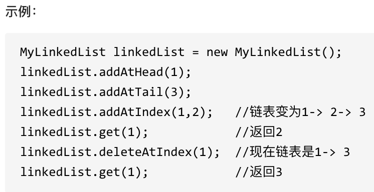
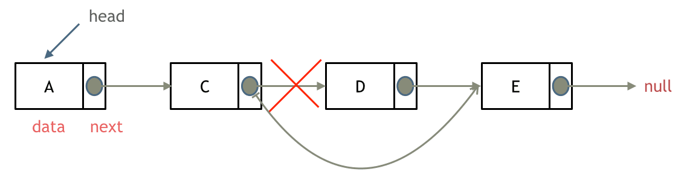
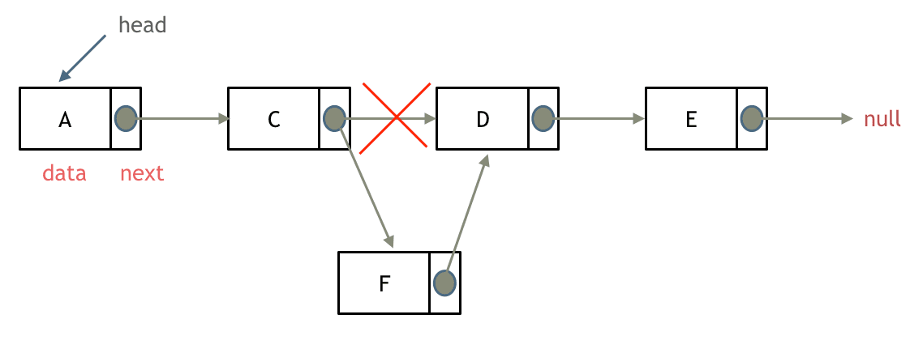

* [做專案（多個 C++、Java、Go、測試開發、前端專案）](https://www.programmercarl.com/other/kstar.html)
* [刷演算法（兩個月高強度學習演算法）](https://www.programmercarl.com/xunlian/xunlianying.html)
* [背八股（40 天挑戰高頻面試題）](https://www.programmercarl.com/xunlian/bagu.html)


> 聽說這道題目把鏈接串列（linked list）常見的五個操作都涵蓋了？

# 707.設計鏈接串列

[LeetCode 題目連結](https://leetcode.cn/problems/design-linked-list/)

題意：

在鏈接串列類別（class）中實作這些功能：

* get(index)：取得鏈接串列中第 index 個節點（node）的值。如果索引（index）無效，則回傳 -1。
* addAtHead(val)：在鏈接串列的第一個元素（element）之前新增一個值為 val 的節點。插入後，新節點將成為鏈接串列的第一個節點。
* addAtTail(val)：將值為 val 的節點附加到鏈接串列的最後一個元素。
* addAtIndex(index,val)：在鏈接串列中的第 index 個節點之前新增值為 val 的節點。如果 index 等於鏈接串列的長度，則該節點將附加到鏈接串列的尾端。如果 index 大於鏈接串列長度，則不會插入節點。如果 index 小於 0，則在頭部插入節點。
* deleteAtIndex(index)：如果索引 index 有效，則刪除鏈接串列中的第 index 個節點。





## 演算法公開課

**[《程式碼隨想錄》演算法影片公開課](https://programmercarl.com/other/gongkaike.html)：[幫你把鏈接串列操作學個通透！LeetCode：707.設計鏈接串列](https://www.bilibili.com/video/BV1FU4y1X7WD)，相信結合影片再看本篇題解，更有助於大家對本題的理解**。


## 解題思路

如果對鏈接串列的基礎知識還不太懂，可以看這篇文章：[關於鏈接串列，你該了解這些！](https://programmercarl.com/链表理论基础.html)

如果對鏈接串列的虛擬頭節點（dummy head）不清楚，可以看這篇文章：[鏈接串列：聽說用 dummy head 會方便很多？](https://programmercarl.com/0203.移除链表元素.html)

刪除鏈接串列節點：


新增鏈接串列節點：


這道題目設計鏈接串列的五個介面（interface）：
* 取得鏈接串列第 index 個節點的數值
* 在鏈接串列的最前面插入一個節點
* 在鏈接串列的最後面插入一個節點
* 在鏈接串列第 index 個節點前面插入一個節點
* 刪除鏈接串列的第 index 個節點

可以說這五個介面，已經涵蓋了鏈接串列的常見操作，是練習鏈接串列操作非常好的一道題目

**鏈接串列操作的兩種方式：**

1. 直接使用原來的鏈接串列來進行操作。
2. 設定一個虛擬頭節點再進行操作。

下面採用的是設定一個虛擬頭節點（這樣更方便一些，大家看程式碼就會感受出來）。

```CPP
class MyLinkedList {
public:
    // 定義鏈接串列節點結構體
    struct LinkedNode {
        int val;
        LinkedNode* next;
        LinkedNode(int val):val(val), next(nullptr){}
    };

    // 初始化鏈接串列
    MyLinkedList() {
        _dummyHead = new LinkedNode(0); // 這裡定義的頭節點 是一個 dummy head，而不是真正的鏈接串列頭節點
        _size = 0;
    }

    // 取得到第index個節點數值，如果index是非法數值直接回傳-1， 注意index是從0開始的，第0個節點就是頭節點
    int get(int index) {
        if (index > (_size - 1) || index < 0) {
            return -1;
        }
        LinkedNode* cur = _dummyHead->next;
        while(index--){ // 如果--index 就會陷入無窮迴圈
            cur = cur->next;
        }
        return cur->val;
    }

    // 在鏈接串列最前面插入一個節點，插入完成後，新插入的節點為鏈接串列的新的頭節點
    void addAtHead(int val) {
        LinkedNode* newNode = new LinkedNode(val);
        newNode->next = _dummyHead->next;
        _dummyHead->next = newNode;
        _size++;
    }

    // 在鏈接串列最後面新增一個節點
    void addAtTail(int val) {
        LinkedNode* newNode = new LinkedNode(val);
        LinkedNode* cur = _dummyHead;
        while(cur->next != nullptr){
            cur = cur->next;
        }
        cur->next = newNode;
        _size++;
    }

    // 在第index個節點之前插入一個新節點，例如index為0，那麼新插入的節點為鏈接串列的新頭節點。
    // 如果index 等於鏈接串列的長度，則說明新插入的節點為鏈接串列的尾節點
    // 如果index大於鏈接串列的長度，則回傳空
    // 如果index小於0，則在頭部插入節點
    void addAtIndex(int index, int val) {

        if(index > _size) return;
        if(index < 0) index = 0;        
        LinkedNode* newNode = new LinkedNode(val);
        LinkedNode* cur = _dummyHead;
        while(index--) {
            cur = cur->next;
        }
        newNode->next = cur->next;
        cur->next = newNode;
        _size++;
    }

    // 刪除第index個節點，如果index 大於等於鏈接串列的長度，直接return，注意index是從0開始的
    void deleteAtIndex(int index) {
        if (index >= _size || index < 0) {
            return;
        }
        LinkedNode* cur = _dummyHead;
        while(index--) {
            cur = cur ->next;
        }
        LinkedNode* tmp = cur->next;
        cur->next = cur->next->next;
        delete tmp;
        //delete命令指示釋放了tmp指標原本所指的那部分記憶體，
        //被delete後的指標tmp的值（位址）並非就是NULL，而是隨機值。也就是被delete後，
        //如果不再加上一句tmp=nullptr,tmp會成為亂指的野指標
        //如果之後的程式不小心使用了tmp，會指向難以預想的記憶體空間
        tmp=nullptr;
        _size--;
    }

    // 印出鏈接串列
    void printLinkedList() {
        LinkedNode* cur = _dummyHead;
        while (cur->next != nullptr) {
            cout << cur->next->val << " ";
            cur = cur->next;
        }
        cout << endl;
    }
private:
    int _size;
    LinkedNode* _dummyHead;

};
```

* 時間複雜度（time complexity）：涉及 `index` 的相關操作為 O(index)，其餘為 O(1)
* 空間複雜度（space complexity）：O(n)


## 其他語言版本
### C++ 雙鏈接串列（doubly linked list）法：

```CPP
//採用循環虛擬節點的雙鏈接串列實作
class MyLinkedList {
public:
    // 定義雙向鏈接串列節點結構體
    struct DList {
        int elem; // 節點儲存的元素
        DList *next; // 指向下一個節點的指標
        DList *prev; // 指向上一個節點的指標
        // 建構函數，建立一個值為elem的新節點
        DList(int elem) : elem(elem), next(nullptr), prev(nullptr) {};
    };

    // 建構函數，初始化鏈接串列
    MyLinkedList() {
        sentinelNode = new DList(0); // 建立哨符節點，不儲存有效資料
        sentinelNode->next = sentinelNode; // 哨符節點的下一個節點指向自身，形成循環
        sentinelNode->prev = sentinelNode; // 哨符節點的上一個節點指向自身，形成循環
        size = 0; // 初始化鏈接串列大小為0
    }

    // 取得鏈接串列中第index個節點的值
    int get(int index) {
        if (index > (size - 1) || index < 0) { // 檢查索引是否超出範圍
            return -1; // 如果超出範圍，回傳-1
        }
        int num;
        int mid = size >> 1; // 計算鏈接串列中部位置
        DList *curNode = sentinelNode; // 從哨符節點開始
        if (index < mid) { // 如果索引小於中部位置，從前往後遍歷
            for (int i = 0; i < index + 1; i++) {
                curNode = curNode->next; // 移動到目標節點
            }
        } else { // 如果索引大於等於中部位置，從後往前遍歷
            for (int i = 0; i < size - index; i++) {
                curNode = curNode->prev; // 移動到目標節點
            }
        }
        num = curNode->elem; // 取得目標節點的值
        return num; // 回傳節點的值
    }

    // 在鏈接串列頭部新增節點
    void addAtHead(int val) {
        DList *newNode = new DList(val); // 建立新節點
        DList *next = sentinelNode->next; // 取得當前頭節點的下一個節點
        newNode->prev = sentinelNode; // 新節點的上一個節點指向哨符節點
        newNode->next = next; // 新節點的下一個節點指向原來的頭節點
        size++; // 鏈接串列大小加1
        sentinelNode->next = newNode; // 哨符節點的下一個節點指向新節點
        next->prev = newNode; // 原來的頭節點的上一個節點指向新節點
    }

    // 在鏈接串列尾部新增節點
    void addAtTail(int val) {
        DList *newNode = new DList(val); // 建立新節點
        DList *prev = sentinelNode->prev; // 取得當前尾節點的上一個節點
        newNode->next = sentinelNode; // 新節點的下一個節點指向哨符節點
        newNode->prev = prev; // 新節點的上一個節點指向原來的尾節點
        size++; // 鏈接串列大小加1
        sentinelNode->prev = newNode; // 哨符節點的上一個節點指向新節點
        prev->next = newNode; // 原來的尾節點的下一個節點指向新節點
    }

    // 在鏈接串列中的第index個節點之前新增值為val的節點
    void addAtIndex(int index, int val) {
        if (index > size) { // 檢查索引是否超出範圍
            return; // 如果超出範圍，直接回傳
        }
        if (index <= 0) { // 如果索引為0或負數，在頭部新增節點
            addAtHead(val);
            return;
        }
        int num;
        int mid = size >> 1; // 計算鏈接串列中部位置
        DList *curNode = sentinelNode; // 從哨符節點開始
        if (index < mid) { // 如果索引小於中部位置，從前往後遍歷
            for (int i = 0; i < index; i++) {
                curNode = curNode->next; // 移動到目標位置的前一個節點
            }
            DList *temp = curNode->next; // 取得目標位置的節點
            DList *newNode = new DList(val); // 建立新節點
            curNode->next = newNode; // 在目標位置前新增新節點
            temp->prev = newNode; // 目標位置的節點的前一個節點指向新節點
            newNode->next = temp; // 新節點的下一個節點指向目標位置的節點
            newNode->prev = curNode; // 新節點的上一個節點指向當前節點
        } else { // 如果索引大於等於中部位置，從後往前遍歷
            for (int i = 0; i < size - index; i++) {
                curNode = curNode->prev; // 移動到目標位置的後一個節點
            }
            DList *temp = curNode->prev; // 取得目標位置的節點
            DList *newNode = new DList(val); // 建立新節點
            curNode->prev = newNode; // 在目標位置後新增新節點
            temp->next = newNode; // 目標位置的節點的下一個節點指向新節點
            newNode->prev = temp; // 新節點的上一個節點指向目標位置的節點
            newNode->next = curNode; // 新節點的下一個節點指向當前節點
        }
        size++; // 鏈接串列大小加1
    }

    // 刪除鏈接串列中的第index個節點
    void deleteAtIndex(int index) {
        if (index > (size - 1) || index < 0) { // 檢查索引是否超出範圍
            return; // 如果超出範圍，直接回傳
        }
        int num;
        int mid = size >> 1; // 計算鏈接串列中部位置
        DList *curNode = sentinelNode; // 從哨符節點開始
        if (index < mid) { // 如果索引小於中部位置，從前往後遍歷
            for (int i = 0; i < index; i++) {
                curNode = curNode->next; // 移動到目標位置的前一個節點
            }
            DList *next = curNode->next->next; // 取得目標位置的下一個節點
            curNode->next = next; // 刪除目標位置的節點
            next->prev = curNode; // 目標位置的下一個節點的前一個節點指向當前節點
        } else { // 如果索引大於等於中部位置，從後往前遍歷
            for (int i = 0; i < size - index - 1; i++) {
                curNode = curNode->prev; // 移動到目標位置的後一個節點
            }
            DList *prev = curNode->prev->prev; // 取得目標位置的下一個節點
            curNode->prev = prev; // 刪除目標位置的節點
            prev->next = curNode; // 目標位置的下一個節點的下一個節點指向當前節點
        }
        size--; // 鏈接串列大小減1
    }

private:
    int size; // 鏈接串列的大小
    DList *sentinelNode; // 哨符節點的指標
};
```

### C:

```C
typedef struct Node {
	int val;
	struct Node* next;
} Node;


typedef struct {
	int size;
	Node* data;
} MyLinkedList;

/** Initialize your data structure here. */

MyLinkedList* myLinkedListCreate() {
	MyLinkedList* obj = (MyLinkedList*)malloc(sizeof(MyLinkedList));
    Node* head = (Node*)malloc(sizeof(Node));
	head->next = (void*)0;
	obj->data = head;
    obj->size = 0;
	return obj;
}

/** Get the value of the index-th node in the linked list. If the index is invalid, return -1. */
int myLinkedListGet(MyLinkedList* obj, int index) {
	if (index < 0 || index >= obj->size) return -1;

	Node* cur = obj->data;
	while (index-- >= 0) {
        cur = cur->next;
    }

	return cur->val;
}

/** Add a node of value val before the first element of the linked list. After the insertion, the new node will be the first node of the linked list. */
void myLinkedListAddAtHead(MyLinkedList* obj, int val) {
	Node* node = (Node*)malloc(sizeof(Node));
	node->val = val;

	node->next = obj->data->next;
	obj->data->next = node;
	obj->size++;
}

/** Append a node of value val to the last element of the linked list. */
void myLinkedListAddAtTail(MyLinkedList* obj, int val) {
	Node* cur = obj->data;
	while (cur->next != ((void*)0)) {
        cur = cur->next;
    }

	Node* tail = (Node*)malloc(sizeof(Node));
	tail->val = val;
	tail->next = (void*)0;
	cur->next = tail;
	obj->size++;
}

/** Add a node of value val before the index-th node in the linked list. If index equals to the length of linked list, the node will be appended to the end of linked list. If index is greater than the length, the node will not be inserted. */
void myLinkedListAddAtIndex(MyLinkedList* obj, int index, int val) {
	if (index > obj->size) return;

	Node* cur = obj->data;
	while (index-- > 0) { 
        cur = cur->next;
    }

	Node* node = (Node*)malloc(sizeof(Node));
	node->val = val;
	node->next = cur->next;
	cur->next = node;
	obj->size++;
}

/** Delete the index-th node in the linked list, if the index is valid. */
void myLinkedListDeleteAtIndex(MyLinkedList* obj, int index) {
	if (index < 0 || index >= obj->size) return;

	Node* cur = obj->data;
	while (index-- > 0) {
        cur = cur->next;
    }

	Node* temp = cur->next;
	cur->next = temp->next;
	free(temp);
	obj->size--;
}

void myLinkedListFree(MyLinkedList* obj) {
	Node* tmp = obj->data;
	while (tmp != NULL) {
		Node* n = tmp;
		tmp = tmp->next;
		free(n);
	}
	free(obj);
}

/**
 * Your MyLinkedList struct will be instantiated and called as such:
 * MyLinkedList* obj = myLinkedListCreate();
 * int param_1 = myLinkedListGet(obj, index);
 
 * myLinkedListAddAtHead(obj, val);
 
 * myLinkedListAddAtTail(obj, val);
 
 * myLinkedListAddAtIndex(obj, index, val);
 
 * myLinkedListDeleteAtIndex(obj, index);
 
 * myLinkedListFree(obj);
*/
```

### Java：

```Java
//單向鏈接串列
class MyLinkedList {

    class ListNode {
        int val;
        ListNode next;
        ListNode(int val) {
            this.val=val;
        }
    }
    //size儲存鏈接串列元素的個數
    private int size;
    //注意這裡記錄的是 dummy head
    private ListNode head;

    //初始化鏈接串列
    public MyLinkedList() {
        this.size = 0;
        this.head = new ListNode(0);
    }

    //取得第index個節點的數值，注意index是從0開始的，第0個節點就是 dummy head
    public int get(int index) {
        //如果index非法，回傳-1
        if (index < 0 || index >= size) {
            return -1;
        }
        ListNode cur = head;
        //第0個節點是 dummy head，所以搜尋第 index+1 個節點
        for (int i = 0; i <= index; i++) {
            cur = cur.next;
        }
        return cur.val;
    }

    public void addAtHead(int val) {
        ListNode newNode = new ListNode(val);
        newNode.next = head.next;
        head.next = newNode;
        size++;

        // 在鏈接串列最前面插入一個節點，等價於在第0個元素前新增
        // addAtIndex(0, val);
    }

    
    public void addAtTail(int val) {
        ListNode newNode = new ListNode(val);
        ListNode cur = head;
        while (cur.next != null) {
            cur = cur.next;
        }
        cur.next = newNode;
        size++;

        // 在鏈接串列的最後插入一個節點，等價於在(末尾+1)個元素前新增
        // addAtIndex(size, val);
    }

    // 在第 index 個節點之前插入一個新節點，例如index為0，那麼新插入的節點為鏈接串列的新頭節點。
    // 如果 index 等於鏈接串列的長度，則說明新插入的節點為鏈接串列的尾節點
    // 如果 index 大於鏈接串列的長度，則回傳空
    public void addAtIndex(int index, int val) {
        if (index < 0 || index > size) {
            return;
        }

        //找到要插入節點的前驅節點
        ListNode pre = head;
        for (int i = 0; i < index; i++) {
            pre = pre.next;
        }
        ListNode newNode = new ListNode(val);
        newNode.next = pre.next;
        pre.next = newNode;
        size++;
    }

    public void deleteAtIndex(int index) {
        if (index < 0 || index >= size) {
            return;
        }
        
        //因為有 dummy head，所以不用對index=0的情況進行特殊處理
        ListNode pre = head;
        for (int i = 0; i < index ; i++) {
            pre = pre.next;
        }
        pre.next = pre.next.next;
        size--;
    }
}
```

```Java
//雙鏈接串列
class MyLinkedList {  

    class ListNode{
        int val;
        ListNode next, prev;
        ListNode(int val){
            this.val = val;
        }
    }

    //記錄鏈接串列中元素的數量
    private int size;
    //記錄鏈接串列的 dummy head 和尾節點
    private ListNode head, tail;
    
    public MyLinkedList() {
        //初始化操作
        this.size = 0;
        this.head = new ListNode(0);
        this.tail = new ListNode(0);
        //這一步非常關鍵，否則在加入頭節點的操作中會出現null.next的錯誤！！！
        this.head.next = tail;
        this.tail.prev = head;
    }
    
    public int get(int index) {
        //判斷index是否有效
        if(index < 0 || index >= size){
            return -1;
        }
        ListNode cur = head;
        //判斷是哪一邊遍歷時間更短
        if(index >= size / 2){
            //tail開始
            cur = tail;
            for(int i = 0; i < size - index; i++){
                cur = cur.prev;
            }
        }else{
            for(int i = 0; i <= index; i++){
                cur = cur.next; 
            }
        }
        return cur.val;
    }
    
    public void addAtHead(int val) {
        //等價於在第0個元素前新增
        addAtIndex(0, val);
    }
    
    public void addAtTail(int val) {
        //等價於在最後一個元素(null)前新增
        addAtIndex(size, val);
    }
    
    public void addAtIndex(int index, int val) {
        //判斷index是否有效
        if(index < 0 || index > size){
            return;
        }

        //找到前驅節點
        ListNode pre = head;
        for(int i = 0; i < index; i++){
            pre = pre.next;
        }
        //新建節點
        ListNode newNode = new ListNode(val);
        newNode.next = pre.next;
        pre.next.prev = newNode;
        newNode.prev = pre;
        pre.next = newNode;
        size++;
        
    }
    
    public void deleteAtIndex(int index) {
        //判斷index是否有效
        if(index < 0 || index >= size){
            return;
        }

        //刪除操作
        ListNode pre = head;
        for(int i = 0; i < index; i++){
            pre = pre.next;
        }
        pre.next.next.prev = pre;
        pre.next = pre.next.next;
        size--;
    }
}

/**
 * Your MyLinkedList object will be instantiated and called as such:
 * MyLinkedList obj = new MyLinkedList();
 * int param_1 = obj.get(index);
 * obj.addAtHead(val);
 * obj.addAtTail(val);
 * obj.addAtIndex(index,val);
 * obj.deleteAtIndex(index);
 */
```

### Python：

```python
（版本一）單向鏈接串列法
class ListNode:
    def __init__(self, val=0, next=None):
        self.val = val
        self.next = next
        
class MyLinkedList:
    def __init__(self):
        self.dummy_head = ListNode()
        self.size = 0

    def get(self, index: int) -> int:
        if index < 0 or index >= self.size:
            return -1
        
        current = self.dummy_head.next
        for i in range(index):
            current = current.next
            
        return current.val

    def addAtHead(self, val: int) -> None:
        self.dummy_head.next = ListNode(val, self.dummy_head.next)
        self.size += 1

    def addAtTail(self, val: int) -> None:
        current = self.dummy_head
        while current.next:
            current = current.next
        current.next = ListNode(val)
        self.size += 1

    def addAtIndex(self, index: int, val: int) -> None:
        if index < 0 or index > self.size:
            return
        
        current = self.dummy_head
        for i in range(index):
            current = current.next
        current.next = ListNode(val, current.next)
        self.size += 1

    def deleteAtIndex(self, index: int) -> None:
        if index < 0 or index >= self.size:
            return
        
        current = self.dummy_head
        for i in range(index):
            current = current.next
        current.next = current.next.next
        self.size -= 1


# Your MyLinkedList object will be instantiated and called as such:
# obj = MyLinkedList()
# param_1 = obj.get(index)
# obj.addAtHead(val)
# obj.addAtTail(val)
# obj.addAtIndex(index,val)
# obj.deleteAtIndex(index)
```


```python
（版本二）雙鏈接串列法
class ListNode:
    def __init__(self, val=0, prev=None, next=None):
        self.val = val
        self.prev = prev
        self.next = next

class MyLinkedList:
    def __init__(self):
        self.head = None
        self.tail = None
        self.size = 0

    def get(self, index: int) -> int:
        if index < 0 or index >= self.size:
            return -1
        
        if index < self.size // 2:
            current = self.head
            for i in range(index):
                current = current.next
        else:
            current = self.tail
            for i in range(self.size - index - 1):
                current = current.prev
                
        return current.val

    def addAtHead(self, val: int) -> None:
        new_node = ListNode(val, None, self.head)
        if self.head:
            self.head.prev = new_node
        else:
            self.tail = new_node
        self.head = new_node
        self.size += 1

    def addAtTail(self, val: int) -> None:
        new_node = ListNode(val, self.tail, None)
        if self.tail:
            self.tail.next = new_node
        else:
            self.head = new_node
        self.tail = new_node
        self.size += 1

    def addAtIndex(self, index: int, val: int) -> None:
        if index < 0 or index > self.size:
            return
        
        if index == 0:
            self.addAtHead(val)
        elif index == self.size:
            self.addAtTail(val)
        else:
            if index < self.size // 2:
                current = self.head
                for i in range(index - 1):
                    current = current.next
            else:
                current = self.tail
                for i in range(self.size - index):
                    current = current.prev
            new_node = ListNode(val, current, current.next)
            current.next.prev = new_node
            current.next = new_node
            self.size += 1

    def deleteAtIndex(self, index: int) -> None:
        if index < 0 or index >= self.size:
            return
        
        if index == 0:
            self.head = self.head.next
            if self.head:
                self.head.prev = None
            else:
                self.tail = None
        elif index == self.size - 1:
            self.tail = self.tail.prev
            if self.tail:
                self.tail.next = None
            else:
                self.head = None
        else:
            if index < self.size // 2:
                current = self.head
                for i in range(index):
                    current = current.next
            else:
                current = self.tail
                for i in range(self.size - index - 1):
                    current = current.prev
            current.prev.next = current.next
            current.next.prev = current.prev
        self.size -= 1


# Your MyLinkedList object will be instantiated and called as such:
# obj = MyLinkedList()
# param_1 = obj.get(index)
# obj.addAtHead(val)
# obj.addAtTail(val)
# obj.addAtIndex(index,val)
# obj.deleteAtIndex(index)
```

### Go：

```go
//單向鏈接串列實作
package main

import (
	"fmt"
)

type SingleNode struct {
	Val  int         // 節點的值
	Next *SingleNode // 下一個節點的指標
}

type MyLinkedList struct {
	dummyHead *SingleNode // dummy head
	Size      int         // 鏈接串列大小
}

func main() {
	list := Constructor()     // 初始化鏈接串列
	list.AddAtHead(100)       // 在頭部新增元素
	list.AddAtTail(242)       // 在尾部新增元素
	list.AddAtTail(777)       // 在尾部新增元素
	list.AddAtIndex(1, 99999) // 在指定位置新增元素
	list.printLinkedList()    // 印出鏈接串列
}

/** Initialize your data structure here. */
func Constructor() MyLinkedList {
	newNode := &SingleNode{ // 建立新節點
		-999,
		nil,
	}
	return MyLinkedList{ // 回傳鏈接串列
		dummyHead: newNode,
		Size:      0,
	}

}

/** Get the value of the index-th node in the linked list. If the index is
  invalid, return -1. */
func (this *MyLinkedList) Get(index int) int {
	/*if this != nil || index < 0 || index > this.Size {
		return -1
	}*/
	if this == nil || index < 0 || index >= this.Size { // 如果索引無效則回傳-1
		return -1
	}
	// 讓cur等於真正頭節點
	cur := this.dummyHead.Next   // 設定當前節點為真實頭節點
	for i := 0; i < index; i++ { // 遍歷到索引所在的節點
		cur = cur.Next
	}
	return cur.Val // 回傳節點值
}

/** Add a node of value val before the first element of the linked list. After
  the insertion, the new node will be the first node of the linked list. */
func (this *MyLinkedList) AddAtHead(val int) {
	// 以下兩行程式碼可用一行代替
	// newNode := new(SingleNode)
	// newNode.Val = val
	newNode := &SingleNode{Val: val}   // 建立新節點
	newNode.Next = this.dummyHead.Next // 新節點指向當前頭節點
	this.dummyHead.Next = newNode      // 新節點變為頭節點
	this.Size++                        // 鏈接串列大小增加1
}

/** Append a node of value val to the last element of the linked list. */
func (this *MyLinkedList) AddAtTail(val int) {
	newNode := &SingleNode{Val: val} // 建立新節點
	cur := this.dummyHead            // 設定當前節點為 dummy head
	for cur.Next != nil {            // 遍歷到最後一個節點
		cur = cur.Next
	}
	cur.Next = newNode // 在尾部新增新節點
	this.Size++        // 鏈接串列大小增加1
}

/** Add a node of value val before the index-th node in the linked list. If
  index equals to the length of linked list, the node will be appended to the
  end of linked list. If index is greater than the length, the node will not be
  inserted. */
func (this *MyLinkedList) AddAtIndex(index int, val int) {
	if index < 0 { // 如果索引小於0，設定為0
		index = 0
	} else if index > this.Size { // 如果索引大於鏈接串列長度，直接回傳
		return
	}

	newNode := &SingleNode{Val: val} // 建立新節點
	cur := this.dummyHead            // 設定當前節點為 dummy head
	for i := 0; i < index; i++ {     // 遍歷到指定索引的前一個節點
		cur = cur.Next
	}
	newNode.Next = cur.Next // 新節點指向原索引節點
	cur.Next = newNode      // 原索引的前一個節點指向新節點
	this.Size++             // 鏈接串列大小增加1
}

/** Delete the index-th node in the linked list, if the index is valid. */
func (this *MyLinkedList) DeleteAtIndex(index int) {
	if index < 0 || index >= this.Size { // 如果索引無效則直接回傳
		return
	}
	cur := this.dummyHead        // 設定當前節點為 dummy head
	for i := 0; i < index; i++ { // 遍歷到要刪除節點的前一個節點
		cur = cur.Next
	}
	if cur.Next != nil {
		cur.Next = cur.Next.Next // 當前節點直接指向下下個節點，即刪除了下一個節點
	}
	this.Size-- // 注意刪除節點後應將鏈接串列大小減一
}

// 印出鏈接串列
func (list *MyLinkedList) printLinkedList() {
	cur := list.dummyHead // 設定當前節點為 dummy head
	for cur.Next != nil { // 遍歷鏈接串列
		fmt.Println(cur.Next.Val) // 印出節點值
		cur = cur.Next            // 切換到下一個節點
	}
}


```

```go
//循環雙鏈接串列
type MyLinkedList struct {
	dummy *Node
}

type Node struct {
	Val  int
	Next *Node
	Pre  *Node
}

//僅儲存虛擬節點，pre-> rear, next-> head
/** Initialize your data structure here. */
func Constructor() MyLinkedList {
	rear := &Node{
		Val:  -1,
		Next: nil,
		Pre:  nil,
	}
	rear.Next = rear
	rear.Pre = rear
	return MyLinkedList{rear}
}

/** Get the value of the index-th node in the linked list. If the index is invalid, return -1. */
func (this *MyLinkedList) Get(index int) int {
	head := this.dummy.Next
	//head == this, 遍歷完全
	for head != this.dummy && index > 0 {
		index--
		head = head.Next
	}
	//否則, head == this, 索引無效
	if 0 != index {
		return -1
	}
	return head.Val
}

/** Add a node of value val before the first element of the linked list. After the insertion, the new node will be the first node of the linked list. */
func (this *MyLinkedList) AddAtHead(val int) {
	dummy := this.dummy
	node := &Node{
		Val: val,
		//head.Next指向原頭節點
		Next: dummy.Next,
		//head.Pre 指向虛擬節點
		Pre: dummy,
	}

	//更新原頭節點
	dummy.Next.Pre = node
	//更新虛擬節點
	dummy.Next = node
	//以上兩步不能反
}

/** Append a node of value val to the last element of the linked list. */
func (this *MyLinkedList) AddAtTail(val int) {
	dummy := this.dummy
	rear := &Node{
		Val: val,
		//rear.Next = dummy(虛擬節點)
		Next: dummy,
		//rear.Pre = ori_rear
		Pre: dummy.Pre,
	}

	//ori_rear.Next = rear
	dummy.Pre.Next = rear
	//update dummy
	dummy.Pre = rear
	//以上兩步不能反
}

/** Add a node of value val before the index-th node in the linked list. If index equals to the length of linked list, the node will be appended to the end of linked list. If index is greater than the length, the node will not be inserted. */
func (this *MyLinkedList) AddAtIndex(index int, val int) {
	head := this.dummy.Next
	//head = MyLinkedList[index]
	for head != this.dummy && index > 0 {
		head = head.Next
		index--
	}
	if index > 0 {
		return
	}
	node := &Node{
		Val: val,
		//node.Next = MyLinkedList[index]
		Next: head,
		//node.Pre = MyLinkedList[index-1]
		Pre: head.Pre,
	}
	//MyLinkedList[index-1].Next = node
	head.Pre.Next = node
	//MyLinkedList[index].Pre = node
	head.Pre = node
	//以上兩步不能反
}

/** Delete the index-th node in the linked list, if the index is valid. */
func (this *MyLinkedList) DeleteAtIndex(index int) {
	//鏈接串列為空
	if this.dummy.Next == this.dummy {
		return
	}
	head := this.dummy.Next
	//head = MyLinkedList[index]
	for head.Next != this.dummy && index > 0 {
		head = head.Next
		index--
	}
	//驗證index有效
	if index == 0 {
		//MyLinkedList[index].Pre = index[index-2]
		head.Next.Pre = head.Pre
		//MyLinedList[index-2].Next = index[index]
		head.Pre.Next = head.Next
		//以上兩步順序無所謂
	}
}
```

### JavaScript:

```js

class LinkNode {
    constructor(val, next) {
        this.val = val;
        this.next = next;
    }
}

/**
 * Initialize your data structure here.
 * 單向鏈接串列 儲存頭尾節點 和 節點數量
 */
var MyLinkedList = function() {
    this._size = 0;
    this._tail = null;
    this._head = null;
};

/**
 * Get the value of the index-th node in the linked list. If the index is invalid, return -1. 
 * @param {number} index
 * @return {number}
 */
MyLinkedList.prototype.getNode = function(index) {
    if(index < 0 || index >= this._size) return null;
    // 建立 dummy head
    let cur = new LinkNode(0, this._head);
    // 0 -> head
    while(index-- >= 0) {
        cur = cur.next;
    }
    return cur;
};
MyLinkedList.prototype.get = function(index) {
    if(index < 0 || index >= this._size) return -1;
    // 取得當前節點
    return this.getNode(index).val;
};

/**
 * Add a node of value val before the first element of the linked list. After the insertion, the new node will be the first node of the linked list. 
 * @param {number} val
 * @return {void}
 */
MyLinkedList.prototype.addAtHead = function(val) {
    const node = new LinkNode(val, this._head);
    this._head = node;
    this._size++;
    if(!this._tail) {
        this._tail = node;
    }
};

/**
 * Append a node of value val to the last element of the linked list. 
 * @param {number} val
 * @return {void}
 */
MyLinkedList.prototype.addAtTail = function(val) {
    const node = new LinkNode(val, null);
    this._size++;
    if(this._tail) {
        this._tail.next = node;
        this._tail = node;
        return;
    }
    this._tail = node;
    this._head = node;
};

/**
 * Add a node of value val before the index-th node in the linked list. If index equals to the length of linked list, the node will be appended to the end of linked list. If index is greater than the length, the node will not be inserted. 
 * @param {number} index 
 * @param {number} val
 * @return {void}
 */
MyLinkedList.prototype.addAtIndex = function(index, val) {
    if(index > this._size) return;
    if(index <= 0) {
        this.addAtHead(val);
        return;
    }
    if(index === this._size) {
        this.addAtTail(val);
        return;
    }
    // 取得目標節點的上一個節點
    const node = this.getNode(index - 1);
    node.next = new LinkNode(val, node.next);
    this._size++;
};

/**
 * Delete the index-th node in the linked list, if the index is valid. 
 * @param {number} index
 * @return {void}
 */
MyLinkedList.prototype.deleteAtIndex = function(index) {
    if(index < 0 || index >= this._size) return;
    if(index === 0) {
        this._head = this._head.next;
        // 如果刪除的這個節點同時是尾節點，要處理尾節點
        if(index === this._size - 1){
            this._tail = this._head
        }
        this._size--;
        return;
    }
    // 取得目標節點的上一個節點
    const node = this.getNode(index - 1);    
    node.next = node.next.next;
    // 處理尾節點
    if(index === this._size - 1) {
        this._tail = node;
    }
    this._size--;
};

// MyLinkedList.prototype.out = function() {
//     let cur = this._head;
//     const res = [];
//     while(cur) {
//         res.push(cur.val);
//         cur = cur.next;
//     }
// };
/**
 * Your MyLinkedList object will be instantiated and called as such:
 * var obj = new MyLinkedList()
 * var param_1 = obj.get(index)
 * obj.addAtHead(val)
 * obj.addAtTail(val)
 * obj.addAtIndex(index,val)
 * obj.deleteAtIndex(index)
 */
```

```js
/** 
    定義雙頭節點的結構：同時包含前指標`prev`和後指標`next`
*/
class Node {
    constructor(val, prev, next) {
        this.val = val
        this.prev = prev
        this.next = next
    }
}

/**
    雙鏈接串列：維護 `head` 和 `tail` 兩個哨符節點，這樣可以簡化對於中間節點的操作  
    並且維護 `size`，使得能夠以O(1)時間判斷操作是否合法
*/
var MyLinkedList = function () {
    this.tail = new Node(-1)
    this.head = new Node(-1)
    this.tail.prev = this.head
    this.head.next = this.tail
    this.size = 0
};

/** 
 * 取得在index處節點的值
 *
 * @param {number} index
 * @return {number}
 *
 * 時間複雜度: O(n)
 * 空間複雜度: O(1)
 */
MyLinkedList.prototype.get = function (index) {
    // 當索引超出範圍時，回傳-1
    if (index > this.size) {
        return -1
    }

    let cur = this.head
    for (let i = 0; i <= index; i++) {
        cur = cur.next
    }

    return cur.val
};

/**
 * 在鏈接串列頭部新增一個新節點
 *
 * @param {number} val
 * @return {void}
 * 
 * 時間複雜度: O(1)
 * 空間複雜度: O(1)
 */
MyLinkedList.prototype.addAtHead = function (val) {
    /** 
       head <-> [newNode] <-> originNode
    */
    this.size++
    const originNode = this.head.next
    // 建立新節點，並建立連結
    const newNode = new Node(val, this.head, originNode)

    // 取消原前後節點的連結
    this.head.next = newNode
    originNode.prev = newNode
};

/** 
 * 在鏈接串列尾部新增一個新節點
 *
 * @param {number} val
 * @return {void}
 *
 * 時間複雜度: O(1)
 * 空間複雜度: O(1)
 */
MyLinkedList.prototype.addAtTail = function (val) {
    /** 
        originNode <-> [newNode] <-> tail
    */
    this.size++
    const originNode = this.tail.prev

    // 建立新節點，並建立連結
    const newNode = new Node(val, originNode, this.tail)

    // 取消原前後節點的連結
    this.tail.prev = newNode
    originNode.next = newNode
};

/** 
 * 在指定索引位置前新增一個新節點
 *
 * @param {number} index 
 * @param {number} val
 * @return {void}
 *
 * 時間複雜度: O(n)
 * 空間複雜度: O(1)
 */
MyLinkedList.prototype.addAtIndex = function (index, val) {
    // 當索引超出範圍時，直接回傳
    if (index > this.size) {
        return
    }
    this.size++

    let cur = this.head
    for (let i = 0; i < index; i++) {
        cur = cur.next
    }

    const new_next = cur.next

    // 建立新節點，並建立連結
    const node = new Node(val, cur, new_next)

    // 取消原前後節點的連結
    cur.next = node
    new_next.prev = node
};

/**
 * 刪除指定索引位置的節點
 *
 * @param {number} index
 * @return {void}
 *
 * 時間複雜度: O(n)
 * 空間複雜度: O(1)
 */
MyLinkedList.prototype.deleteAtIndex = function (index) {
    // 當索引超出範圍時，直接回傳
    if (index >= this.size) {
        return
    }

    this.size--
    let cur = this.head
    for (let i = 0; i < index; i++) {
        cur = cur.next
    }

    const new_next = cur.next.next
    // 取消原前後節點的連結
    new_next.prev = cur
    cur.next = new_next
};
```

### TypeScript:

```TypeScript
class ListNode {
    public val: number;
    public next: ListNode | null;
    constructor(val?: number, next?: ListNode | null) {
        this.val = val === undefined ? 0 : val;
        this.next = next === undefined ? null : next;
    }
}

class MyLinkedList {
    // 記錄鏈接串列長度
    private size: number;
    private head: ListNode | null;
    private tail: ListNode | null;
    constructor() {
        this.size = 0;
        this.head = null;
        this.tail = null;
    }

    // 取得鏈接串列中第 index個節點的值
    get(index: number): number {
        // 索引無效的情況
        if (index < 0 || index >= this.size) {
            return -1;
        }
        let curNode = this.getNode(index);
        // 這裡在前置條件下，理論上不會出現 null的情況
        return curNode.val;
    }

    // 在鏈接串列的第一個元素之前新增一個值為 val的節點。插入後，新節點將成為鏈接串列的第一個節點。
    addAtHead(val: number): void {
        let node: ListNode = new ListNode(val, this.head);
        this.head = node;
        if (!this.tail) {
            this.tail = node;
        }
        this.size++;
    }

    // 將值為 val 的節點附加到鏈接串列的最後一個元素。
    addAtTail(val: number): void {
        let node: ListNode = new ListNode(val, null);
        if (this.tail) {
            this.tail.next = node;
        } else {
            // 還沒有尾節點，說明一個節點都還沒有
            this.head = node;
        }
        this.tail = node;
        this.size++;
    }

    // 在鏈接串列中的第 index個節點之前新增值為 val的節點。
    // 如果 index等於鏈接串列的長度，則該節點將附加到鏈接串列的末尾。如果 index大於鏈接串列長度，則不會插入節點。如果 index小於0，則在頭部插入節點。
    addAtIndex(index: number, val: number): void {
        if (index === this.size) {
            this.addAtTail(val);
            return;
        }
        if (index > this.size) {
            return;
        }
        // <= 0 的情況都是在頭部插入
        if (index <= 0) {
            this.addAtHead(val);
            return;
        }
        // 正常情況
        // 取得插入位置的前一個 node
        let curNode = this.getNode(index - 1);
        let node: ListNode = new ListNode(val, curNode.next);
        curNode.next = node;
        this.size++;
    }

    // 如果索引 index有效，則刪除鏈接串列中的第 index個節點。
    deleteAtIndex(index: number): void {
        if (index < 0 || index >= this.size) {
            return;
        }
        // 處理頭節點
        if (index === 0) {
            this.head = this.head!.next;
            // 如果鏈接串列中只有一個元素，刪除頭節點後，需要處理尾節點
            if (index === this.size - 1) {
                this.tail = null
            }
            this.size--;
            return;
        }
        // 索引有效
        let curNode: ListNode = this.getNode(index - 1);
        curNode.next = curNode.next!.next;
        // 處理尾節點
        if (index === this.size - 1) {
            this.tail = curNode;
        }
        this.size--;
    }

    // 取得指定 Node節點
    private getNode(index: number): ListNode {
        // 這裡不存在沒辦法取得到節點的情況，都已經在前置方法做過判斷
        // 建立 dummy head
        let curNode: ListNode = new ListNode(0, this.head);
        for (let i = 0; i <= index; i++) {
            // 理論上不會出現 null
            curNode = curNode.next!;
        }
        return curNode;
    }
}
```

### Kotlin:

```kotlin
class MyLinkedList {

    var next: ListNode? = null

    var size: Int = 0

    fun get(index: Int): Int {
        if (index + 1 > size) return -1
        var cur = this.next
        for (i in 0 until index) {
            cur = cur?.next
        }
        return cur?.`val` ?: -1
    }

    fun addAtHead(`val`: Int) {
        val head = ListNode(`val`)
        head.next = this.next
        this.next = head
        size++
    }

    fun addAtTail(`val`: Int) {
        val pre = ListNode(0)
        pre.next = this.next
        var cur: ListNode? = pre
        while (cur?.next != null) {
            cur = cur.next
        }
        cur?.next = ListNode(`val`)
        this.next = pre.next
        size++
    }

    fun addAtIndex(index: Int, `val`: Int) {
        if (index > size) return
        val pre = ListNode(0)
        pre.next = this.next
        var cur:ListNode? = pre
        for (i in 0 until index) {
            cur = cur?.next
        }
        val temp = cur?.next
        cur?.next = ListNode(`val`)
        cur?.next?.next = temp
        this.next = pre.next
        size++
    }

    fun deleteAtIndex(index: Int) {
        if (index + 1 > size) return
        val pre = ListNode(0)
        pre.next = this.next
        var cur: ListNode? = pre
        for (i in 0 until index) {
            cur = cur?.next
        }
        val temp = cur?.next?.next
        cur?.next?.next = null
        cur?.next = temp
        this.next = pre.next
        size--
    }
}
```

### Swift:

```swift
class MyLinkedList {
    var dummyHead: ListNode<Int>?
    var size: Int
    
    init() {
        dummyHead = ListNode(0)
        size = 0
    }
    
    func get(_ index: Int) -> Int {
        if index >= size || index < 0 {
            return -1
        }
        
        var curNode = dummyHead?.next
        var curIndex = index
        
        while curIndex > 0 {
            curNode = curNode?.next
            curIndex -= 1
        }
        
        return curNode?.value ?? -1
    }
    
    func addAtHead(_ val: Int) {
        let newHead = ListNode(val)
        newHead.next = dummyHead?.next
        dummyHead?.next = newHead
        size += 1
    }
    
    func addAtTail(_ val: Int) {
        let newNode = ListNode(val)
        var curNode = dummyHead
        while curNode?.next != nil {
            curNode = curNode?.next
        }
        
        curNode?.next = newNode
        size += 1
    }
    
    func addAtIndex(_ index: Int, _ val: Int) {
        if index > size {
            return
        }
        
        let newNode = ListNode(val)
        var curNode = dummyHead
        var curIndex = index
      
        while curIndex > 0 {
            curNode = curNode?.next
            curIndex -= 1
        }
      
        newNode.next = curNode?.next
        curNode?.next = newNode
        size += 1
    }
    
    func deleteAtIndex(_ index: Int) {
        if index >= size || index < 0 {
            return
        }
        
        var curNode = dummyHead
        for _ in 0..<index {
            curNode = curNode?.next
        }
        
        curNode?.next = curNode?.next?.next
        size -= 1
    }
}
```

### Scala:

```scala
class ListNode(_x: Int = 0, _next: ListNode = null) {
  var next: ListNode = _next
  var x: Int = _x
}

class MyLinkedList() {

  var size = 0 // 鏈接串列大小
  var dummy: ListNode = new ListNode(0) // dummy head
  
  // 取得第index個節點的值
  def get(index: Int): Int = {
    if (index < 0 || index >= size) {
      return -1;
    }
    var cur = dummy
    for (i <- 0 to index) {
      cur = cur.next
    }
    cur.x // 回傳cur的值
  }
  
  // 在鏈接串列最前面插入一個節點
  def addAtHead(`val`: Int) {
    addAtIndex(0, `val`)
  }
  
  // 在鏈接串列最後面插入一個節點
  def addAtTail(`val`: Int) {
    addAtIndex(size, `val`)
  }
  
  // 在第index個節點之前插入一個新節點
  // 如果index等於鏈接串列長度，則說明新插入的節點是尾節點
  // 如果index等於0，則說明新插入的節點是頭節點
  // 如果index>鏈接串列長度，則說明為空
  def addAtIndex(index: Int, `val`: Int) {
    if (index > size) {
      return
    }
    var loc = index // 因為參數index是val不可變類型，所以需要賦值給一個可變類型
    if (index < 0) {
      loc = 0
    }
    size += 1 //鏈接串列大小+1
    var pre = dummy
    for (i <- 0 until loc) {
      pre = pre.next
    }
    val node: ListNode = new ListNode(`val`, pre.next)
    pre.next = node
  }
  // 刪除第index個節點
  def deleteAtIndex(index: Int) {
    if (index < 0 || index >= size) {
      return
    }
    size -= 1
    var pre = dummy
    for (i <- 0 until index) {
      pre = pre.next
    }
    pre.next = pre.next.next
  }

}
```

### Rust:

```rust
#[derive(Debug)]
pub struct MyLinkedList {
    pub val: i32,
    pub next: Option<Box<MyLinkedList>>,
}

impl MyLinkedList {
    fn new() -> Self {
        // 新增頭節點
        MyLinkedList { val: 0, next: None }
    }

    fn get(&self, index: i32) -> i32 {
        if index < 0 {
            return -1;
        }
        let mut i = 0;
        let mut cur = &self.next;
        while let Some(node) = cur {
            if i == index {
                return node.val;
            }
            i += 1;
            cur = &node.next;
        }
        -1
    }

    fn add_at_head(&mut self, val: i32) {
        let new_node = Box::new(MyLinkedList {
            val,
            next: self.next.take(),
        });
        self.next = Some(new_node);
    }

    fn add_at_tail(&mut self, val: i32) {
        let new_node = Box::new(MyLinkedList { val, next: None });
        let mut last_node = &mut self.next;
        while let Some(node) = last_node {
            last_node = &mut node.next;
        }
        *last_node = Some(new_node);
    }

    fn add_at_index(&mut self, index: i32, val: i32) {
        if index <= 0 {
            self.add_at_head(val);
        } else {
            let mut i = 0;
            let mut cur = &mut self.next;
            while let Some(node) = cur {
                if i + 1 == index {
                    let new_node = Box::new(MyLinkedList {
                        val,
                        next: node.next.take(),
                    });
                    node.next = Some(new_node);
                    break;
                }
                i += 1;
                cur = &mut node.next;
            }
        }
    }

    fn delete_at_index(&mut self, index: i32) {
        if index < 0 {
            return;
        }

        let mut i = 0;
        let mut cur = self;
        while let Some(node) = cur.next.take() {
            if i == index {
                cur.next = node.next;
                break;
            }
            i += 1;
            cur.next = Some(node);
            cur = cur.next.as_mut().unwrap();
        }
    }
}
```

### C#
```csharp
class ListNode
{
    public int val;
    public ListNode next;
    public ListNode(int val) { this.val = val; }
}
public class MyLinkedList
{
    ListNode dummyHead;
    int count;

    public MyLinkedList()
    {
        dummyHead = new ListNode(0);
        count = 0;
    }

    public int Get(int index)
    {
        if (index < 0 || count <= index) return -1;
        ListNode current = dummyHead;
        for (int i = 0; i <= index; i++)
        {
            current = current.next;
        }
        return current.val;
    }

    public void AddAtHead(int val)
    {
        AddAtIndex(0, val);
    }

    public void AddAtTail(int val)
    {
        AddAtIndex(count, val);
    }

    public void AddAtIndex(int index, int val)
    {
        if (index > count) return;
        index = Math.Max(0, index);
        count++;
        ListNode tmp1 = dummyHead;
        for (int i = 0; i < index; i++)
        {
            tmp1 = tmp1.next;
        }
        ListNode tmp2 = new ListNode(val);
        tmp2.next = tmp1.next;
        tmp1.next = tmp2;
    }

    public void DeleteAtIndex(int index)
    {

        if (index >= count || index < 0) return;
        var tmp1 = dummyHead;
        for (int i = 0; i < index; i++)
        {
            tmp1 = tmp1.next;
        }
        tmp1.next = tmp1.next.next;
        count--;

    }
}
```


