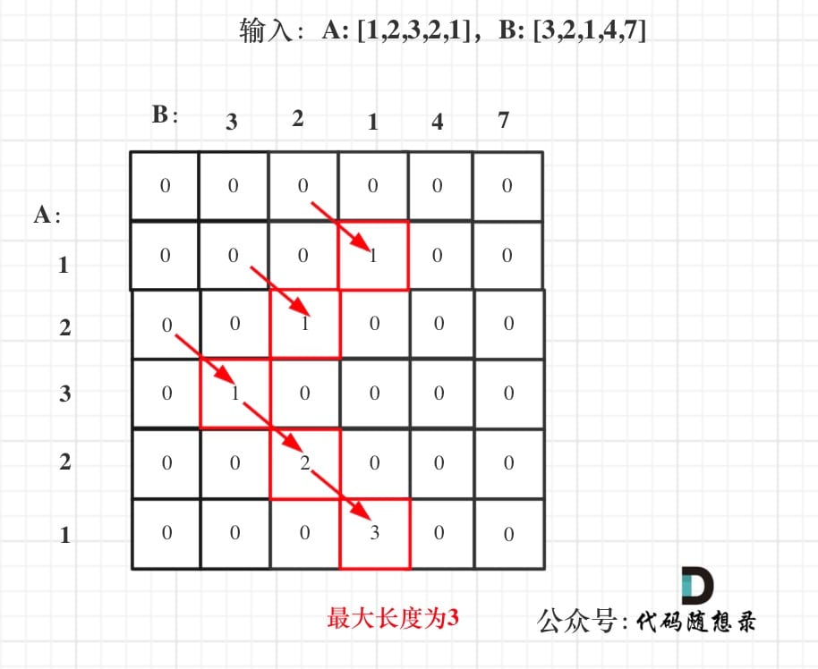

* [做專案（多個 C++、Java、Go、測試開發、前端（front end）專案）](https://www.programmercarl.com/other/kstar.html)
* [刷題學演算法（兩個月高強度學演算法）](https://www.programmercarl.com/xunlian/xunlianying.html)
* [背面試必考題（八股文）（40 天挑戰高頻面試題）](https://www.programmercarl.com/xunlian/bagu.html)

# 718. 最長重複子陣列（subarray）

[LeetCode 題目連結](https://leetcode.cn/problems/maximum-length-of-repeated-subarray/)

給兩個整數（integer）陣列（array） A 和 B，回傳兩個陣列中公用的、長度最長的子陣列的長度。

範例：

輸入：
* A: [1,2,3,2,1]
* B: [3,2,1,4,7]
* 輸出：3
* 解釋：長度最長的公用子陣列是 [3, 2, 1]。

提示：

* 1 <= len(A), len(B) <= 1000
* 0 <= A[i], B[i] < 100

## 演算法公開課

**[《程式碼隨想錄》演算法影片公開課](https://programmercarl.com/other/gongkaike.html)：[動態規劃（dynamic programming, DP）之次序列（subsequence）問題，想清楚 DP 陣列的定義 | LeetCode：718.最長重複子陣列](https://www.bilibili.com/video/BV178411H7hV)，相信結合影片再看本篇題解，更有助於大家對本題的理解**。

## 解題思路

注意題目中說的子陣列，其實就是連續次序列。

要求兩個陣列中最長重複子陣列，如果是蠻力法（brute force），只需要先兩層 for 迴圈（for-loop）確定兩個陣列起始位置，然後再來一個迴圈（loop），可以是 for 或者 while 迴圈（while loop），來從兩個起始位置開始比較（comparison），取得重複子陣列的長度。

本題其實是動態規劃（dynamic programming, DP）解決的經典題目，我們只要想到用二維（two-dimensional）陣列可以記錄兩個字串（string）的所有比較情況，這樣就比較好推導遞迴公式（recurrence formula）了。
DP五部曲分析如下：

1. 確定 DP 陣列（DP table）以及下標（subscript）的含義

`dp[i][j]`：以下標 `i - 1` 為結尾的 A，和以下標 `j - 1` 為結尾的 B，最長重複子陣列長度為 `dp[i][j]`。（**特別注意**：「以下標 `i - 1` 為結尾的 A」標明一定是以 `A[i-1]` 為結尾的字串）

此時細心的同學應該發現，那 `dp[0][0]` 是什麼含義呢？總不能是以下標 -1 為結尾的 A 陣列吧。

其實 `dp[i][j]` 的定義也就決定著，我們在遍歷（traversal） `dp[i][j]` 的時候 `i` 和 `j` 都要從 1 開始。

那有同學問了，我就定義 `dp[i][j]` 為以下標 `i` 為結尾的 A，和以下標 `j` 為結尾的 B，最長重複子陣列長度，不行嗎？

行倒是行！但實作起來就麻煩一點，需要單獨處理初始化（initialization）部分，在本題解下面的拓展內容裡，我給出了第二種 DP 陣列的定義方式所對應的程式碼和講解，大家比較一下就了解了。

2. 確定遞迴公式

根據 `dp[i][j]` 的定義，`dp[i][j]` 的狀態（state）只能由 `dp[i - 1][j - 1]` 推導出來。

即當 `A[i - 1]` 和 `B[j - 1]` 相等的時候，`dp[i][j] = dp[i - 1][j - 1] + 1;`

根據遞迴公式可以看出，遍歷 `i` 和 `j` 要從 1 開始！

3. DP 陣列如何初始化

根據 `dp[i][j]` 的定義，`dp[i][0]` 和 `dp[0][j]` 其實都是沒有意義的！

但 `dp[i][0]` 和 `dp[0][j]` 要有初始值，因為為了方便遞迴公式 `dp[i][j] = dp[i - 1][j - 1] + 1;`

所以 `dp[i][0]` 和 `dp[0][j]` 初始化為 0。

舉個例子，`A[0]` 如果和 `B[0]` 相同的話，`dp[1][1] = dp[0][0] + 1`，只有 `dp[0][0]` 初始為 0，正好符合遞迴公式逐步累加起來。


4. 確定遍歷順序

外層 for 迴圈遍歷 A，內層 for 迴圈遍歷 B。

那又有同學問了，外層 for 迴圈遍歷 B，內層 for 迴圈遍歷 A，不行嗎？

也行，一樣的，我這裡就用外層 for 迴圈遍歷 A，內層 for 迴圈遍歷 B 了。

同時題目要求長度最長的子陣列的長度。所以在遍歷的時候順便把 `dp[i][j]` 的最大值記錄下來。

程式碼如下：

```CPP
for (int i = 1; i <= nums1.size(); i++) {
    for (int j = 1; j <= nums2.size(); j++) {
        if (nums1[i - 1] == nums2[j - 1]) {
            dp[i][j] = dp[i - 1][j - 1] + 1;
        }
        if (dp[i][j] > result) result = dp[i][j];
    }
}

```


5. 舉例推導 DP 陣列

拿範例 1 中，A: [1,2,3,2,1]，B: [3,2,1,4,7] 為例，畫一個 DP 陣列的狀態變化，如下：


以上五部曲分析完畢，C++ 程式碼如下：

```CPP
// 版本一
class Solution {
public:
    int findLength(vector<int>& nums1, vector<int>& nums2) {
        vector<vector<int>> dp (nums1.size() + 1, vector<int>(nums2.size() + 1, 0));
        int result = 0;
        for (int i = 1; i <= nums1.size(); i++) {
            for (int j = 1; j <= nums2.size(); j++) {
                if (nums1[i - 1] == nums2[j - 1]) {
                    dp[i][j] = dp[i - 1][j - 1] + 1;
                }
                if (dp[i][j] > result) result = dp[i][j];
            }
        }
        return result;
    }
};
```

* 時間複雜度（time complexity）：O(n × m)，n 為 A 長度，m 為 B 長度
* 空間複雜度（space complexity）：O(n × m)

### rolling array

在如下圖中：




我們可以看出 `dp[i][j]` 都是由 `dp[i - 1][j - 1]` 推出。那麼壓縮為一維陣列（one dimensional array），也就是 `dp[j]` 都是由 `dp[j - 1]` 推出。

也就是相當於可以把上一層 `dp[i - 1][j]` 複製到下一層 `dp[i][j]` 來繼續用。

**此時遍歷 B 陣列的時候，就要從後向前遍歷，這樣避免重複覆蓋**。

```CPP
// 版本二
class Solution {
public:
    int findLength(vector<int>& A, vector<int>& B) {
        vector<int> dp(vector<int>(B.size() + 1, 0));
        int result = 0;
        for (int i = 1; i <= A.size(); i++) {
            for (int j = B.size(); j > 0; j--) {
                if (A[i - 1] == B[j - 1]) {
                    dp[j] = dp[j - 1] + 1;
                } else dp[j] = 0; // 注意這裡不相等的時候要有賦 0 的操作
                if (dp[j] > result) result = dp[j];
            }
        }
        return result;
    }
};
```

* 時間複雜度：$O(n × m)$，n 為 A 長度，m 為 B 長度
* 空間複雜度：$O(m)$

## 拓展

前面講了 DP 陣列為什麼定義：以下標 `i - 1` 為結尾的 A，和以下標 `j - 1` 為結尾的 B，最長重複子陣列長度為 `dp[i][j]`。

我就定義 `dp[i][j]` 為以下標 `i` 為結尾的 A，和以下標 `j` 為結尾的 B，最長重複子陣列長度，不行嗎？

當然可以，就是實作起來麻煩一些。

如果定義 `dp[i][j]` 為以下標 `i` 為結尾的 A，和以下標 `j` 為結尾的 B，那麼第一列（row）和第一行（column）畢竟要進行初始化，如果 `nums1[i]` 與 `nums2[0]` 相同的話，對應的 `dp[i][0]` 就要初始為 1，因為此時最長重複子陣列為 1。`nums2[j]` 與 `nums1[0]` 相同的話，同理。

所以程式碼如下：

```CPP 
// 版本三
class Solution {
public:
    int findLength(vector<int>& nums1, vector<int>& nums2) {
        vector<vector<int>> dp (nums1.size() + 1, vector<int>(nums2.size() + 1, 0));
        int result = 0;

        // 要對第一列、第一行進行初始化
        for (int i = 0; i < nums1.size(); i++) if (nums1[i] == nums2[0]) dp[i][0] = 1;
        for (int j = 0; j < nums2.size(); j++) if (nums1[0] == nums2[j]) dp[0][j] = 1;

        for (int i = 0; i < nums1.size(); i++) {
            for (int j = 0; j < nums2.size(); j++) {
                if (nums1[i] == nums2[j] && i > 0 && j > 0) { // 防止 i-1 出現負數
                    dp[i][j] = dp[i - 1][j - 1] + 1;
                }
                if (dp[i][j] > result) result = dp[i][j];
            }
        }
        return result;
    }
};
```

大家會發現這種寫法一定要多寫一段初始化的過程。

而且為了讓 `if (dp[i][j] > result) result = dp[i][j];` 收集到全部結果，兩層 for 迴圈一定從 0 開始遍歷，這樣需要加上 `&& i > 0 && j > 0` 的判斷。

對於基礎不牢的新手來說，在推導出轉移方程式後可能疑惑上述程式碼為什麼要從 `i=0,j=0` 遍歷而不是從 `i=1,j=1` 開始遍歷，原因在於這裡如果不是從 `i=0,j=0` 位置開始遍歷，會漏掉如下範例結果：
```txt
nums1 = [70,39,25,40,7]
nums2 = [52,20,67,5,31]
```

當然，如果你願意也可以使用如下程式碼，與上面那個 C++ 是同一解題思路：
```java 
class Solution {
    public int findLength(int[] nums1, int[] nums2) {
        int len1 = nums1.length;
        int len2 = nums2.length;
        int[][] result = new int[len1][len2];

        int maxresult = Integer.MIN_VALUE;

        for(int i=0;i<len1;i++){
            if(nums1[i] == nums2[0])
                result[i][0] = 1;
            if(maxresult<result[i][0])
                    maxresult = result[i][0];
        }

        for(int j=0;j<len2;j++){
            if(nums1[0] == nums2[j])
                result[0][j] = 1;
            if(maxresult<result[0][j])
                maxresult = result[0][j];
        }

        for(int i=1;i<len1;i++){
            for(int j=1;j<len2;j++){

                if(nums1[i]==nums2[j])
                    result[i][j] = result[i-1][j-1]+1;

                if(maxresult<result[i][j])
                    maxresult = result[i][j];

            }

        }

        return maxresult;
    }
}
```

對於新手來說一定要明確 DP 陣列中初始化的資料是什麼

整體而言相對於版本一來說還是多寫了不少程式碼。而且邏輯上也複雜了一些。優勢就是 DP 陣列的定義更直覺一點。

## 其他語言版本

### Java：

```java
// 版本一
class Solution {
    public int findLength(int[] nums1, int[] nums2) {
        int result = 0;
        int[][] dp = new int[nums1.length + 1][nums2.length + 1];
        
        for (int i = 1; i < nums1.length + 1; i++) {
            for (int j = 1; j < nums2.length + 1; j++) {
                if (nums1[i - 1] == nums2[j - 1]) {
                    dp[i][j] = dp[i - 1][j - 1] + 1;
                    result = Math.max(result, dp[i][j]);
                }
            }
        }
        
        return result;
    }
}

// 版本二: rolling array
class Solution {
    public int findLength(int[] nums1, int[] nums2) {
        int[] dp = new int[nums2.length + 1];
        int result = 0;

        for (int i = 1; i <= nums1.length; i++) {
            for (int j = nums2.length; j > 0; j--) {
                if (nums1[i - 1] == nums2[j - 1]) {
                    dp[j] = dp[j - 1] + 1;
                } else {
                    dp[j] = 0;
                }
                result = Math.max(result, dp[j]);
            }
        }
        return result;
    }
}
```

### Python：

2 維 DP
```python
class Solution:
    def findLength(self, nums1: List[int], nums2: List[int]) -> int:
        # 建立一個二維陣列 dp，用於儲存最長公用子陣列的長度
        dp = [[0] * (len(nums2) + 1) for _ in range(len(nums1) + 1)]
        # 記錄最長公用子陣列的長度
        result = 0

        # 遍歷陣列 nums1
        for i in range(1, len(nums1) + 1):
            # 遍歷陣列 nums2
            for j in range(1, len(nums2) + 1):
                # 如果 nums1[i-1] 和 nums2[j-1] 相等
                if nums1[i - 1] == nums2[j - 1]:
                    # 在目前位置上的最長公用子陣列長度為前一個位置上的長度加一
                    dp[i][j] = dp[i - 1][j - 1] + 1
                # 更新最長公用子陣列的長度
                if dp[i][j] > result:
                    result = dp[i][j]

        # 回傳最長公用子陣列的長度
        return result

```

1 維 DP
```python
class Solution:
    def findLength(self, nums1: List[int], nums2: List[int]) -> int:
        # 建立一個一維陣列 dp，用於儲存最長公用子陣列的長度
        dp = [0] * (len(nums2) + 1)
        # 記錄最長公用子陣列的長度
        result = 0

        # 遍歷陣列 nums1
        for i in range(1, len(nums1) + 1):
            # 用於保存上一個位置的值
            prev = 0
            # 遍歷陣列 nums2
            for j in range(1, len(nums2) + 1):
                # 保存目前位置的值，因為會在後面被更新
                current = dp[j]
                # 如果 nums1[i-1] 和 nums2[j-1] 相等
                if nums1[i - 1] == nums2[j - 1]:
                    # 在目前位置上的最長公用子陣列長度為上一個位置的長度加一
                    dp[j] = prev + 1
                    # 更新最長公用子陣列的長度
                    if dp[j] > result:
                        result = dp[j]
                else:
                    # 如果不相等，將目前位置的值設為零
                    dp[j] = 0
                # 更新 prev 變數為目前位置的值，供下一次疊代使用
                prev = current

        # 回傳最長公用子陣列的長度
        return result

```

2 維 DP 擴展
```python
class Solution:
    def findLength(self, nums1: List[int], nums2: List[int]) -> int:
        # 建立一個二維陣列 dp，用於儲存最長公用子陣列的長度
        dp = [[0] * (len(nums2) + 1) for _ in range(len(nums1) + 1)]
        # 記錄最長公用子陣列的長度
        result = 0

        # 對第一列和第一行進行初始化
        for i in range(len(nums1)):
            if nums1[i] == nums2[0]:
                dp[i + 1][1] = 1
        for j in range(len(nums2)):
            if nums1[0] == nums2[j]:
                dp[1][j + 1] = 1

        # 填充 dp 陣列
        for i in range(1, len(nums1) + 1):
            for j in range(1, len(nums2) + 1):
                if nums1[i - 1] == nums2[j - 1]:
                    # 如果 nums1[i-1] 和 nums2[j-1] 相等，則目前位置的最長公用子陣列長度為左上角位置的值加一
                    dp[i][j] = dp[i - 1][j - 1] + 1
                if dp[i][j] > result:
                    # 更新最長公用子陣列的長度
                    result = dp[i][j]

        # 回傳最長公用子陣列的長度
        return result


```
### Go：

```Go
func findLength(A []int, B []int) int {
	m, n := len(A), len(B)
	res := 0
	dp := make([][]int, m+1)
	for i := 0; i <= m; i++ { 
		dp[i] = make([]int, n+1)
	}

	for i := 1; i <= m; i++ {
		for j := 1; j <= n; j++ {
			if A[i-1] == B[j-1] {
				dp[i][j] = dp[i-1][j-1] + 1
			}
			if dp[i][j] > res {
				res = dp[i][j]
			}
		}
	}
	return res
}

// 滾動陣列（rolling array）
func findLength(nums1 []int, nums2 []int) int {
    n, m, res := len(nums1), len(nums2), 0
    dp := make([]int, m+1)
    for i := 1; i <= n; i++ {
        for j := m; j >= 1; j-- {
            if nums1[i-1] == nums2[j-1] {
                dp[j] = dp[j-1] + 1
            } else {
                dp[j] = 0  // 注意這裡不相等要賦值為 0，供下一層使用
            }
            res = max(res, dp[j]) 
        }
    }
    return res
}
func max(a, b int) int {
    if a > b {
        return a
    }
    return b
}
```

### JavaScript：

> DP

```javascript
const findLength = (A, B) => {
    // A、B 陣列的長度
    const [m, n] = [A.length, B.length];
    // dp 陣列初始化，都初始化為 0
    const dp = new Array(m + 1).fill(0).map(x => new Array(n + 1).fill(0));
    // 初始化最大長度為 0
    let res = 0;
    for (let i = 1; i <= m; i++) {
        for (let j = 1; j <= n; j++) {
            // 遇到 A[i - 1] === B[j - 1]，則更新 dp 陣列
            if (A[i - 1] === B[j - 1]) {
                dp[i][j] = dp[i - 1][j - 1] + 1;
            }
            // 更新 res
            res = dp[i][j] > res ? dp[i][j] : res;
        }
    }
    // 遍歷完成，回傳 res
    return res;
};
```
> rolling array
```javascript
const findLength = (nums1, nums2) => {
    let len1 = nums1.length, len2 = nums2.length;
    // dp[i][j]: 以 nums1[i-1]、nums2[j-1] 為結尾的最長公用子陣列的長度
    let dp = new Array(len2+1).fill(0);
    let res = 0;
    for (let i = 1; i <= len1; i++) {
        for (let j = len2; j > 0; j--) {
            if (nums1[i-1] === nums2[j-1]) {
                dp[j] = dp[j-1] + 1;
            } else {
                dp[j] = 0;
            }
            res = Math.max(res, dp[j]);
        }
    }
    return res;
}
```

### TypeScript：

> DP：

```typescript
function findLength(nums1: number[], nums2: number[]): number {
    /**
        dp[i][j]：nums[i-1] 和 nums[j-1] 結尾，最長重複子陣列的長度
     */
    const length1: number = nums1.length,
        length2: number = nums2.length;
    const dp: number[][] = new Array(length1 + 1).fill(0)
        .map(_ => new Array(length2 + 1).fill(0));
    let resMax: number = 0;
    for (let i = 1; i <= length1; i++) {
        for (let j = 1; j <= length2; j++) {
            if (nums1[i - 1] === nums2[j - 1]) {
                dp[i][j] = dp[i - 1][j - 1] + 1;
                resMax = Math.max(resMax, dp[i][j]);
            }
        }
    }
    return resMax;
};
```

> 滾動陣列：

```typescript
function findLength(nums1: number[], nums2: number[]): number {
    const length1: number = nums1.length,
        length2: number = nums2.length;
    const dp: number[] = new Array(length1 + 1).fill(0);
    let resMax: number = 0;
    for (let i = 1; i <= length1; i++) {
        for (let j = length2; j >= 1; j--) {
            if (nums1[i - 1] === nums2[j - 1]) {
                dp[j] = dp[j - 1] + 1;
                resMax = Math.max(resMax, dp[j]);
            } else {
                dp[j] = 0;
            }
        }
    }
    return resMax;
};
```

Rust:

> 滾動陣列

```rust
impl Solution {
    pub fn find_length(nums1: Vec<i32>, nums2: Vec<i32>) -> i32 {
        let (mut res, mut dp) = (0, vec![0; nums2.len()]);

        for n1 in nums1 {
            for j in (0..nums2.len()).rev() {
                if n1 == nums2[j] {
                    dp[j] = if j == 0 { 1 } else { dp[j - 1] + 1 };
                    res = res.max(dp[j]);
                } else {
                    dp[j] = 0;
                }
            }
        }
        res
    }
}
```

### C:

```c
int findLength(int* nums1, int nums1Size, int* nums2, int nums2Size) {
    int dp[nums1Size + 1][nums2Size + 1];
    memset(dp, 0, sizeof(dp));
    int result = 0;
    for (int i = 1; i <= nums1Size; ++i) {
        for (int j = 1; j <= nums2Size; ++j) {
            if(nums1[i - 1] == nums2[j - 1]){
                dp[i][j] = dp[i - 1][j - 1] + 1;
            }
            if(dp[i][j] > result){
                result = dp[i][j];
            }
        }
    }
    return result;
}
```

### Cangjie

```cangjie
func findLength(nums1: Array<Int64>, nums2: Array<Int64>): Int64 {
    let n = nums1.size
    let m = nums2.size
    let dp = Array(n + 1, {_ => Array(m + 1, item: 0)})
    var res = 0
    for (i in 1..=n) {
        for (j in 1..=m) {
            if (nums1[i - 1] == nums2[j - 1]) {
                dp[i][j] = dp[i - 1][j - 1] + 1
            }
            res = max(res, dp[i][j])
        }
    }
    return res
}
```


