* [做專案（多個 C++、Java、Go、測試開發、前端（front end）專案）](https://www.programmercarl.com/other/kstar.html)
* [刷題學演算法（兩個月高強度學演算法）](https://www.programmercarl.com/xunlian/xunlianying.html)
* [背面試必考題（八股文）（40 天挑戰高頻面試題）](https://www.programmercarl.com/xunlian/bagu.html)


# 739. 每日溫度

[LeetCode 題目連結](https://leetcode.cn/problems/daily-temperatures/)

請根據每日氣溫串列（list），重新生成一個串列。對應位置的輸出為：要想觀測到更高的氣溫，至少需要等待的天數。如果氣溫在這之後都不會升高，請在該位置用 0 來代替。

例如，給定一個串列 `temperatures = [73, 74, 75, 71, 69, 72, 76, 73]`，你的輸出應該是 `[1, 1, 4, 2, 1, 1, 0, 0]`。

提示：氣溫串列長度的範圍是 `[1, 30000]`。每個氣溫的值均為華氏度，都是在 `[30, 100]` 範圍內的整數（integer）。

## 演算法公開課

**[《程式碼隨想錄》演算法影片公開課](https://programmercarl.com/other/gongkaike.html)：[monotonic stack，你該了解的，這裡都講了！LeetCode:739.每日溫度](https://www.bilibili.com/video/BV1my4y1Z7jj/)，相信結合影片再看本篇題解，更有助於大家對本題的理解**。


## 解題思路

首先想到的當然是蠻力法（brute force），兩層 for 迴圈（for-loop），把至少需要等待的天數就搜出來了。時間複雜度（time complexity）是 $O(n^2)$

那麼接下來再來看看使用單調堆疊（monotonic stack）的解法。

那有同學就問了，我怎麼能想到用單調堆疊呢？什麼時候用單調堆疊呢？

**通常是一維陣列（one dimensional array），要尋找任一個元素（element）的右邊或者左邊第一個比自己大或者小的元素的位置，此時我們就要想到可以用單調堆疊了**。時間複雜度為 $O(n)$。

例如本題其實就是找一個元素右邊第一個比自己大的元素，此時就應該想到用單調堆疊了。

那麼單調堆疊的原理是什麼呢？為什麼時間複雜度是 $O(n)$ 就可以找到每一個元素的右邊第一個比它大的元素位置呢？

**單調堆疊的本質是空間換時間**，因為在遍歷（traversal）的過程中需要用一個堆疊（stack）來記錄右邊第一個比目前元素高的元素，優點是整個陣列（array）只需要遍歷一次。

**更直白來說，就是用一個堆疊來記錄我們遍歷過的元素**，因為我們遍歷陣列的時候，我們不知道之前都遍歷了哪些元素，以至於遍歷一個元素找不到是不是之前遍歷過一個更小的，所以我們需要用一個容器（container）（這裡用 monotonic stack）來記錄我們遍歷過的元素。


在使用單調堆疊的時候首先要明確如下幾點：

1. 單調堆疊裡存放的元素是什麼？

單調堆疊裡只需要存放元素的下標（subscript） `i` 就可以了，如果需要使用對應的元素，直接 `T[i]` 就可以取得。

2. 單調堆疊裡元素是遞增呢？還是遞減呢？

**注意以下講解中，順序的描述為從堆疊頂（top of stack）到堆疊底端（stack bottom）的順序**，因為單純地說從左到右或者從前到後，不說堆疊頂朝哪個方向的話，大家一定比較懵。

這裡我們要使用遞增順序（再強調一下是指從堆疊頂到堆疊底端的順序），因為只有遞增的時候，堆疊裡要加入一個元素 `i` 的時候，才知道堆疊頂元素在陣列中右面第一個比堆疊頂元素大的元素是 `i`。

即：如果求一個元素右邊第一個更大元素，單調堆疊就是遞增的，如果求一個元素右邊第一個更小元素，單調堆疊就是遞減的。

文字描述理解起來有點費勁，接下來我畫了一系列的圖，來講解單調堆疊的工作過程，大家再去思考，本題為什麼是遞增堆疊。

使用單調堆疊主要有三個判斷條件。

* 目前遍歷的元素 `T[i]` 小於堆疊頂元素 `T[st.top()]` 的情況
* 目前遍歷的元素 `T[i]` 等於堆疊頂元素 `T[st.top()]` 的情況
* 目前遍歷的元素 `T[i]` 大於堆疊頂元素 `T[st.top()]` 的情況

**把這三種情況分析清楚了，也就理解透徹了**。

接下來我們用 `temperatures = [73, 74, 75, 71, 71, 72, 76, 73]` 為例來逐步分析，輸出應該是 `[1, 1, 4, 2, 1, 1, 0, 0]`。

-------

首先先將第一個遍歷元素加入單調堆疊

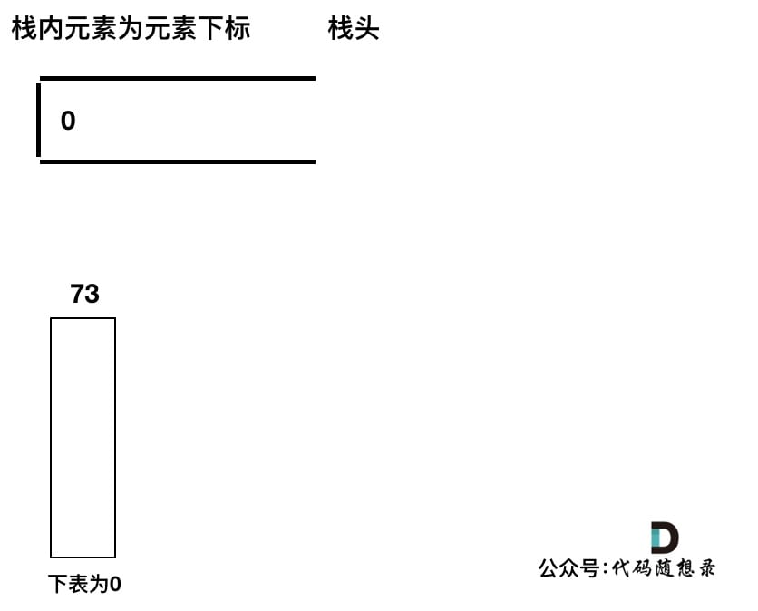

---------

加入 `T[1] = 74`，因為 `T[1] > T[0]`（目前遍歷的元素 `T[i]` 大於堆疊頂元素 `T[st.top()]` 的情況）。

我們要保持一個遞增的單調堆疊（從堆疊頂到堆疊底端），所以將 `T[0]` 彈出，`T[1]` 加入，此時 `result` 陣列可以記錄了，`result[0] = 1`，即 `T[0]` 右面第一個比 `T[0]` 大的元素是 `T[1]`。

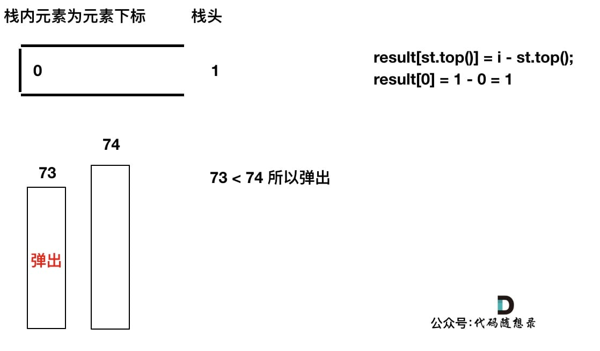

-----------

加入 `T[2]`，同理，`T[1]` 彈出

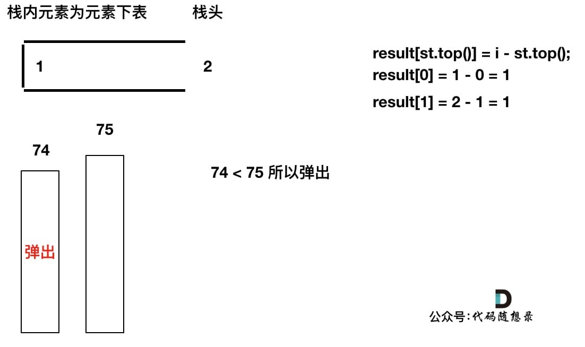

-------

加入 `T[3]`，`T[3] < T[2]`（目前遍歷的元素 `T[i]` 小於堆疊頂元素 `T[st.top()]` 的情況），將 `T[3]` 加入單調堆疊。

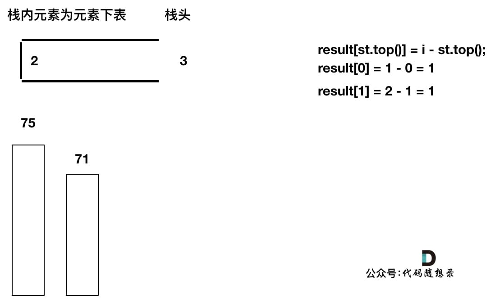

---------

加入 `T[4]`，`T[4] == T[3]`（目前遍歷的元素 `T[i]` 等於堆疊頂元素 `T[st.top()]` 的情況），此時依然要加入堆疊，不用計算距離，因為我們要求的是右面第一個大於本元素的位置，而不是大於等於！

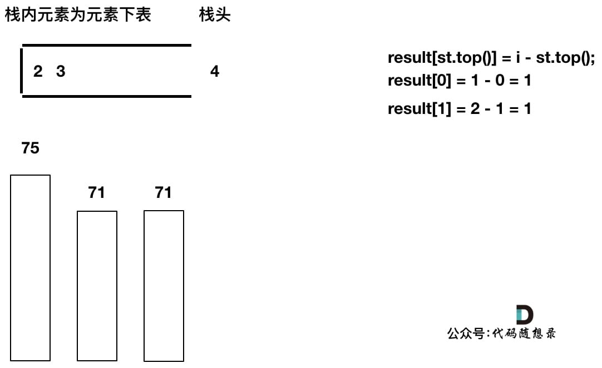

---------

加入 `T[5]`，`T[5] > T[4]`（目前遍歷的元素 `T[i]` 大於堆疊頂元素 `T[st.top()]` 的情況），將 `T[4]` 彈出，同時計算距離，更新 `result`
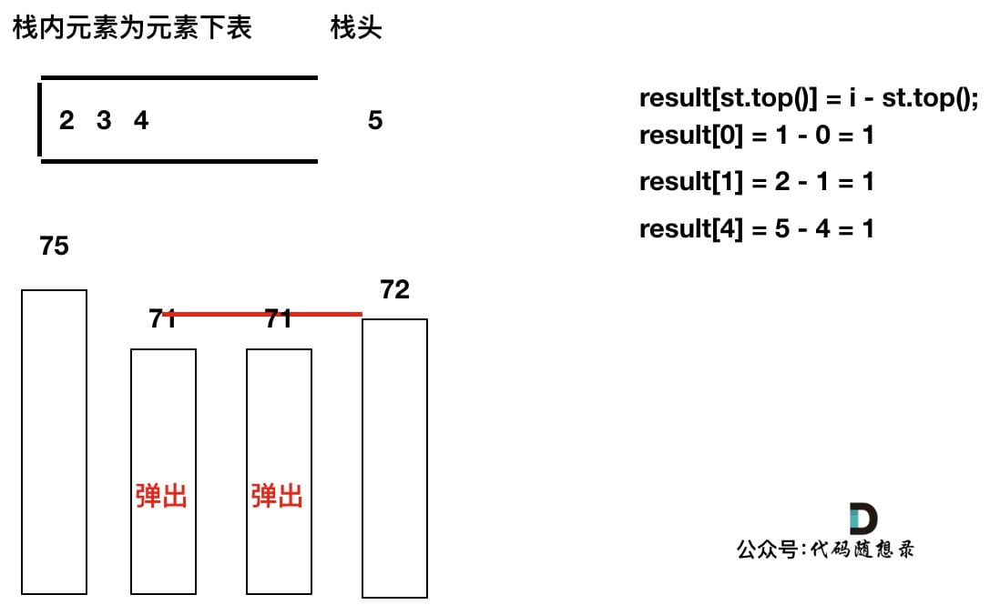

----------

`T[4]` 彈出之後，`T[5] > T[3]`（目前遍歷的元素 `T[i]` 大於堆疊頂元素 `T[st.top()]` 的情況），將 `T[3]` 繼續彈出，同時計算距離，更新 `result`
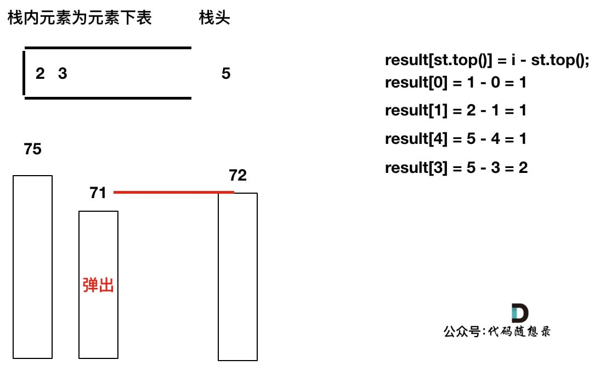

-------

直到發現 `T[5]` 小於 `T[st.top()]`，終止彈出，將 `T[5]` 加入單調堆疊

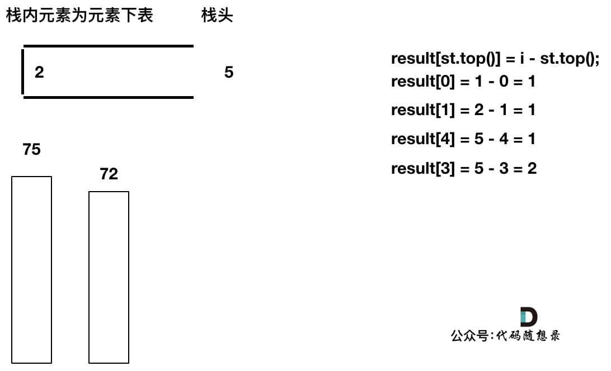

-------

加入 `T[6]`，同理，需要將堆疊裡的 `T[5]`、`T[2]` 彈出

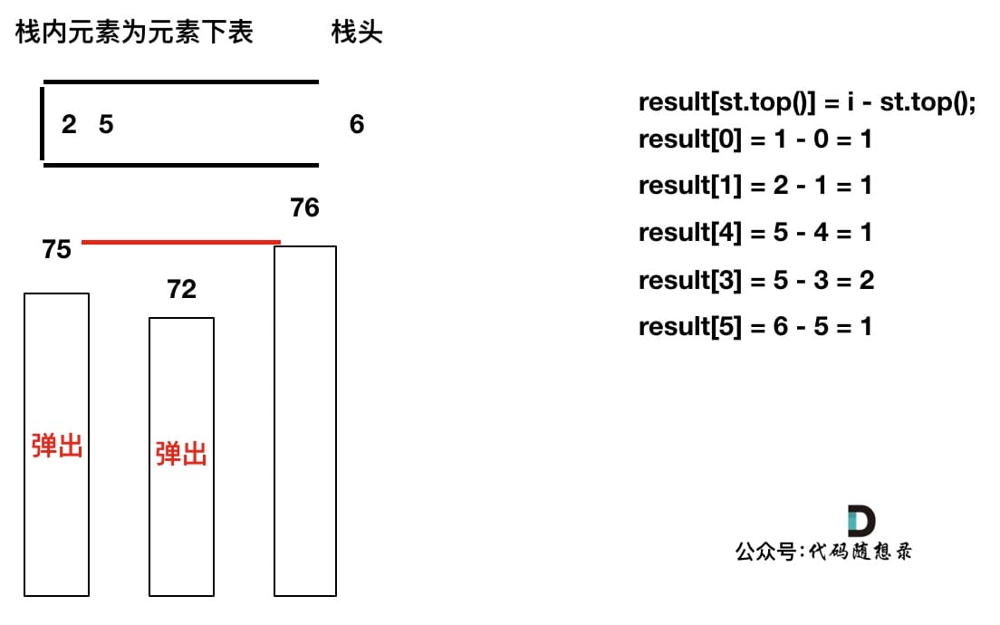

-------

同理，繼續彈出

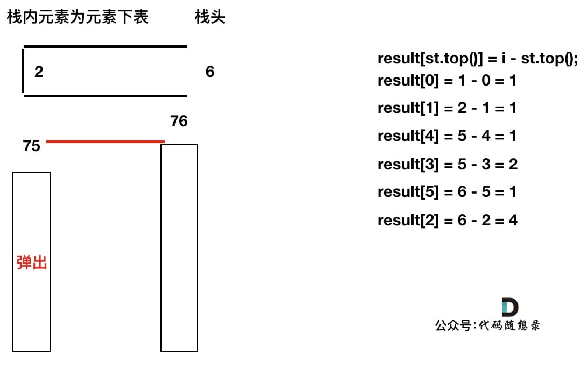

------

此時堆疊裡只剩下了 `T[6]`

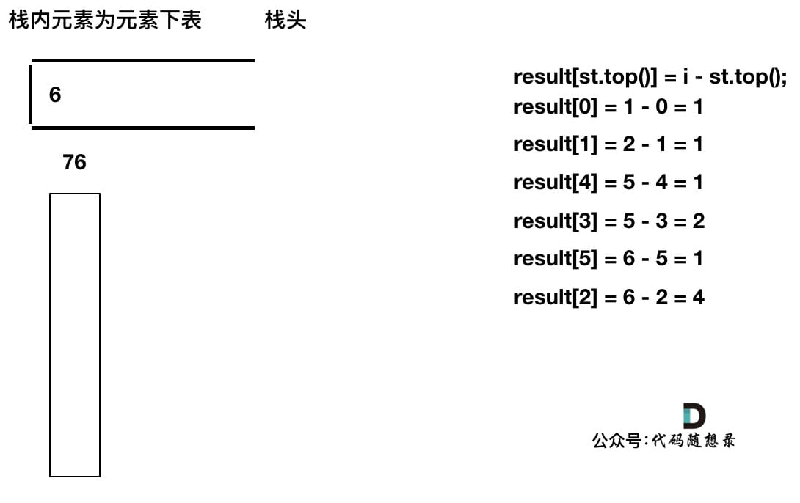

------------

加入 `T[7]`，`T[7] < T[6]` 直接入堆疊，這就是最後的情況，`result` 陣列也更新完了。

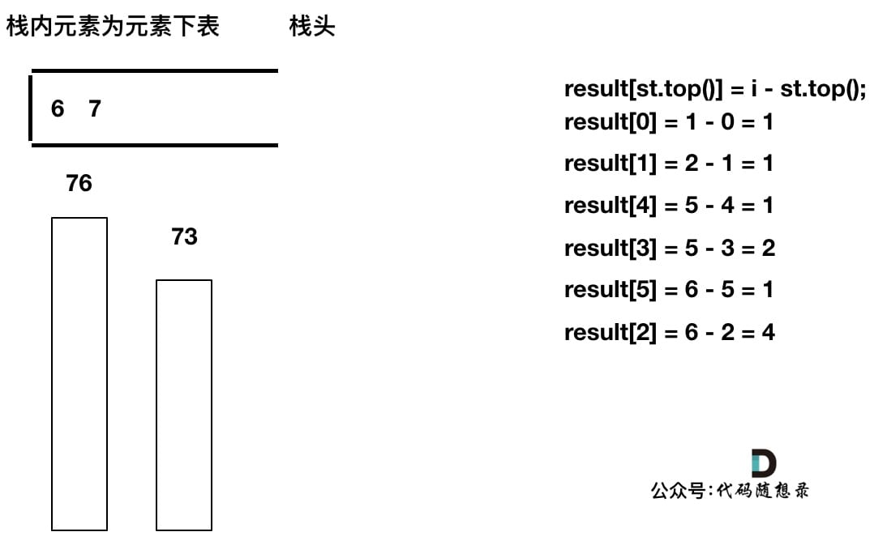


此時有同學可能就疑惑了，那 `result[6]`、`result[7]` 怎麼沒更新啊，元素也一直在堆疊裡。

其實定義 `result` 陣列的時候，就應該直接初始化（initialization）為 0，如果 `result` 沒有更新，說明這個元素右面沒有更大的了，也就是為 0。

以上在圖解的時候，已經把這三種情況都做了詳細的分析。

* 情況一：目前遍歷的元素 `T[i]` 小於堆疊頂元素 `T[st.top()]` 的情況
* 情況二：目前遍歷的元素 `T[i]` 等於堆疊頂元素 `T[st.top()]` 的情況
* 情況三：目前遍歷的元素 `T[i]` 大於堆疊頂元素 `T[st.top()]` 的情況

透過以上過程，大家可以自己再模擬一遍，就會發現：只有單調堆疊遞增（從堆疊口到堆疊底端順序），就是求右邊第一個比自己大的，單調堆疊遞減的話，就是求右邊第一個比自己小的。

C++ 程式碼如下：

```CPP
// 版本一
class Solution {
public:
    vector<int> dailyTemperatures(vector<int>& T) {
        // 遞增堆疊
        stack<int> st;
        vector<int> result(T.size(), 0);
        st.push(0);
        for (int i = 1; i < T.size(); i++) {
            if (T[i] < T[st.top()]) {                       // 情況一
                st.push(i);
            } else if (T[i] == T[st.top()]) {               // 情況二
                st.push(i);
            } else {
                while (!st.empty() && T[i] > T[st.top()]) { // 情況三
                    result[st.top()] = i - st.top();
                    st.pop();
                }
                st.push(i);
            }
        }
        return result;
    }
};
```

**建議一開始都把每種情況分析好，不要上來看簡短的程式碼，關鍵邏輯都被隱藏了**。

精簡程式碼如下：

```CPP
// 版本二
class Solution {
public:
    vector<int> dailyTemperatures(vector<int>& T) {
        stack<int> st; // 遞增堆疊
        vector<int> result(T.size(), 0);
        for (int i = 0; i < T.size(); i++) {
            while (!st.empty() && T[i] > T[st.top()]) { // 注意堆疊不能為空
                result[st.top()] = i - st.top();
                st.pop();
            }
            st.push(i);

        }
        return result;
    }
};
```

* 時間複雜度：O(n)
* 空間複雜度（space complexity）：O(n)

精簡的程式碼是直接把情況一二三都合併到了一起，其實這種程式碼精簡是精簡，但思路不是很清晰。

建議大家把情況一二三想清楚了，先寫出版本一的程式碼，然後在其基礎上再做精簡！


## 其他語言版本

### C：

```C
/**
 * Note: The returned array must be malloced, assume caller calls free().
 */
int* dailyTemperatures(int* temperatures, int temperaturesSize, int* returnSize) {
    int len = temperaturesSize;
    *returnSize = len;

    int *result = (int *)malloc(sizeof(int) * len);
    memset(result, 0x00, sizeof(int) * len);

    int stack[len];
    memset(stack, 0x00, sizeof(stack));
    int top = 0;

    for (int i = 1; i < len; i++) {
        if (temperatures[i] <= temperatures[stack[top]]) { /* push */
            stack[++top] = i;
        } else {
            while (top >= 0 && temperatures[i] > temperatures[stack[top]]) { /* stack not empty */
                result[stack[top]] = i - stack[top];
                top--; /* pop */
            }
            stack[++top] = i; /* push */
        }
    }
    return result;
}
```

### Java：

```java
class Solution {
  // 版本 1
    public int[] dailyTemperatures(int[] temperatures) {

        int lens=temperatures.length;
        int []res=new int[lens];

        /**
        如果目前遍歷的元素 大於堆疊頂元素，表示 堆疊頂元素的 右邊的最大的元素就是 目前遍歷的元素，
        	所以彈出 堆疊頂元素，並記錄
        	如果堆疊不空的話，還要考慮新的堆疊頂與目前元素的大小關係
        否則的話，可以直接入堆疊。
        注意，monotonic stack 裡 加入的元素是 下標。
        */
        Deque<Integer> stack=new LinkedList<>();
        stack.push(0);
        for(int i=1;i<lens;i++){

            if(temperatures[i]<=temperatures[stack.peek()]){
                stack.push(i);
            }else{
                while(!stack.isEmpty()&&temperatures[i]>temperatures[stack.peek()]){
                    res[stack.peek()]=i-stack.peek();
                    stack.pop();
                }
                stack.push(i);
            }
        }

        return  res;
    }

    //--------這 是一條分界線
    // 版本 2
    class Solution {
    public int[] dailyTemperatures(int[] temperatures) {
        int lens=temperatures.length;
        int []res=new int[lens];
        Deque<Integer> stack=new LinkedList<>();
        for(int i=0;i<lens;i++){

           while(!stack.isEmpty()&&temperatures[i]>temperatures[stack.peek()]){
                    res[stack.peek()]=i-stack.peek();
                    stack.pop();
                }
                stack.push(i);
        }

        return  res;
    }
}

}
```

### Python：

> 未精簡版本

```python
class Solution:
    def dailyTemperatures(self, temperatures: List[int]) -> List[int]:
        answer = [0]*len(temperatures)
        stack = [0]
        for i in range(1,len(temperatures)):
            # 情況一和情況二
            if temperatures[i]<=temperatures[stack[-1]]:
                stack.append(i)
            # 情況三
            else:
                while len(stack) != 0 and temperatures[i]>temperatures[stack[-1]]:
                    answer[stack[-1]]=i-stack[-1]
                    stack.pop()
                stack.append(i)

        return answer
```

> 精簡版本

```python
class Solution:
    def dailyTemperatures(self, temperatures: List[int]) -> List[int]:
        answer = [0]*len(temperatures)
        stack = []
        for i in range(len(temperatures)):
            while len(stack)>0 and temperatures[i] > temperatures[stack[-1]]:
                answer[stack[-1]] = i - stack[-1]
                stack.pop()
            stack.append(i)
        return answer
```

### Go：

> 蠻力法

```go
func dailyTemperatures(t []int) []int {
    var res []int
    for i := 0; i < len(t)-1; i++ {
        j := i + 1
        for ; j < len(t); j++ {
            // 如果之後出現更高，說明找到了
            if t[j] > t[i] {
                res = append(res, j-i)
                break
            }
        }
        // 找完了都沒找到
        if j == len(t) {
            res = append(res, 0)
        }
    }
    // 最後一個肯定是 0
    return append(res, 0)
}
```

> 單調堆疊法(未精簡版本)

```go
func dailyTemperatures(temperatures []int) []int {
    res := make([]int, len(temperatures))
    // 初始化堆疊頂元素為第一個下標索引 0
    stack := []int{0}

    for i := 1; i < len(temperatures); i++ {
        top := stack[len(stack)-1]
        if temperatures[i] < temperatures[top] {
            stack = append(stack, i)
        } else if temperatures[i] ==  temperatures[top] {
            stack = append(stack, i)
        } else {
            for len(stack) != 0 && temperatures[i] > temperatures[top] {
                res[top] = i - top
                stack = stack[:len(stack)-1]
                if len(stack) != 0 {
                    top = stack[len(stack)-1]
                }
            }
            stack = append(stack, i)
        }
    }
    return res
}
```

> 單調堆疊法(精簡版本)

```go
// 單調遞減堆疊
func dailyTemperatures(num []int) []int {
    ans := make([]int, len(num))
    stack := []int{}
    for i, v := range num {
        // 堆疊不空，且目前遍歷元素 v 破壞了堆疊的單調性
        for len(stack) != 0 && v > num[stack[len(stack)-1]] {
            // pop
            top := stack[len(stack)-1]
            stack = stack[:len(stack)-1]

            ans[top] = i - top
        }
        stack = append(stack, i)
    }
    return ans
}
```

### JavaScript：

```javascript
// 版本一
var dailyTemperatures = function(temperatures) {
    const n = temperatures.length;
    const res = Array(n).fill(0);
    const stack = [];  // 遞增堆疊：用於儲存元素右面第一個比他大的元素下標
    stack.push(0);
    for (let i = 1; i < n; i++) {
        // 堆疊頂元素
        const top = stack[stack.length - 1];
        if (temperatures[i] < temperatures[top]) {
            stack.push(i);
        } else if (temperatures[i] === temperatures[top]) {
            stack.push(i);
        } else {
            while (stack.length && temperatures[i] > temperatures[stack[stack.length - 1]]) {
                const top = stack.pop();
                res[top] = i - top;
            }
            stack.push(i);
        }
    }
    return res;
};


// 版本二
var dailyTemperatures = function(temperatures) {
    const n = temperatures.length;
    const res = Array(n).fill(0);
    const stack = [];  // 遞增堆疊：用於儲存元素右面第一個比他大的元素下標
    stack.push(0);
    for (let i = 1; i < n; i++) {
        while (stack.length && temperatures[i] > temperatures[stack[stack.length - 1]]) {
            const top = stack.pop();
            res[top] = i - top;
        }
        stack.push(i);
    }
    return res;
};
```

### TypeScript:

> 精簡版：

```typescript
function dailyTemperatures(temperatures: number[]): number[] {
    const length: number = temperatures.length;
    const stack: number[] = [];
    const resArr: number[] = new Array(length).fill(0);
    stack.push(0);
    for (let i = 1; i < length; i++) {
        let top = stack[stack.length - 1];
        while (
            stack.length > 0 &&
            temperatures[top] < temperatures[i]
        ) {
            resArr[top] = i - top;
            stack.pop();
            top = stack[stack.length - 1];
        }
        stack.push(i);
    }
    return resArr;
};
```

### Rust:

```rust
impl Solution {
    /// monotonic stack 的本質是以空間換時間，記錄之前已存取過的非遞增次序列下標
    pub fn daily_temperatures(temperatures: Vec<i32>) -> Vec<i32> {
        let mut res = vec![0; temperatures.len()];
        let mut stack = vec![];
        for (idx, &value) in temperatures.iter().enumerate() {
            while !stack.is_empty() && temperatures[*stack.last().unwrap()] < value {
                // 彈出，並計算 res 中對應位置的值
                let i = stack.pop().unwrap();
                res[i] = (idx - i) as i32;
            }
            // 入堆疊
            stack.push(idx)
        }
        res
    }
}
```


