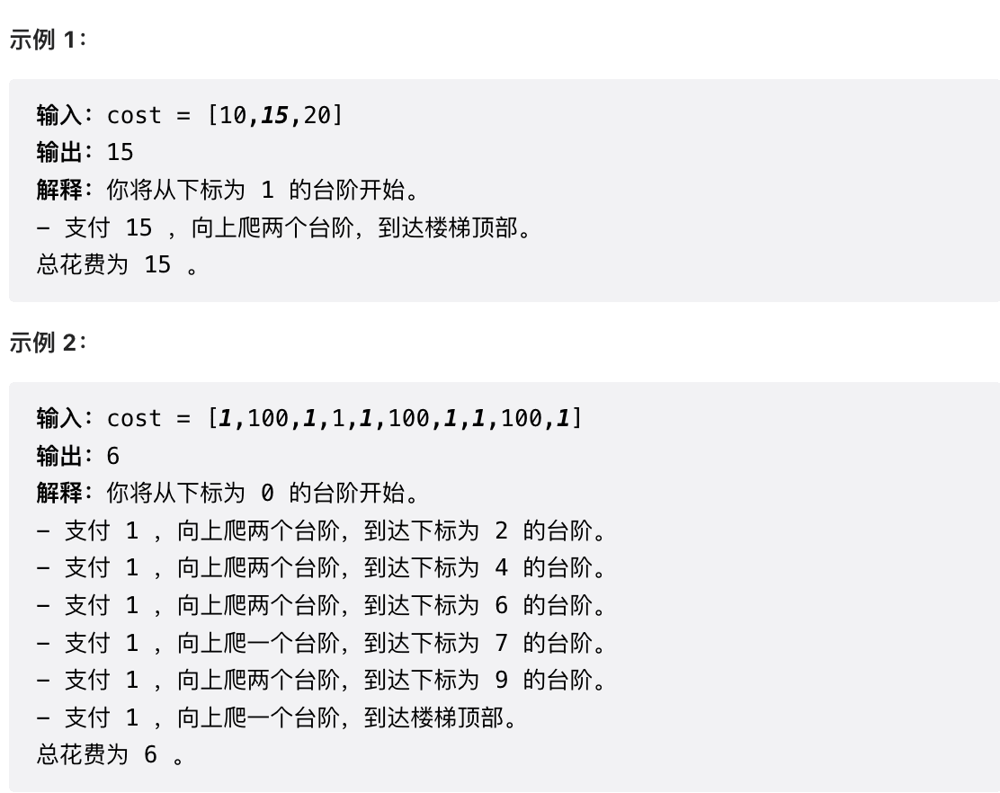
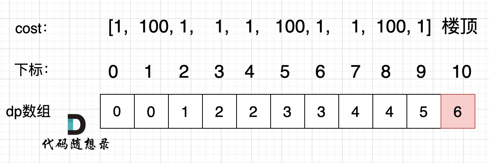

* [做專案（多個 C++、Java、Go、測試開發、前端（front end）專案）](https://www.programmercarl.com/other/kstar.html)
* [刷演算法（兩個月高強度學演算法）](https://www.programmercarl.com/xunlian/xunlianying.html)
* [背面試必考題（八股文）（40 天挑戰高頻面試題）](https://www.programmercarl.com/xunlian/bagu.html)


# 746. 使用最小花費爬樓梯

[LeetCode 題目連結](https://leetcode.cn/problems/min-cost-climbing-stairs/)

**舊題目描述**：

陣列（array）的每個下標（subscript）作為一個階梯，第 i 個階梯對應著一個非負數的體力花費值 cost[i]（下標從 0 開始）。

每當你爬上一個階梯你都要花費對應的體力值，一旦支付了相應的體力值，你就可以選擇向上爬一個階梯或者爬兩個階梯。

請你找出達到樓層頂部的最低花費。在開始時，你可以選擇從下標為 0 或 1 的元素（element）作為初始階梯。

範例 1：

* 輸入：cost = [10, 15, 20]
* 輸出：15
* 解釋：最低花費是從 cost[1] 開始，然後走兩步即可到階梯頂，一共花費 15 。

範例 2：

* 輸入：cost = [1, 100, 1, 1, 1, 100, 1, 1, 100, 1]
* 輸出：6
* 解釋：最低花費方式是從 cost[0] 開始，逐個經過那些 1 ，跳過 cost[3] ，一共花費 6 。

提示：

* cost 的長度範圍是 [2, 1000]。
* cost[i] 將會是一個整數（integer）資料，範圍為 [0, 999] 。


## 演算法公開課

**[《程式碼隨想錄》演算法影片公開課](https://programmercarl.com/other/gongkaike.html)：[動態規劃（dynamic programming, DP）開更了！| LeetCode：746. 使用最小花費爬樓梯](https://www.bilibili.com/video/BV16G411c7yZ/)，相信結合影片再看本篇題解，更有助於大家對本題的理解**。


-----------

本題之前的題目描述是很模糊的，看不出來第一步需要花費體力值、最後一步不用花費，還是說第一步不花費體力值、最後一步花費。

後來 LeetCode 改了題目描述，**新題目描述**：

給你一個整數陣列 cost ，其中 cost[i] 是從樓梯第 i 個台階向上爬需要支付的費用。一旦你支付此費用，即可選擇向上爬一個或者兩個台階。

你可以選擇從下標為 0 或下標為 1 的台階開始爬樓梯。

請你計算並回傳達到樓梯頂部的最低花費。

 


## 解題思路

（**在 LeetCode 修改了題目描述下，我又重新修改了題解**）

修改之後的題意就比較明確了，題目中說「你可以選擇從下標為 0 或下標為 1 的台階開始爬樓梯」，也就是相當於跳到下標 0 或者下標 1 是不花費體力的，從下標 0 下標 1 開始跳就要花費體力了。

1. 確定 dp 陣列以及下標的含義

使用動態規劃，就要有一個陣列來記錄狀態（state），本題只需要一個一維陣列（one dimensional array）dp[i] 就可以了。

**dp[i] 的定義：到達第 i 台階所花費的最少體力為 dp[i]**。

**對於 dp 陣列的定義，大家一定要清晰！**

2. 確定遞迴公式（recurrence formula）

**可以有兩個途徑得到 dp[i]，一個是 dp[i-1] 一個是 dp[i-2]**。

dp[i - 1] 跳到 dp[i] 需要花費 dp[i - 1] + cost[i - 1]。

dp[i - 2] 跳到 dp[i] 需要花費 dp[i - 2] + cost[i - 2]。

那麼究竟是選從 dp[i - 1] 跳還是從 dp[i - 2] 跳呢？

一定是選最小的，所以 dp[i] = min(dp[i - 1] + cost[i - 1], dp[i - 2] + cost[i - 2]);


3. dp 陣列如何初始化（initialization）

看一下遞迴公式，dp[i] 由 dp[i - 1]，dp[i - 2] 推出，既然初始化所有的 dp[i] 是不可能的，那麼只初始化 dp[0] 和 dp[1] 就夠了，其他的最終都是 dp[0] dp[1] 推出。

那麼 dp[0] 應該是多少呢？根據 dp 陣列的定義，到達第 0 台階所花費的最小體力為 dp[0]，那麼有同學可能想，那 dp[0] 應該是 cost[0]，例如 cost = [1, 100, 1, 1, 1, 100, 1, 1, 100, 1] 的話，dp[0] 就是 cost[0] 應該是 1。

這裡就要說明本題 LeetCode 為什麼改題意，而且修改題意之後就清晰很多的原因了。

新題目描述中明確說了「你可以選擇從下標為 0 或下標為 1 的台階開始爬樓梯。」也就是說到達第 0 個台階是不花費的，但從第 0 個台階往上跳的話，需要花費 cost[0]。

所以初始化 dp[0] = 0，dp[1] = 0;


4. 確定遍歷（traversal）順序

最後一步，遞迴公式有了，初始化有了，如何遍歷呢？

本題的遍歷順序其實比較簡單，簡單到很多同學都忽略了思考這一步直接就把程式碼寫出來了。

因為是模擬（simulation）台階，而且 dp[i] 由 dp[i-1] dp[i-2] 推出，所以是從前到後遍歷 cost 陣列就可以了。

> **但是稍稍有點難度的動態規劃，其遍歷順序並不容易確定下來**。
> 例如：0/1 背包問題（0/1 knapsack problem），都知道兩個 for 迴圈（for-loop），一個 for 遍歷物品嵌套一個 for 遍歷背包容量，那麼為什麼不是一個 for 遍歷背包容量嵌套一個 for 遍歷物品呢？以及在使用一維 dp 陣列的時候遍歷背包容量為什麼要倒序呢？

**這些都與遍歷順序息息相關。當然背包問題（knapsack problem）後續「程式碼隨想錄」都會重點講解的！**

5. 舉例推導 dp 陣列

拿範例 2：cost = [1, 100, 1, 1, 1, 100, 1, 1, 100, 1] ，來模擬一下 dp 陣列的狀態變化，如下：

 

如果大家程式碼寫出來有問題，就把 dp 陣列印出來，看看和如上推導的是不是一樣的。

以上分析完畢，整體 C++ 程式碼如下：

```CPP
class Solution {
public:
    int minCostClimbingStairs(vector<int>& cost) {
        vector<int> dp(cost.size() + 1);
        dp[0] = 0; // 預設第一步都是不花費體力的
        dp[1] = 0;
        for (int i = 2; i <= cost.size(); i++) {
            dp[i] = min(dp[i - 1] + cost[i - 1], dp[i - 2] + cost[i - 2]);
        }
        return dp[cost.size()];
    }
};
```
* 時間複雜性（time complexity）：O(n)
* 空間複雜度（space complexity）：O(n)

還可以最佳化空間複雜度，因為 dp[i] 就是由前兩位推出來的，那麼也不用 dp 陣列了，C++ 程式碼如下：

```CPP
// 版本二
class Solution {
public:
    int minCostClimbingStairs(vector<int>& cost) {
        int dp0 = 0;
        int dp1 = 0;
        for (int i = 2; i <= cost.size(); i++) {
            int dpi = min(dp1 + cost[i - 1], dp0 + cost[i - 2]);
            dp0 = dp1; // 記錄一下前兩位
            dp1 = dpi;
        }
        return dp1;
    }
};

```

* 時間複雜性：O(n)
* 空間複雜度：O(1)

當然如果在面試中，能寫出版本一就行，除非面試官額外要求空間複雜度，那麼再去思考版本二，因為版本二還是有點繞。版本一才是正常想法。


## 拓展

舊 LeetCode 描述，如果按照第一步是花費的，最後一步不花費，那麼程式碼是這麼寫的，提交也可以通過


```CPP
// 版本一
class Solution {
public:
    int minCostClimbingStairs(vector<int>& cost) {
        vector<int> dp(cost.size());
        dp[0] = cost[0]; // 第一步有花費
        dp[1] = cost[1];
        for (int i = 2; i < cost.size(); i++) {
            dp[i] = min(dp[i - 1], dp[i - 2]) + cost[i];
        }
        // 注意最後一步可以理解為不用花費，所以取倒數第一步、第二步的最小值
        return min(dp[cost.size() - 1], dp[cost.size() - 2]);
    }
};
```

當然如果對動態規劃理解不夠深入的話，拓展內容就別看了，容易越看越懵。

## 總結

大家可以發現這道題目相對於昨天的[動態規劃：爬樓梯](https://programmercarl.com/0070.爬楼梯.html)又難了一點，但整體想法是一樣的。

從[動態規劃：斐波那契數](https://programmercarl.com/0509.斐波那契数.html)到 [動態規劃：爬樓梯](https://programmercarl.com/0070.爬楼梯.html)再到今天這道題目，讀者／錄友們感受到循序漸進的梯度了嘛。

每個系列開始的時候，都有讀者／錄友和我回饋說題目太簡單了，趕緊上難度，但也有讀者／錄友和我說有點難了，快跟不上了。

其實我選的題目都是有目的性的，就算是簡單題，也是為了練習方法論，然後難度都是梯度上來的，一環扣一環。

但我也可以隨便選來一道難題講唄，這其實是最省事的，不用管什麼題目順序，看心情找一道就講。

難的是把題目按梯度排好，循序漸進，再按照統一方法論把這些都串起來，所以大家不要催我哈，按照我的節奏一步一步來就行了。

## 其他語言版本

以下其他語言版本，大多是按照舊 LeetCode 題解來寫的，歡迎大家在 [Github](https://github.com/youngyangyang04/leetcode-master) 上[提交 pr](https://mp.weixin.qq.com/s/tqCxrMEU-ajQumL1i8im9A)，修正一波。

### Java 

```Java
// 方式一：第一步不支付費用
class Solution {
    public int minCostClimbingStairs(int[] cost) {
        int len = cost.length;
        int[] dp = new int[len + 1];

        // 從下標為 0 或下標為 1 的台階開始，因此支付費用為 0
        dp[0] = 0;
        dp[1] = 0;

        // 計算到達每一層台階的最小費用
        for (int i = 2; i <= len; i++) {
            dp[i] = Math.min(dp[i - 1] + cost[i - 1], dp[i - 2] + cost[i - 2]);
        }

        return dp[len];
    }
}
```

```Java
// 方式二：第一步支付費用
class Solution {
    public int minCostClimbingStairs(int[] cost) {
        int[] dp = new int[cost.length];
        dp[0] = cost[0];
        dp[1] = cost[1];
        for (int i = 2; i < cost.length; i++) {
            dp[i] = Math.min(dp[i - 1], dp[i - 2]) + cost[i];
        }
        // 最後一步，如果是由倒數第二步爬，則最後一步的體力花費可以不用算
        return Math.min(dp[cost.length - 1], dp[cost.length - 2]);
    }
}
```

```Java
// state compression，使用三個變數來代替陣列
class Solution {
    public int minCostClimbingStairs(int[] cost) {
        // 以下三個變數分別表示前兩個台階的最少費用、前一個的、當前的。
        int beforeTwoCost = 0, beforeOneCost = 0, currentCost = 0;
        // 前兩個台階不需要費用就能上到，因此從下標 2 開始；因為最後一個台階需要跨越，所以需要遍歷到 cost.length
        for (int i = 2; i <= cost.length; i ++) {
            // 此處遍歷的是 cost[i - 1]，不會越界
            currentCost = Math.min(beforeOneCost + cost[i - 1], beforeTwoCost + cost[i - 2]);
            beforeTwoCost = beforeOneCost;
            beforeOneCost = currentCost;
        }
        return currentCost;
    }
}
```

### Python

動態規劃（版本一）
```python

class Solution:
    def minCostClimbingStairs(self, cost: List[int]) -> int:
        dp = [0] * (len(cost) + 1)
        dp[0] = 0  # 初始值，表示從起點開始不需要花費體力
        dp[1] = 0  # 初始值，表示經過第一步不需要花費體力
        
        for i in range(2, len(cost) + 1):
            # 在第 i 步，可以選擇從前一步（i-1）花費體力到達當前步，或者從前兩步（i-2）花費體力到達當前步
            # 選擇其中花費體力較小的路徑，加上當前步的花費，更新 dp 陣列
            dp[i] = min(dp[i - 1] + cost[i - 1], dp[i - 2] + cost[i - 2])
        
        return dp[len(cost)]  # 回傳到達樓頂的最小花費

```
動態規劃（版本二）

```python
class Solution:
    def minCostClimbingStairs(self, cost: List[int]) -> int:
        dp0 = 0  # 初始值，表示從起點開始不需要花費體力
        dp1 = 0  # 初始值，表示經過第一步不需要花費體力
        
        for i in range(2, len(cost) + 1):
            # 在第 i 步，可以選擇從前一步（i-1）花費體力到達當前步，或者從前兩步（i-2）花費體力到達當前步
            # 選擇其中花費體力較小的路徑，加上當前步的花費，得到當前步的最小花費
            dpi = min(dp1 + cost[i - 1], dp0 + cost[i - 2])
            
            dp0 = dp1  # 更新 dp0 為前一步的值，即上一次迴圈中的 dp1
            dp1 = dpi  # 更新 dp1 為當前步的最小花費
        
        return dp1  # 回傳到達樓頂的最小花費

```
動態規劃（版本三）

```python
class Solution:
    def minCostClimbingStairs(self, cost: List[int]) -> int:
        dp = [0] * len(cost)
        dp[0] = cost[0]  # 第一步有花費
        dp[1] = cost[1]
        for i in range(2, len(cost)):
            dp[i] = min(dp[i - 1], dp[i - 2]) + cost[i]
        # 注意最後一步可以理解為不用花費，所以取倒數第一步、第二步的最小值
        return min(dp[-1], dp[-2])

```
動態規劃（版本四）

```python
class Solution:
    def minCostClimbingStairs(self, cost: List[int]) -> int:
        n = len(cost)
        prev_1 = cost[0]  # 前一步的最小花費
        prev_2 = cost[1]  # 前兩步的最小花費
        for i in range(2, n):
            current = min(prev_1, prev_2) + cost[i]  # 當前位置的最小花費
            prev_1, prev_2 = prev_2, current  # 更新前一步和前兩步的最小花費
        return min(prev_1, prev_2)  # 最後一步可以理解為不用花費，取倒數第一步和第二步的最小值


```
### Go
```Go
func minCostClimbingStairs(cost []int) int {
    f := make([]int, len(cost) + 1)
    f[0], f[1] = 0, 0
    for i := 2; i <= len(cost); i++ {
        f[i] = min(f[i-1] + cost[i-1], f[i-2] + cost[i-2])
    }
    return f[len(cost)]
}
func min(a, b int) int {
    if a < b {
        return a
    }
    return b
}
```
``` GO
第二種想法: dp[i] 表示從 i 層起跳所需要支付的最小費用
遞迴公式:
i<n :dp[i] = min(dp[i-1],dp[i-2])+cost[i]
i==n:dp[i] = min(dp[i-1],dp[i-2]) (登頂)

func minCostClimbingStairs(cost []int) int {
	n := len(cost)
	dp := make([]int, n+1)
	dp[0], dp[1] = cost[0], cost[1]
	for i := 2; i <= n; i++ {
		if i < n {
			dp[i] = min(dp[i-1], dp[i-2]) + cost[i]
		} else {
			dp[i] = min(dp[i-1], dp[i-2])
		}
	}
	return dp[n]
}
func min(a, b int) int {
	if a < b {
		return a
	}
	return b
}
```


### JavaScript 

```JavaScript
var minCostClimbingStairs = function(cost) {
  const dp = [0, 0]
  for (let i = 2; i <= cost.length; ++i) {
    dp[i] = Math.min(dp[i - 1] + cost[i - 1], dp[i - 2] + cost[i - 2])
  }
  return dp[cost.length]
};
```

不使用 dp 陣列

```JavaScript
var minCostClimbingStairs = function(cost) {
  let dpBefore = 0,
    dpAfter = 0
    for(let i = 2;i <= cost.length;i++){
        let dpi = Math.min(dpBefore + cost[i - 2],dpAfter + cost[i - 1])
        dpBefore = dpAfter
        dpAfter = dpi
    }
    return dpAfter
};
```

### TypeScript

```typescript
function minCostClimbingStairs(cost: number[]): number {
  const dp = [0, 0]
  for (let i = 2; i <= cost.length; i++) {
    dp[i] = Math.min(dp[i - 1] + cost[i - 1], dp[i - 2] + cost[i - 2])
  }
  return dp[cost.length]
}
```

不使用 dp 陣列

```typescript
function minCostClimbingStairs(cost: number[]): number {
  let dpBefore = 0,
    dpAfter = 0
  for (let i = 2; i <= cost.length; i++) {
    let dpi = Math.min(dpBefore + cost[i - 2], dpAfter + cost[i - 1])
    dpBefore = dpAfter
    dpAfter = dpi
  }
  return dpAfter
}
```

### Rust

```Rust
impl Solution {
    pub fn min_cost_climbing_stairs(cost: Vec<i32>) -> i32 {
        let mut dp = vec![0; cost.len() + 1];
        for i in 2..=cost.len() {
            dp[i] = (dp[i - 1] + cost[i - 1]).min(dp[i - 2] + cost[i - 2]);
        }
        dp[cost.len()]
    }
}
```

不使用 dp 陣列

```rust
impl Solution {
    pub fn min_cost_climbing_stairs(cost: Vec<i32>) -> i32 {
        let (mut dp_before, mut dp_after) = (0, 0);
        for i in 2..=cost.len() {
            let dpi = (dp_before + cost[i - 2]).min(dp_after + cost[i - 1]);
            dp_before = dp_after;
            dp_after = dpi;
        }
        dp_after
    }
}
```

### C

```c
#include <math.h>
int minCostClimbingStairs(int *cost, int costSize) {
  int dp[costSize + 1];
  dp[0] = dp[1] = 0;
  for (int i = 2; i <= costSize; i++) {
    dp[i] = fmin(dp[i - 2] + cost[i - 2], dp[i - 1] + cost[i - 1]);
  }
  return dp[costSize];
}
```

不使用 dp 陣列

```c
#include <math.h>
int minCostClimbingStairs(int *cost, int costSize) {
  int dpBefore = 0, dpAfter = 0;
  for (int i = 2; i <= costSize; i++) {
    int dpi = fmin(dpBefore + cost[i - 2], dpAfter + cost[i - 1]);
    dpBefore = dpAfter;
    dpAfter = dpi;
  }
  return dpAfter;
}
```

### Scala

```scala
object Solution {
  def minCostClimbingStairs(cost: Array[Int]): Int = {
    var dp = new Array[Int](cost.length)
    dp(0) = cost(0)
    dp(1) = cost(1)
    for (i <- 2 until cost.length) {
      dp(i) = math.min(dp(i - 1), dp(i - 2)) + cost(i)
    }
    math.min(dp(cost.length - 1), dp(cost.length - 2))
  }
}
```

第二種想法: dp[i] 表示爬到第 i-1 層所需的最小花費，狀態變遷方程式（state transition equation）為: dp[i] = min(dp[i-1]+cost[i-1],dp[i-2]+cost[i-2])
```scala
object Solution {
  def minCostClimbingStairs(cost: Array[Int]): Int = {
    var dp = new Array[Int](cost.length + 1)
    for (i <- 2 until cost.length + 1) {
      dp(i) = math.min(dp(i - 1) + cost(i - 1), dp(i - 2) + cost(i - 2))
    }
    dp(cost.length)
  }
}
```

### C#

```csharp
public class Solution
{
    public int MinCostClimbingStairs(int[] cost)
    {
        int[] dp=new int[2] { cost[0], cost[1] };
        for (int i = 2; i < cost.Length; i++)
        {
            int temp = Math.Min(dp[0], dp[1])+cost[i];
            dp[0]=dp[1];
            dp[1]=temp;
        }
        return Math.Min(dp[0],dp[1]);
    }
}
```


