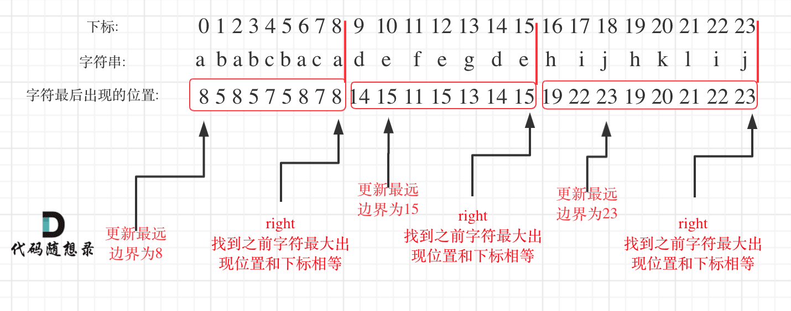

* [做專案（多個 C++、Java、Go、測開、前端（front end）專案）](https://www.programmercarl.com/other/kstar.html)
* [刷演算法（兩個月高強度學演算法）](https://www.programmercarl.com/xunlian/xunlianying.html)
* [背八股（40 天挑戰高頻面試題）](https://www.programmercarl.com/xunlian/bagu.html)


# 763.劃分字母區間（interval）

[LeetCode 題目連結](https://leetcode.com/problems/partition-labels/)

字串（string） S 由小寫字母組成。我們要把這個字串劃分為盡可能多的片段，同一字母最多出現在一個片段中。回傳一個表示每個字串片段長度的串列（list）。

範例：
* 輸入：S = "ababcbacadefegdehijhklij"
* 輸出：[9,7,8]
解釋：
劃分結果為 "ababcbaca", "defegde", "hijhklij"。
每個字母最多出現在一個片段中。
像 "ababcbacadefegde", "hijhklij" 的劃分是錯誤的，因為劃分的片段數較少。

提示：

* S 的長度在 [1, 500] 之間。
* S 只包含小寫字母 'a' 到 'z' 。

## 演算法影片公開課

**[《代碼隨想錄》演算法影片公開課](https://programmercarl.com/other/gongkaike.html)：[貪心演算法（greedy algorithm），尋找最遠的出現位置！ LeetCode：763.劃分字母區間](https://www.bilibili.com/video/BV18G4y1K7d5)，相信結合影片再看本篇題解，更有助於大家對本題的理解**。

## 解題思路

一想到分割字串就想到了回溯（backtracking），但本題其實不用回溯去蠻力（brute force）搜尋。

題目要求同一字母最多出現在一個片段中，那麼如何把同一個字母都圈在同一個區間裡呢？

如果沒有接觸過這種題目的話，還挺有難度的。

在遍歷（traversal）的過程中相當於是要找每一個字母的邊界（boundary），**如果找到之前遍歷過的所有字母的最遠邊界，說明這個邊界就是分割點了**。此時前面出現過的所有字母，最遠也就到這個邊界了。

可以分為如下兩步：

* 統計每一個字元（character）最後出現的位置
* 從頭遍歷字元，並更新字元的最遠出現下標（subscript），如果找到字元最遠出現位置下標和目前下標相等了，則找到了分割點

如圖：




明白原理之後，程式碼並不複雜，如下：

```CPP
class Solution {
public:
    vector<int> partitionLabels(string S) {
        int hash[27] = {0}; // i 為字元，hash[i] 為字元出現的最後位置
        for (int i = 0; i < S.size(); i++) { // 統計每一個字元最後出現的位置
            hash[S[i] - 'a'] = i;
        }
        vector<int> result;
        int left = 0;
        int right = 0;
        for (int i = 0; i < S.size(); i++) {
            right = max(right, hash[S[i] - 'a']); // 找到字元出現的最遠邊界
            if (i == right) {
                result.push_back(right - left + 1);
                left = i + 1;
            }
        }
        return result;
    }
};
```

* 時間複雜度（time complexity）：O(n)
* 空間複雜度（space complexity）：O(1)，使用的 hash 陣列（array）是固定大小

## 總結

這道題目 LeetCode 標記為貪心演算法，老實說，我沒有感受到貪心，找不出區域最佳（local optimum）推出總體最佳（global optimum）的過程。就是用最遠出現距離模擬（simulation）了圈字元的行為。

但這道題目的解題思路是很巧妙的，所以有必要介紹給大家做一做，感受一下。

## 補充

這裡提供一種與[452.用最少數量的箭引爆氣球](./0452.用最少數量的箭引爆氣球.md)、[435.無重疊區間](./0435.無重叠區間.md)相同的解題思路。

統計字串中所有字元的起始和結束位置，記錄這些區間(實際上也就是[435.無重疊區間](./0435.無重叠區間.md)題目裡的輸入)，**將區間按左邊界從小到大排序（sorting），找到邊界將區間劃分成組，互不重疊。找到的邊界就是答案。**

```CPP
class Solution {
public:
    static bool cmp(vector<int> &a, vector<int> &b) {
        return a[0] < b[0];
    }
    // 記錄每個字母出現的區間
    vector<vector<int>> countLabels(string s) {
        vector<vector<int>> hash(26, vector<int>(2, INT_MIN));
        vector<vector<int>> hash_filter;
        for (int i = 0; i < s.size(); ++i) {
            if (hash[s[i] - 'a'][0] == INT_MIN) {
                hash[s[i] - 'a'][0] = i;
            }
            hash[s[i] - 'a'][1] = i;
        }
        // 去除字串中未出現的字母所佔用區間
        for (int i = 0; i < hash.size(); ++i) {
            if (hash[i][0] != INT_MIN) {
                hash_filter.push_back(hash[i]);
            }
        }
        return hash_filter;
    }
    vector<int> partitionLabels(string s) {
        vector<int> res;
        // 這一步得到的 hash 即為無重疊區間題意中的輸入範例格式：區間串列
        // 只不過現在我們要求的是區間分割點
        vector<vector<int>> hash = countLabels(s);
        // 按照左邊界從小到大排序
        sort(hash.begin(), hash.end(), cmp);
        // 記錄最大右邊界
        int rightBoard = hash[0][1];
        int leftBoard = 0;
        for (int i = 1; i < hash.size(); ++i) {
            // 由於字串一定能分割，因此，
            // 一旦下一區間左邊界大於目前右邊界，即可認為出現分割點
            if (hash[i][0] > rightBoard) {
                res.push_back(rightBoard - leftBoard + 1);
                leftBoard = hash[i][0];
            }
            rightBoard = max(rightBoard, hash[i][1]);
        }
        // 最右端
        res.push_back(rightBoard - leftBoard + 1);
        return res;
    }
};
```

## 其他語言版本


### Java 
```java
class Solution {
    public List<Integer> partitionLabels(String S) {
        List<Integer> list = new LinkedList<>();
        int[] edge = new int[26];
        char[] chars = S.toCharArray();
        for (int i = 0; i < chars.length; i++) {
            edge[chars[i] - 'a'] = i;
        }
        int idx = 0;
        int last = -1;
        for (int i = 0; i < chars.length; i++) {
            idx = Math.max(idx,edge[chars[i] - 'a']);
            if (i == idx) {
                list.add(i - last);
                last = i;
            }
        }
        return list;
    }
}

class Solution{
    /*解法二： 上述 C++ 補充解題思路的 Java 程式碼實作*/
    
    public  int[][] findPartitions(String s) {
        List<Integer> temp = new ArrayList<>();
        int[][] hash = new int[26][2];//26 個字母 2 行 表示該字母對應的區間

        for (int i = 0; i < s.length(); i++) {
            //更新字元 c 對應的位置 i
            char c = s.charAt(i);
            if (hash[c - 'a'][0] == 0) hash[c - 'a'][0] = i;

            hash[c - 'a'][1] = i;

            //第一個元素區別對待一下
            hash[s.charAt(0) - 'a'][0] = 0;
        }


        List<List<Integer>> h = new LinkedList<>();
        //組裝區間
        for (int i = 0; i < 26; i++) {
            //if (hash[i][0] != hash[i][1]) {
            temp.clear();
            temp.add(hash[i][0]);
            temp.add(hash[i][1]);
            //System.out.println(temp);
            h.add(new ArrayList<>(temp));
            // }
        }
        // System.out.println(h);
        // System.out.println(h.size());
        int[][] res = new int[h.size()][2];
        for (int i = 0; i < h.size(); i++) {
            List<Integer> list = h.get(i);
            res[i][0] =  list.get(0);
            res[i][1] =  list.get(1);
        }

        return res;

    }

    public  List<Integer> partitionLabels(String s) {
        int[][] partitions = findPartitions(s);
        List<Integer> res = new ArrayList<>();
        Arrays.sort(partitions, (o1, o2) -> Integer.compare(o1[0], o2[0]));
        int right = partitions[0][1];
        int left = 0;
        for (int i = 0; i < partitions.length; i++) {
            if (partitions[i][0] > right) {
                //左邊界大於右邊界即可記為一次分割
                res.add(right - left + 1);
                left = partitions[i][0];
            }
            right = Math.max(right, partitions[i][1]);

        }
        //最右端
        res.add(right - left + 1);
        return res;

    }
}
```

### Python 
貪心法（greedy）（版本一）
```python
class Solution:
    def partitionLabels(self, s: str) -> List[int]:
        last_occurrence = {}  # 儲存每個字元最後出現的位置
        for i, ch in enumerate(s):
            last_occurrence[ch] = i

        result = []
        start = 0
        end = 0
        for i, ch in enumerate(s):
            end = max(end, last_occurrence[ch])  # 找到目前字元出現的最遠位置
            if i == end:  # 如果目前位置是最遠位置，表示可以分割出一個區間
                result.append(end - start + 1)
                start = i + 1

        return result
         
```
貪心（版本二）與 452.用最少數量的箭引爆氣球 (opens new window)、435.無重疊區間 (opens new window) 相同的解題思路。
```python
class Solution:
    def countLabels(self, s):
        # 初始化一個長度為 26 的區間串列，初始值為負無窮
        hash = [[float('-inf'), float('-inf')] for _ in range(26)]
        hash_filter = []
        for i in range(len(s)):
            if hash[ord(s[i]) - ord('a')][0] == float('-inf'):
                hash[ord(s[i]) - ord('a')][0] = i
            hash[ord(s[i]) - ord('a')][1] = i
        for i in range(len(hash)):
            if hash[i][0] != float('-inf'):
                hash_filter.append(hash[i])
        return hash_filter

    def partitionLabels(self, s):
        res = []
        hash = self.countLabels(s)
        hash.sort(key=lambda x: x[0])  # 按左邊界從小到大排序
        rightBoard = hash[0][1]  # 記錄最大右邊界
        leftBoard = 0
        for i in range(1, len(hash)):
            if hash[i][0] > rightBoard:  # 出現分割點
                res.append(rightBoard - leftBoard + 1)
                leftBoard = hash[i][0]
            rightBoard = max(rightBoard, hash[i][1])
        res.append(rightBoard - leftBoard + 1)  # 最右端
        return res
            
```

### Go

```go

func partitionLabels(s string) []int {
    var res []int;
    var marks [26]int;
    size, left, right := len(s), 0, 0;
    for i := 0; i < size; i++ {
        marks[s[i] - 'a'] = i;
    }
    for i := 0; i < size; i++ {
        right = max(right, marks[s[i] - 'a']);
        if i == right {
            res = append(res, right - left + 1);
            left = i + 1;
        }
    }
    return res;
}

func max(a, b int) int {
    if a < b {
        a = b;
    }
    return a;
}
```

### JavaScript 
```Javascript
var partitionLabels = function(s) {
    let hash = {}
    for(let i = 0; i < s.length; i++) {
        hash[s[i]] = i
    }
    let result = []
    let left = 0
    let right = 0
    for(let i = 0; i < s.length; i++) {
        right = Math.max(right, hash[s[i]])
        if(right === i) {
            result.push(right - left + 1)
            left = i + 1
        }
    }
    return result
};
```

### TypeScript

```typescript
function partitionLabels(s: string): number[] {
    const length: number = s.length;
    const resArr: number[] = [];
    const helperMap: Map<string, number> = new Map();
    for (let i = 0; i < length; i++) {
        helperMap.set(s[i], i);
    }
    let left: number = 0;
    let right: number = 0;
    for (let i = 0; i < length; i++) {
        right = Math.max(helperMap.get(s[i])!, right);
        if (i === right) {
            resArr.push(i - left + 1);
            left = i + 1;
        }
    }
    return resArr;
};
```

### Scala

```scala
object Solution {
  import scala.collection.mutable
  def partitionLabels(s: String): List[Int] = {
    var hash = new Array[Int](26)
    for (i <- s.indices) {
      hash(s(i) - 'a') = i
    }

    var res = mutable.ListBuffer[Int]()
    var (left, right) = (0, 0)
    for (i <- s.indices) {
      right = math.max(hash(s(i) - 'a'), right)
      if (i == right) {
        res.append(right - left + 1)
        left = i + 1
      }
    }

    res.toList
  }
}
```

### Rust

```Rust
impl Solution {
    pub fn partition_labels(s: String) -> Vec<i32> {
        let mut hash = vec![0; 26];
        for (i, &c) in s.as_bytes().iter().enumerate() {
            hash[(c - b'a') as usize] = i;
        }
        let mut res = vec![];
        let (mut left, mut right) = (0, 0);
        for (i, &c) in s.as_bytes().iter().enumerate() {
            right = right.max(hash[(c - b'a') as usize]);
            if i == right {
                res.push((right - left + 1) as i32);
                left = i + 1;
            }
        }
        res
    }
}
```
### C

```c
#define max(a, b) ((a) > (b) ? (a) : (b))

int* partitionLabels(char* s, int* returnSize) {
    // 記錄每個字元最遠出現的位置
    int last[26] = {0};
    int len = strlen(s);
    for (int i = 0; i < len; ++i) {
        last[s[i] - 'a'] = i;
    }
    int left = 0, right = 0;
    int * partition = malloc(sizeof (int ) * len);
    // 初始化值
    *returnSize = 0;
    for(int i = 0; i < len; i++){
        right = max(right, last[s[i] - 'a']);
        // 到達最遠位置，加入答案，並且更新左邊下標
        if(i == right){
            partition[(*returnSize)++] = right - left + 1;
            left = i + 1;
        }
    }
    return partition;
}
```


### C#

```csharp
public class Solution
{
    public IList<int> PartitionLabels(string s)
    {
        int[] location = new int[27];
        for (int i = 0; i < s.Length; i++)
        {
            location[s[i] - 'a'] = i;
        }
        List<int> res = new List<int>();
        int left = 0, right = 0;
        for (int i = 0; i < s.Length; i++)
        {
            right = Math.Max(right, location[s[i] - 'a']);
            if (i == right)
            {
                res.Add(right - left + 1);
                left = i + 1;
            }
        }
        return res;
    }
}
```

