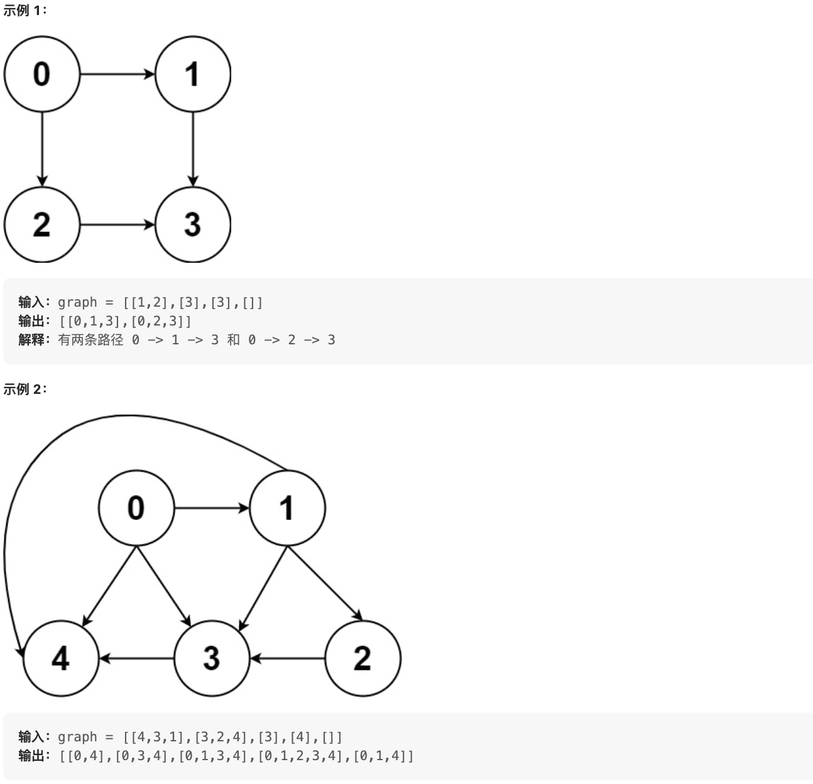
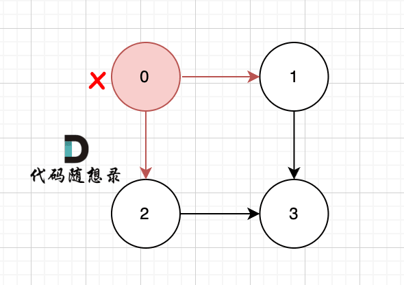

* [做專案（多個 C++、Java、Go、測開、前端（front end）專案）](https://www.programmercarl.com/other/kstar.html)
* [刷演算法（algorithm）（兩個月高強度學演算法）](https://www.programmercarl.com/xunlian/xunlianying.html)
* [背八股（40 天挑戰高頻面試題）](https://www.programmercarl.com/xunlian/bagu.html)


# 797.所有可能的路徑（path） 

[LeetCode 題目連結](https://leetcode.cn/problems/all-paths-from-source-to-target/)

給你一個有 n 個節點（node）的有向非循環圖（directed acyclic graph, DAG），請你找出所有從節點 0 到節點 n-1 的路徑並輸出（不要求按特定順序）

graph[i] 是一個從節點 i 可以造訪的所有節點的串列（list）（即從節點 i 到節點 graph[i][j] 存在一條有向邊（edge））。



提示：

* n == graph.length
* 2 <= n <= 15
* 0 <= graph[i][j] < n
* graph[i][j] != i（即不存在 self-loop）
* graph[i] 中的所有元素（element）互不相同
* 保證輸入為 有向非循環圖（DAG）

## 解題思路 

這道題目是深度優先搜尋（depth-first search, DFS），比較好的入門題。 

如果對深度優先搜尋還不夠了解，可以先看這裡：[深度優先搜尋的理論基礎](https://programmercarl.com/图论深搜理论基础.html)

我依然總結了深搜三部曲，如果按照代碼隨想錄刷題的錄友，應該刷過二元樹（binary tree）的遞迴（recursion）三部曲、回溯（backtracking）三部曲。 

**大家可能有疑惑，深搜、二元樹和回溯演算法（backtracking algorithm）有什麼區別呢**？什麼時候用深搜、什麼時候用回溯？ 

我在講解[二元樹理論基礎](https://programmercarl.com/二叉树理论基础.html)的時候，提到過，**二元樹的前、中、後序遍歷（traversal）其實就是深搜在二元樹這種資料結構（data structure）上的應用**。 

那麼回溯演算法呢，**其實回溯演算法就是深搜，只不過我們給它一個更細分的定義，叫做回溯演算法**。 

那有的錄友可能說：那我以後稱回溯演算法為深搜，是不是沒毛病？ 

理論上來說，沒毛病，但就像是二元樹你不叫它二元樹，叫它資料結構，有問題嗎？也沒問題對吧。 

建議是有細分的場景，還是稱其細分場景的名稱。所以回溯演算法可以獨立出來，但回溯確實就是深搜。 

接下來我們使用深搜三部曲來分析題目：

1. 確認遞迴函數（recursive function）、參數（parameter） 

首先我們 dfs 函式一定要存一個圖（graph），用來遍歷的，還要存一個目前我們遍歷的節點，定義為 x

至於單一路徑和路徑集合可以放在總體變數（global variable），那麼程式碼是這樣的： 

```CPP
vector<vector<int>> result; // 收集符合條件的路徑
vector<int> path; // 0 節點到終點的路徑
// x：目前遍歷的節點
// graph：存目前的圖
void dfs (vector<vector<int>>& graph, int x) 
```

2. 確認終止條件（termination condition） 

遍歷的時候，什麼時候我們就找到一條路徑了？ 

當目前遍歷的節點為最後一個節點的時候，就找到了一條從出發點到終止點的路徑。 

目前遍歷的節點，我們定義為 x，最後一個節點，就是 graph.size() - 1（因為題目描述是找出所有從節點 0 到節點 n-1 的路徑並輸出）。 

所以當 x 等於 graph.size() - 1 的時候就找到一條有效路徑。程式碼如下： 


```CPP
// 要求從節點 0 到節點 n-1 的路徑並輸出，所以是 graph.size() - 1
if (x == graph.size() - 1) { // 找到符合條件的一條路徑
    result.push_back(path); // 收集有效路徑
    return;
}
```

3. 處理目前搜尋節點出發的路徑 

接下來是走目前遍歷節點 x 的下一個節點。 

首先是要找到 x 節點連接了哪些節點呢？遍歷方式是這樣的： 

```c++
for (int i = 0; i < graph[x].size(); i++) { // 遍歷節點 n 連接的所有節點
```

接下來就是將選中的 x 所連接的節點，加入到單一路徑來。 

```C++
path.push_back(graph[x][i]); // 遍歷到的節點加入到路徑中來

```

一些錄友可能疑惑這裡如何找到 x 連接的節點的，例如如果 x 目前是節點 0，那麼目前的過程就是這樣的：

 

二維（2D）陣列（array）中，graph[x][i] 都是 x 連接的節點，目前遍歷的節點就是 `graph[x][i]` 。

進入下一層遞迴 

```CPP
dfs(graph, graph[x][i]); // 進入下一層遞迴
```

最後就是回溯的過程，撤銷本次新增節點的操作。該過程整體程式碼： 

```CPP
for (int i = 0; i < graph[x].size(); i++) { // 遍歷節點 n 連接的所有節點
    path.push_back(graph[x][i]); // 遍歷到的節點加入到路徑中來
    dfs(graph, graph[x][i]); // 進入下一層遞迴
    path.pop_back(); // 回溯，撤銷本節點
}
```

本題整體程式碼如下：

```CPP
class Solution {
private:
    vector<vector<int>> result; // 收集符合條件的路徑
    vector<int> path; // 0 節點到終點的路徑
    // x：目前遍歷的節點
    // graph：存目前的圖
    void dfs (vector<vector<int>>& graph, int x) {
        // 要求從節點 0 到節點 n-1 的路徑並輸出，所以是 graph.size() - 1
        if (x == graph.size() - 1) { // 找到符合條件的一條路徑
            result.push_back(path);
            return;
        }
        for (int i = 0; i < graph[x].size(); i++) { // 遍歷節點 n 連接的所有節點
            path.push_back(graph[x][i]); // 遍歷到的節點加入到路徑中來
            dfs(graph, graph[x][i]); // 進入下一層遞迴
            path.pop_back(); // 回溯，撤銷本節點
        }
    }
public:
    vector<vector<int>> allPathsSourceTarget(vector<vector<int>>& graph) {
        path.push_back(0); // 無論什麼路徑都已經是從 0 節點出發
        dfs(graph, 0); // 開始遍歷
        return result;
    }
};

```

## 總結 

本題是比較基礎的深度優先搜尋模板（template）題，這種有向圖（directed graph）路徑問題，最適合使用深搜，當然本題也可以使用廣度優先搜尋（breadth-first search, BFS），但廣搜相對來說就麻煩了一些，需要記錄一下路徑。 

而深搜和廣搜都適合解決顏色類的問題，例如島嶼系列，其實都是「遍歷 + 標記」，所以使用哪種遍歷都是可以的。 

至於廣搜理論基礎，我們在下一篇再好好講解，敬請期待！ 

## 其他語言版本 

### Java 

```Java
// 深度優先遍歷
class Solution {
    List<List<Integer>> ans;		// 用來存放滿足條件的路徑
    List<Integer> cnt;		// 用來儲存 dfs 過程中的節點值

    public void dfs(int[][] graph, int node) {
        if (node == graph.length - 1) {		// 如果目前節點是 n - 1，那麼就儲存這條路徑
            ans.add(new ArrayList<>(cnt));
            return;
        }
        for (int index = 0; index < graph[node].length; index++) {
            int nextNode = graph[node][index];
            cnt.add(nextNode);
            dfs(graph, nextNode);
            cnt.remove(cnt.size() - 1);		// 回溯
        }
    }

    public List<List<Integer>> allPathsSourceTarget(int[][] graph) {
        ans = new ArrayList<>();
        cnt = new ArrayList<>();
        cnt.add(0);			// 注意，0 號節點要加入 cnt 陣列中
        dfs(graph, 0);
        return ans;
    }
}
```

### Python

```python
class Solution:
    def __init__(self):
        self.result = []
        self.path = [0]

    def allPathsSourceTarget(self, graph: List[List[int]]) -> List[List[int]]:
        if not graph: return []

        self.dfs(graph, 0)
        return self.result
    
    def dfs(self, graph, root: int):
        if root == len(graph) - 1:  # 成功找到一條路徑時
            # ***Python 的 list 是 mutable 類型***
            # ***回溯中必須使用 Deep Copy***
            self.result.append(self.path[:]) 
            return
        
        for node in graph[root]:   # 遍歷節點 n 的所有後續節點
            self.path.append(node)
            self.dfs(graph, node)
            self.path.pop() # 回溯
```


### JavaScript
```javascript
var allPathsSourceTarget = function(graph) {
    let res=[],path=[]

    function dfs(graph,start){
        if(start===graph.length-1){
            res.push([...path])
            return;
        }
        for(let i=0;i<graph[start].length;i++){
            path.push(graph[start][i])
            dfs(graph,graph[start][i])
            path.pop()
        }
    }
    path.push(0)
    dfs(graph,0)
    return res
};
```


### Go

```go
func allPathsSourceTarget(graph [][]int) [][]int {
    result := make([][]int, 0)

    var dfs func(path []int, step int)
    dfs = func(path []int, step int){
        // 從 0 遍歷到 length-1
        if step == len(graph) - 1{
            tmp := make([]int, len(path))
            copy(tmp, path)
            result = append(result, tmp)
            return 
        }

        for i := 0; i < len(graph[step]); i++{
            next := append(path, graph[step][i])
            dfs(next, graph[step][i])
        }
    }
    // 從 0 開始，開始 push 0 進去
    dfs([]int{0}, 0)
    return result 
}

```

### Rust


```rust
impl Solution {
    pub fn all_paths_source_target(graph: Vec<Vec<i32>>) -> Vec<Vec<i32>> {
        let (mut res, mut path) = (vec![], vec![0]);
        Self::dfs(&graph, &mut path, &mut res, 0);
        res
    }

    pub fn dfs(graph: &Vec<Vec<i32>>, path: &mut Vec<i32>, res: &mut Vec<Vec<i32>>, node: usize) {
        if node == graph.len() - 1 {
            res.push(path.clone());
            return;
        }
        for &v in &graph[node] {
            path.push(v);
            Self::dfs(graph, path, res, v as usize);
            path.pop();
        }
    }
}
```

