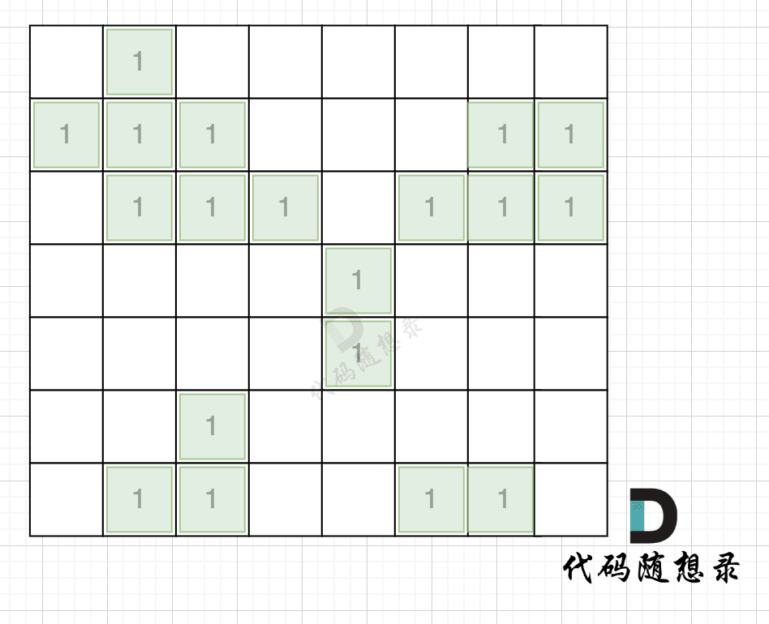
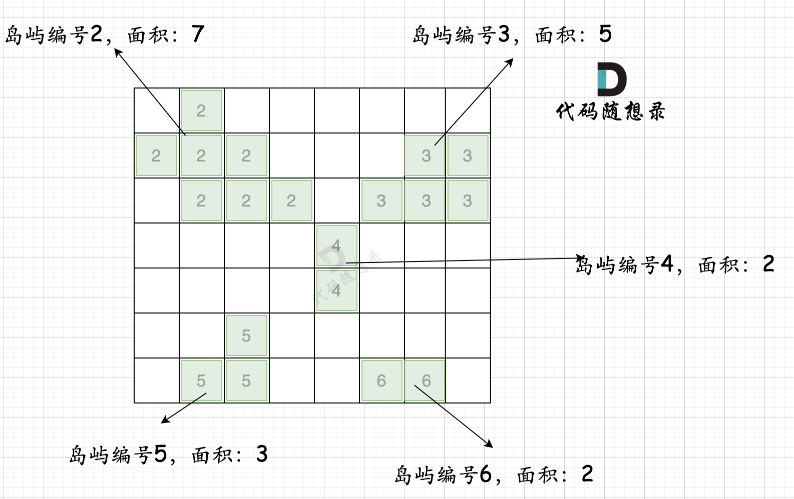
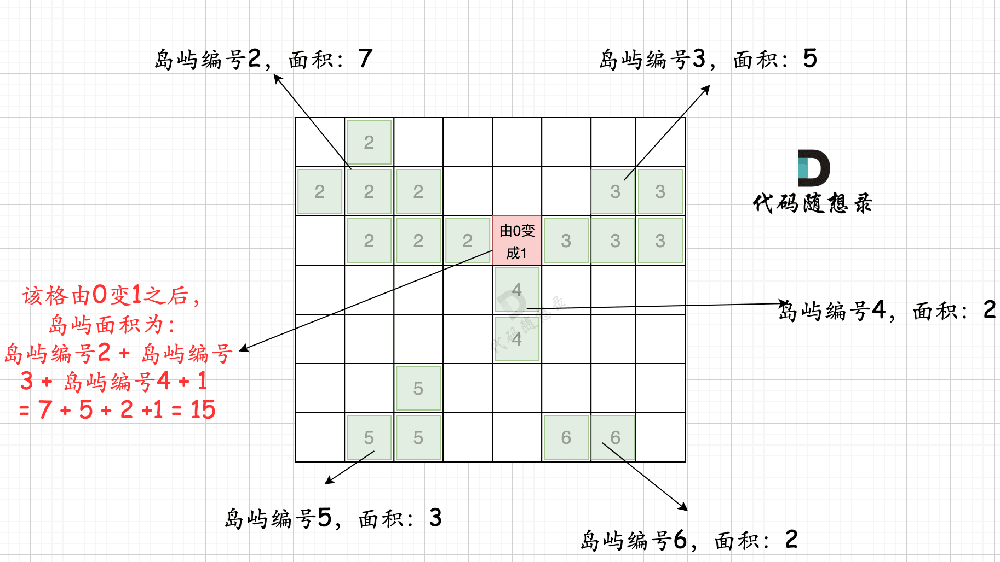

* [做專案（多個 C++、Java、Go、測開、前端（front end）專案）](https://www.programmercarl.com/other/kstar.html)
* [刷演算法（algorithm）（兩個月高強度學演算法）](https://www.programmercarl.com/xunlian/xunlianying.html)
* [背八股（40 天挑戰高頻面試題）](https://www.programmercarl.com/xunlian/bagu.html)

# 827.最大人工島 

[LeetCode 連結](https://leetcode.cn/problems/making-a-large-island/)

給你一個大小為 n x n 二進制（binary）矩陣（matrix） grid 。最多只能將一格 0 變成 1 。

回傳執行此操作後，grid 中最大的島嶼面積是多少？

島嶼由一組上、下、左、右四個方向相連的 1 形成。

範例 1:
* 輸入: grid = [[1, 0], [0, 1]]
* 輸出: 3
* 解釋: 將一格 0 變成 1，最終連通兩個小島得到面積為 3 的島嶼。

範例 2:
* 輸入: grid = [[1, 1], [1, 0]]
* 輸出: 4
* 解釋: 將一格 0 變成 1，島嶼的面積擴大為 4。

範例 3:
* 輸入: grid = [[1, 1], [1, 1]]
* 輸出: 4
* 解釋: 沒有 0 可以讓我們變成 1，面積依然為 4。

## 解題思路 

本題的一個蠻力（brute force）想法，應該是遍歷（traversal）地圖嘗試將每一個 0 改成 1，然後去搜尋地圖中最大的島嶼面積。 

計算地圖的最大面積：遍歷地圖 + 深搜島嶼，時間複雜性（time complexity）為 n * n。 

（其實使用深度優先搜尋（depth-first search, DFS）還是廣度優先搜尋（breadth-first search, BFS）都是可以的，其目的就是遍歷島嶼做一個標記，相當於染色，那麼使用哪個遍歷方式都行，以下我用深搜來講解） 

每改變一個 0 的方格，都需要重新計算一次地圖的最大面積，所以整體時間複雜性為：n^4。 

如果對深度優先搜尋不了解的錄友，可以看這裡：[深度優先搜尋精講](https://programmercarl.com/kamacoder/图论深搜理论基础.html)


## 最佳化思路  

其實每次深搜遍歷計算最大島嶼面積，我們都做了很多重複的工作。 

只要用一次深搜把每個島嶼的面積記錄下來就好。 

第一步：一次遍歷地圖，得出各個島嶼的面積，並做編號記錄。可以使用 map 記錄，key 為島嶼編號，value 為島嶼面積
第二步：再遍歷地圖，遍歷 0 的方格（因為要將 0 變成 1），並統計該 1（由 0 變成的 1）周邊島嶼面積，將其相鄰面積相加在一起，遍歷所有 0 之後，就可以得出選一個 0 變成 1 之後的最大面積。 

拿如下地圖的島嶼情況來舉例：（1 為陸地）



第一步，則遍歷題目，並將島嶼的編號和面積進行統計，過程如圖所示： 




本過程程式碼如下：

```CPP 
int dir[4][2] = {0, 1, 1, 0, -1, 0, 0, -1}; // 四個方向
void dfs(vector<vector<int>>& grid, vector<vector<bool>>& visited, int x, int y, int mark) {
    if (visited[x][y] || grid[x][y] == 0) return; // 終止條件：造訪過的節點 或者 遇到海水
    visited[x][y] = true; // 標記造訪過
    grid[x][y] = mark; // 給陸地標記新標籤
    count++;
    for (int i = 0; i < 4; i++) {
        int nextx = x + dir[i][0];
        int nexty = y + dir[i][1];
        if (nextx < 0 || nextx >= grid.size() || nexty < 0 || nexty >= grid[0].size()) continue;  // 越界了，直接跳過
        dfs(grid, visited, nextx, nexty, mark);
    }
}

int largestIsland(vector<vector<int>>& grid) {
    int n = grid.size(), m = grid[0].size();
    vector<vector<bool>> visited = vector<vector<bool>>(n, vector<bool>(m, false)); // 標記造訪過的點
    unordered_map<int ,int> gridNum;
    int mark = 2; // 記錄每個島嶼的編號
    bool isAllGrid = true; // 標記是否整個地圖都是陸地
    for (int i = 0; i < n; i++) {
        for (int j = 0; j < m; j++) {
            if (grid[i][j] == 0) isAllGrid = false;
            if (!visited[i][j] && grid[i][j] == 1) {
                count = 0;
                dfs(grid, visited, i, j, mark); // 將與其連接的陸地都標記上 true
                gridNum[mark] = count; // 記錄每一個島嶼的面積
                mark++; // 記錄下一個島嶼編號
            }
        }
    }
}
```


這個過程時間複雜性為 n * n 。可能有錄友想：分明是兩個 for 迴圈（for-loop）下面套著一個 dfs，時間複雜性怎麼會是 n * n 呢？ 

其實大家可以仔細看一下程式碼，**n * n 這個方格地圖中，每個節點（node）我們就遍歷一次，並不會重複遍歷**。

第二步過程如圖所示： 



也就是遍歷每一個 0 的方格，並統計其相鄰島嶼面積，最後取一個最大值。 

這個過程的時間複雜性也為 n * n。

所以整個解法的時間複雜性，為 n * n + n * n 也就是 n^2。 

當然這裡還有一個最佳化的點，就是可以不用 visited 陣列（array），因為有 mark 來標記，所以遍歷過的 grid[i][j] 是不等於 1 的。 

程式碼如下：

```CPP
    int dir[4][2] = {0, 1, 1, 0, -1, 0, 0, -1}; // 四個方向
    void dfs(vector<vector<int>>& grid, int x, int y, int mark) {
        if (grid[x][y] != 1 || grid[x][y] == 0) return; // 終止條件：造訪過的節點 或者 遇到海水
        grid[x][y] = mark; // 給陸地標記新標籤
        count++;
        for (int i = 0; i < 4; i++) {
            int nextx = x + dir[i][0];
            int nexty = y + dir[i][1];
            if (nextx < 0 || nextx >= grid.size() || nexty < 0 || nexty >= grid[0].size()) continue;  // 越界了，直接跳過
            dfs(grid, nextx, nexty, mark);
        }
    }

public:
    int largestIsland(vector<vector<int>>& grid) {
        int n = grid.size(), m = grid[0].size();
        unordered_map<int ,int> gridNum;
        int mark = 2; // 記錄每個島嶼的編號
        bool isAllGrid = true; // 標記是否整個地圖都是陸地
        for (int i = 0; i < n; i++) {
            for (int j = 0; j < m; j++) {
                if (grid[i][j] == 0) isAllGrid = false;
                if (grid[i][j] == 1) {
                    count = 0;
                    dfs(grid, i, j, mark); // 將與其連接的陸地都標記上 true
                    gridNum[mark] = count; // 記錄每一個島嶼的面積
                    mark++; // 記錄下一個島嶼編號
                }
            }
        }
    }
}
```

不過為了讓各個變數（variable）各司其事，程式碼清晰一些，完整程式碼還是使用 visited 陣列來標記。

最後，整體程式碼如下： 

```CPP 
class Solution {
private:
    int count;
    int dir[4][2] = {0, 1, 1, 0, -1, 0, 0, -1}; // 四個方向
    void dfs(vector<vector<int>>& grid, vector<vector<bool>>& visited, int x, int y, int mark) {
        if (visited[x][y] || grid[x][y] == 0) return; // 終止條件：造訪過的節點 或者 遇到海水
        visited[x][y] = true; // 標記造訪過
        grid[x][y] = mark; // 給陸地標記新標籤
        count++;
        for (int i = 0; i < 4; i++) {
            int nextx = x + dir[i][0];
            int nexty = y + dir[i][1];
            if (nextx < 0 || nextx >= grid.size() || nexty < 0 || nexty >= grid[0].size()) continue;  // 越界了，直接跳過
            dfs(grid, visited, nextx, nexty, mark);
        }
    }

public:
    int largestIsland(vector<vector<int>>& grid) {
        int n = grid.size(), m = grid[0].size();
        vector<vector<bool>> visited = vector<vector<bool>>(n, vector<bool>(m, false)); // 標記造訪過的點
        unordered_map<int ,int> gridNum;
        int mark = 2; // 記錄每個島嶼的編號
        bool isAllGrid = true; // 標記是否整個地圖都是陸地
        for (int i = 0; i < n; i++) {
            for (int j = 0; j < m; j++) {
                if (grid[i][j] == 0) isAllGrid = false;
                if (!visited[i][j] && grid[i][j] == 1) {
                    count = 0;
                    dfs(grid, visited, i, j, mark); // 將與其連接的陸地都標記上 true
                    gridNum[mark] = count; // 記錄每一個島嶼的面積
                    mark++; // 記錄下一個島嶼編號
                }
            }
        }
        if (isAllGrid) return n * m; // 如果都是陸地，回傳全面積

        // 以下邏輯是根據新增陸地的位置，計算周邊島嶼面積之和
        int result = 0; // 記錄最後結果
        unordered_set<int> visitedGrid; // 標記造訪過的島嶼
        for (int i = 0; i < n; i++) {
            for (int j = 0; j < m; j++) {
                int count = 1; // 記錄連接之後的島嶼數量
                visitedGrid.clear(); // 每次使用時，清空
                if (grid[i][j] == 0) {
                    for (int k = 0; k < 4; k++) {
                        int neari = i + dir[k][1]; // 計算相鄰坐標
                        int nearj = j + dir[k][0];
                        if (neari < 0 || neari >= grid.size() || nearj < 0 || nearj >= grid[0].size()) continue;
                        if (visitedGrid.count(grid[neari][nearj])) continue; // 加入過的島嶼不要重複加入
                        // 把相鄰四面的島嶼數量加起來
                        count += gridNum[grid[neari][nearj]];
                        visitedGrid.insert(grid[neari][nearj]); // 標記該島嶼已經加入過
                    }
                }
                result = max(result, count);
            }
        }
        return result;
    }
};
```

## 其他語言版本

### Java

```Java
class Solution {
    private static final int[][] position = {{-1, 0}, {0, 1}, {1, 0}, {0, -1}};  // 四個方向

    /**
     * @param grid 矩陣陣列
     * @param row 目前遍歷的節點的列號
     * @param col 目前遍歷的節點的行號
     * @param mark 目前區域的標記
     * @return 回傳目前區域內 1 的數量
     */
    public int dfs(int[][] grid, int row, int col, int mark) {
        int ans = 0;
        grid[row][col] = mark;
        for (int[] current: position) {
            int curRow = row + current[0], curCol = col + current[1];
            if (curRow < 0 || curRow >= grid.length || curCol < 0 || curCol >= grid.length) continue;  // 越界
            if (grid[curRow][curCol] == 1)
                ans += 1 + dfs(grid, curRow, curCol, mark);
        }
        return ans;
    }

    public int largestIsland(int[][] grid) {
        int ans = Integer.MIN_VALUE, size = grid.length, mark = 2;
        Map<Integer, Integer> getSize = new HashMap<>();
        for (int row = 0; row < size; row++) {
            for (int col = 0; col < size; col++) {
                if (grid[row][col] == 1) {
                    int areaSize = 1 + dfs(grid, row, col, mark);
                    getSize.put(mark++, areaSize);
                }
            }
        }
        for (int row = 0; row < size; row++) {
            for (int col = 0; col < size; col++) {
                // 目前位置如果不是 0 那麼直接跳過，因為我們只能把 0 變成 1
                if (grid[row][col] != 0) continue;
                Set<Integer> hashSet = new HashSet<>();     // 防止同一個區域被重複計算
                // 計算從目前位置開始取得的 1 的數量，初始化 1 是因為把目前位置的 0 轉換成了 1 
                int curSize = 1;
                for (int[] current: position) {
                    int curRow = row + current[0], curCol = col + current[1];
                    if (curRow < 0 || curRow >= grid.length || curCol < 0 || curCol >= grid.length) continue;
                    int curMark = grid[curRow][curCol];     // 取得對應位置的標記
                    // 如果標記存在 hashSet 中說明該標記被記錄過一次，如果不存在 getSize 中說明該標記是無效標記(此時 curMark = 0)
                    if (hashSet.contains(curMark) || !getSize.containsKey(curMark)) continue;
                    hashSet.add(curMark);
                    curSize += getSize.get(curMark);
                }
                ans = Math.max(ans, curSize);
            }
        }
        // 當 ans == Integer.MIN_VALUE 說明矩陣陣列中不存在 0，全都是有效區域，回傳陣列大小即可
        return ans == Integer.MIN_VALUE ? size * size : ans;
    }
}
```

### Python

```python

class Solution:
    def largestIsland(self, grid: List[List[int]]) -> int:
        visited = set()    #標記造訪過的位置
        m, n = len(grid), len(grid[0])
        res = 0
        island_size = 0     #用於儲存目前島嶼的大小
        directions = [[0, 1], [0, -1], [1, 0], [-1, 0]] #四個方向
        islands_size = defaultdict(int)  #儲存每個島嶼的大小

        def dfs(island_num, r, c):
            visited.add((r, c))
            grid[r][c] = island_num     #造訪過的位置標記為島嶼編號
            nonlocal island_size
            island_size += 1
            for i in range(4):
                nextR = r + directions[i][0]
                nextC = c + directions[i][1]
                if (nextR not in range(m) or     #列坐標越界
                    nextC not in range(n) or     #行坐標越界
                    (nextR, nextC) in visited):  #坐標已造訪
                    continue
                if grid[nextR][nextC] == 1:      #遇到有效坐標，進入下一層搜尋
                    dfs(island_num, nextR, nextC)

        island_num = 2             #初始島嶼編號設為 2，因為 grid 裡的資料有 0 和 1，所以從 2 開始編號
        all_land = True            #標記是否整個地圖都是陸地
        for r in range(m):
            for c in range(n):
                if grid[r][c] == 0:
                    all_land = False    #地圖裡不全是陸地
                if (r, c) not in visited and grid[r][c] == 1:
                    island_size = 0     #遍歷每個位置前重置島嶼大小為 0
                    dfs(island_num, r, c)
                    islands_size[island_num] = island_size #儲存目前島嶼大小
                    island_num += 1     #下一個島嶼編號加一
        if all_land:
            return m * n     #如果全是陸地，回傳地圖面積

        count = 0            #某個位置 0 變成 1 後目前島嶼大小
        #因為後續計算島嶼面積要往四個方向遍歷，但某 2 個或 3 個方向的位置可能同屬於一個島，
        #所以為避免重複累加，把已經造訪過的島嶼編號加入到這個集合
        visited_island = set() #儲存造訪過的島嶼
        for r in range(m):
            for c in range(n):
                if grid[r][c] == 0:
                    count = 1        #把由 0 轉換為 1 的位置計算到面積裡
                    visited_island.clear()   #遍歷每個位置前清空集合
                    for i in range(4):
                        nearR = r + directions[i][0]
                        nearC = c + directions[i][1]
                        if nearR not in range(m) or nearC not in range(n): #周圍位置越界
                            continue
                        if grid[nearR][nearC] in visited_island:  #島嶼已造訪
                            continue
                        count += islands_size[grid[nearR][nearC]] #累加連在一起的島嶼面積
                        visited_island.add(grid[nearR][nearC])    #標記目前島嶼已造訪
                    res = max(res, count) 
        return res


```


### Go

```go
func largestIsland(grid [][]int) int {
	dir := [][]int{{0, 1}, {1, 0}, {-1, 0}, {0, -1}}
	n := len(grid)
	m := len(grid[0])
	area := 0
	visited := make([][]bool, n)
	for i := 0; i < n; i++ {
		visited[i] = make([]bool, m)
	}
	gridNum := make(map[int]int, 0) // 記錄每一個島嶼的面積
	mark := 2                       // 記錄每個島嶼的編號
	isAllGrid := true
	res := 0 // 標記是否整個地圖都是陸地

	var dfs func(grid [][]int, visited [][]bool, x, y, mark int)
	dfs = func(grid [][]int, visited [][]bool, x, y, mark int) {
		// 終止條件：造訪過的節點 或者 遇到海水
		if visited[x][y] || grid[x][y] == 0 {
			return
		}
		visited[x][y] = true // 標記造訪過
		grid[x][y] = mark    // 給陸地標記新標籤
		area++
		for i := 0; i < 4; i++ {
			nextX := x + dir[i][0]
			nextY := y + dir[i][1]
			if nextX < 0 || nextX >= len(grid) || nextY < 0 || nextY >= len(grid[0]) {
				continue
			}
			dfs(grid, visited, nextX, nextY, mark)
		}
	}

	for i := 0; i < n; i++ {
		for j := 0; j < m; j++ {
			if grid[i][j] == 0 {
				isAllGrid = false
			}
			if !visited[i][j] && grid[i][j] == 1 {
				area = 0
				dfs(grid, visited, i, j, mark) // 將與其連接的陸地都標記上 true
				gridNum[mark] = area           // 記錄每一個島嶼的面積
				mark++                         // 更新下一個島嶼編號
			}
		}
	}
	if isAllGrid {
		return n * m
	}
	// 根據新增陸地的位置，計算周邊島嶼面積之和
	visitedGrid := make(map[int]struct{}) // 標記造訪過的島嶼
	for i := 0; i < n; i++ {
		for j := 0; j < m; j++ {
			count := 1                           // 記錄連接之後的島嶼數量
			visitedGrid = make(map[int]struct{}) // 每次使用時，清空
			if grid[i][j] == 0 {
				for k := 0; k < 4; k++ {
					// 計算相鄰坐標
					nearI := i + dir[k][0]
					nearJ := j + dir[k][1]
					if nearI < 0 || nearI >= len(grid) || nearJ < 0 || nearJ >= len(grid[0]) {
						continue
					}
					// 加入過的島嶼不要重複加入
					if _, ok := visitedGrid[grid[nearI][nearJ]]; ok {
						continue
					}
					// 把相鄰四面的島嶼數量加起來
					count += gridNum[grid[nearI][nearJ]]
					// 標記該島嶼已經加入過
					visitedGrid[grid[nearI][nearJ]] = struct{}{}
				}
			}
			res = max827(res, count)
		}
	}
	return res
}

func max827(x, y int) int {
	if x > y {
		return x
	}
	return y
}

```


### JavaScript

```JavaScript

var largestIsland = function(grid) {
let res = 0;
const m = grid.length;
const n = grid[0].length;
const tag = new Array(n).fill().map(_ => new Array(m).fill(0));
const area = new Map();
const dir = [[0,1],[0,-1],[1,0],[-1,0]];
const dfs = (grid,tag,x,y,mark) => {
    let res = 1;
    tag[x][y] = mark;
    for(let i = 0; i < dir.length; i++) {
        let nextX = x + dir[i][0];
        let nextY = y + dir[i][1];
        if(nextX < 0 || nextX >= m || nextY < 0 || nextY >= n) {
            continue;
        }
        if(grid[nextX][nextY] === 1 && tag[nextX][nextY] === 0) {
            res += dfs(grid,tag,nextX,nextY,mark);
        }
    }
    return res;
}
let mark = 2;
//將島嶼用 mark 標記
for(let i = 0; i < m; i++) {      
    for(let j = 0; j < n; j++) {
        if(grid[i][j] === 1 && tag[i][j] === 0) {
            area.set(mark,dfs(grid,tag,i,j,mark));
            res = Math.max(res,area.get(mark));
            mark++;
        }
    }
}
//將一個非島嶼格子變為島嶼
for(let i = 0; i < m; i++) {
    for(let j = 0; j < n; j++) {
        if(grid[i][j] === 0) {
            let z = 1;
            const connected = new Set();
            for(let k = 0; k < dir.length; k++) {
                let nextX = i + dir[k][0];
                let nextY = j + dir[k][1];
                if(nextX < 0 || nextX >= m || nextY < 0 || nextY >= n || tag[nextX][nextY] === 0 || connected.has(tag[nextX][nextY])) {
                    continue;
                }
                z += area.get(tag[nextX][nextY]);
                connected.add(tag[nextX][nextY]);
            }
            res = Math.max(res,z);
        }
    }
}
return res;
}; 


```


