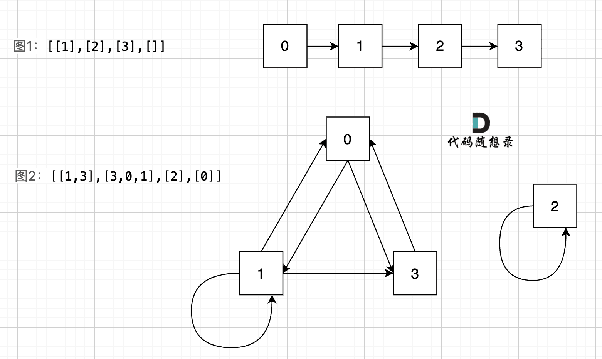
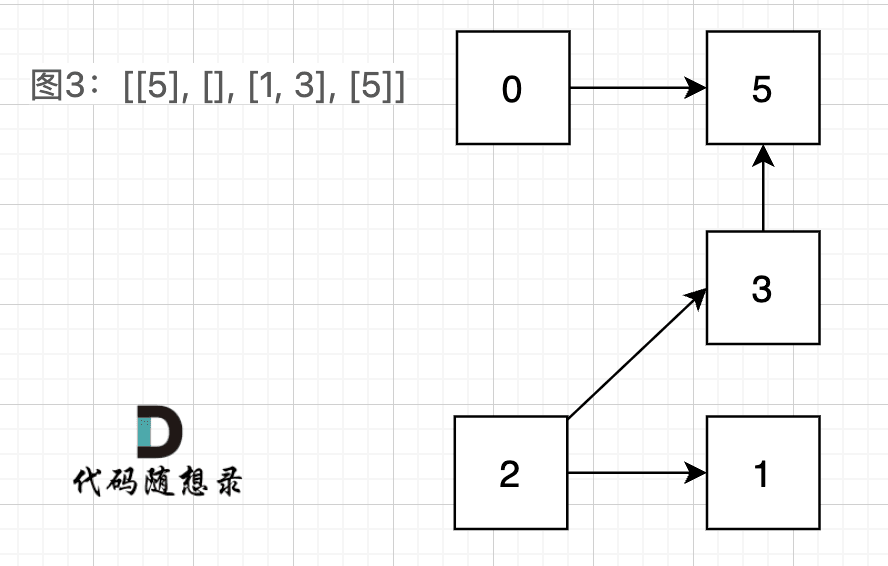

* [做專案（多個 C++、Java、Go、測開、前端（front end）專案）](https://www.programmercarl.com/other/kstar.html)
* [刷演算法（兩個月高強度學演算法）](https://www.programmercarl.com/xunlian/xunlianying.html)
* [背八股（40 天挑戰高頻面試題）](https://www.programmercarl.com/xunlian/bagu.html)


# 841.鑰匙和房間

[LeetCode 題目連結](https://leetcode.cn/problems/keys-and-rooms/)

有 N 個房間，開始時你位於 0 號房間。每個房間有不同的號碼：0，1，2，...，N-1，並且房間裡可能有一些鑰匙能使你進入下一個房間。

在形式上，對於每個房間 i 都有一個鑰匙串列（list） rooms[i]，每個鑰匙 rooms[i][j] 由 [0, 1，...，N-1] 中的一個整數（integer）表示，其中 N = rooms.length。鑰匙 rooms[i][j] = v 可以打開編號為 v 的房間。

最初，除 0 號房間外的其餘所有房間都被鎖住。

你可以自由地在房間之間來回走動。

如果能進入每個房間回傳 true，否則回傳 false。

範例 1：
* 輸入: [[1],[2],[3],[]]
* 輸出: true
* 解釋: 我們從 0 號房間開始，拿到鑰匙 1。之後我們去 1 號房間，拿到鑰匙 2。然後我們去 2 號房間，拿到鑰匙 3。最後我們去了 3 號房間。由於我們能夠進入每個房間，我們回傳 true。

範例 2：
* 輸入: [[1,3],[3,0,1],[2],[0]]
* 輸出: false
* 解釋: 我們不能進入 2 號房間。


## 解題思路 

本題其實給我們的是一個有向圖（directed graph），意識到這是有向圖很重要！ 

題目給我們的兩個範例：`[[1],[2],[3],[]]` `[[1,3],[3,0,1],[2],[0]]`，畫成對應的圖如下： 



我們可以看出圖 1 的所有節點（node）都是連接的，而圖二中，節點 2 是孤立的。

這就很容易讓我們想起島嶼問題，只要發現獨立的島，就是不能進入所有房間。 

此時也容易想到用互斥集（disjoint set）的方式去解決。

**但本題是有向圖**，在有向圖中，即使所有節點都是連接的，但依然不可能從 0 出發遍歷所有邊（edge）。 
給大家舉一個例子： 

圖 3：[[5], [], [1, 3], [5]] ，如圖： 

 

在圖 3 中，大家可以發現，節點 0 只能到節點 5，然後就哪也去不了了。 

所以本題是一個有向圖搜尋全路徑的問題。只能用深度優先搜尋（depth-first search, DFS）或者廣度優先搜尋（breadth-first search, BFS）來搜。 

關於 DFS 的理論，如果大家有困惑，可以先看我這篇題解：[DFS 理論基礎](https://programmercarl.com/图论深搜理论基础.html)

**以下 dfs 分析大家一定要仔細看，本題有兩種 dfs 的解法，很多題解沒有講清楚**。看完之後相信你對 dfs 會有更深的理解。 

深搜三部曲： 

1. 確認遞迴函數（recursive function）、參數（parameter） 

需要傳入二維（2D）陣列（array） rooms 來遍歷（traversal）地圖，需要知道目前我們拿到的 key，以至於去下一個房間。 

同時還需要一個陣列，用來記錄我們都走過了哪些房間，這樣好知道最後有沒有把所有房間都遍歷了，可以定義一個一維陣列（one dimensional array）。

所以遞迴函數參數如下： 

```C++ 
// key 目前得到的鑰匙 
// visited 記錄造訪過的房間 
void dfs(const vector<vector<int>>& rooms, int key, vector<bool>& visited) {
```

2. 確認終止條件（termination condition） 

遍歷的時候，什麼時候終止呢？  

這裡有一個很重要的邏輯，就是在遞迴（recursion）中，**我們是處理目前造訪的節點，還是處理下一個要造訪的節點**。 

這決定終止條件怎麼寫。  

首先明確，本題中什麼叫做處理，就是 visited 陣列來記錄造訪過的節點，該節點預設（default）陣列裡元素（element）都是 false，把元素標記為 true 就是處理本節點了。 

如果我們是處理目前造訪的節點，目前造訪的節點如果是 true ，說明是造訪過的節點，那就終止本層遞迴，如果不是 true，我們就把它賦值（assignment）為 true，因為這是我們處理本層遞迴的節點。 

程式碼就是這樣： 

```C++
// 寫法一：處理目前造訪的節點
void dfs(const vector<vector<int>>& rooms, int key, vector<bool>& visited) {
    if (visited[key]) { // 本層遞迴是 true，說明造訪過，立刻回傳
        return;
    }
    visited[key] = true; // 給目前遍歷的節點賦值 true 
    vector<int> keys = rooms[key];
    for (int key : keys) {
        // 深度優先搜尋遍歷
        dfs(rooms, key, visited);
    }
}
```

如果我們是處理下一層造訪的節點，而不是目前層。那麼就要在深搜三部曲中第三步：處理目前搜尋節點出發的路徑的時候對節點進行處理。 

這樣的話，就不需要終止條件，而是在搜尋下一個節點的時候，直接判斷下一個節點是否是我們要搜的節點。 

程式碼就是這樣的：

```C++
// 寫法二：處理下一個要造訪的節點
void dfs(const vector<vector<int>>& rooms, int key, vector<bool>& visited) {
    // 這裡沒有終止條件，而是在處理下一層節點的時候來判斷
    vector<int> keys = rooms[key];
    for (int key : keys) { 
        if (visited[key] == false) { // 處理下一層節點，判斷是否要進行遞迴
            visited[key] = true;
            dfs(rooms, key, visited);
        }       
    }
}
```

可以看出，如何看待我們要造訪的節點，直接決定了兩種不一樣的寫法，很多錄友對這一塊很模糊，可能做過這道題，但沒有思考到這個維度上。


3. 處理目前搜尋節點出發的路徑 

其實在上面，深搜三部曲第二步，就已經講了，因為終止條件的兩種寫法，直接決定了兩種不一樣的遞迴寫法。 

這裡還有細節：

看上面兩個版本的寫法中，好像沒有發現回溯（backtracking）的邏輯。

我們都知道，有遞迴就有回溯，回溯就在遞迴函數的下面，那麼之前我們做的 dfs 題目，都需要回溯操作，例如：[797.所有可能的路徑](https://programmercarl.com/0797.%E6%89%80%E6%9C%89%E5%8F%AF%E8%83%BD%E7%9A%84%E8%B7%AF%E5%BE%84.html)，**為什麼本題就沒有回溯呢？** 

程式碼中可以看到 dfs 函數下面並沒有回溯的操作。 

此時就要再思考本題的要求了，本題是需要判斷 0 節點是否能到所有節點，那麼我們就沒有必要回溯去撤銷操作了，只要遍歷過的節點一律都標記上。

**那什麼時候需要回溯操作呢？** 

當我們需要搜尋一條可行路徑的時候，就需要回溯操作了，因為沒有回溯，就沒法「調頭」，如果不理解的話，去看我寫的 [797.所有可能的路徑](https://programmercarl.com/0797.%E6%89%80%E6%9C%89%E5%8F%AF%E8%83%BD%E7%9A%84%E8%B7%AF%E5%BE%84.html) 的題解。 


以上分析完畢，DFS 整體實作 C++ 程式碼如下： 

```CPP
// 寫法一：處理目前造訪的節點
class Solution {
private:
    void dfs(const vector<vector<int>>& rooms, int key, vector<bool>& visited) {
        if (visited[key]) {
            return;
        }
        visited[key] = true;
        vector<int> keys = rooms[key];
        for (int key : keys) {
            // 深度優先搜尋遍歷
            dfs(rooms, key, visited);
        }
    }
public:
    bool canVisitAllRooms(vector<vector<int>>& rooms) {
        vector<bool> visited(rooms.size(), false);
        dfs(rooms, 0, visited);
        //檢查是否都造訪到了
        for (int i : visited) {
            if (i == false) return false;
        }
        return true;
    }
};

```

```c++  
寫法二：處理下一個要造訪的節點
class Solution {
private:  
    void dfs(const vector<vector<int>>& rooms, int key, vector<bool>& visited) {
        vector<int> keys = rooms[key];
        for (int key : keys) { 
            if (visited[key] == false) {
                visited[key] = true;
                dfs(rooms, key, visited);
            }       
        }
    }
public:
    bool canVisitAllRooms(vector<vector<int>>& rooms) {
        vector<bool> visited(rooms.size(), false); 
        visited[0] = true; // 0 節點是出發節點，一定被造訪過
        dfs(rooms, 0, visited);  
        //檢查是否都造訪到了
        for (int i : visited) {
            if (i == false) return false;
        }
        return true;
    }
};

```

本題我也給出 BFS C++ 程式碼，[BFS 理論基礎](https://programmercarl.com/%E5%9B%BE%E8%AE%BA%E6%B7%B1%E6%90%9C%E7%90%86%E8%AE%BA%E5%9F%BA%E7%A1%80.html)，程式碼如下：

```CPP
class Solution {
bool bfs(const vector<vector<int>>& rooms) {
    vector<int> visited(rooms.size(), 0); // 標記房間是否被造訪過
    visited[0] = 1; // 0 號房間開始
    queue<int> que;
    que.push(0); // 0 號房間開始

    // 廣度優先搜尋的過程
    while (!que.empty()) {
        int key = que.front(); que.pop();
         vector<int> keys = rooms[key];
         for (int key : keys) {
             if (!visited[key]) {
                 que.push(key);
                 visited[key] = 1;
             }
         }
    }
    // 檢查房間是不是都遍歷過了
    for (int i : visited) {
        if (i == 0) return false;
    }
    return true;

}
public:
    bool canVisitAllRooms(vector<vector<int>>& rooms) {
        return bfs(rooms);
    }
};
```

## 其他語言版本

### Java 

```java
class Solution {
     private void dfs(int key, List<List<Integer>>  rooms, List<Boolean> visited) {
        if (visited.get(key)) {
            return;
        }
        visited.set(key, true);
        for (int k : rooms.get(key)) {
            // 深度優先搜尋遍歷
            dfs(k, rooms, visited);
        }
    }
    public boolean canVisitAllRooms(List<List<Integer>> rooms) {
        List<Boolean> visited = new ArrayList<Boolean>(){{
            for(int i = 0 ; i < rooms.size(); i++){
                add(false);
            }
        }};
        dfs(0, rooms, visited);
        //檢查是否都造訪到了
        for (boolean flag : visited) {
            if (!flag) {
                return false;
            }
        }
        return true;
    }
}
```

```Java
// 廣度優先搜尋
class Solution {
    public boolean canVisitAllRooms(List<List<Integer>> rooms) {
        boolean[] visited = new boolean[rooms.size()];    // 用一個 visited 陣列記錄房間是否被造訪
        visited[0] = true;
        Queue<Integer> queue = new ArrayDeque<>();
        queue.add(0);           // 第 0 個房間標記為已造訪
        while (!queue.isEmpty()) {
            int curKey = queue.poll();
            for (int key: rooms.get(curKey)) {
                if (visited[key]) continue;
                visited[key] = true;
                queue.add(key);
            }
        }
        for (boolean key: visited)
            if (!key) return false;
        return true;
    }
}
```

```java
// 廣度優先遍歷(時間最佳化)
class Solution {
    public boolean canVisitAllRooms(List<List<Integer>> rooms) {
        int count = 1;      // 用來記錄可以被造訪的房間數目，因為初始狀態下 0 號房間可以被造訪，所以設為 1
        boolean[] visited = new boolean[rooms.size()];      // 用一個 visited 陣列記錄房間是否被造訪
        visited[0] = true;          // 第 0 個房間標記為已造訪
        Queue<Integer> queue = new ArrayDeque<>();
        queue.add(0);
        while (!queue.isEmpty()) {
            int curKey = queue.poll();
            for (int key: rooms.get(curKey)) {
                if (visited[key]) continue;
                ++count;                // 每造訪一個房間就讓 count 加 1
                visited[key] = true;
                queue.add(key);
            }
        }
        return count == rooms.size();       // 如果 count 等於房間數目，表示能進入所有房間，反之不能
    }
}
```

### python3

```python
# 深度優先搜尋
class Solution:
    def dfs(self, key: int, rooms: List[List[int]]  , visited : List[bool] ) :
        if visited[key] :
            return
        visited[key] = True
        keys = rooms[key]
        for i in range(len(keys)) :
            # 深度優先搜尋遍歷
            self.dfs(keys[i], rooms, visited)

    def canVisitAllRooms(self, rooms: List[List[int]]) -> bool:
        visited = [False for i in range(len(rooms))]

        self.dfs(0, rooms, visited)

        # 檢查是否都造訪到了
        for i in range(len(visited)):
            if not visited[i] :
                return False
        return True

# 廣度優先搜尋
class Solution:
    def canVisitAllRooms(self, rooms: List[List[int]]) -> bool:
        visited = [False] * len(rooms)
        self.bfs(rooms, 0, visited)
        
        for room in visited:
            if room == False:
                return False
        
        return True
    
    def bfs(self, rooms, index, visited):
        q = collections.deque()
        q.append(index)

        visited[0] = True

        while len(q) != 0:
            index = q.popleft()
            for nextIndex in rooms[index]:
                if visited[nextIndex] == False:
                    q.append(nextIndex)
                    visited[nextIndex] = True

```


### Go  

```go

func dfs(key int, rooms [][]int, visited []bool ) {
	if visited[key] {
		return;
	}

	visited[key] = true
	keys := rooms[key]
	for _ , key := range keys {
		// 深度優先搜尋遍歷
		dfs(key, rooms, visited);
	}
}

func canVisitAllRooms(rooms [][]int) bool {
	visited := make([]bool, len(rooms));
	dfs(0, rooms, visited);
	//檢查是否都造訪到了
	for i := 0; i < len(visited); i++ {
		if !visited[i] {
			return false;
		}
	}
	return true;
}
```

### JavaScript 
```javascript
//DFS
var canVisitAllRooms = function(rooms) {
    const dfs = (key, rooms, visited) => {
        if(visited[key]) return;
        visited[key] = 1;
        for(let k of rooms[key]){
            // 深度優先搜尋遍歷
            dfs(k, rooms, visited);
        }
    }
    const visited = new Array(rooms.length).fill(false);
    dfs(0, rooms, visited);
    //檢查是否都造訪到了
    for (let i of visited) {
        if (!i) {
            return false;
        }
    }
    return true;
};

//BFS
var canVisitAllRooms = function(rooms) {
    const bfs = rooms => {
        const visited = new Array(rooms.length).fill(0); // 標記房間是否被造訪過
        visited[0] = 1; // 0 號房間開始
        const queue = []; //js 陣列作為佇列使用
        queue.push(0); // 0 號房間開始
        // 廣度優先搜尋的過程
        while(queue.length !== 0){
            let key = queue[0];
            queue.shift();
            for(let k of rooms[key]){
                if(!visited[k]){
                    queue.push(k);
                    visited[k] = 1;
                }
            }
        }
        // 檢查房間是不是都遍歷過了
        for(let i of visited){
            if(i === 0) return false;
        }
        return true;
    }
    return bfs(rooms);
};
```


### TypeScript
```ts
// BFS
// rooms :就是一個鏈接串列 表示的有向圖
// 轉換問題就是，一次遍歷從 0 開始 能不能 把所有的節點造訪了，實質問題就是一個
// 層次序走訪
function canVisitAllRooms(rooms: number[][]): boolean {
  const n = rooms.length;
  //  cnt[i] 代表節點 i 的造訪順序， cnt[i] = 0，代表沒被造訪過
  let cnt = new Array(n).fill(0);
  let queue = [0];
  cnt[0]++;
  while (queue.length > 0) {
    const from = queue.shift();
    for (let i = 0; i < rooms[from].length; i++) {
      const to = rooms[from][i];
      if (cnt[to] == 0) {
        queue.push(to);
        cnt[to]++;
      }
    }
  }
  // 只要其中有一個節點 沒被造訪過，那麼就回傳 false
  return cnt.every((item) => item != 0);
}
```


