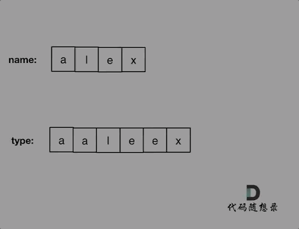

* [做專案（多個 C++、Java、Go、測試開發、前端（front end）專案）](https://www.programmercarl.com/other/kstar.html)
* [刷演算法（兩個月高強度學習演算法）](https://www.programmercarl.com/xunlian/xunlianying.html)
* [背面試必考題（八股文）（40 天挑戰高頻面試題）](https://www.programmercarl.com/xunlian/bagu.html)


# 925. 長按鍵入
[LeetCode 題目連結](https://leetcode.cn/problems/long-pressed-name/)

你的朋友正在使用鍵盤輸入他的名字 name。偶爾，在鍵入字元（character） c 時，按鍵可能會被長按，而字元可能被輸入 1 次或多次。

你將會檢查鍵盤輸入的字元 typed。如果它對應的可能是你的朋友的名字（其中一些字元可能被長按），那麼就回傳 True。

範例 1：
* 輸入：name = "alex", typed = "aaleex"
* 輸出：true
* 解釋：'alex' 中的 'a' 和 'e' 被長按。

範例 2：
* 輸入：name = "saeed", typed = "ssaaedd"
* 輸出：false
* 解釋：'e' 一定需要被鍵入兩次，但在 typed 的輸出中不是這樣。


範例 3：

* 輸入：name = "leelee", typed = "lleeelee"
* 輸出：true

範例 4：

* 輸入：name = "laiden", typed = "laiden"
* 輸出：true
* 解釋：長按名字中的字元並不是必要的。

## 解題思路

這道題目一看以為是雜湊（hash），仔細一看不行，要有順序。

所以模擬（simulation）同時遍歷（traversal）兩個陣列（array），進行對比就可以了。

對比的時候需要注意以下幾點：

* name[i] 和 typed[j] 相同，則 i++，j++（繼續向後對比）
* name[i] 和 typed[j] 不相同
    * 看是不是第一位就不相同了，也就是 j 如果等於 0，那麼直接回傳 false
    * 不是第一位不相同，就讓 j 跨越重複（duplicate）項，移動到重複項之後的位置，再次比較（comparison） name[i] 和 typed[j]
        * 如果 name[i] 和 typed[j] 相同，則 i++，j++（繼續向後對比）
        * 不相同，回傳 false
* 對比完之後有兩種情況
    * name 沒有匹配完，例如 name:"pyplrzzzzdsfa" type:"ppyypllr"
    * type 沒有匹配完，例如 name:"alex" type:"alexxrrrrssda"

動畫如下：

 </img></div>

上面的邏輯想清楚了，不難寫出如下 C++ 程式碼：

```CPP
class Solution {
public:
    bool isLongPressedName(string name, string typed) {
        int i = 0, j = 0;
        while (i < name.size() && j < typed.size()) {
            if (name[i] == typed[j]) { // 相同則同時向後匹配
                j++; i++;
            } else { // 不相同
                if (j == 0) return false; // 如果是第一位就不相同直接回傳 false
                // j 跨越重複項，向後移動，同時防止 j 越界
                while(j < typed.size() && typed[j] == typed[j - 1]) j++;
                if (name[i] == typed[j]) { // j 跨越重複項之後再次和 name[i] 匹配
                    j++; i++; // 相同則同時向後匹配
                }
                else return false;
            }
        }
        // 說明 name 沒有匹配完，例如 name:"pyplrzzzzdsfa" type:"ppyypllr"
        if (i < name.size()) return false;

        // 說明 type 沒有匹配完，例如 name:"alex" type:"alexxrrrrssda"
        while (j < typed.size()) {
            if (typed[j] == typed[j - 1]) j++;
            else return false;
        }
        return true;
    }
};

```

時間複雜度（time complexity）：O(n)
空間複雜度（space complexity）：O(1)


## 其他語言版本

### Java 
```java
class Solution {
    public boolean isLongPressedName(String name, String typed) {
        int i = 0, j = 0;
        int m = name.length(), n = typed.length();
        while (i< m && j < n) {
            if (name.charAt(i) == typed.charAt(j)) {  // 相同則同時向後匹配
                i++; j++;
            }
            else {
                if (j == 0) return false; // 如果是第一位就不相同直接回傳 false
                // 判斷邊界為 n-1，若為 n 會越界，例如 name:"kikcxmvzi" typed:"kiikcxxmmvvzzz"
                while (j < n-1 && typed.charAt(j) == typed.charAt(j-1)) j++;
                if (name.charAt(i) == typed.charAt(j)) {  // j 跨越重複項之後再次和 name[i] 匹配
                    i++; j++; // 相同則同時向後匹配
                }
                else return false;
            }
        }
        // 說明 name 沒有匹配完
        if (i < m) return false;
        // 說明 type 沒有匹配完
        while (j < n) {
            if (typed.charAt(j) == typed.charAt(j-1)) j++;
            else return false;
        }
        return true;
    }
}
```
### Python
```python
        i = j = 0
        while(i<len(name) and j<len(typed)):
        # If the current letter matches, move as far as possible
            if typed[j]==name[i]:
                while j+1<len(typed) and typed[j]==typed[j+1]:
                    j+=1
                    # special case when there are consecutive repeating letters
                    if i+1<len(name) and name[i]==name[i+1]:
                        i+=1
                else:
                    j+=1
                    i+=1
            else:
                return False
        return i == len(name) and j==len(typed)
```

### Go

```go

func isLongPressedName(name string, typed string) bool {
	if(name[0] != typed[0] || len(name) > len(typed)) {
		return false;
	}

	idx := 0 // name 的索引
	var last byte  // 上個匹配字元
	for i := 0; i < len(typed); i++ {
		if idx < len(name) && name[idx] == typed[i] {
			last = name[idx]
			idx++
		} else if last == typed[i] {
			continue
		} else  {
			return false
		}
	}
	return idx == len(name)
}
```

### JavaScript：
```javascript
var isLongPressedName = function(name, typed) {
    let i = 0, j = 0;
    const m = name.length, n = typed.length;
    while(i < m && j < n){
        if(name[i] === typed[j]){ // 相同則同時向後匹配
            i++; j++;
        } else {
            if(j === 0) return false; // 如果是第一位就不相同直接回傳 false
            // 判斷邊界為 n-1，若為 n 會越界，例如 name:"kikcxmvzi" typed:"kiikcxxmmvvzzz"
            while(j < n - 1 && typed[j] === typed[j-1]) j++;
            if(name[i] === typed[j]){ // j 跨越重複項之後再次和 name[i] 匹配，相同則同時向後匹配
                i++; j++;
            } else {
                return false;
            }
        }
    }
    // 說明 name 沒有匹配完，例如 name:"pyplrzzzzdsfa" type:"ppyypllr"
    if(i < m) return false;
    // 說明 type 沒有匹配完，例如 name:"alex" type:"alexxrrrrssda"
    while(j < n) {
        if(typed[j] === typed[j-1]) j++;
        else return false;
    }
    return true;
};
```

### TypeScript

```typescript
function isLongPressedName(name: string, typed: string): boolean {
    const nameLength: number = name.length,
        typeLength: number = typed.length;
    let i: number = 0,
        j: number = 0;
    while (i < nameLength && j < typeLength) {
        if (name[i] !== typed[j]) return false;
        i++;
        j++;
        if (i === nameLength || name[i] !== name[i - 1]) {
            // 跳過 typed 中的連續相同字元
            while (j < typeLength && typed[j] === typed[j - 1]) {
                j++;
            }
        }
    }
    return i === nameLength && j === typeLength;
};
```


