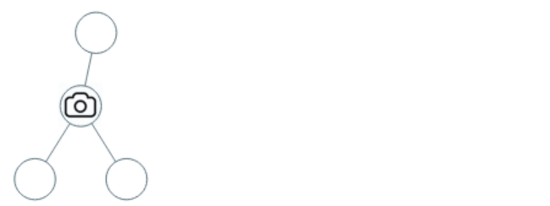
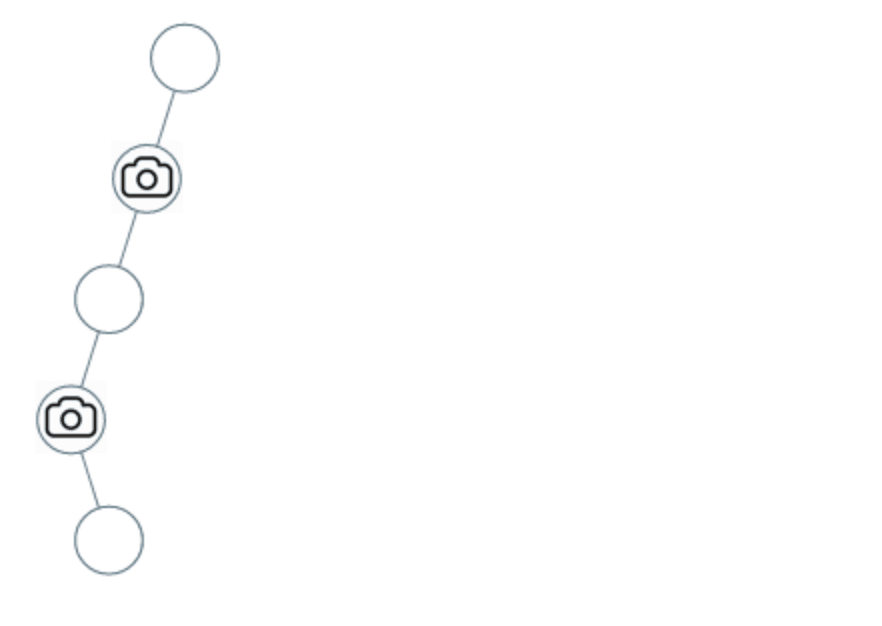
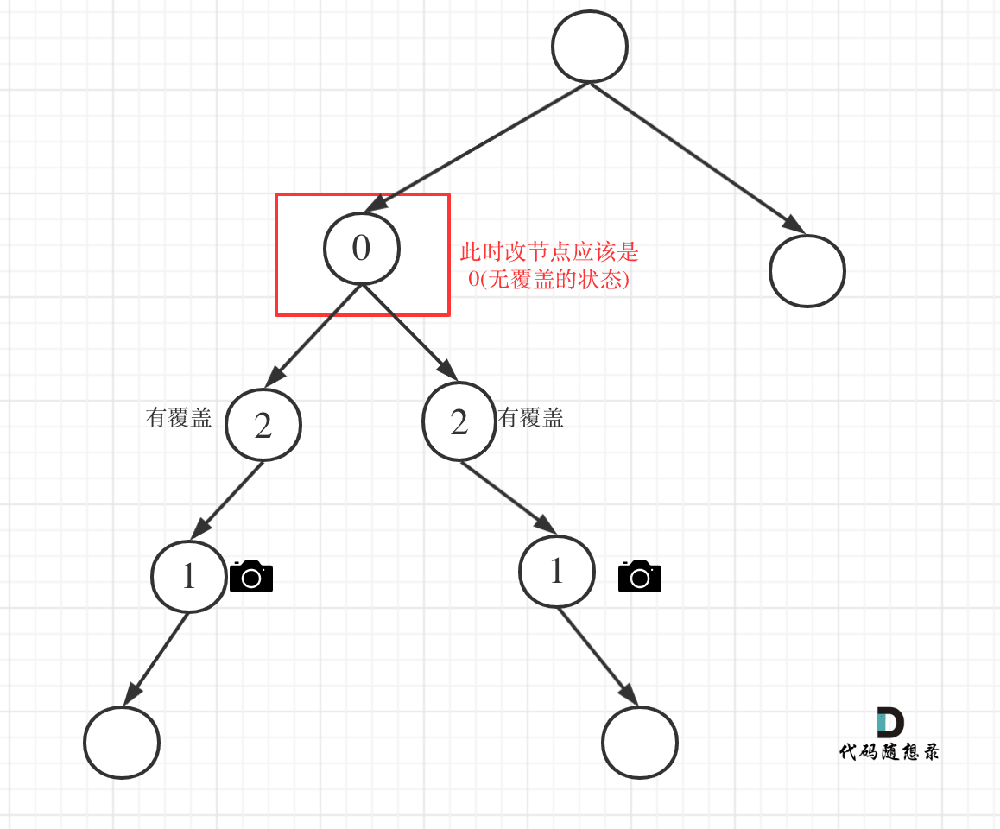
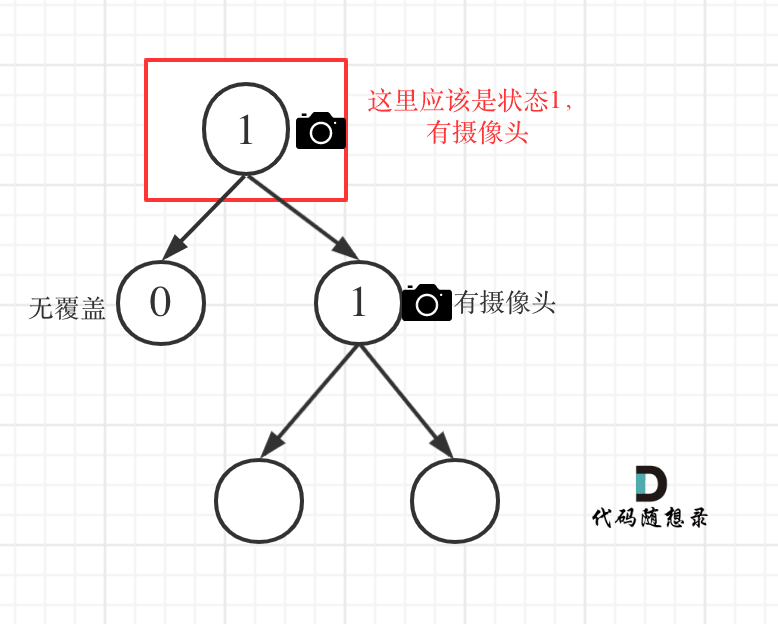
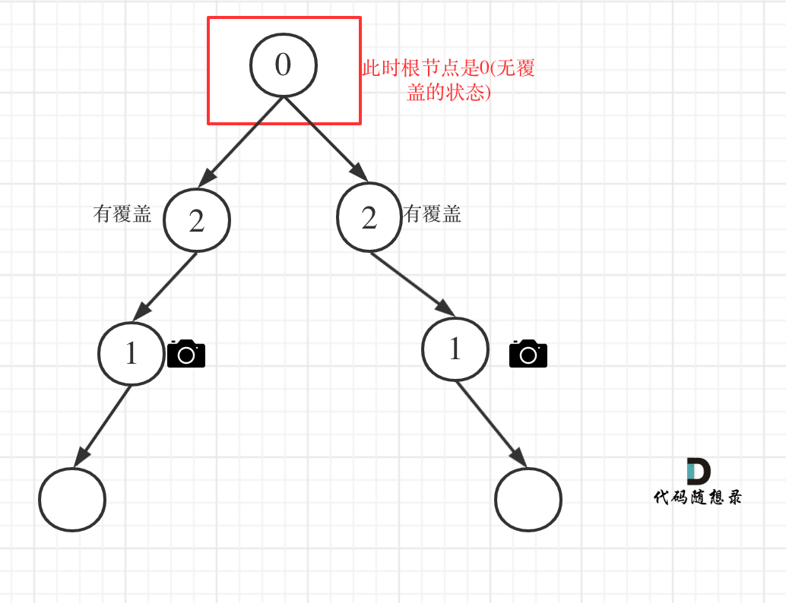

* [做專案（多個 C++、Java、Go、測試開發、前端（front end）專案）](https://www.programmercarl.com/other/kstar.html)
* [刷演算法（兩個月高強度學習演算法）](https://www.programmercarl.com/xunlian/xunlianying.html)
* [背面試必考題（八股文）（40 天挑戰高頻面試題）](https://www.programmercarl.com/xunlian/bagu.html)


# 968. 監控二元樹（binary tree）

[LeetCode 題目連結](https://leetcode.com/problems/binary-tree-cameras/)

給定一個二元樹，我們在樹（tree）的節點（node）上安裝攝影機。

節點上的每個攝影機都可以監視其父物件（object）、自身及其直接子物件。

計算監控樹的所有節點所需的最小攝影機數量。

範例 1：



* 輸入：[0,0,null,0,0]
* 輸出：1
* 解釋：如圖所示，一台攝影機足以監控所有節點。

範例 2：



* 輸入：[0,0,null,0,null,0,null,null,0]
* 輸出：2
* 解釋：需要至少兩個攝影機來監視樹的所有節點。上圖顯示了攝影機放置的有效位置之一。

提示：

* 給定樹的節點數的範圍是 [1, 1000]。
* 每個節點的值（value）都是 0。

## 演算法公開課

**[《程式碼隨想錄》演算法影片公開課](https://programmercarl.com/other/gongkaike.html)：[貪心演算法（greedy algorithm），二元樹與貪心法（greedy）的結合，有點難...... LeetCode:968.監督二元樹](https://www.bilibili.com/video/BV1SA411U75i)，相信結合影片再看本篇題解，更有助於大家對本題的理解**。


## 解題思路

這道題目首先要想，如何放置，才能讓攝影機最少呢？

從題目中範例，其實可以得到啟發，**我們發現題目範例中的攝影機都沒有放在葉節點（leaf node）上！**

這是很重要的一個線索，攝影機可以覆蓋上中下三層，如果把攝影機放在葉節點上，就浪費了一層的覆蓋。

所以把攝影機放在葉節點的父節點（father node）位置，才能充分利用攝影機的覆蓋面積。

那麼有同學可能問了，為什麼不從頭節點（head node）開始看起呢，為啥要從葉節點看呢？

因為頭節點放不放攝影機也就省下一個攝影機，葉節點放不放攝影機省下的攝影機數量是指數（exponential）級別的。

**所以我們要從下往上看，區域最佳（local optimum）：讓葉節點的父節點裝攝影機，所用攝影機最少，總體最佳（global optimum）：全部攝影機數量所用最少！**

區域最佳推出總體最佳，找不出反例，那麼就按照貪心法來！

此時，大體思路就是從低到上，先給葉節點父節點放個攝影機，然後隔兩個節點放一個攝影機，直至到二元樹頭節點。

此時這道題目還有兩個難點：

1. 二元樹的遍歷（traversal）
2. 如何隔兩個節點放一個攝影機


### 確定遍歷順序

在二元樹中如何從低向上推導呢？

可以使用後序遍歷（post-order traversal）也就是左右中的順序，這樣就可以在回溯（backtracking）的過程中從下到上進行推導了。

後序遍歷程式碼如下：

```CPP
int traversal(TreeNode* cur) {

    // 空節點，該節點有覆蓋
    if (終止條件) return ;

    int left = traversal(cur->left);    // 左
    int right = traversal(cur->right);  // 右

    邏輯處理                            // 中
    return ;
}
```

**注意在以上程式碼中我們取了左孩子的轉回值（return value），右孩子的轉回值，即 left 和 right，以後推導中間節點的狀態（state）**

### 如何隔兩個節點放一個攝影機

此時需要狀態轉移的公式，大家不要和動態規劃（dynamic programming, DP）的狀態變遷方程式（state transition equation）混到一起，本題狀態轉移沒有擇優的過程，就是單純的狀態轉移！

來看看這個狀態應該如何轉移，先來看看每個節點可能有幾種狀態：

有如下三種：

* 該節點無覆蓋
* 本節點有攝影機
* 本節點有覆蓋

我們分別有三個數字來表示：

* 0：該節點無覆蓋
* 1：本節點有攝影機
* 2：本節點有覆蓋

大家應該找不出第四個節點的狀態了。

**一些同學可能會想有沒有第四種狀態：本節點無攝影機，其實無攝影機就是 無覆蓋 或者 有覆蓋 的狀態，所以一共還是三個狀態。**

**因為在遍歷樹的過程中，就會遇到空節點，那麼問題來了，空節點究竟是哪一種狀態呢？空節點表示無覆蓋？表示有攝影機？還是有覆蓋呢？**


回歸本質，為了讓攝影機數量最少，我們要盡量讓葉節點的父節點安裝攝影機，這樣才能使攝影機的數量最少。

那麼空節點不能是無覆蓋的狀態，這樣葉節點就要放攝影機了；空節點也不能是有攝影機的狀態，這樣葉節點的父節點就沒有必要放攝影機了，而是可以把攝影機放在葉節點的爺爺節點上。

**所以空節點的狀態只能是有覆蓋，這樣就可以在葉節點的父節點放攝影機了**

接下來就是遞迴關係（recurrence relation）。

那麼遞迴（recursion）的終止條件（termination condition）應該是遇到了空節點，此時應該回傳 2（有覆蓋），原因上面已經解釋過了。

程式碼如下：

```CPP
// 空節點，該節點有覆蓋
if (cur == NULL) return 2;
```

遞迴的函數（function），以及終止條件已經確定了，再來看單層邏輯處理。

主要有如下四類情況：

* 情況 1：左右節點都有覆蓋

左孩子有覆蓋，右孩子有覆蓋，那麼此時中間節點應該就是無覆蓋的狀態了。

如圖：



程式碼如下：

```CPP
// 左右節點都有覆蓋
if (left == 2 && right == 2) return 0;
```

* 情況 2：左右節點至少有一個無覆蓋的情況

如果是以下情況，則中間節點（父節點）應該放攝影機：

* left == 0 && right == 0 左右節點無覆蓋
* left == 1 && right == 0 左節點有攝影機，右節點無覆蓋
* left == 0 && right == 1 左節點無覆蓋，右節點有攝影機
* left == 0 && right == 2 左節點無覆蓋，右節點覆蓋
* left == 2 && right == 0 左節點覆蓋，右節點無覆蓋

這不難理解，畢竟有一個孩子沒有覆蓋，父節點就應該放攝影機。

此時攝影機的數量要加一，並且 return 1，代表中間節點放攝影機。

程式碼如下：

```CPP
if (left == 0 || right == 0) {
    result++;
    return 1;
}
```

* 情況 3：左右節點至少有一個有攝影機

如果是以下情況，其實就是左右孩子節點有一個有攝影機了，那麼其父節點就應該是 2（覆蓋的狀態）

* left == 1 && right == 2 左節點有攝影機，右節點有覆蓋
* left == 2 && right == 1 左節點有覆蓋，右節點有攝影機
* left == 1 && right == 1 左右節點都有攝影機

程式碼如下：

```CPP
if (left == 1 || right == 1) return 2;
```

**從這個程式碼中，可以看出，如果 left == 1, right == 0 怎麼辦？其實這種條件在情況 2 中已經判斷過了**，如圖：



這種情況也是大多數同學容易迷惑的情況。

4. 情況 4：頭節點沒有覆蓋

以上都處理完了，遞迴結束之後，可能頭節點還有一個無覆蓋的情況，如圖：



所以遞迴結束之後，還要判斷根節點（root node），如果沒有覆蓋，result++，程式碼如下：

```CPP
int minCameraCover(TreeNode* root) {
    result = 0;
    if (traversal(root) == 0) { // root 無覆蓋
        result++;
    }
    return result;
}
```

以上四種情況我們分析完了，程式碼也差不多了，整體程式碼如下：

（**以下我的程式碼註解很詳細，為了把情況說清楚，特別把每種情況列出來。**）

C++ 程式碼如下：

```CPP
// 版本一
class Solution {
private:
    int result;
    int traversal(TreeNode* cur) {

        // 空節點，該節點有覆蓋
        if (cur == NULL) return 2;

        int left = traversal(cur->left);    // 左
        int right = traversal(cur->right);  // 右

        // 情況 1
        // 左右節點都有覆蓋
        if (left == 2 && right == 2) return 0;

        // 情況 2
        // left == 0 && right == 0 左右節點無覆蓋
        // left == 1 && right == 0 左節點有攝影機，右節點無覆蓋
        // left == 0 && right == 1 左節點無覆蓋，右節點有攝影機
        // left == 0 && right == 2 左節點無覆蓋，右節點覆蓋
        // left == 2 && right == 0 左節點覆蓋，右節點無覆蓋
        if (left == 0 || right == 0) {
            result++;
            return 1;
        }

        // 情況 3
        // left == 1 && right == 2 左節點有攝影機，右節點有覆蓋
        // left == 2 && right == 1 左節點有覆蓋，右節點有攝影機
        // left == 1 && right == 1 左右節點都有攝影機
        // 其他情況前段程式碼均已覆蓋
        if (left == 1 || right == 1) return 2;

        // 以上程式碼我沒有使用 else，主要是為了把各個分支條件展現出來，這樣程式碼有助於讀者理解
        // 這個 return -1 邏輯不會走到這裡。
        return -1;
    }

public:
    int minCameraCover(TreeNode* root) {
        result = 0;
        // 情況 4
        if (traversal(root) == 0) { // root 無覆蓋
            result++;
        }
        return result;
    }
};
```

在以上程式碼的基礎上，再進行精簡，程式碼如下：

```CPP
// 版本二
class Solution {
private:
    int result;
    int traversal(TreeNode* cur) {
        if (cur == NULL) return 2;
        int left = traversal(cur->left);    // 左
        int right = traversal(cur->right);  // 右
        if (left == 2 && right == 2) return 0;
        else if (left == 0 || right == 0) {
            result++;
            return 1;
        } else return 2;
    }
public:
    int minCameraCover(TreeNode* root) {
        result = 0;
        if (traversal(root) == 0) { // root 無覆蓋
            result++;
        }
        return result;
    }
};


```

* 時間複雜度（time complexity）：O(n)，需要遍歷二元樹上的每個節點
* 空間複雜度（space complexity）：O(n)


大家可能會驚訝，居然可以這麼簡短，**其實就是在版本一的基礎上，使用 else 把一些情況直接覆蓋掉了**。

在網上關於這道題解可以搜到很多這種神級別的程式碼，但都講不清楚，如果直接看程式碼的話，肯定越看越暈，**所以建議大家對著版本一的程式碼一步一步來，版本二中看不中用！**

## 總結

本題的難點首先是要想到貪心的思路，然後就是遍歷和狀態推導。

在二元樹上進行狀態推導，其實難度就上了一個台階了，需要對二元樹的操作非常嫻熟。

這道題目是名副其實的 hard，大家感受感受。

## 其他語言版本


### Java

```java
class Solution {
    int  res=0;
    public int minCameraCover(TreeNode root) {
        // 對根節點的狀態做檢驗，防止根節點是無覆蓋狀態
        if(minCame(root)==0){
            res++;
        }
        return res;
    }
    /**
     節點的狀態值：
       0 表示無覆蓋
       1 表示有攝影機
       2 表示有覆蓋
    後序遍歷，根據左右節點的情況，來判斷自己的狀態
     */
    public int minCame(TreeNode root){
        if(root==null){
            // 空節點預設為有覆蓋狀態，避免在葉節點上放攝影機
            return 2;
        }
        int left=minCame(root.left);
        int  right=minCame(root.right);

        // 如果左右節點都覆蓋了的話，那麼本節點的狀態就應該是無覆蓋，沒有攝影機
        if(left==2&&right==2){
            //(2,2)
            return 0;
        }else if(left==0||right==0){
            // 左右節點都是無覆蓋狀態，那根節點此時應該放一個攝影機
            // (0,0) (0,1) (0,2) (1,0) (2,0)
            // 狀態值為 1，攝影機數 ++；
            res++;
            return 1;
        }else{
            // 左右節點的狀態為 (1,1) (1,2) (2,1)，也就是左右節點至少存在 1 個攝影機，
            // 那麼本節點就是處於被覆蓋狀態
            return 2;
        }
    }
}
```

簡化分支（branch）版本：

```java
class Solution {
    static int ans;
    public int minCameraCover(TreeNode root) {
        ans = 0; // 初始化
        if(f(root) == 0) ans ++;
        return ans;
    }
    // 定義 f 函數有三種轉回值情況
    // 0：表示 x 節點沒有被相機監控，只能依靠父節點放相機
    // 1：表示 x 節點被相機監控，但相機不是放在自身節點上
    // 2：表示 x 節點被相機監控，但相機放在自身節點上
    public static int f(TreeNode x) {
        if(x == null) return 1; // 空樹認為被監控，但沒有相機
        // 左右遞迴到最深處
        int l = f(x.left);
        int r = f(x.right);
        // 有任意一個子節點為空，就需要當前節點放相機，不然以後沒機會
        if(l == 0 || r == 0) {
            ans ++; // 放相機
            return 2;
        }
        // 貪心策略，左右子樹都被監控，且沒有監控到當前節點，
        // 那麼最有利的情況就是將相機放置在當前節點父節點上，
        // 因為這樣能多監控可能的子樹節點和父父節點
        if(l == 1 && r == 1) return 0;
        // 剩下情況就是左右子樹有可能為 2，即當前節點被監控
        return 1; 
    }
}
```


### Python

貪心法（版本一）
```python
class Solution:
         # Greedy Algo:
        # 從下往上安裝攝影機：跳過 leaves 這樣安裝數量最少，區域最佳 -> 總體最佳
        # 先給 leaves 的父節點安裝，然後每隔兩層節點安裝一個攝影機，直到 Head
        # 0: 該節點未覆蓋
        # 1: 該節點有攝影機
        # 2: 該節點有覆蓋
    def minCameraCover(self, root: TreeNode) -> int:
        # 定義遞迴函數
        result = [0]  # 用於記錄攝影機的安裝數量
        if self.traversal(root, result) == 0:
            result[0] += 1

        return result[0]

        
    def traversal(self, cur: TreeNode, result: List[int]) -> int:
        if not cur:
            return 2

        left = self.traversal(cur.left, result)
        right = self.traversal(cur.right, result)

        # 情況 1: 左右節點都有覆蓋
        if left == 2 and right == 2:
            return 0

        # 情況 2:
        # left == 0 && right == 0 左右節點無覆蓋
        # left == 1 && right == 0 左節點有攝影機，右節點無覆蓋
        # left == 0 && right == 1 左節點無覆蓋，右節點有攝影機
        # left == 0 && right == 2 左節點無覆蓋，右節點覆蓋
        # left == 2 && right == 0 左節點覆蓋，右節點無覆蓋
        if left == 0 or right == 0:
            result[0] += 1
            return 1

        # 情況 3:
        # left == 1 && right == 2 左節點有攝影機，右節點有覆蓋
        # left == 2 && right == 1 左節點有覆蓋，右節點有攝影機
        # left == 1 && right == 1 左右節點都有攝影機
        if left == 1 or right == 1:
            return 2


```
貪心法（版本二）利用 elif 精簡程式碼
```python
class Solution:
         # Greedy Algo:
        # 從下往上安裝攝影機：跳過 leaves 這樣安裝數量最少，區域最佳 -> 總體最佳
        # 先給 leaves 的父節點安裝，然後每隔兩層節點安裝一個攝影機，直到 Head
        # 0: 該節點未覆蓋
        # 1: 該節點有攝影機
        # 2: 該節點有覆蓋
    def minCameraCover(self, root: TreeNode) -> int:
        # 定義遞迴函數
        result = [0]  # 用於記錄攝影機的安裝數量
        if self.traversal(root, result) == 0:
            result[0] += 1

        return result[0]

        
    def traversal(self, cur: TreeNode, result: List[int]) -> int:
        if not cur:
            return 2

        left = self.traversal(cur.left, result)
        right = self.traversal(cur.right, result)

        # 情況 1: 左右節點都有覆蓋
        if left == 2 and right == 2:
            return 0

        # 情況 2:
        # left == 0 && right == 0 左右節點無覆蓋
        # left == 1 && right == 0 左節點有攝影機，右節點無覆蓋
        # left == 0 && right == 1 左節點無覆蓋，右節點有攝影機
        # left == 0 && right == 2 左節點無覆蓋，右節點覆蓋
        # left == 2 && right == 0 左節點覆蓋，右節點無覆蓋
        elif left == 0 or right == 0:
            result[0] += 1
            return 1

        # 情況 3:
        # left == 1 && right == 2 左節點有攝影機，右節點有覆蓋
        # left == 2 && right == 1 左節點有覆蓋，右節點有攝影機
        # left == 1 && right == 1 左右節點都有攝影機
        else:
            return 2


```
### Go

```go
const inf = math.MaxInt64 / 2

func minCameraCover(root *TreeNode) int {
    var dfs func(*TreeNode) (a, b, c int)
    dfs = func(node *TreeNode) (a, b, c int) {
        if node == nil {
            return inf, 0, 0
        }
        lefta, leftb, leftc := dfs(node.Left)
        righta, rightb, rightc := dfs(node.Right)
        a = leftc + rightc + 1
        b = min(a, min(lefta+rightb, righta+leftb))
        c = min(a, leftb+rightb)
        return
    }
    _, ans, _ := dfs(root)
    return ans
}

func min(a, b int) int {
    if a <= b {
        return a
    }
    return b
}

```

### JavaScript

```Javascript
var minCameraCover = function(root) {
    let result = 0
    function traversal(cur) {
        if(cur === null) {
            return 2
        }

        let left = traversal(cur.left)
        let right = traversal(cur.right)

        if(left === 2 && right === 2) {
            return 0
        }

        if(left === 0 || right === 0) {
            result++
            return 1
        }

        if(left === 1 || right === 1) {
            return 2
        }

        return -1
    }

    if(traversal(root) === 0) {
        result++
    }

    return result

};
```

### TypeScript

```typescript
function minCameraCover(root: TreeNode | null): number {
    /** 0-無覆蓋，1-有攝影機，2-有覆蓋 */
    type statusCode = 0 | 1 | 2;
    let resCount: number = 0;
    if (recur(root) === 0) resCount++;
    return resCount;
    function recur(node: TreeNode | null): statusCode {
        if (node === null) return 2;
        const left: statusCode = recur(node.left),
            right: statusCode = recur(node.right);
        let resStatus: statusCode = 0;
        if (left === 0 || right === 0) {
            resStatus = 1;
            resCount++;
        } else if (left === 1 || right === 1) {
            resStatus = 2;
        } else {
            resStatus = 0;
        }
        return resStatus;
    }
};
```

### C

```c
/*
**函數後序遍歷二元樹。判斷一個節點狀態時，根據其左右孩子節點的狀態進行判斷
**狀態：0 為沒有被攝影機覆蓋到。1 為此節點處應設置攝影機。2 為此節點已被攝影機覆蓋
*/
int traversal(struct TreeNode* node, int* ans) {
    // 遞迴結束條件：傳入節點為 NULL，假設此節點能被攝影機覆蓋。這樣方便對葉節點的判斷，將葉節點設為 0
    if(!node)
        return 2;
    // 後序遍歷二元樹，記錄左右孩子的狀態。根據左右孩子狀態更新節點自身狀態
    int left = traversal(node->left, ans);
    int right = traversal(node->right, ans);

    // 若左右孩子都可以被攝影機覆蓋，將父節點狀態設為 0
    if(left == 2 && right == 2) {
        return 0;
    }
    // 若左右孩子有一個節點狀態為沒有被覆蓋（0），則將父節點狀態設置為攝影機
    if(left == 0 || right == 0) {
        (*ans)++;
        return 1;
    }
    // 若左右孩子有一個為攝影機，證明父節點可以被覆蓋。將父節點狀態變為 2
    if(left == 1 || right == 1)
        return 2;
    // 邏輯不會走到 -1，語句不會執行
    return -1;
}

int minCameraCover(struct TreeNode* root){
    int ans = 0;

    // 在對整個二元樹遍歷後。頭節點可能未被覆蓋，這時候如果函數轉回值為 0，證明頭節點未被覆蓋。說明頭節點也需要添置攝影機，ans++
    if(traversal(root, &ans) == 0)
        ans++;
    return ans;
}
```

### Scala

```scala
object Solution {
  def minCameraCover(root: TreeNode): Int = {
    var result = 0
    def traversal(cur: TreeNode): Int = {
      // 空節點，該節點有覆蓋
      if (cur == null) return 2
      var left = traversal(cur.left)
      var right = traversal(cur.right)
      // 情況 1，左右節點都有覆蓋
      if (left == 2 && right == 2) {
        return 0
      }
      // 情況 2
      if (left == 0 || right == 0) {
        result += 1
        return 1
      }
      // 情況 3
      if (left == 1 || right == 1) {
        return 2
      }
      -1
    }

    if (traversal(root) == 0) {
      result += 1
    }
    result
  }
}
```

### Rust

```Rust
/// 版本一
impl Solution {
    pub fn min_camera_cover(root: Option<Rc<RefCell<TreeNode>>>) -> i32 {
        let mut res = 0;
        if Self::traversal(&root, &mut res) == 0 {
            res += 1;
        }
        res
    }

    pub fn traversal(cur: &Option<Rc<RefCell<TreeNode>>>, ans: &mut i32) -> i32 {
        // 0 未覆蓋 1 節點已設置攝影機 2 節點已覆蓋
        if let Some(node) = cur {
            let node = node.borrow();

            let left = Self::traversal(&node.left, ans);
            let right = Self::traversal(&node.right, ans);

            // 左右節點都被覆蓋
            if left == 2 && right == 2 {
                return 0; // 無覆蓋
            }

            // left == 0 right == 0 左右無覆蓋
            // left == 0 right == 1 左節點無覆蓋 右節點有攝影機
            // left == 1 right == 0 左節點有攝影機 右節點無覆蓋
            // left == 0 right == 2 左節點無覆蓋 右節點有覆蓋
            // left == 2 right == 0 左節點有覆蓋 右節點無覆蓋
            if left == 0 || right == 0 {
                *ans += 1;
                return 1;
            }

            // left == 1 right == 1 左節點有攝影機 右節點有攝影機
            // left == 1 right == 2 左節點有攝影機 右節點覆蓋
            // left == 2 right == 1 左節點覆蓋 右節點有攝影機
            if left == 1 || right == 1 {
                return 2; // 已覆蓋
            }
        } else {
            return 2;
        }
        -1
    }
}

/// 版本二
enum NodeState {
    NoCover = 0,
    Camera = 1,
    Covered = 2,
}

impl Solution {
    pub fn min_camera_cover(root: Option<Rc<RefCell<TreeNode>>>) -> i32 {
        let mut res = 0;
        let state = Self::traversal(&root, &mut res);
        match state {
            NodeState::NoCover => res + 1,
            _ => res,
        }
    }

    pub fn traversal(cur: &Option<Rc<RefCell<TreeNode>>>, ans: &mut i32) -> NodeState {
        if let Some(node) = cur {
            let node = node.borrow();
            let left_state = Self::traversal(&node.left, ans);
            let right_state = Self::traversal(&node.right, ans);
            match (left_state, right_state) {
                (NodeState::NoCover, _) | (_, NodeState::NoCover) => {
                    *ans += 1;
                    NodeState::Camera
                }
                (NodeState::Camera, _) | (_, NodeState::Camera) => NodeState::Covered,
                (_, _) => NodeState::NoCover,
            }
        } else {
            NodeState::Covered
        }
    }
}

```
### C#
```csharp
public class Solution
{
    public int res = 0;
    public int MinCameraCover(TreeNode root)
    {
        if (Traversal(root) == 0) res++;
        return res;
    }
    public int Traversal(TreeNode cur)
    {
        if (cur == null) return 2;
        int left = Traversal(cur.left);
        int right = Traversal(cur.right);
        if (left == 2 && right == 2) return 0;
        else if (left == 0 || right == 0)
        {
            res++;
            return 1;
        }
        else return 2;
    }
}
```

