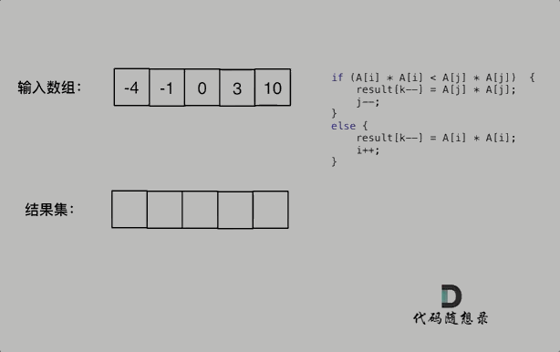

* [做專案（多個 C++、Java、Go、測試開發、前端（front end）專案）](https://www.programmercarl.com/other/kstar.html)
* [刷演算法（兩個月高強度學習演算法）](https://www.programmercarl.com/xunlian/xunlianying.html)
* [背面試必考題（八股文）（40 天挑戰高頻面試題）](https://www.programmercarl.com/xunlian/bagu.html)

> 雙指標（two pointers）厲害起來，也是無敵

# 977. 有序（ordered）陣列（array）的平方

[LeetCode 題目連結](https://leetcode.cn/problems/squares-of-a-sorted-array/)

給你一個按 非遞減順序 排序（sorting）的整數（integer）陣列 nums，回傳 每個數字的平方 組成的新陣列，要求也按 非遞減順序 排序。

範例 1：
* 輸入：nums = [-4,-1,0,3,10]
* 輸出：[0,1,9,16,100]
* 解釋：平方後，陣列變為 [16,1,0,9,100]，排序後，陣列變為 [0,1,9,16,100]

範例 2：
* 輸入：nums = [-7,-3,2,3,11]
* 輸出：[4,9,9,49,121]

## 演算法公開課

**[《程式碼隨想錄》演算法影片公開課](https://programmercarl.com/other/gongkaike.html)：[two pointers 法經典題目！LeetCode:977.有序陣列的平方](https://www.bilibili.com/video/BV1QB4y1D7ep)，相信結合影片再看本篇題解，更有助於大家對本題的理解**。


## 解題思路

### 蠻力（brute force）排序

最直觀的想法，莫過於：每個數平方之後，排個序，程式碼如下：

```CPP
class Solution {
public:
    vector<int> sortedSquares(vector<int>& A) {
        for (int i = 0; i < A.size(); i++) {
            A[i] *= A[i];
        }
        sort(A.begin(), A.end()); // 快速排序
        return A;
    }
};
```

這個時間複雜度（time complexity）是 O(n + nlogn)，可以說是 O(nlogn) 的時間複雜度，但為了和下面雙指標法演算法時間複雜度有鮮明對比，我記為 O(n + nlog n)。

### 雙指標法

陣列其實是有序的，只不過負數（negative number）平方之後可能成為最大數了。

那麼陣列平方的最大值就在陣列的兩端，不是最左邊就是最右邊，不可能是中間。

此時可以考慮雙指標法了，i 指向起始位置，j 指向終止位置。

定義一個新陣列 result，和 A 陣列一樣的大小，讓 k 指向 result 陣列終止位置。

如果 `A[i] * A[i] < A[j] * A[j]` 那麼 `result[k--] = A[j] * A[j];`。

如果 `A[i] * A[i] >= A[j] * A[j]` 那麼 `result[k--] = A[i] * A[i];`。

如動畫所示：



不難寫出如下程式碼：

```CPP
class Solution {
public:
    vector<int> sortedSquares(vector<int>& A) {
        int k = A.size() - 1;
        vector<int> result(A.size(), 0);
        for (int i = 0, j = A.size() - 1; i <= j;) { // 注意這裡要 i <= j，因為最後要處理兩個元素
            if (A[i] * A[i] < A[j] * A[j])  {
                result[k--] = A[j] * A[j];
                j--;
            }
            else {
                result[k--] = A[i] * A[i];
                i++;
            }
        }
        return result;
    }
};
```

此時的時間複雜度為 O(n)，相對於蠻力排序的解法 O(n + nlog n) 還是提升不少的。


**這裡還是說一下，大家不必太在意 leetcode 上執行用時，打敗多少多少使用者，這個就是一個玩具，非常不準確。**

做題的時候自己能分析出來時間複雜度就可以了，至於 leetcode 上執行用時，大概看一下就行，只要達到最佳的時間複雜度就可以了，

一樣的程式碼多提交幾次可能就擊敗百分之百了.....

## 其他語言版本

### Java：

排序法
```Java
class Solution {
    public int[] sortedSquares(int[] nums) {
        for (int i = 0; i < nums.length; i++) {
            nums[i] = nums[i] * nums[i];
        }
        Arrays.sort(nums);
        return nums;
    }
}
```

```Java
class Solution {
    public int[] sortedSquares(int[] nums) {
        int right = nums.length - 1;
        int left = 0;
        int[] result = new int[nums.length];
        int index = result.length - 1;
        while (left <= right) {
            if (nums[left] * nums[left] > nums[right] * nums[right]) {
                // 正數的相對位置是不變的，需要調整的是負數平方後的相對位置
                result[index--] = nums[left] * nums[left];
                ++left;
            } else {
                result[index--] = nums[right] * nums[right];
                --right;
            }
        }
        return result;
    }
}
```

```java
class Solution {
    public int[] sortedSquares(int[] nums) {
        int l = 0;
        int r = nums.length - 1;
        int[] res = new int[nums.length];
        int j = nums.length - 1;
        while(l <= r){
            if(nums[l] * nums[l] > nums[r] * nums[r]){
                res[j--] = nums[l] * nums[l++];
            }else{
                res[j--] = nums[r] * nums[r--];
            }
        }
        return res;
    }
}
```

### Python：

```Python
（版本一）two pointers 法
class Solution:
    def sortedSquares(self, nums: List[int]) -> List[int]:
        l, r, i = 0, len(nums)-1, len(nums)-1
        res = [float('inf')] * len(nums) # 需要提前定義串列，存放結果
        while l <= r:
            if nums[l] ** 2 < nums[r] ** 2: # 左右邊界進行對比，找出最大值
                res[i] = nums[r] ** 2
                r -= 1 # 右指標往左移動
            else:
                res[i] = nums[l] ** 2
                l += 1 # 左指標往右移動
            i -= 1 # 存放結果的指標需要往前平移一位
        return res
```

```Python
（版本二）蠻力排序法
class Solution:
    def sortedSquares(self, nums: List[int]) -> List[int]:
        for i in range(len(nums)):
            nums[i] *= nums[i]
        nums.sort()
        return nums
```

```Python
（版本三）蠻力排序法 + list comprehension
class Solution:
    def sortedSquares(self, nums: List[int]) -> List[int]:
        return sorted(x*x for x in nums)
```

```Python
(版本四) two pointers + 反轉串列
class Solution:
    def sortedSquares(self, nums: List[int]) -> List[int]:
        # 根據 list 的先進排序在先原則
        # 將 nums 的平方按從大到小的順序添加進新的 list
        # 最後反轉 list
        new_list = []
        left, right = 0 , len(nums) -1
        while left <= right:
            if abs(nums[left]) <= abs(nums[right]):
                new_list.append(nums[right] ** 2)
                right -= 1
            else:
                new_list.append(nums[left] ** 2)
                left += 1
        return new_list[::-1]
```

```python3
(two pointers 最佳化版本） 三步最佳化
 class Solution:
    def sortedSquares(self, nums: List[int]) -> List[int]:
        """
        整體思想：有序陣列的絕對值最大值永遠在兩頭，比較兩頭，平方大的插到新陣列的最後
        最佳化：1. 最佳化所有元素為非正或非負的情況
                2. 頭尾平方的大小比較直接將頭尾相加與 0 進行比較即可
                3. 新的平方排序陣列的插入索引可以用倒序插入實作（針對 for 迴圈，while 迴圈不適用）
        """
 
        # 特殊情況，元素都非負（最佳化 1）
        if nums[0] >= 0:
            return [num ** 2 for num in nums]  # 按順序平方即可
        # 最後一個非正，全負有序的
        if nums[-1] <= 0:
            return [x ** 2 for x in nums[::-1]]  # 倒序平方後的陣列
        
        # 一般情況，有正有負
        i = 0  # 原陣列頭索引
        j = len(nums) - 1  # 原陣列尾部索引
        new_nums = [0] * len(nums)  # 新建一個等長陣列用於保存排序後的結果
        # end_index = len(nums) - 1  # 新的排序陣列(是新陣列)尾插索引，每次需要減一（最佳化 3 最佳化了）

        for end_index in range(len(nums)-1, -1, -1): # (最佳化 3，倒序，不用單獨建立變數)
            # if nums[i] ** 2 >= nums[j] ** 2:
            if nums[i] + nums[j] <= 0:  # (最佳化 2)
                new_nums[end_index] = nums[i] ** 2
                i += 1
                # end_index -= 1  (最佳化 3)
            else:
                new_nums[end_index] = nums[j] ** 2
                j -= 1
                # end_index -= 1  (最佳化 3)
        return new_nums
```

### Go：

```Go
// 排序法
func sortedSquares(nums []int) []int {
    for i, val := range nums {
        nums[i] *= val
    }
    sort.Ints(nums)
    return nums
}
```
```Go
// two pointers 法
func sortedSquares(nums []int) []int {
	n := len(nums)
	i, j, k := 0, n-1, n-1
	ans := make([]int, n)
	for i <= j {
		lm, rm := nums[i]*nums[i], nums[j]*nums[j]
		if lm > rm {
			ans[k] = lm
			i++
		} else {
			ans[k] = rm
			j--
		}
		k--
	}
	return ans
}
```
### Rust:

```rust
impl Solution {
    pub fn sorted_squares(nums: Vec<i32>) -> Vec<i32> {
        let n = nums.len();
        let (mut i,mut j,mut k) = (0,n - 1,n);
        let mut ans = vec![0;n];
        while i <= j{
            if nums[i] * nums[i] < nums[j] * nums[j] {
                ans[k-1] = nums[j] * nums[j];
                j -= 1;
            }else{
                ans[k-1] = nums[i] * nums[i];
                i += 1;
            }
            k -= 1;
        }
        ans
    }
}
```
### JavaScript：

```Javascript
/**
 * @param {number[]} nums
 * @return {number[]}
 */
var sortedSquares = function(nums) {
    let n = nums.length;
    let res = new Array(n).fill(0);
    let i = 0, j = n - 1, k = n - 1;
    while (i <= j) {
        let left = nums[i] * nums[i],
            right = nums[j] * nums[j];
        if (left < right) {
            res[k--] = right;
            j--;
        } else {
            res[k--] = left;
            i++;
        }
    }
    return res;
};
```

### TypeScript：

雙指標法：

```typescript
function sortedSquares(nums: number[]): number[] {
    const ans: number[] = [];
    let left = 0,
        right = nums.length - 1;

    while (left <= right) {
        // 右側的元素不需要取絕對值，nums 為非遞減排序的整數陣列
        // 在同為負數的情況下，左側的平方值一定大於右側的平方值
        if (Math.abs(nums[left]) > nums[right]) {
            // 使用 Array.prototype.unshift() 直接在陣列的首項插入當前最大值
            ans.unshift(nums[left] ** 2);
            left++;
        } else {
            ans.unshift(nums[right] ** 2);
            right--;
        }
    }

    return ans;
};
```

花俏寫法（蠻力解題思路）：

```typescript
function sortedSquares(nums: number[]): number[] {
    return nums.map(i => i * i).sort((a, b) => a - b);
};
```

### Swift:

```swift
func sortedSquares(_ nums: [Int]) -> [Int] {
    // 指向新陣列最後一個元素
    var k = nums.count - 1
    // 指向原陣列第一個元素
    var i = 0
    // 指向原陣列最後一個元素
    var j = nums.count - 1
    // 初始化新陣列（用 -1 填充）
    var result = Array<Int>(repeating: -1, count: nums.count)

    for _ in 0..<nums.count {
        if nums[i] * nums[i] < nums[j] * nums[j] {
            result[k] = nums[j] * nums[j]
            j -= 1
        } else {
            result[k] = nums[i] * nums[i]
            i += 1
        }
        k -= 1
    }

    return result
}
```

### Ruby:

```ruby
def sorted_squares(nums)
  left, right, result = 0, nums.size - 1, []
  while left <= right
    if nums[left]**2 > nums[right]**2
      result << nums[left]**2
      left += 1
    else
      result << nums[right]**2
      right -= 1
    end
  end
  result.reverse
end
```

### C:

```c
int* sortedSquares(int* nums, int numsSize, int* returnSize){
    // 回傳的陣列大小就是原陣列大小
    *returnSize = numsSize;
    // 建立兩個指標，right 指向陣列最後一位元素，left 指向陣列第一位元素
    int right = numsSize - 1;
    int left = 0;

    // 最後要回傳的結果陣列
    int* ans = (int*)malloc(sizeof(int) * numsSize);
    int index;
    for(index = numsSize - 1; index >= 0; index--) {
        // 左指標指向元素的平方
        int lSquare = nums[left] * nums[left];
        // 右指標指向元素的平方
        int rSquare = nums[right] * nums[right];
        // 若左指標指向元素平方比右指標指向元素平方大，將左指標指向元素平方放入結果陣列。左指標右移一位
        if(lSquare > rSquare) {
            ans[index] = lSquare;
            left++;
        } 
        // 若右指標指向元素平方比左指標指向元素平方大，將右指標指向元素平方放入結果陣列。右指標左移一位
        else {
            ans[index] = rSquare;
            right--;
        }
    }
    // 回傳結果陣列
    return ans;
}
```

### PHP:

```php
class Solution {
    /**
     * @param Integer[] $nums
     * @return Integer[]
     */
    function sortedSquares($nums) {
        // two pointers 法
        $res = [];
        for ($i = 0; $i < count($nums); $i++) {
            $res[$i] = 0;
        }
        $k = count($nums) - 1;
        for ($i = 0, $j = count($nums) - 1; $i <= $j; ) {
            if ($nums[$i] ** 2 < $nums[$j] ** 2) {
                $res[$k--] = $nums[$j] ** 2;
                $j--;
            }
            else {
                $res[$k--] = $nums[$i] ** 2;
                $i++;
            }
        } 
        return $res;
    }
}
```

### Kotlin:

雙指標法
```kotlin
class Solution {
    // two pointers 法
    fun sortedSquares(nums: IntArray): IntArray {
        var res = IntArray(nums.size)
        var left = 0 // 指向陣列的最左端
        var right = nums.size - 1 // 指向陣列最右端
        // 選擇平方數更大的那一個往 res 陣列中倒序填充
        for (index in nums.size - 1 downTo 0) {
            if (nums[left] * nums[left] > nums[right] * nums[right]) {
                res[index] = nums[left] * nums[left]
                left++
            } else {
                res[index] = nums[right] * nums[right]
                right--
            }
        }
        return res
    }
}
```
花俏寫法（蠻力解題思路）
```kotlin
class Solution {
    fun sortedSquares(nums: IntArray): IntArray {
        // left 與 right 用來控制迴圈，類似於滑動視窗
        var left: Int = 0;
        var right: Int = nums.size - 1;
        // 將每個數字的平方經過排序後加入 result 數值
        var result: IntArray = IntArray(nums.size);
        var k: Int = nums.size - 1;
        while (left <= right) {
            // 從大到小，從後向前填滿陣列
            // [left, right] 控制迴圈
            if (nums[left] * nums[left] > nums[right] * nums[right]) {
                result[k--] = nums[left] * nums[left]
                left++
            }
            else {
                result[k--] = nums[right] * nums[right]
                right--
            }
        }
        return result
    }
}
```

### Scala:

雙指標:
```scala
object Solution {
  def sortedSquares(nums: Array[Int]): Array[Int] = {
    val res: Array[Int] = new Array[Int](nums.length)
    var top = nums.length - 1
    var i = 0
    var j = nums.length - 1
    while (i <= j) {
      if (nums(i) * nums(i) <= nums(j) * nums(j)) {
        // 當左側平方小於等於右側，res 陣列頂部放右側的平方，並且 top 下移，j 左移
        res(top) = nums(j) * nums(j)
        top -= 1
        j -= 1
      } else {
        // 當左側平方大於右側，res 陣列頂部放左側的平方，並且 top 下移，i 右移
        res(top) = nums(i) * nums(i)
        top -= 1
        i += 1
      }
    }
    res
  }
}
```
花俏寫法（蠻力解題思路）:
```scala
object Solution {
  def sortedSquares(nums: Array[Int]): Array[Int] = {
    nums.map(x=>{x*x}).sortWith(_ < _)
  }
}
```

### C#：

```csharp
public class Solution {
    public int[] SortedSquares(int[] nums) {
        int k = nums.Length - 1;
        int[] result = new int[nums.Length];
        for (int i = 0, j = nums.Length - 1;i <= j;){
            if (nums[i] * nums[i] < nums[j] * nums[j]) {
                result[k--] = nums[j] * nums[j];
                j--;
            } else {
                result[k--] = nums[i] * nums[i];
                i++;
            }
        }
        return result;
    }
}
```
C# LINQ：
```csharp
public class Solution {
    public int[] SortedSquares(int[] nums) {
       return nums.Select(x => x * x).OrderBy(x => x).ToArray();
    }
}
```


