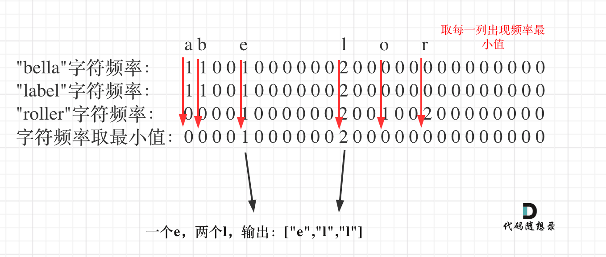

* [做專案（多個 C++、Java、Go、測試開發、前端（front end）專案）](https://www.programmercarl.com/other/kstar.html)
* [刷演算法（兩個月高強度學習演算法）](https://www.programmercarl.com/xunlian/xunlianying.html)
* [背面試必考題（八股文）（40 天挑戰高頻面試題）](https://www.programmercarl.com/xunlian/bagu.html)


# 1002. 查找常用字元（character）

[LeetCode 題目連結](https://leetcode.com/problems/find-common-characters/)

給你一個字串（string）陣列（array） words，請你找出所有在 words 的每個字串中都出現的共用字元（包括重複（duplicate）字元），並以陣列形式回傳。你可以按 任意順序 回傳答案。

範例 1：

輸入：words = ["bella","label","roller"]
輸出：["e","l","l"]

範例 2：

輸入：words = ["cool","lock","cook"]
輸出：["c","o"]

提示：

1 <= words.length <= 100
1 <= words[i].length <= 100
words[i] 由小寫英文字母組成


## 解題思路

這道題意一開始就有點繞，不是那麼容易懂，其實就是 26 個小寫字元中有字元在所有字串裡都出現的話，就輸出，重複的也算。

例如：

輸入：["ll","ll","ll"]
輸出：["l","l"]

這道題目一眼看上去，就是用雜湊（hash）法，**「小寫字元」，「出現頻率」，這些關鍵字（keyword）都是為雜湊法量身訂做的啊**

首先可以想到的是蠻力法（brute force），一個字串一個字串去搜，時間複雜度（time complexity）是 $O(n^m)$，n 是字串長度，m 是有幾個字串。

可以看出這是指數（exponential）級別的時間複雜度，非常高，而且程式碼實作也不容易，因為要統計重複的字元，還要適當地替換或者 deduplication。

那我們還是雜湊法吧。如果對雜湊法不了解，可以看這篇：[關於雜湊表（hash table），你該了解這些！](./雜湊表理論基礎.md)。

如果對用陣列來做雜湊法不了解的話，可以看這篇：[把陣列當做雜湊表來用，很巧妙！](./0242.有效的字母異位詞.md)。

了解了雜湊法，理解了陣列在雜湊法中的應用之後，可以來看解題思路了。

整體思路就是統計出搜尋字串裡 26 個字元出現的頻率，然後取每個字元頻率最小值，最後轉成輸出格式就可以了。

如圖：



先統計第一個字串所有字元出現的次數，程式碼如下：

```cpp
int hash[26] = {0}; // 用來統計所有字串裡字元出現的最小頻率
for (int i = 0; i < A[0].size(); i++) { // 用第一個字串給 hash 初始化
    hash[A[0][i] - 'a']++;
}
```

接下來，把其他字串裡字元的出現次數也統計出來，一次放在 hashOtherStr 中。

然後 hash 和 hashOtherStr 取最小值，這是本題關鍵所在，此時取最小值，就是一個字元在所有字串裡出現的最小次數了。

程式碼如下：

```cpp
int hashOtherStr[26] = {0}; // 統計除第一個字串外字元的出現頻率
for (int i = 1; i < A.size(); i++) {
    memset(hashOtherStr, 0, 26 * sizeof(int));
    for (int j = 0; j < A[i].size(); j++) {
        hashOtherStr[A[i][j] - 'a']++;
    }
    // 這是關鍵所在
    for (int k = 0; k < 26; k++) { // 更新 hash，保證 hash 裡統計 26 個字元在所有字串裡出現的最小次數
        hash[k] = min(hash[k], hashOtherStr[k]);
    }
}
```
此時 hash 裡統計著字元在所有字串裡出現的最小次數，那麼把 hash 轉成題目要求的輸出格式就可以了。

程式碼如下：

```cpp
// 將 hash 統計的字元次數，轉成輸出形式
for (int i = 0; i < 26; i++) {
    while (hash[i] != 0) { // 注意這裡是 while，多個重複的字元
        string s(1, i + 'a'); // char -> string
        result.push_back(s);
        hash[i]--;
    }
}
```

整體 C++ 程式碼如下：

```CPP
class Solution {
public:
    vector<string> commonChars(vector<string>& A) {
        vector<string> result;
        if (A.size() == 0) return result;
        int hash[26] = {0}; // 用來統計所有字串裡字元出現的最小頻率
        for (int i = 0; i < A[0].size(); i++) { // 用第一個字串給 hash 初始化
            hash[A[0][i] - 'a']++;
        }

        int hashOtherStr[26] = {0}; // 統計除第一個字串外字元的出現頻率
        for (int i = 1; i < A.size(); i++) {
            memset(hashOtherStr, 0, 26 * sizeof(int));
            for (int j = 0; j < A[i].size(); j++) {
                hashOtherStr[A[i][j] - 'a']++;
            }
            // 更新 hash，保證 hash 裡統計 26 個字元在所有字串裡出現的最小次數
            for (int k = 0; k < 26; k++) {
                hash[k] = min(hash[k], hashOtherStr[k]);
            }
        }
        // 將 hash 統計的字元次數，轉成輸出形式
        for (int i = 0; i < 26; i++) {
            while (hash[i] != 0) { // 注意這裡是 while，多個重複的字元
                string s(1, i + 'a'); // char -> string
                result.push_back(s);
                hash[i]--;
            }
        }

        return result;
    }
};
```

## 其他語言版本

### Java：

```Java
class Solution {
    public List<String> commonChars(String[] A) {
        List<String> result = new ArrayList<>();
        if (A.length == 0) return result;
        int[] hash= new int[26]; // 用來統計所有字串裡字元出現的最小頻率
        for (int i = 0; i < A[0].length(); i++) { // 用第一個字串給 hash 初始化
            hash[A[0].charAt(i)- 'a']++;
        }
        // 統計除第一個字串外字元的出現頻率
        for (int i = 1; i < A.length; i++) {
            int[] hashOtherStr= new int[26];
            for (int j = 0; j < A[i].length(); j++) {
                hashOtherStr[A[i].charAt(j)- 'a']++;
            }
            // 更新 hash，保證 hash 裡統計 26 個字元在所有字串裡出現的最小次數
            for (int k = 0; k < 26; k++) {
                hash[k] = Math.min(hash[k], hashOtherStr[k]);
            }
        }
        // 將 hash 統計的字元次數，轉成輸出形式
        for (int i = 0; i < 26; i++) {
            while (hash[i] != 0) { // 注意這裡是 while，多個重複的字元
                char c= (char) (i+'a');
                result.add(String.valueOf(c));
                hash[i]--;
            }
        }
        return result;
    }
}
```
### Python

```python
class Solution:
    def commonChars(self, words: List[str]) -> List[str]:
        if not words: return []
        result = []
        hash = [0] * 26 # 用來統計所有字串裡字元出現的最小頻率
        for i, c in enumerate(words[0]):  # 用第一個字串給 hash 初始化
            hash[ord(c) - ord('a')] += 1
        # 統計除第一個字串外字元的出現頻率
        for i in range(1, len(words)):
            hashOtherStr = [0] * 26
            for j in range(len(words[i])):
                hashOtherStr[ord(words[i][j]) - ord('a')] += 1
            # 更新 hash，保證 hash 裡統計 26 個字元在所有字串裡出現的最小次數
            for k in range(26):
                hash[k] = min(hash[k], hashOtherStr[k])
        # 將 hash 統計的字元次數，轉成輸出形式
        for i in range(26):
            while hash[i] != 0: # 注意這裡是 while，多個重複的字元
                result.extend(chr(i + ord('a')))
                hash[i] -= 1
        return result
```

Python 3 使用 collections.Counter
```python
class Solution:
    def commonChars(self, words: List[str]) -> List[str]:
        tmp = collections.Counter(words[0])
        l = []
        for i in range(1,len(words)):
            # 使用 & 取交集
            tmp = tmp & collections.Counter(words[i])

        # 剩下的就是每個單字都出現的字元（鍵），個數（值）
        for j in tmp:
            v = tmp[j]
            while(v):
                l.append(j)
                v -= 1
        return l
```

### JavaScript

```js
var commonChars = function (words) {
	let res = []
	let size = 26
	let firstHash = new Array(size).fill(0)   // 初始化 hash 陣列

	let a = "a".charCodeAt()
	let firstWord = words[0]
	for (let i = 0; i < firstWord.length; i++) { // 第 0 個單字的統計
		let idx = firstWord[i].charCodeAt()
		firstHash[idx - a] += 1
	}
	
	let otherHash = new Array(size).fill(0)    // 初始化 hash 陣列
	for (let i = 1; i < words.length; i++) { // 1-n 個單字統計
		for (let j = 0; j < words[i].length; j++) {
			let idx = words[i][j].charCodeAt()
			otherHash[idx - a] += 1
		}
		
		for (let i = 0; i < size; i++) {
			firstHash[i] = Math.min(firstHash[i], otherHash[i])
		}
		otherHash.fill(0)
	}
	
	for (let i = 0; i < size; i++) {
		while (firstHash[i] > 0) {
			res.push(String.fromCharCode(i + a))
			firstHash[i]--
		}
	}
	return res
};

// 方法二：map()
var commonChars = function(words) {
  let min_count = new Map()
  // 統計字串中字元出現的最小頻率，以第一個字串初始化
  for(let str of words[0]) {
    min_count.set(str, ((min_count.get(str) || 0) + 1))
  }
  // 從第二個單字開始統計字元出現次數
  for(let i = 1; i < words.length; i++) {
    let char_count = new Map()
    for(let str of words[i]) { // 遍歷字母
      char_count.set(str, (char_count.get(str) || 0) + 1)
    }
    // 比較出最小的字元次數
    for(let value of min_count) { // 注意這裡遍歷 min_count！而不是單字
      min_count.set(value[0], Math.min((min_count.get(value[0]) || 0), (char_count.get(value[0]) || 0)))
    }
  }
  // 遍歷 map
  let res = []
  min_count.forEach((value, key) => {
    if(value) {
      for(let i=0; i<value; i++) {
        res.push(key)
      }
    }
  })
  return res
}
```

### TypeScript

```ts
  console.time("test")
  let str: string = ""
  // 設定一個用字母組成的 map 字典
  let map = new Map<string, number>()
  // 給所有 map 設定初始值為 0
  let wordInitial: [string, number][] = words[0]
    .split("")
    .map((item) => [item, 0])
  // 如果有重複字母，就把重複字母的數量加 1
  for (let word of words[0]) {
    map.set(word, map.has(word) ? map.get(word) + 1 : 1)
  }
  for (let i = 1; i < words.length; i++) {
    const mapWord = new Map<string, number>(wordInitial)
    for (let j = 0; j < words[i].length; j++) {
      if (!map.has(words[i][j])) continue
      // mapWord 中的字母的個數不能高於當前 map 的個數，多於則不能添加
      if (map.get(words[i][j]) > mapWord.get(words[i][j])) {
        mapWord.set(
          words[i][j],
          mapWord.has(words[i][j]) ? mapWord!.get(words[i][j]) + 1 : 1
        )
      }
    }
    // 每次重新初始化 map
    map = mapWord
  }
  for (let [key, value] of map) {
    str += key.repeat(value)
  }
  console.timeEnd("test")
  return str.split("")
```

### GO

```golang
func commonChars(A []string) []string {
	var result []string
	if len(A) == 0 {
		return result
	}

	hash := make([]int, 26)  // 用來統計所有字串裡字元出現的最小頻率
	for _, c := range A[0] { // 用第一個字串給 hash 初始化
		hash[c-'a']++
	}

	for i := 1; i < len(A); i++ {
		hashOtherStr := make([]int, 26) // 統計除第一個字串外字元的出現頻率
		for _, c := range A[i] {
			hashOtherStr[c-'a']++
		}
		// 更新 hash，保證 hash 裡統計 26 個字元在所有字串裡出現的最小次數
		for k := 0; k < 26; k++ {
			hash[k] = min(hash[k], hashOtherStr[k])
		}
	}

	// 將 hash 統計的字元次數，轉成輸出形式
	for i := 0; i < 26; i++ {
		for hash[i] > 0 {
			s := string('a' + i) // rune -> string
			result = append(result, s)
			hash[i]--
		}
	}

	return result
}

func min(a, b int) int {
	if a < b {
		return a
	}
	return b
}
```

### Swift：

```swift
func commonChars(_ words: [String]) -> [String] {
    var res = [String]()
    if words.count < 1 {
        return res
    }
    let aUnicodeScalarValue = "a".unicodeScalars.first!.value
    let lettersMaxCount = 26
    // 用於統計所有字串每個字母出現的 最小 頻率
    var hash = Array(repeating: 0, count: lettersMaxCount)
    // 統計第一個字串每個字母出現的次數
    for unicodeScalar in words.first!.unicodeScalars {
        hash[Int(unicodeScalar.value - aUnicodeScalarValue)] += 1
    }
    // 統計除第一個字串每個字母出現的次數
    for idx in 1 ..< words.count {
        var hashOtherStr = Array(repeating: 0, count: lettersMaxCount)
        for unicodeScalar in words[idx].unicodeScalars {
            hashOtherStr[Int(unicodeScalar.value - aUnicodeScalarValue)] += 1
        }
        // 更新 hash，保證 hash 裡統計的字母為出現的最小頻率
        for k in 0 ..< lettersMaxCount {
            hash[k] = min(hash[k], hashOtherStr[k])
        }
    }
    // 將 hash 統計的字元次數，轉成輸出形式
    for i in 0 ..< lettersMaxCount {
        while hash[i] != 0 { // 注意這裡是 while，多個重複的字元
            let currentUnicodeScalarValue: UInt32 = UInt32(i) + aUnicodeScalarValue
            let currentUnicodeScalar: UnicodeScalar = UnicodeScalar(currentUnicodeScalarValue)!
            let outputStr = String(currentUnicodeScalar) // UnicodeScalar -> String
            res.append(outputStr)
            hash[i] -= 1
        }
    }
    return res
}
```

### C:

```c
// 若兩個雜湊表定義為 char 陣列（每個單字的最大長度不會超過 100，因此可以用 char 表示），可以提高時間和空間效率
void updateHashTable(int* hashTableOne, int* hashTableTwo) {
    int i;
    for(i = 0; i < 26; i++) {
        hashTableOne[i] = hashTableOne[i] < hashTableTwo[i] ? hashTableOne[i] : hashTableTwo[i];
    }
}

char ** commonChars(char ** words, int wordsSize, int* returnSize){
    // 用來統計所有字母出現的最小頻率
    int hashTable[26] = { 0 };
    // 初始化回傳的 char** 陣列以及回傳陣列長度
    *returnSize = 0;
    char** ret = (char**)malloc(sizeof(char*) * 100);

    // 如果輸入陣列長度為 0，則回傳 NULL
    if(!wordsSize) 
        return NULL;

    int i;
    // 更新第一個單字的字母頻率
    for(i = 0; i < strlen(words[0]); i++)
        hashTable[words[0][i] - 'a']++;
    // 更新從第二個單字開始的字母頻率
    for(i = 1; i < wordsSize; i++) {
        // 建立新的雜湊表，記錄新的單字的字母頻率
        int newHashTable[26] = { 0 };
        int j;
        for(j = 0; j < strlen(words[i]); j++) {
            newHashTable[words[i][j] - 'a']++;
        }
        // 更新原雜湊表
        updateHashTable(hashTable, newHashTable);
    }

    // 將雜湊表中的字元變為字串放入 ret 中
    for(i = 0; i < 26; i++) {
        if(hashTable[i]) {
            int j;
            for(j = 0; j < hashTable[i]; j++) {
                char* tempString = (char*)malloc(sizeof(char) * 2);
                tempString[0] = i + 'a';
                tempString[1] = '\0';
                ret[(*returnSize)++] = tempString;
            }
        }
    }
    return ret;
}
```
### Scala:

```scala
object Solution {
  def commonChars(words: Array[String]): List[String] = {
    // 宣告回傳結果的不可變 List 集合，因為 res 要重新賦值，所以宣告為 var
    var res = List[String]()
    var hash = new Array[Int](26) // 統計字元出現的最小頻率
    // 統計第一個字串中字元出現的次數
    for (i <- 0 until words(0).length) {
      hash(words(0)(i) - 'a') += 1
    }
    // 統計其他字串出現的頻率
    for (i <- 1 until words.length) {
      // 統計其他字元出現的頻率
      var hashOtherStr = new Array[Int](26)
      for (j <- 0 until words(i).length) {
        hashOtherStr(words(i)(j) - 'a') += 1
      }
      // 更新 hash，取 26 個字母最小出現的頻率
      for (k <- 0 until 26) {
        hash(k) = math.min(hash(k), hashOtherStr(k))
      }
    }
    // 根據 hash 的結果轉換輸出的形式
    for (i <- 0 until 26) {
      for (j <- 0 until hash(i)) {
        res = res :+ (i + 'a').toChar.toString
      }
    }
    res
  }
}
```

### Rust:

```rust
impl Solution {
    pub fn common_chars(words: Vec<String>) -> Vec<String> {
        if words.is_empty() {
            return vec![];
        }
        let mut res = vec![];
        let mut hash = vec![0; 26];
        for i in words[0].bytes() {
            hash[(i - b'a') as usize] += 1;
        }
        for i in words.iter().skip(1) {
            let mut other_hash_str = vec![0; 26];
            for j in i.bytes() {
                other_hash_str[(j - b'a') as usize] += 1;
            }
            for k in 0..26 {
                hash[k] = hash[k].min(other_hash_str[k]);
            }
        }

        for (i, v) in hash.iter_mut().enumerate() {
            while *v > 0 {
                res.push(((i as u8 + b'a') as char).to_string());
                *v -= 1;
            }
        }

        res
    }
}
```

Ruby:
```ruby
def common_chars(words)
  result = []
  # 統計所有字串裡字元出現的最小頻率
  hash = {}
  # 初始化標識
  is_first = true

  words.each do |word|
    # 記錄共同字元
    chars = []
    word.split('').each do |chr|
      # 第一個字串初始化
      if is_first
        chars << chr
      else
        # 字母之前出現過的最小次數
        if hash[chr] != nil && hash[chr] > 0
          hash[chr] -= 1
          chars << chr
        end
      end
    end

    is_first = false
    # 清除 hash，更新字元最小頻率
    hash.clear
    chars.each do |chr|
      if hash[chr] != nil
        hash[chr] += 1
      else
        hash[chr] = 1
      end
    end
  end

  # 字元最小頻率 hash 轉換為字元陣列
  hash.keys.each do |key|
    for i in 0..hash[key] - 1
      result << key
    end
  end

  return result
end
```


