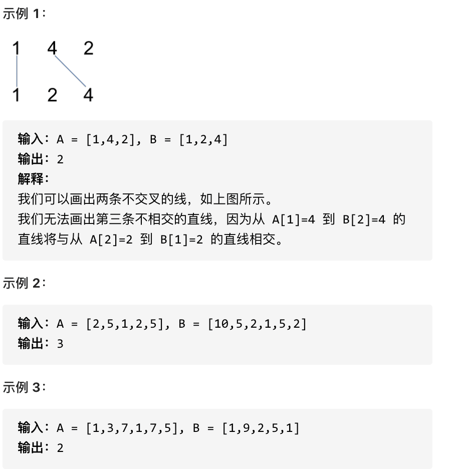
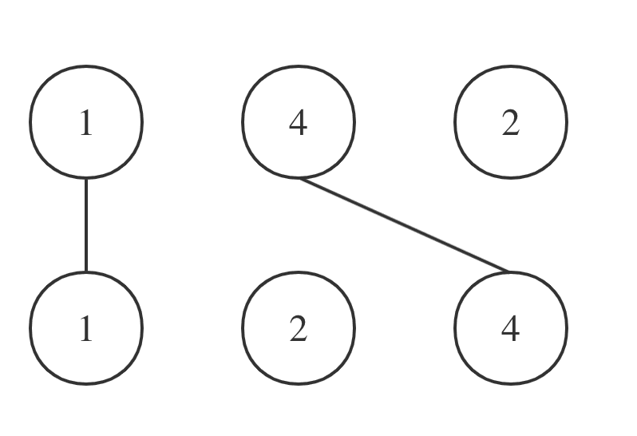

* [做專案（多個 C++、Java、Go、測開、前端專案）](https://www.programmercarl.com/other/kstar.html)
* [刷演算法（algorithm）（兩個月高強度學演算法）](https://www.programmercarl.com/xunlian/xunlianying.html)
* [背面試必考題（40 天挑戰高頻面試題）](https://www.programmercarl.com/xunlian/bagu.html)

# 1035.不相交的線

[LeetCode 題目連結](https://leetcode.cn/problems/uncrossed-lines/)

在兩條獨立的水平線上按給定的順序寫下 nums1 和 nums2 中的整數（integer）。

現在，可以繪製一些連接兩個數字 nums1[i] 和 nums2[j] 的直線，這些直線需要同時滿足：

* nums1[i] == nums2[j]
* 且繪製的直線不與任何其他連線（非水平線）相交。

請注意，連線即使在端點也不能相交：每個數字只能屬於一條連線。

以這種方法繪製線條，並回傳可以繪製的最大連線數。




## 演算法公開課

**[《程式碼隨想錄》演算法影片公開課](https://programmercarl.com/other/gongkaike.html)：[動態規劃（dynamic programming, DP）之次序列（subsequence）問題，換湯不換藥 | LeetCode：1035.不相交的線](https://www.bilibili.com/video/BV1h84y1x7MP)，相信結合影片再看本篇題解，更有助於大家對本題的理解**。


## 解題思路

相信不少讀者看到這道題目都沒什麼想法，我們來逐步分析一下。

繪製一些連接兩個數字 nums1[i] 和 nums2[j] 的直線，只要 nums1[i] == nums2[j]，且直線不能相交！

直線不能相交，這就是說明在字串（string） nums1 中找到一個與字串 nums2 相同的次序列，且這個次序列不能改變相對順序，只要相對順序不改變，連接相同數字的直線就不會相交。

拿範例一 nums1 = [1,4,2], nums2 = [1,2,4] 為例，相交情況如圖：




其實也就是說 nums1 和 nums2 的最長公用次序列（longest common subsequence）是 [1,4]，長度為 2。這個公用次序列指的是相對順序不變（即數字 4 在字串 nums1 中數字 1 的後面，那麼數字 4 也應該在字串 nums2 數字 1 的後面）

這麼分析完之後，大家可以發現：**本題說是求繪製的最大連線數，其實就是求兩個字串的最長公用次序列的長度！**

那麼本題就和我們剛剛講過的這道題目[動態規劃：1143.最長公用次序列](https://programmercarl.com/1143.最长公共子序列.html)就是一模一樣的了。

一樣到什麼程度呢？把字串名字改一下，其他程式碼都不用改，直接複製過來就行了。

其實本題就是求最長公用次序列的長度，鑑於我們剛剛講過[動態規劃：1143.最長公用次序列](https://programmercarl.com/1143.最长公共子序列.html)，所以本題我就不再做動規五部曲分析了。

如果大家有點遺忘了最長公用次序列，就再看一下這篇：[動態規劃：1143.最長公用次序列](https://programmercarl.com/1143.最长公共子序列.html)

本題程式碼如下：

```CPP
class Solution {
public:
    int maxUncrossedLines(vector<int>& nums1, vector<int>& nums2) {
        vector<vector<int>> dp(nums1.size() + 1, vector<int>(nums2.size() + 1, 0));
        for (int i = 1; i <= nums1.size(); i++) {
            for (int j = 1; j <= nums2.size(); j++) {
                if (nums1[i - 1] == nums2[j - 1]) {
                    dp[i][j] = dp[i - 1][j - 1] + 1;
                } else {
                    dp[i][j] = max(dp[i - 1][j], dp[i][j - 1]);
                }
            }
        }
        return dp[nums1.size()][nums2.size()];
    }
};
```
* 時間複雜性（time complexity）: O(n * m)
* 空間複雜度（space complexity）: O(n * m)


## 總結

看到程式碼大家也可以發現其實就是求兩個字串的最長公用次序列，但如果沒有做過[1143.最長公用次序列](https://programmercarl.com/1143.最长公共子序列.html)，本題其實還是很有難度的。

這是 Carl 為什麼要先講[1143.最長公用次序列](https://programmercarl.com/1143.最长公共子序列.html)再講本題，大家會發現一個正確的刷題順序對演算法學習是非常重要的！

這也是 Carl 做了很多題目（包括 ACM 和 LeetCode）才總結出來的規律，大家仔細體會一下喔。

## 其他語言版本

### Java：

```java
  class Solution {
    public int maxUncrossedLines(int[] nums1, int[] nums2) {
        int len1 = nums1.length;
        int len2 = nums2.length;
        int[][] dp = new int[len1 + 1][len2 + 1];

        for (int i = 1; i <= len1; i++) {
            for (int j = 1; j <= len2; j++) {
                if (nums1[i - 1] == nums2[j - 1]) {
                    dp[i][j] = dp[i - 1][j - 1] + 1;
                } else {
                    dp[i][j] = Math.max(dp[i - 1][j], dp[i][j - 1]);
                }
            }
        }

        return dp[len1][len2];
    }
}
```

### Python：

```python
class Solution:
    def maxUncrossedLines(self, nums1: List[int], nums2: List[int]) -> int:
        dp = [[0] * (len(nums2)+1) for _ in range(len(nums1)+1)]
        for i in range(1, len(nums1)+1):
            for j in range(1, len(nums2)+1):
                if nums1[i-1] == nums2[j-1]:
                    dp[i][j] = dp[i-1][j-1] + 1
                else:
                    dp[i][j] = max(dp[i-1][j], dp[i][j-1])
        return dp[-1][-1]
```

### Go:

```go
func maxUncrossedLines(nums1 []int, nums2 []int) int {
    dp := make([][]int, len(nums1) + 1)
    for i := range dp {
        dp[i] = make([]int, len(nums2) + 1)
    }

	for i := 1; i <= len(nums1); i++ {
		for j := 1; j <= len(nums2); j++ {
			if (nums1[i - 1] == nums2[j - 1]) {
				dp[i][j] = dp[i - 1][j - 1] + 1
			} else {
				dp[i][j] = max(dp[i - 1][j], dp[i][j - 1])
			}
		}
	}
	return dp[len(nums1)][len(nums2)]

}

func max(a, b int) int {
    if a > b {
        return a
    }
    return b
}
```

### Rust:

```rust
impl Solution {
    pub fn max_uncrossed_lines(nums1: Vec<i32>, nums2: Vec<i32>) -> i32 {
        let mut dp = vec![vec![0; nums2.len() + 1]; nums1.len() + 1];
        for (i, num1) in nums1.iter().enumerate() {
            for (j, num2) in nums2.iter().enumerate() {
                if num1 == num2 {
                    dp[i + 1][j + 1] = dp[i][j] + 1;
                } else {
                    dp[i + 1][j + 1] = dp[i][j + 1].max(dp[i + 1][j]);
                }
            }
        }
        dp[nums1.len()][nums2.len()]
    }
}
```

> rolling array

```rust
impl Solution {
    pub fn max_uncrossed_lines(nums1: Vec<i32>, nums2: Vec<i32>) -> i32 {
        let mut dp = vec![0; nums2.len() + 1];
        for num1 in nums1 {
            let mut prev = 0;
            for (j, &num2) in nums2.iter().enumerate() {
                let temp = dp[j + 1];
                if num1 == num2 {
                    // 使用上一次的狀態，防止重複計算
                    dp[j + 1] = prev + 1;
                } else {
                    dp[j + 1] = dp[j + 1].max(dp[j]);
                }
                prev = temp;
            }
        }
        dp[nums2.len()]
    }
}
```

### JavaScript：

```javascript
const maxUncrossedLines = (nums1, nums2) => {
    // 兩個陣列長度
    const [m, n] = [nums1.length, nums2.length];
    // 建立 dp 陣列並都初始化為 0
    const dp = new Array(m + 1).fill(0).map(x => new Array(n + 1).fill(0));
    for (let i = 1; i <= m; i++) {
        for (let j = 1; j <= n; j++) {
            // 根據兩種情況更新 dp[i][j]
            if (nums1[i - 1] === nums2[j - 1]) {
                dp[i][j] = dp[i - 1][j - 1] + 1;
            } else {
                dp[i][j] = Math.max(dp[i - 1][j], dp[i][j - 1]);
            }
        }
    }
    // 回傳 dp 陣列中右下角的元素
    return dp[m][n];
};
```

### TypeScript：

> 二維（2D）陣列（array）

```typescript
function maxUncrossedLines(nums1: number[], nums2: number[]): number {
    /**
        dp[i][j]: nums1 前 i-1 個，nums2 前 j-1 個，最大連線數
     */
    const length1: number = nums1.length,
        length2: number = nums2.length;
    const dp: number[][] = new Array(length1 + 1).fill(0)
        .map(_ => new Array(length2 + 1).fill(0));
    for (let i = 1; i <= length1; i++) {
        for (let j = 1; j <= length2; j++) {
            if (nums1[i - 1] === nums2[j - 1]) {
                dp[i][j] = dp[i - 1][j - 1] + 1;
            } else {
                dp[i][j] = Math.max(dp[i - 1][j], dp[i][j - 1]);
            }
        }
    }
    return dp[length1][length2];
};
```

> rolling array
```typescript
function maxUncrossedLines(nums1: number[], nums2: number[]): number {
    const len1 = nums1.length
    const len2 = nums2.length

    const dp: number[] = new Array(len2 + 1).fill(0)

    for (let i = 1; i <= len1; i++) {
        let prev: number = 0;
        let temp: number = 0;
        for (let j = 1; j <= len2; j++) {
            // 備份一下當前狀態（經過上層疊代後的）
            temp = dp[j]
            // prev 相當於 dp[j-1]（累加了上層的狀態）
            // 如果單純 dp[j-1] 則不會包含上層狀態
            if (nums1[i - 1] === nums2[j - 1]) dp[j] = prev + 1
            // dp[j] 表示之前的 dp[i][j-1]，dp[j-1] 表示 dp[i-1][j]
            else dp[j] = Math.max(dp[j], dp[j - 1])
            // 繼續使用上一層狀態更新參數用於當前層下一個狀態
            prev = temp
        }
    }
    return dp[len2]
}
```


