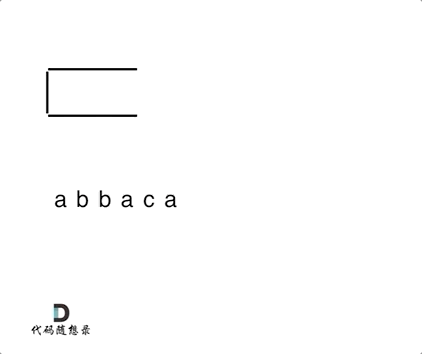

* [做專案（多個 C++、Java、Go、測開、前端專案）](https://www.programmercarl.com/other/kstar.html)
* [刷演算法（兩個月高強度學演算法）](https://www.programmercarl.com/xunlian/xunlianying.html)
* [背面試必考題（40 天挑戰高頻面試題）](https://www.programmercarl.com/xunlian/bagu.html)


> 配對問題都是堆疊（stack）的強項

# 1047. 刪除字串中的所有相鄰重複項

[LeetCode 題目連結](https://leetcode.com/problems/remove-all-adjacent-duplicates-in-string/)

給出由小寫字母組成的字串（string） S，重複項刪除操作會選擇兩個相鄰且相同的字母，並刪除它們。

在 S 上反覆執行重複項刪除操作，直到無法繼續刪除。

在完成所有重複項刪除操作後回傳最終的字串。答案保證唯一。


範例：
* 輸入："abbaca"
* 輸出："ca"
* 解釋：例如，在 "abbaca" 中，我們可以刪除 "bb" 由於兩字母相鄰且相同，這是此時唯一可以執行刪除操作的重複項。之後我們得到字串 "aaca"，其中又只有 "aa" 可以執行重複項刪除操作，所以最後的字串為 "ca"。


提示：
* 1 <= S.length <= 20000
* S 僅由小寫英文字母組成。

## 演算法公開課

**[《程式碼隨想錄》演算法影片公開課](https://programmercarl.com/other/gongkaike.html)：[堆疊的好戲還要繼續！| LeetCode：1047. 刪除字串中的所有相鄰重複項](https://www.bilibili.com/video/BV12a411P7mw)，相信結合影片再看本篇題解，更有助於大家對本題的理解**。

## 解題思路

### 正題

本題要刪除相鄰相同元素（element），相對於[20. 有效的括號](./0020.有效的括號.md)來說其實也是配對問題，20. 有效的括號 是配對左右括號，本題是配對相鄰元素，最後都是做消除的操作。

本題也是用堆疊來解決的經典題目。

那麼堆疊裡應該放的是什麼元素呢？

我們在刪除相鄰重複項的時候，其實就是要知道當前遍歷（traversal）的這個元素，我們在前一位是不是遍歷過一樣數值的元素，那麼如何記錄前面遍歷過的元素呢？

所以就是用堆疊來存放，那麼堆疊的目的，就是存放遍歷過的元素，當遍歷當前的這個元素的時候，去堆疊裡看一下我們是不是遍歷過相同數值的相鄰元素。

然後再去做對應的消除操作。如動畫所示：



從堆疊中彈出剩餘元素，此時是字串 ac，因為從堆疊裡彈出的元素是倒序的，所以再對字串進行反轉（reverse）一下，就得到了最終的結果。

C++ 程式碼：

```CPP
class Solution {
public:
    string removeDuplicates(string S) {
        stack<char> st;
        for (char s : S) {
            if (st.empty() || s != st.top()) {
                st.push(s);
            } else {
                st.pop(); // s 與 st.top() 相等的情況
            }
        }
        string result = "";
        while (!st.empty()) { // 將堆疊中元素放到 result 字串彙總
            result += st.top();
            st.pop();
        }
        reverse (result.begin(), result.end()); // 此時字串需要反轉一下
        return result;

    }
};
```
* 時間複雜度（time complexity）: O(n)
* 空間複雜度（space complexity）: O(n)


當然可以拿字串直接作為堆疊，這樣省去了堆疊還要轉為字串的操作。

程式碼如下：

```CPP
class Solution {
public:
    string removeDuplicates(string S) {
        string result;
        for(char s : S) {
            if(result.empty() || result.back() != s) {
                result.push_back(s);
            }
            else {
                result.pop_back();
            }
        }
        return result;
    }
};
```
* 時間複雜度: O(n)
* 空間複雜度: O(1)，回傳值（return value）不計空間複雜度

### 題外話

這道題目就像是我們玩過的遊戲對對碰，如果相同的元素挨在一起就要消除。

可能我們在玩遊戲的時候感覺理所當然應該消除，但程式又怎麼知道該如何消除呢，特別是消除之後又有新的元素可能挨在一起。

此時遊戲的後端（back end）邏輯就可以用一個堆疊來實作（我沒有實際考察對對碰或者愛消除遊戲的程式碼實作，僅從原理上進行推斷）。

遊戲開發可能使用堆疊結構，程式設計語言（programming language）的一些功能實作也會使用堆疊結構，實作函數（function）遞迴呼叫（recursive call）就需要堆疊，但不是每種程式設計語言都支援遞迴（recursion），例如：

**遞迴的實作就是：每一次遞迴呼叫都會把函數的局部變數（local variable）、參數（parameter）值和回傳位址（address）等壓入呼叫堆疊（call stack）中**，然後遞迴回傳的時候，從堆疊頂（top of stack）彈出上一次遞迴的各項參數，所以這就是遞迴為什麼可以回到上一層位置的原因。

相信大家應該遇到過一種錯誤就是堆疊溢出（stack overflow），系統輸出的異常（exception）是 `Segmentation fault`（當然不是所有的 `Segmentation fault` 都是堆疊溢出導致的），如果你使用了遞迴，就要想一想是不是無限遞迴（infinite recursion）了，那麼系統呼叫堆疊就會溢位（overflow）。

而且**在企業專案開發中，盡量不要使用遞迴**！在專案比較大的時候，由於參數多，全域變數（global variable）等等，使用遞迴很容易判斷不充分 return 的條件，非常容易無限遞迴（或者遞迴層級過深），**造成堆疊溢出錯誤（這種問題還不好排查！）**


## 其他語言版本

### Java：

使用 Deque 作為堆疊
```Java
class Solution {
    public String removeDuplicates(String S) {
        // ArrayDeque 會比 LinkedList 在除了刪除元素這一點外會快一點
        // 參考：https://stackoverflow.com/questions/6163166/why-is-arraydeque-better-than-linkedlist
        ArrayDeque<Character> deque = new ArrayDeque<>();
        char ch;
        for (int i = 0; i < S.length(); i++) {
            ch = S.charAt(i);
            if (deque.isEmpty() || deque.peek() != ch) {
                deque.push(ch);
            } else {
                deque.pop();
            }
        }
        String str = "";
        // 剩餘的元素即為不重複的元素
        while (!deque.isEmpty()) {
            str = deque.pop() + str;
        }
        return str;
    }
}
```
拿字串直接作為堆疊，省去了堆疊還要轉為字串的操作。
```Java
class Solution {
    public String removeDuplicates(String s) {
        // 將 res 當做堆疊
        // 也可以用 StringBuilder 來修改字串，速度更快
        // StringBuilder res = new StringBuilder();
        StringBuffer res = new StringBuffer();
        // top 為 res 的長度
        int top = -1;
        for (int i = 0; i < s.length(); i++) {
            char c = s.charAt(i);
            // 當 top >= 0，即堆疊中有字元時，當前字元如果和堆疊中字元相等，彈出堆疊頂字元，同時 top--
            if (top >= 0 && res.charAt(top) == c) {
                res.deleteCharAt(top);
                top--;
            // 否則，將該字元 入堆疊，同時 top++
            } else {
                res.append(c);
                top++;
            }
        }
        return res.toString();
    }
}
```

拓展：two pointers
```java
class Solution {
    public String removeDuplicates(String s) {
        char[] ch = s.toCharArray();
        int fast = 0;
        int slow = 0;
        while(fast < s.length()){
            // 直接用 fast 指標覆蓋 slow 指標的值
            ch[slow] = ch[fast];
            // 遇到前後相同值的，就跳過，即 slow 指標後退一步，下次迴圈就可以直接被覆蓋掉了
            if(slow > 0 && ch[slow] == ch[slow - 1]){
                slow--;
            }else{
                slow++;
            }
            fast++;
        }
        return new String(ch,0,slow);
    }
}
```

### Python：

```python
# 方法一，使用堆疊
class Solution:
    def removeDuplicates(self, s: str) -> str:
        res = list()
        for item in s:
            if res and res[-1] == item:
                res.pop()
            else:
                res.append(item)
        return "".join(res)  # 字串拼接
```

```python
# 方法二，使用 雙指標（two pointers） 模擬堆疊，如果不讓用堆疊可以作為備選方法。
class Solution:
    def removeDuplicates(self, s: str) -> str:
        res = list(s)
        slow = fast = 0
        length = len(res)

        while fast < length:
            # 如果一樣直接換，不一樣會把後面的填在 slow 的位置
            res[slow] = res[fast]
            
            # 如果發現和前一個一樣，就退一格指標
            if slow > 0 and res[slow] == res[slow - 1]:
                slow -= 1
            else:
                slow += 1
            fast += 1
            
        return ''.join(res[0: slow])
```

### Go：

使用堆疊
```go
func removeDuplicates(s string) string {
    stack := make([]rune, 0)
    for _, val := range s {
        if len(stack) == 0 || val != stack[len(stack)-1] {
            stack = append(stack, val)
        } else {
            stack = stack[:len(stack)-1]
        }
    }
    var res []rune
    for len(stack) != 0 { // 將堆疊中元素放到 result 字串彙總
        res = append(res, stack[len(stack)-1])
        stack = stack[:len(stack)-1]
    }
    // 此時字串需要反轉一下
    l, r := 0, len(res)-1
    for l < r {
        res[l], res[r] = res[r], res[l]
        l++
        r--
    }
    return string(res)
}
```
拿字串直接作為堆疊，省去了堆疊還要轉為字串的操作
```go
func removeDuplicates(s string) string {
    var stack []byte
    for i := 0; i < len(s);i++ {
        // 堆疊不空 且 與堆疊頂元素不等
        if len(stack) > 0 && stack[len(stack)-1] == s[i] {
            // 彈出堆疊頂元素 並 忽略當前元素(s[i])
            stack = stack[:len(stack)-1]
        }else{
            // 入堆疊
            stack = append(stack, s[i])
        }
    }
    return string(stack)
}
```

### JavaScript:

方法一：使用堆疊

```js
var removeDuplicates = function(s) {
    const result = []
    for(const i of s){
        if(i === result[result.length-1]){
            result.pop()
        }else{
            result.push(i)
        }
    }
    return result.join('')
};
```

方法二：two pointers（模擬堆疊）

```js
// 原地解法（two pointers 模擬堆疊）
var removeDuplicates = function(s) {
    s = [...s];
    let top = -1; // 指向堆疊頂元素的下標
    for(let i = 0; i < s.length; i++) {
        if(top === -1 || s[top] !== s[i]) { // top === -1 即空堆疊
            s[++top] = s[i]; // 入堆疊
        } else {
            top--; // 推出堆疊
        }
    }
    s.length = top + 1; // 堆疊頂元素下標 + 1 為堆疊的長度
    return s.join('');
};
```

### TypeScript：

```typescript
function removeDuplicates(s: string): string {
    const helperStack: string[] = [];
    let i: number = 0;
    while (i < s.length) {
        let top: string = helperStack[helperStack.length - 1];
        if (top === s[i]) {
            helperStack.pop();
        } else {
            helperStack.push(s[i]);
        }
        i++;
    }
    let res: string = '';
    while (helperStack.length > 0) {
        res = helperStack.pop() + res;
    }
    return res;
};
```

### C:
方法一：使用堆疊

```c
char * removeDuplicates(char * s){
    // 求出字串長度
    int strLength = strlen(s);
    // 配置堆疊空間。堆疊空間長度應為字串長度 + 1（為了存放字串結束標記 '\0'）
    char* stack = (char*)malloc(sizeof(char) * strLength + 1);
    int stackTop = 0;

    int index = 0;
    // 遍歷整個字串
    while(index < strLength) {
        // 取出當前 index 對應字母，之後 index + 1
        char letter = s[index++];
        // 若堆疊中有元素，且堆疊頂字母等於當前字母（兩字母相鄰）。將堆疊頂元素彈出
        if(stackTop > 0 && letter == stack[stackTop - 1])
            stackTop--;
        // 否則將字母入堆疊
        else
            stack[stackTop++] = letter;
    }
    // 存放字串結束標記 '\0'
    stack[stackTop] = '\0';
    // 回傳堆疊本身作為字串
    return stack;
}
```
方法二：two pointers
```c
char * removeDuplicates(char * s){
    // 建立 快慢指標（fast and slow pointers）
    int fast = 0;
    int slow = 0;
    // 求出字串長度
    int strLength = strlen(s);
    // 遍歷字串
    while(fast < strLength) {
        // 將當前 slow 指向字元改為 fast 指向字元。fast 指標 + 1
        char letter = s[slow] = s[fast++];
        // 若慢指標大於 0，且慢指標指向元素等於字串中前一位元素，刪除慢指標指向當前元素
        if(slow > 0 && letter == s[slow - 1])
            slow--;
        else
            slow++;
    }
    // 在字串結束加入字串結束標記 '\0'
    s[slow] = 0;
    return s;
}
```

### Swift：

```swift
func removeDuplicates(_ s: String) -> String {
    var stack = [Character]()
    for c in s {
        if stack.last == c {
            stack.removeLast()
        } else {
            stack.append(c)
        }
    }
    return String(stack)
}
```

### C#:

```csharp
public string RemoveDuplicates(string s) {
        // 拿字串直接作為堆疊，省去了堆疊還要轉為字串的操作
        StringBuilder res = new StringBuilder();

        foreach(char c in s){
            if(res.Length > 0 && res[res.Length-1] == c){
                res.Remove(res.Length-1, 1);
            }else{
                res.Append(c);
            }
        }
       
        return res.ToString();
    }
```

### PHP:

```php
class Solution {
    function removeDuplicates($s) {
        $stack = new SplStack();
        for($i=0;$i<strlen($s);$i++){
            if($stack->isEmpty() || $s[$i] != $stack->top()){
                $stack->push($s[$i]);
            }else{
               $stack->pop(); 
            }
        }

        $result = "";
        while(!$stack->isEmpty()){
            $result.= $stack->top();
            $stack->pop();
        }
        
        // 此時字串需要反轉一下
        return strrev($result);
    }
}
```

### Scala:

```scala
object Solution {
  import scala.collection.mutable
  def removeDuplicates(s: String): String = {
    var stack = mutable.Stack[Int]()
    var str = "" // 儲存最終結果
    for (i <- s.indices) {
      var tmp = s(i)
      // 如果堆疊非空並且堆疊頂元素等於當前字元，那麼刪掉堆疊頂和字串最後一個元素
      if (!stack.isEmpty && tmp == stack.head) {
        str = str.take(str.length - 1)
        stack.pop()
      } else {
        stack.push(tmp)
        str += tmp
      }
    }
    str
  }
}
```

### Rust:

```rust
impl Solution {
    pub fn remove_duplicates(s: String) -> String {
        let mut stack = vec![];
        let mut chars: Vec<char> = s.chars().collect();
        while let Some(c) = chars.pop() {
            if stack.is_empty() || stack[stack.len() - 1] != c {
                stack.push(c);
            } else {
                stack.pop();
            }
        }
        stack.into_iter().rev().collect()
    }
}
```

### Ruby

```ruby
def remove_duplicates(s)
  # 陣列模擬堆疊
  stack = []
  s.each_char do |chr|
    if stack.empty?
      stack.push chr
    else
      head = stack.pop 
      # 重新進堆疊
      stack.push head, chr if head != chr
    end
  end

  return stack.join
end
```


