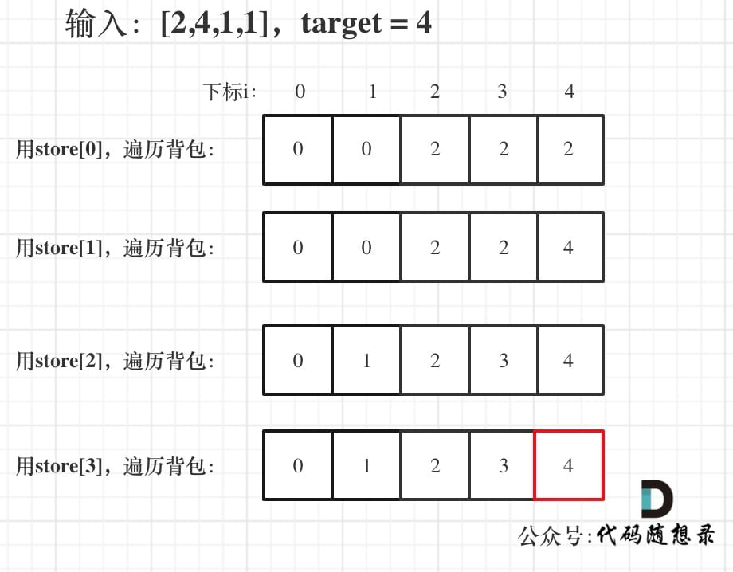

* [做專案（多個 C++、Java、Go、測開、前端專案）](https://www.programmercarl.com/other/kstar.html)
* [刷演算法（兩個月高強度學演算法）](https://www.programmercarl.com/xunlian/xunlianying.html)
* [背面試必考題（40 天挑戰高頻面試題）](https://www.programmercarl.com/xunlian/bagu.html)

# 1049.最後一塊石頭的重量 II

[LeetCode 題目連結](https://leetcode.com/problems/last-stone-weight-ii/)

題目難度：中等

有一堆石頭，每塊石頭的重量都是正整數（positive integer）。

每一回合，從中選出任意兩塊石頭，然後將它們一起粉碎。假設石頭的重量分別為 x 和 y，且 x <= y。那麼粉碎的可能結果如下：

如果 x == y，那麼兩塊石頭都會被完全粉碎；

如果 x != y，那麼重量為 x 的石頭將會完全粉碎，而重量為 y 的石頭新重量為 y-x。

最後，最多只會剩下一塊石頭。回傳此石頭最小的可能重量。如果沒有石頭剩下，就回傳 0。

範例：
* 輸入：[2,7,4,1,8,1]
* 輸出：1

解釋：
* 組合（combination） 2 和 4，得到 2，所以陣列（array）轉化為 [2,7,1,8,1]，
* 組合 7 和 8，得到 1，所以陣列轉化為 [2,1,1,1]，
* 組合 2 和 1，得到 1，所以陣列轉化為 [1,1,1]，
* 組合 1 和 1，得到 0，所以陣列轉化為 [1]，這就是最佳值。

提示：

* 1 <= stones.length <= 30
* 1 <= stones[i] <= 1000

## 演算法公開課

**[《程式碼隨想錄》演算法影片公開課](https://programmercarl.com/other/gongkaike.html)：[這個背包最多能裝多少？LeetCode：1049.最後一塊石頭的重量 II](https://www.bilibili.com/video/BV14M411C7oV/)，相信結合影片再看本篇題解，更有助於大家對本題的理解**。


## 解題思路

如果對背包問題（knapsack problem）不熟悉的話先看這兩篇：

* [0/1 背包問題（0/1 knapsack problem）理論基礎（二維（2D）陣列）](./背包理論基礎01背包-1.md)
* [0/1 背包問題理論基礎（一維陣列（one dimensional array））](./背包理論基礎01背包-2.md)

本題其實是盡量讓石頭分成重量相同的兩堆（盡可能相同），相撞之後剩下的石頭就是最小的。

一堆的石頭重量是 sum，那麼我們就盡可能拼成重量為 sum / 2 的石頭堆。這樣剩下的石頭堆也是盡可能接近 sum/2 的重量。
那麼此時問題就是有一堆石頭，每個石頭都有自己的重量，是否可以裝滿最大重量為 sum / 2 的背包。

看到這裡，大家是否感覺和昨天講解的 [416. 分割等和子集（subset）](./0416.分割等和子集.md)非常像了，簡直就是同一道題。

本題**這樣就化解成 0/1 背包問題了**。

**[416. 分割等和子集](./0416.分割等和子集.md) 是求背包是否正好裝滿，而本題是求背包最多能裝多少**。

物品就是石頭，物品的重量為 stones[i]，物品的價值也為 stones[i]。

接下來進行動規五部曲：

### 1. 確定 dp 陣列以及下標（subscript）的含義

**dp[j] 表示容量（這裡說容量更形象，其實就是重量）為 j 的背包，最多可以背最大重量為 dp[j]**。

相對於 0/1 背包，本題中，石頭的重量是 stones[i]，石頭的價值也是 stones[i]。

「最多可以裝的價值為 dp[j]」等同於「最多可以背的重量為 dp[j]」

### 2. 確定遞迴公式（recurrence formula）

0/1 背包的遞迴公式為：dp[j] = max(dp[j], dp[j - weight[i]] + value[i]);

本題則是：**dp[j] = max(dp[j], dp[j - stones[i]] + stones[i]);**

### 3. dp 陣列如何初始化（initialization）

既然 dp[j] 中的 j 表示容量，那麼最大容量（重量）是多少呢，就是所有石頭的重量和。

因為提示中給出 1 <= stones.length <= 30，1 <= stones[i] <= 1000，所以最大重量就是 30 * 1000。

而我們要求的 target 其實只是最大重量的一半，所以 dp 陣列開到 15000 大小就可以了。

當然也可以把石頭遍歷（traversal）一遍，計算出石頭總重量然後除 2，得到 dp 陣列的大小。

我這裡就直接用 15000 了。

接下來就是如何初始化 dp[j] 呢，因為重量都不會是負數（negative number），所以 dp[j] 都初始化為 0 就可以了，這樣在遞迴公式 dp[j] = max(dp[j], dp[j - stones[i]] + stones[i]); 中 dp[j] 才不會被初始值所覆蓋。

程式碼為：

```
vector<int> dp(15001, 0);
```

### 4. 確定遍歷順序


在[動態規劃（dynamic programming, DP）：關於 0/1 背包問題，你該了解這些！（rolling array）](./背包理論基礎01背包-2.md)中就已經說明：如果使用一維 dp 陣列，物品遍歷的 for 迴圈（for-loop）放在外層，遍歷背包的 for 迴圈放在內層，且內層 for 迴圈倒序遍歷！

程式碼如下：

```CPP
for (int i = 0; i < stones.size(); i++) { // 遍歷物品
    for (int j = target; j >= stones[i]; j--) { // 遍歷背包
        dp[j] = max(dp[j], dp[j - stones[i]] + stones[i]);
    }
}

```

### 5. 舉例推導 dp 陣列

舉例，輸入：[2,4,1,1]，此時 target = (2 + 4 + 1 + 1)/2 = 4，dp 陣列狀態圖如下：




最後 dp[target] 裡是容量為 target 的背包所能背的最大重量。

那麼分成兩堆石頭，一堆石頭的總重量是 dp[target]，另一堆就是 sum - dp[target]。

**在計算 target 的時候，target = sum / 2 因為是無條件捨去，所以 sum - dp[target] 一定是大於等於 dp[target] 的**。

那麼相撞之後剩下的最小石頭重量就是 (sum - dp[target]) - dp[target]。

以上分析完畢，C++ 程式碼如下：

```CPP
class Solution {
public:
    int lastStoneWeightII(vector<int>& stones) {
        vector<int> dp(15001, 0);
        int sum = 0;
        for (int i = 0; i < stones.size(); i++) sum += stones[i];
        int target = sum / 2;
        for (int i = 0; i < stones.size(); i++) { // 遍歷物品
            for (int j = target; j >= stones[i]; j--) { // 遍歷背包
                dp[j] = max(dp[j], dp[j - stones[i]] + stones[i]);
            }
        }
        return sum - dp[target] - dp[target];
    }
};

```

* 時間複雜度（time complexity）：O(m × n)，m 是石頭總重量（準確的說是總重量的一半），n 為石頭塊數
* 空間複雜度（space complexity）：O(m)

## 總結

本題其實和[416. 分割等和子集](./0416.分割等和子集.md)幾乎是一樣的，只是最後對 dp[target] 的處理方式不同。

**[416. 分割等和子集](./0416.分割等和子集.md)相當於是求背包是否正好裝滿，而本題是求背包最多能裝多少**。


## 其他語言版本


### Java：

一維陣列版本
```Java
class Solution {
    public int lastStoneWeightII(int[] stones) {
        int sum = 0;
        for (int i : stones) {
            sum += i;
        }
        int target = sum >> 1;
        // 初始化 dp 陣列
        int[] dp = new int[target + 1];
        for (int i = 0; i < stones.length; i++) {
            // 採用倒序
            for (int j = target; j >= stones[i]; j--) {
                // 兩種情況，要麼放，要麼不放
                dp[j] = Math.max(dp[j], dp[j - stones[i]] + stones[i]);
            }
        }
        return sum - 2 * dp[target];
    }
}
```
二維陣列版本（便於理解）
```Java
class Solution {
    public int lastStoneWeightII(int[] stones) {
        int sum = 0;
        for (int s : stones) {
            sum += s;
        }

        int target = sum / 2;
        // 初始化，dp[i][j] 為可以放 0-i 物品，背包容量為 j 的情況下背包中的最大價值
        int[][] dp = new int[stones.length][target + 1];
        // dp[i][0] 預設初始化為 0
        // dp[0][j] 取決於 stones[0]
        for (int j = stones[0]; j <= target; j++) {
            dp[0][j] = stones[0];
        }

        for (int i = 1; i < stones.length; i++) {
            for (int j = 1; j <= target; j++) {// 注意是等於
                if (j >= stones[i]) {
                    // 不放: dp[i - 1][j] 放: dp[i - 1][j - stones[i]] + stones[i]
                    dp[i][j] = Math.max(dp[i - 1][j], dp[i - 1][j - stones[i]] + stones[i]);
                } else {
                    dp[i][j] = dp[i - 1][j];
                }
            }
        }

        System.out.println(dp[stones.length - 1][target]);
        return (sum - dp[stones.length - 1][target]) - dp[stones.length - 1][target];
    }
}

```

### Python：
卡哥版
```python
class Solution:
    def lastStoneWeightII(self, stones: List[int]) -> int:
        dp = [0] * 15001
        total_sum = sum(stones)
        target = total_sum // 2

        for stone in stones:  # 遍歷物品
            for j in range(target, stone - 1, -1):  # 遍歷背包
                dp[j] = max(dp[j], dp[j - stone] + stone)

        return total_sum - dp[target] - dp[target]

```

卡哥版（簡化版）
```python
class Solution:
    def lastStoneWeightII(self, stones):
        total_sum = sum(stones)
        target = total_sum // 2
        dp = [0] * (target + 1)
        for stone in stones:
            for j in range(target, stone - 1, -1):
                dp[j] = max(dp[j], dp[j - stone] + stone)
        return total_sum - 2* dp[-1]


```
二維動態規劃（dynamic programming, DP）版
```python
class Solution:
    def lastStoneWeightII(self, stones: List[int]) -> int:
        total_sum = sum(stones)
        target = total_sum // 2
        
        # 建立二維 dp 陣列，列數為石頭的數量加 1，行數為 target 加 1
        # dp[i][j] 表示前 i 個石頭能否組成總重量為 j
        dp = [[False] * (target + 1) for _ in range(len(stones) + 1)]
        
        # 初始化第一行，表示總重量為 0 時，前 i 個石頭都能組成
        for i in range(len(stones) + 1):
            dp[i][0] = True
        
        for i in range(1, len(stones) + 1):
            for j in range(1, target + 1):
                # 如果當前石頭重量大於當前目標重量 j，則無法選擇該石頭
                if stones[i - 1] > j:
                    dp[i][j] = dp[i - 1][j]
                else:
                    # 可選擇該石頭或不選擇該石頭
                    dp[i][j] = dp[i - 1][j] or dp[i - 1][j - stones[i - 1]]
        
        # 找到最大的重量 i，使得 dp[len(stones)][i] 為 True
        # 回傳總重量減去兩倍的最接近總重量一半的重量
        for i in range(target, -1, -1):
            if dp[len(stones)][i]:
                return total_sum - 2 * i
        
        return 0


```
一維 DP 版
```python
class Solution:
    def lastStoneWeightII(self, stones):
        total_sum = sum(stones)
        target = total_sum // 2
        dp = [False] * (target + 1)
        dp[0] = True

        for stone in stones:
            for j in range(target, stone - 1, -1):
                # 判斷當前重量是否可以透過選擇之前的石頭得到或選擇當前石頭和之前的石頭得到
                dp[j] = dp[j] or dp[j - stone]

        for i in range(target, -1, -1):
            if dp[i]:
                # 回傳剩餘石頭的重量，即總重量減去兩倍的最接近總重量一半的重量
                return total_sum - 2 * i

        return 0


```
### Go：

一維 dp
```go
func lastStoneWeightII(stones []int) int {
	// 15001 = 30 * 1000 /2 +1
	dp := make([]int, 15001)
	// 求 target
	sum := 0
	for _, v := range stones {
		sum += v
	}
	target := sum / 2
	// 遍歷順序
	for i := 0; i < len(stones); i++ {
		for j := target; j >= stones[i]; j-- {
			// 推導公式
			dp[j] = max(dp[j], dp[j-stones[i]]+stones[i])
		}
	}
	return sum - 2 * dp[target]
}

func max(a, b int) int {
	if a > b {
		return a
	}
	return b
}
```

二維 dp
```go
func lastStoneWeightII(stones []int) int {
    sum := 0
    for _, val := range stones {
        sum += val
    }
    target := sum / 2
	
    dp := make([][]int, len(stones))
    for i := range dp {
        dp[i] = make([]int, target + 1)
    }
    for j := stones[0]; j <= target; j++ {
        dp[0][j] = stones[0]
    }
	
    for i := 1; i < len(stones); i++ {
        for j := 0; j <= target; j++ {
            if stones[i] > j {
                dp[i][j] = dp[i-1][j]
            } else {
                dp[i][j] = max(dp[i-1][j], dp[i-1][j-stones[i]] + stones[i])
            }
        }
    }
    return (sum - dp[len(stones)-1][target]) - dp[len(stones)-1][target]
}

func max(x, y int) int {
    if x > y {
        return x
    }
    return y
}
```

### JavaScript:

```javascript
/**
 * @param {number[]} stones
 * @return {number}
 */
var lastStoneWeightII = function (stones) {
    let sum = stones.reduce((s, n) => s + n);

    let dpLen = Math.floor(sum / 2);
    let dp = new Array(dpLen + 1).fill(0);

    for (let i = 0; i < stones.length; ++i) {
        for (let j = dpLen; j >= stones[i]; --j) {
            dp[j] = Math.max(dp[j], dp[j - stones[i]] + stones[i]);
        }
    }

    return sum - dp[dpLen] - dp[dpLen];
};
```

### C:
```c
#define MAX(a, b) (((a) > (b)) ? (a) : (b))

int getSum(int *stones, int stoneSize) {
    int sum = 0, i;
    for (i = 0; i < stoneSize; ++i)
        sum += stones[i];
    return sum;
}

int lastStoneWeightII(int* stones, int stonesSize){
    int sum = getSum(stones, stonesSize);
    int target = sum / 2;
    int i, j;

    // 初始化 dp 陣列
    int *dp = (int*)malloc(sizeof(int) * (target + 1));
    memset(dp, 0, sizeof(int) * (target + 1));
    for (j = stones[0]; j <= target; ++j)
        dp[j] = stones[0];
    
    // 遞迴公式：dp[j] = max(dp[j], dp[j - stones[i]] + stones[i])
    for (i = 1; i < stonesSize; ++i) {
        for (j = target; j >= stones[i]; --j)
            dp[j] = MAX(dp[j], dp[j - stones[i]] + stones[i]);
    }
    return sum - dp[target] - dp[target];
}
```

### TypeScript：

```ts
function lastStoneWeightII(stones: number[]): number {
    const sum: number = stones.reduce((a: number, b:number): number => a + b);
    const target: number = Math.floor(sum / 2);
    const n: number = stones.length;
    // dp[j] 表示容量（總數和）為 j 的背包所能裝下的數（下標 [0, i] 之間任意取）的總和（<= 容量）的最大值
    const dp: number[] = new Array(target + 1).fill(0);
    for (let i: number = 0; i < n; i++ ) {
        for (let j: number = target; j >= stones[i]; j--) {
            dp[j] = Math.max(dp[j], dp[j - stones[i]] + stones[i]);
        }
    }
    return sum - dp[target] - dp[target];
};
```

### Scala:

rolling array:
```scala
object Solution {
  def lastStoneWeightII(stones: Array[Int]): Int = {
    var sum = stones.sum
    var half = sum / 2
    var dp = new Array[Int](half + 1)

    // 遍歷
    for (i <- 0 until stones.length; j <- half to stones(i) by -1) {
      dp(j) = math.max(dp(j), dp(j - stones(i)) + stones(i))
    }

    sum - 2 * dp(half)
  }
}
```

二維陣列:
```scala
object Solution {
  def lastStoneWeightII(stones: Array[Int]): Int = {
    var sum = stones.sum
    var half = sum / 2
    var dp = Array.ofDim[Int](stones.length, half + 1)

    // 初始化
    for (j <- stones(0) to half) dp(0)(j) = stones(0)

    // 遍歷
    for (i <- 1 until stones.length; j <- 1 to half) {
      if (j - stones(i) >= 0) dp(i)(j) = stones(i) + dp(i - 1)(j - stones(i))
      dp(i)(j) = math.max(dp(i)(j), dp(i - 1)(j))
    }
    
    sum - 2 * dp(stones.length - 1)(half)
  }
}
```

### Rust:

```rust
impl Solution {
    pub fn last_stone_weight_ii(stones: Vec<i32>) -> i32 {
        let sum = stones.iter().sum::<i32>();
        let target = sum as usize / 2;
        let mut dp = vec![0; target + 1];
        for s in stones {
            for j in (s as usize..=target).rev() {
                dp[j] = dp[j].max(dp[j - s as usize] + s);
            }
        }
        sum - dp[target] * 2
    }
}
```
### C#
```csharp
public class Solution
{
    public int LastStoneWeightII(int[] stones)
    {
        int[] dp = new int[15001];
        int sum = 0;
        foreach (int stone in stones)
        {
            sum += stone;
        }
        int target = sum / 2;
        for (int i = 0; i < stones.Length; i++)
        {
            for (int j = target; j >= stones[i]; j--)
            {
                dp[j] = Math.Max(dp[j], dp[j - stones[i]] + stones[i]);
            }
        }
        return sum - 2 * dp[target];
    }
}
```


