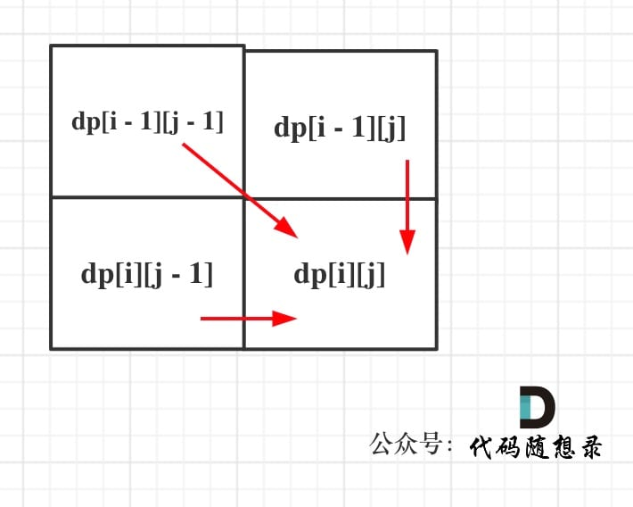
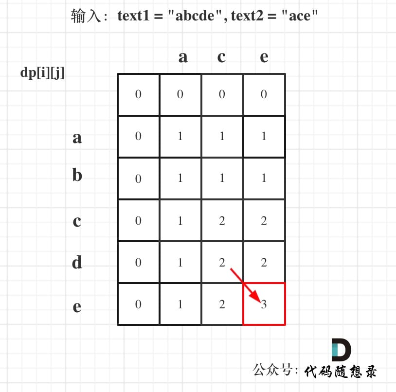

* [做專案（多個 C++、Java、Go、測開、前端專案）](https://www.programmercarl.com/other/kstar.html)
* [刷演算法（兩個月高強度學演算法）](https://www.programmercarl.com/xunlian/xunlianying.html)
* [背面試必考題（40 天挑戰高頻面試題）](https://www.programmercarl.com/xunlian/bagu.html)

# 1143.最長公用次序列（longest common subsequence）

[LeetCode 題目連結](https://leetcode.cn/problems/longest-common-subsequence/)

給定兩個字串（string） text1 和 text2，回傳這兩個字串的最長公用次序列的長度。

一個字串的 次序列（subsequence） 是指這樣一個新的字串：它是由原字串在不改變字元（character）的相對順序的情況下刪除某些字元（也可以不刪除任何字元）後組成的新字串。

例如，"ace" 是 "abcde" 的次序列，但 "aec" 不是 "abcde" 的次序列。兩個字串的「公用次序列」是這兩個字串所共同擁有的次序列。

若這兩個字串沒有公用次序列，則回傳 0。

範例 1:

* 輸入：text1 = "abcde", text2 = "ace"
* 輸出：3
* 解釋：最長公用次序列是 "ace"，它的長度為 3。

範例 2:
* 輸入：text1 = "abc", text2 = "abc"
* 輸出：3
* 解釋：最長公用次序列是 "abc"，它的長度為 3。

範例 3:
* 輸入：text1 = "abc", text2 = "def"
* 輸出：0
* 解釋：兩個字串沒有公用次序列，回傳 0。

提示:
* 1 <= text1.length <= 1000
* 1 <= text2.length <= 1000
輸入的字串只含有小寫英文字元。

## 演算法公開課

**[《程式碼隨想錄》演算法影片公開課](https://programmercarl.com/other/gongkaike.html)：[動態規劃（dynamic programming, DP）次序列問題經典題目 | LeetCode：1143.最長公用次序列](https://www.bilibili.com/video/BV1ye4y1L7CQ)，相信結合影片再看本篇題解，更有助於大家對本題的理解**。


## 解題思路

本題和[動態規劃：718. 最長重複（duplicate）子陣列（subarray）](https://programmercarl.com/0718.最长重复子数组.html)區別在於這裡不要求是連續的了，但要有相對順序，即："ace" 是 "abcde" 的次序列，但 "aec" 不是 "abcde" 的次序列。

繼續動規五部曲分析如下：

1. 確定 dp 陣列（array）（dp table）以及下標（subscript）的含義

dp[i][j]：長度為 [0, i - 1] 的字串 text1 與長度為 [0, j - 1] 的字串 text2 的最長公用次序列為 dp[i][j]

有同學會問：為什麼要定義長度為 [0, i - 1] 的字串 text1，定義為長度為 [0, i] 的字串 text1 不香嗎？

這樣定義是為了後面程式碼實作方便，如果非要定義為長度為 [0, i] 的字串 text1 也可以，我在 [動態規劃：718. 最長重複子陣列](https://programmercarl.com/0718.最长重复子数组.html) 中的「拓展」裡詳細講解了區別所在，其實就是簡化了 dp 陣列第一列和第一行的初始化（initialization）邏輯。

2. 確定遞迴公式（recurrence formula）

主要就是兩大情況：text1[i - 1] 與 text2[j - 1] 相同，text1[i - 1] 與 text2[j - 1] 不相同

如果 text1[i - 1] 與 text2[j - 1] 相同，那麼找到了一個公用元素（element），所以 dp[i][j] = dp[i - 1][j - 1] + 1;

如果 text1[i - 1] 與 text2[j - 1] 不相同，那就看看 text1[0, i - 2] 與 text2[0, j - 1] 的最長公用次序列和 text1[0, i - 1] 與 text2[0, j - 2] 的最長公用次序列，取最大的。

即：dp[i][j] = max(dp[i - 1][j], dp[i][j - 1]);

程式碼如下：

```CPP
if (text1[i - 1] == text2[j - 1]) {
    dp[i][j] = dp[i - 1][j - 1] + 1;
} else {
    dp[i][j] = max(dp[i - 1][j], dp[i][j - 1]);
}
```

3. dp 陣列如何初始化

先看看 dp[i][0] 應該是多少呢？

text1[0, i-1] 和空字串（empty string）的最長公用次序列自然是 0，所以 dp[i][0] = 0;

同理 dp[0][j] 也是 0。

其他下標都是隨著遞迴公式逐步覆蓋，初始為多少都可以，那麼就統一初始為 0。

程式碼：

```
vector<vector<int>> dp(text1.size() + 1, vector<int>(text2.size() + 1, 0));
```

4. 確定遍歷（traversal）順序

從遞迴公式，可以看出，有三個方向可以推出 dp[i][j]，如圖：



那麼為了在遞迴（recursion）的過程中，這三個方向都是經過計算的數值，所以要從前向後，從上到下來遍歷這個矩陣（matrix）。

5. 舉例推導 dp 陣列

以輸入：text1 = "abcde", text2 = "ace" 為例，dp 狀態如圖：




最後紅框 dp[text1.size()][text2.size()] 為最終結果

以上分析完畢，C++ 程式碼如下：

```CPP
class Solution {
public:
    int longestCommonSubsequence(string text1, string text2) {
        vector<vector<int>> dp(text1.size() + 1, vector<int>(text2.size() + 1, 0));
        for (int i = 1; i <= text1.size(); i++) {
            for (int j = 1; j <= text2.size(); j++) {
                if (text1[i - 1] == text2[j - 1]) {
                    dp[i][j] = dp[i - 1][j - 1] + 1;
                } else {
                    dp[i][j] = max(dp[i - 1][j], dp[i][j - 1]);
                }
            }
        }
        return dp[text1.size()][text2.size()];
    }
};
```
* 時間複雜度（time complexity）: O(n * m)，其中 n 和 m 分別為 text1 和 text2 的長度
* 空間複雜度（space complexity）: O(n * m)


## 其他語言版本

### Java：

```java
/*
	二維 dp 陣列
*/
class Solution {
    public int longestCommonSubsequence(String text1, String text2) {
        // char[] char1 = text1.toCharArray();
        // char[] char2 = text2.toCharArray();
	// 可以在一開始的時候就先把 text1, text2 轉成 char[]，之後就不需要有這麼多為了處理字串的調整
	// 就可以和卡哥的 code 更一致
 	
        int[][] dp = new int[text1.length() + 1][text2.length() + 1]; // 先對 dp 陣列做初始化操作
        for (int i = 1 ; i <= text1.length() ; i++) {
            char char1 = text1.charAt(i - 1);
            for (int j = 1; j <= text2.length(); j++) {
                char char2 = text2.charAt(j - 1);
                if (char1 == char2) { // 開始列出狀態變遷方程式
                    dp[i][j] = dp[i - 1][j - 1] + 1;
                } else {
                    dp[i][j] = Math.max(dp[i - 1][j], dp[i][j - 1]);
                }
            }
        }
        return dp[text1.length()][text2.length()];
    }
}


/**
	一維 dp 陣列
*/
class Solution {
    public int longestCommonSubsequence(String text1, String text2) {
        int n1 = text1.length();
        int n2 = text2.length();

        // 多從二維 dp 陣列過程分析  
        // 關鍵在於  如果記錄  dp[i - 1][j - 1]
        // 因為 dp[i - 1][j - 1]  <!=>  dp[j - 1]  <=>  dp[i][j - 1]
        int [] dp = new int[n2 + 1];

        for(int i = 1; i <= n1; i++){

            // 這裡 pre 相當於 dp[i - 1][j - 1]
            int pre = dp[0];
            for(int j = 1; j <= n2; j++){

                // 用於給 pre 賦值
                int cur = dp[j];
                if(text1.charAt(i - 1) == text2.charAt(j - 1)){
                    // 這裡 pre 相當於 dp[i - 1][j - 1]   千萬不能用 dp[j - 1] !!
                    dp[j] = pre + 1;
                } else{
                    // dp[j]     相當於   dp[i - 1][j]
                    // dp[j - 1] 相當於   dp[i][j - 1]
                    dp[j] = Math.max(dp[j], dp[j - 1]);
                }

                // 更新 dp[i - 1][j - 1], 為下次使用做準備
                pre = cur;
            }
        }

        return dp[n2];
    }
}
```

### Python：
2 維 動態規劃（dynamic programming, DP）

```python
class Solution:
    def longestCommonSubsequence(self, text1: str, text2: str) -> int:
        # 建立一個二維陣列 dp，用於儲存最長公用次序列的長度
        dp = [[0] * (len(text2) + 1) for _ in range(len(text1) + 1)]
        
        # 遍歷 text1 和 text2，填充 dp 陣列
        for i in range(1, len(text1) + 1):
            for j in range(1, len(text2) + 1):
                if text1[i - 1] == text2[j - 1]:
                    # 如果 text1[i-1] 和 text2[j-1] 相等，則當前位置的最長公用次序列長度為左上角位置的值加一
                    dp[i][j] = dp[i - 1][j - 1] + 1
                else:
                    # 如果 text1[i-1] 和 text2[j-1] 不相等，則當前位置的最長公用次序列長度為上方或左方的較大值
                    dp[i][j] = max(dp[i - 1][j], dp[i][j - 1])
        
        # 回傳最長公用次序列的長度
        return dp[len(text1)][len(text2)]

```
1 維 DP
```python
class Solution:
    def longestCommonSubsequence(self, text1: str, text2: str) -> int:
        m, n = len(text1), len(text2)
        dp = [0] * (n + 1)  # 初始化一維 動態規劃（dynamic programming, DP） 陣列
        
        for i in range(1, m + 1):
            prev = 0  # 儲存上一個位置的最長公用次序列長度
            for j in range(1, n + 1):
                curr = dp[j]  # 儲存當前位置的最長公用次序列長度
                if text1[i - 1] == text2[j - 1]:
                    # 如果當前字元相等，則最長公用次序列長度加一
                    dp[j] = prev + 1
                else:
                    # 如果當前字元不相等，則選擇保留前一個位置的最長公用次序列長度中的較大值
                    dp[j] = max(dp[j], dp[j - 1])
                prev = curr  # 更新上一個位置的最長公用次序列長度
        
        return dp[n]  # 回傳最後一個位置的最長公用次序列長度作為結果

```

### Go：

```Go
func longestCommonSubsequence(text1 string, text2 string) int {
	t1 := len(text1)
	t2 := len(text2)
	dp:=make([][]int,t1+1)
	for i:=range dp{
		dp[i]=make([]int,t2+1)
	}

	for i := 1; i <= t1; i++ {
		for j := 1; j <=t2; j++ {
			if text1[i-1]==text2[j-1]{
				dp[i][j]=dp[i-1][j-1]+1
			}else{
				dp[i][j]=max(dp[i-1][j],dp[i][j-1])
			}
		}
	}
	return dp[t1][t2]
}

func max(a,b int)int  {
	if a>b{
		return a
	}
	return b
}

```

### JavaScript：

```javascript
const longestCommonSubsequence = (text1, text2) => {
    let dp = Array.from(Array(text1.length+1), () => Array(text2.length+1).fill(0));

    for(let i = 1; i <= text1.length; i++) {
        for(let j = 1; j <= text2.length; j++) {
            if(text1[i-1] === text2[j-1]) {
                dp[i][j] = dp[i-1][j-1] +1;;
            } else {
                dp[i][j] = Math.max(dp[i-1][j], dp[i][j-1])
            }
        }
    }

    return dp[text1.length][text2.length];
};
```

### TypeScript:

```typescript
function longestCommonSubsequence(text1: string, text2: string): number {
    /**
        dp[i][j]: text1 中前 i-1 個和 text2 中前 j-1 個，最長公用次序列的長度
     */
    const length1: number = text1.length,
        length2: number = text2.length;
    const dp: number[][] = new Array(length1 + 1).fill(0)
        .map(_ => new Array(length2 + 1).fill(0));
    for (let i = 1; i <= length1; i++) {
        for (let j = 1; j <= length2; j++) {
            if (text1[i - 1] === text2[j - 1]) {
                dp[i][j] = dp[i - 1][j - 1] + 1;
            } else {
                dp[i][j] = Math.max(dp[i][j - 1], dp[i - 1][j]);
            }
        }
    }
    return dp[length1][length2];
};
```

### Rust

```rust
impl Solution {
    pub fn longest_common_subsequence(text1: String, text2: String) -> i32 {
        let mut dp = vec![vec![0; text2.len() + 1]; text1.len() + 1];
        for (i, c1) in text1.chars().enumerate() {
            for (j, c2) in text2.chars().enumerate() {
                if c1 == c2 {
                    dp[i + 1][j + 1] = dp[i][j] + 1;
                } else {
                    dp[i + 1][j + 1] = dp[i][j + 1].max(dp[i + 1][j]);
                }
            }
        }
        dp[text1.len()][text2.len()]
    }
}
```

一維：

```rust
impl Solution {
    pub fn longest_common_subsequence(text1: String, text2: String) -> i32 {
        let mut dp = vec![0; text2.len() + 1];
        for c1 in text1.chars() {
            // 初始化 prev
            let mut prev = 0;

            for (j, c2) in text2.chars().enumerate() {
                let temp = dp[j + 1];
                if c1 == c2 {
                    // 使用上一次的狀態，防止重複計算
                    dp[j + 1] = prev + 1;
                } else {
                    dp[j + 1] = dp[j + 1].max(dp[j]);
                }
                // 使用上一次的狀態更新 prev
                prev = temp;
            }
        }
        dp[text2.len()]
    }
}
```

### C:

```c
#define max(a, b) ((a) > (b) ? (a) : (b))

int longestCommonSubsequence(char* text1, char* text2) {
    int text1Len = strlen(text1);
    int text2Len = strlen(text2);
    int dp[text1Len + 1][text2Len + 1];
    memset(dp, 0, sizeof (dp));
    for (int i = 1; i <= text1Len; ++i) {
        for (int j = 1; j <= text2Len; ++j) {
            if(text1[i - 1] == text2[j - 1]){
                dp[i][j] = dp[i - 1][j - 1] + 1;
            } else{
                dp[i][j] = max(dp[i - 1][j], dp[i][j - 1]);
            }
        }
    }
    return dp[text1Len][text2Len];
}
```

### Cangjie

```cangjie
func longestCommonSubsequence(text1: String, text2: String): Int64 {
    let n = text1.size
    let m = text2.size
    let dp = Array(n + 1, {_ => Array(m + 1, repeat: 0)})
    for (i in 1..=n) {
        for (j in 1..=m) {
            if (text1[i - 1] == text2[j - 1]) {
                dp[i][j] = dp[i - 1][j - 1] + 1
            } else {
                dp[i][j] = max(dp[i - 1][j], dp[i][j - 1])
            }
        }
    }
    return dp[n][m]
}
```


