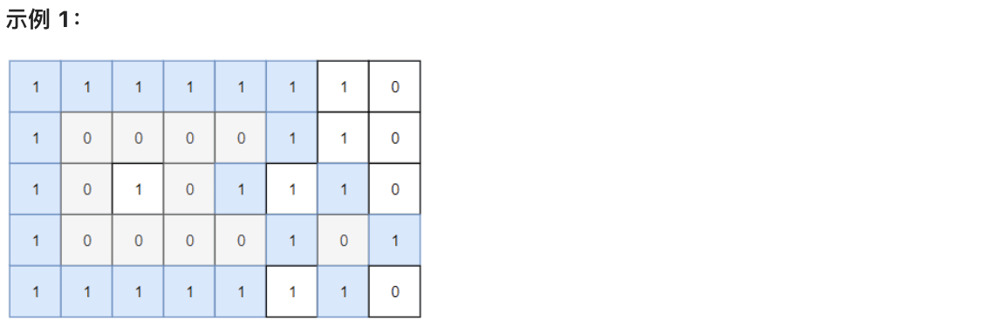
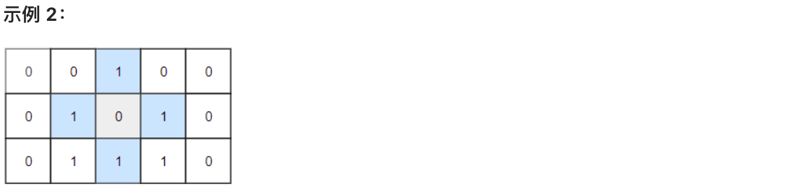

* [做專案（多個 C++、Java、Go、測開、前端專案）](https://www.programmercarl.com/other/kstar.html)
* [刷演算法（兩個月高強度學演算法）](https://www.programmercarl.com/xunlian/xunlianying.html)
* [背面試必考題（40 天挑戰高頻面試題）](https://www.programmercarl.com/xunlian/bagu.html)

# 1254. 統計封閉島嶼的數目

[LeetCode 題目連結](https://leetcode.com/problems/number-of-closed-islands/)

二維（two-dimensional）矩陣（matrix） grid 由 0（土地）和 1（水）組成。島是由最大的 4 個方向連通的 0 組成的群，封閉島是一個完全由 1 包圍（左、上、右、下）的島。

請回傳封閉島嶼的數目。



* 輸入：grid = [[1,1,1,1,1,1,1,0],[1,0,0,0,0,1,1,0],[1,0,1,0,1,1,1,0],[1,0,0,0,0,1,0,1],[1,1,1,1,1,1,1,0]]
* 輸出：2
* 解釋：灰色區域的島嶼是封閉島嶼，因為這座島嶼完全被水域包圍（即被 1 區域包圍）。



* 輸入：grid = [[0,0,1,0,0],[0,1,0,1,0],[0,1,1,1,0]]
* 輸出：1

提示：

* 1 <= grid.length, grid[0].length <= 100
* 0 <= grid[i][j] <=1

## 解題思路

和 [1020. 飛地的數量](https://leetcode.com/problems/number-of-enclaves/solution/by-carlsun-2-7lt9/) 思路是一樣的，程式碼也基本一樣

```CPP
class Solution {
private:
    int dir[4][2] = {-1, 0, 0, -1, 1, 0, 0, 1}; // 儲存四個方向
    void dfs(vector<vector<int>>& grid, int x, int y) {
        grid[x][y] = 1;
        for (int i = 0; i < 4; i++) { // 向四個方向遍歷
            int nextx = x + dir[i][0];
            int nexty = y + dir[i][1];
            // 超過邊界
            if (nextx < 0 || nextx >= grid.size() || nexty < 0 || nexty >= grid[0].size()) continue;
            // 不符合條件，不繼續遍歷
            if (grid[nextx][nexty] == 1) continue;

            dfs (grid, nextx, nexty);
        }
        return;
    }

public:
    int closedIsland(vector<vector<int>>& grid) {
        int n = grid.size(), m = grid[0].size();
        // 從左側邊，和右側邊 向中間遍歷
        for (int i = 0; i < n; i++) {
            if (grid[i][0] == 0) dfs(grid, i, 0);
            if (grid[i][m - 1] == 0) dfs(grid, i, m - 1);
        }
        // 從上邊和下邊 向中間遍歷
        for (int j = 0; j < m; j++) {
            if (grid[0][j] == 0) dfs(grid, 0, j);
            if (grid[n - 1][j] == 0) dfs(grid, n - 1, j);
        }
        int count = 0;
        for (int i = 0; i < n; i++) {
            for (int j = 0; j < m; j++) {
                if (grid[i][j] == 0) {
                    count++;
                    dfs(grid, i, j);
                }
            }
        }
        return count;
    }
};
``` 
## 其他語言版本

### JavaScript:

```js
/**
 * @param {number[][]} grid
 * @return {number}
 */
var closedIsland = function(grid) {
    let rows = grid.length;
    let cols = grid[0].length;
    // 儲存四個方向
    let dir = [[-1, 0], [0, -1], [1, 0], [0, 1]];
    // 深度優先
    function dfs(x, y) {
        grid[x][y] = 1;
        // 向四個方向遍歷
        for(let i = 0; i < 4; i++) {
            let nextX = x + dir[i][0];
            let nextY = y + dir[i][1];
            // 判斷是否越界
            if (nextX < 0 || nextX >= rows || nextY < 0 || nextY >= cols) continue;
            // 不符合條件
            if (grid[nextX][nextY] === 1) continue;
            // 繼續遞迴
            dfs(nextX, nextY);
        }
    }
    // 從邊界島嶼開始
    // 從左側和右側出發
    for(let i = 0; i < rows; i++) {
        if (grid[i][0] === 0) dfs(i, 0);
        if (grid[i][cols - 1] === 0) dfs(i, cols - 1);
    }
    // 從上側和下側出發
    for(let j = 0; j < cols; j++) {
        if (grid[0][j] === 0) dfs(0, j);
        if (grid[rows - 1][j] === 0) dfs(rows - 1, j);
    }
    let count = 0;
    // 排除所有與邊界相連的陸地之後
    // 依序遍歷網格中的每個元素，如果遇到一個元素是陸地且狀態是未存取，則遇到一個新的島嶼，將封閉島嶼的數目加 1
    // 並存取與當前陸地連接的所有陸地
    for(let i = 0; i < rows; i++) {
        for(let j = 0; j < cols; j++) {
            if (grid[i][j] === 0) {
                count++;
                dfs(i, j);
            }
        }
    }
    return count;
};
```


