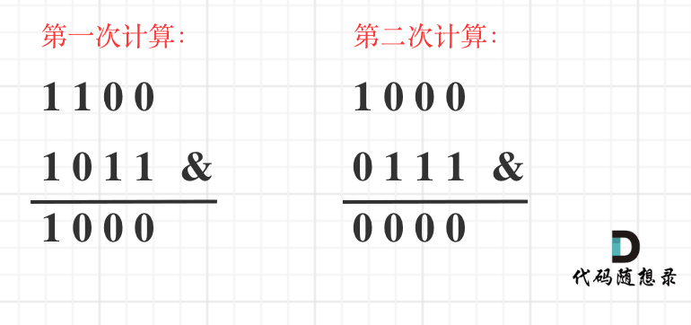

* [做專案（多個 C++、Java、Go、測開、前端專案）](https://www.programmercarl.com/other/kstar.html)
* [刷演算法（兩個月高強度學演算法）](https://www.programmercarl.com/xunlian/xunlianying.html)
* [背面試必考題（40 天挑戰高頻面試題）](https://www.programmercarl.com/xunlian/bagu.html)


# 1356. 根據數字二進制（binary）下 1 的數目排序（sorting）

[LeetCode 題目連結](https://leetcode.com/problems/sort-integers-by-the-number-of-1-bits/)

題目連結：https://leetcode.com/problems/sort-integers-by-the-number-of-1-bits/

給你一個整數（integer）陣列（array） arr。請你將陣列中的元素（element）按照其二進制表示中數字 1 的數目升序（ascending order）排序。

如果存在多個數字二進制中 1 的數目相同，則必須將它們按照數值大小升序排列。

請你回傳排序後的陣列。

範例 1：
* 輸入：arr = [0,1,2,3,4,5,6,7,8]
* 輸出：[0,1,2,4,8,3,5,6,7]
* 解釋：[0] 是唯一一個有 0 個 1 的數。
[1,2,4,8] 都有 1 個 1。
[3,5,6] 有 2 個 1。
[7] 有 3 個 1。按照 1 的個數排序得到的結果陣列為 [0,1,2,4,8,3,5,6,7]


範例 2：
* 輸入：arr = [1024,512,256,128,64,32,16,8,4,2,1]
* 輸出：[1,2,4,8,16,32,64,128,256,512,1024]
* 解釋：陣列中所有整數二進制下都只有 1 個 1，所以你需要按照數值大小將它們排序。

範例 3：
* 輸入：arr = [10000,10000]
* 輸出：[10000,10000]

範例 4：
* 輸入：arr = [2,3,5,7,11,13,17,19]
* 輸出：[2,3,5,17,7,11,13,19]

範例 5：
* 輸入：arr = [10,100,1000,10000]
* 輸出：[10,100,10000,1000]


## 解題思路

這道題其實是考察如何計算一個數的二進制中 1 的數量。

我提供兩種方法：

* 方法一：

樸實無華挨個計算 1 的數量，最多就是迴圈（loop） n 的二進制位數，32 位元。

```C++
int bitCount(int n) {
    int count = 0; // 計數器
    while (n > 0) {
        if((n & 1) == 1)  count++;  // 當前位元是 1，count++
        n >>= 1 ; // n 向右移位
    }
    return count;
}
```

* 方法二

這種方法，只迴圈 n 的二進制中 1 的個數次，比方法一高效得多

```C++
int bitCount(int n) {
    int count = 0;
    while (n) {
        n &= (n - 1); // 清除最低位的 1
        count++;
    }
    return count;
}
```
以計算 12 的二進制 1 的數量為例，如圖所示：

 </img></div>

下面我就使用方法二，來做這道題目：


```C++
class Solution {
private:
    static int bitCount(int n) { // 計算 n 的二進制中 1 的數量
        int count = 0;
        while(n) {
            n &= (n -1); // 清除最低位的 1
            count++;
        }
        return count;
    }
    static bool cmp(int a, int b) {
        int bitA = bitCount(a);
        int bitB = bitCount(b);
        if (bitA == bitB) return a < b; // 如果 bit 中 1 數量相同，比較數值大小
        return bitA < bitB; // 否則比較 bit 中 1 數量大小
    }
public:
    vector<int> sortByBits(vector<int>& arr) {
        sort(arr.begin(), arr.end(), cmp);
        return arr;
    }
};
```


## 其他語言版本

### Java

```java
class Solution {
    private int cntInt(int val){
        int count = 0;
        while(val > 0) {
            val = val & (val - 1);
            count ++;
        }

        return count;
    }

    public int[] sortByBits(int[] arr) {
      return Arrays.stream(arr).boxed()
            .sorted(new Comparator<Integer>(){
                @Override
                public int compare(Integer o1, Integer o2) {
                    int cnt1 = cntInt(o1);
                    int cnt2 = cntInt(o2);
                    return (cnt1 == cnt2) ? Integer.compare(o1, o2) : Integer.compare(cnt1, cnt2);
                }
            })
            .mapToInt(Integer::intValue)
            .toArray();
    }
}
```


### Python

```python
class Solution:
    def sortByBits(self, arr: List[int]) -> List[int]:
        arr.sort(key=lambda num: (self.count_bits(num), num))
        return arr

    def count_bits(self, num: int) -> int:
        count = 0
        while num:
            num &= num - 1
            count += 1
        return count
```

### Go

```go
func sortByBits(arr []int) []int {
    // 是否 arr[i] <= arr[j]
    // 先比較 1 的數量，後比較值本身
    cmp := func(i, j int) bool {
        c1, c2 := bitCount(arr[i]), bitCount(arr[j])
        if c1 == c2 {
            return arr[i] <= arr[j]
        }
        return c1 <= c2
    }

    // 呼叫程式館函數
    // 第一個參數是待排序切片，第二個是第 i 位是否小於第 j 位的函數
    sort.Slice(arr, cmp)

    return arr
}

func bitCount(num int) (count int) {
    for num != 0 {
        num &= num-1    // 每次運算將最右側的 1 變成 0
        count++
    }

    return count
}
```

### JavaScript

```js
var sortByBits = function(arr) {
    const bitCount = n =>{// 計算 n 的二進制中 1 的數量
        let count = 0;
        while(n){
            n &= (n - 1);// 清除最低位的 1
            count++;
        }
        return count;
    }
    // 如果有差，則按 bits 數排，如果無差，則按原值排
    return arr.sort((a,b) => bitCount(a) - bitCount(b) || a - b);
};
```


