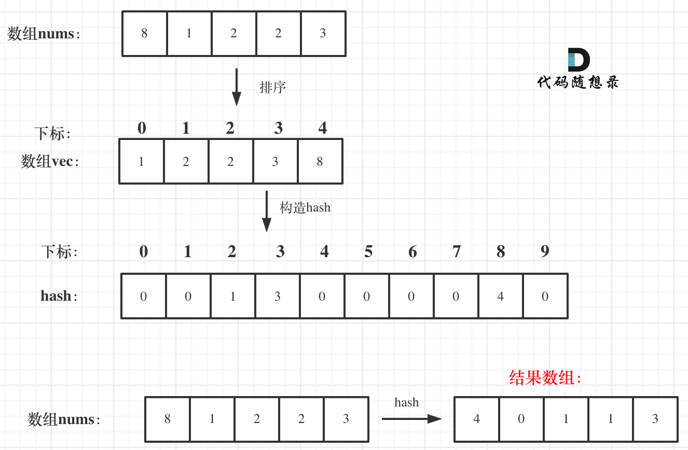

* [做專案（多個 C++、Java、Go、測開、前端專案）](https://www.programmercarl.com/other/kstar.html)
* [刷演算法（兩個月高強度學演算法）](https://www.programmercarl.com/xunlian/xunlianying.html)
* [背八股（40 天挑戰高頻面試題）](https://www.programmercarl.com/xunlian/bagu.html)


# 1365.有多少小於目前數字的數字

[LeetCode 題目連結](https://leetcode.com/problems/how-many-numbers-are-smaller-than-the-current-number/)

給你一個陣列（array） nums，對於其中每個元素（element） nums[i]，請你統計陣列中比它小的所有數字的數目。

換而言之，對於每個 nums[i] 你必須計算出有效的 j 的數量，其中 j 滿足 j != i 且 nums[j] < nums[i] 。

以陣列形式回傳答案。


範例 1：
* 輸入：nums = [8,1,2,2,3]     
* 輸出：[4,0,1,1,3] 
* 解釋：
對於 nums[0]=8 存在四個比它小的數字：（1，2，2 和 3）。        
對於 nums[1]=1 不存在比它小的數字。        
對於 nums[2]=2 存在一個比它小的數字：（1）。       
對於 nums[3]=2 存在一個比它小的數字：（1）。       
對於 nums[4]=3 存在三個比它小的數字：（1，2 和 2）。      

範例 2：
* 輸入：nums = [6,5,4,8]
* 輸出：[2,1,0,3]

範例 3：
* 輸入：nums = [7,7,7,7]
* 輸出：[0,0,0,0]

提示：
* 2 <= nums.length <= 500
* 0 <= nums[i] <= 100

## 解題思路

兩層 for 迴圈（for-loop）蠻力（brute force）搜尋，時間複雜度（time complexity）明顯為$O(n^2)$。

那麼我們來看一下如何最佳化。

首先要找小於目前數字的數字，那麼從小到大排序（sorting）之後，該數字之前的數字就都是比它小的了。

所以可以定義一個新陣列，將陣列排個序。

**排序之後，其實每一個數值的下標（subscript）就代表這前面有幾個比它小的了**。

程式碼如下：

```
vector<int> vec = nums;
sort(vec.begin(), vec.end()); // 從小到大排序之後，元素下標就是小於目前數字的數字
```

用一個雜湊表（hash table）hash（本題可以就用一個陣列）來做數值和下標的映射（mapping）。這樣就可以透過數值快速知道下標（也就是前面有幾個比它小的）。

此時有一個情況，就是數值相同怎麼辦？

例如，陣列：1 2 3 4 4 4 ，第一個數值 4 的下標是 3，第二個數值 4 的下標是 4 了。

這裡就需要一個技巧了，**在建構陣列 hash 的時候，從後向前遍歷（traversal），這樣 hash 裡存放的就是相同元素最左邊的數值和下標了**。
程式碼如下：

```CPP
int hash[101];
for (int i = vec.size() - 1; i >= 0; i--) { // 從後向前，記錄 vec[i] 對應的下標
    hash[vec[i]] = i;
}
```

最後再遍歷原陣列 nums，用 hash 快速找到每一個數值 對應的 小於這個數值的個數。將結果存放在另一個陣列中。

程式碼如下：

```CPP
// 此時 hash 裡保存的每一個元素數值 對應的 小於這個數值的個數
for (int i = 0; i < nums.size(); i++) {
    vec[i] = hash[nums[i]];
}
```

流程如圖：

 </img></div>

關鍵地方講完了，整體 C++ 程式碼如下：

```CPP
class Solution {
public:
    vector<int> smallerNumbersThanCurrent(vector<int>& nums) {
        vector<int> vec = nums;
        sort(vec.begin(), vec.end()); // 從小到大排序之後，元素下標就是小於目前數字的數字
        int hash[101];
        for (int i = vec.size() - 1; i >= 0; i--) { // 從後向前，記錄 vec[i] 對應的下標
            hash[vec[i]] = i;
        }
        // 此時 hash 裡保存的每一個元素數值 對應的 小於這個數值的個數
        for (int i = 0; i < nums.size(); i++) {
            vec[i] = hash[nums[i]];
        }
        return vec;
    }
};
```

可以排序之後加雜湊（hash），時間複雜度為$O(n\log n)$


## 其他語言版本

### Java：

```Java 
public int[] smallerNumbersThanCurrent(int[] nums) {
        Map<Integer, Integer> map = new HashMap<>(); // 記錄數字 nums[i] 有多少個比它小的數字
        int[] res = Arrays.copyOf(nums, nums.length);
        Arrays.sort(res);
        for (int i = 0; i < res.length; i++) {
            if (!map.containsKey(res[i])) { // 遇到了相同的數字，那麼不需要更新該 number 的情況
                map.put(res[i], i);
            }
        }

        for (int i = 0; i < nums.length; i++) {
            res[i] = map.get(nums[i]);
        }

        return res;
    }
```

### Python：

> 蠻力法（brute force method）：

```python3
class Solution:
    def smallerNumbersThanCurrent(self, nums: List[int]) -> List[int]:
        res = [0 for _ in range(len(nums))]
        for i in range(len(nums)):
            cnt = 0
            for j in range(len(nums)):
                if j == i:
                    continue
                if nums[i] > nums[j]:
                    cnt += 1
            res[i] = cnt
        return res
```

> 排序+hash：

```python3
class Solution:
    # 方法一：使用字典
    def smallerNumbersThanCurrent(self, nums: List[int]) -> List[int]:
        res = nums[:]
        hash_dict = dict()
        res.sort() # 從小到大排序之後，元素下標就是小於目前數字的數字
        for i, num in enumerate(res):
            if num  not in hash_dict.keys(): # 遇到了相同的數字，那麼不需要更新該 number 的情況
                hash_dict[num] = i       
        for i, num in enumerate(nums):
            res[i] = hash_dict[num]
        return res

    # 方法二：使用陣列
    def smallerNumbersThanCurrent(self, nums: List[int]) -> List[int]:
        # 同步進行排序和建立新陣列的操作，這樣可以減少一次冗餘的陣列複製操作，以減少一次 O(n) 的複製時間開銷
        sort_nums = sorted(nums)
        # 題意中 0 <= nums[i] <= 100，故 range 的參數設為 101
        hash_lst = [0 for _ in range(101)]
        # 從後向前遍歷，這樣 hash 裡存放的就是相同元素最左邊的數值和下標了
        for i in range(len(sort_nums)-1,-1,-1):
            hash_lst[sort_nums[i]] = i
        for i in range(len(nums)):
            nums[i] = hash_lst[nums[i]]
        return nums
```

### Go：

```go
func smallerNumbersThanCurrent(nums []int) []int {
    // map，key[陣列中出現的數] value[比這個數小的個數]
    m := make(map[int]int)
    // 複製一份原始陣列
    rawNums := make([]int,len(nums)) 
    copy(rawNums,nums)
    // 將陣列排序
    sort.Ints(nums)
    // 迴圈遍歷排序後的陣列，值為 map 的 key，索引為 value
    for i,v := range nums {
        _,contains := m[v]
        if !contains {
          m[v] = i
        } 
          
    }
    // 轉回值結果
    result := make([]int,len(nums))
    // 根據原始陣列的位置，存放對應的比它小的數
    for i,v := range rawNums {
        result[i] = m[v]
    }

    return result
}
```

### JavaScript：

```javascript
// 方法一：使用雜湊表記錄位置
var smallerNumbersThanCurrent = function(nums) {
    const map = new Map();// 記錄數字 nums[i] 有多少個比它小的數字
    const res = nums.slice(0);//深複製 nums
    res.sort((a,b) => a - b);
    for(let i = 0; i < res.length; i++){
        if(!map.has(res[i])){// 遇到了相同的數字，那麼不需要更新該 number 的情況
            map.set(res[i],i);
        }
    }
    // 此時 map 裡保存的每一個元素數值 對應的 小於這個數值的個數
    for(let i = 0; i < nums.length; i++){
        res[i] = map.get(nums[i]);
    }
    return res;
};

// 方法二：不使用雜湊表，只使用一個額外陣列
/**
 * @param {number[]} nums
 * @return {number[]}
 */
var smallerNumbersThanCurrent = function(nums) {
    let array = [...nums];   // 深複製
    // 升序排列，此時陣列元素下標即是比它小的元素的個數
    array = array.sort((a, b) => a-b);
    let res = [];
    nums.forEach( x => {
        // 即使元素重複也不怕，indexOf 只回傳找到的第一個元素的下標
        res.push(array.indexOf(x));
    })
    return res;
};
```

### TypeScript：

> 蠻力法：

```typescript
function smallerNumbersThanCurrent(nums: number[]): number[] {
    const length: number = nums.length;
    const resArr: number[] = [];
    for (let i = 0; i < length; i++) {
        let count: number = 0;
        for (let j = 0; j < length; j++) {
            if (nums[j] < nums[i]) {
                count++;
            }
        }
        resArr[i] = count;
    }
    return resArr;
};
```

> 排序+hash：

```typescript
function smallerNumbersThanCurrent(nums: number[]): number[] {
    const length: number = nums.length;
    const sortedArr: number[] = [...nums];
    sortedArr.sort((a, b) => a - b);
    const hashMap: Map<number, number> = new Map();
    for (let i = length - 1; i >= 0; i--) {
        hashMap.set(sortedArr[i], i);
    }
    const resArr: number[] = [];
    for (let i = 0; i < length; i++) {
        resArr[i] = hashMap.get(nums[i]);
    }
    return resArr;
};
```

### Rust：
```rust
use std::collections::HashMap;
impl Solution {
    pub fn smaller_numbers_than_current(nums: Vec<i32>) -> Vec<i32> {
        let mut v = nums.clone();
        v.sort();
        let mut hash = HashMap::new();
        for i in 0..v.len() {
            // rust 中使用 or_insert 插入值，如果存在就不插入，可以使用正序遍歷
            hash.entry(v[i]).or_insert(i as i32);
        }
        nums.into_iter().map(|x| *hash.get(&x).unwrap()).collect()
    }
}
```


