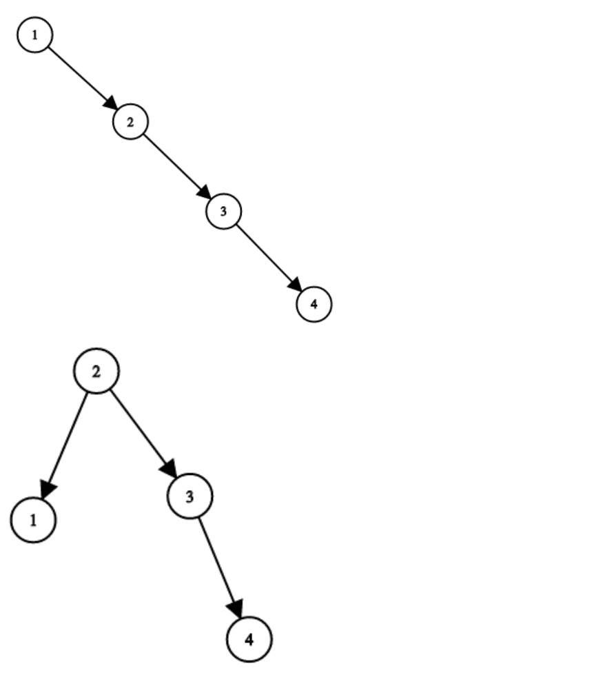

* [做專案（多個 C++、Java、Go、測開、前端專案）](https://www.programmercarl.com/other/kstar.html)
* [刷演算法（兩個月高強度學演算法）](https://www.programmercarl.com/xunlian/xunlianying.html)
* [背八股（40 天挑戰高頻面試題）](https://www.programmercarl.com/xunlian/bagu.html)


# 1382.將二元搜尋樹變平衡

[LeetCode 題目連結](https://leetcode.cn/problems/balance-a-binary-search-tree/)

給你一棵二元搜尋樹（binary search tree, BST），請你回傳一棵 平衡後 的BST，新生成的樹應該與原來的樹有著相同的節點（node）值。

如果一棵BST中，每個節點的兩棵子樹（subtree）高度（height）差不超過 1 ，我們就稱這棵BST是 平衡的 。

如果有多種建構方法，請你回傳任意一種。

範例：

 

* 輸入：root = [1,null,2,null,3,null,4,null,null]
* 輸出：[2,1,3,null,null,null,4]
* 解釋：這不是唯一的正確答案，[3,1,4,null,2,null,null] 也是一個可行的建構方案。

提示：

* 樹節點的數目在 1 到 10^4 之間。
* 樹節點的值互不相同，且在 1 到 10^5 之間。

## 解題思路

這道題目，可以中序橫過（inorder traversal）把二元樹（binary tree）轉變為有序陣列（ordered array），然後再根據有序陣列建構平衡BST。

建議做這道題之前，先看如下兩篇題解：
* [98.驗證二元搜尋樹](https://programmercarl.com/0098.验证二叉搜索树.html) 學習BST的特性
* [108.將有序陣列轉換為二元搜尋樹](https://programmercarl.com/0108.将有序数组转换为二叉搜索树.html) 學習如何透過有序陣列建構BST

這兩道題目做過之後，本題分分鐘就可以做出來了。

程式碼如下：

```CPP
class Solution {
private:
    vector<int> vec;
    // 有序樹轉成有序陣列
    void traversal(TreeNode* cur) {
        if (cur == nullptr) {
            return;
        }
        traversal(cur->left);
        vec.push_back(cur->val);
        traversal(cur->right);
    }
    // 有序陣列轉平衡二元樹
    TreeNode* getTree(vector<int>& nums, int left, int right) {
        if (left > right) return nullptr;
        int mid = left + ((right - left) / 2);
        TreeNode* root = new TreeNode(nums[mid]);
        root->left = getTree(nums, left, mid - 1);
        root->right = getTree(nums, mid + 1, right);
        return root;
    }

public:
    TreeNode* balanceBST(TreeNode* root) {
        traversal(root);
        return getTree(vec, 0, vec.size() - 1);
    }
};
```

## 其他語言版本

### Java：

```java
class Solution {
    ArrayList <Integer> res = new ArrayList<Integer>();
    // 有序樹轉成有序陣列
    private void travesal(TreeNode cur) {
            if (cur == null) return;
            travesal(cur.left);
            res.add(cur.val);
            travesal(cur.right);
        }
    // 有序陣列轉平衡二元樹
    private TreeNode getTree(ArrayList <Integer> nums, int left, int right) {
        if (left > right) return null;
        int mid = left + (right - left) / 2;
        TreeNode root = new TreeNode(nums.get(mid));
        root.left = getTree(nums, left, mid - 1);
        root.right = getTree(nums, mid + 1, right);
        return root;
    }
    public TreeNode balanceBST(TreeNode root) {
        travesal(root);
        return getTree(res, 0, res.size() - 1);
    }
}
```
### Python：

```python
class Solution:
    def balanceBST(self, root: TreeNode) -> TreeNode:
        res = []
        # 有序樹轉成有序陣列
        def traversal(cur: TreeNode):
            if not cur: return
            traversal(cur.left)
            res.append(cur.val)
            traversal(cur.right)
        # 有序陣列轉平衡二元樹
        def getTree(nums: List, left, right):
            if left > right: return 
            mid = left + (right -left) // 2
            root = TreeNode(nums[mid])
            root.left = getTree(nums, left, mid - 1)
            root.right = getTree(nums, mid + 1, right)
            return root
        traversal(root)
        return getTree(res, 0, len(res) - 1)
```
### Go：

```go
/**
 * Definition for a binary tree node.
 * type TreeNode struct {
 *     Val int
 *     Left *TreeNode
 *     Right *TreeNode
 * }
 */
func balanceBST(root *TreeNode) *TreeNode {
   // 二元搜尋樹中序橫過得到有序陣列
	nums := []int{}
   // 中序遞迴遍歷二元樹
	var travel func(node *TreeNode)
	travel = func(node *TreeNode) {
		if node == nil {
			return
		}
		travel(node.Left)
		nums = append(nums, node.Val)
		travel(node.Right)
	}
	// 二分法保證左右子樹高度差不超過一（題目要求回傳的仍是二元搜尋樹）
	var buildTree func(nums []int, left, right int) *TreeNode
	buildTree = func(nums []int, left, right int) *TreeNode {
		if left > right {
			return nil
		}
		mid := left + (right-left) >> 1
		root := &TreeNode{Val: nums[mid]}
		root.Left = buildTree(nums, left, mid-1)
		root.Right = buildTree(nums, mid+1, right)
		return root
	}
	travel(root)
	return buildTree(nums, 0, len(nums)-1)
}

```

### JavaScript：

```javascript
var balanceBST = function(root) {
    const res = [];
    // 中序橫過轉成有序陣列
    const travesal = cur => {
        if(!cur) return;
        travesal(cur.left);
        res.push(cur.val);
        travesal(cur.right);
    }
    // 有序陣列轉平衡二元樹
    const getTree = (nums, left, right) => {
        if(left > right) return null;
        let mid = left + ((right - left) >> 1);
        let root = new TreeNode(nums[mid]);// 中心位置作為目前節點的值
        root.left = getTree(nums, left, mid - 1);// 遞迴地將區間[left,mid−1] 作為目前節點的左子樹
        root.right = getTree(nums, mid + 1, right);// 遞迴地將區間[mid+1,right] 作為目前節點的右子樹
        return root;
    }
    travesal(root);
    return getTree(res, 0, res.length - 1);
};
```

### TypeScript：

```typescript
function balanceBST(root: TreeNode | null): TreeNode | null {
    const inorderArr: number[] = [];
    inorderTraverse(root, inorderArr);
    return buildTree(inorderArr, 0, inorderArr.length - 1);
};
function inorderTraverse(node: TreeNode | null, arr: number[]): void {
    if (node === null) return;
    inorderTraverse(node.left, arr);
    arr.push(node.val);
    inorderTraverse(node.right, arr);
}
function buildTree(arr: number[], left: number, right: number): TreeNode | null {
    if (left > right) return null;
    const mid = (left + right) >> 1;
    const resNode: TreeNode = new TreeNode(arr[mid]);
    resNode.left = buildTree(arr, left, mid - 1);
    resNode.right = buildTree(arr, mid + 1, right);
    return resNode;
}
```


