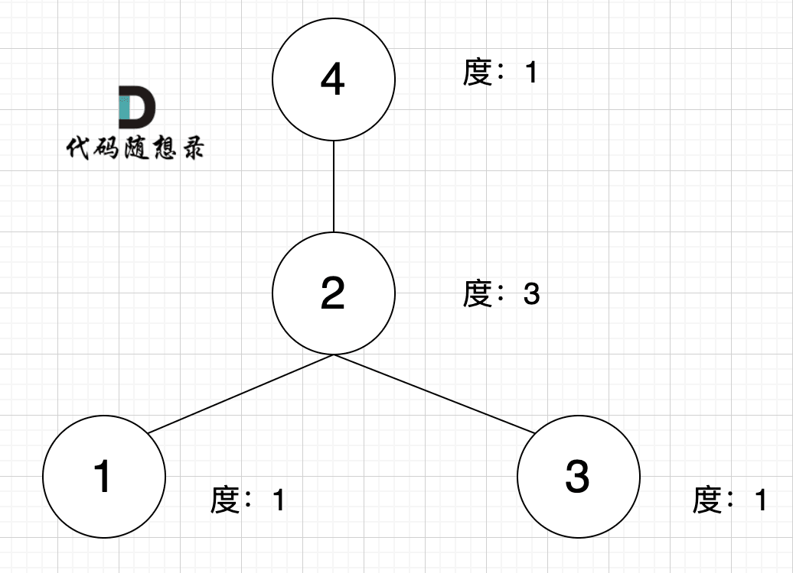

* [做專案（多個 C++、Java、Go、測開、前端專案）](https://www.programmercarl.com/other/kstar.html)
* [刷演算法（兩個月高強度學演算法）](https://www.programmercarl.com/xunlian/xunlianying.html)
* [背八股（40 天挑戰高頻面試題）](https://www.programmercarl.com/xunlian/bagu.html)

# 1791.找出星狀圖的中心節點 

[題目連結](https://leetcode.com/problems/find-center-of-star-graph/)

本題解題思路就是統計各個節點（node）的度（degree）（這裡沒有區別輸入度（in degree）和外度數（out degree）），如果某個節點的度等於這個圖（graph）邊（edge）的數量。 那麼這個節點一定是中心節點。 

什麼是度，可以理解為，連接節點的邊的數量。 題目中度如圖所示： 

 

至於外度數和輸入度，那就是在有向圖（directed graph）裡的概念了，本題是無向圖（undirected graph）。

本題程式碼如下： 

```c++ 

class Solution {
public:
    int findCenter(vector<vector<int>>& edges) {
        unordered_map<int ,int> du;
        for (int i = 0; i < edges.size(); i++) { // 統計各個節點的度    
                du[edges[i][1]]++;
                du[edges[i][0]]++;
        }
        unordered_map<int, int>::iterator iter;  // 找出度等於邊數量的節點
        for (iter = du.begin(); iter != du.end(); iter++) { 
            if (iter->second == edges.size()) return iter->first;
        }
        return -1;
    }
};
```

其實可以只記錄度不用最後統計，因為題目說了一定是星狀圖，所以 一旦有 節點的度 大於 1，就回傳該節點數值就行，只有中心節點的度會大於 1。 

程式碼如下：

```c++ 
class Solution {
public:
    int findCenter(vector<vector<int>>& edges) {
        vector<int> du(edges.size() + 2);  // edges.size() + 1 為節點數量，下標表示節點數，所以+2 
        for (int i = 0; i < edges.size(); i++) {
            du[edges[i][1]]++;
            du[edges[i][0]]++;
            if (du[edges[i][1]] > 1) return edges[i][1];
            if (du[edges[i][0]] > 1) return edges[i][0];

        }
        return -1;
    }
};
```

以上程式碼中沒有使用 unordered_map，因為遍歷（traversal）的時候，開闢新空間會浪費時間，而採用 vector，這是 空間換時間的一種策略。 

程式碼其實可以再精簡： 

```c++ 
class Solution {
public:
    int findCenter(vector<vector<int>>& edges) {
        vector<int> du(edges.size() + 2);
        for (int i = 0; i < edges.size(); i++) {
            if (++du[edges[i][1]] > 1) return edges[i][1];
            if (++du[edges[i][0]] > 1) return edges[i][0];
        }
        return -1;
    }
};
```


