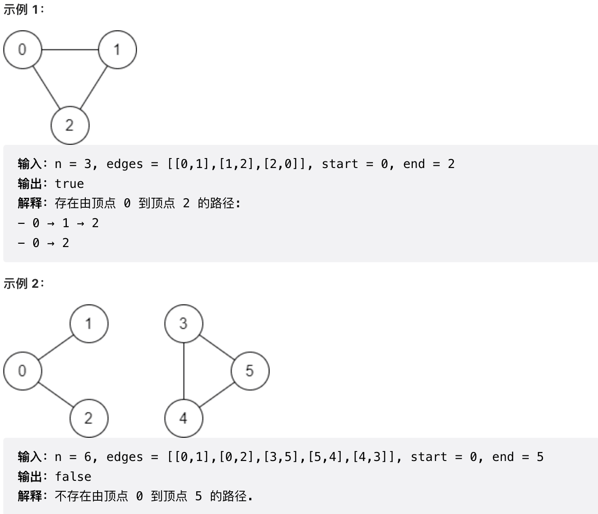

* [做專案（多個 C++、Java、Go、測開、前端專案）](https://www.programmercarl.com/other/kstar.html)
* [刷演算法（兩個月高強度學演算法）](https://www.programmercarl.com/xunlian/xunlianying.html)
* [背八股（40 天挑戰高頻面試題）](https://www.programmercarl.com/xunlian/bagu.html)

# 1971. 尋找圖中是否存在路徑

[題目連結](https://leetcode.cn/problems/find-if-path-exists-in-graph/)

有一個具有 n 個頂點（vertex）的 雙向 圖（graph），其中每個頂點標記從 0 到 n - 1（包含 0 和 n - 1）。圖中的邊（edge）用一個二維（2D）整數（integer）陣列（array） edges 表示，其中 edges[i] = [ui, vi] 表示頂點 ui 和頂點 vi 之間的雙向邊。 每個頂點對由 最多一條 邊連接，並且沒有頂點存在與自身相連的邊。

請你確定是否存在從頂點 start 開始，到頂點 end 結束的 有效路徑（path） 。

給你陣列 edges 和整數 n、start 和 end，如果從 start 到 end 存在 有效路徑 ，則回傳 true，否則回傳 false 。




## 解題思路

本題是互斥集（disjoint set）基礎題目。 如果還不了解互斥集，可以看這裡：[並查集理論基礎](https://programmercarl.com/图论并查集理论基础.html)

互斥集可以解決什麼問題呢？

主要就是集合（set）問題，兩個節點（node）在不在一個集合，也可以將兩個節點新增到一個集合中。

這裡整理出我的互斥集模板（template）如下：

```CPP
int n = 1005; // n 根據題目中節點數量而定，一般比節點數量大一點就好
vector<int> father = vector<int> (n, 0); // C++ 裡的一種陣列結構

// 互斥集初始化
void init() {
    for (int i = 0; i < n; ++i) {
        father[i] = i;
    }
}
// 互斥集裡尋根的過程，這裡遞迴呼叫當題目資料過多，遞迴呼叫可能會發生堆疊溢出

int find(int u) {
    return u == father[u] ? u : father[u] = find(father[u]); // 路徑壓縮
}

// 使用疊代的方法可以避免堆疊溢出問題
int find(int x) {
  while (x != parent[x]) {
	// 路徑壓縮，直接將 x 連接到其上代節點，減少樹的高度
	parent[x] = parent[parent[x]];
	x = parent[x];
	}
return x;
}

// 判斷 u 和 v 是否找到同一個根
bool isSame(int u, int v) {
    u = find(u);
    v = find(v);
    return u == v;
}

// 將 v->u 這條邊加入互斥集
void join(int u, int v) {
    u = find(u); // 尋找 u 的根
    v = find(v); // 尋找 v 的根
    if (u == v) return ; // 如果發現根相同，則說明在一個集合，不用兩個節點相連直接回傳
    father[v] = u;
}
```

以上模板中，只要修改 n 大小就可以，本題 n 不會超過 2 \* 10^5。

互斥集主要有三個功能。

1. 尋找根節點（root node），函數（function）：find(int u)，也就是判斷這個節點的上代節點（ancestor node）是哪個
2. 將兩個節點串接到同一個集合，函數：join(int u, int v)，將兩個節點連在同一個根節點上
3. 判斷兩個節點是否在同一個集合，函數：isSame(int u, int v)，就是判斷兩個節點是不是同一個根節點

簡單介紹互斥集之後，我們再來看一下這道題目。

為什麼說這道題目是互斥集基礎題目，題目中各個點是雙向圖連接，那麼判斷 一個頂點到另一個頂點有沒有有效路徑其實就是看這兩個頂點是否在同一個集合裡。

如何算是同一個集合呢，有邊連在一起，就算是一個集合。

此時我們就可以直接套用互斥集模板。

本題在 join 函數呼叫 find 函數時如果是遞迴呼叫（recursive call）會發生堆疊溢出（stack overflow）提示，建議使用疊代（iteration）方法

使用 join(int u, int v) 將每條邊加入到互斥集。

最後 isSame(int u, int v) 判斷是否是同一個根 就可以了。

C++ 程式碼如下：

```CPP
class Solution {
private:
    int n = 200005; // 節點數量 20000
    vector<int> father = vector<int> (n, 0); // C++ 裡的一種陣列結構

    // 互斥集初始化
    void init() {
        for (int i = 0; i < n; ++i) { father[i] = i;
        }
    }
    // 互斥集裡尋根的過程
    int find(int x) {
      while (x != parent[x]) {
	      // 路徑壓縮，直接將 x 連接到其上代節點，減少樹的高度
	      parent[x] = parent[parent[x]];
	      x = parent[x];
	      }
      return x;
    }

    // 判斷 u 和 v 是否找到同一個根
    bool isSame(int u, int v) {
        u = find(u);
        v = find(v);
        return u == v;
    }

    // 將 v->u 這條邊加入互斥集
    void join(int u, int v) {
        u = find(u); // 尋找 u 的根
        v = find(v); // 尋找 v 的根
        if (u == v) return ; // 如果發現根相同，則說明在一個集合，不用兩個節點相連直接回傳
        father[v] = u;
    }

public:
    bool validPath(int n, vector<vector<int>>& edges, int source, int destination) {
        init();
        for (int i = 0; i < edges.size(); i++) {
            join(edges[i][0], edges[i][1]);
        }
        return isSame(source, destination);

    }
};
```

## 其他語言版本

### Java：

```java
class Solution {

    int[] father;
    public boolean validPath(int n, int[][] edges, int source, int destination) {
        father = new int[n];
        init();
        for (int i = 0; i < edges.length; i++) {
            join(edges[i][0], edges[i][1]);
        }

        return isSame(source, destination);
    }

    // 互斥集初始化
    public void init() {
        for (int i = 0; i < father.length; i++) {
            father[i] = i;
        }
    }

    // 互斥集裡尋根的過程
    public int find(int u) {
        if (u == father[u]) {
            return u;
        } else {
            father[u] = find(father[u]);
            return father[u];
        }
    }

    // 判斷 u 和 v 是否找到同一個根
    public boolean isSame(int u, int v) {
        u = find(u);
        v = find(v);
        return u == v;
    }

    // 將 v->u 這條邊加入互斥集
    public void join(int u, int v) {
        u = find(u); // 尋找 u 的根
        v = find(v); // 尋找 v 的根
        if (u == v) return; // 如果發現根相同，則說明在一個集合，不用兩個節點相連直接回傳

        father[v] = u;
    }

}
```

### Python：

PYTHON 互斥集解法如下：

```PYTHON
class Solution:
    def validPath(self, n: int, edges: List[List[int]], source: int, destination: int) -> bool:
        p = [i for i in range(n)]
        def find(i):
            if p[i] != i:
                p[i] = find(p[i])
            return p[i]
        for u, v in edges:
            p[find(u)] = find(v)
        return find(source) == find(destination)
```

### JavaScript：

Javascript 互斥集解法如下：

```Javascript
class unionF{
    constructor(n){
        this.count = n
        this.roots = new Array(n).fill(0).map((item,index)=>index)
    }

    findRoot(x){
        if(this.roots[x]!==x){
            this.roots[x] = this.findRoot(this.roots[x])
        }
        return this.roots[x]
    }

    union(x,y){
        const rx = this.findRoot(x)
        const ry = this.findRoot(y)
        this.roots[rx] = ry
        this.count--
    }

    isConnected(x,y){
        return this.findRoot(x)===this.findRoot(y)
    }
}

var validPath = function(n, edges, source, destination) {
    const UF = new unionF(n)
    for(const [s,t] of edges){
        UF.union(s,t)
    }
    return UF.isConnected(source,destination)
};
```

Javascript 雙向 廣度優先搜尋（breadth-first search, BFS） 解法如下：

```Javascript
var validPath = function(n, edges, source, destination) {
    const graph = new Array(n).fill(0).map(()=>[])
    for(const [s,t] of edges){
        graph[s].push(t)
        graph[t].push(s)
    }

    const visited = new Array(n).fill(false)
    function bfs(start,end,graph){
        const startq = [start]
        const endq = [end]
        while(startq.length&&endq.length){
            const slen = startq.length
            for(let i = 0;i<slen;i++){
                const scur = startq.shift()
                if(visited[scur]) continue
                if(endq.includes(scur)) return true
                visited[scur] = true
                const neighbors = graph[scur]
                startq.push(...neighbors)
            }

            const elen = endq.length
            for(let i = 0;i<elen;i++){
                const ecur = endq.shift()
                if(visited[ecur]) continue
                if(startq.includes(ecur)) return true
                visited[ecur] = true
                const neighbors = graph[ecur]
                endq.push(...neighbors)
            }
        }
        return false
    }
    return bfs(source,destination,graph)
};
```

### Go

```go
func validPath(n int, edges [][]int, source int, destination int) bool {
	n = 200005
	father := make([]int, n)
	// 互斥集初始化
	for i := 0; i < n; i++ {
		father[i] = i
	}

	var find func(u int) int // 互斥集裡尋根的過程
	find = func(u int) int {
		// 如果根就是自己，直接回傳
		// 如果根不是自己，就根據陣列下標一層一層向下找
		if u == father[u] {
			return u
		}
		return find(father[u])
	}

	var join func(u, v int) // 將 v->u 這條邊加入互斥集
	join = func(u, v int) {
		u = find(u)
		v = find(v)
		if u == v {
			return
		}
		father[v] = u
	}

	for i := 0; i < len(edges); i++ {
		join(edges[i][0], edges[i][1])
	}

	source = find(source)
	destination = find(destination)
	return source == destination
}

```

