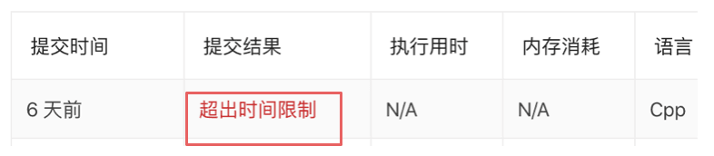
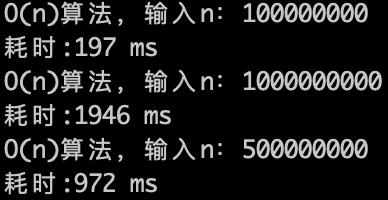
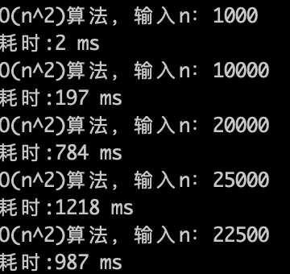
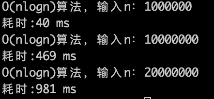
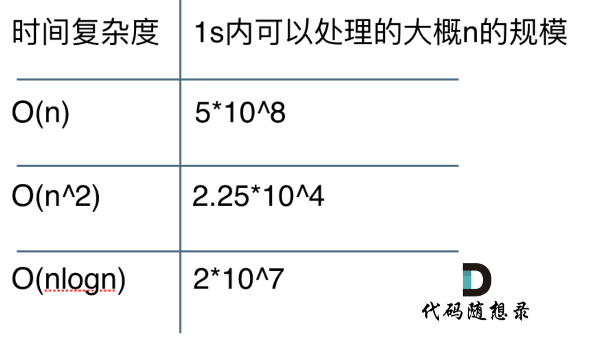

* [做專案（多個 C++、Java、Go、測開、前端專案）](https://www.programmercarl.com/other/kstar.html)
* [刷演算法（兩個月高強度學演算法）](https://www.programmercarl.com/xunlian/xunlianying.html)
* [背八股（40 天挑戰高頻面試題）](https://www.programmercarl.com/xunlian/bagu.html)


# 程式提交之後為什麼會超時？O(n) 的演算法會超時，n 究竟是多大？


一些同學可能對電腦運行的速度還沒有概念，就是感覺電腦運行速度應該會很快，那麼在 LeetCode 上做演算法題目的時候為什麼會超時呢？

電腦究竟 1s 可以執行多少次操作呢？ 接下來探討一下這個問題。

## 超時是怎麼回事



大家在 LeetCode 上練習演算法的時候應該都遇到過一種錯誤是「超時」。

也就是說程式運行的時間超過了規定的時間，一般 OJ（online judge）的超時時間就是 1s，也就是測試案例資料輸入後最多要 1s 內得到結果，暫時還不清楚 LeetCode 的判題規則，下文為了方便講解，暫定超時時間就是 1s。

如果寫出了一個 O(n) 的演算法 ，其實可以估算出來 n 是多大的時候演算法的執行時間就會超過 1s 了。

如果 n 的規模已經足夠讓 O(n) 的演算法運行時間超過了 1s，就應該考慮 log(n) 的解法了。

## 從硬體組態看電腦的效能

電腦的運算速度主要看 CPU 的組態（configuration），以 2015 年 MacPro 為例，CPU 組態：2.7 GHz Dual-Core Intel Core i5 。

也就是 2.7 GHz 雙核 i5 處理器，GHz 是指什麼呢，1Hz = 1/s，1Hz 是 CPU 的一次脈衝（可以理解為一次改變狀態，也叫時脈週期），稱之為赫茲，那麼 1GHz 等於多少赫茲呢

* 1GHz（吉赫）= 1000MHz（兆赫）
* 1MHz（兆赫）= 1 百萬赫茲

所以 1GHz = 10 億 Hz，表示 CPU 可以一秒脈衝 10 億次（有 10 億個時脈週期），這裡不要簡單理解一個時脈週期就是一次 CPU 運算。

例如 1 + 2 = 3，CPU 要執行四次才能完成這個操作，步驟一：把 1 放入暫存器，步驟二：把 2 放入暫存器，步驟三：做加法，步驟四：保存 3。


而且電腦的 CPU 也不會只運行在我們自己寫的程式上，同時 CPU 也要執行電腦的各種處理程序（process）任務等等，我們的程式僅僅是其中的一個處理程序而已。


所以我們的程式在電腦上究竟 1s 真正能執行多少次操作呢？

## 做個測試實驗

在寫測試程式測 1s 內處理多大數量級資料的時候，有三點需要注意：

* CPU 執行每條指令所需的時間實際上並不相同，例如 CPU 執行加法和乘法操作的耗時實際上都是不一樣的。
* 現在大多電腦系統的記憶體（memory）管理都有快取（cache）技術，所以頻繁存取相同位址（address）的資料和存取不相鄰元素（element）所需的時間也是不同的。
* 電腦同時運行多個程式，每個程式裡還有不同的處理程序執行緒（thread）在搶佔資源。

儘管有很多因素影響，但是還是可以對自己程式的運行時間有一個大體的評估的。

引用《演算法 4》裡面的一段話：

* 火箭科學家需要大致知道一枚試射火箭的著陸點是在大海裡還是在城市中；
* 醫學研究者需要知道一次藥物測試是會殺死還是會治癒實驗對象；

所以**任何開發電腦程式的軟體工程師都應該能夠估計這個程式的運行時間是一秒鐘還是一年**。

這個是最基本的，所以以上誤差就不算事了。

以下以 C++ 程式碼為例：

測試硬體：2015 年 MacPro，CPU 組態：2.7 GHz Dual-Core Intel Core i5

實作三個函式（function），時間複雜性（time complexity）分別是 O(n) , O(n^2), O(nlog n)，使用加法運算來統一測試。

```CPP
// O(n)
void function1(long long n) {
    long long k = 0;
    for (long long i = 0; i < n; i++) {
        k++;
    }
}

```

```CPP
// O(n^2)
void function2(long long n) {
    long long k = 0;
    for (long long i = 0; i < n; i++) {
        for (long j = 0; j < n; j++) {
            k++;
        }
    }

}
```

```CPP
// O(nlogn)
void function3(long long n) {
    long long k = 0;
    for (long long i = 0; i < n; i++) {
        for (long long j = 1; j < n; j = j*2) { // 注意這裡 j=1
            k++;
        }
    }
}

```

來看一下這三個函式隨著 n 的規模變化，耗時會產生多大的變化，先測 function1 ，就把 function2 和 function3 註解掉

```CPP
int main() {
    long long n; // 資料規模
    while (1) {
        cout << "輸入n：";
        cin >> n;
        milliseconds start_time = duration_cast<milliseconds >(
            system_clock::now().time_since_epoch()
        );
        function1(n);
//        function2(n);
//        function3(n);
        milliseconds end_time = duration_cast<milliseconds >(
            system_clock::now().time_since_epoch()
        );
        cout << "耗時:" << milliseconds(end_time).count() - milliseconds(start_time).count()
            <<" ms"<< endl;
    }
}
```

來看一下運行的效果，如下圖：



O(n) 的演算法，1s 內大概電腦可以運行 5 * (10^8) 次計算，可以推測一下 O(n^2) 的演算法應該 1s 可以處理的數量級的規模是 5 * (10^8) 開根號，實驗資料如下。



O(n^2) 的演算法，1s 內大概電腦可以運行 22500 次計算，驗證了剛剛的推測。

再推測一下 O(nlogn) 的話， 1s 可以處理的資料規模是什麼呢？

理論上應該是比 O(n) 少一個數量級，因為 logn 的複雜度 其實是很快，看一下實驗資料。



O(nlogn) 的演算法，1s 內大概電腦可以運行 2 * (10^7) 次計算，符合預期。

這是在我個人 PC 上測出來的資料，不能說是十分精確，但數量級是差不多的，大家也可以在自己的電腦上測一下。

**整體測試資料整理如下：**



至於 O(log n) 和 O(n^3) 等等這些時間複雜性在 1s 內可以處理多大的資料規模，大家可以自己寫一寫程式碼去測一下了。

## 完整測試程式碼

```CPP
#include <iostream>
#include <chrono>
#include <thread>
using namespace std;
using namespace chrono;
// O(n)
void function1(long long n) {
    long long k = 0;
    for (long long i = 0; i < n; i++) {
        k++;
    }
}

// O(n^2)
void function2(long long n) {
    long long k = 0;
    for (long long i = 0; i < n; i++) {
        for (long j = 0; j < n; j++) {
            k++;
        }
    }

}
// O(nlogn)
void function3(long long n) {
    long long k = 0;
    for (long long i = 0; i < n; i++) {
        for (long long j = 1; j < n; j = j*2) { // 注意這裡 j=1
            k++;
        }
    }
}
int main() {
    long long n; // 資料規模
    while (1) {
        cout << "輸入n：";
        cin >> n;
        milliseconds start_time = duration_cast<milliseconds >(
            system_clock::now().time_since_epoch()
        );
        function1(n);
//        function2(n);
//        function3(n);
        milliseconds end_time = duration_cast<milliseconds >(
            system_clock::now().time_since_epoch()
        );
        cout << "耗時:" << milliseconds(end_time).count() - milliseconds(start_time).count()
            <<" ms"<< endl;
    }
}


```

## 總結

本文詳細分析了在 LeetCode 上做題程式為什麼會有超時，以及從硬體組態上大體知道 CPU 的執行速度，然後親自做一個實驗來看看 O(n) 的演算法，跑一秒鐘，這個 n 究竟是多大，最後給出不同時間複雜性，一秒內可以運算出來的 n 的大小。

建議讀者們也都自己做一做實驗，測一測，看看是不是和我的測出來的結果差不多。

這樣，大家應該對程式超時時候的資料規模有一個整體的認識了。


