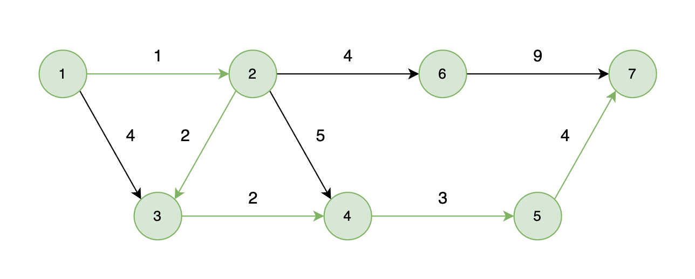
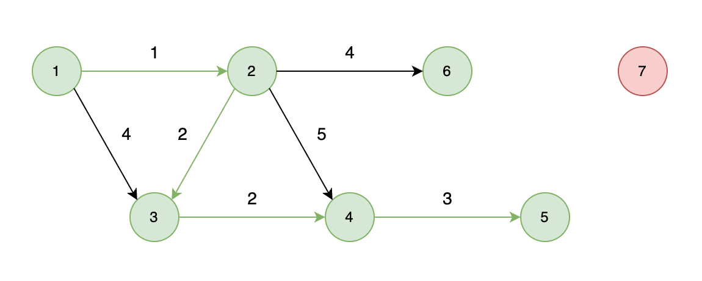
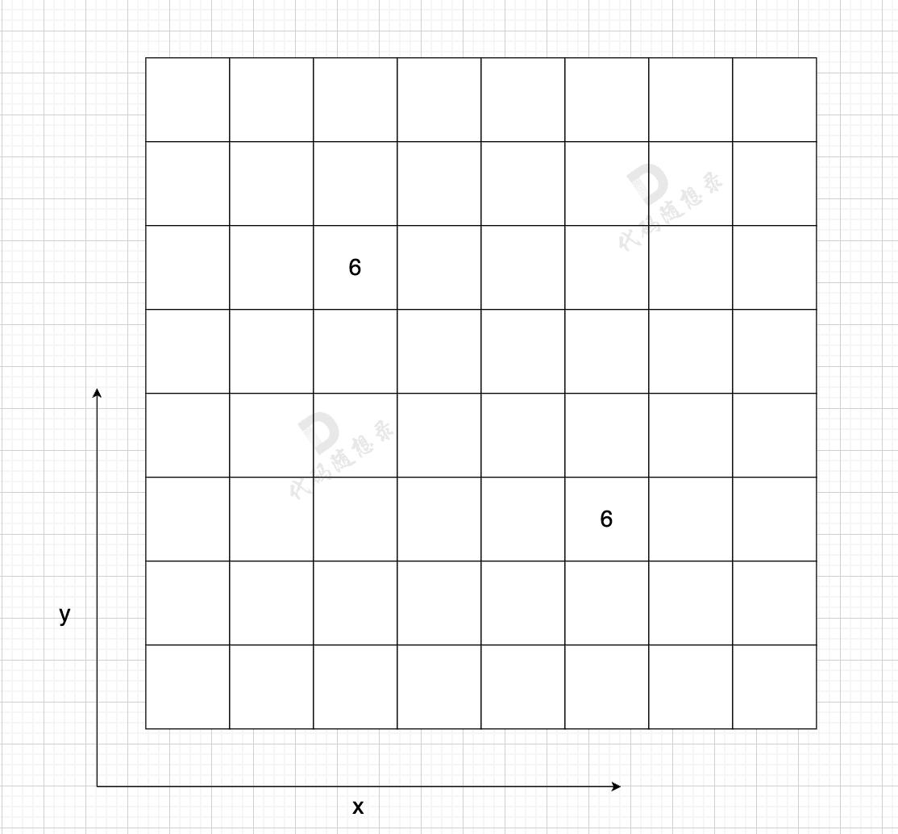
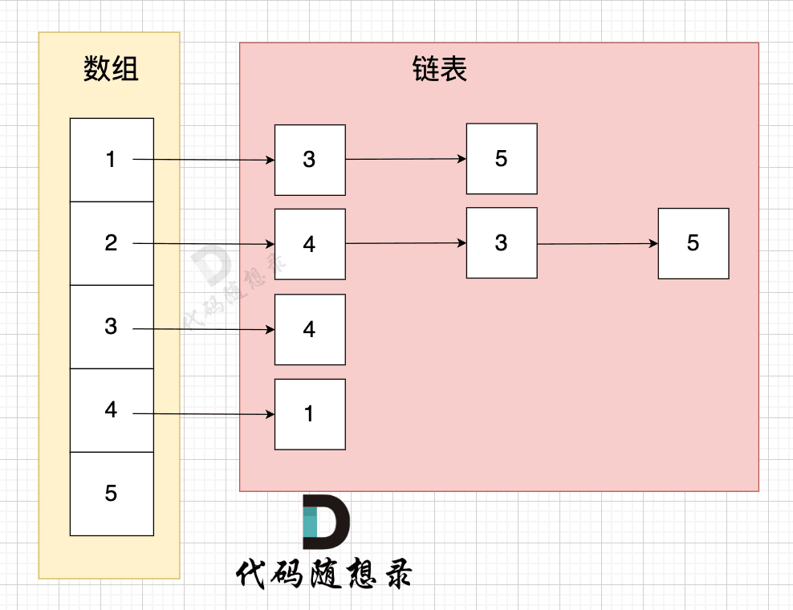
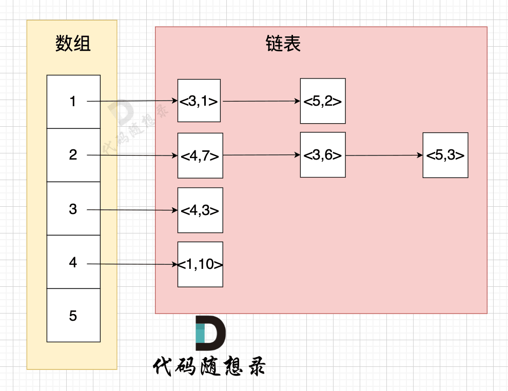

<p align="center"><strong><a href="./qita/join.md">參與本專案</a>，貢獻其他語言版本的程式碼，擁抱開放原始碼（open source），讓更多學習演算法（algorithm）的夥伴們受益！</strong></p>

# dijkstra（堆積（heap）最佳化版）精講 

[KamaCoder：47. 參加科學大會](https://kamacoder.com/problempage.php?pid=1047)

【題目描述】

小明是一位科學家，他需要參加一場重要的國際科學大會，以展示自己的最新研究成果。

小明的起點是第一個車站，終點是最後一個車站。然而，途中的各個車站之間的道路狀況、交通擁擠程度以及可能的自然因素（如天氣變化）等不同，這些因素都會影響每條路徑（path）的通行時間。

小明希望能選擇一條花費時間最少的路線，以確保他能夠儘快到達目的地。

【輸入描述】

第一行包含兩個正整數（positive integer），第一個正整數 N 表示一共有 N 個公車站，第二個正整數 M 表示有 M 條公路。

接下來為 M 行，每行包括三個整數（integer），S、E 和 V，代表從 S 車站可以單向直達 E 車站，並且需要花費 V 單位的時間。

【輸出描述】

輸出一個整數，代表小明從起點到終點所花費的最小時間。

輸入範例

```
7 9
1 2 1
1 3 4
2 3 2
2 4 5
3 4 2
4 5 3
2 6 4
5 7 4
6 7 9
```

輸出範例：12

【提示資訊】 

能夠到達的情況：

如下圖所示，起始車站為 1 號車站，終點車站為 7 號車站，綠色路線為最短的路線，路線總長度為 12，則輸出 12。



不能到達的情況：

如下圖所示，當從起始車站不能到達終點車站時，則輸出 -1。



資料範圍：

1 <= N <= 500;
1 <= M <= 5000;


## 解題思路

> 本篇我們來講解堆積最佳化版 dijkstra，看本篇之前，一定要先看我講解的樸素版 dijkstra，否則本篇會有部分內容看不懂。

在上一篇中，我們講解了樸素版的 dijkstra，該解法的時間複雜性（time complexity）為 O(n^2)，可以看出時間複雜性只和 n（節點（node）數量）有關係。

如果 n 很大的話，我們可以換一個角度來最佳化效能。

在講解最小生成樹（minimum spanning tree, MST）的時候，我們講了兩個演算法，[Prim 的最小生成樹演算法（Prim's algorithm）](./0053.尋寶-prim.md)（從點的角度來求最小生成樹）、[Kruskal 演算法（Kruskal's algorithm）](./0053.尋寶-Kruskal.md)（從邊（edge）的角度來求最小生成樹）

那麼在 n 很大的時候，也有另一個思考維度，即：從邊的數量出發。

當 n 很大，邊的數量也很多的時候（密集圖（dense graph）），那麼上述解法沒問題。 

但 n 很大，邊的數量很少的時候（稀疏圖形（sparse graph）），是不是可以換成從邊的角度來求最短路徑（shortest path）呢？

畢竟邊的數量少。 

有的讀者可能會想，n（節點數量）很大，邊不就多嗎？怎麼會邊的數量少呢？ 

別忘了，誰也沒有規定節點之間一定要有邊連接著，例如有一萬個節點，只有一條邊，這也是一張圖（graph）。

了解背景之後，再來看解題思路。 

### 圖的儲存

首先是圖的儲存。 

關於圖的儲存主流有兩種方式：相鄰矩陣（adjacency matrix）和相鄰串列（adjacency list） 

#### 相鄰矩陣 

相鄰矩陣使用二維（2D）陣列（array）來表示圖結構。相鄰矩陣是從節點的角度來表示圖，有多少節點就申請多大的二維陣列。

例如：grid[2][5] = 6，表示節點 2 連結節點 5 為有向圖（directed graph），節點 2 指向節點 5，邊的權重（weight）為 6（套在題意裡，可能是距離為 6 或者消耗為 6 等等） 

如果想表示無向圖（undirected graph），即：grid[2][5] = 6，grid[5][2] = 6，表示節點 2 與節點 5 相互連通，權重為 6。


如圖： 

 

在一個 n（節點數）為 8 的圖中，就需要申請 8 * 8 這麼大的空間，有一條雙向邊，即：grid[2][5] = 6，grid[5][2] = 6

這種表達方式（相鄰矩陣）在邊少、節點多的情況下，會導致申請過大的二維陣列，造成空間浪費。 

而且在尋找節點連結情況的時候，需要遍歷（traversal）整個矩陣（matrix），即 n * n 的時間複雜性，同樣造成時間浪費。 

相鄰矩陣的優點： 

* 表達方式簡單，易於理解
* 檢查任意兩個頂點（vertex）間是否存在邊的操作非常快
* 適合密集圖，在邊數接近頂點數平方的圖中，相鄰矩陣是一種空間效率較高的表示方法。 

缺點： 

* 遇到稀疏圖形，會導致申請過大的二維陣列造成空間浪費，且遍歷邊的時候需要遍歷整個 n * n 矩陣，造成時間浪費 

#### 相鄰串列

相鄰串列使用陣列 + 鏈接串列（linked list）的方式來表示。相鄰串列是從邊的數量來表示圖，有多少邊才會申請對應大小的鏈接串列。 

相鄰串列的構造如圖： 

 

這裡表達的圖是： 

* 節點 1 指向節點 3 和節點 5 
* 節點 2 指向節點 4、節點 3、節點 5 
* 節點 3 指向節點 4，節點 4 指向節點 1。 

有多少邊，相鄰串列才會申請多少個對應的鏈接串列節點。 

從圖中可以直觀看出使用陣列 + 鏈接串列來表達邊的連結情況。 

相鄰串列的優點： 

* 對於稀疏圖形的儲存，只需要儲存邊，空間利用率高 
* 遍歷節點連結情況相對容易

缺點： 

* 檢查任意兩個節點間是否存在邊，效率相對低，需要 O(V) 時間，V 表示某節點連結其他節點的數量。
* 實作相對複雜，不易理解 

#### 本題圖的儲存

接下來我們繼續按照稀疏圖形的角度來分析本題。 

在第一個版本的實作思路中，我們提到了三部曲：

1. 第一步，選源點到哪個節點近且該節點未被訪問過
2. 第二步，該最近節點被標記訪問過
3. 第三步，更新非訪問節點到源點的距離（即更新 minDist 陣列）

在第一個版本的程式碼中，這三部曲是套在一個 for 迴圈（for-loop）裡，為什麼？ 

因為我們是從節點的角度來解決問題。 

三部曲中第一步（選源點到哪個節點近且該節點未被訪問過），這個操作本身需要 for 迴圈遍歷 minDist 來尋找最近的節點。  

同時我們需要遍歷所有未訪問過的節點，所以我們從節點角度出發，程式碼會有兩層 for 迴圈，程式碼是這樣的：（注意程式碼中的註解，標記兩層 for 迴圈的用處）

```CPP 

for (int i = 1; i <= n; i++) { // 遍歷所有節點，第一層 for 迴圈 

    int minVal = INT_MAX;
    int cur = 1;

    // 1、選距離源點最近且未訪問過的節點，第二層 for 迴圈
    for (int v = 1; v <= n; ++v) {
        if (!visited[v] && minDist[v] < minVal) {
            minVal = minDist[v];
            cur = v;
        }
    }

    visited[cur] = true;  // 2、標記該節點已被訪問

    // 3、第三步，更新非訪問節點到源點的距離（即更新 minDist 陣列）
    for (int v = 1; v <= n; v++) {
        if (!visited[v] && grid[cur][v] != INT_MAX && minDist[cur] + grid[cur][v] < minDist[v]) {
            minDist[v] = minDist[cur] + grid[cur][v];
        }
    }

}
```

那麼當從邊的角度出發，在處理三部曲裡的第一步（選源點到哪個節點近且該節點未被訪問過）的時候，我們可以不用去遍歷所有節點了。

而且直接把邊（帶權重）加入到最小堆積（min heap）（利用堆積來自動排序（sorting）），那麼每次我們從堆積頂取出邊，自然就是距離源點最近的節點所在的邊。 

這樣我們就不需要兩層 for 迴圈來尋找最近的節點了。 

了解了大體思路，我們再來看程式碼實作。 

首先是如何使用相鄰串列來表述圖結構，這是擺在很多讀者面前的第一個難題。 

相鄰串列用陣列 + 鏈接串列來表示，程式碼如下：（C++ 中 vector 為陣列，list 為鏈接串列，定義了 n+1 這麼大的陣列空間） 

```CPP 
vector<list<int>> grid(n + 1);
```
 
不少讀者不知道如何定義資料結構（data structure）、怎麼表示相鄰串列，我來給大家畫一個圖：

 

圖中相鄰串列表示： 

* 節點 1 指向節點 3 和節點 5 
* 節點 2 指向節點 4、節點 3、節點 5 
* 節點 3 指向節點 4 
* 節點 4 指向節點 1 

大家發現圖中的邊沒有權重，而本題中我們的邊是有權重的，權重怎麼表示？在哪裡表示？ 

所以在 `vector<list<int>> grid(n + 1);` 中就不能使用 int 了，而是需要一個鍵值對（key-value pair）來存兩個數字，一個數表示節點，一個數表示指向該節點的這條邊的權重。 

那麼程式碼可以改成這樣：（pair 為鍵值對，可以存放兩個 int）

```CPP 
vector<list<pair<int,int>>> grid(n + 1);
```

舉例來給大家展示該程式碼表達的資料如下：



* 節點 1 指向節點 3 權重為 1  
* 節點 1 指向節點 5 權重為 2 
* 節點 2 指向節點 4 權重為 7 
* 節點 2 指向節點 3 權重為 6
* 節點 2 指向節點 5 權重為 3 
* 節點 3 指向節點 4 權重為 3 
* 節點 5 指向節點 1 權重為 10 

這樣我們就把圖中權重表示出來了。

但是在程式碼中使用 `pair<int, int>` 很容易讓我們搞混，第一個 int 表示什麼，第二個 int 表示什麼，導致程式碼可讀性（readability）很差，或者說別人看你的程式碼看不懂。 

那麼可以定義一個類別（class）來取代 `pair<int, int>` 

類別（或者說是 struct）定義如下： 

```CPP
struct Edge {
    int to;  // 相鄰頂點
    int val; // 邊的權重

    Edge(int t, int w): to(t), val(w) {}  // 建構子
};
```

這個類別裡有兩個成員變數，有對應的命名，這樣不容易搞混兩個 int 的含義。 

所以本題中相鄰串列的定義如下： 

```CPP 
struct Edge {
    int to;  // 連結的節點
    int val; // 邊的權重

    Edge(int t, int w): to(t), val(w) {}  // 建構子
};

vector<list<Edge>> grid(n + 1); // 相鄰串列

```

（我們在下面的講解中會直接使用這個相鄰串列的程式碼表示方式）

### 堆積最佳化細節

其實思路依然是 dijkstra 三部曲： 

1. 第一步，選源點到哪個節點近且該節點未被訪問過
2. 第二步，該最近節點被標記訪問過
3. 第三步，更新非訪問節點到源點的距離（即更新 minDist 陣列）

只不過之前是透過遍歷節點來遍歷邊，透過兩層 for 迴圈來尋找距離源點最近節點。這次我們直接遍歷邊，且透過堆積來對邊進行排序，達到直接選擇距離源點最近節點。 

先來看一下針對這三部曲，如何用堆積來最佳化。 

那麼三部曲中的第一步（選源點到哪個節點近且該節點未被訪問過），我們如何選？ 

我們要選擇距離源點近的節點（即：該邊的權重最小），所以我們需要一個最小堆積來幫我們對邊的權重排序，每次從最小堆積頂取邊就是權重最小的邊。

C++ 定義最小堆積，可以用優先佇列（priority queue）實作，程式碼如下：

```CPP 
// 最小堆積
class mycomparison {
public:
    bool operator()(const pair<int, int>& lhs, const pair<int, int>& rhs) {
        return lhs.second > rhs.second;
    }
};
// 優先佇列中存放 pair<節點編號，源點到該節點的權重> 
priority_queue<pair<int, int>, vector<pair<int, int>>, mycomparison> pq;
```

（`pair<int, int>` 中第二個 int 為什麼要存源點到該節點的權重，因為這個最小堆積需要按照權重來排序）


有了最小堆積自動對邊的權重排序，那我們只需要直接從堆積裡取堆積頂元素（element）（最小堆積中，最小的權重在上面），就可以取到離源點最近的節點了（未訪問過的節點，不會加到堆積裡進行排序） 

所以三部曲中的第一步，我們不用 for 迴圈去遍歷，直接取堆積頂元素： 

```CPP 
// pair<節點編號，源點到該節點的權重>
pair<int, int> cur = pq.top(); pq.pop();

```

第二步（該最近節點被標記訪問過）這個就是將節點做訪問標記，和樸素 dijkstra 一樣，程式碼如下： 

```CPP 
// 2. 第二步，該最近節點被標記訪問過
visited[cur.first] = true;

```

（`cur.first` 是指取 `pair<int, int>` 裡的第一個 int，即節點編號）

第三步（更新非訪問節點到源點的距離），這裡的思路也是和樸素 dijkstra 一樣的。 

但很多讀者對這裡是最懵的，主要是因為兩點： 

* 沒有理解透徹 dijkstra 的思路 
* 沒有理解相鄰串列的表達方式 

我們來回顧一下樸素 dijkstra 在這一步的程式碼和思路（如果沒看過我講解的樸素版 dijkstra，這裡會看不懂） 

```CPP 

// 3、第三步，更新非訪問節點到源點的距離（即更新 minDist 陣列）
for (int v = 1; v <= n; v++) {
    if (!visited[v] && grid[cur][v] != INT_MAX && minDist[cur] + grid[cur][v] < minDist[v]) {
        minDist[v] = minDist[cur] + grid[cur][v];
    }
}
```

其中 for 迴圈是用來做什麼的？是為了找到節點 cur 連結指向了哪些節點，因為使用相鄰矩陣的表達方式，所以把所有節點遍歷一遍。 

而在相鄰串列中，我們可以以相對高效的方式知道一個節點連結指向哪些節點。 

再回顧一下相鄰串列的構造（陣列 + 鏈接串列）： 

 

假如加入的 cur 是節點 2，那麼 grid[2] 表示的就是圖中第二列鏈接串列。（grid 陣列的構造我們在上面「圖的儲存」中講過）

所以在相鄰串列中，我們要取得節點 cur 連結指向哪些節點，就是遍歷 grid[cur 節點編號] 這個鏈接串列。 

這個遍歷方式，C++ 程式碼如下： 

```CPP 
for (Edge edge : grid[cur.first]) 
```

（如果不知道 Edge 是什麼，看上面「圖的儲存」中相鄰串列的講解）

`cur.first` 就是 cur 節點編號，參考上面 pair 的定義：pair<節點編號，源點到該節點的權重>  

接下來就是更新非訪問節點到源點的距離，程式碼實作和樸素 dijkstra 是一樣的，程式碼如下： 

```CPP 
// 3. 第三步，更新非訪問節點到源點的距離（即更新 minDist 陣列）
for (Edge edge : grid[cur.first]) { // 遍歷 cur 指向的節點，cur 指向的節點為 edge
    // cur 指向的節點 edge.to，這條邊的權重為 edge.val
    if (!visited[edge.to] && minDist[cur.first] + edge.val < minDist[edge.to]) { // 更新 minDist
        minDist[edge.to] = minDist[cur.first] + edge.val;
        pq.push(pair<int, int>(edge.to, minDist[edge.to]));
    }
}
```

但為什麼思路一樣，有的讀者能寫出樸素 dijkstra，但堆積最佳化這裡的邏輯（logic）就是寫不出來呢？ 

**主要就是因為對相鄰串列的表達方式不熟悉**！ 

以上程式碼中，cur 連結指向的節點編號為 edge.to，這條邊的權重為 edge.val，如果對這裡模糊的就再回顧一下 Edge 的定義：

```CPP 
struct Edge {
    int to;  // 相鄰頂點
    int val; // 邊的權重

    Edge(int t, int w): to(t), val(w) {}  // 建構子
};
```

確定該節點沒有被訪問過，`!visited[edge.to]`，目前源點到 cur.first 的最短距離（minDist）+ cur.first 到 edge.to 的距離（edge.val）是否小於 minDist 已經記錄的源點到 edge.to 的距離（minDist[edge.to]） 

如果是的話，就開始更新操作。 

即： 

```CPP 
if (!visited[edge.to] && minDist[cur.first] + edge.val < minDist[edge.to]) { // 更新 minDist
    minDist[edge.to] = minDist[cur.first] + edge.val;
    pq.push(pair<int, int>(edge.to, minDist[edge.to])); // 由於 cur 節點的加入，而新連結的邊，加入到優先佇列中
}

```

同時，由於 cur 節點的加入，源點又有可以新連結到的邊，將這些邊加入到優先佇列中。 


以上程式碼思路和樸素版 dijkstra 是一模一樣的，主要區別是兩點： 

* 相鄰串列的表示方式不同 
* 使用優先佇列（最小堆積）來對新連結的邊排序

### 程式碼實作 

堆積最佳化 dijkstra 完整程式碼如下： 

```CPP
#include <iostream>
#include <vector>
#include <list>
#include <queue>
#include <climits>
using namespace std; 
// 最小堆積
class mycomparison {
public:
    bool operator()(const pair<int, int>& lhs, const pair<int, int>& rhs) {
        return lhs.second > rhs.second;
    }
};
// 定義一個 struct 來表示帶權重的邊
struct Edge {
    int to;  // 相鄰頂點
    int val; // 邊的權重

    Edge(int t, int w): to(t), val(w) {}  // 建構子
};

int main() {
    int n, m, p1, p2, val;
    cin >> n >> m;

    vector<list<Edge>> grid(n + 1);

    for(int i = 0; i < m; i++){
        cin >> p1 >> p2 >> val; 
        // p1 指向 p2，權重為 val
        grid[p1].push_back(Edge(p2, val));

    }

    int start = 1;  // 起點
    int end = n;    // 終點

    // 儲存從源點到每個節點的最短距離
    std::vector<int> minDist(n + 1, INT_MAX);

    // 記錄頂點是否被訪問過
    std::vector<bool> visited(n + 1, false); 
    
    // 優先佇列中存放 pair<節點，源點到該節點的權重>
    priority_queue<pair<int, int>, vector<pair<int, int>>, mycomparison> pq;


    // 初始化佇列，源點到源點的距離為 0，所以初始為 0
    pq.push(pair<int, int>(start, 0)); 
    
    minDist[start] = 0;  // 起始點到自身的距離為 0

    while (!pq.empty()) {
        // 1. 第一步，選源點到哪個節點近且該節點未被訪問過（透過優先佇列來實作）
        // <節點，源點到該節點的距離>
        pair<int, int> cur = pq.top(); pq.pop();

        if (visited[cur.first]) continue;

        // 2. 第二步，該最近節點被標記訪問過
        visited[cur.first] = true;

        // 3. 第三步，更新非訪問節點到源點的距離（即更新 minDist 陣列）
        for (Edge edge : grid[cur.first]) { // 遍歷 cur 指向的節點，cur 指向的節點為 edge
            // cur 指向的節點 edge.to，這條邊的權重為 edge.val
            if (!visited[edge.to] && minDist[cur.first] + edge.val < minDist[edge.to]) { // 更新 minDist
                minDist[edge.to] = minDist[cur.first] + edge.val;
                pq.push(pair<int, int>(edge.to, minDist[edge.to]));
            }
        }

    }

    if (minDist[end] == INT_MAX) cout << -1 << endl; // 不能到達終點
    else cout << minDist[end] << endl; // 到達終點最短路徑
}

```

* 時間複雜性：O(ElogE) E 為邊的數量 
* 空間複雜度（space complexity）：O(N + E) N 為節點的數量

堆積最佳化的時間複雜性只和邊的數量有關，和節點數無關，在優先佇列中放的也是邊。 

以上程式碼中，`while (!pq.empty())` 裡套了 `for (Edge edge : grid[cur.first])`  

`for` 裡遍歷的是目前節點 cur 所連接的邊。

那目前節點 cur 所連接的邊也是不固定的，這就讓大家分不清，這時間複雜性究竟是多少？  

其實 `for (Edge edge : grid[cur.first])` 裡最終的資料流向是給佇列（queue）裡加入邊。 

那麼跳出局部程式碼，整個佇列一定是所有邊加入了一次，同時也彈出了一次。 

所以邊加入一次時間複雜性是 O(E)，`while (!pq.empty())` 裡每次都要彈出一條邊來進行操作，在優先佇列（最小堆積）中彈出一個元素的時間複雜性是 O(logE)，這是錐形排序法（heap sort）的時間複雜性。 

（當然最小堆積裡是加入元素的時候排序，還是取出元素的時候排序，這個無所謂，時間複雜性都是 O(E)，總之是一定要排序的，而最小堆積裡也不會滯留元素，有多少元素加入一定就有多少元素彈出）

所以該演算法整體時間複雜性為 O(ElogE)   

網上的不少分析會把 n（節點的數量）算進來，這個分析是有問題的，舉一個極端例子，在 n 為 10000，且只有一條邊的圖裡，以上程式碼，大家感覺執行了多少次？ 

`while (!pq.empty())` 中的 pq 存的是邊，其實只執行了一次。

所以該演算法時間複雜性和節點沒有關係。 

至於空間複雜度，相鄰串列是陣列 + 鏈接串列，陣列的空間是 N，有 E 條邊就申請對應多少個鏈接串列節點，所以複雜度是 N + E

## 進階補充 

當然也有讀者可能想，堆積最佳化 dijkstra 中為什麼一定要用相鄰串列呢，我就用相鄰矩陣行不行？

也行的。 

但正是因為稀疏圖形，所以我們使用堆積最佳化的思路，如果我們還用相鄰矩陣去表達這個圖的話，就是 **一個高效的演算法使用了低效的資料結構，那麼整體演算法效率依然是低的**。

如果還不清楚為什麼要使用相鄰串列，可以再看看上面我在「圖的儲存」標題下的講解。 

這裡我也給出相鄰矩陣版本的堆積最佳化 dijkstra 程式碼： 

```CPP
#include <iostream>
#include <vector>
#include <list>
#include <climits>
using namespace std;
// 最小堆積
class mycomparison {
public:
    bool operator()(const pair<int, int>& lhs, const pair<int, int>& rhs) {
        return lhs.second > rhs.second;
    }
};

int main() {
    int n, m, p1, p2, val;
    cin >> n >> m;

    vector<vector<int>> grid(n + 1, vector<int>(n + 1, INT_MAX));

    for(int i = 0; i < m; i++){
        cin >> p1 >> p2 >> val;
        // p1 指向 p2，權重為 val
        grid[p1][p2] = val;
    }

    int start = 1;  // 起點
    int end = n;    // 終點

    // 儲存從源點到每個節點的最短距離
    std::vector<int> minDist(n + 1, INT_MAX);

    // 記錄頂點是否被訪問過
    std::vector<bool> visited(n + 1, false);

    // 優先佇列中存放 pair<節點，源點到該節點的權重>
    priority_queue<pair<int, int>, vector<pair<int, int>>, mycomparison> pq;


    // 初始化佇列，源點到源點的距離為 0，所以初始為 0
    pq.push(pair<int, int>(start, 0));

    minDist[start] = 0;  // 起始點到自身的距離為 0

    while (!pq.empty()) {
        // <節點，源點到該節點的距離>
        // 1、選距離源點最近且未訪問過的節點
        pair<int, int> cur = pq.top(); pq.pop();

        if (visited[cur.first]) continue;

        visited[cur.first] = true; // 2、標記該節點已被訪問

        // 3、第三步，更新非訪問節點到源點的距離（即更新 minDist 陣列）
        for (int j = 1; j <= n; j++) {
            if (!visited[j] && grid[cur.first][j] != INT_MAX && (minDist[cur.first] + grid[cur.first][j] < minDist[j])) {
                minDist[j] = minDist[cur.first] + grid[cur.first][j];
                pq.push(pair<int, int>(j, minDist[j]));
            }
        }
    }

    if (minDist[end] == INT_MAX) cout << -1 << endl; // 不能到達終點
    else cout << minDist[end] << endl; // 到達終點最短路徑

}

```

* 時間複雜性：O(E * N * logE) E 為邊的數量，N 為節點數量
* 空間複雜度：O(log(N^2))

`while (!pq.empty())` 時間複雜性為 E，優先佇列每次插入元素時間複雜性為 logE，和一個 for 迴圈時間複雜性為 N。

所以整體是 E * N * logE


## 總結 

在學習一種最佳化思路的時候，首先就要知道為什麼要最佳化，遇到了什麼問題。 

正如我在開篇就給大家交代清楚堆積最佳化方式的背景。 

堆積最佳化的整體思路和樸素版是大體一樣的，區別是堆積最佳化從邊的角度出發且利用堆積來排序。 

很多讀者別說寫堆積最佳化，就是看堆積最佳化的程式碼也看得很懵。 

主要是因為兩點： 

* 不熟悉相鄰串列的表達方式 
* 對 dijkstra 的實作思路還是不熟 

這是我為什麼本篇花了大力氣來講解圖的儲存，就是為了讓大家徹底理解相鄰串列以及相鄰串列的程式碼寫法。 

至於 dijkstra 的實作思路，樸素版和堆積最佳化版本都是按照 dijkstra 三部曲來的。 

理解了三部曲，dijkstra 的思路就是清晰的。 

針對相鄰串列版本程式碼我做了詳細的時間複雜性分析，也讓讀者們清楚，相對於樸素版，時間都最佳化到哪了。 

最後我也給出了相鄰矩陣的版本程式碼，分析了這一版本的必要性以及時間複雜性。 

至此透過兩篇 dijkstra 的文章，終於把 dijkstra 講完了，如果大家對我講解裡所涉及的內容都吃透的話，相信對 dijkstra 演算法也就理解到位了。 


## 其他語言版本

### Java 

```Java 

import java.util.*;

class Edge {
    int to;  // 相鄰頂點
    int val; // 邊的權重

    Edge(int to, int val) {
        this.to = to;
        this.val = val;
    }
}

class MyComparison implements Comparator<Pair<Integer, Integer>> {
    @Override
    public int compare(Pair<Integer, Integer> lhs, Pair<Integer, Integer> rhs) {
        return Integer.compare(lhs.second, rhs.second);
    }
}

class Pair<U, V> {
    public final U first;
    public final V second;

    public Pair(U first, V second) {
        this.first = first;
        this.second = second;
    }
}

public class Main {
    public static void main(String[] args) {
        Scanner scanner = new Scanner(System.in);
        int n = scanner.nextInt();
        int m = scanner.nextInt();

        List<List<Edge>> grid = new ArrayList<>(n + 1);
        for (int i = 0; i <= n; i++) {
            grid.add(new ArrayList<>());
        }

        for (int i = 0; i < m; i++) {
            int p1 = scanner.nextInt();
            int p2 = scanner.nextInt();
            int val = scanner.nextInt();
            grid.get(p1).add(new Edge(p2, val));
        }

        int start = 1;  // 起點
        int end = n;    // 終點

        // 儲存從源點到每個節點的最短距離
        int[] minDist = new int[n + 1];
        Arrays.fill(minDist, Integer.MAX_VALUE);

        // 記錄頂點是否被訪問過
        boolean[] visited = new boolean[n + 1];

        // 優先佇列中存放 Pair<節點，源點到該節點的權重>
        PriorityQueue<Pair<Integer, Integer>> pq = new PriorityQueue<>(new MyComparison());

        // 初始化佇列，源點到源點的距離為 0，所以初始為 0
        pq.add(new Pair<>(start, 0));

        minDist[start] = 0;  // 起始點到自身的距離為 0

        while (!pq.isEmpty()) {
            // 1. 第一步，選源點到哪個節點近且該節點未被訪問過（透過優先佇列來實作）
            // <節點，源點到該節點的距離>
            Pair<Integer, Integer> cur = pq.poll();

            if (visited[cur.first]) continue;

            // 2. 第二步，該最近節點被標記訪問過
            visited[cur.first] = true;

            // 3. 第三步，更新非訪問節點到源點的距離（即更新 minDist 陣列）
            for (Edge edge : grid.get(cur.first)) { // 遍歷 cur 指向的節點，cur 指向的節點為 edge
                // cur 指向的節點 edge.to，這條邊的權重為 edge.val
                if (!visited[edge.to] && minDist[cur.first] + edge.val < minDist[edge.to]) { // 更新 minDist
                    minDist[edge.to] = minDist[cur.first] + edge.val;
                    pq.add(new Pair<>(edge.to, minDist[edge.to]));
                }
            }
        }

        if (minDist[end] == Integer.MAX_VALUE) {
            System.out.println(-1); // 不能到達終點
        } else {
            System.out.println(minDist[end]); // 到達終點最短路徑
        }
    }
}

```


### Python

```python
import heapq

class Edge:
    def __init__(self, to, val):
        self.to = to
        self.val = val

def dijkstra(n, m, edges, start, end):
    grid = [[] for _ in range(n + 1)]

    for p1, p2, val in edges:
        grid[p1].append(Edge(p2, val))

    minDist = [float('inf')] * (n + 1)
    visited = [False] * (n + 1)

    pq = []
    heapq.heappush(pq, (0, start))
    minDist[start] = 0

    while pq:
        cur_dist, cur_node = heapq.heappop(pq)

        if visited[cur_node]:
            continue

        visited[cur_node] = True

        for edge in grid[cur_node]:
            if not visited[edge.to] and cur_dist + edge.val < minDist[edge.to]:
                minDist[edge.to] = cur_dist + edge.val
                heapq.heappush(pq, (minDist[edge.to], edge.to))

    return -1 if minDist[end] == float('inf') else minDist[end]

# 輸入
n, m = map(int, input().split())
edges = [tuple(map(int, input().split())) for _ in range(m)]
start = 1  # 起點
end = n    # 終點

# 執行演算法並輸出結果
result = dijkstra(n, m, edges, start, end)
print(result)

```

### Go

```go 
package main

import (
    "container/heap"
    "fmt"
    "math"
)

// Edge 表示帶權重的邊
type Edge struct {
    to, val int
}

// PriorityQueue 實作一個最小堆積
type Item struct {
    node, dist int
}

type PriorityQueue []*Item

func (pq PriorityQueue) Len() int { return len(pq) }

func (pq PriorityQueue) Less(i, j int) bool {
    return pq[i].dist < pq[j].dist
}

func (pq PriorityQueue) Swap(i, j int) {
    pq[i], pq[j] = pq[j], pq[i]
}

func (pq *PriorityQueue) Push(x interface{}) {
    *pq = append(*pq, x.(*Item))
}

func (pq *PriorityQueue) Pop() interface{} {
    old := *pq
    n := len(old)
    item := old[n-1]
    *pq = old[0 : n-1]
    return item
}

func dijkstra(n, m int, edges [][]int, start, end int) int {
    grid := make([][]Edge, n+1)
    for _, edge := range edges {
        p1, p2, val := edge[0], edge[1], edge[2]
        grid[p1] = append(grid[p1], Edge{to: p2, val: val})
    }

    minDist := make([]int, n+1)
    for i := range minDist {
        minDist[i] = math.MaxInt64
    }
    visited := make([]bool, n+1)

    pq := &PriorityQueue{}
    heap.Init(pq)
    heap.Push(pq, &Item{node: start, dist: 0})
    minDist[start] = 0

    for pq.Len() > 0 {
        cur := heap.Pop(pq).(*Item)

        if visited[cur.node] {
            continue
        }

        visited[cur.node] = true

        for _, edge := range grid[cur.node] {
            if !visited[edge.to] && minDist[cur.node]+edge.val < minDist[edge.to] {
                minDist[edge.to] = minDist[cur.node] + edge.val
                heap.Push(pq, &Item{node: edge.to, dist: minDist[edge.to]})
            }
        }
    }

    if minDist[end] == math.MaxInt64 {
        return -1
    }
    return minDist[end]
}

func main() {
    var n, m int
    fmt.Scan(&n, &m)

    edges := make([][]int, m)
    for i := 0; i < m; i++ {
        var p1, p2, val int
        fmt.Scan(&p1, &p2, &val)
        edges[i] = []int{p1, p2, val}
    }

    start := 1  // 起點
    end := n    // 終點

    result := dijkstra(n, m, edges, start, end)
    fmt.Println(result)
}

```

### Rust

### JavaScript

### TypeScript

### PhP

### Swift

### Scala

### C#

### Dart

### C

