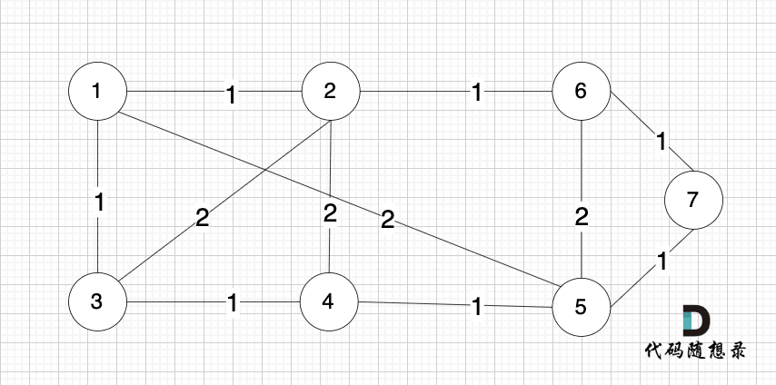
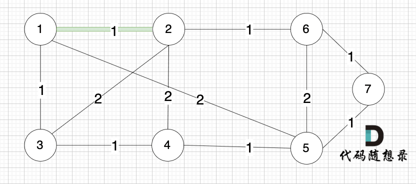
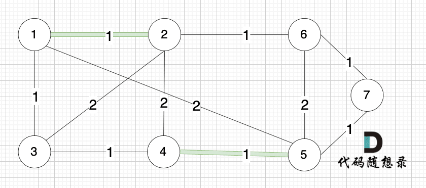
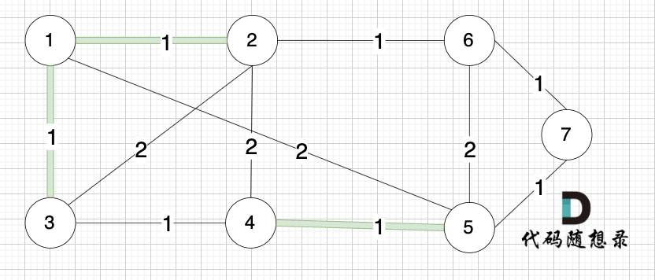
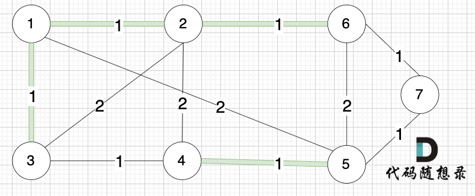
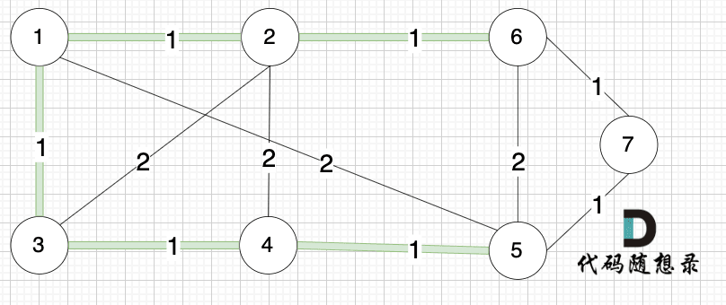
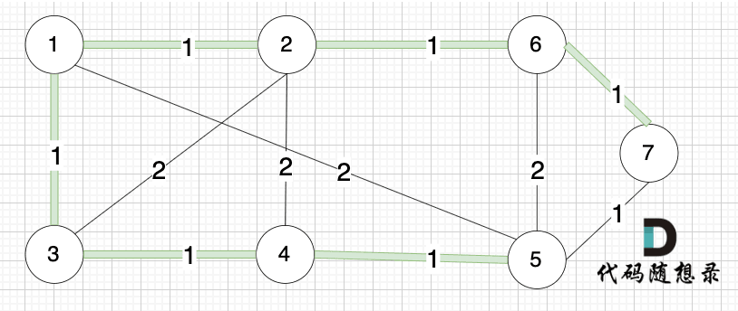
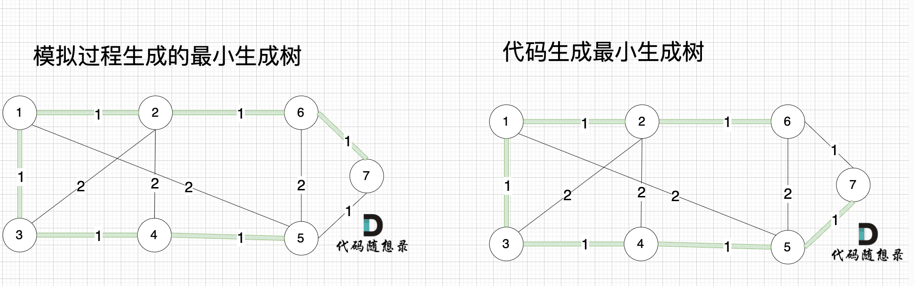
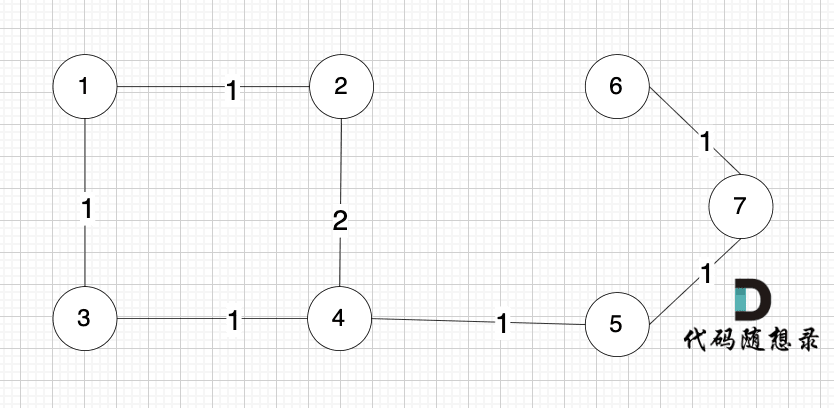

<p align="center"><strong><a href="./qita/join.md">參與本專案</a>，貢獻其他語言版本的程式碼，擁抱開放原始碼（open source），讓更多學習演算法的夥伴們受益！</strong></p>

# Kruskal 演算法（Kruskal's algorithm）精講

[KamaCoder：53. 尋寶](https://kamacoder.com/problempage.php?pid=1053)

題目描述：

在世界的某個區域，有一些分散的神秘島嶼，每個島嶼上都有一種珍稀的資源或寶藏。國王打算在這些島嶼上建公路，方便運輸。

不同島嶼之間，路途距離不同，國王希望你可以規劃建公路的方案，如何可以以最短的總公路距離將所有島嶼連通起來。

給定一張地圖，其中包括了所有的島嶼，以及它們之間的距離。以最小化公路建設長度，確保可以連接到所有島嶼。

輸入描述：

第一行包含兩個整數（integer）V 和 E，V 代表頂點（vertex）數，E 代表邊（edge）數。頂點編號是從 1 到 V。例如：V=2，一共有兩個頂點，分別是 1 和 2。

接下來共有 E 行，每行三個整數 v1、v2 和 val，v1 和 v2 為邊的起點和終點，val 代表邊的權重（weight）。

輸出描述：

輸出連通所有島嶼的最小路徑（path）總距離

輸入範例：

```
7 11
1 2 1
1 3 1
1 5 2
2 6 1
2 4 2
2 3 2
3 4 1
4 5 1
5 6 2
5 7 1
6 7 1
```

輸出範例：

6

## 解題思路

**[《程式碼隨想錄》演算法影片公開課](https://programmercarl.com/other/gongkaike.html)：[圖論（graph theory）：最小生成樹（minimum spanning tree, MST）之 Kruskal 演算法](https://www.bilibili.com/video/BV1GD3uz8EY4)，相信結合影片再看本篇題解，更有助於大家對本題的理解**。

在上一篇我們講解了 Prim 的最小生成樹（minimum spanning tree, MST）演算法（Prim's algorithm）求解MST，本篇我們來講解另一個演算法：Kruskal，同樣可以求MST。

**Prim 演算法是維護節點（node）的集合（set），而 Kruskal 是維護邊的集合**。

一上來就這麼說，大家應該看不太懂，這裡是先讓大家有這麼個印象，帶著這個印象再看下文，理解得會更到位一些。

Kruskal 的解題思路：

* 邊的權重排序（sorting），因為要優先選最小的邊加入到生成樹裡
* 遍歷（traversal）排序後的邊
    * 如果邊首尾的兩個節點在同一個集合，說明如果連上這條邊圖（graph）中會出現 cycle
    * 如果邊首尾的兩個節點不在同一個集合，加入到MST，並把兩個節點加入同一個集合

下面我們畫圖舉例說明 Kruskal 的工作過程。

依然以範例中，如下這個圖來舉例。



將圖中的邊按照權重由小到大排序，這樣從貪心法（greedy）的角度來說，優先選權重小的邊加入到MST中。

排序後的邊順序為 [(1,2) (4,5) (1,3) (2,6) (3,4) (6,7) (5,7) (1,5) (3,2) (2,4) (5,6)]

> (1,2) 表示節點 1 與節點 2 之間的邊。權重相同的邊，先後順序無所謂。

**開始從頭遍歷排序後的邊**。

--------

選邊 (1,2)，節點 1 和節點 2 不在同一個集合，所以生成樹可以添加邊 (1,2)，並將節點 1、節點 2 放在同一個集合。



--------

選邊 (4,5)，節點 4 和節點 5 不在同一個集合，生成樹可以添加邊 (4,5)，並將節點 4、節點 5 放到同一個集合。

 

**大家判斷兩個節點是否在同一個集合，就看圖中兩個節點是否有綠色的粗線連著就行**

------

（這裡再強調一下，以下選邊是按照上面排序好的邊的陣列（array）來選擇的）

選邊 (1,3)，節點 1 和節點 3 不在同一個集合，生成樹添加邊 (1,3)，並將節點 1、節點 3 放到同一個集合。

 

---------

選邊 (2,6)，節點 2 和節點 6 不在同一個集合，生成樹添加邊 (2,6)，並將節點 2、節點 6 放到同一個集合。

 

--------

選邊 (3,4)，節點 3 和節點 4 不在同一個集合，生成樹添加邊 (3,4)，並將節點 3、節點 4 放到同一個集合。

 

----------

選邊 (6,7)，節點 6 和節點 7 不在同一個集合，生成樹添加邊 (6,7)，並將節點 6、節點 7 放到同一個集合。

 

-----------

選邊 (5,7)，節點 5 和節點 7 在同一個集合，不做計算。

選邊 (1,5)，兩個節點在同一個集合，不做計算。

後面遍歷邊 (3,2)、(2,4)、(5,6) 同理，都因兩個節點已經在同一集合，不做計算。


-------

此時我們就已經生成了一個MST，即：

 

在上面的講解中，看圖的話大家知道如何判斷兩個節點是否在同一個集合（是否有綠色的線連在一起），以及如何把兩個節點加入集合（就在圖中把兩個節點連上）

**但在程式碼中，如何將兩個節點加入同一個集合，又如何判斷兩個節點是否在同一個集合呢**？

這裡就涉及到我們之前講解的[互斥集（disjoint set）](./圖論並查集理論基礎.md)。

我們在互斥集開篇的時候就講了，互斥集主要就兩個功能：

* 將兩個元素（element）添加到一個集合中
* 判斷兩個元素在不在同一個集合

大家發現這正好符合 Kruskal 演算法的需求，這也是為什麼 **我要先講互斥集，再講 Kruskal**。

關於互斥集，我已經在[互斥集精講](./圖論並查集理論基礎.md)詳細講解過了，所以這裡不再贅述，我們直接用。

本題程式碼如下，已經詳細註解：

```CPP

#include <iostream>
#include <vector>
#include <algorithm>

using namespace std;

// l, r 為邊兩側的節點，val 為邊的數值
struct Edge {
    int l, r, val;
};

// 節點數量
int n = 10001;
// 互斥集標記節點關係的陣列
vector<int> father(n, -1); // 節點編號是從 1 開始的，n 要大一些

// 互斥集初始化
void init() {
    for (int i = 0; i < n; ++i) {
        father[i] = i;
    }
}

// 互斥集的查詢操作
int find(int u) {
    return u == father[u] ? u : father[u] = find(father[u]); // 路徑壓縮
}

// 互斥集的加入集合
void join(int u, int v) {
    u = find(u); // 尋找 u 的根
    v = find(v); // 尋找 v 的根
    if (u == v) return ; // 如果發現根相同，則說明在同一個集合，不用將兩個節點相連直接回傳
    father[v] = u;
}

int main() {

    int v, e;
    int v1, v2, val;
    vector<Edge> edges;
    int result_val = 0;
    cin >> v >> e;
    while (e--) {
        cin >> v1 >> v2 >> val;
        edges.push_back({v1, v2, val});
    }

    // 執行 Kruskal 演算法
    // 按邊的權重對邊進行由小到大排序
    sort(edges.begin(), edges.end(), [](const Edge& a, const Edge& b) {
            return a.val < b.val;
    });

    // 互斥集初始化
    init();

    // 從頭開始遍歷邊
    for (Edge edge : edges) {
        // 互斥集，找出兩個節點的上代節點
        int x = find(edge.l);
        int y = find(edge.r);

        // 如果上代節點不同，則不在同一個集合
        if (x != y) {
            result_val += edge.val; // 這條邊可以作為生成樹的邊
            join(x, y); // 將兩個節點加入到同一個集合
        }
    }
    cout << result_val << endl;
    return 0;
}

```

時間複雜度（time complexity）：nlogn（快速排序（quick sort）） + logn（互斥集），所以最後依然是 nlogn。n 為邊的數量。

關於互斥集時間複雜度，可以看我在[互斥集理論基礎](https://programmercarl.com/%E5%9B%BE%E8%AE%BA%E5%B9%B6%E6%9F%A5%E9%9B%86%E7%90%86%E8%AE%BA%E5%9F%BA%E7%A1%80.html)的講解。

## 拓展一

如果題目要求將MST的邊輸出的話，應該怎麼辦呢？

Kruskal 演算法輸出邊的話，相對 Prim 要容易很多，因為 Kruskal 本來就是直接操作邊，邊的結構自然清晰，不用像 Prim 一樣需要再將節點連成線輸出邊（因為 Prim 是對節點操作，而 Kruskal 是對邊操作，這是本質區別）

本題中，邊的結構為：

```CPP
struct Edge {
    int l, r, val;
};
```

那麼我們只需要找到在哪裡把生成樹的邊儲存下來就可以了。

當判斷兩個節點不在同一個集合的時候，這兩個節點的邊就加入到MST，所以添加邊的操作在這裡：

```CPP 
vector<Edge> result; // 儲存最小生成樹的邊
// 如果上代節點不同，則不在同一個集合
if (x != y) {
    result.push_back(edge); // 記錄最小生成樹的邊
    result_val += edge.val; // 這條邊可以作為生成樹的邊
    join(x, y); // 將兩個節點加入到同一個集合
}
```

整體程式碼如下，為了突出重點，我僅僅將印出MST的部分程式碼註解了，大家更容易看到哪些改動。

```CPP 
#include <iostream>
#include <vector>
#include <algorithm>

using namespace std;

struct Edge {
    int l, r, val;
};


int n = 10001;

vector<int> father(n, -1); 

void init() {
    for (int i = 0; i < n; ++i) {
        father[i] = i;
    }
}

int find(int u) {
    return u == father[u] ? u : father[u] = find(father[u]); 
}

void join(int u, int v) {
    u = find(u); 
    v = find(v); 
    if (u == v) return ; 
    father[v] = u;
}

int main() {

    int v, e;
    int v1, v2, val;
    vector<Edge> edges;
    int result_val = 0;
    cin >> v >> e;
    while (e--) {
        cin >> v1 >> v2 >> val;
        edges.push_back({v1, v2, val});
    }

    sort(edges.begin(), edges.end(), [](const Edge& a, const Edge& b) {
            return a.val < b.val;
    });

    vector<Edge> result; // 儲存最小生成樹的邊

    init();

    for (Edge edge : edges) {

        int x = find(edge.l);
        int y = find(edge.r);


        if (x != y) {
            result.push_back(edge); // 儲存最小生成樹的邊
            result_val += edge.val; 
            join(x, y);
        }
    }

    // 印出最小生成樹的邊
    for (Edge edge : result) {
        cout << edge.l << " - " << edge.r << " : " << edge.val << endl;
    }

    return 0;
}


```

按照題目中的範例，印出邊的輸出為：

```
1 - 2 : 1
1 - 3 : 1
2 - 6 : 1
3 - 4 : 1
4 - 5 : 1
5 - 7 : 1
```

大家可能發現怎麼和我們模擬（simulation）畫的圖不一樣，差別在於程式碼生成的MST中節點 5 和節點 7 是相連的。




其實造成這個差別是對邊排序的時候權重相同的邊先後順序的問題導致的，無論相同權重邊的順序是什麼樣的，最後都能得出MST。


## 拓展二


此時我們已經講完了 Kruskal 和 Prim 兩個解法來求MST。

什麼情況用哪個演算法更合適呢。

Kruskal 與 Prim 的關鍵區別在於，Prim 維護的是節點的集合，而 Kruskal 維護的是邊的集合。
如果一個圖中，節點多，但邊相對較少，那麼使用 Kruskal 更優。

有錄友可能疑惑，一個圖裡怎麼可能節點多，邊卻少呢？

節點未必一定要連著邊，例如這個圖，大家能明顯感受到邊沒有那麼多對吧，但節點數量和上述我們講的例子是一樣的。



為什麼邊少的話，使用 Kruskal 更優呢？

因為 Kruskal 是對邊進行排序後，進行操作是否加入到MST。

邊如果少，那麼遍歷操作的次數就少。

在節點數量固定的情況下，圖中的邊越少，Kruskal 需要遍歷的邊也就越少。

而 Prim 演算法是對節點進行操作的，節點數量越少，Prim 演算法效率就越優。

所以在稀疏圖形（sparse graph）中，用 Kruskal 更優。在密集圖（dense graph）中，用 Prim 演算法更優。

> 邊數量較少為稀疏圖形，接近或等於 完全圖（complete graph）（所有節點皆相連）為密集圖


Prim 演算法時間複雜度為 O(n^2)，其中 n 為節點數量，它的執行效率和圖中邊數無關，適用密集圖。

Kruskal 演算法時間複雜度為 nlogn，其中 n 為邊的數量，適用稀疏圖形。

## 總結

如果學過了互斥集，其實 Kruskal 比 Prim 更好理解一些。

本篇，我們依然透過模擬 Kruskal 演算法的過程，來帶大家一步步了解其工作過程。

在拓展一中講解了如何輸出MST的邊。

在拓展二中講解了 Prim 和 Kruskal 的區別。

錄友們可以細細體會。


## 其他語言版本

### Java 

```Java 
import java.util.*;

class Edge {
    int l, r, val;

    Edge(int l, int r, int val) {
        this.l = l;
        this.r = r;
        this.val = val;
    }
}

public class Main {
    private static int n = 10001;
    private static int[] father = new int[n];

    // 互斥集初始化
    public static void init() {
        for (int i = 0; i < n; i++) {
            father[i] = i;
        }
    }

    // 互斥集的查詢操作
    public static int find(int u) {
        if (u == father[u]) return u;
        return father[u] = find(father[u]);
    }

    // 互斥集的加入集合
    public static void join(int u, int v) {
        u = find(u);
        v = find(v);
        if (u == v) return;
        father[v] = u;
    }

    public static void main(String[] args) {
        Scanner scanner = new Scanner(System.in);
        int v = scanner.nextInt();
        int e = scanner.nextInt();
        List<Edge> edges = new ArrayList<>();
        int result_val = 0;

        for (int i = 0; i < e; i++) {
            int v1 = scanner.nextInt();
            int v2 = scanner.nextInt();
            int val = scanner.nextInt();
            edges.add(new Edge(v1, v2, val));
        }

        // 執行 Kruskal 演算法
        edges.sort(Comparator.comparingInt(edge -> edge.val));

        // 互斥集初始化
        init();

        // 從頭開始遍歷邊
        for (Edge edge : edges) {
            int x = find(edge.l);
            int y = find(edge.r);

            if (x != y) {
                result_val += edge.val;
                join(x, y);
            }
        }
        System.out.println(result_val);
        scanner.close();
    }
}
 
```

### Python

```python 
class Edge:
    def __init__(self, l, r, val):
        self.l = l
        self.r = r
        self.val = val

n = 10001
father = list(range(n))

def init():
    global father
    father = list(range(n))

def find(u):
    if u != father[u]:
        father[u] = find(father[u])
    return father[u]

def join(u, v):
    u = find(u)
    v = find(v)
    if u != v:
        father[v] = u

def kruskal(v, edges):
    edges.sort(key=lambda edge: edge.val)
    init()
    result_val = 0

    for edge in edges:
        x = find(edge.l)
        y = find(edge.r)
        if x != y:
            result_val += edge.val
            join(x, y)

    return result_val

if __name__ == "__main__":
    import sys
    input = sys.stdin.read
    data = input().split()

    v = int(data[0])
    e = int(data[1])

    edges = []
    index = 2
    for _ in range(e):
        v1 = int(data[index])
        v2 = int(data[index + 1])
        val = int(data[index + 2])
        edges.append(Edge(v1, v2, val))
        index += 3

    result_val = kruskal(v, edges)
    print(result_val)
 
```


### Go

### Rust

### JavaScript

```js
function kruskal(v, edges) {
    const father = Array.from({ length: v + 1 }, (_, i) => i)
    
    function find(u){
        if (u === father[u]) {
            return u
        } else {
            father[u] = find(father[u])
            return father[u]
        }
        
    }
    
    function isSame(u, v) {
        let s = find(u)
        let t = find(v)
        return s === t
    }
    
    function join(u, v) {
        let s = find(u)
        let t = find(v)
        if (s !== t) {
            father[s] = t
        }
    }
    
    edges.sort((a, b) => a[2] - b[2])
    let result = 0
    for (const [v1, v2, w] of edges) {
        if (!isSame(v1, v2)) {
            result += w
            join(v1 ,v2)
        } 
    }
    console.log(result)
}


async function main() {
    const rl = require('readline').createInterface({ input: process.stdin })
    const iter = rl[Symbol.asyncIterator]()
    const readline = async () => (await iter.next()).value
    const [v, e] = (await readline()).split(" ").map(Number)
    const edges = []
    for (let i = 0 ; i < e ; i++) {
        edges.push((await readline()).split(" ").map(Number))
    }
    kruskal(v, edges)
}


main()
```

### TypeScript

### PhP

### Swift

### Scala

### C#

### Dart

### C
互斥集方法一
```c
#include <stdio.h>
#include <stdlib.h>

// 定義邊結構，包含兩個頂點 vex1 和 vex2 以及它們之間的權重 val
struct Edge
{
    int vex1, vex2, val;
};

// 泡沫排序函數，用於按邊的權重 val 非遞減順序排序邊陣列
void bubblesort(struct Edge *a, int numsize)
{
    for (int i = 0; i < numsize - 1; ++i)
    {

        for (int j = 0; j < numsize - i - 1; ++j)
        {
            if (a[j].val > a[j + 1].val)
            {
                struct Edge temp = a[j];
                a[j] = a[j + 1];
                a[j + 1] = temp;
            }
        }
    }
}

int main()
{
    int v, e;
    int v1, v2, val;
    int ret = 0;

    scanf("%d%d", &v, &e);
    struct Edge *edg = (struct Edge *)malloc(sizeof(struct Edge) * e);
    int *conne_gra = (int *)malloc(sizeof(int) * (v + 1));

    // 初始化連接圖陣列，每個頂點初始時只與自己相連通
    for (int i = 0; i <= v; ++i)
    {
        conne_gra[i] = i;
    }

    // 讀取所有邊的資訊並儲存到 edg（儲存所有邊的）陣列中
    for (int i = 0; i < e; ++i)
    {
        scanf("%d%d%d", &v1, &v2, &val);
        edg[i].vex1 = v1;
        edg[i].vex2 = v2;
        edg[i].val = val;
    }
    bubblesort(edg, e); // 呼叫泡沫排序函數對邊進行排序

    // 遍歷所有邊，執行 Kruskal 演算法來找到最小生成樹
    for (int i = 0; i < e; ++i)
    {
        if (conne_gra[edg[i].vex1] != conne_gra[edg[i].vex2])
        { // 如果目前邊的兩個頂點不在同一個連接組件中
            int tmp1 = conne_gra[edg[i].vex1], tmp2 = conne_gra[edg[i].vex2];
            for (int k = 1; k <= v; ++k)
            { // 將所有屬於 tmp2 的頂點合併到 tmp1 的連接組件中
                if (conne_gra[k] == tmp2)
                    conne_gra[k] = tmp1;
            }
            ret += edg[i].val; // 將目前邊的權重加到最小生成樹的權重中
        }
    }
    printf("%d", ret);
    return 0;
}

```
互斥集方法二
```c
#include <stdio.h>
#include <stdlib.h>

// 定義邊結構，包含兩個頂點 vex1 和 vex2 以及它們之間的權重 val（略，同上）
// 泡沫排序函數，用於按邊的權重 val 非遞減順序排序邊陣列（略，同上）

// 互斥集的查詢操作
int find(int m, int *father)
{ // 如果目前節點是其自身的父節點，則直接回傳該節點
    // 否則遞迴查詢其父節點的根，並將目前節點直接連接到根節點
    return (m == father[m]) ? m : (father[m] = find(father[m], father)); // 路徑壓縮
}

// 互斥集的加入集合
void Union(int m, int n, int *father)
{
    int x = find(m, father);
    int y = find(n, father);
    if (x == y)
        return; // 如果發現根相同，則說明在同一個集合，不用將兩個節點相連直接回傳
    father[y] = x;
}

int main()
{
    int v, e;
    int v1, v2, val;
    int ret = 0;

    scanf("%d%d", &v, &e);
    struct Edge *edg = (struct Edge *)malloc(sizeof(struct Edge) * e);
    int *conne_gra = (int *)malloc(sizeof(int) * (v + 1));

    // 初始化連接圖陣列，每個頂點初始時只與自己相連通
    for (int i = 0; i <= v; ++i)
    {
        conne_gra[i] = i;
    }
    // 讀取所有邊的資訊並儲存到 edg（儲存所有邊的）陣列中
    for (int i = 0; i < e; ++i)
    {
        scanf("%d%d%d", &v1, &v2, &val);
        edg[i].vex1 = v1;
        edg[i].vex2 = v2;
        edg[i].val = val;
    }

    bubblesort(edg, e); // 呼叫泡沫排序函數對邊進行排序

    // Kruskal 演算法的實作，透過邊陣列建構最小生成樹
    int j = 0, count = 0;
    while (v > 1)
    {
        if (find(edg[j].vex1, conne_gra) != find(edg[j].vex2, conne_gra))
        {
            ret += edg[j].val; // 將目前邊的權重加到最小生成樹的權重中
            Union(edg[j].vex1, edg[j].vex2, conne_gra);
            v--;
        }
        j++;
    }
    printf("%d", ret);
    return 0;
}

```
