<p align="center"><strong><a href="./qita/join.md">參與本專案</a>，貢獻其他語言版本的程式碼，擁抱開放原始碼（open source），讓更多學習演算法的夥伴們受益！</strong></p>

# Prim 演算法（Prim's algorithm）精講

[KamaCoder：53. 尋寶](https://kamacoder.com/problempage.php?pid=1053)

題目描述：

在世界的某個區域，有一些分散的神秘島嶼，每個島嶼上都有一種珍稀的資源或寶藏。國王打算在這些島嶼上建公路，方便運輸。

不同島嶼之間，路途距離不同，國王希望你可以規劃建公路的方案，如何可以以最短的總公路距離將所有島嶼連通起來。

給定一張地圖，其中包括了所有的島嶼，以及它們之間的距離。以最小化公路建設長度，確保可以連接到所有島嶼。

輸入描述：

第一行包含兩個整數（integer）V 和 E，V 代表頂點（vertex）數，E 代表邊（edge）數。頂點編號是從 1 到 V。例如：V=2，一共有兩個頂點，分別是 1 和 2。

接下來共有 E 行，每行三個整數 v1、v2 和 val，v1 和 v2 為邊的起點和終點，val 代表邊的權重（weight）。

輸出描述：

輸出連通所有島嶼的最小路徑（path）總距離

輸入範例：

```
7 11
1 2 1
1 3 1
1 5 2
2 6 1
2 4 2
2 3 2
3 4 1
4 5 1
5 6 2
5 7 1
6 7 1
```

輸出範例：

6


## 解題思路

**[《程式碼隨想錄》演算法影片公開課](https://programmercarl.com/other/gongkaike.html)：[圖論（graph theory）：最小生成樹（minimum spanning tree, MST）之 Prim 演算法](https://www.bilibili.com/video/BV1gFKVzpExq)，相信結合影片再看本篇題解，更有助於大家對本題的理解**。

本題是最小生成樹的模板（template）題，那麼我們來講一講最小生成樹。

最小生成樹可以使用 Prim 的最小生成樹演算法（Prim's algorithm）也可以使用 Kruskal 演算法（Kruskal's algorithm）計算出來。

本篇我們先講解 Prim 演算法。

最小生成樹是所有節點（node）的最小 connected subgraph，即：以最小的成本（邊的權重）將圖（graph）中所有節點連接到一起。

圖中有 n 個節點，那麼一定可以用 n-1 條邊將所有節點連接到一起。

那麼如何選擇這 n-1 條邊就是最小生成樹演算法的任務所在。

例如本題範例中的無向（undirected）加權圖形（weighted graph）為：

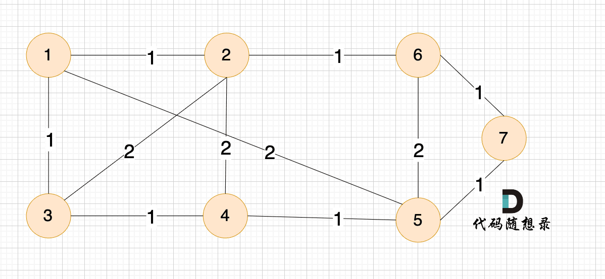

那麼在這個圖中，如何選取 n-1 條邊使得圖中所有節點連接到一起，並且邊的權重總和最小呢？

（圖中 n 為 7，即 7 個節點，那麼只需要 n-1 即 6 條邊就可以將所有頂點連接到一起）

Prim 演算法是從節點的角度採用貪心策略（greedy strategy）每次尋找距離最小生成樹最近的節點並加入到最小生成樹中。

Prim 演算法核心就是三步，我稱為 **Prim 三部曲**，大家一定要熟悉這三步，程式碼相對會好寫很多：

1. 第一步，選距離生成樹最近節點
2. 第二步，最近節點加入生成樹
3. 第三步，更新非生成樹節點到生成樹的距離（即更新 minDist 陣列（array））

現在錄友們會對這三步很陌生，不知道這是做什麼的，沒關係，下面將會畫圖舉例來帶大家把這 **Prim 三部曲**理解到位。

在 Prim 演算法中，有一個陣列特別重要，這裡我起名為：minDist。

剛剛我有講過「每次尋找距離最小生成樹最近的節點並加入到最小生成樹中」，那麼如何尋找距離最小生成樹最近的節點呢？

這就用到了 minDist 陣列，它用來做什麼呢？

**minDist 陣列用來記錄每一個節點距離最小生成樹的最近距離**。理解這一點非常重要，這也是 Prim 演算法最核心要點所在，很多錄友看不懂 Prim 演算法的程式碼，都是因為沒有理解透這個陣列的含義。

接下來，我們來透過一步一步畫圖，來帶大家鞏固 **Prim 三部曲**以及 minDist 陣列的作用。

（**範例中節點編號是從 1 開始，所以為了讓大家看得不暈，minDist 陣列下標（subscript）我也從 1 開始計數，下標 0 就不使用了，這樣下標和節點編號就可以對應上了，避免大家搞混**）


### 1 初始狀態

minDist 陣列裡的數值初始化（initialization）為最大數，因為本題節點距離不會超過 10000，所以初始化最大數為 10001 就可以。

相信這裡錄友就要問了，為什麼這麼做？

現在還沒有最小生成樹，預設（default）每個節點距離最小生成樹是最大的，這樣後面我們在比較（comparison）的時候，發現更近的距離，才能更新到 minDist 陣列上。

如圖：

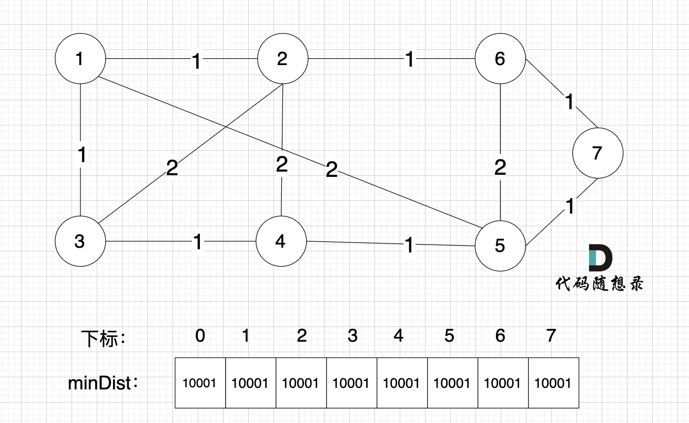

開始建構最小生成樹

### 2

1、Prim 三部曲，第一步：選距離生成樹最近節點

選擇距離最小生成樹最近的節點，加入到最小生成樹，剛開始還沒有最小生成樹，所以隨便選一個節點加入就好（因為每一個節點一定會在最小生成樹裡，所以隨便選一個就好），那我們選擇節點 1（符合遍歷（traversal）陣列的習慣，第一個遍歷的也是節點 1）

2、Prim 三部曲，第二步：最近節點加入生成樹

此時節點 1 已經算最小生成樹的節點。

3、Prim 三部曲，第三步：更新非生成樹節點到生成樹的距離（即更新 minDist 陣列）

接下來，我們要更新所有節點距離最小生成樹的距離，如圖：

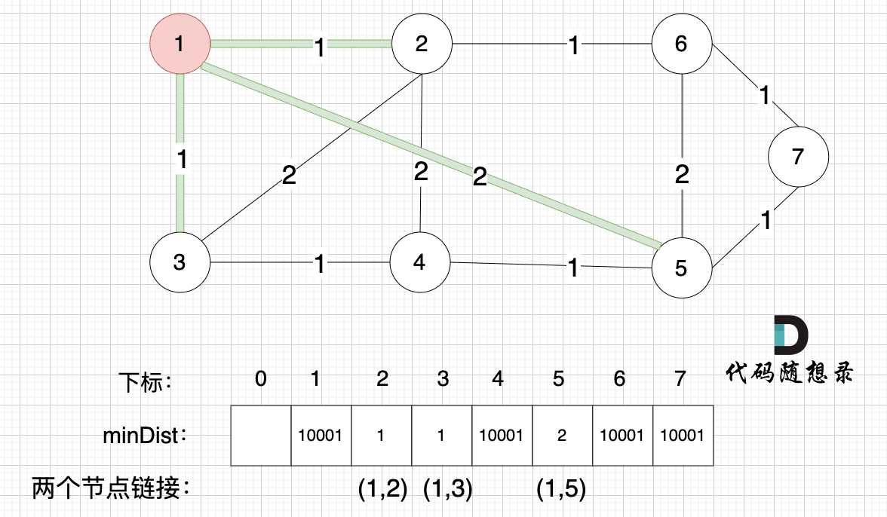


注意下標 0，我們就不管它了，下標 1 與節點 1 對應，這樣可以避免大家把節點搞混。

此時所有非生成樹的節點距離最小生成樹（節點 1）的距離都已經更新了。

* 節點 2 與節點 1 的距離為 1，比原先的距離值 10001 小，所以更新 minDist[2]。
* 節點 3 和節點 1 的距離為 1，比原先的距離值 10001 小，所以更新 minDist[3]。
* 節點 5 和節點 1 的距離為 2，比原先的距離值 10001 小，所以更新 minDist[5]。

**注意圖中我標記了 minDist 陣列裡更新的權重**，是哪兩個節點之間的權重，例如 minDist[2]=1，這個 1 是節點 1 與節點 2 之間的連線，清楚這一點對最後我們記錄最小生成樹的權重總和很重要。

（我在後面依然會不斷重複 Prim 三部曲，可能基礎好的錄友會感覺有點囉嗦，但也是讓大家感受這三部曲求解的過程）

### 3

1、Prim 三部曲，第一步：選距離生成樹最近節點

選取一個距離最小生成樹（節點 1）最近的非生成樹裡的節點，節點 2、3、5 距離最小生成樹（節點 1）最近，選節點 2（其實選節點 3 或者節點 2 都可以，距離一樣的）加入最小生成樹。

2、Prim 三部曲，第二步：最近節點加入生成樹

此時節點 1 和節點 2，已經算最小生成樹的節點。


3、Prim 三部曲，第三步：更新非生成樹節點到生成樹的距離（即更新 minDist 陣列）

接下來，我們要更新節點距離最小生成樹的距離，如圖：

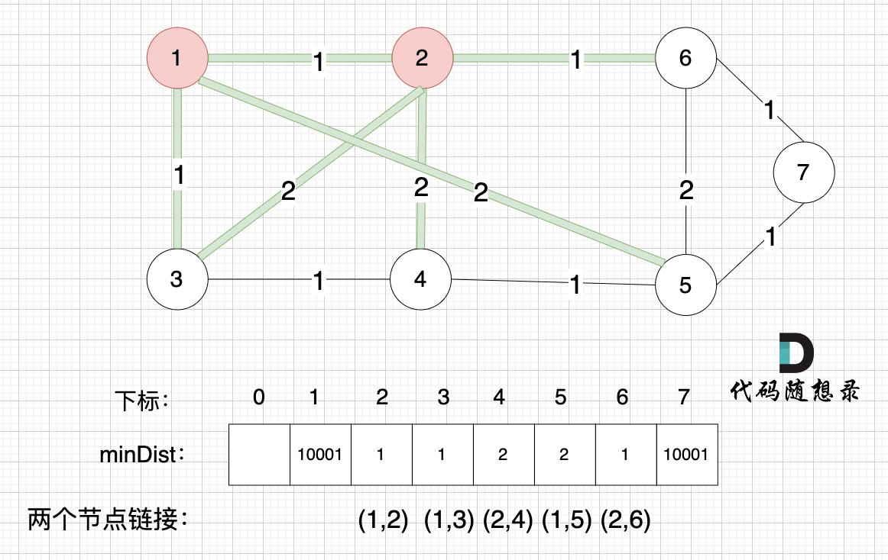

此時所有非生成樹的節點距離最小生成樹（節點 1、節點 2）的距離都已經更新了。

* 節點 3 和節點 2 的距離為 2，不比原先的距離值 1 小，所以不用更新。
* 節點 4 和節點 2 的距離為 2，比原先的距離值 10001 小，所以更新 minDist[4]。
* 節點 5 和節點 2 的距離為 10001（不連接），所以不用更新。
* 節點 6 和節點 2 的距離為 1，比原先的距離值 10001 小，所以更新 minDist[6]。

### 4

1、Prim 三部曲，第一步：選距離生成樹最近節點

選擇一個距離最小生成樹（節點 1、節點 2）最近的非生成樹裡的節點，節點 3、6 距離最小生成樹（節點 1、節點 2）最近，選節點 3（選節點 6 也可以，距離一樣）加入最小生成樹。

2、Prim 三部曲，第二步：最近節點加入生成樹

此時節點 1、節點 2、節點 3 算是最小生成樹的節點。


3、Prim 三部曲，第三步：更新非生成樹節點到生成樹的距離（即更新 minDist 陣列）

接下來更新節點距離最小生成樹的距離，如圖：

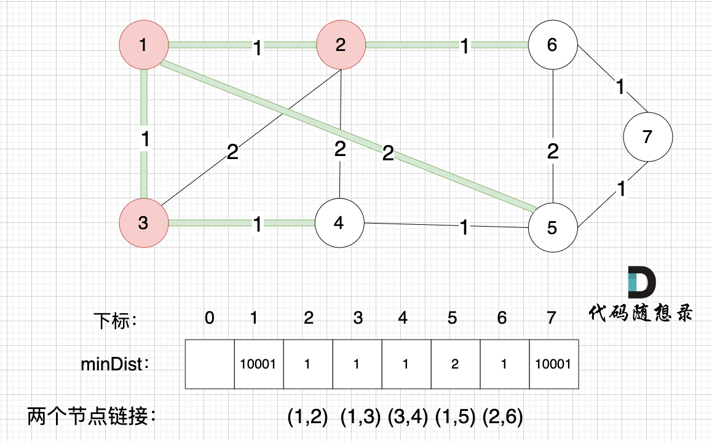

所有非生成樹的節點距離最小生成樹（節點 1、節點 2、節點 3）的距離都已經更新了。

* 節點 4 和節點 3 的距離為 1，比原先的距離值 2 小，所以更新 minDist[4] 為 1。

上面為什麼我們只比較節點 4 和節點 3 的距離呢？

因為節點 3 加入最小生成樹後，非生成樹節點只有節點 4 和節點 3 是連接的，所以需要重新更新一下節點 4 距離最小生成樹的距離，其他節點距離最小生成樹的距離都不變。

### 5

1、Prim 三部曲，第一步：選距離生成樹最近節點

繼續選擇一個距離最小生成樹（節點 1、節點 2、節點 3）最近的非生成樹裡的節點，為了鞏固大家對 minDist 陣列的理解，這裡我再囉嗦一遍：

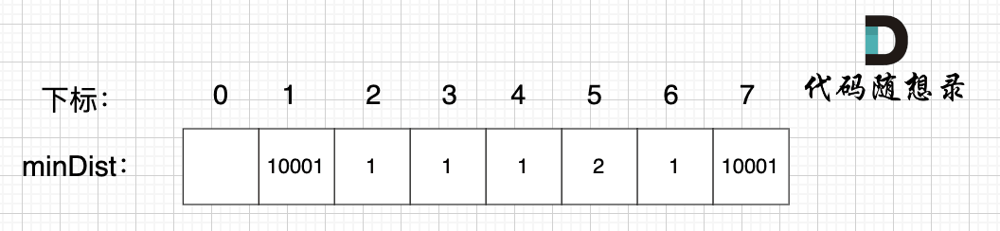

**minDist 陣列是記錄了所有非生成樹節點距離生成樹的最小距離**，所以從陣列裡我們能看出來，非生成樹節點 4 和節點 6 距離生成樹最近。


任選一個加入生成樹，我們選節點 4（選節點 6 也行）。

**注意**，我們根據 minDist 陣列，選取距離生成樹最近的節點加入生成樹，那麼 **minDist 陣列裡記錄的其實也是最小生成樹的邊的權重**（我在圖中把權重對應的是哪兩個節點也標記出來了）。

如果大家不理解，可以跟著我們下面的講解，看 minDist 陣列的變化，minDist 陣列裡記錄的權重對應的是哪條邊。

理解這一點很重要，因為最後我們要求最小生成樹裡所有邊的權重總和。

2、Prim 三部曲，第二步：最近節點加入生成樹

此時節點 1、節點 2、節點 3、節點 4 算是最小生成樹的節點。

3、Prim 三部曲，第三步：更新非生成樹節點到生成樹的距離（即更新 minDist 陣列）

接下來更新節點距離最小生成樹的距離，如圖：

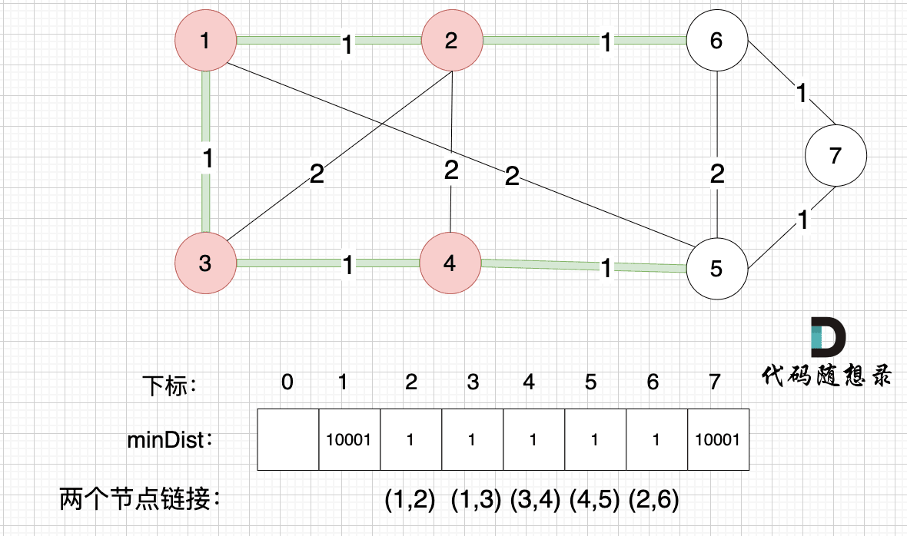

minDist 陣列已經更新了所有非生成樹的節點距離最小生成樹（節點 1、節點 2、節點 3、節點 4）的距離。

* 節點 5 和節點 4 的距離為 1，比原先的距離值 2 小，所以更新 minDist[5] 為 1。

### 6

1、Prim 三部曲，第一步：選距離生成樹最近節點

繼續選距離最小生成樹（節點 1、節點 2、節點 3、節點 4）最近的非生成樹裡的節點，只有節點 5 和節點 6。


選節點 5（選節點 6 也可以）加入生成樹。

2、Prim 三部曲，第二步：最近節點加入生成樹

節點 1、節點 2、節點 3、節點 4、節點 5 算是最小生成樹的節點。

3、Prim 三部曲，第三步：更新非生成樹節點到生成樹的距離（即更新 minDist 陣列）

接下來更新節點距離最小生成樹的距離，如圖：

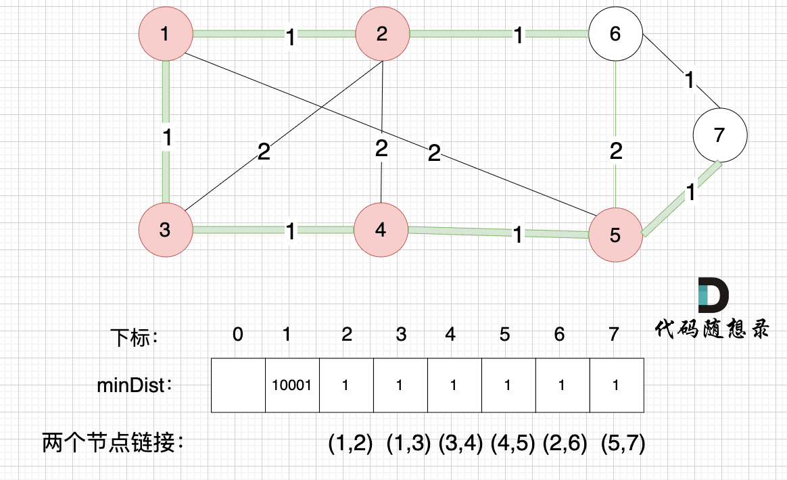

minDist 陣列已經更新了所有非生成樹的節點距離最小生成樹（節點 1、節點 2、節點 3、節點 4、節點 5）的距離。

* 節點 6 和節點 5 距離為 2，比原先的距離值 1 大，所以不更新
* 節點 7 和節點 5 距離為 1，比原先的距離值 10001 小，更新 minDist[7]

### 7

1、Prim 三部曲，第一步：選距離生成樹最近節點

繼續選距離最小生成樹（節點 1、節點 2、節點 3、節點 4、節點 5）最近的非生成樹裡的節點，只有節點 6 和節點 7。

2、Prim 三部曲，第二步：最近節點加入生成樹

選節點 6（選節點 7 也行，距離一樣的）加入生成樹。

3、Prim 三部曲，第三步：更新非生成樹節點到生成樹的距離（即更新 minDist 陣列）

節點 1、節點 2、節點 3、節點 4、節點 5、節點 6 算是最小生成樹的節點，接下來更新節點距離最小生成樹的距離，如圖：

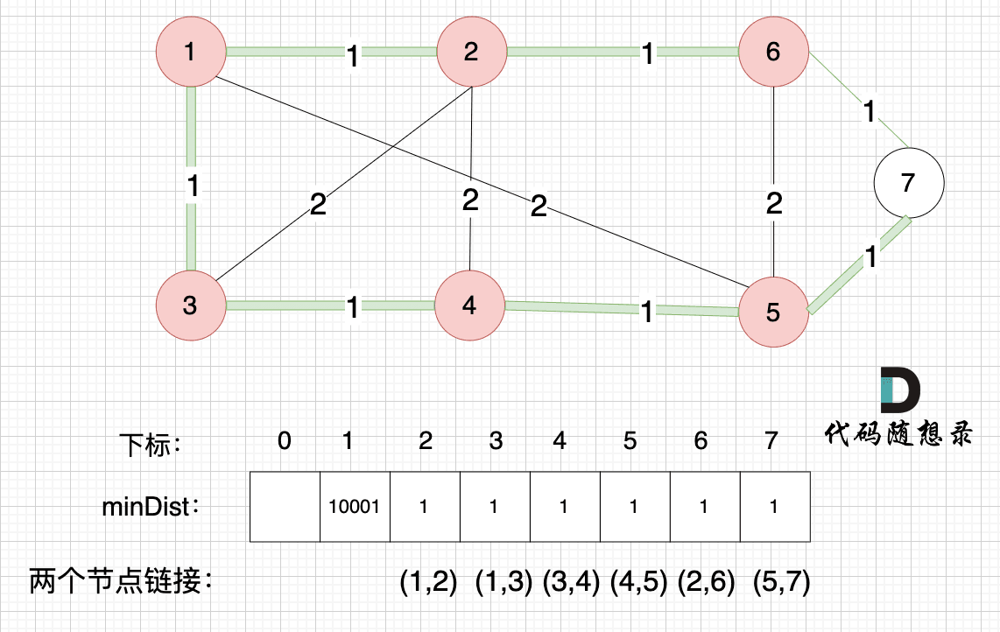

這裡就不再重複描述了，大家類推，最後，節點 7 加入生成樹，如圖：

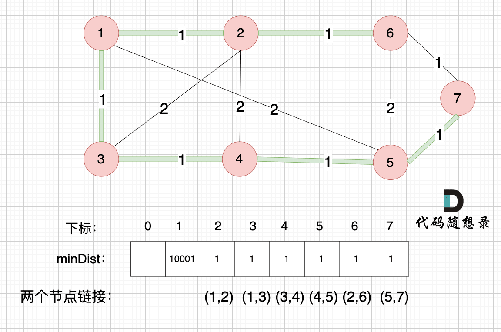

### 最後

最後我們就生成了一個最小生成樹，綠色的邊將所有節點連接到一起，並且保證權重是最小的，因為我們在更新 minDist 陣列的時候，都是選距離最小生成樹最近的點加入到樹中。

講解上面的模擬（simulation）過程的時候，我已經強調多次 minDist 陣列是記錄了所有非生成樹節點距離生成樹的最小距離。

最後，minDist 陣列也就是記錄的是最小生成樹所有邊的權重。

我在圖中，特別把每條邊的權重對應的是哪兩個節點標記出來（例如 minDist[7]=1，對應的是節點 5 和節點 7 之間的邊，而不是節點 6 和節點 7），就是為了讓大家清楚，minDist 裡的每一個值對應的是哪條邊。

那麼我們要求最小生成樹裡邊的權重總和就是把最後的 minDist 陣列累加一起。

以下程式碼，我對 Prim 三部曲做了重點註解，大家根據這三步，就可以透徹理解 Prim。

```CPP
#include<iostream>
#include<vector>
#include <climits>

using namespace std;
int main() {
    int v, e;
    int x, y, k;
    cin >> v >> e;
    // 填一個預設最大值，題目描述 val 最大為 10000
    vector<vector<int>> grid(v + 1, vector<int>(v + 1, 10001));
    while (e--) {
        cin >> x >> y >> k;
        // 因為是雙向圖，所以兩個方向都要填上
        grid[x][y] = k;
        grid[y][x] = k;

    }
    // 所有節點到最小生成樹的最小距離
    vector<int> minDist(v + 1, 10001);

    // 這個節點是否在樹裡
    vector<bool> isInTree(v + 1, false);

    // 我們只需要迴圈 n-1 次，建立 n - 1 條邊，就可以把 n 個節點的圖連在一起
    for (int i = 1; i < v; i++) {

        // 1、Prim 三部曲，第一步：選距離生成樹最近節點
        int cur = -1; // 選中哪個節點加入最小生成樹
        int minVal = INT_MAX;
        for (int j = 1; j <= v; j++) { // 1 - v，頂點編號，這裡下標從 1 開始
            // 選取最小生成樹節點的條件：
            // （1）不在最小生成樹裡
            // （2）距離最小生成樹最近的節點
            if (!isInTree[j] &&  minDist[j] < minVal) {
                minVal = minDist[j];
                cur = j;
            }
        }
        // 2、Prim 三部曲，第二步：最近節點（cur）加入生成樹
        isInTree[cur] = true;

        // 3、Prim 三部曲，第三步：更新非生成樹節點到生成樹的距離（即更新 minDist 陣列）
        // cur 節點加入之後，最小生成樹加入了新的節點，那麼所有節點到最小生成樹的距離（即 minDist 陣列）需要更新一下
        // 由於 cur 節點是新加入到最小生成樹，那麼只需要關心與 cur 相連的非生成樹節點的距離是否比原來非生成樹節點到生成樹節點的距離更小了呢
        for (int j = 1; j <= v; j++) {
            // 更新的條件：
            // （1）節點是非生成樹裡的節點
            // （2）與 cur 相連的某節點的權重比該某節點距離最小生成樹的距離小
            // 很多錄友看到這裡就想不明白什麼意思，其實就是 cur 是新加入最小生成樹的節點，那麼所有非生成樹的節點距離生成樹節點的最近距離由於 cur 的新加入，需要更新一下資料了
            if (!isInTree[j] && grid[cur][j] < minDist[j]) {
                minDist[j] = grid[cur][j];
            }
        }
    }
    // 統計結果
    int result = 0;
    for (int i = 2; i <= v; i++) { // 不計第一個頂點，因為統計的是邊的權重，v 個節點有 v-1 條邊
        result += minDist[i];
    }
    cout << result << endl;

}

```

時間複雜性（time complexity）為 O(n^2)，其中 n 為節點數量。

## 拓展

上面講解的是記錄了最小生成樹所有邊的權重，如果讓印出來最小生成樹的每條邊呢？或者說要把這個最小生成樹畫出來呢？


此時我們就需要把最小生成樹裡每一條邊記錄下來。

此時有兩個問題：

* 1、用什麼結構來記錄
* 2、如何記錄

如果記錄邊，其實就是記錄兩個節點就可以，兩個節點連成一條邊。

如何記錄兩個節點呢？

我們使用一維陣列（one dimensional array）就可以記錄。parent[節點編號] = 節點編號，這樣就把一條邊記錄下來了。（當然如果節點編號非常大，可以考慮使用 map）

使用一維陣列記錄是有向邊，不過我們這裡不需要記錄方向，所以只關注兩條邊是連接的就行。

parent 陣列初始化程式碼：

```CPP 
vector<int> parent(v + 1, -1);
```

接下來就是第二個問題，如何記錄？

我們再來回顧一下 Prim 三部曲，

1. 第一步，選距離生成樹最近節點
2. 第二步，最近節點加入生成樹
3. 第三步，更新非生成樹節點到生成樹的距離（即更新 minDist 陣列）

大家先思考一下，我們是在第幾步，可以記錄最小生成樹的邊呢？

在本篇上半部分我們講解過：「我們根據 minDist 陣列，選取距離生成樹最近的節點加入生成樹，那麼 **minDist 陣列裡記錄的其實也是最小生成樹的邊的權重**。」

既然 minDist 陣列記錄了最小生成樹的邊，是不是就是在更新 minDist 陣列的時候，去更新 parent 陣列來記錄一下對應的邊呢。


所以在 Prim 三部曲中的第三步，更新 parent 陣列，程式碼如下：

```CPP
for (int j = 1; j <= v; j++) {
    if (!isInTree[j] && grid[cur][j] < minDist[j]) {
        minDist[j] = grid[cur][j];
        parent[j] = cur; // 記錄最小生成樹的邊（注意陣列指向的順序很重要）
    }
}
```

程式碼中註解中，我強調了陣列指向的順序很重要。因為不少錄友在這裡會寫成這樣：`parent[cur] = j`。

這裡估計大家會疑惑了，parent[節點編號A] = 節點編號B，就表示 A 和 B 相連，我們這裡就不用在意方向，程式碼中為什麼只能 `parent[j] = cur` 而不能 `parent[cur] = j` 這麼寫呢？

如果寫成 `parent[cur] = j`，在 for 迴圈（for-loop）中，有多個 j 滿足要求，那麼 parent[cur] 就會被反覆覆蓋，因為 cur 是一個固定值。

舉個例子，cur=1，在 for 迴圈中，可能就 j=2，j=3，j=4 都符合條件（condition），那麼本來應該記錄節點 1 與節點 2、節點 3、節點 4 相連的。

如果 `parent[cur] = j` 這麼寫，最後更新的邏輯是 parent[1] = 2, parent[1] = 3, parent[1] = 4，最後只能記錄節點 1 與節點 4 相連，其他相連情況都被覆蓋了。

如果這麼寫 `parent[j] = cur`，那就是 parent[2] = 1, parent[3] = 1, parent[4] = 1，這樣才能完整表示出節點 1 與其他節點都是連接的，才沒有被覆蓋。

主要問題也是我們使用了一維陣列來記錄。

如果是二維（2D）陣列（array），來記錄兩個點連接，例如 parent[節點編號A][節點編號B] = 1，parent[節點編號B][節點編號A] = 1，來表示節點 A 與節點 B 相連，那就沒有上面說的這個注意事項了，當然這麼做的話，就是多開闢了記憶體（memory）空間。

以下是輸出最小生成樹邊的程式碼，不算最後輸出，就額外添加了兩行程式碼，我都註解標記了：

```CPP
#include<iostream>
#include<vector>
#include <climits>

using namespace std;
int main() {
    int v, e;
    int x, y, k;
    cin >> v >> e;
    vector<vector<int>> grid(v + 1, vector<int>(v + 1, 10001));
    while (e--) {
        cin >> x >> y >> k;
        grid[x][y] = k;
        grid[y][x] = k;
    }

    vector<int> minDist(v + 1, 10001);
    vector<bool> isInTree(v + 1, false);

    // 加上初始化
    vector<int> parent(v + 1, -1);

    for (int i = 1; i < v; i++) {
        int cur = -1;
        int minVal = INT_MAX;
        for (int j = 1; j <= v; j++) {
            if (!isInTree[j] &&  minDist[j] < minVal) {
                minVal = minDist[j];
                cur = j;
            }
        }

        isInTree[cur] = true;
        for (int j = 1; j <= v; j++) {
            if (!isInTree[j] && grid[cur][j] < minDist[j]) {
                minDist[j] = grid[cur][j];

                parent[j] = cur; // 記錄邊
            }
        }
    }
    // 輸出最小生成樹邊的連接情況
    for (int i = 1; i <= v; i++) {
        cout << i << "->" << parent[i] << endl;
    }
}

```

按照本題範例，程式碼輸入如下：

```
1->-1
2->1
3->1
4->3
5->4
6->2
7->5 
```

注意，這裡是無向圖（undirected graph），我在輸出上添加了箭頭僅僅是為了方便大家看出是邊的意思。

大家可以和我們本題最後生成的最小生成樹的圖去對比一下邊的連接情況：

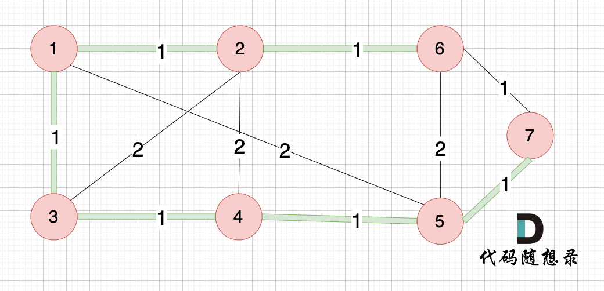  

綠色的邊是最小生成樹，和我們的輸出完全一致。

## 總結

此時我就把 Prim 演算法講解完畢了，我們再來回顧一下。

關於 Prim 演算法，我自創了三部曲，來幫助大家理解：

1. 第一步，選距離生成樹最近節點
2. 第二步，最近節點加入生成樹
3. 第三步，更新非生成樹節點到生成樹的距離（即更新 minDist 陣列）

大家只要理解這三部曲，Prim 演算法至少是可以寫出一個框架（framework）出來，然後再慢慢補充細節，這樣不至於自己在寫 Prim 的時候兩眼一抹黑完全憑感覺去寫。
這也為什麼很多錄友感覺 Prim 演算法比較難，而且每次學會了，隔一段時間又不會寫了，主要是沒有一個綱領。

理解這三部曲之後，更重要的就是理解 minDist 陣列。

**minDist 陣列是 Prim 演算法的靈魂，它幫助 Prim 演算法完成最重要的一步，就是如何找到距離最小生成樹最近的點**。

再來幫大家回顧 minDist 陣列的含義：記錄每一個節點距離最小生成樹的最近距離。

理解 minDist 陣列，至少大家看 Prim 演算法的程式碼不會懵。

也正是因為 minDist 陣列的作用，我們根據 minDist 陣列，選取距離生成樹最近的節點加入生成樹，那麼 **minDist 陣列裡記錄的其實也是最小生成樹的邊的權重**。

所以我們求最小生成樹的權重總和就是計算後的 minDist 陣列數值總和。

最後我們拓展了如何獲得最小生成樹的每一條邊，其實添加的程式碼很簡單，主要是理解為什麼使用 parent 陣列來記錄邊以及在哪裡更新 parent 陣列。

同時，因為使用一維陣列，陣列的下標和陣列如何賦值（assignment）很重要，不要搞反，導致結果被覆蓋。

好了，以上為總結，錄友們學習愉快。


## 其他語言版本

### Java 

```Java 
import java.util.*;

public class Main {
    public static void main(String[] args) {
        Scanner scanner = new Scanner(System.in);
        int v = scanner.nextInt();
        int e = scanner.nextInt();

        // 初始化相鄰矩陣，所有值初始化為一個大值，表示無窮大
        int[][] grid = new int[v + 1][v + 1];
        for (int i = 0; i <= v; i++) {
            Arrays.fill(grid[i], 10001);
        }

        // 讀取邊的資訊並填充相鄰矩陣
        for (int i = 0; i < e; i++) {
            int x = scanner.nextInt();
            int y = scanner.nextInt();
            int k = scanner.nextInt();
            grid[x][y] = k;
            grid[y][x] = k;
        }

        // 所有節點到最小生成樹的最小距離
        int[] minDist = new int[v + 1];
        Arrays.fill(minDist, 10001);

        // 記錄節點是否在樹裡
        boolean[] isInTree = new boolean[v + 1];

        // Prim 演算法主迴圈
        for (int i = 1; i < v; i++) {
            int cur = -1;
            int minVal = Integer.MAX_VALUE;

            // 選擇距離生成樹最近的節點
            for (int j = 1; j <= v; j++) {
                if (!isInTree[j] && minDist[j] < minVal) {
                    minVal = minDist[j];
                    cur = j;
                }
            }

            // 將最近的節點加入生成樹
            isInTree[cur] = true;

            // 更新非生成樹節點到生成樹的距離
            for (int j = 1; j <= v; j++) {
                if (!isInTree[j] && grid[cur][j] < minDist[j]) {
                    minDist[j] = grid[cur][j];
                }
            }
        }

        // 統計結果
        int result = 0;
        for (int i = 2; i <= v; i++) {
            result += minDist[i];
        }
        System.out.println(result);
        scanner.close();
    }
}

```

### Python
```python
# 接收輸入
v, e = list(map(int, input().strip().split()))
# 按照常規的相鄰矩陣儲存圖資訊，不可達的初始化為 10001
graph = [[10001] * (v+1) for _ in range(v+1)]
for _ in range(e):
    x, y, w = list(map(int, input().strip().split()))
    graph[x][y] = w
    graph[y][x] = w

# 定義加入生成樹的標記陣列和未加入生成樹的最近距離
visited = [False] * (v + 1)
minDist = [10001] * (v + 1)

# 迴圈 n - 1 次，建立 n - 1 條邊
# 從節點視角來看：每次選中一個節點加入樹，更新剩餘的節點到樹的最短距離，
# 這一步其實蘊含了確定下一條選取的邊，計入總路程 ans 的計算
for _ in range(1, v + 1):
    min_val = 10002
    cur = -1
    for j in range(1, v + 1):
        if visited[j] == False and minDist[j] < min_val:
            cur = j
            min_val = minDist[j]
    visited[cur] = True
    for j in range(1, v + 1):
        if visited[j] == False and minDist[j] > graph[cur][j]:
            minDist[j] = graph[cur][j]

ans = 0
for i in range(2, v + 1):
    ans += minDist[i]
print(ans)
```

```python 
def prim(v, e, edges):
    import sys
    import heapq

    # 初始化相鄰矩陣，所有值初始化為一個大值，表示無窮大
    grid = [[10001] * (v + 1) for _ in range(v + 1)]

    # 讀取邊的資訊並填充相鄰矩陣
    for edge in edges:
        x, y, k = edge
        grid[x][y] = k
        grid[y][x] = k

    # 所有節點到最小生成樹的最小距離
    minDist = [10001] * (v + 1)

    # 記錄節點是否在樹裡
    isInTree = [False] * (v + 1)

    # Prim 演算法主迴圈
    for i in range(1, v):
        cur = -1
        minVal = sys.maxsize

        # 選擇距離生成樹最近的節點
        for j in range(1, v + 1):
            if not isInTree[j] and minDist[j] < minVal:
                minVal = minDist[j]
                cur = j

        # 將最近的節點加入生成樹
        isInTree[cur] = True

        # 更新非生成樹節點到生成樹的距離
        for j in range(1, v + 1):
            if not isInTree[j] and grid[cur][j] < minDist[j]:
                minDist[j] = grid[cur][j]

    # 統計結果
    result = sum(minDist[2:v+1])
    return result

if __name__ == "__main__":
    import sys
    input = sys.stdin.read
    data = input().split()
    
    v = int(data[0])
    e = int(data[1])
    
    edges = []
    index = 2
    for _ in range(e):
        x = int(data[index])
        y = int(data[index + 1])
        k = int(data[index + 2])
        edges.append((x, y, k))
        index += 3

    result = prim(v, e, edges)
    print(result)

```

### Go

### Rust

### JavaScript
```js
function prim(v, edges) {
    const grid = Array.from({ length: v + 1 }, () => new Array(v + 1).fill(10001)); // Fixed grid initialization
    const minDist = new Array(v + 1).fill(10001)
    const isInTree = new Array(v + 1).fill(false)
    // 建構相鄰矩陣
    for(const [v1, v2, w] of edges) {
        grid[v1][v2] = w
        grid[v2][v1] = w
    }
    // Prim 演算法
    for (let i = 1 ; i < v ; i++) {
        let cur = -1
        let tempMinDist = Number.MAX_VALUE
        // 1. 尋找距離生成樹最近的節點
        for (let j = 1 ; j < v + 1 ; j++) {
            if (!isInTree[j] && minDist[j] < tempMinDist) {
                tempMinDist = minDist[j]
                cur = j
            }
        }
        // 2. 將節點放入生成樹
        isInTree[cur] = true
        // 3. 更新非生成樹節點與生成樹的最短距離
        for (let j = 1 ; j < v + 1 ; j++) {
            if (!isInTree[j] && grid[cur][j] < minDist[j]) {
                minDist[j] = grid[cur][j]
            }
        }
    }
    console.log(minDist.slice(2).reduce((acc, cur) => acc + cur, 0))
}


async function main() {
    const rl = require('readline').createInterface({ input: process.stdin })
    const iter = rl[Symbol.asyncIterator]()
    const readline = async () => (await iter.next()).value
    const [v, e] = (await readline()).split(" ").map(Number)
    const edges = []
    for (let i = 0 ; i < e ; i++) {
        edges.push((await readline()).split(" ").map(Number))
    }
    prim(v, edges)
}


main()
```

### TypeScript

### PhP

### Swift

### Scala

### C#

### Dart

### C

