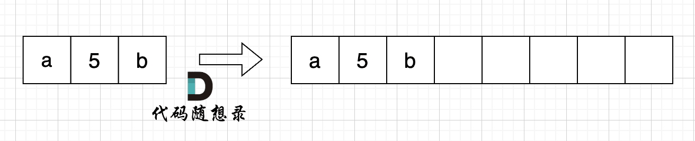
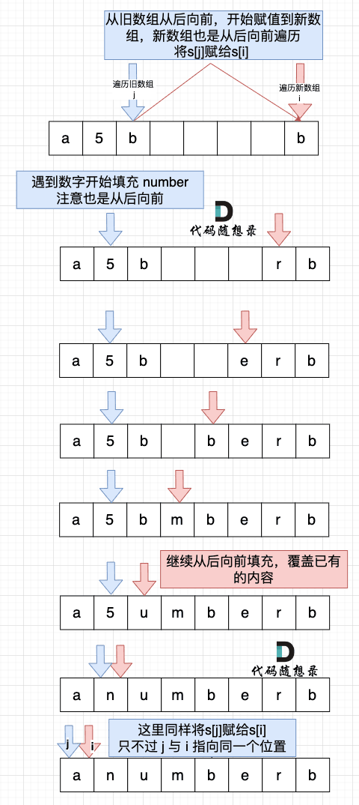

# 替換數字

[KamaCoder 題目連結](https://kamacoder.com/problempage.php?pid=1064)

給定一個字串（string）s，它包含小寫字母和數字字元（character），請編寫一個函數（function），將字串中的字母字元保持不變，而將每個數字字元替換為 number。

例如，對於輸入字串 "a1b2c3"，函數應該將其轉換為 "anumberbnumbercnumber"。

對於輸入字串 "a5b"，函數應該將其轉換為 "anumberb"

輸入：一個字串 s，s 僅包含小寫字母和數字字元。

輸出：印出一個新的字串，其中每個數字字元都被替換為了 number

範例輸入：a1b2c3

範例輸出：anumberbnumbercnumber

資料範圍：1 <= s.length < 10000。

## 解題思路

如果想把這道題目做到極致，就不要使用額外的 auxiliary space 了！（不過使用 Java 和 Python 練習題目的錄友，一定要使用 auxiliary space，因為 Java 和 Python 裡的 string 不能修改）

首先擴充陣列（array）到每個數字字元替換成 "number" 之後的大小。

例如字串 "a5b" 的長度為 3，那麼將數字字元變成字串 "number" 之後的字串為 "anumberb" 長度為 8。

如圖：

 

然後從後向前替換數字字元，也就是 two pointers 法，過程如下：i 指向新長度的末尾，j 指向舊長度的末尾。

 

有同學問了，為什麼要從後向前填充，從前向後填充不行嗎？

從前向後填充就是 O(n^2) 的演算法了，因為每次添加元素（element）都要將添加元素之後的所有元素整體向後移動。

**其實很多陣列填充類的問題，其做法都是先預先給陣列擴容到填充後的大小，然後再從後向前進行操作。**

這麼做有兩個好處：

1. 不用申請新陣列。
2. 從後向前填充元素，避免了從前向後填充元素時，每次添加元素都要將添加元素之後的所有元素向後移動的問題。

C++ 程式碼如下：

```CPP
#include <iostream>
using namespace std;
int main() {
    string s;
    while (cin >> s) {
        int sOldIndex = s.size() - 1;
        int count = 0; // 統計數字的個數
        for (int i = 0; i < s.size(); i++) {
            if (s[i] >= '0' && s[i] <= '9') {
                count++;
            }
        }
        // 擴充字串 s 的大小，也就是將每個數字替換成 "number" 之後的大小
        s.resize(s.size() + count * 5);
        int sNewIndex = s.size() - 1;
        // 從後往前將數字替換為 "number"
        while (sOldIndex >= 0) {
            if (s[sOldIndex] >= '0' && s[sOldIndex] <= '9') {
                s[sNewIndex--] = 'r';
                s[sNewIndex--] = 'e';
                s[sNewIndex--] = 'b';
                s[sNewIndex--] = 'm';
                s[sNewIndex--] = 'u';
                s[sNewIndex--] = 'n';
            } else {
                s[sNewIndex--] = s[sOldIndex];
            }
            sOldIndex--;
        }
        cout << s << endl;       
    }
}


```

* 時間複雜度（time complexity）：O(n)
* 空間複雜度（space complexity）：O(1)

此時算上本題，我們已經做了七道 two pointers 相關的題目了，分別是：

* [27.移除元素](https://programmercarl.com/0027.移除元素.html)
* [15.三數之和](https://programmercarl.com/0015.三数之和.html)
* [18.四數之和](https://programmercarl.com/0018.四数之和.html)
* [206.翻轉鏈接串列](https://programmercarl.com/0206.翻转链表.html)
* [142.環形鏈接串列II](https://programmercarl.com/0142.环形链表II.html)
* [344.反轉字串](https://programmercarl.com/0344.反转字符串.html)

## 拓展

這裡也給大家拓展一下字串和陣列有什麼差別，

字串是若干字元組成的有限序列（sequence），也可以理解為是一個字元陣列（character array），但是很多程式設計語言（programming language）對字串做了特殊的規定，接下來我來說一說 C/C++ 中的字串。

在 C 語言中，把一個字串存入一個陣列時，也把結束符 '\0' 存入陣列，並以此作為該字串是否結束的旗標（flag）。

例如這段程式碼：

```
char a[5] = "asd";
for (int i = 0; a[i] != '\0'; i++) {
}
```

在 C++ 中，提供一個 string 類別（class），string 類別會提供 size 介面（interface），可以用來判斷 string 類別字串是否結束，就不用 '\0' 來判斷是否結束。

例如這段程式碼：

```
string a = "asd";
for (int i = 0; i < a.size(); i++) {
}
```

那麼 vector< char > 和 string 又有什麼區別呢？

其實在基本操作上沒有區別，但是 string 提供更多的字串處理的相關介面，例如 string 過載（overload） 了 +，而 vector 卻沒有。

所以想處理字串，我們還是會定義一個 string 類型。


## 其他語言版本

### C：

### Java：
解法一
```java
import java.util.Scanner;

public class Main {
    
    public static String replaceNumber(String s) {
        int count = 0; // 統計數字的個數
        int sOldSize = s.length();
        for (int i = 0; i < s.length(); i++) {
            if(Character.isDigit(s.charAt(i))){
                count++;
            }
        }
        // 擴充字串 s 的大小，也就是每個空白替換成 "number" 之後的大小
        char[] newS = new char[s.length() + count * 5];
        int sNewSize = newS.length;
        // 將舊字串的內容填入新陣列
        System.arraycopy(s.toCharArray(), 0, newS, 0, sOldSize);
        // 從後向前將空白替換為 "number"
        for (int i = sNewSize - 1, j = sOldSize - 1; j < i; j--, i--) {
            if (!Character.isDigit(newS[j])) {
                newS[i] = newS[j];
            } else {
                newS[i] = 'r';
                newS[i - 1] = 'e';
                newS[i - 2] = 'b';
                newS[i - 3] = 'm';
                newS[i - 4] = 'u';
                newS[i - 5] = 'n';
                i -= 5;
            }
        }
        return new String(newS);
    };
    public static void main(String[] args) {
        Scanner scanner = new Scanner(System.in);
        String s = scanner.next();
        System.out.println(replaceNumber(s));
        scanner.close();
    }
}
```
解法二
```java
// 為了還原題目本意，先把原陣列複製到擴展長度後的新陣列，然後不再使用原陣列、in-place 對新陣列進行操作。
import java.util.*;

public class Main {
    public static void main(String[] args) {
        Scanner sc = new Scanner(System.in);
        String s = sc.next();
        int len = s.length();
        for (int i = 0; i < s.length(); i++) {
            if (s.charAt(i) >= 0 && s.charAt(i) <= '9') {
                len += 5;
            }
        }
        
        char[] ret = new char[len];
        for (int i = 0; i < s.length(); i++) {
            ret[i] = s.charAt(i);
        }
        for (int i = s.length() - 1, j = len - 1; i >= 0; i--) {
            if ('0' <= ret[i] && ret[i] <= '9') {
                ret[j--] = 'r';
                ret[j--] = 'e';
                ret[j--] = 'b';
                ret[j--] = 'm';
                ret[j--] = 'u';
                ret[j--] = 'n';
            } else {
                ret[j--] = ret[i];
            }
        }
        System.out.println(ret);
    }
}
```

### Python：
```python
class Solution(object):
    def subsitute_numbers(self, s):
        """
        :type s: str
        :rtype: str
        """
        
        count = sum(1 for char in s if char.isdigit()) # 統計數字的個數
        expand_len = len(s) + (count * 5)  # 計算擴充後字串的大小，x->number，每有一個數字就要增加五個長度
        res = [''] * expand_len
        
        new_index = expand_len - 1 # 指向擴充後字串末尾
        old_index = len(s) - 1 # 指向原字串末尾
        
        while old_index >= 0: # 從後往前，遇到數字替換成 "number"
            if s[old_index].isdigit():
                res[new_index-5:new_index+1] = "number"
                new_index -= 6
            else:
                res[new_index] = s[old_index]
                new_index -= 1
            old_index -= 1
        
        return "".join(res)
        
if __name__ == "__main__":
    solution = Solution()

    while True:
        try:
            s = input()
            result = solution.subsitute_numbers(s)
            print(result)
        except EOFError:
            break

```

### Go：
````go
package main

import "fmt"

func main(){
    var strByte []byte
    
    fmt.Scanln(&strByte)
    
    for i := 0; i < len(strByte); i++{
        if strByte[i] <= '9' && strByte[i] >= '0' {
            inserElement := []byte{'n','u','m','b','e','r'}
            strByte = append(strByte[:i], append(inserElement, strByte[i+1:]...)...)
            i = i + len(inserElement) -1
        }
    }
    
    fmt.Printf(string(strByte))
}
````
Go 使用 雙指標（two pointers） 解法
````go
package main

import "fmt"

func replaceNumber(strByte []byte) string {
    // 查看有多少字元
    numCount, oldSize := 0, len(strByte)
    for i := 0; i < len(strByte); i++ {
        if (strByte[i] <= '9') && (strByte[i] >= '0') {
            numCount ++
        }
    }
    // 增加長度
    for i := 0; i < numCount; i++ {
        strByte = append(strByte, []byte("     ")...)
    }
    tmpBytes := []byte("number")
    // two pointers 從後遍歷
    leftP, rightP := oldSize-1, len(strByte)-1
    for leftP < rightP {
        rightShift := 1
        // 如果是數字則加入 number
        if (strByte[leftP] <= '9') && (strByte[leftP] >= '0') {
            for i, tmpByte := range tmpBytes {
                strByte[rightP-len(tmpBytes)+i+1] = tmpByte
            }
            rightShift = len(tmpBytes)
        } else {
            strByte[rightP] = strByte[leftP]
        }
        // 更新指標
        rightP -= rightShift
        leftP -= 1
    }
    return string(strByte)
}

func main(){
    var strByte []byte
    fmt.Scanln(&strByte)
    
    newString := replaceNumber(strByte)

    fmt.Println(newString)
}
````


### JavaScript:
```js
const readline = require("readline");

const rl = readline.createInterface({
    input: process.stdin,
    output: process.stdout
})

function main() {
    const num0 = "0".charCodeAt();
    const num9 = "9".charCodeAt();
    const a = "a".charCodeAt();
    const z = "z".charCodeAt();
    function isAZ(str) {
        return str >= a && str <= z;
    }
    function isNumber(str) {
        return str >= num0 && str <= num9;
    }
    rl.on("line", (input) => {
        let n = 0;
        for (let i = 0; i < input.length; i++) {
            const val = input[i].charCodeAt();
            if (isNumber(val)) {
                n+= 6;
            }
            if (isAZ(val)) {
                n++;
            }
        }
        const ans = new Array(n).fill(0);
        let index = input.length - 1;
        for (let i = n - 1; i >= 0; i--) {
            const val = input[index].charCodeAt();
            if (isAZ(val)) {
                ans[i] = input[index];
            }
            if (isNumber(val)) {
                ans[i] = "r";
                ans[i - 1] = "e";
                ans[i - 2] = "b";
                ans[i - 3] = "m";
                ans[i - 4] = "u";
                ans[i - 5] = "n";
                i -= 5;
            }
            index--;
        }
        console.log(ans.join(""));
    })
}

main();
```

### TypeScript：


### Swift:


### Scala:

### PHP：

```php
<?php
// 標準輸入
$s = trim(fgets(STDIN));
$oldLen = strlen($s);
$count = 0;
for ($i = 0; $i < $oldLen; $i++) {
    if (is_numeric($s[$i])) {
      $count++;
    }
}

// 擴充字串
$s = str_pad($s, $oldLen + $count * 5);
$newLen = strlen($s);
while($oldLen >= 0) {
    if (is_numeric($s[$oldLen])) {
        $s[$newLen--] = 'r';
        $s[$newLen--] = 'e';
        $s[$newLen--] = 'b';
        $s[$newLen--] = 'm';
        $s[$newLen--] = 'u';
        $s[$newLen--] = 'n';
    } else {
        $s[$newLen--] = $s[$oldLen];
    }
    $oldLen--;
}

echo $s;
?>
```


### Rust:

