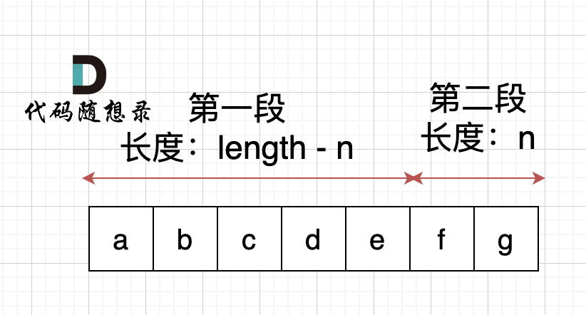
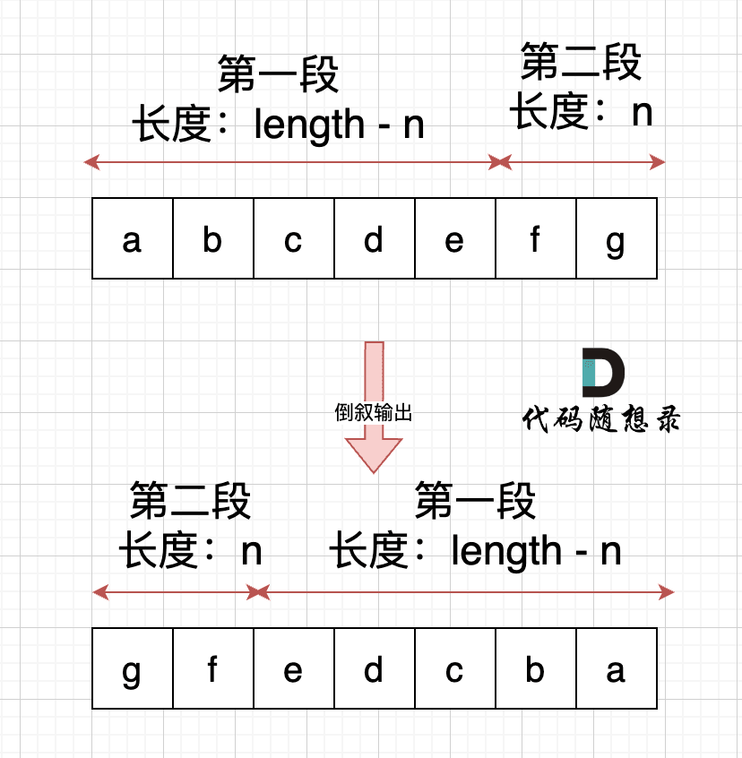
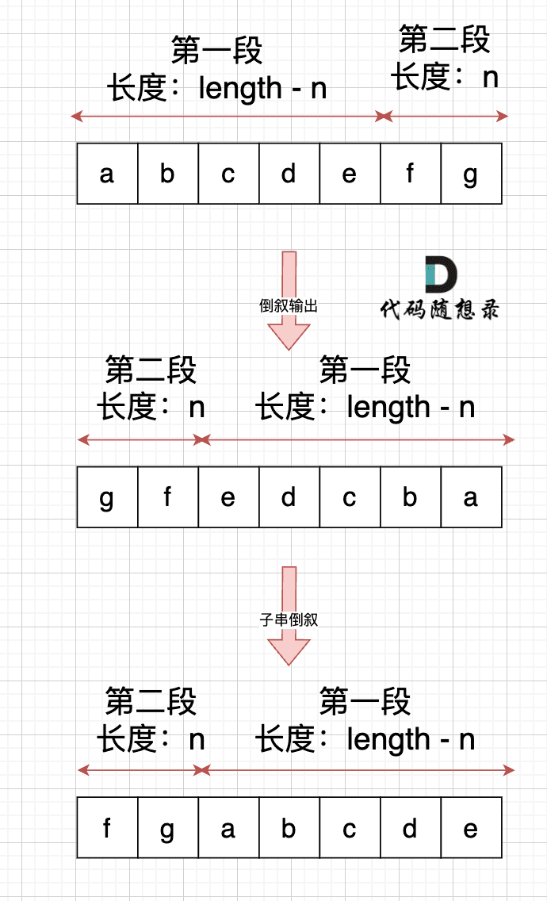
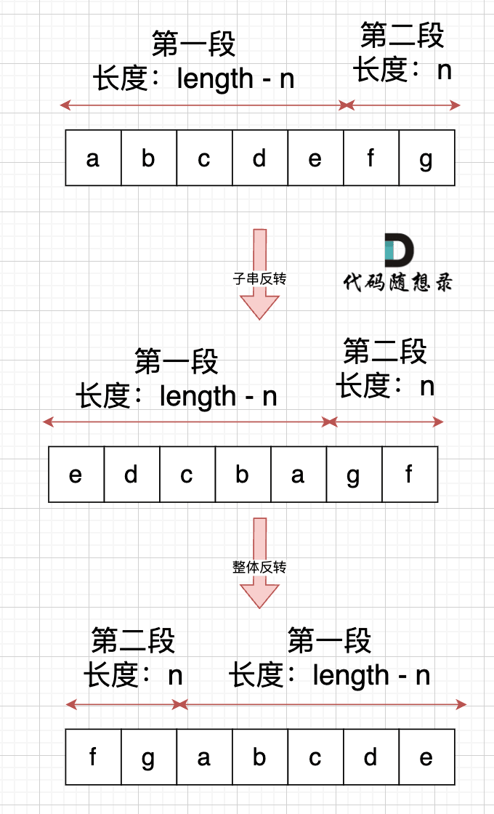

# 右旋字串

[KamaCoder 題目連結](https://kamacoder.com/problempage.php?pid=1065)

字串（string）的右旋轉操作是把字串尾部的若干個字元（character）轉移到字串的前面。給定一個字串 s 和一個正整數（positive integer）k，請編寫一個函數（function），將字串中的後面 k 個字元移到字串的前面，實現字串的右旋轉操作。

例如，對於輸入字串 "abcdefg" 和整數（integer）2，函數應該將其轉換為 "fgabcde"。

輸入：輸入共包含兩行，第一行為一個正整數 k，代表右旋轉的位數。第二行為字串 s，代表需要旋轉的字串。

輸出：輸出共一行，為進行了右旋轉操作後的字串。

範例輸入：

```
2
abcdefg 
```

範例輸出：

```
fgabcde
```

資料範圍：1 <= k < 10000, 1 <= s.length < 10000;


## 解題思路

為了讓本題更有意義，提升一下本題難度：**不能申請額外空間，只能在本字串上操作**。（Java 不能在字串上修改，所以使用 Java 一定要開闢新空間）

不能使用額外空間的話，模擬（simulation）在本字串操作要實作右旋轉字串的功能還是有點困難的。

那麼我們可以想一下上一題目[字串：花式反轉（reverse）還不夠！](../0151.反轉字串裡的單詞.md)中講過，使用整體反轉+局部反轉就可以實作反轉單詞順序的目的。


本題中，我們需要將字串右移 n 位，字串相當於分成了兩個部分，如果 n 為 2，字串相當於分成了兩個部分，如圖：（length 為字串長度）




右移 n 位，就是將第二段放在前面，第一段放在後面，先不考慮裡面字元的順序，是不是整體倒序就行了。如圖：

 

此時第一段和第二段的順序是我們想要的，但裡面的字元位置被我們倒序了，那麼此時我們再把第一段和第二段裡面的字元再倒序一次，這樣字元順序不就正確了。如圖：

 

其實，解題思路就是透過整體倒序，把兩段子字串（substring）順序顛倒，兩段子字串裡的字元再倒序一次，**負負得正**，這樣就不影響子字串裡面字元的順序了。

整體程式碼如下：

```CPP 
// 版本一
#include<iostream>
#include<algorithm>
using namespace std;
int main() {
    int n;
    string s;
    cin >> n;
    cin >> s;
    int len = s.size(); // 取得長度

    reverse(s.begin(), s.end()); // 整體反轉
    reverse(s.begin(), s.begin() + n); // 先反轉前一段，長度 n
    reverse(s.begin() + n, s.end()); // 再反轉後一段

    cout << s << endl;

} 
```

那麼整體反轉的操作放在下面，先局部反轉行不行？

可以的，不過，要記得控制好局部反轉的長度，如果先局部反轉，那麼先反轉的子字串長度就是 len - n，如圖：



程式碼如下：

```CPP
// 版本二
#include<iostream>
#include<algorithm>
using namespace std;
int main() {
    int n;
    string s;
    cin >> n;
    cin >> s;
    int len = s.size(); // 取得長度
    reverse(s.begin(), s.begin() + len - n); // 先反轉前一段，長度 len-n，注意這裡是和版本一的區別
    reverse(s.begin() + len - n, s.end()); // 再反轉後一段
    reverse(s.begin(), s.end()); // 整體反轉
    cout << s << endl;

}
```


## 拓展

大家在做《劍指 Offer》的時候，會發現《劍指 Offer》的題目是左反轉，那麼左反轉和右反轉有什麼區別呢？

其實解題思路是一模一樣的，就是反轉的區間（interval）不同而已。如果本題是左旋轉 n，那麼實作程式碼如下：

```CPP
#include<iostream>
#include<algorithm>
using namespace std;
int main() {
    int n;
    string s;
    cin >> n;
    cin >> s;
    int len = s.size(); // 取得長度
    reverse(s.begin(), s.begin() + n); // 反轉第一段長度為 n
    reverse(s.begin() + n, s.end()); // 反轉第二段長度為 len-n
    reverse(s.begin(), s.end()); // 整體反轉
    cout << s << endl;

}
```

大家可以感受一下這份程式碼和版本二的區別，其實就是反轉的區間不同而已。

那麼左旋轉的話，可不可以先整體反轉，例如像版本一那樣呢？

當然可以。


## 其他語言版本

### Java：
```Java
// 版本一
import java.util.Scanner;

public class Main {
    public static void main(String[] args) {
        Scanner in = new Scanner(System.in);
        int n = Integer.parseInt(in.nextLine());
        String s = in.nextLine();

        int len = s.length(); // 取得字串長度
        char[] chars = s.toCharArray();
        reverseString(chars, 0, len - 1); // 反轉整個字串
        reverseString(chars, 0, n - 1); // 反轉前一段字串，此時的字串首尾是 0, n - 1
        reverseString(chars, n, len - 1); // 反轉後一段字串，此時的字串首尾是 n, len - 1
        
        System.out.println(chars);

    }

    public static void reverseString(char[] ch, int start, int end) {
        // 互斥或法反轉字串，參照題目 344.反轉字串的解釋
        while (start < end) {
            ch[start] ^= ch[end];
            ch[end] ^= ch[start];
            ch[start] ^= ch[end];
            start++;
            end--;
        }
    }
}


// 版本二
import java.util.Scanner;

public class Main {
    public static void main(String[] args) {
        Scanner in = new Scanner(System.in);
        int n = Integer.parseInt(in.nextLine());
        String s = in.nextLine();

        int len = s.length(); // 取得字串長度
        char[] chars = s.toCharArray();
        reverseString(chars, 0, len - n - 1); // 反轉前一段字串，此時的字串首尾是 0, len - n - 1
        reverseString(chars, len - n, len - 1); // 反轉後一段字串，此時的字串首尾是 len - n, len - 1
        reverseString(chars, 0, len - 1); // 反轉整個字串

        System.out.println(chars);

    }

    public static void reverseString(char[] ch, int start, int end) {
        // 互斥或法反轉字串，參照題目 344.反轉字串的解釋
        while (start < end) {
            ch[start] ^= ch[end];
            ch[end] ^= ch[start];
            ch[start] ^= ch[end];
            start++;
            end--;
        }
    }
}
```

### Python: 
```Python
# 取得輸入的數字 k 和字串
k = int(input())
s = input()

# 透過切片反轉第一段和第二段字串
# 注意：python 中字串是不可變的，所以也需要額外空間
s = s[len(s)-k:] + s[:len(s)-k]
print(s)
```

```Python 切片法
k = int(input())
s = input()

print(s[-k:] + s[:-k])
```

### Go：
```go
package main
import "fmt"

func reverse (strByte []byte, l, r int){
    for l < r {
        strByte[l], strByte[r] = strByte[r], strByte[l]
        l++
        r--
    }
}


func main(){
    var str string
    var target int
    
    fmt.Scanln(&target)
    fmt.Scanln(&str)
    strByte := []byte(str)
    
    reverse(strByte, 0, len(strByte) - 1)
    reverse(strByte, 0, target - 1)
    reverse(strByte, target, len(strByte) - 1)
    
    fmt.Printf(string(strByte))
}
```


### C：
```C
#include <stdio.h>
#include <string.h>

void reverse(char *s, int left, int right)
{
    while(left <= right)
    {
        char c = s[left];
        s[left] = s[right];
        s[right] = c;
        left++;
        right--;
    }
}

void rightRotate(char *s, int k)
{
    int len = strlen(s);
    // 先局部反轉再整體反轉
    reverse(s, 0, len - k - 1);   // 反轉前部分
    reverse(s, len - k, len - 1); // 反轉後部分：後 k 位
    reverse(s, 0, len - 1);       // 整體反轉
}

int main()
{

    int k;
    scanf("%d", &k);
    char s[10000];
    scanf("%s", s);

    rightRotate(s, k);
    printf("%s\n", s);

    return 0;
}
```

### JavaScript：
```javascript
// JS 中字串內不可單獨修改

const readline = require('readline')

const rl = readline.createInterface({
    input: process.stdin,
    output: process.stdout
})

const inputs = []; // 儲存輸入

rl.on('line', function(data) {
    inputs.push(data);

}).on('close', function() {
    const res = deal(inputs);
    // 印出結果
    console.log(res);
})

// 對傳入的資料進行處理
function deal(inputs) {
    let [k, s] = inputs;
    const len = s.length - 1;
    k = parseInt(k);
    str = s.split('');
    
    str = reverseStr(str, 0, len - k)
    str = reverseStr(str, len - k + 1, len)
    str = reverseStr(str, 0, len)

    return str.join('');
}

// 根據提供的範圍進行翻轉
function reverseStr(s, start, end) {
    
    while (start < end) {
        [s[start], s[end]] = [s[end], s[start]]
        
        start++;
        end--;
    }

    return s;
}
```

### TypeScript：


### Swift:
```swift
func rotateWords(_ s: String, _ k: Int) -> String {
    var chars = Array(s)
    // 先反轉整體
    reverseWords(&chars, start: 0, end: s.count - 1)
    // 反轉前半段
    reverseWords(&chars, start: 0, end: k - 1)
    // 反轉後半段
    reverseWords(&chars, start: k, end: s.count - 1)
    return String(chars)
}

// 反轉 start...end 的字元陣列
func reverseWords(_ chars: inout [Character], start: Int, end: Int) {
    var left = start
    var right = end
    while left < right, right < chars.count {
        (chars[left], chars[right]) = (chars[right], chars[left])
        left += 1
        right -= 1
    }
}
```


### PHP：

```php
<?php
// 反轉函數
function reverse(&$s, $start, $end) {
    for ($i = $start, $j = $end; $i < $j; $i++, $j--) {
        $tmp = $s[$i];
        $s[$i] = $s[$j];
        $s[$j] = $tmp;
    }
}
    
// 標準輸入：讀取右旋轉位數和字串
$n = trim(fgets(STDIN));
$s = trim(fgets(STDIN));
// 字串長度
$len = strlen($s);
// 先部分反轉
reverse($s, $len - $n, $len - 1);
reverse($s, 0, $len - $n - 1);
// 再整體反轉
reverse($s, 0, $len - 1);

echo $s;
?>
```


### Scala:


### Rust:

