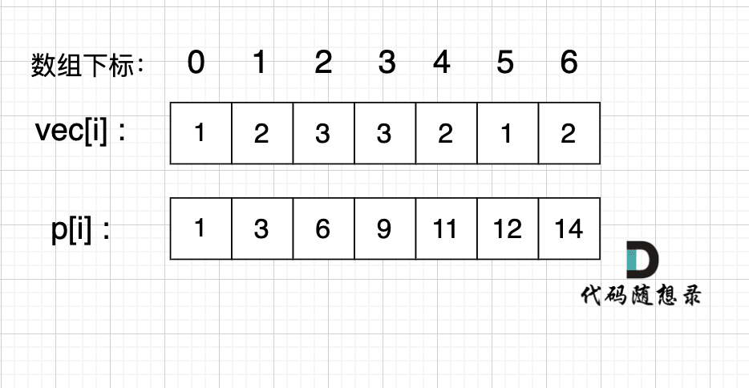
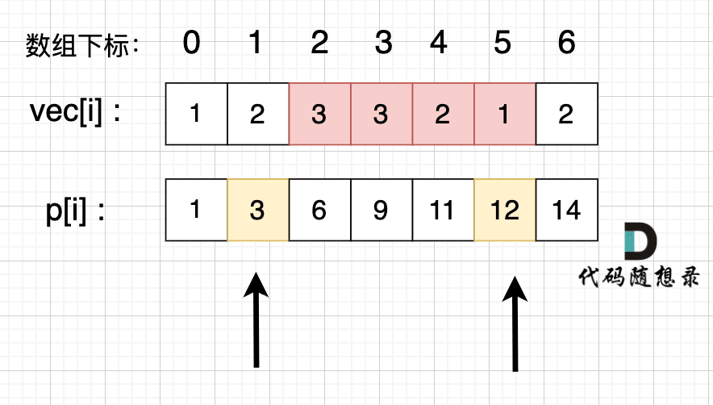

# 58. 區間（interval）和

> 本題為《程式碼隨想錄》後續擴充題目，還沒有影片講解，順便讓大家練習一下 ACM 輸入輸出模式（筆試面試必備）

[題目連結](https://kamacoder.com/problempage.php?pid=1070)

題目描述

給定一個整數（integer）陣列（array）Array，請計算該陣列在每個指定區間內元素（element）的總和。

輸入描述

第一行輸入為整數陣列 Array 的長度 n，接下來 n 行，每行一個整數，表示陣列的元素。隨後的輸入為需要計算總和的區間，直至檔案結束。

輸出描述

輸出每個指定區間內元素的總和。

輸入範例

```
5
1
2
3
4
5
0 1
1 3
```

輸出範例

```
3
9
```

資料範圍：

0 < n <= 100000

## 解題思路

本題我們來講解陣列上常用的解題技巧：prefix sum

首先來看本題，我們最直觀的想法是什麼？

那就是給一個區間，然後把這個區間的和都累加一遍不就得了，是一道簡單到不能再簡單的題目。

程式碼如下：

```CPP 
#include <iostream>
#include <vector>
using namespace std;
int main() {
    int n, a, b;
    cin >> n;
    vector<int> vec(n);
    for (int i = 0; i < n; i++) cin >> vec[i];
    while (cin >> a >> b) {
        int sum = 0;
        // 累加區間 a 到 b 的和
        for (int i = a; i <= b; i++) sum += vec[i];
        cout << sum << endl;
    }
} 
```

程式碼一提交，發現逾時了.....

我在製作本題的時候，特別製作了大資料量查詢，卡的就是這種蠻力法（brute force）。

來舉一個極端的例子，如果我查詢 m 次，每次查詢的範圍都是從 0 到 n - 1

那麼該演算法的時間複雜度（time complexity）是 O(n * m)，m 是查詢的次數

如果查詢次數非常大的話，這個時間複雜度也是非常大的。

接下來我們來引入 prefix sum，看看 prefix sum 如何解決這個問題。

prefix sum 的思想是重複利用計算過的子陣列（subarray）之和，從而降低區間查詢需要累加計算的次數。

**prefix sum 在涉及計算區間和的問題時非常有用**！

prefix sum 的解題思路其實很簡單，我給大家舉個例子很容易就懂了。

例如，我們要統計 vec[i] 這個陣列上的區間和。

我們先做累加，即 p[i] 表示下標（subscript）0 到 i 的 vec[i] 累加之和。

如圖：



如果，我們想統計在 vec 陣列上下標 2 到下標 5 之間的累加和，那是不是就用 p[5] - p[1] 就可以了。

為什麼呢？

`p[1] = vec[0] + vec[1];`

`p[5] = vec[0] + vec[1] + vec[2] + vec[3] + vec[4] + vec[5];`

`p[5] - p[1] = vec[2] + vec[3] + vec[4] + vec[5];`

這不就是我們要求的下標 2 到下標 5 之間的累加和嗎。

如圖所示：



`p[5] - p[1]` 就是紅色部分的區間和。

而 p 陣列是我們之前就計算好的累加和，所以後面每次求區間和的時候我們只需要 O(1) 的操作。

**特別注意**：在使用 prefix sum 求解的時候，要特別注意求解區間。

如上圖，如果我們要求區間下標 [2, 5] 的區間和，那麼應該是 p[5] - p[1]，而不是 p[5] - p[2]。

**很多錄友在使用 prefix sum 的時候，分不清 prefix sum 的區間，建議畫一畫圖，模擬（simulation）一下，解題思路會更清晰**。

本題 C++ 程式碼如下：

```CPP
#include <iostream>
#include <vector>
using namespace std;
int main() {
    int n, a, b;
    cin >> n;
    vector<int> vec(n);
    vector<int> p(n);
    int presum = 0;
    for (int i = 0; i < n; i++) {
        cin >> vec[i];
        presum += vec[i];
        p[i] = presum;
    }

    while (cin >> a >> b) {
        int sum;
        if (a == 0) sum = p[b];
        else sum = p[b] - p[a - 1];
        cout << sum << endl;
    }
}

```

C++ 程式碼面對大量資料讀取輸出操作，最好用 scanf 和 printf，耗時會小很多：

```CPP
#include <iostream>
#include <vector>
using namespace std;
int main() {
    int n, a, b;
    cin >> n;
    vector<int> vec(n);
    vector<int> p(n);
    int presum = 0;
    for (int i = 0; i < n; i++) {
        scanf("%d", &vec[i]);
        presum += vec[i];
        p[i] = presum;
    }

    while (~scanf("%d%d", &a, &b)) {
        int sum;
        if (a == 0) sum = p[b];
        else sum = p[b] - p[a - 1];
        printf("%d\n", sum);
    }
}

```

## 其他語言版本

### Java 

```Java

import java.util.Scanner;

public class Main {
    public static void main(String[] args) {
        Scanner scanner = new Scanner(System.in);

        int n = scanner.nextInt();
        int[] vec = new int[n];
        int[] p = new int[n];

        int presum = 0;
        for (int i = 0; i < n; i++) {
            vec[i] = scanner.nextInt();
            presum += vec[i];
            p[i] = presum;
        }

        while (scanner.hasNextInt()) {
            int a = scanner.nextInt();
            int b = scanner.nextInt();

            int sum;
            if (a == 0) {
                sum = p[b];
            } else {
                sum = p[b] - p[a - 1];
            }
            System.out.println(sum);
        }

        scanner.close();
    }
}

 
```

### Python

```python 

import sys
input = sys.stdin.read

def main():
    data = input().split()
    index = 0
    n = int(data[index])
    index += 1
    vec = []
    for i in range(n):
        vec.append(int(data[index + i]))
    index += n

    p = [0] * n
    presum = 0
    for i in range(n):
        presum += vec[i]
        p[i] = presum

    results = []
    while index < len(data):
        a = int(data[index])
        b = int(data[index + 1])
        index += 2

        if a == 0:
            sum_value = p[b]
        else:
            sum_value = p[b] - p[a - 1]

        results.append(sum_value)

    for result in results:
        print(result)

if __name__ == "__main__":
    main()

```


###  JavaScript

``` JavaScript

function prefixSum() {
    const readline = require('readline');

    const rl = readline.createInterface({
        input: process.stdin,
        output: process.stdout
    });

    let inputLines = [];
    rl.on('line', (line) => {
        inputLines.push(line.trim());
    });

    rl.on('close', () => {
        // 讀取項數 n
        const n = parseInt(inputLines[0]);

        // 使用 前綴和（prefix sum），複雜度控制在 O(1)
        let sum = new Array(n);
        sum[0] = parseInt(inputLines[1]);

        // 計算 前綴和 陣列
        for (let i = 1; i < n; i++) {
            let value = parseInt(inputLines[i + 1]);
            sum[i] = sum[i - 1] + value;
        }

        // 處理區間和查詢
        for (let i = n + 1; i < inputLines.length; i++) {
            let [left, right] = inputLines[i].split(' ').map(Number);

            if (left === 0) {
                console.log(sum[right]);
            } else {
                console.log(sum[right] - sum[left - 1]);
            }
        }
    });
}


```


### C

```C
#include <stdio.h>
#include <stdlib.h>

int main(int argc, char *argv[])
{
    int num;
    // 讀取陣列長度
    scanf("%d", &num);

    // 使用動態記憶體配置而不是靜態陣列，以適應不同的輸入大小
    int *a = (int *)malloc((num + 1) * sizeof(int));

    // 初始化 前綴和 陣列的第一個元素為 0
    a[0] = 0;

    // 讀取陣列元素並計算 前綴和
    for (int i = 1; i <= num; i++)
    {
        int mm;
        scanf("%d", &mm);
        // 累加 prefix sum
        a[i] = a[i - 1] + mm;
    }

    int m, n;
    // 迴圈讀取區間並計算區間和，直到輸入結束
    // scanf() 回傳成功匹配和賦值的個數，到達檔案末尾則回傳 EOF
    while (scanf("%d%d", &m, &n) == 2)
    {
        // 輸出區間和，注意區間是左閉右開，因此 a[n+1] 是包含 n 的元素的 prefix sum
        printf("%d\n", a[n+1] - a[m]);
    }

    // 釋放之前配置的記憶體
    free(a);
    return 0;
}

```

### Go

```go
package main

import (
    "fmt"
    "bufio"
    "strconv"
    "os"
)

func main() {
    // bufio 中讀取資料的介面，因為資料卡得比較嚴，導致使用 fmt.Scan 會逾時
    scanner := bufio.NewScanner(os.Stdin)
    
    // 取得陣列大小
    scanner.Scan()
    n, _ := strconv.Atoi(scanner.Text())
    
    // 取得陣列元素的同時計算 prefix sum，一般建議切片開大一點防止各種越界問題
    arr := make([]int, n + 1)
    for i := 0; i < n; i++ {
        scanner.Scan()
        arr[i], _ = strconv.Atoi(scanner.Text())
        if i != 0 {
            arr[i] += arr[i - 1]
        }
    }
    
    /* 
    區間 [l, r] 的和可以使用區間 [0, r] 和 [0, l - 1] 相減得到，
    在程式碼中即為 arr[r]-arr[l-1]。這裡需要注意 l-1 是否越界
    */
    for {
        var l, r int
        scanner.Scan()
        _, err := fmt.Sscanf(scanner.Text(), "%d %d", &l, &r)
        if err != nil {
            return
        }
        
        if l > 0 {
            fmt.Println(arr[r] - arr[l - 1])
        } else {
            fmt.Println(arr[r])
        }
    }
}
```

