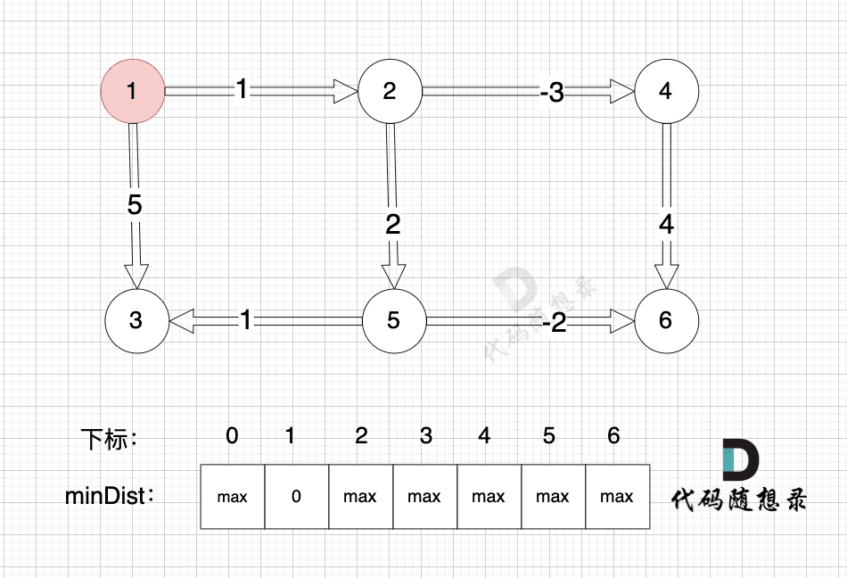
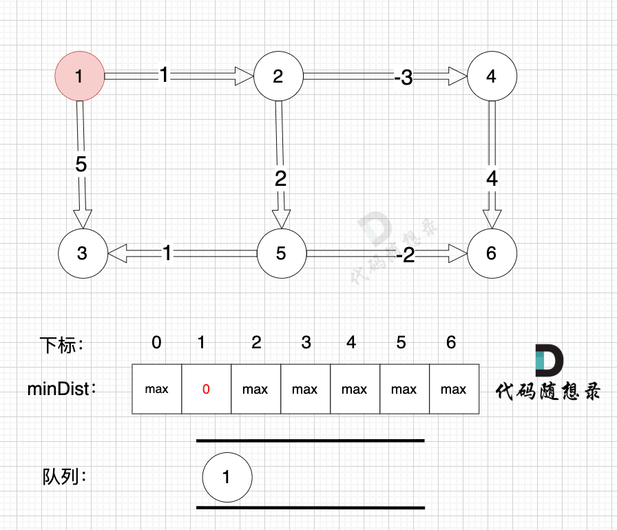
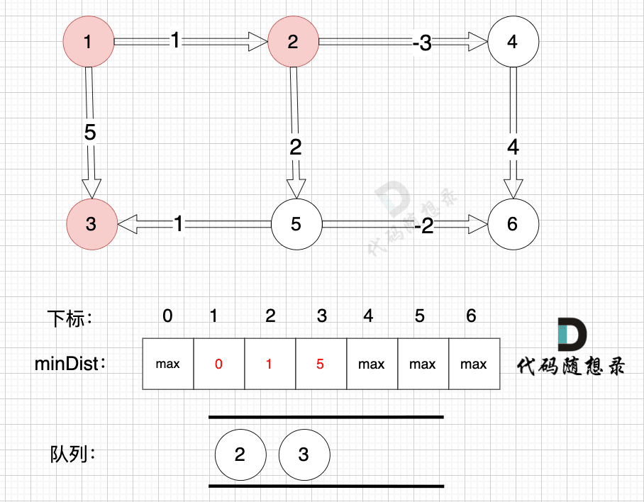
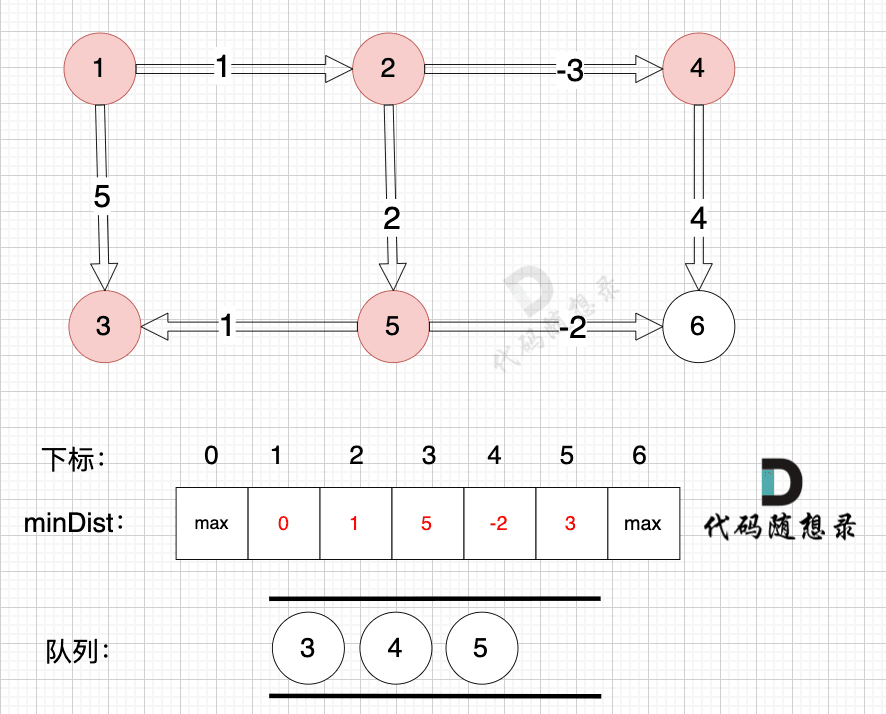
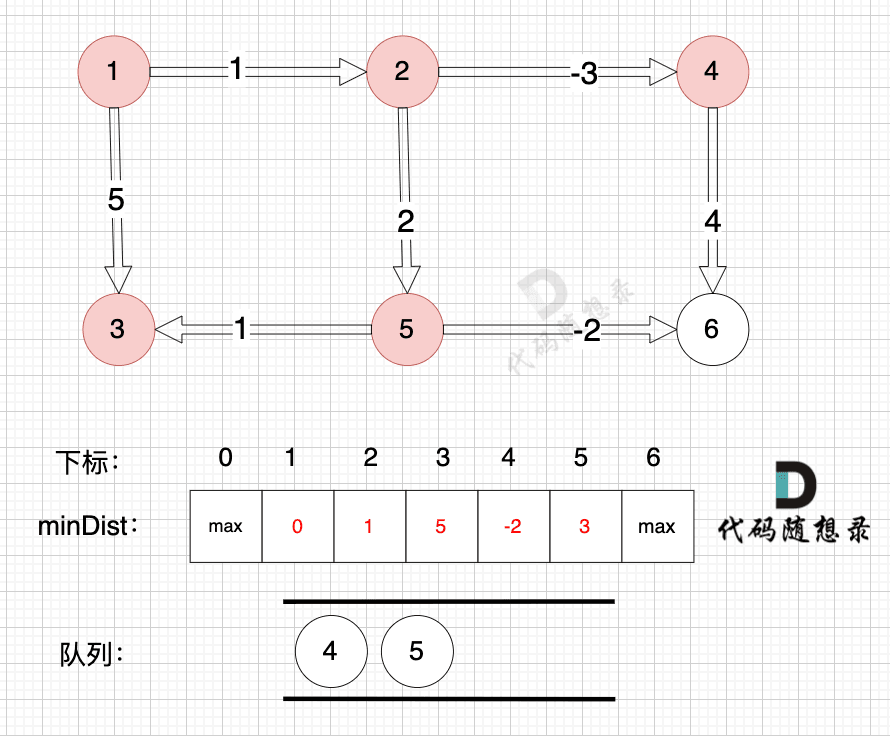
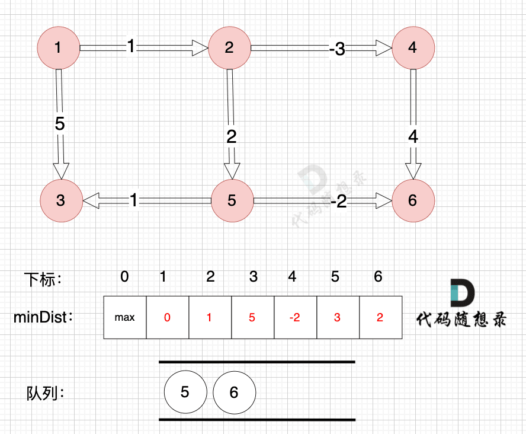
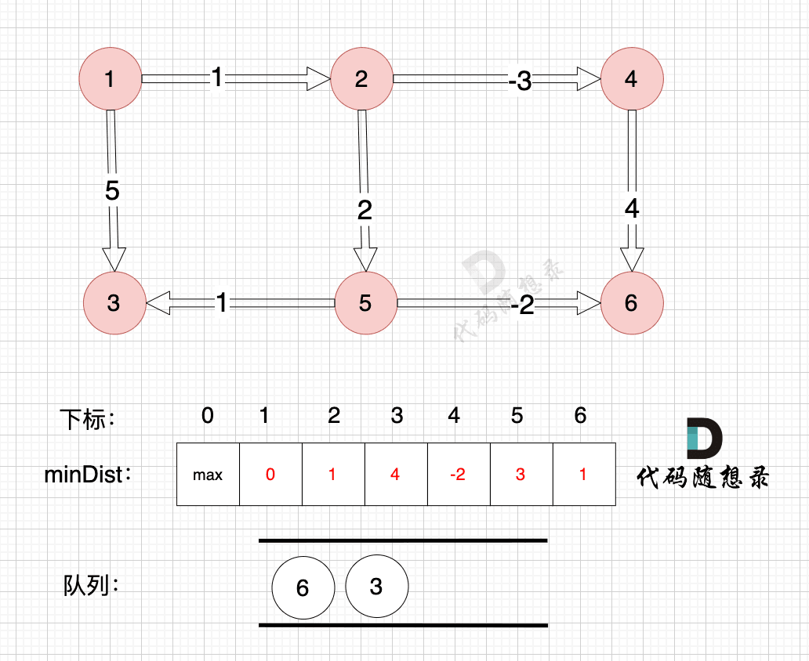
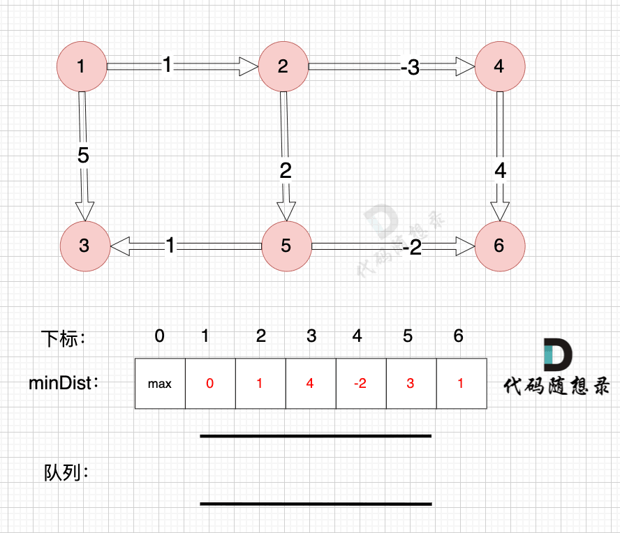
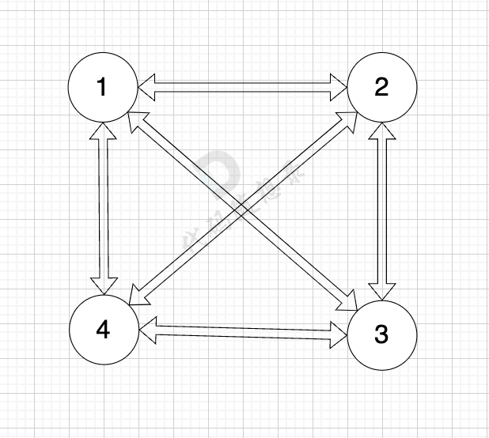
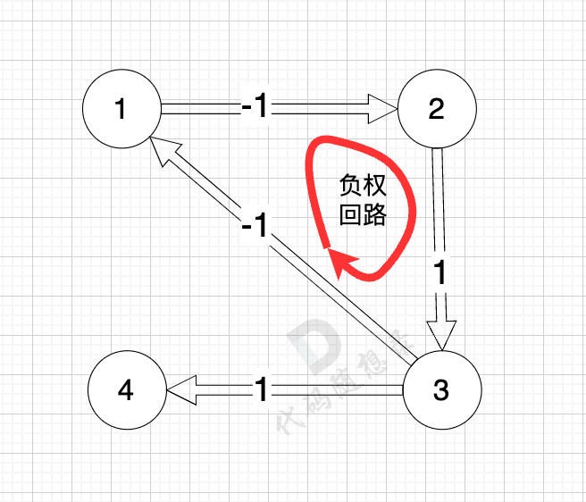

<p align="center"><strong><a href="./qita/join.md">參與本專案</a>，貢獻其他語言版本的程式碼，擁抱開放原始碼（open source），讓更多學習演算法的夥伴們受益！</strong></p>

# Bellman_ford 佇列（queue）最佳化演算法（又名 SPFA）

[KamaCoder：94. 城市間貨物運輸 I](https://kamacoder.com/problempage.php?pid=1152)

題目描述

某國為促進城市間經濟交流，決定對貨物運輸提供補貼。共有 n 個編號為 1 到 n 的城市，透過道路網路連接，網路中的道路僅允許從某個城市單向通行到另一個城市，不能反向通行。


網路中的道路都有各自的運輸成本和政府補貼，道路的權重（weight）計算方式為：運輸成本 - 政府補貼。

權重為正表示扣除了政府補貼後運輸貨物仍需支付的費用；權重為負則表示政府的補貼超過了支出的運輸成本，實際表現為運輸過程中還能賺取一定的收益。


請找出從城市 1 到城市 n 的所有可能路徑（path）中，綜合政府補貼後的最低運輸成本。

如果最低運輸成本是一個負數（negative number），它表示在遵循最佳路徑的情況下，運輸過程中反而能夠實現盈利。

城市 1 到城市 n 之間可能會出現沒有路徑的情況，同時保證道路網路中不存在任何 負權重環（negative weight cycle）。

> 負權重環 是指一系列道路的總權重為負，這樣的迴路使得透過反覆經過迴路中的道路，理論上可以無限地減少總成本或無限地增加總收益。

輸入描述

第一行包含兩個正整數（positive integer），第一個正整數 n 表示該國一共有 n 個城市，第二個整數（integer） m 表示這些城市中共有 m 條道路。

接下來為 m 行，每行包括三個整數，s、t 和 v，表示 s 號城市運輸貨物到達 t 號城市，道路權重為 v（單向圖）。

輸出描述

如果能夠從城市 1 連通到城市 n，請輸出一個整數，表示運輸成本。如果該整數是負數，則表示實現了盈利。如果從城市 1 沒有路徑可達城市 n，請輸出 "unconnected"。

輸入範例： 

```
6 7
5 6 -2
1 2 1
5 3 1
2 5 2
2 4 -3
4 6 4
1 3 5
```

## 背景

本題我們來系統講解 Bellman_ford 佇列最佳化演算法，也叫 SPFA 演算法（Shortest Path Faster Algorithm）。 

>  SPFA 的稱呼來自 1994 年西南交通大學段凡丁的論文，其實 Bellman_ford 提出後不久（20 世紀 50 年代末期）就有佇列最佳化的版本，國際上不承認這個演算法是中國國內提出的。所以國際上一般稱呼該演算法為 Bellman_ford 佇列最佳化演算法（Queue improved Bellman-Ford） 

大家知道以上來歷，知道 SPFA 和 Bellman_ford 佇列最佳化演算法指的都是同一個演算法就好。 

如果大家還不夠了解 Bellman_ford 演算法，強烈建議按照《程式碼隨想錄》的順序學習，否則可能看不懂下面的講解。 

大家可以發現 Bellman_ford 演算法每次鬆弛都是對所有邊（edge）進行鬆弛。 

但真正有效的鬆弛，是基於已經計算過的節點（node）在做的鬆弛。 

給大家舉一個例子： 

  

本圖中，對所有邊進行鬆弛，真正有效的鬆弛，只有鬆弛 邊（節點 1->節點 2）和 邊（節點 1->節點 3）。

而鬆弛 邊（節點 4->節點 6），邊（節點 5->節點 3）等等都是無效的操作，因為 節點 4 和 節點 5 都是沒有被計算過的節點。


所以 Bellman_ford 演算法每次都是對所有邊進行鬆弛，其實是多做了一些無用功。 

**只需要對 上一次鬆弛的時候更新過的節點作為出發節點所連接的邊 進行鬆弛就夠了**。 

基於以上想法，如何記錄 上次鬆弛的時候更新過的節點呢？ 

用佇列來記錄。（其實用堆疊（stack）也行，對元素（element）順序沒有要求） 

## 模擬（simulation）過程

接下來舉例說明這個佇列是如何運作的。 

以範例給出的所有邊為例： 

```
5 6 -2
1 2 1
5 3 1
2 5 2
2 4 -3
4 6 4
1 3 5
```

我們依然使用 **minDist 陣列（array）來表達 起點到各個節點的最短路徑（shortest path）**，例如 minDist[3] = 5 表示起點到達節點 3 的最小距離為 5 

初始化（initialization），起點為節點 1，起點到起點的最短距離為 0，所以 minDist[1] 為 0。將節點 1 加入佇列（下次鬆弛從節點 1 開始）



------------

從佇列裡取出節點 1，鬆弛節點 1 作為出發點連接的邊（節點 1 -> 節點 2）和邊（節點 1 -> 節點 3） 

邊：節點 1 -> 節點 2，權重為 1，minDist[2] > minDist[1] + 1，更新 minDist[2] = minDist[1] + 1 = 0 + 1 = 1。

邊：節點 1 -> 節點 3，權重為 5，minDist[3] > minDist[1] + 5，更新 minDist[3] = minDist[1] + 5 = 0 + 5 = 5。 

將節點 2、節點 3 加入佇列，如圖： 




----------------- 


從佇列裡取出節點 2，鬆弛節點 2 作為出發點連接的邊（節點 2 -> 節點 4）和邊（節點 2 -> 節點 5） 

邊：節點 2 -> 節點 4，權重為 1，minDist[4] > minDist[2] + (-3)，更新 minDist[4] = minDist[2] + (-3) = 1 + (-3) = -2。

邊：節點 2 -> 節點 5，權重為 2，minDist[5] > minDist[2] + 2，更新 minDist[5] = minDist[2] + 2 = 1 + 2 = 3。 


將節點 4，節點 5 加入佇列，如圖： 




-------------------- 


從佇列裡取出節點 3，鬆弛節點 3 作為出發點連接的邊。 

因為沒有從節點 3 作為出發點的邊，所以這裡就從佇列裡取出節點 3 就好，不用做其他操作，如圖： 




------------ 

從佇列中取出節點 4，鬆弛節點 4 作為出發點連接的邊（節點 4 -> 節點 6）

邊：節點 4 -> 節點 6，權重為 4，minDist[6] > minDist[4] + 4，更新 minDist[6] = minDist[4] + 4 = -2 + 4 = 2。 

將節點 6 加入佇列

如圖： 




--------------- 

從佇列中取出節點 5，鬆弛節點 5 作為出發點連接的邊（節點 5 -> 節點 3），邊（節點 5 -> 節點 6） 

邊：節點 5 -> 節點 3，權重為 1，minDist[3] > minDist[5] + 1，更新 minDist[3] = minDist[5] + 1 = 3 + 1 = 4 

邊：節點 5 -> 節點 6，權重為 -2，minDist[6] > minDist[5] + (-2)，更新 minDist[6] = minDist[5] + (-2) = 3 - 2 = 1

如圖，將節點 3 加入佇列，因為節點 6 已經在佇列裡，所以不用重複加入



所以我們在加入佇列的過程可以有一個最佳化，**用 visited 陣列記錄已經在佇列裡的元素，已經在佇列的元素不用重複加入**

-------------- 

從佇列中取出節點 6，鬆弛節點 6 作為出發點連接的邊。 

節點 6 作為終點，沒有可以出發的邊。 

同理從佇列中取出節點 3，也沒有可以出發的邊

所以直接從佇列中取出，如圖： 

 

----------

這樣我們就完成了基於佇列最佳化的 bellman_ford 演算法模擬過程。 

大家可以發現，基於佇列最佳化的演算法，要比 bellman_ford 演算法減少很多無用的鬆弛情況，特別是對於邊數眾多的大圖最佳化效果明顯。 

了解了大體流程，我們再看程式碼應該怎麼寫。 

在上面模擬過程中，我們每次都要知道 一個節點作為出發點連接了哪些節點。 

如果想方便知道這些資料，就需要使用相鄰串列（adjacency list）來儲存這個圖（graph），如果對於相鄰串列不了解的話，可以看 [kama0047.參會dijkstra堆](./0047.參會dijkstra堆積.md) 中 圖的儲存 部分。 


整體程式碼如下：

```
#include <iostream>
#include <vector>
#include <queue>
#include <list>
#include <climits>
using namespace std;

struct Edge { //相鄰串列
    int to;  // 連結的節點
    int val; // 邊的權重

    Edge(int t, int w): to(t), val(w) {}  // 建構子
};


int main() {
    int n, m, p1, p2, val;
    cin >> n >> m;

    vector<list<Edge>> grid(n + 1); 

    vector<bool> isInQueue(n + 1); // 加入最佳化，已經在佇列裡的元素不用重複加入

    // 將所有邊儲存起來
    for(int i = 0; i < m; i++){
        cin >> p1 >> p2 >> val;
        // p1 指向 p2，權重為 val
        grid[p1].push_back(Edge(p2, val));
    }
    int start = 1;  // 起點
    int end = n;    // 終點

    vector<int> minDist(n + 1 , INT_MAX);
    minDist[start] = 0;

    queue<int> que;
    que.push(start); 

    while (!que.empty()) {

        int node = que.front(); que.pop();
        isInQueue[node] = false; // 從佇列裡取出的時候，要取消標記，我們只保證已經在佇列裡的元素不用重複加入
        for (Edge edge : grid[node]) {
            int from = node;
            int to = edge.to;
            int value = edge.val;
            if (minDist[to] > minDist[from] + value) { // 開始鬆弛
                minDist[to] = minDist[from] + value; 
                if (isInQueue[to] == false) { // 已經在佇列裡的元素不用重複加入
                    que.push(to);
                    isInQueue[to] = true;
                }
            }
        }

    }
    if (minDist[end] == INT_MAX) cout << "unconnected" << endl; // 不能到達終點
    else cout << minDist[end] << endl; // 到達終點最短路徑
}

```

## 效率分析 

佇列最佳化版 Bellman_ford 的時間複雜度（time complexity）並不穩定，效率高低依賴於圖的結構。 

例如 如果是一個雙向圖，且每一個節點和所有其他節點都相連的話，那麼該演算法的時間複雜度就接近於 Bellman_ford 的 O(N * E)，N 為節點數量，E 為邊的數量。 

在這種圖中，每一個節點都會重複加入佇列 n - 1 次，因為 這種圖中 每個節點都有 n-1 條指向該節點的邊，每條邊指向該節點，就需要加入一次佇列。（如果這裡看不懂，可以再重溫一下程式碼邏輯）

至於為什麼 雙向圖且每一個節點和所有其他節點都相連的話，每個節點都有 n-1 條指向該節點的邊，我再來舉個例子，如圖： 



圖中 每個節點都與其他所有節點相連，節點數 n 為 4，每個節點都有 3 條指向該節點的邊，即輸入度（in degree）為 3。 

n 為其他數值的時候，也是一樣的。 

當然這種圖是比較極端的情況，也是最密集的圖。

所以如果圖越密集，則 SPFA 的效率越接近於 Bellman_ford。 

反之，圖越稀疏，SPFA 的效率就越高。 

一般來說，SPFA 的時間複雜度為 O(K * N)，K 為不定值，因為 節點需要進入幾次佇列取決於 圖的密集度。  

如果圖是一條線形圖且單向的話，每個節點的輸入度為 1，那麼只需要加入一次佇列，這樣時間複雜度就是 O(N)。

所以 SPFA 在最壞的情況下是 O(N * E)，但 一般情況下 時間複雜度為 O(K * N)。 

儘管如此，**以上分析都是 理論上的時間複雜度分析**。 

並沒有計算 出佇列 和 入佇列 的時間消耗。因為這個在不同程式設計語言（programming language）上 時間消耗也是不一定的。 

以 C++ 為例，以下兩段程式碼理論上，時間複雜度都是 O(n)：

```CPP
for (long long i = 0; i < n; i++) {
    k++;
}

```

```CPP
for (long long i = 0; i < n; i++) {
    que.push(i);
    que.front();
    que.pop();
}

```

在 MacBook Pro (13-inch, M1, 2020) 機器上分別測試這兩段程式碼的時間消耗情況：

* n = 10^4，第一段程式碼的時間消耗：1ms，第二段程式碼的時間消耗：4 ms
* n = 10^5，第一段程式碼的時間消耗：1ms，第二段程式碼的時間消耗：13 ms
* n = 10^6，第一段程式碼的時間消耗：4ms，第二段程式碼的時間消耗：59 ms
* n = 10^7，第一段程式碼的時間消耗：24ms，第二段程式碼的時間消耗：463 ms 
* n = 10^8，第一段程式碼的時間消耗：135ms，第二段程式碼的時間消耗：4268 ms 

在這裡就可以看出 出佇列和入佇列 其實也是十分耗時的。 

SPFA（佇列最佳化版 Bellman_ford）在理論上 時間複雜度更勝一籌，但實際上，也要看圖的密集程度，如果 圖很大且非常密集的情況下，雖然 SPFA 的時間複雜度接近 Bellman_ford，但實際時間消耗 可能是 SPFA 耗時更多。

針對這種情況，我在後面題目講解中，會特別加入密集圖（dense graph）的測試案例（test case）來給大家講解。


## 拓展 

這裡可能有讀者疑惑，`while (!que.empty())` 佇列裡 會不會造成無限迴路（infinite loop）？例如 圖中有環，這樣一直有元素加入到佇列裡？ 

其實有環的情況，要看它是 正權重環（positive weight cycle） 還是 負權重環。 

題目描述中，已經說了，本題沒有 負權重環。 

如圖： 



正權重環 就是有環，但環的總權重為正數。 

在有環且只有 正權重環 的情況下，即使元素重複加入佇列，最後，也會因為 所有邊都鬆弛後，節點數值（minDist 陣列）不再發生變化了 而終止。

（而且有重複元素加入佇列是正常的，多條路徑到達同一個節點，節點必須要選擇一個最短的路徑，而這個節點就會重複加入佇列進行判斷，選一個最短的）

在[0094.城市間貨物運輸I](./0094.城市間貨物運輸I.md) 中我們講過對所有邊 最多鬆弛 n - 1 次，就一定可以求出所有起點到所有節點的最小距離即 minDist 陣列。 

即使再鬆弛 n 次以上，所有起點到所有節點的最小距離（minDist 陣列）不會再變了。（這裡如果不理解，建議認真看[0094.城市間貨物運輸I](./0094.城市間貨物運輸I.md)講解） 

所以本題我們使用佇列最佳化，有元素重複加入佇列，也會因為最後 minDist 陣列 不會再發生變化而終止。

節點再加入佇列，需要有鬆弛的行為，而 每個節點已經都計算出來 起點到該節點的最短路徑，就不會執行這個判斷條件 `if (minDist[to] > minDist[from] + value)`，從而不會有新的節點加入到佇列。 

但如果本題有 負權重環，那情況就不一樣了，我在下一題目講解中，會重點講解 負權重環 帶來的變化。


## 其他語言版本

### Java 
```Java
import java.util.*;

public class Main {

    // Define an inner class Edge
    static class Edge {
        int from;
        int to;
        int val;
        public Edge(int from, int to, int val) {
            this.from = from;
            this.to = to;
            this.val = val;
        }
    }

    public static void main(String[] args) {
        // Input processing
        Scanner sc = new Scanner(System.in);
        int n = sc.nextInt();
        int m = sc.nextInt();
        List<List<Edge>> graph = new ArrayList<>();

        for (int i = 0; i <= n; i++) {
            graph.add(new ArrayList<>());
        }

        for (int i = 0; i < m; i++) {
            int from = sc.nextInt();
            int to = sc.nextInt();
            int val = sc.nextInt();
            graph.get(from).add(new Edge(from, to, val));
        }

        // Declare the minDist array to record the minimum distance form current node to the original node
        int[] minDist = new int[n + 1];
        Arrays.fill(minDist, Integer.MAX_VALUE);
        minDist[1] = 0;

        // Declare a queue to store the updated nodes instead of traversing all nodes each loop for more efficiency
        Queue<Integer> queue = new LinkedList<>();
        queue.offer(1);

        // Declare a boolean array to record if the current node is in the queue to optimise the processing
        boolean[] isInQueue = new boolean[n + 1];

        while (!queue.isEmpty()) {
            int curNode = queue.poll();
            isInQueue[curNode] = false; // Represents the current node is not in the queue after being polled
            for (Edge edge : graph.get(curNode)) {
                if (minDist[edge.to] > minDist[edge.from] + edge.val) { // Start relaxing the edge
                    minDist[edge.to] = minDist[edge.from] + edge.val;
                    if (!isInQueue[edge.to]) { // Don't add the node if it's already in the queue
                        queue.offer(edge.to);
                        isInQueue[edge.to] = true;
                    }
                }
            }
        }
        
        // Outcome printing
        if (minDist[n] == Integer.MAX_VALUE) {
            System.out.println("unconnected");
        } else {
            System.out.println(minDist[n]);
        }
    }
}

```

### Python
```Python
import collections

def main():
    n, m = map(int, input().strip().split())
    edges = [[] for _ in range(n + 1)]
    for _ in range(m):
        src, dest, weight = map(int, input().strip().split())
        edges[src].append([dest, weight])
    
    minDist = [float("inf")] * (n + 1)
    minDist[1] = 0
    que = collections.deque([1])
    visited = [False] * (n + 1)
    visited[1] = True
    
    while que:
        cur = que.popleft()
        visited[cur] = False
        for dest, weight in edges[cur]:
            if minDist[cur] != float("inf") and minDist[cur] + weight < minDist[dest]:
                minDist[dest] = minDist[cur] + weight
                if visited[dest] == False:
                    que.append(dest)
                    visited[dest] = True
    
    if minDist[-1] == float("inf"):
        return "unconnected"
    return minDist[-1]

if __name__ == "__main__":
    print(main())
```
### Go

### Rust

### JavaScript

```js
async function main() {
    // 輸入
    const rl = require('readline').createInterface({ input: process.stdin })
    const iter = rl[Symbol.asyncIterator]()
    const readline = async () => (await iter.next()).value
    const [n, m] = (await readline()).split(" ").map(Number)
    const grid = {}
    for (let i = 0 ; i < m ; i++) {
        const [src, desc, w] = (await readline()).split(" ").map(Number)
        if (grid.hasOwnProperty(src)) {
            grid[src].push([desc, w])
        } else {
            grid[src] = [[desc, w]]
        }
    }
    const minDist = Array.from({length: n + 1}, () => Number.MAX_VALUE)
    
    // 起始點
    minDist[1] = 0
    
    const q = [1]
    const visited = Array.from({length: n + 1}, () => false)
    
    while (q.length) {
        const src = q.shift()
        const neighbors = grid[src]
        visited[src] = false
        if (neighbors) {
            for (const [desc, w] of neighbors) {
                if (minDist[src] !== Number.MAX_VALUE 
                && minDist[src] + w < minDist[desc]) {
                    minDist[desc] = minDist[src] + w
                    if (!visited[desc]) {
                        q.push(desc)
                        visited[desc] = true
                    }
                    
                }            
            }            
        }
    }
    
    // 輸出
    if (minDist[n] === Number.MAX_VALUE) {
        console.log('unconnected')
    } else {
        console.log(minDist[n])
    }
}

main()
```

### TypeScript

### PhP

### Swift

### Scala

### C#

### Dart

### C
