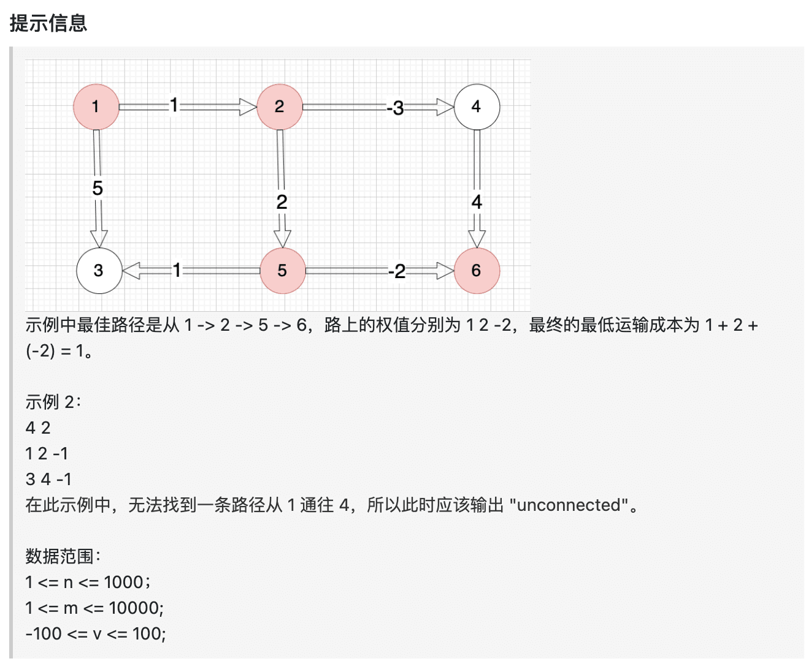
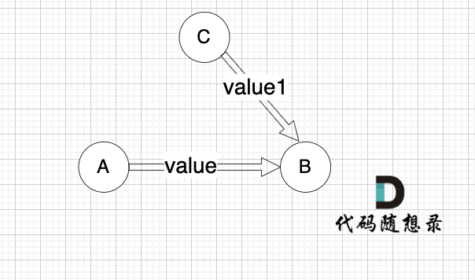
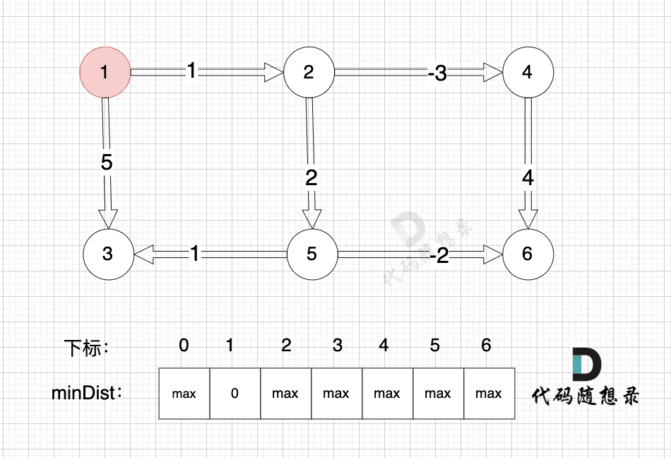
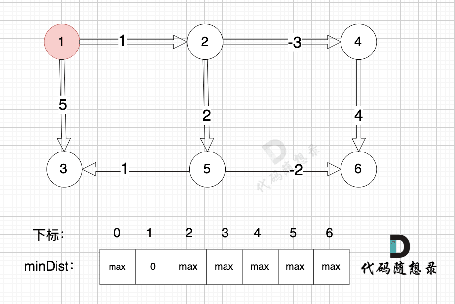
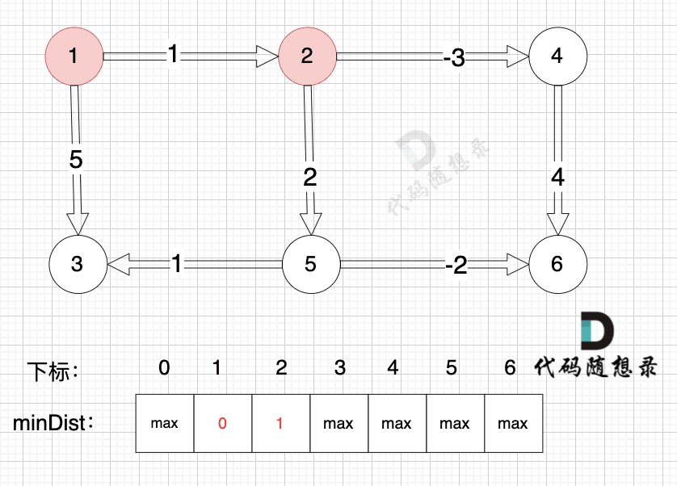
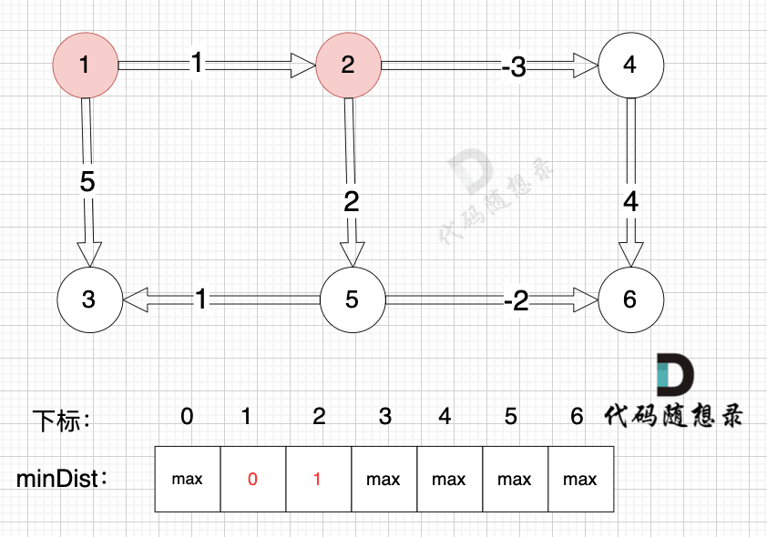
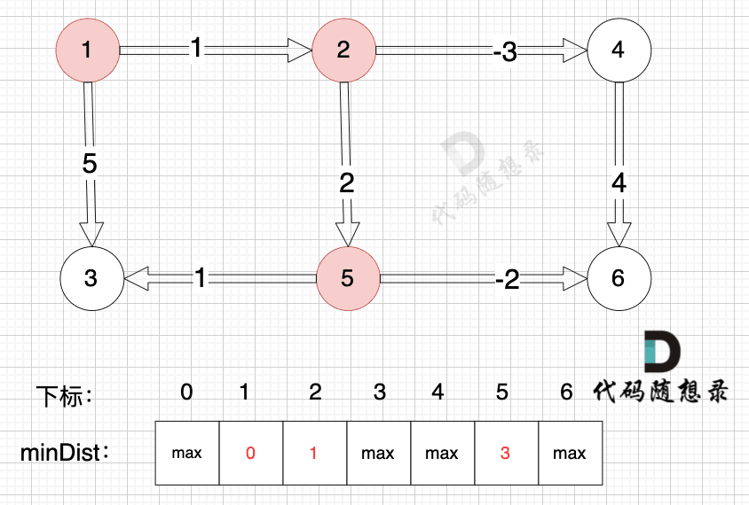
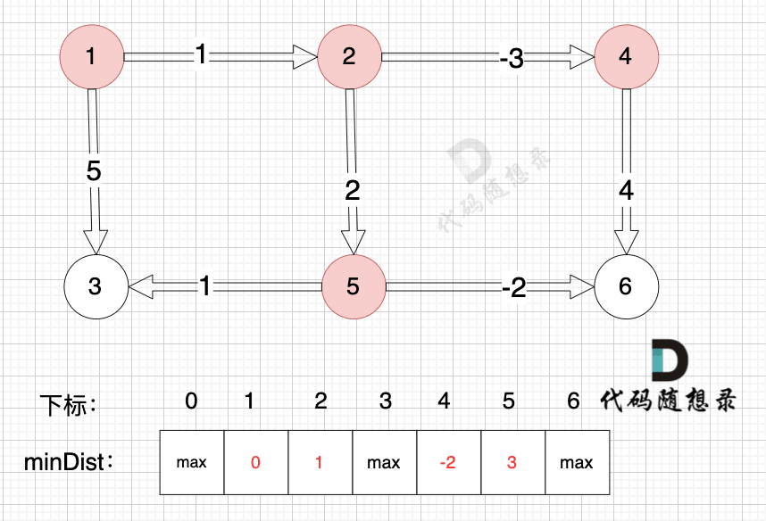
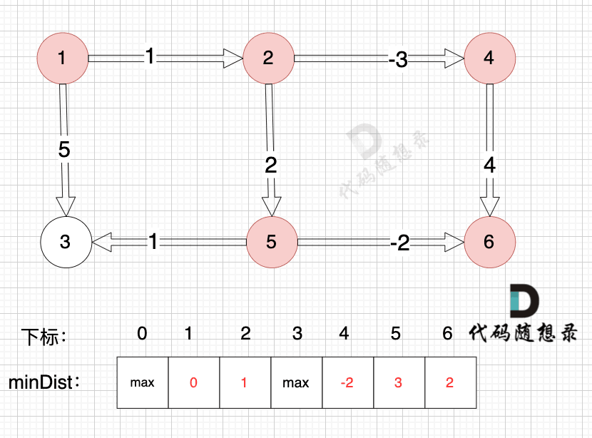
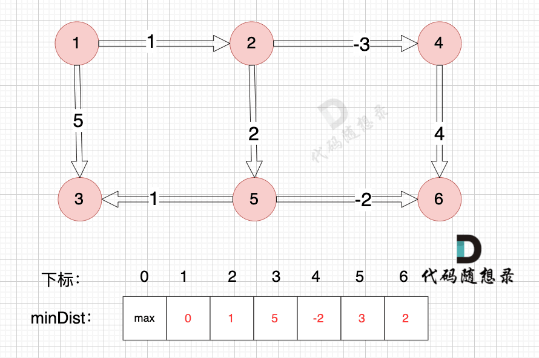

<p align="center"><strong><a href="./qita/join.md">參與本專案</a>，貢獻其他語言版本的程式碼，擁抱開放原始碼（open source），讓更多學習演算法（algorithm）的夥伴們受益！</strong></p>

# Bellman_ford 演算法精講

[KamaCoder：94. 城市間貨物運輸 I](https://kamacoder.com/problempage.php?pid=1152)

題目描述

某國為促進城市間經濟交流，決定對貨物運輸提供補貼。共有 n 個編號為 1 到 n 的城市，透過道路網路連接，網路中的道路僅允許從某個城市單向通行到另一個城市，不能反向通行。


網路中的道路都有各自的運輸成本和政府補貼，道路的權重（weight）計算方式為：運輸成本 - 政府補貼。

權重為正表示扣除了政府補貼後運輸貨物仍需支付的費用；權重為負則表示政府的補貼超過了支出的運輸成本，實際表現為運輸過程中還能賺取一定的收益。


請找出從城市 1 到城市 n 的所有可能路徑（path）中，綜合政府補貼後的最低運輸成本。

如果最低運輸成本是一個負數（negative number），它表示在遵循最佳路徑的情況下，運輸過程中反而能夠實現盈利。

城市 1 到城市 n 之間可能會出現沒有路徑的情況，同時保證道路網路中不存在任何 negative weight cycle。

> negative weight cycle 是指一系列道路的總權重為負，這樣的迴路使得透過反覆經過迴路中的道路，理論上可以無限地減少總成本或無限地增加總收益。

輸入描述

第一行包含兩個正整數（positive integer），第一個正整數 n 表示該國一共有 n 個城市，第二個整數（integer） m 表示這些城市中共有 m 條道路。

接下來為 m 行，每行包括三個整數，s、t 和 v，表示 s 號城市運輸貨物到達 t 號城市，道路權重為 v（單向圖）。

輸出描述

如果能夠從城市 1 連通到城市 n，請輸出一個整數，表示運輸成本。如果該整數是負數，則表示實現了盈利。如果從城市 1 沒有路徑可達城市 n，請輸出 "unconnected"。

輸入範例： 

```
6 7
5 6 -2
1 2 1
5 3 1
2 5 2
2 4 -3
4 6 4
1 3 5
```



## 想法 

本題依然是單源最短路徑（shortest path）問題，求 從 節點（node） 1 到節點 n 的最小費用。**但本題不同之處在於 邊（edge）的權重是有負數了**。

從 節點 1 到節點 n 的最小費用也可以是負數，費用如果是負數 則表示 運輸的過程中 政府補貼大於運輸成本。  

在求單源最短路徑的方法中，使用 dijkstra 的話，則要求圖中邊的權重都為正數。 

我們在 [dijkstra樸素版](./0047.參會dijkstra樸素.md) 中專門有講解：為什麼有邊為負數 使用 dijkstra 就不行了。 

**本題是經典的帶負權重的單源最短路徑問題，此時就輪到 Bellman_ford 登場了**，接下來我們來詳細介紹 Bellman_ford 演算法 如何解決這類問題。 

> 該演算法是由 R.Bellman 和 L.Ford 在 20 世紀 50 年代末期發明的演算法，故稱為 Bellman_ford 演算法。

**Bellman_ford 演算法的核心想法是 對所有邊進行鬆弛 n-1 次操作（n 為節點數量），從而求得目標最短路徑**。 

## 什麼叫做鬆弛

看到這裡，估計大家都比較暈了，為什麼是 n-1 次，那「鬆弛」這兩個字究竟是個啥意思？   

我們先來說什麼是「鬆弛」。

《演算法（四）》裡面把這個操作叫做「放鬆」，英文版裡叫做 "relax the edge" 

所以大家翻譯過來，就是「放鬆」或者「鬆弛」。 

但《演算法（四）》沒有具體去講這個「放鬆」究竟是個啥？網上很多題解也沒有講題解裡的「鬆弛這條邊，鬆弛所有邊」等等 裡面的「鬆弛」究竟是什麼意思？  

這裡我給大家舉一個例子，每條邊有起點、終點和邊的權重。例如一條邊，節點 A 到 節點 B 權重為 value，如圖： 



minDist[B] 表示 到達 B 節點 最小權重，minDist[B] 有哪些狀態（state）可以推出來？

狀態一：minDist[A] + value 可以推出 minDist[B] 
狀態二：minDist[B] 本身就有權重（可能是其他邊連結的節點 B 例如節點 C，以至於 minDist[B] 記錄了其他邊到 minDist[B] 的權重） 

minDist[B] 應該如何取捨。 

本題我們要求最小權重，那麼 這兩個狀態我們就取最小的 

```CPP
if (minDist[B] > minDist[A] + value) minDist[B] = minDist[A] + value

```

也就是說，如果 透過 A 到 B 這條邊可以獲得更短的到達 B 節點的路徑，即如果 `minDist[B] > minDist[A] + value`，那麼我們就更新 `minDist[B] = minDist[A] + value`，**這個過程就叫做「鬆弛」**。 

以上講了這麼多，其實都是圍繞以下這句程式碼展開：

```
if (minDist[B] > minDist[A] + value) minDist[B] = minDist[A] + value

```

**這句程式碼就是 Bellman_ford 演算法的核心操作**。 

以上程式碼也可以這麼寫：`minDist[B] = min(minDist[A] + value, minDist[B])`  

如果大家看過《程式碼隨想錄》的動態規劃（dynamic programming, DP）章節，會發現 無論是背包問題（knapsack problem）還是次序列（subsequence）問題，這段程式碼（遞迴公式（recurrence formula））出現頻率非常高的。 

其實 Bellman_ford 演算法 也是採用了動態規劃的想法，即：將一個問題分解成多個決策階段，透過狀態之間的遞迴關係（recurrence relation）最後計算出總體最佳（global optimum）解（solution）。 

（如果理解不了動態規劃的想法也無所謂，理解我上面講的鬆弛操作就好） 

**那麼為什麼是 n - 1 次 鬆弛呢**？ 

這裡要給大家模擬（simulation）一遍 Bellman_ford 的演算法才行，接下來我們來看看對所有邊鬆弛 n - 1 次的操作是什麼樣的。 

我們依然使用 **minDist 陣列（array）來表達 起點到各個節點的最短距離**，例如 minDist[3] = 5 表示起點到達節點 3 的最小距離為 5 

### 模擬過程 

初始化（initialization）過程。 

起點為節點 1，起點到起點的距離為 0，所以 minDist[1] 初始化為 0 

如圖： 

  

其他節點對應的 minDist 初始化為 max，因為我們要求最小距離，那麼還沒有計算過的節點 預設（default）是一個最大數，這樣才能更新最小距離。


對所有邊 進行第一次鬆弛：（什麼是鬆弛，在上面我已經詳細講過）  

以範例給出的所有邊為例： 

```
5 6 -2
1 2 1
5 3 1
2 5 2
2 4 -3
4 6 4
1 3 5
```

接下來我們來鬆弛一遍所有的邊。

邊：節點 5 -> 節點 6，權重為 -2，minDist[5] 還是預設數值 max，所以不能基於 節點 5 去更新節點 6，如圖： 



（再複習一下，minDist[5] 表示起點到節點 5 的最短距離）


邊：節點 1 -> 節點 2，權重為 1，minDist[2] > minDist[1] + 1，更新 minDist[2] = minDist[1] + 1 = 0 + 1 = 1，如圖： 



邊：節點 5 -> 節點 3，權重為 1，minDist[5] 還是預設數值 max，所以不能基於節點 5 去更新節點 3 如圖： 




邊：節點 2 -> 節點 5，權重為 2，minDist[5] > minDist[2] + 2（經過上面的計算 minDist[2] 已經不是預設值，而是 1），更新 minDist[5] = minDist[2] + 2 = 1 + 2 = 3，如圖： 




邊：節點 2 -> 節點 4，權重為 -3，minDist[4] > minDist[2] + (-3)，更新 minDist[4] = minDist[2] + (-3) = 1 + (-3) = -2，如圖： 

 

邊：節點 4 -> 節點 6，權重為 4，minDist[6] > minDist[4] + 4，更新 minDist[6] = minDist[4] + 4 = -2 + 4 = 2  



邊：節點 1 -> 節點 3，權重為 5，minDist[3] > minDist[1] + 5，更新 minDist[3] = minDist[1] + 5 = 0 + 5 = 5，如圖： 

 

-------- 

以上是對所有邊進行一次鬆弛之後的結果。

那麼需要對所有邊鬆弛幾次才能得到 起點（節點 1）到終點（節點 6）的最短距離呢？  

**對所有邊鬆弛一次，相當於計算 起點到達 與起點一條邊相連的節點 的最短距離**。

上面的距離中，我們得到了 起點到達 與起點一條邊相鄰的節點 2 和 節點 3 的最短距離，分別是 minDist[2] 和 minDist[3]  

這裡有讀者疑惑了 minDist[3] = 5，分明不是 起點到達 節點 3 的最短距離，節點 1 -> 節點 2 -> 節點 5 -> 節點 3 這條路線 距離才是 4。 

注意我上面講的是 **對所有邊鬆弛一次，相當於計算 起點到達 與起點一條邊相連的節點 的最短距離**，這裡 說的是 一條邊相連的節點。 

與起點（節點 1）一條邊相鄰的節點，到達節點 2 最短距離是 1，到達節點 3 最短距離是 5。

而 節點 1 -> 節點 2 -> 節點 5 -> 節點 3 這條路線 是 與起點 三條邊相連的路線了。 

所以對所有邊鬆弛一次 能得到 與起點 一條邊相連的節點最短距離。 

那對所有邊鬆弛兩次 可以得到與起點 兩條邊相連的節點的最短距離。 

那對所有邊鬆弛三次 可以得到與起點 三條邊相連的節點的最短距離，這個時候，我們就能得到到達節點 3 真正的核心最短距離，也就是 節點 1 -> 節點 2 -> 節點 5 -> 節點 3 這條路線。 

那麼再回歸剛剛的問題，**需要對所有邊鬆弛幾次才能得到 起點（節點 1）到終點（節點 6）的最短距離呢**？ 

節點數量為 n，那麼起點到終點，最多是 n-1 條邊相連。 

那麼無論圖（graph）是什麼樣的，邊是什麼樣的順序，我們對所有邊鬆弛 n-1 次 就一定能得到 起點到達 終點的最短距離。 

其實也同時計算出了，起點 到達 所有節點的最短距離，因為所有節點與起點連接的邊數最多也就是 n-1 條邊。 

截止到這裡，Bellman_ford 的核心演算法想法，大家就了解得差不多了。 

共有兩個關鍵點。 

* 「鬆弛」究竟是個啥？ 
* 為什麼要對所有邊鬆弛 n - 1 次（n 為節點個數）？

那麼 Bellman_ford 的解題過程其實就是對所有邊鬆弛 n-1 次，然後得出終點的最短路徑。 


### 程式碼 

理解上面講解的內容，程式碼就更容易寫了，本題程式碼如下：（詳細註解）

```CPP
#include <iostream>
#include <vector>
#include <list>
#include <climits>
using namespace std;

int main() {
    int n, m, p1, p2, val;
    cin >> n >> m;

    vector<vector<int>> grid;

    // 將所有邊儲存起來
    for(int i = 0; i < m; i++){
        cin >> p1 >> p2 >> val;
        // p1 指向 p2，權重為 val
        grid.push_back({p1, p2, val});

    }
    int start = 1;  // 起點
    int end = n;    // 終點

    vector<int> minDist(n + 1 , INT_MAX);
    minDist[start] = 0;
    for (int i = 1; i < n; i++) { // 對所有邊 鬆弛 n-1 次
        for (vector<int> &side : grid) { // 每一次鬆弛，都是對所有邊進行鬆弛
            int from = side[0]; // 邊的出發點
            int to = side[1]; // 邊的到達點
            int price = side[2]; // 邊的權重
            // 鬆弛操作 
            // minDist[from] != INT_MAX 防止從未計算過的節點出發
            if (minDist[from] != INT_MAX && minDist[to] > minDist[from] + price) { 
                minDist[to] = minDist[from] + price;  
            }
        }
    }
    if (minDist[end] == INT_MAX) cout << "unconnected" << endl; // 不能到達終點
    else cout << minDist[end] << endl; // 到達終點最短路徑

}
```

* 時間複雜性（time complexity）：O(N * E)，N 為節點數量，E 為圖中邊的數量 
* 空間複雜度（space complexity）：O(N)，即 minDist 陣列所配置的空間

關於空間複雜度，可能有讀者疑惑，程式碼中陣列 grid 不也配置空間了嗎？為什麼只算 minDist 陣列的空間呢？ 

grid 陣列是用來存圖的，這是題目描述中必須要使用的空間，而不是我們演算法所使用的空間。 

我們在講空間複雜度的時候，一般都是說，我們這個演算法所用的空間複雜度。


### 拓展

有讀者可能會想，那我 鬆弛 n 次，鬆弛 n + 1 次，鬆弛 2 * n 次會怎麼樣？ 

其實沒啥影響，結果不會變的，因為 題目中說了「同時保證道路網路中不存在任何 negative weight cycle」也就是圖中沒有 negative weight cycle（在有向圖（directed graph）中出現有向環 且環的總權重為負數）。 

那麼我們只要鬆弛 n - 1 次 就一定能得到結果，沒必要再鬆弛更多次了。 

這裡有疑惑的讀者，可以加上印出 minDist 陣列 的日誌（log），嘗試一下，看看鬆弛 n 次會怎麼樣。   

你會發現 鬆弛 大於 n - 1 次，minDist 陣列 就不會變化了。 

這裡我給出印出日誌的程式碼： 

```CPP 
#include <iostream>
#include <vector>
#include <list>
#include <climits>
using namespace std;

int main() {
    int n, m, p1, p2, val;
    cin >> n >> m;

    vector<vector<int>> grid;

    // 將所有邊儲存起來
    for(int i = 0; i < m; i++){
        cin >> p1 >> p2 >> val;
        // p1 指向 p2，權重為 val
        grid.push_back({p1, p2, val});

    }
    int start = 1;  // 起點
    int end = n;    // 終點

    vector<int> minDist(n + 1 , INT_MAX);
    minDist[start] = 0;
    for (int i = 1; i < n; i++) { // 對所有邊 鬆弛 n-1 次
        for (vector<int> &side : grid) { // 每一次鬆弛，都是對所有邊進行鬆弛
            int from = side[0]; // 邊的出發點
            int to = side[1]; // 邊的到達點
            int price = side[2]; // 邊的權重
            // 鬆弛操作
            // minDist[from] != INT_MAX 防止從未計算過的節點出發
            if (minDist[from] != INT_MAX && minDist[to] > minDist[from] + price) {
                minDist[to] = minDist[from] + price;
            }
        }
        cout << "對所有邊鬆弛 " << i << "次" << endl;
        for (int k = 1; k <= n; k++) {
            cout << minDist[k] << " ";
        }
        cout << endl;
    }
    if (minDist[end] == INT_MAX) cout << "unconnected" << endl; // 不能到達終點
    else cout << minDist[end] << endl; // 到達終點最短路徑

}

```

透過印日誌，大家發現，怎麼對所有邊進行第二次鬆弛以後結果就 不再變化了，那根本就不用鬆弛 n - 1 次？ 

這是本題的範例的特殊性，鬆弛 n-1 次 是保證對任何圖 都能最後求得到終點的最小距離。 

如果還想不明白 我再舉一個例子，用以下測試案例（test case）再跑一下。


```
6 5
5 6 1
4 5 1
3 4 1
2 3 1
1 2 1
```

印出結果： 

```
對所有邊鬆弛 1次
0 1 2147483647 2147483647 2147483647 2147483647
對所有邊鬆弛 2次
0 1 2 2147483647 2147483647 2147483647
對所有邊鬆弛 3次
0 1 2 3 2147483647 2147483647
對所有邊鬆弛 4次
0 1 2 3 4 2147483647
對所有邊鬆弛 5次
0 1 2 3 4 5
```

你會發現到 n-1 次 才印出最後的最短路徑結果。

關於上面的講解，大家一定要多寫程式碼去實驗，驗證自己的想法。 

**至於 negative weight cycle，我在下一篇會專門講解這種情況，大家有個印象就好**。


## 總結 

Bellman_ford 是可以計算 負權重的單源最短路徑演算法。 

其演算法核心想法是對 所有邊進行 n-1 次 鬆弛。 

弄清楚 什麼是 鬆弛？為什麼要 n-1 次？對理解 Bellman_ford 非常重要。

## 其他語言版本

### Java 
```Java
public class Main {

    // Define an inner class Edge
    static class Edge {
        int from;
        int to;
        int val;
        public Edge(int from, int to, int val) {
            this.from = from;
            this.to = to;
            this.val = val;
        }
    }

    public static void main(String[] args) {
        // Input processing
        Scanner sc = new Scanner(System.in);
        int n = sc.nextInt();
        int m = sc.nextInt();
        List<Edge> edges = new ArrayList<>();

        for (int i = 0; i < m; i++) {
            int from = sc.nextInt();
            int to = sc.nextInt();
            int val = sc.nextInt();
            edges.add(new Edge(from, to, val));
        }

        // Represents the minimum distance from the current node to the original node
        int[] minDist = new int[n + 1];

        // Initialize the minDist array
        Arrays.fill(minDist, Integer.MAX_VALUE);
        minDist[1] = 0;

        // Starts the loop to relax all edges n - 1 times to update minDist array
        for (int i = 1; i < n; i++) {

            for (Edge edge : edges) {
                // Updates the minDist array
                if (minDist[edge.from] != Integer.MAX_VALUE && (minDist[edge.from] + edge.val) < minDist[edge.to]) {
                    minDist[edge.to] = minDist[edge.from] + edge.val;
                }
            }
        }

        // Outcome printing
        if (minDist[n] == Integer.MAX_VALUE) {
            System.out.println("unconnected");
        } else {
            System.out.println(minDist[n]);
        }
    }
}

```

### Python
```Python
def main():
    n, m = map(int, input().strip().split())
    edges = []
    for _ in range(m):
        src, dest, weight = map(int, input().strip().split())
        edges.append([src, dest, weight])
    
    minDist = [float("inf")] * (n + 1)
    minDist[1] = 0  # 起點處距離為 0
    
    for i in range(1, n):
        updated = False
        for src, dest, weight in edges:
            if minDist[src] != float("inf") and minDist[src] + weight < minDist[dest]:
                minDist[dest] = minDist[src] + weight
                updated = True
        if not updated:  # 若邊不再更新，即停止迴圈
            break
    
    if minDist[-1] == float("inf"):  # 回傳終點權重
        return "unconnected"
    return minDist[-1]
    
if __name__ == "__main__":
    print(main())
```

### Go

### Rust

### JavaScript

```js
async function main() {
    // 輸入
    const rl = require('readline').createInterface({ input: process.stdin })
    const iter = rl[Symbol.asyncIterator]()
    const readline = async () => (await iter.next()).value
    const [n, m] = (await readline()).split(" ").map(Number)
    const edges = []
    for (let i = 0 ; i < m ; i++) {
        edges.push((await readline()).split(" ").map(Number))
    }
    const minDist = Array.from({length: n + 1}, () => Number.MAX_VALUE)
    // 起始點
    minDist[1] = 0
    
    for (let i = 1 ; i < n ; i++) {
        let update = false
        for (const [src, desc, w] of edges) {
            if (minDist[src] !== Number.MAX_VALUE && minDist[src] + w < minDist[desc]) {
                minDist[desc] = minDist[src] + w
                update = true
            }
        }
        if (!update) {
            break;
        }
    }
    
    // 輸出
    if (minDist[n] === Number.MAX_VALUE) {
        console.log('unconnected')
    } else {
        console.log(minDist[n])
    }
}

main()
```

### TypeScript

### PhP

### Swift

### Scala

### C#

### Dart

### C


=== END PROSE ===