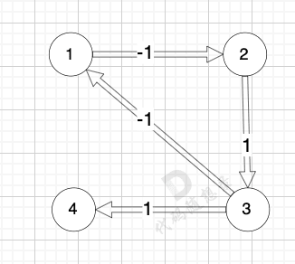
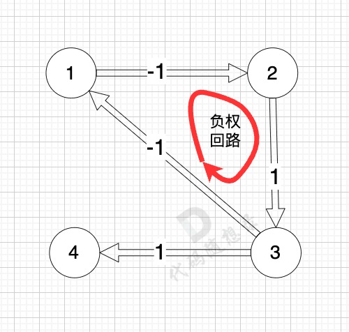
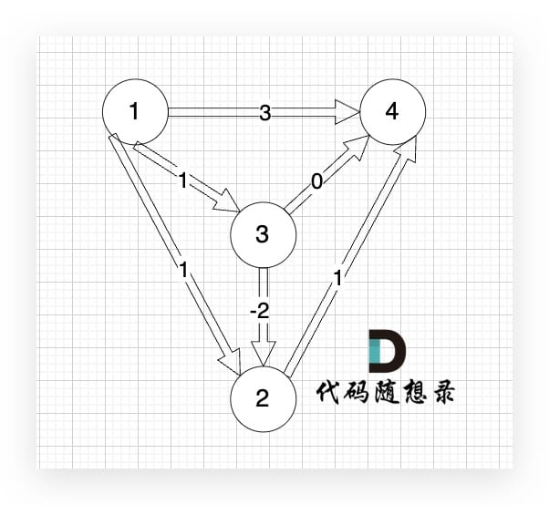

<p align="center"><strong><a href="./qita/join.md">參與本專案</a>，貢獻其他語言版本的程式碼，擁抱開放原始碼（open source），讓更多學習演算法的夥伴們受益！</strong></p>

# bellman_ford 之判斷 negative weight cycle

[KamaCoder：95. 城市間貨物運輸 II](https://kamacoder.com/problempage.php?pid=1153)

【題目描述】

某國為促進城市間經濟交流，決定對貨物運輸提供補貼。共有 n 個編號為 1 到 n 的城市，透過道路網路連接，網路中的道路僅允許從某個城市單向通行到另一個城市，不能反向通行。

網路中的道路都有各自的運輸成本和政府補貼，道路的權重（weight）計算方式為：運輸成本 - 政府補貼。權重為正表示扣除了政府補貼後運輸貨物仍需支付的費用；

權重為負則表示政府的補貼超過了支出的運輸成本，實際表現為運輸過程中還能賺取一定的收益。

然而，在評估從城市 1 到城市 n 的所有可能路徑（path）中綜合政府補貼後的最低運輸成本時，存在一種情況：**圖（graph）中可能出現 negative weight cycle**。

negative weight cycle 是指一系列道路的總權重為負，這樣的迴路使得透過反覆經過迴路中的道路，理論上可以無限地減少總成本或無限地增加總收益。

為了避免貨物運輸商採用 negative weight cycle 這種情況無限地賺取政府補貼，演算法還需檢測這種特殊情況。

請找出從城市 1 到城市 n 的所有可能路徑中，綜合政府補貼後的最低運輸成本。同時能夠檢測並適當處理 negative weight cycle 的存在。

城市 1 到城市 n 之間可能會出現沒有路徑的情況

【輸入描述】

第一行包含兩個正整數（positive integer），第一個正整數 n 表示該國一共有 n 個城市，第二個整數（integer） m 表示這些城市中共有 m 條道路。

接下來為 m 行，每行包括三個整數，s、t 和 v，表示 s 號城市運輸貨物到達 t 號城市，道路權重為 v。

【輸出描述】

如果沒有發現 negative weight cycle，則輸出一個整數，表示從城市 1 到城市 n 的最低運輸成本（包括政府補貼）。

如果該整數是負數（negative number），則表示實現了盈利。如果發現了 negative weight cycle 的存在，則輸出 "circle"。如果從城市 1 無法到達城市 n，則輸出 "unconnected"。


輸入範例

```
4 4
1 2 -1
2 3 1
3 1 -1
3 4 1
```

輸出範例

```
circle
```

## 想法 

本題是 [kama94.城市間貨物運輸I](./0094.城市間貨物運輸I.md) 延伸題目。 

本題是要我們判斷 negative weight cycle，也就是圖中出現環且環上的邊（edge）總權重為負數。

如果在這樣的圖中求最短路徑（shortest path）的話，就會在這個環裡無限迴路（infinite loop）（也是負數 + 負數 只會越來越小），無法求出最短路徑。 

所以對於 在有負權重的圖中求最短路徑，都需要先看看這個圖裡有沒有 negative weight cycle。 

接下來我們來看 如何使用 bellman_ford 演算法來判斷 negative weight cycle。 

在 [kama94.城市間貨物運輸I](./0094.城市間貨物運輸I.md) 中 我們講了 bellman_ford 演算法的核心就是一句話：對 所有邊 進行 n-1 次鬆弛。同時文中的【拓展】部分，我們也講了 鬆弛 n 次以上 會怎麼樣？ 

在沒有 negative weight cycle 的圖中，鬆弛 n 次以上，結果不會有變化。 

但本題有 negative weight cycle，如果鬆弛 n 次，結果就會有變化了，因為 有 negative weight cycle 就是可以無限最短路徑（一直繞圈，就可以一直得到無限小的最短距離）。 

那麼每鬆弛一次，都會更新最短路徑，所以結果會一直有變化。

（如果對於 bellman_ford 不了解的讀者，建議詳細看這裡：[kama94.城市間貨物運輸I](./0094.城市間貨物運輸I.md)） 

以上為理論分析，接下來我們再畫圖舉例。 

我們拿題目中範例來畫一個圖：



圖中 節點（node） 1 到 節點 4 的最短路徑是多少（題目中的最低運輸成本）（注意邊可以為負數的） 

節點 1 -> 節點 2 -> 節點 3 -> 節點 4，這樣的路徑總成本為 -1 + 1 + 1 = 1 

而圖中有 negative weight cycle：

 

那麼我們在 negative weight cycle 中多繞一圈，我們的最短路徑 是不是就更小了（也就是更低的運輸成本） 

節點 1 -> 節點 2 -> 節點 3 -> 節點 1 -> 節點 2 -> 節點 3 -> 節點 4，這樣的路徑總成本 (-1) + 1 + (-1) + (-1) + 1 + (-1) + 1 = -1  

如果在 negative weight cycle 多繞兩圈，三圈，無窮圈，那麼我們的總成本就會無限小，如果要求最小成本的話，你會發現本題就無解了。 

在 bellman_ford 演算法中，鬆弛 n-1 次所有的邊 就可以求得 起點到任何節點的最短路徑，鬆弛 n 次以上，minDist 陣列（array）（記錄起點到其他節點的最短距離）中的結果也不會有改變（如果對 bellman_ford 演算法 不了解，也不知道 minDist 是什麼，建議詳看上篇講解[kama94.城市間貨物運輸I](./0094.城市間貨物運輸I.md)）  

而本題有 negative weight cycle 的情況下，一直都會有更短的最短路徑，所以 鬆弛 第 n 次，minDist 陣列 也會發生改變。  

那麼解決本題的 核心想法，就是在 [kama94.城市間貨物運輸I](./0094.城市間貨物運輸I.md) 的基礎上，再多鬆弛一次，看 minDist 陣列 是否發生變化。

程式碼和 [kama94.城市間貨物運輸I](./0094.城市間貨物運輸I.md) 基本是一樣的，如下：（關鍵地方已註解） 

```CPP
#include <iostream>
#include <vector>
#include <list>
#include <climits>
using namespace std;

int main() {
    int n, m, p1, p2, val;
    cin >> n >> m;

    vector<vector<int>> grid;

    for(int i = 0; i < m; i++){
        cin >> p1 >> p2 >> val;
        // p1 指向 p2，權重為 val
        grid.push_back({p1, p2, val});

    }
    int start = 1;  // 起點
    int end = n;    // 終點

    vector<int> minDist(n + 1 , INT_MAX);
    minDist[start] = 0;
    bool flag = false;
    for (int i = 1; i <= n; i++) { // 這裡我們鬆弛 n 次，最後一次判斷負權迴路
        for (vector<int> &side : grid) {
            int from = side[0];
            int to = side[1];
            int price = side[2];
            if (i < n) {
                if (minDist[from] != INT_MAX && minDist[to] > minDist[from] + price) minDist[to] = minDist[from] + price;
            } else { // 多加一次鬆弛判斷負權迴路
                if (minDist[from] != INT_MAX && minDist[to] > minDist[from] + price) flag = true;

            }
        }

    }

    if (flag) cout << "circle" << endl;
    else if (minDist[end] == INT_MAX) {
        cout << "unconnected" << endl;
    } else {
        cout << minDist[end] << endl;
    }
}
```

* 時間複雜性（time complexity）：O(N * E)，N 為節點數量，E 為圖中邊的數量 
* 空間複雜度（space complexity）：O(N)，即 minDist 陣列所配置的空間

## 拓展 

本題可不可以使用 佇列（queue）最佳化版的 bellman_ford（SPFA）呢？  

上面的解法中，我們對所有邊鬆弛了 n-1 次後，再鬆弛一次，如果出現 minDist 出現變化就判斷有 negative weight cycle。 

如果使用 SPFA 那麼節點都是進佇列的，那麼節點進入佇列幾次後 足夠判斷該圖是否有 negative weight cycle 呢？  

在 [0094.城市間貨物運輸I-SPFA](./0094.城市间货物运输I-SPFA) 中，我們講過 在極端情況下，即：所有節點都與其他節點相連，每個節點的輸入度（in degree）為 n-1（n 為節點數量），所以每個節點最多加入 n-1 次佇列。 

那麼如果節點加入佇列的次數 超過了 n-1 次，那麼該圖就一定有 negative weight cycle。 

所以本題也是可以使用 SPFA 來做的。程式碼如下：

```CPP
#include <iostream>
#include <vector>
#include <queue>
#include <list>
#include <climits>
using namespace std;

struct Edge { //相鄰串列
    int to;  // 連結的節點
    int val; // 邊的權重

    Edge(int t, int w): to(t), val(w) {}  // 建構子
};

int main() {
    int n, m, p1, p2, val;
    cin >> n >> m;

    vector<list<Edge>> grid(n + 1); // 相鄰串列

    // 將所有邊儲存起來
    for(int i = 0; i < m; i++){
        cin >> p1 >> p2 >> val;
        // p1 指向 p2，權重為 val
        grid[p1].push_back(Edge(p2, val));
    }
    int start = 1;  // 起點
    int end = n;    // 終點

    vector<int> minDist(n + 1 , INT_MAX);
    minDist[start] = 0;

    queue<int> que;
    que.push(start); // 佇列裡放入起點 
    
    vector<int> count(n+1, 0); // 記錄節點加入佇列幾次
    count[start]++;

    bool flag = false;
    while (!que.empty()) {

        int node = que.front(); que.pop();

        for (Edge edge : grid[node]) {
            int from = node;
            int to = edge.to;
            int value = edge.val;
            if (minDist[to] > minDist[from] + value) { // 開始鬆弛
                minDist[to] = minDist[from] + value;
                que.push(to);
                count[to]++; 
                if (count[to] == n) {// 如果加入佇列次數超過 n-1 次 就說明該圖有負權迴路
                    flag = true;
                    while (!que.empty()) que.pop();
                    break;
                }
            }
        }
    }
    if (flag) cout << "circle" << endl;
    else if (minDist[end] == INT_MAX) {
        cout << "unconnected" << endl;
    } else {
        cout << minDist[end] << endl;
    }
}
```

以上程式碼看上去沒問題，但提交之後會發現發生錯誤了，為什麼呢？ 

例如這組資料： 

```
4 6
1 4 3
1 2 1
1 3 1
3 2 -2
2 4 1
3 4 0
```

如圖：



上面程式碼在執行的過程中，節點 4 已經出佇列了，但 計算輸入度會反覆計算 節點 4 的輸入度，導致 誤判 該圖有環。

我們需要記錄哪些節點已經出佇列了，哪些節點在佇列裡面，對於已經出佇列的節點不用統計輸入度，以下為最佳化後的程式碼：

```CPP 
#include <iostream>
#include <vector>
#include <queue>
#include <list>
#include <climits>
using namespace std;

struct Edge { //相鄰串列
    int to;  // 連結的節點
    int val; // 邊的權重

    Edge(int t, int w): to(t), val(w) {}  // 建構子
};


int main() {
    int n, m, p1, p2, val;
    cin >> n >> m;

    vector<list<Edge>> grid(n + 1); // 相鄰串列

    // 將所有邊儲存起來
    for(int i = 0; i < m; i++){
        cin >> p1 >> p2 >> val;
        // p1 指向 p2，權重為 val
        grid[p1].push_back(Edge(p2, val));
    }
    int start = 1;  // 起點
    int end = n;    // 終點

    vector<int> minDist(n + 1 , INT_MAX);
    minDist[start] = 0;

    queue<int> que;
    que.push(start); // 佇列裡放入起點

    vector<int> count(n+1, 0); // 記錄節點加入佇列幾次
    count[start]++;
    vector<bool> inQueue(n+1, false);  // 記錄節點是否在佇列中

    bool flag = false;
    while (!que.empty()) {

        int node = que.front(); que.pop();
        inQueue[node] = false;  // 節點出佇列

        for (Edge edge : grid[node]) {
            int from = node;
            int to = edge.to;
            int value = edge.val;
            if (minDist[to] > minDist[from] + value) { // 開始鬆弛
                minDist[to] = minDist[from] + value;
                 if (!inQueue[to]) {  // 避免重複入佇列
                    que.push(to);
                    inQueue[to] = true;
                    count[to]++;
                    if (count[to] == n) {// 如果加入佇列次數超過 n-1 次 就說明該圖有負權迴路
                        flag = true;
                        while (!que.empty()) que.pop();
                        break;
                    }
                 }
            }
        }
    }

    if (flag) cout << "circle" << endl;
    else if (minDist[end] == INT_MAX) {
        cout << "unconnected" << endl;
    } else {
        cout << minDist[end] << endl;
    }
}
```

## 其他語言版本

### Java 
```Java
import java.util.*;

public class Main {
    // 基於 Bellman_ford-SPFA 方法
    // Define an inner class Edge
    static class Edge {
        int from;
        int to;
        int val;
        public Edge(int from, int to, int val) {
            this.from = from;
            this.to = to;
            this.val = val;
        }
    }

    public static void main(String[] args) {
        // Input processing
        Scanner sc = new Scanner(System.in);
        int n = sc.nextInt();
        int m = sc.nextInt();
        List<List<Edge>> graph = new ArrayList<>();

        for (int i = 0; i <= n; i++) {
            graph.add(new ArrayList<>());
        }

        for (int i = 0; i < m; i++) {
            int from = sc.nextInt();
            int to = sc.nextInt();
            int val = sc.nextInt();
            graph.get(from).add(new Edge(from, to, val));
        }

        // Declare the minDist array to record the minimum distance form current node to the original node
        int[] minDist = new int[n + 1];
        Arrays.fill(minDist, Integer.MAX_VALUE);
        minDist[1] = 0;

        // Declare a queue to store the updated nodes instead of traversing all nodes each loop for more efficiency
        Queue<Integer> queue = new LinkedList<>();
        queue.offer(1);

        // Declare an array to record the times each node has been offered in the queue
        int[] count = new int[n + 1];
        count[1]++;

        // Declare a boolean array to record if the current node is in the queue to optimise the processing
        boolean[] isInQueue = new boolean[n + 1];

        // Declare a boolean value to check if there is a negative weight loop inside the graph
        boolean flag = false;

        while (!queue.isEmpty()) {
            int curNode = queue.poll();
            isInQueue[curNode] = false; // Represents the current node is not in the queue after being polled
            for (Edge edge : graph.get(curNode)) {
                if (minDist[edge.to] > minDist[edge.from] + edge.val) { // Start relaxing the edge
                    minDist[edge.to] = minDist[edge.from] + edge.val;
                    if (!isInQueue[edge.to]) { // Don't add the node if it's already in the queue
                        queue.offer(edge.to);
                        count[edge.to]++;
                        isInQueue[edge.to] = true;
                    }

                    if (count[edge.to] == n) { // If some node has been offered in the queue more than n-1 times
                        flag = true;
                        while (!queue.isEmpty()) queue.poll();
                        break;
                    }
                }
            }
        }

        if (flag) {
            System.out.println("circle");
        } else if (minDist[n] == Integer.MAX_VALUE) {
            System.out.println("unconnected");
        } else {
            System.out.println(minDist[n]);
        }
    }
}

```

### Python

Bellman-Ford 方法求解含有負迴路的最短路徑問題

```python 
import sys

def main():
    input = sys.stdin.read
    data = input().split()
    index = 0
    
    n = int(data[index])
    index += 1
    m = int(data[index])
    index += 1
    
    grid = []
    for i in range(m):
        p1 = int(data[index])
        index += 1
        p2 = int(data[index])
        index += 1
        val = int(data[index])
        index += 1
        # p1 指向 p2，權重為 val
        grid.append([p1, p2, val])

    start = 1  # 起點
    end = n    # 終點

    minDist = [float('inf')] * (n + 1)
    minDist[start] = 0
    flag = False

    for i in range(1, n + 1):  # 這裡我們鬆弛 n 次，最後一次判斷負權迴路
        for side in grid:
            from_node = side[0]
            to = side[1]
            price = side[2]
            if i < n:
                if minDist[from_node] != float('inf') and minDist[to] > minDist[from_node] + price:
                    minDist[to] = minDist[from_node] + price
            else:  # 多加一次鬆弛判斷負權迴路
                if minDist[from_node] != float('inf') and minDist[to] > minDist[from_node] + price:
                    flag = True

    if flag:
        print("circle")
    elif minDist[end] == float('inf'):
        print("unconnected")
    else:
        print(minDist[end])

if __name__ == "__main__":
    main()

```

SPFA 方法求解含有負迴路的最短路徑問題

```python
from collections import deque
from math import inf

def main():
    n, m = [int(i) for i in input().split()]
    graph = [[] for _ in range(n+1)]
    min_dist = [inf for _ in range(n+1)]
    count = [0 for _ in range(n+1)]  # 記錄節點加入佇列的次數
    for _ in range(m):
        s, t, v = [int(i) for i in input().split()]
        graph[s].append([t, v])
        
    min_dist[1] = 0  # 初始化
    count[1] = 1
    d = deque([1])
    flag = False
    
    while d:  # 主迴圈
        cur_node = d.popleft()
        for next_node, val in graph[cur_node]:
            if min_dist[next_node] > min_dist[cur_node] + val:
                min_dist[next_node] = min_dist[cur_node] + val
                count[next_node] += 1
                if next_node not in d:
                    d.append(next_node)
                if count[next_node] == n:  # 如果某個點鬆弛了 n 次，說明有負迴路
                    flag = True
        if flag:
            break
            
    if flag:
        print("circle")
    else:
        if min_dist[-1] == inf:
            print("unconnected")
        else:
            print(min_dist[-1])


if __name__ == "__main__":
    main()
```

### Go

### Rust

### JavaScript

### TypeScript

### PhP

### Swift

### Scala

### C#

### Dart

### C


=== END PROSE ===