<p align="center"><strong><a href="./qita/join.md">參與本專案</a>，貢獻其他語言版本的程式碼，擁抱開放原始碼，讓更多學習演算法（algorithm）的夥伴們受益！</strong></p>

# bellman_ford 之單源有限最短路徑

[KamaCoder：96. 城市間貨物運輸 III](https://kamacoder.com/problempage.php?pid=1154) 

【題目描述】

某國為促進城市間經濟交流，決定對貨物運輸提供補貼。共有 n 個編號為 1 到 n 的城市，透過道路網路連接，網路中的道路僅允許從某個城市單向通行到另一個城市，不能反向通行。

網路中的道路都有各自的運輸成本和政府補貼，道路的權值（weight）計算方式為：運輸成本 - 政府補貼。

權值為正表示扣除了政府補貼後運輸貨物仍需支付的費用；

權值為負則表示政府的補貼超過了支出的運輸成本，實際表現為運輸過程中還能賺取一定的收益。

請計算在最多經過 k 個城市的條件下，從城市 src 到城市 dst 的最低運輸成本。

【輸入描述】

第一行包含兩個正整數（positive integer），第一個正整數 n 表示該國一共有 n 個城市，第二個整數（integer） m 表示這些城市中共有 m 條道路。

接下來為 m 行，每行包括三個整數，s、t 和 v，表示 s 號城市運輸貨物到達 t 號城市，道路權值為 v。

最後一行包含三個正整數，src、dst 和 k，src 和 dst 為城市編號，表示從 src 到 dst 經過的城市數量限制。

【輸出描述】

輸出一個整數，表示從城市 src 到城市 dst 的最低運輸成本，如果無法在給定經過城市數量限制下找到從 src 到 dst 的路徑（path），則輸出 "unreachable"，表示不存在符合條件的運輸方案。

輸入範例：

```
6 7
1 2 1
2 4 -3
2 5 2
1 3 5
3 5 1
4 6 4
5 6 -2
2 6 1
```

輸出範例：

```
0
```

## 解題思路 

本題為單源有限最短路徑（shortest path）問題，同樣是 [kama94.城市間貨物運輸 I](./0094.城市間貨物運輸I.md) 的延伸題目。 

注意題目中描述的是 **最多經過 k 個城市的條件下，而不是一定經過 k 個城市，也可以經過的城市數量比 k 小，但要最短的路徑**。

在 [kama94.城市間貨物運輸 I](./0094.城市間貨物運輸I.md) 中我們講過：**對所有邊（edge）鬆弛一次，相當於計算起點到達與起點一條邊相連的節點（node）的最短距離**。 

節點數量為 n，起點到終點，最多是 n-1 條邊相連。那麼對所有邊鬆弛 n-1 次就一定能得到起點到達終點的最短距離。 

（如果對以上講解看不懂，建議詳看 [kama94.城市間貨物運輸 I](./0094.城市間貨物運輸I.md) ） 

本題是最多經過 k 個城市，那麼就是 k + 1 條邊相連的節點。這裡可能有讀者想不懂為什麼是 k + 1，來看這張圖： 

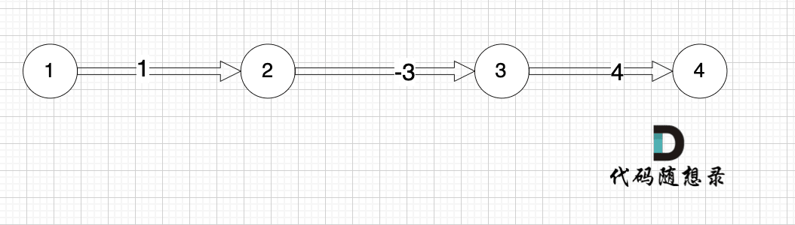 

圖中，節點 1 最多已經經過 2 個節點到達節點 4，那麼中間是有多少條邊呢，是 3 條邊對吧。 

所以本題就是求：起點最多經過 k + 1 條邊到達終點的最短距離。 

對所有邊鬆弛一次，相當於計算起點到達與起點一條邊相連的節點的最短距離，那麼對所有邊鬆弛 k + 1 次，就是求起點到達與起點 k + 1 條邊相連的節點的最短距離。 

**注意**：本題是 [kama94.城市間貨物運輸 I](./0094.城市間貨物運輸I.md) 的拓展題，如果對 bellman_ford 沒有深入了解，強烈建議先看 [kama94.城市間貨物運輸 I](./0094.城市間貨物運輸I.md) 再做本題。   

理解以上內容，其實本題程式碼就很容易了，bellman_ford 標準寫法是鬆弛 n-1 次，本題就鬆弛 k + 1 次就好。

此時我們可以寫出如下程式碼： 

```CPP 
// 版本一
#include <iostream>
#include <vector>
#include <list>
#include <climits>
using namespace std;

int main() {
    int src, dst,k ,p1, p2, val ,m , n;
    
    cin >> n >> m;

    vector<vector<int>> grid;

    for(int i = 0; i < m; i++){
        cin >> p1 >> p2 >> val;
        // p1 指向 p2，權值為 val
        grid.push_back({p1, p2, val});
    }

    cin >> src >> dst >> k;

    vector<int> minDist(n + 1 , INT_MAX);
    minDist[src] = 0;
    for (int i = 1; i <= k + 1; i++) { // 對所有邊鬆弛 k + 1 次
        for (vector<int> &side : grid) {
            int from = side[0];
            int to = side[1];
            int price = side[2];
            if (minDist[from] != INT_MAX && minDist[to] > minDist[from] + price) minDist[to] = minDist[from] + price;
        }

    }

    if (minDist[dst] == INT_MAX) cout << "unreachable" << endl; // 不能到達終點
    else cout << minDist[dst] << endl; // 到達終點最短路徑

}

```

以上程式碼是標準 bellman_ford 寫法，鬆弛 k + 1 次，看上去沒什麼問題。

但大家提交後，居然沒通過！ 

這是為什麼呢？ 

接下來我們拿這組資料來舉例： 

```
4 4
1 2 -1
2 3 1
3 1 -1
3 4 1
1 4 3
```

（**注意上面的範例是有 negative weight cycle 的，只有帶 negative weight cycle 的圖（graph）才能說明問題**）

> negative weight cycle 是指一條道路的總權值為負，這樣的迴路使得透過反覆經過迴路中的道路，理論上可以無限地減少總成本或無限地增加總收益。

正常來說，這組資料輸出應該是 1，但以上程式碼輸出的是 -2。


在講解原因的時候，強烈建議大家，先把 minDist 陣列（array）印出來，看看 minDist 陣列是不是按照自己的想法變化的，這樣更容易理解我接下來的講解內容。（**一定要動手，實踐出真知，憑空模擬不靠譜**）

印出的程式碼可以是這樣： 

```CPP 
#include <iostream>
#include <vector>
#include <list>
#include <climits>
using namespace std;

int main() {
    int src, dst,k ,p1, p2, val ,m , n;
    
    cin >> n >> m;

    vector<vector<int>> grid;

    for(int i = 0; i < m; i++){
        cin >> p1 >> p2 >> val;
        // p1 指向 p2，權值為 val
        grid.push_back({p1, p2, val});
    }

    cin >> src >> dst >> k;

    vector<int> minDist(n + 1 , INT_MAX);
    minDist[src] = 0;
    for (int i = 1; i <= k + 1; i++) { // 對所有邊鬆弛 k + 1 次
        for (vector<int> &side : grid) {
            int from = side[0];
            int to = side[1];
            int price = side[2];
            if (minDist[from] != INT_MAX && minDist[to] > minDist[from] + price) minDist[to] = minDist[from] + price;
        }
        // 印出 minDist 陣列 
        for (int j = 1; j <= n; j++) cout << minDist[j] << " ";
        cout << endl;

    }

    if (minDist[dst] == INT_MAX) cout << "unreachable" << endl; // 不能到達終點
    else cout << minDist[dst] << endl; // 到達終點最短路徑

}

```

接下來，我按照上面的範例帶大家畫圖舉例對所有邊鬆弛一次的效果圖。 

起點為節點 1，起點到起點的距離為 0，所以 minDist[1] 初始化（initialization）為 0，如圖：

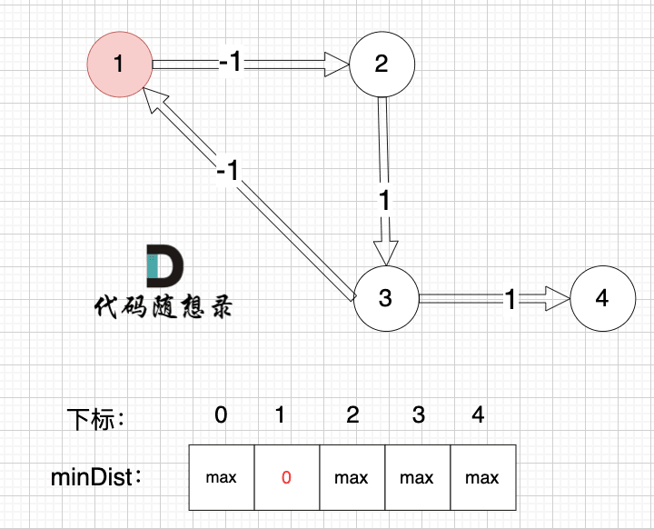

其他節點對應的 minDist 初始化為 max，因為我們要求最小距離，那麼還沒有計算過的節點預設是一個最大數，這樣才能更新最小距離。

當我們開始對所有邊進行第一次鬆弛：  

邊：節點 1 -> 節點 2，權值為 -1，minDist[2] > minDist[1] + (-1)，更新 minDist[2] = minDist[1] + (-1) = 0 - 1 = -1，如圖： 

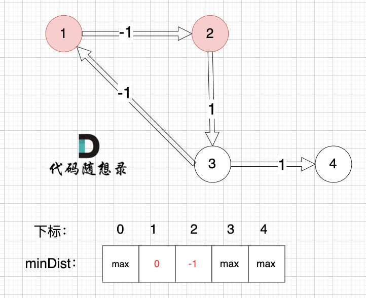


邊：節點 2 -> 節點 3，權值為 1，minDist[3] > minDist[2] + 1，更新 minDist[3] = minDist[2] + 1 = -1 + 1 = 0，如圖： 
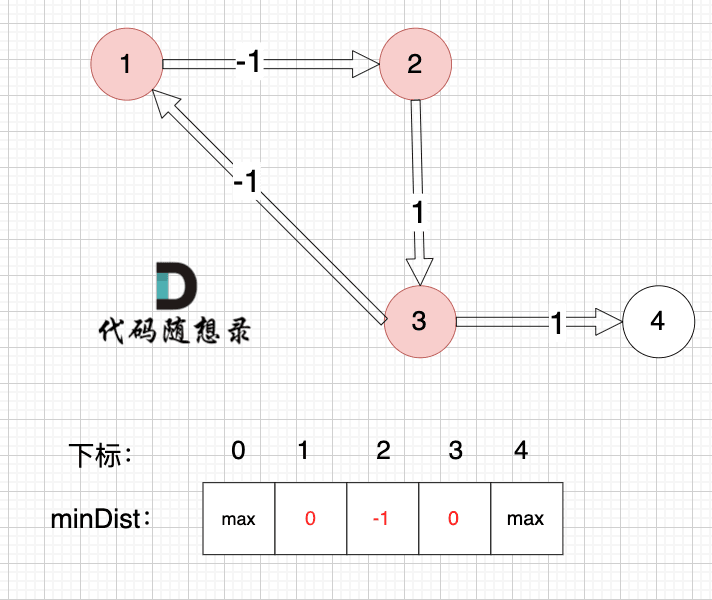


邊：節點 3 -> 節點 1，權值為 -1，minDist[1] > minDist[3] + (-1)，更新 minDist[1] = 0 + (-1) = -1，如圖： 

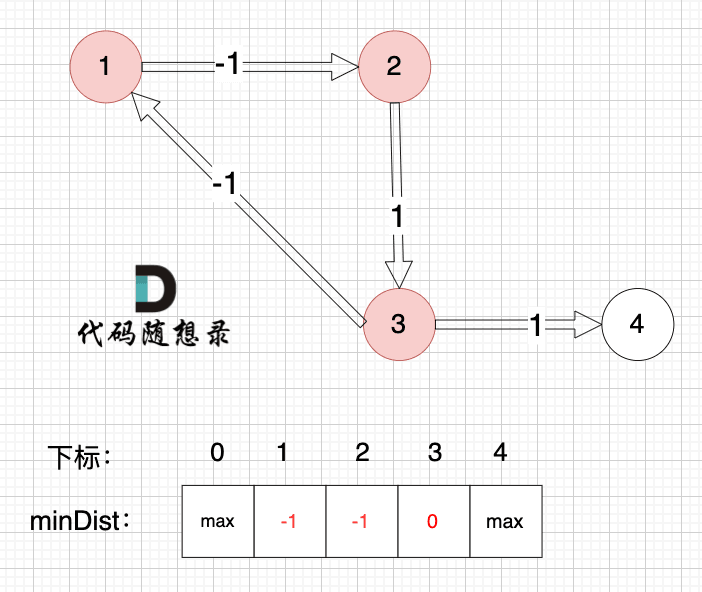


邊：節點 3 -> 節點 4，權值為 1，minDist[4] > minDist[3] + 1，更新 minDist[4] = 0 + 1 = 1，如圖： 

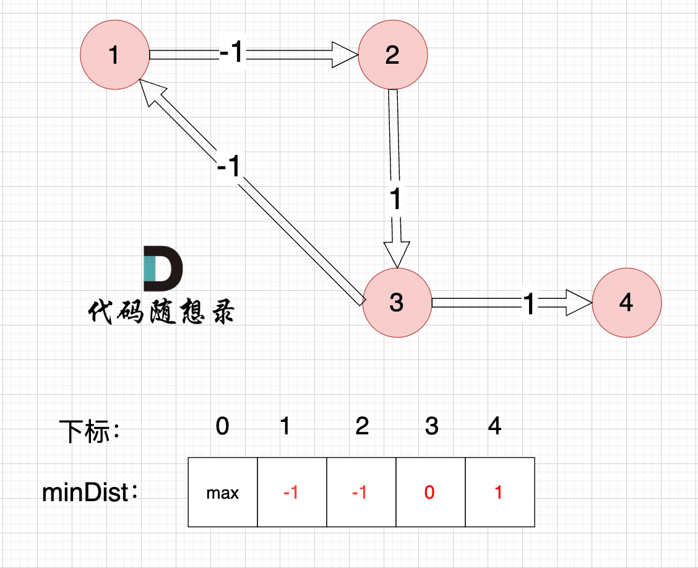


以上是對所有邊進行的第一次鬆弛，最後 minDist 陣列為：-1 -1 0 1，（從索引（index）1 算起） 

後面幾次鬆弛我就不挨個畫圖了，過程大同小異，我直接給出 minDist 陣列的變化： 

所有邊進行的第二次鬆弛，minDist 陣列為：-2 -2 -1 0
所有邊進行的第三次鬆弛，minDist 陣列為：-3 -3 -2 -1
所有邊進行的第四次鬆弛，minDist 陣列為：-4 -4 -3 -2   （本範例中 k 為 3，所以鬆弛 4 次）

最後計算的結果 minDist[4] = -2，即起點到節點 4，最多經過 3 個節點的最短距離是 -2，但正確的結果應該是 1，即路徑：節點 1 -> 節點 2 -> 節點 3 -> 節點 4。 

理論上來說，**對所有邊鬆弛一次，相當於計算起點到達與起點一條邊相連的節點的最短距離**。  

對所有邊鬆弛兩次，相當於計算起點到達與起點兩條邊相連的節點的最短距離。 

對所有邊鬆弛三次，以此類推。 

但在對所有邊鬆弛第一次的過程中，大家會發現，不僅僅與起點一條邊相連的節點更新了，所有節點都更新了。 

而且對所有邊的後面幾次鬆弛，同樣是更新了所有的節點，說明「至多經過 k 個節點」這個限制根本沒有發揮作用，每個節點的數值都被更新了。

這是為什麼？ 

在上面畫圖舉例中，對所有邊進行第一次鬆弛，在計算邊（節點 2 -> 節點 3）的時候，更新了節點 3。 


理論上來說節點 3 應該在對所有邊第二次鬆弛的時候才更新。這是因為當時是基於已經計算好的節點 2（minDist[2]）來做計算了。 

minDist[2] 在計算邊（節點 1 -> 節點 2）的時候剛剛被賦值（assignment）為 -1。 

這樣就造成了一個情況，即：計算 minDist 陣列的時候，基於了本次鬆弛的 minDist 數值，而不是上一次鬆弛時候 minDist 的數值。  
所以在每次計算 minDist 時候，要基於對所有邊上一次鬆弛的 minDist 數值才行，所以我們要記錄上一次鬆弛的 minDist。

程式碼修改如下：（關鍵地方已經加上註解）

```CPP
// 版本二
#include <iostream>
#include <vector>
#include <list>
#include <climits>
using namespace std;

int main() {
    int src, dst,k ,p1, p2, val ,m , n;
    
    cin >> n >> m;

    vector<vector<int>> grid;

    for(int i = 0; i < m; i++){
        cin >> p1 >> p2 >> val;
        grid.push_back({p1, p2, val});
    }

    cin >> src >> dst >> k;

    vector<int> minDist(n + 1 , INT_MAX);
    minDist[src] = 0;
    vector<int> minDist_copy(n + 1); // 用來記錄上一次遍歷的結果
    for (int i = 1; i <= k + 1; i++) {
        minDist_copy = minDist; // 取得上一次計算的結果
        for (vector<int> &side : grid) {
            int from = side[0];
            int to = side[1];
            int price = side[2];
            // 注意使用 minDist_copy 來計算 minDist 
            if (minDist_copy[from] != INT_MAX && minDist[to] > minDist_copy[from] + price) {  
                minDist[to] = minDist_copy[from] + price;
            }
        }
    }
    if (minDist[dst] == INT_MAX) cout << "unreachable" << endl; // 不能到達終點
    else cout << minDist[dst] << endl; // 到達終點最短路徑

}

```

* 時間複雜性（time complexity）：O(K * E)，K 為至多經過 K 個節點，E 為圖中邊的數量 
* 空間複雜度（space complexity）：O(N)，即 minDist 陣列所開闢的空間

## 拓展一（邊的順序的影響）

其實邊的順序會影響我們每一次拓展的結果。

我來給大家舉個例子。 

我上面講解中，給出的範例是這樣的： 
```
4 4
1 2 -1
2 3 1
3 1 -1
3 4 1
1 4 3
```

我將範例中邊的順序改一下，改成： 

```
4 4
3 1 -1
3 4 1
2 3 1
1 2 -1
1 4 3
```

所構成的圖是一樣的，都是如下的這個圖，但給出的邊的順序是不一樣的。 

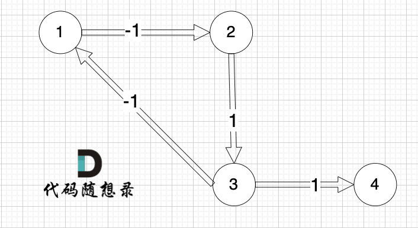

再用版本一的程式碼運行一下，發現結果輸出是 1，是對的。

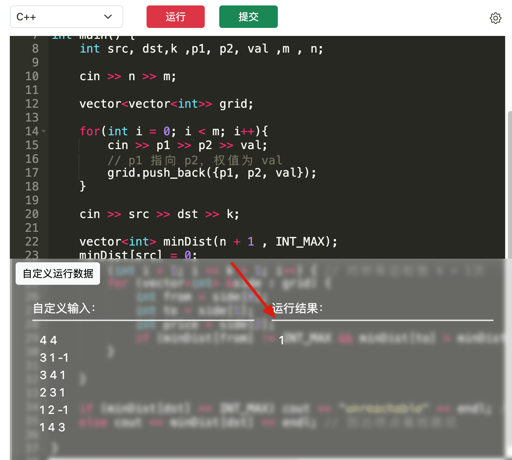

分明剛剛輸出的結果是 -2，是錯誤的，怎麼一樣的圖，這次輸出的結果就對了呢？ 

其實這是和範例中給出的邊的順序有關的，

我們按照修改後的範例再來模擬（simulation）對所有邊的第一次拓展情況。 

初始化： 

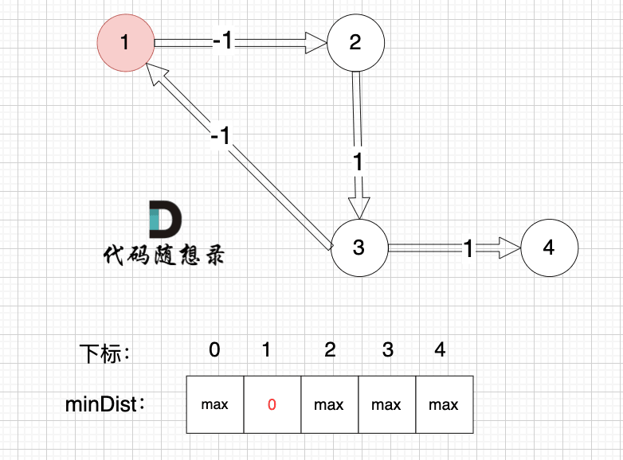 

邊：節點 3 -> 節點 1，權值為 -1，節點 3 還沒有被計算過，節點 1 不更新。

邊：節點 3 -> 節點 4，權值為 1，節點 3 還沒有被計算過，節點 4 不更新。

邊：節點 2 -> 節點 3，權值為 1，節點 2 還沒有被計算過，節點 3 不更新。

邊：節點 1 -> 節點 2，權值為 -1，minDist[2] > minDist[1] + (-1)，更新 minDist[2] = 0 + (-1) = -1，如圖：  

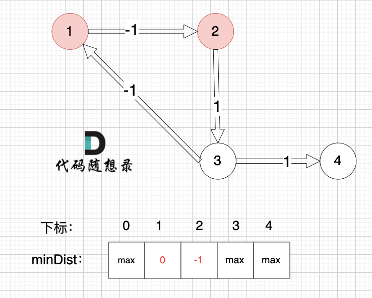

以上是對所有邊鬆弛一次的狀態。

可以發現同樣的圖，邊的順序不一樣，使用版本一的程式碼每次鬆弛更新的節點也是不一樣的。  

而邊的順序是隨機的，是題目給我們的，所以本題我們才需要記錄上一次鬆弛的 minDist，來保障每一次對所有邊鬆弛的結果。 


## 拓展二（本題本質）

那麼前面講解過的 [94.城市間貨物運輸 I](./0094.城市間貨物運輸I.md) 和 [95.城市間貨物運輸 II](./0095.城市間貨物運輸II.md) 也是 bellman_ford 經典演算法，也沒使用 minDist_copy，怎麼就沒問題呢？ 

> 如果沒看過我上面這兩篇講解的話，建議詳細學習上面兩篇，再看我下面講的區別，否則容易看不懂。

[94.城市間貨物運輸 I](./0094.城市間貨物運輸I.md) 是沒有 negative weight cycle 的，那麼多鬆弛多少次，對結果都沒有影響。  

求節點 1 到節點 n 的最短路徑，鬆弛 n-1 次就夠了，鬆弛大於 n-1 次，結果也不會變。 

那麼在對所有邊進行第一次鬆弛的時候，如果基於本次計算的 minDist 來計算 minDist（相當於多做鬆弛了），也是對最終結果沒影響。 

[95.城市間貨物運輸 II](./0095.城市間貨物運輸II.md) 是判斷是否有 negative weight cycle，一旦有 negative weight cycle，對所有邊鬆弛 n-1 次以後，再做鬆弛 minDist 數值一定會變，根據這一點來判斷是否有 negative weight cycle。

所以，[95.城市間貨物運輸 II](./0095.城市間貨物運輸II.md) 只需要判斷 minDist 數值變化了就行，而 minDist 的數值對不對，並不是我們關心的。 

那麼本題為什麼計算 minDist 一定要基於上次的 minDist 數值。 

其關鍵在於本題的兩個因素： 

* 本題可以有 negative weight cycle，說明只要多做鬆弛，結果是會變的。 
* 本題要求最多經過 k 個節點，對鬆弛次數是有限制的。 

## 拓展三（SPFA） 

本題也可以用 SPFA 來做，關於 SPFA，已經在這裡 [0094.城市間貨物運輸 I-SPFA](./0094.城市間貨物運輸I-SPFA.md) 有詳細講解。 

使用 SPFA 演算法解決本題的時候，關鍵在於如何控制鬆弛 k 次。 

其實實作不難，但有點技巧，可以用一個變數（variable）que_size 記錄每一輪鬆弛入佇列（queue）的所有節點數量。 

下一輪鬆弛的時候，就把佇列裡 que_size 個節點都彈出來，就是上一輪鬆弛入佇列的節點。 

程式碼如下（詳細註解）

```CPP 
#include <iostream>
#include <vector>
#include <queue>
#include <list>
#include <climits>
using namespace std;

struct Edge { // 相鄰串列
    int to;  // 連結的節點
    int val; // 邊的權重

    Edge(int t, int w): to(t), val(w) {}  // 建構子
};


int main() {
    int n, m, p1, p2, val;
    cin >> n >> m;

    vector<list<Edge>> grid(n + 1); // 相鄰串列

    // 將所有邊保存起來
    for(int i = 0; i < m; i++){
        cin >> p1 >> p2 >> val;
        // p1 指向 p2，權值為 val
        grid[p1].push_back(Edge(p2, val));
    }
    int start, end, k;
    cin >> start >> end >> k;

    k++;

    vector<int> minDist(n + 1 , INT_MAX);
    vector<int> minDist_copy(n + 1); // 用來記錄每一次遍歷的結果

    minDist[start] = 0;

    queue<int> que;
    que.push(start); // 佇列裡放入起點

    int que_size;
    while (k-- && !que.empty()) {

        minDist_copy = minDist; // 取得上一次計算的結果
        que_size = que.size(); // 記錄上次入佇列的節點個數
        while (que_size--) { // 上一輪鬆弛入佇列的節點，這次對應的邊都要做鬆弛
            int node = que.front(); que.pop();
            for (Edge edge : grid[node]) {
                int from = node;
                int to = edge.to;
                int price = edge.val;
                if (minDist[to] > minDist_copy[from] + price) {
                    minDist[to] = minDist_copy[from] + price;
                    que.push(to);
                }
            }

        }
    }
    if (minDist[end] == INT_MAX) cout << "unreachable" << endl;
    else cout << minDist[end] << endl;

}

```

時間複雜性：O(K * H)，H 為不確定數，取決於圖的稠密度，但 H 一定是小於等於 E 的

關於 SPFA 的時間複雜性分析，我在 [0094.城市間貨物運輸 I-SPFA](./0094.城市間貨物運輸I-SPFA.md) 有詳細講解

但大家會發現，以上程式碼大家提交後，怎麼耗時這麼多？

  

理論上，SPFA 的時間複雜性不是要比 bellman_ford 更優嗎？ 

怎麼耗時多了這麼多呢？ 

以上程式碼有一個可以改進的點，每一輪鬆弛中，重複節點可以不用入佇列。 

因為重複節點入佇列，下次從佇列裡取節點的時候，該節點要取很多次，而且都是重複計算。 

所以程式碼可以最佳化成這樣： 

```CPP
#include <iostream>
#include <vector>
#include <queue>
#include <list>
#include <climits>
using namespace std;

struct Edge { // 相鄰串列
    int to;  // 連結的節點
    int val; // 邊的權重

    Edge(int t, int w): to(t), val(w) {}  // 建構子
};


int main() {
    int n, m, p1, p2, val;
    cin >> n >> m;

    vector<list<Edge>> grid(n + 1); // 相鄰串列

    // 將所有邊保存起來
    for(int i = 0; i < m; i++){
        cin >> p1 >> p2 >> val;
        // p1 指向 p2，權值為 val
        grid[p1].push_back(Edge(p2, val));
    }
    int start, end, k;
    cin >> start >> end >> k;

    k++;

    vector<int> minDist(n + 1 , INT_MAX);
    vector<int> minDist_copy(n + 1); // 用來記錄每一次遍歷的結果

    minDist[start] = 0;

    queue<int> que;
    que.push(start); // 佇列裡放入起點

    int que_size;
    while (k-- && !que.empty()) {

        vector<bool> visited(n + 1, false); // 每一輪鬆弛中，控制節點不用重複入佇列
        minDist_copy = minDist; 
        que_size = que.size(); 
        while (que_size--) { 
            int node = que.front(); que.pop();
            for (Edge edge : grid[node]) {
                int from = node;
                int to = edge.to;
                int price = edge.val;
                if (minDist[to] > minDist_copy[from] + price) {
                    minDist[to] = minDist_copy[from] + price;
                    if(visited[to]) continue; // 不用重複放入佇列，但需要重複鬆弛，所以放在這個位置
                    visited[to] = true;
                    que.push(to);
                }
            }

        }
    }
    if (minDist[end] == INT_MAX) cout << "unreachable" << endl;
    else cout << minDist[end] << endl;
}
```

以上程式碼提交後，耗時情況： 


大家發現依然遠比 bellman_ford 的程式碼版本耗時高。 

這又是為什麼呢？ 

對於後台資料，我特別製作了一個密集圖（dense graph）大圖，該圖有 250 個節點和 10000 條邊，在這種情況下，SPFA 的時間複雜性是接近於 bellman_ford 的。 

但因為 SPFA 節點的進出佇列操作，耗時很大，所以相同的時間複雜性的情況下，SPFA 實際上更耗時了。

這一點我在 [0094.城市間貨物運輸 I-SPFA](./0094.城市間貨物運輸I-SPFA.md) 有分析，感興趣的讀者再回頭去看看。

## 拓展四（能否用 dijkstra） 

本題能否使用 dijkstra 演算法呢？ 

dijkstra 是貪心法（greedy）的思路，每一次搜尋都只會找距離源點最近的非訪問過的節點。 

如果限制最多訪問 k 個節點，那麼 dijkstra 未必能在有限次就能到達終點，即使在經過 k 個節點確實可以到達終點的情況下。 

這麼說大家會感覺有點抽象，我用 [dijkstra 樸素版精講](./0047.參會dijkstra樸素.md) 裡的範例來舉例說明：（如果沒看過我講的 [dijkstra 樸素版精講](./0047.參會dijkstra樸素.md)，建議去仔細看一下，否則下面講解容易看不懂）


在以下這個圖中，求節點 1 到節點 7 最多經過 2 個節點的最短路徑是多少呢？ 

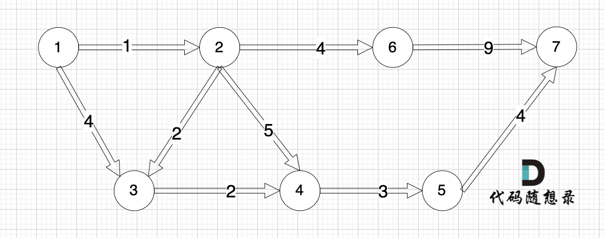

最短路徑顯然是： 

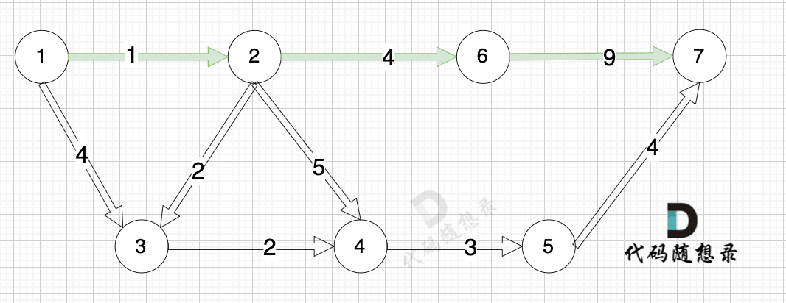 

最多經過 2 個節點，也就是 3 條邊相連的路線：節點 1 -> 節點 2 -> 節點 6 -> 節點 7

如果是 dijkstra 求解的話，求解過程是這樣的：（下面是 dijkstra 的模擬過程，我精簡了很多，如果看不懂，一定要先看 [dijkstra 樸素版精講](./0047.參會dijkstra樸素.md)）

初始化如圖所示：

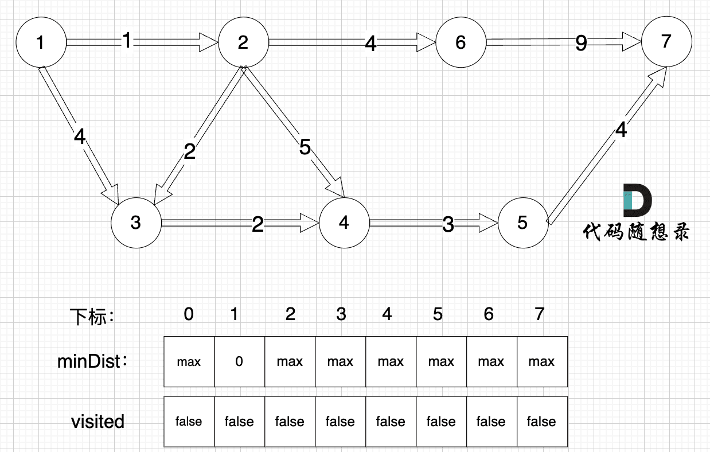

找距離源點最近且沒有被訪問過的節點，先找節點 1 

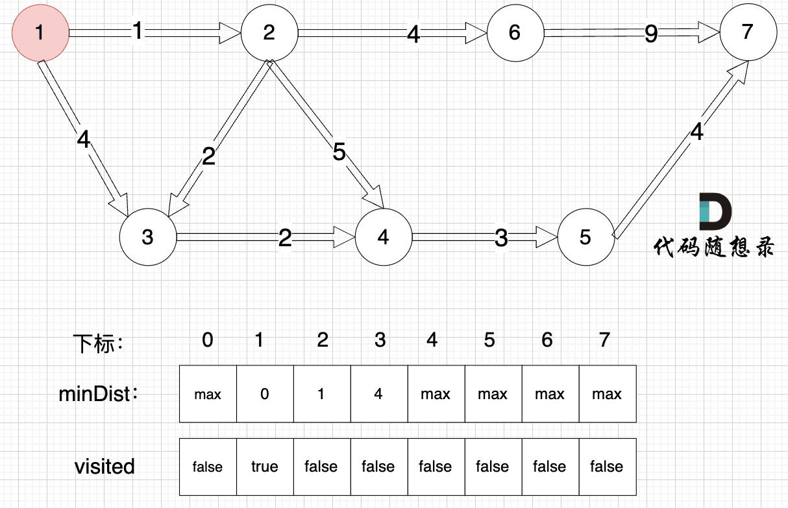


距離源點最近且沒有被訪問過的節點，找節點 2：

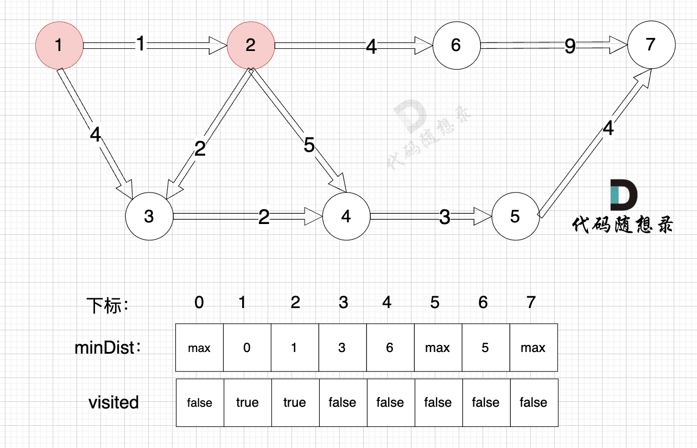

距離源點最近且沒有被訪問過的節點，找到節點 3：

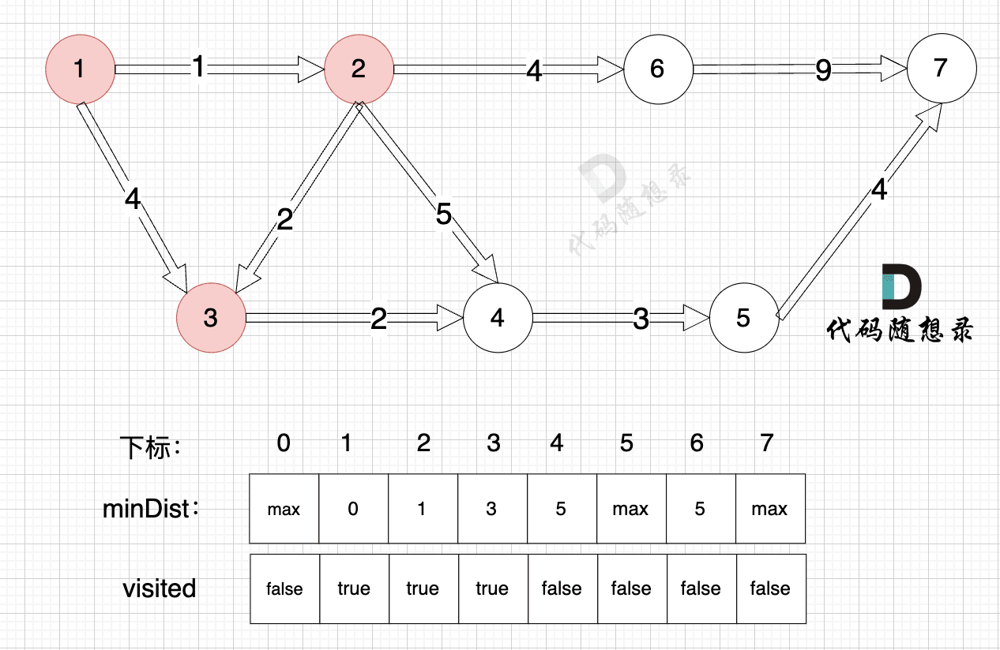

距離源點最近且沒有被訪問過的節點，找到節點 4：

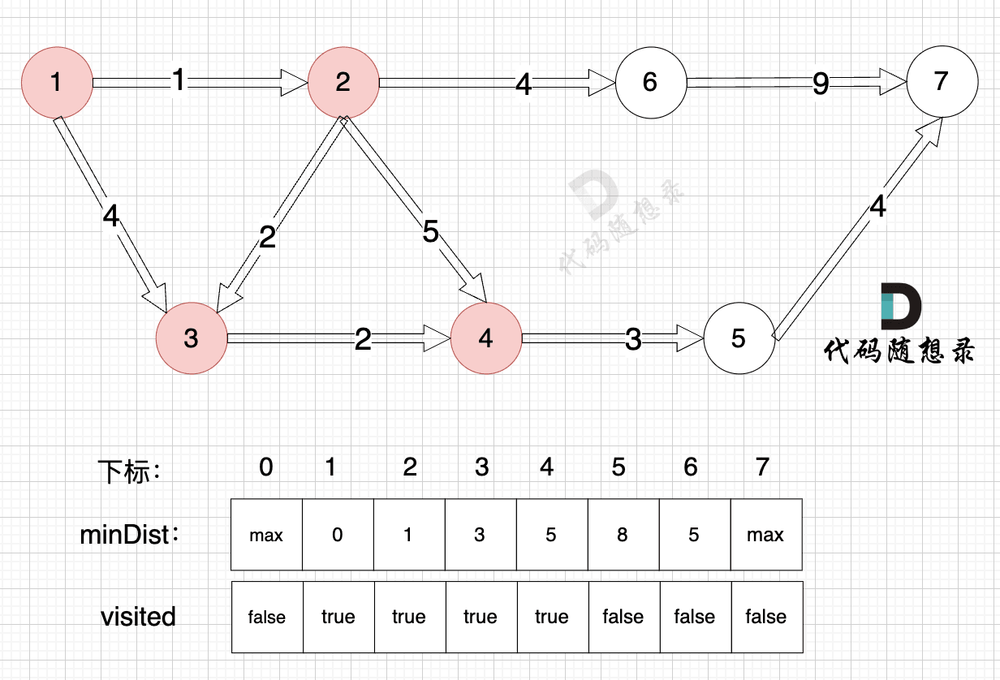 

此時最多經過 2 個節點的搜尋就完畢了，但結果中 minDist[7]（即節點 7 的結果）並沒有被更新。

那麼 dijkstra 會告訴我們節點 1 到節點 7 最多經過 2 個節點的情況下是不可到達的。 

透過以上模擬過程，大家應該能感受到 dijkstra 貪心的過程，正是因為貪心，所以 dijkstra 找不到 節點 1 -> 節點 2 -> 節點 6 -> 節點 7 這條路徑。 

## 總結 

本題是單源有限最短路徑問題，也是 bellman_ford 的一個拓展問題，如果理解 bellman_ford 其實解題思路比較容易理解，但有很多細節。 

例如為什麼要用 minDist_copy 來記錄上一輪鬆弛的結果。這也是本篇我為什麼花了這麼大篇幅講解的關鍵所在。

接下來，還給大家做了四個拓展： 

* 邊的順序的影響 
* 本題的本質 
* SPFA 的解法 
* 能否用 dijkstra

學透了以上四個拓展，相信大家會對 bellman_ford 有更深入的理解。 

## 其他語言版本

### Java 
```Java
import java.util.*;

public class Main {
    // 基於 Bellman_ford 一般解法解決單源最短路徑問題
    // Define an inner class Edge
    static class Edge {
        int from;
        int to;
        int val;
        public Edge(int from, int to, int val) {
            this.from = from;
            this.to = to;
            this.val = val;
        }
    }

    public static void main(String[] args) {
        // Input processing
        Scanner sc = new Scanner(System.in);
        int n = sc.nextInt();
        int m = sc.nextInt();

        List<Edge> graph = new ArrayList<>();

        for (int i = 0; i < m; i++) {
            int from = sc.nextInt();
            int to = sc.nextInt();
            int val = sc.nextInt();
            graph.add(new Edge(from, to, val));
        }

        int src = sc.nextInt();
        int dst = sc.nextInt();
        int k = sc.nextInt();

        int[] minDist = new int[n + 1];
        int[] minDistCopy;

        Arrays.fill(minDist, Integer.MAX_VALUE);
        minDist[src] = 0;

        for (int i = 0; i < k + 1; i++) { // Relax all edges k + 1 times
            minDistCopy = Arrays.copyOf(minDist, n + 1);
            for (Edge edge : graph) {
                int from = edge.from;
                int to = edge.to;
                int val = edge.val;
                // Use minDistCopy to calculate minDist
                if (minDistCopy[from] != Integer.MAX_VALUE && minDist[to] > minDistCopy[from] + val) {
                    minDist[to] = minDistCopy[from] + val;
                }
            }
        }
        
        // Output printing
        if (minDist[dst] == Integer.MAX_VALUE) {
            System.out.println("unreachable");
        } else {
            System.out.println(minDist[dst]);
        }
    }
}

```

```java
class Edge {
    public int u; // 邊的端點 1
    public int v; // 邊的端點 2
    public int val; // 邊的權值

    public Edge() {
    }

    public Edge(int u, int v) {
        this.u = u;
        this.v = v;
        this.val = 0;
    }

    public Edge(int u, int v, int val) {
        this.u = u;
        this.v = v;
        this.val = val;
    }
}

/**
 * SPFA 演算法（版本 3）：處理含【negative weight cycle】的有向圖的最短路徑問題
 * bellman_ford（版本 3）的佇列最佳化演算法版本
 * 限定起點、終點、至多途經 k 個節點
 */
public class SPFAForSSSP {

    /**
     * SPFA 演算法
     *
     * @param n        節點個數 [1,n]
     * @param graph    相鄰串列
     * @param startIdx 開始節點（源點）
     */
    public static int[] spfa(int n, List<List<Edge>> graph, int startIdx, int k) {
        // 定義最大範圍
        int maxVal = Integer.MAX_VALUE;
        // minDist[i] 源點到節點 i 的最短距離
        int[] minDist = new int[n + 1]; // 有效節點編號範圍：[1,n]
        Arrays.fill(minDist, maxVal); // 初始化為 maxVal
        minDist[startIdx] = 0; // 設定源點到源點的最短路徑為 0

        // 定義 queue 記錄每一次鬆弛更新的節點
        Queue<Integer> queue = new LinkedList<>();
        queue.offer(startIdx); // 初始化：源點開始（queue 和 minDist 的更新是同步的）


        // SPFA 演算法核心：只對上一次鬆弛的時候更新過的節點關聯的邊進行鬆弛操作
        while (k + 1 > 0 && !queue.isEmpty()) { // 限定鬆弛 k+1 次
            int curSize = queue.size(); // 記錄當前佇列節點個數（上一次鬆弛更新的節點個數，用作分層統計）
            while (curSize-- > 0) { // 分層控制，限定本次鬆弛只針對上一次鬆弛更新的節點，不對新增的節點做處理
                // 記錄當前 minDist 狀態，作為本次鬆弛的基礎
                int[] minDist_copy = Arrays.copyOfRange(minDist, 0, minDist.length);

                // 取出節點
                int cur = queue.poll();
                // 取得 cur 節點關聯的邊，進行鬆弛操作
                List<Edge> relateEdges = graph.get(cur);
                for (Edge edge : relateEdges) {
                    int u = edge.u; // 與 `cur` 對照
                    int v = edge.v;
                    int weight = edge.val;
                    if (minDist_copy[u] + weight < minDist[v]) {
                        minDist[v] = minDist_copy[u] + weight; // 更新
                        // 佇列同步更新（此處有一個針對佇列的最佳化：就是如果已經存在於佇列的元素不需要重複新增）
                        if (!queue.contains(v)) {
                            queue.offer(v); // 與 minDist[i] 同步更新，將本次更新的節點加入佇列，用作下一個鬆弛的參考基礎
                        }
                    }
                }
            }
            // 當次鬆弛結束，次數 -1
            k--;
        }

        // 回傳 minDist
        return minDist;
    }

    public static void main(String[] args) {
        // 輸入控制
        Scanner sc = new Scanner(System.in);
        System.out.println("1.輸入N個節點、M條邊（u v weight）");
        int n = sc.nextInt();
        int m = sc.nextInt();

        System.out.println("2.輸入M條邊");
        List<List<Edge>> graph = new ArrayList<>(); // 建構相鄰串列
        for (int i = 0; i <= n; i++) {
            graph.add(new ArrayList<>());
        }
        while (m-- > 0) {
            int u = sc.nextInt();
            int v = sc.nextInt();
            int weight = sc.nextInt();
            graph.get(u).add(new Edge(u, v, weight));
        }

        System.out.println("3.輸入src dst k（起點、終點、至多途經k個點）");
        int src = sc.nextInt();
        int dst = sc.nextInt();
        int k = sc.nextInt();

        // 呼叫演算法
        int[] minDist = SPFAForSSSP.spfa(n, graph, src, k);
        // 校驗起點->終點
        if (minDist[dst] == Integer.MAX_VALUE) {
            System.out.println("unreachable");
        } else {
            System.out.println("最短路徑：" + minDist[n]);
        }
    }
}
```


### Python

Bellman-Ford 方法求解單源有限最短路徑

```python
def main():
    # 輸入
    n, m = map(int, input().split())
    edges = list()
    for _ in range(m):
        edges.append(list(map(int, input().split() )))
    
    start, end, k = map(int, input().split())
    min_dist = [float('inf') for _ in range(n + 1)]
    min_dist[start] = 0
    
    # 只能經過 k 個城市，所以從起始點到中間有 (k + 1) 個邊連接
    # 需要鬆弛 (k + 1) 次
    
    for _ in range(k + 1):
        update = False
        min_dist_copy = min_dist.copy()
        for src, desc, w in edges:
            if (min_dist_copy[src] != float('inf') and 
            min_dist_copy[src] + w < min_dist[desc]):
                min_dist[desc] = min_dist_copy[src] + w
                update = True
        if not update:
            break
    # 輸出
    if min_dist[end] == float('inf'):
        print('unreachable')
    else:
        print(min_dist[end])
            
            

if __name__ == "__main__":
    main()
```

SPFA 方法求解單源有限最短路徑

```python
from collections import deque
from math import inf


def main():
    n, m = [int(i) for i in input().split()]
    graph = [[] for _ in range(n+1)]
    for _ in range(m):
        v1, v2, val = [int(i) for i in input().split()]
        graph[v1].append([v2, val])
    src, dst, k = [int(i) for i in input().split()]
    min_dist = [inf for _ in range(n+1)]
    min_dist[src] = 0  # 初始化起點的距離
    que = deque([src])

    while k != -1 and que:
        visited = [False for _ in range(n+1)]  # 用於保證每次鬆弛時一個節點最多加入佇列一次
        que_size = len(que)
        temp_dist = min_dist.copy()  # 用於記錄上一次遍歷的結果
        for _ in range(que_size):
            cur_node = que.popleft()
            for next_node, val in graph[cur_node]:
                if min_dist[next_node] > temp_dist[cur_node] + val:
                    min_dist[next_node] = temp_dist[cur_node] + val
                    if not visited[next_node]:
                        que.append(next_node)
                        visited[next_node] = True
        k -= 1

    if min_dist[dst] == inf:
        print("unreachable")
    else:
        print(min_dist[dst])


if __name__ == "__main__":
    main()
```

### Go

### Rust

### JavaScript

### TypeScript

### PhP

### Swift

### Scala

### C#

### Dart

### C

