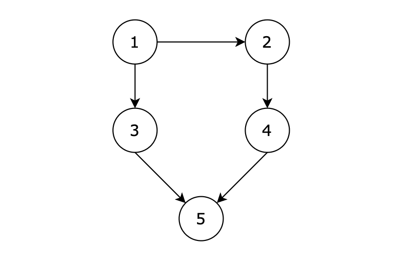
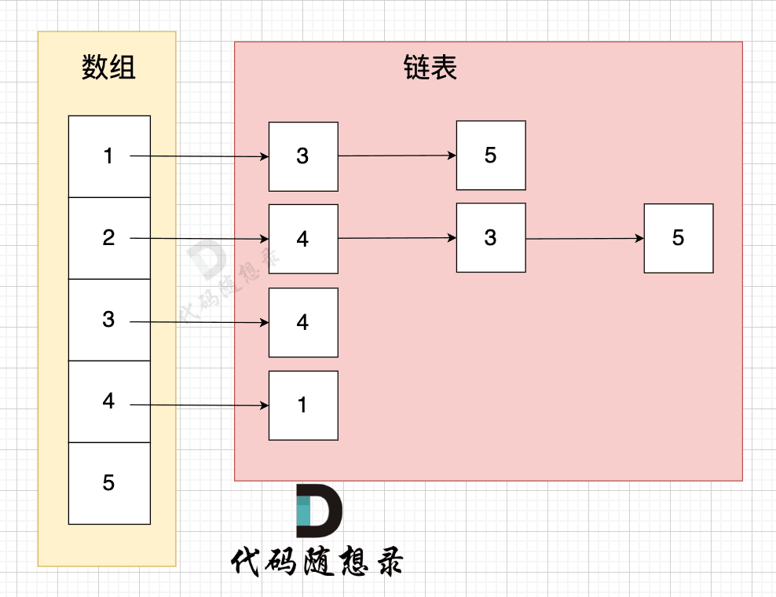

<p align="center"><strong><a href="./qita/join.md">參與本專案</a>，貢獻其他語言版本的程式碼，擁抱開放原始碼，讓更多學習演算法的夥伴們受益！</strong></p>

# 98. 所有可達路徑 

[KamaCoder 題目連結（ACM 模式）](https://kamacoder.com/problempage.php?pid=1170)

【題目描述】

給定一個有 n 個節點（node）的有向非循環圖（directed acyclic graph, DAG），節點編號從 1 到 n。請編寫一個程式，找出並回傳所有從節點 1 到節點 n 的路徑（path）。每條路徑應以節點編號的串列（list）形式表示。

【輸入描述】

第一行包含兩個整數（integer）N、M，表示圖（graph）中擁有 N 個節點，M 條邊（edge）

後續 M 行，每行包含兩個整數 s 和 t，表示圖中的 s 節點與 t 節點中有一條路徑

【輸出描述】

輸出所有的可達路徑，路徑中所有節點的後面跟一個空白，每條路徑獨佔一行，存在多條路徑時，路徑輸出的順序可任意。

如果不存在任何一條路徑，則輸出 -1。

注意輸出的序列（sequence）中，最後一個節點後面沒有空白！例如正確的答案是 `1 3 5`，而不是 `1 3 5 `，5 後面沒有空白！

【輸入範例】

```
5 5
1 3
3 5
1 2
2 4
4 5
```

【輸出範例】

```
1 3 5
1 2 4 5  
```

提示資訊

 

範例解釋：

有五個節點，其中從 1 到達 5 的路徑有兩個，分別是 1 -> 3 -> 5 和 1 -> 2 -> 4 -> 5。

因為擁有多條路徑，所以輸出結果為：

```
1 3 5
1 2 4 5
```

或

```
1 2 4 5
1 3 5
```

都算正確。

資料範圍：

* 圖中不存在自環
* 圖中不存在平行邊
* 1 <= N <= 100
* 1 <= M <= 500

**[《程式碼隨想錄》演算法影片公開課](https://programmercarl.com/other/gongkaike.html)：[所有可達路徑](https://www.bilibili.com/video/BV1VePeepEpP)，相信結合影片再看本篇題解，更有助於大家對本題的理解**。

## 插曲  

-------------

本題和 LeetCode [797.所有可能的路徑](https://leetcode.cn/problems/all-paths-from-source-to-target/description/) 是一樣的，讀者了解深度優先搜尋（depth-first search, DFS）之後，這道題目就是模板（template）題，是送分題。

LeetCode 是核心程式碼模式，把圖的儲存方式給大家定義好了，只需要寫出深搜的核心程式碼就可以。

如果筆試的時候出一道原題（筆試都是 ACM 模式，部分面試也是 ACM 模式），不少熟練刷 LeetCode 的讀者都難住了，因為不知道圖應該怎麼存，也不知道自己存的圖如何去遍歷（traversal）。

所以這也是為什麼我要讓大家練習 ACM 模式，也是我為什麼在程式碼隨想錄圖論（graph theory）講解中，不惜自己親自出題，讓大家統一練習 ACM 模式。

--------


這道題目是DFS，比較好的入門題。 

如果對DFS還不夠了解，可以先看這裡：[深度優先搜尋的理論基礎](https://programmercarl.com/图论深搜理论基础.html)

我依然總結了深搜三部曲，如果按照程式碼隨想錄練習題目的讀者，應該練習過二元樹（binary tree）的遞迴（recursion）三部曲，回溯（backtracking）三部曲。 

**大家可能有疑惑，深搜、二元樹和回溯演算法有什麼區別呢**？什麼時候用深搜、什麼時候用回溯？ 

我在講解[二元樹理論基礎](https://programmercarl.com/二叉树理论基础.html)的時候，提到過，**二元樹的前中後序遍歷其實就是深搜在二元樹這種資料結構上的應用**。 

那麼回溯演算法呢，**其實回溯演算法就是深搜，只不過針對某一搜尋場景我們給它一個更細分的定義，叫做回溯演算法**。 

那有的讀者可能說：那我以後稱回溯演算法為深搜，是不是沒問題？ 

理論上來說，沒問題，但就像是二元樹，你不叫它二元樹，叫它資料結構，有問題嗎？也沒問題對吧。 

建議是有細分的場景，還是稱其細分場景的名稱。所以回溯演算法可以獨立出來，但回溯確實就是深搜。 

## 圖的儲存 

在[圖論理論基礎篇](./圖論理論基礎.md)中我們講到了兩種圖的儲存方式：相鄰串列（adjacency list）和相鄰矩陣（adjacency matrix）。 

本題我們將帶大家分別實作這兩個圖的儲存方式。 

### 相鄰矩陣 

相鄰矩陣使用二維（2D）陣列（array）來表示圖結構。相鄰矩陣是從節點的角度來表示圖，有多少節點就申請多大的二維陣列。

本題我們會有 n 個節點，因為節點標號是從 1 開始的，為了節點標號和下標（subscript）對齊，我們申請 (n + 1) * (n + 1) 這麼大的二維陣列。 

```CPP
vector<vector<int>> graph(n + 1, vector<int>(n + 1, 0));
```

輸入 m 個邊，建構方式如下：

```CPP
while (m--) {
    cin >> s >> t;
    // 使用相鄰矩陣，1 表示節點 s 指向節點 t
    graph[s][t] = 1;
}
```

### 相鄰串列

相鄰串列使用陣列 + 鏈接串列（linked list）的方式來表示。相鄰串列是從邊的數量來表示圖，有多少邊才會申請對應大小的鏈接串列。 

相鄰串列的建構相對相鄰矩陣難理解一些。 

我在[圖論理論基礎篇](./圖論理論基礎.md)舉了一個例子：


 

這裡表達的圖是： 

* 節點 1 指向節點 3 和節點 5 
* 節點 2 指向節點 4、節點 3、節點 5 
* 節點 3 指向節點 4 
* 節點 4 指向節點 1 

我們需要建構一個陣列，陣列裡的元素（element）是一個鏈接串列。 

C++ 寫法： 

```CPP
// 節點編號從 1 到 n，所以申請 n+1 這麼大的陣列
vector<list<int>> graph(n + 1); // 相鄰串列，list 為 C++ 裡的鏈接串列
```

輸入 m 個邊，建構方式如下：

```CPP
while (m--) {
    cin >> s >> t;
    // 使用相鄰串列，表示 s -> t 是相連的
    graph[s].push_back(t);
}
```

本題我們使用相鄰串列或者相鄰矩陣都可以，因為後台資料並沒有對圖的大小以及稠密度做很大的區分。 

以下我們使用相鄰矩陣的方式來講解，文末我也會給出使用相鄰串列的整體程式碼。

**注意相鄰串列和相鄰矩陣的寫法都要掌握**！ 

## 深度優先搜尋

本題是DFS的基礎題目，關於深搜我在[圖論深搜理論基礎](./圖論深搜理論基礎.md)已經有詳細的講解，圖文並茂。 

關於本題我會直接使用深搜三部曲來分析，如果對深搜不夠了解，建議先看[圖論深搜理論基礎](./圖論深搜理論基礎.md)。

深搜三部曲來分析題目：

1. 確認遞迴函數（recursive function）、參數（parameter） 

首先我們 dfs 函數（function）一定要存一個圖，用來遍歷的，需要存一個目前我們遍歷的節點，定義為 x。

還需要存一個 n，表示終點，我們遍歷的時候，用來判斷當 x==n 時候標明找到了終點。

（其實在遞迴函數的參數不容易一開始就確定，一般是在寫函數體的時候發現缺什麼，參數就補什麼）

至於單一路徑和路徑集合（set）可以放在全域變數（global variable），那麼程式碼是這樣的： 

```CPP
vector<vector<int>> result; // 收集符合條件的路徑
vector<int> path; // 0 節點到終點的路徑
// x：目前遍歷的節點
// graph：存當前的圖
// n：終點
void dfs (const vector<vector<int>>& graph, int x, int n) {
```

2. 確認終止條件（termination condition） 

什麼時候我們就找到一條路徑了？ 

當目前遍歷的節點為最後一個節點 n 的時候，就找到了一條從出發點到終止點的路徑。 

```CPP
// 當前遍歷的節點 x 到達節點 n 
if (x == n) { // 找到符合條件的一條路徑
    result.push_back(path);
    return;
}
```

3. 處理目前搜尋節點出發的路徑 

接下來是走當前遍歷節點 x 的下一個節點。 

首先是要找到 x 節點指向了哪些節點呢？遍歷方式是這樣的： 

```c++
for (int i = 1; i <= n; i++) { // 遍歷節點 x 連結的所有節點
    if (graph[x][i] == 1) { // 找到 x 指向的節點，就是節點 i
    }
}
```

接下來就是將選中的 x 所指向的節點，加入到單一路徑來。 

```C++
path.push_back(i); // 遍歷到的節點加入到路徑中來

```


進入下一層遞迴 

```CPP
dfs(graph, i, n); // 進入下一層遞迴
```

最後就是回溯的過程，撤銷本次新增節點的操作。  

為什麼要有回溯，我在[圖論深搜理論基礎](./圖論深搜理論基礎.md)也有詳細的講解。

該過程整體程式碼： 

```CPP
for (int i = 1; i <= n; i++) { // 遍歷節點 x 連結的所有節點
    if (graph[x][i] == 1) { // 找到 x 連結的節點
        path.push_back(i); // 遍歷到的節點加入到路徑中來
        dfs(graph, i, n); // 進入下一層遞迴
        path.pop_back(); // 回溯，撤銷本節點
    }
}
```

## 印出結果

ACM 格式大家在輸出結果的時候，要關注看看格式問題，特別是字串（string），有的題目說的是每個元素後面都有空白，有的題目說的是每個元素間有空白，最後一個元素沒有空白。

有的題目呢，根本沒說，那只能提交去試一試了。 

很多讀者在提交題目的時候發現結果一樣，為什麼提交就是不對呢。 

例如範例輸出是： 

`1 3 5` 而不是 `1 3 5 `

即 5 的後面沒有空白！ 

這是我們在輸出的時候需要注意的點。 

有讀者可能會想，ACM 格式就是麻煩，有空白沒有空白有什麼影響，結果對了不就行了？ 

ACM 模式相對於核心程式碼模式（LeetCode）更考驗大家對程式碼的掌控能力。例如工程程式碼裡，輸入輸出都是要自己控制的。這也是為什麼大公司筆試，都是 ACM 模式。 

以上程式碼中，結果都存在了 result 陣列裡（二維陣列，每一列（row）是一個結果），最後將其印出來。（重點看註解） 

```CPP
// 輸出結果
if (result.size() == 0) cout << -1 << endl;
for (const vector<int> &pa : result) {
    for (int i = 0; i < pa.size() - 1; i++) { // 這裡指印到倒數第二個
        cout << pa[i] << " ";
    }
    cout << pa[pa.size() - 1]  << endl; // 這裡再印倒數第一個，控制最後一個元素後面沒有空白
}
```

## 本題程式碼

### 相鄰矩陣寫法


```CPP
#include <iostream>
#include <vector>
using namespace std;
vector<vector<int>> result; // 收集符合條件的路徑
vector<int> path; // 1 節點到終點的路徑

void dfs (const vector<vector<int>>& graph, int x, int n) {
    // 當前遍歷的節點 x 到達節點 n 
    if (x == n) { // 找到符合條件的一條路徑
        result.push_back(path);
        return;
    }
    for (int i = 1; i <= n; i++) { // 遍歷節點 x 連結的所有節點
        if (graph[x][i] == 1) { // 找到 x 連結的節點
            path.push_back(i); // 遍歷到的節點加入到路徑中來
            dfs(graph, i, n); // 進入下一層遞迴
            path.pop_back(); // 回溯，撤銷本節點
        }
    }
}

int main() {
    int n, m, s, t;
    cin >> n >> m;

    // 節點編號從 1 到 n，所以申請 n+1 這麼大的陣列
    vector<vector<int>> graph(n + 1, vector<int>(n + 1, 0));

    while (m--) {
        cin >> s >> t;
        // 使用相鄰矩陣表示無向圖，1 表示 s 與 t 是相連的
        graph[s][t] = 1;
    }

    path.push_back(1); // 無論什麼路徑已經是從 0 節點出發
    dfs(graph, 1, n); // 開始遍歷

    // 輸出結果
    if (result.size() == 0) cout << -1 << endl;
    for (const vector<int> &pa : result) {
        for (int i = 0; i < pa.size() - 1; i++) {
            cout << pa[i] << " ";
        }
        cout << pa[pa.size() - 1]  << endl;
    }
}

```

### 相鄰串列寫法 

```CPP 
#include <iostream>
#include <vector>
#include <list>
using namespace std;

vector<vector<int>> result; // 收集符合條件的路徑
vector<int> path; // 1 節點到終點的路徑

void dfs (const vector<list<int>>& graph, int x, int n) {

    if (x == n) { // 找到符合條件的一條路徑
        result.push_back(path);
        return;
    }
    for (int i : graph[x]) { // 找到 x 指向的節點
        path.push_back(i); // 遍歷到的節點加入到路徑中來
        dfs(graph, i, n); // 進入下一層遞迴
        path.pop_back(); // 回溯，撤銷本節點
    }
}

int main() {
    int n, m, s, t;
    cin >> n >> m;

    // 節點編號從 1 到 n，所以申請 n+1 這麼大的陣列
    vector<list<int>> graph(n + 1); // 相鄰串列
    while (m--) {
        cin >> s >> t;
        // 使用相鄰串列，表示 s -> t 是相連的
        graph[s].push_back(t);

    }

    path.push_back(1); // 無論什麼路徑已經是從 0 節點出發
    dfs(graph, 1, n); // 開始遍歷

    // 輸出結果
    if (result.size() == 0) cout << -1 << endl;
    for (const vector<int> &pa : result) {
        for (int i = 0; i < pa.size() - 1; i++) {
            cout << pa[i] << " ";
        }
        cout << pa[pa.size() - 1]  << endl;
    }
}

```

## 總結 

本題是一道簡單的深搜題目，也可以說是模板題，和 [LeetCode 797. 所有可能的路徑](https://leetcode.cn/problems/all-paths-from-source-to-target/description/) 解題思路是一模一樣的。

很多讀者做 LeetCode 的時候，輕鬆就把程式碼寫出來了，但做面試筆試的時候，遇到這樣的題就寫不出來了。

在 LeetCode 上刷題不用考慮圖的儲存方式，也不用考慮輸出的格式。 

而這些都是 ACM 模式題目的知識點（圖的儲存方式）和細節（輸出的格式）

所以我才會特別製作 ACM 題目，同樣也重點去講解圖的儲存和遍歷方式，來幫大家練習。

對於這種有向圖（directed graph）路徑問題，最適合使用深搜，當然本題也可以使用廣度優先搜尋（breadth-first search, BFS），但廣搜相對來說就麻煩了一些，需要記錄一下路徑。 

而深搜和廣搜都適合解決顏色類的問題，例如島嶼系列，其實都是遍歷+標記，所以使用哪種遍歷都是可以的。 

至於廣搜理論基礎，我們在下一篇再好好講解，敬請期待！ 


## 其他語言版本

### Java 

相鄰矩陣寫法
```java
import java.util.ArrayList;
import java.util.List;
import java.util.Scanner;

public class Main {
    static List<List<Integer>> result = new ArrayList<>(); // 收集符合條件的路徑
    static List<Integer> path = new ArrayList<>(); // 1 節點到終點的路徑

    public static void dfs(int[][] graph, int x, int n) {
        // 當前遍歷的節點 x 到達節點 n
        if (x == n) { // 找到符合條件的一條路徑
            result.add(new ArrayList<>(path));
            return;
        }
        for (int i = 1; i <= n; i++) { // 遍歷節點 x 連結的所有節點
            if (graph[x][i] == 1) { // 找到 x 連結的節點
                path.add(i); // 遍歷到的節點加入到路徑中來
                dfs(graph, i, n); // 進入下一層遞迴
                path.remove(path.size() - 1); // 回溯，撤銷本節點
            }
        }
    }

    public static void main(String[] args) {
        Scanner scanner = new Scanner(System.in);
        int n = scanner.nextInt();
        int m = scanner.nextInt();

        // 節點編號從 1 到 n，所以申請 n+1 這麼大的陣列
        int[][] graph = new int[n + 1][n + 1];

        for (int i = 0; i < m; i++) {
            int s = scanner.nextInt();
            int t = scanner.nextInt();
            // 使用相鄰矩陣表示無向圖，1 表示 s 與 t 是相連的
            graph[s][t] = 1;
        }

        path.add(1); // 無論什麼路徑已經是從 1 節點出發
        dfs(graph, 1, n); // 開始遍歷

        // 輸出結果
        if (result.isEmpty()) System.out.println(-1);
        for (List<Integer> pa : result) {
            for (int i = 0; i < pa.size() - 1; i++) {
                System.out.print(pa.get(i) + " ");
            }
            System.out.println(pa.get(pa.size() - 1));
        }
    }
}
```

相鄰串列寫法
```java
import java.util.ArrayList;
import java.util.LinkedList;
import java.util.List;
import java.util.Scanner;

public class Main {
    static List<List<Integer>> result = new ArrayList<>(); // 收集符合條件的路徑
    static List<Integer> path = new ArrayList<>(); // 1 節點到終點的路徑

    public static void dfs(List<LinkedList<Integer>> graph, int x, int n) {
        if (x == n) { // 找到符合條件的一條路徑
            result.add(new ArrayList<>(path));
            return;
        }
        for (int i : graph.get(x)) { // 找到 x 指向的節點
            path.add(i); // 遍歷到的節點加入到路徑中來
            dfs(graph, i, n); // 進入下一層遞迴
            path.remove(path.size() - 1); // 回溯，撤銷本節點
        }
    }

    public static void main(String[] args) {
        Scanner scanner = new Scanner(System.in);
        int n = scanner.nextInt();
        int m = scanner.nextInt();

        // 節點編號從 1 到 n，所以申請 n+1 這麼大的陣列
        List<LinkedList<Integer>> graph = new ArrayList<>(n + 1);
        for (int i = 0; i <= n; i++) {
            graph.add(new LinkedList<>());
        }

        while (m-- > 0) {
            int s = scanner.nextInt();
            int t = scanner.nextInt();
            // 使用相鄰串列表示 s -> t 是相連的
            graph.get(s).add(t);
        }

        path.add(1); // 無論什麼路徑已經是從 1 節點出發
        dfs(graph, 1, n); // 開始遍歷

        // 輸出結果
        if (result.isEmpty()) System.out.println(-1);
        for (List<Integer> pa : result) {
            for (int i = 0; i < pa.size() - 1; i++) {
                System.out.print(pa.get(i) + " ");
            }
            System.out.println(pa.get(pa.size() - 1));
        }
    }
}
```
### Python
相鄰矩陣寫法
``` python
def dfs(graph, x, n, path, result):
    if x == n:
        result.append(path.copy())
        return
    for i in range(1, n + 1):
        if graph[x][i] == 1:
            path.append(i)
            dfs(graph, i, n, path, result)
            path.pop()

def main():
    n, m = map(int, input().split())
    graph = [[0] * (n + 1) for _ in range(n + 1)]

    for _ in range(m):
        s, t = map(int, input().split())
        graph[s][t] = 1

    result = []
    dfs(graph, 1, n, [1], result)

    if not result:
        print(-1)
    else:
        for path in result:
            print(' '.join(map(str, path)))

if __name__ == "__main__":
    main()
```

相鄰串列寫法
``` python
from collections import defaultdict

result = []  # 收集符合條件的路徑
path = []  # 1 節點到終點的路徑

def dfs(graph, x, n):
    if x == n:  # 找到符合條件的一條路徑
        result.append(path.copy())
        return
    for i in graph[x]:  # 找到 x 指向的節點
        path.append(i)  # 遍歷到的節點加入到路徑中來
        dfs(graph, i, n)  # 進入下一層遞迴
        path.pop()  # 回溯，撤銷本節點

def main():
    n, m = map(int, input().split())

    graph = defaultdict(list)  # 相鄰串列
    for _ in range(m):
        s, t = map(int, input().split())
        graph[s].append(t)

    path.append(1)  # 無論什麼路徑已經是從 1 節點出發
    dfs(graph, 1, n)  # 開始遍歷

    # 輸出結果
    if not result:
        print(-1)
    for pa in result:
        print(' '.join(map(str, pa)))

if __name__ == "__main__":
    main()
```
### Go

#### 相鄰矩陣寫法
```go
package main

import (
	"fmt"
)

var result [][]int // 收集符合條件的路徑
var path []int     // 1 節點到終點的路徑

func dfs(graph [][]int, x, n int) {
	// 當前遍歷的節點 x 到達節點 n
	if x == n { // 找到符合條件的一條路徑
		temp := make([]int, len(path))
		copy(temp, path)
		result = append(result, temp)
		return
	}
	for i := 1; i <= n; i++ { // 遍歷節點 x 連結的所有節點
		if graph[x][i] == 1 { // 找到 x 連結的節點
			path = append(path, i)    // 遍歷到的節點加入到路徑中來
			dfs(graph, i, n)          // 進入下一層遞迴
			path = path[:len(path)-1] // 回溯，撤銷本節點
		}
	}
}

func main() {
	var n, m int
	fmt.Scanf("%d %d", &n, &m)

	// 節點編號從 1 到 n，所以申請 n+1 這麼大的陣列
	graph := make([][]int, n+1)
	for i := range graph {
		graph[i] = make([]int, n+1)
	}

	for i := 0; i < m; i++ {
		var s, t int
		fmt.Scanf("%d %d", &s, &t)
		// 使用相鄰矩陣表示無向圖，1 表示 s 與 t 是相連的
		graph[s][t] = 1
	}

	path = append(path, 1) // 無論什麼路徑已經是從 1 節點出發
	dfs(graph, 1, n)       // 開始遍歷

	// 輸出結果
	if len(result) == 0 {
		fmt.Println(-1)
	} else {
		for _, pa := range result {
			for i := 0; i < len(pa)-1; i++ {
				fmt.Print(pa[i], " ")
			}
			fmt.Println(pa[len(pa)-1])
		}
	}
}
```

#### 相鄰串列寫法
```go
package main

import (
	"fmt"
)

var result [][]int
var path []int

func dfs(graph [][]int, x, n int) {
	if x == n {
		temp := make([]int, len(path))
		copy(temp, path)
		result = append(result, temp)
		return
	}
	for _, i := range graph[x] {
		path = append(path, i)
		dfs(graph, i, n)
		path = path[:len(path)-1]
	}
}

func main() {
	var n, m int
	fmt.Scanf("%d %d", &n, &m)

	graph := make([][]int, n+1)
	for i := 0; i <= n; i++ {
		graph[i] = make([]int, 0)
	}

	for m > 0 {
		var s, t int
		fmt.Scanf("%d %d", &s, &t)
		graph[s] = append(graph[s], t)
		m--
	}

	path = append(path, 1)
	dfs(graph, 1, n)

	if len(result) == 0 {
		fmt.Println(-1)
	} else {
		for _, pa := range result {
			for i := 0; i < len(pa)-1; i++ {
				fmt.Print(pa[i], " ")
			}
			fmt.Println(pa[len(pa)-1])
		}
	}
}
```

### Rust

### JavaScript

#### 相鄰矩陣寫法

```javascript
const r1 = require('readline').createInterface({ input: process.stdin });
// 建立 readline 介面
let iter = r1[Symbol.asyncIterator]();
// 建立非同步疊代器
const readline = async ()=>(await iter.next()).value;


let graph;
let N, M;
// 收集符合條件的路徑
let result = [];
// 1 節點到終點的路徑
let path = [];

// 建立相鄰矩陣，初始化相鄰矩陣
async function initGraph(){
    let line;

    line = await readline();
    [N, M] = line.split(' ').map(i => parseInt(i))
    graph = new Array(N + 1).fill(0).map(() => new Array(N + 1).fill(0))
    
    while(M--){
        line = await readline()
        const strArr = line ?  line.split(' ').map(i => parseInt(i)) : undefined
        strArr ? graph[strArr[0]][strArr[1]] = 1 : null
    }
};

// 深度搜尋
function dfs(graph, x,  n){
    // 當前遍歷節點為 x，到達節點為 n
    if(x == n){
        result.push([...path])
        return
    }
    for(let i = 1 ; i <= n ; i++){
        if(graph[x][i] == 1){
            path.push(i)
            dfs(graph, i, n )
            path.pop(i)
        }
    }
};

(async function(){
    // 建立相鄰矩陣，初始化相鄰矩陣
    await initGraph();
    
    // 從節點 1 開始深度搜尋
    path.push(1);
    
    // 深度搜尋
    dfs(graph, 1, N );
    
    // 輸出
    if(result.length > 0){
        result.forEach(i => {
            console.log(i.join(' '))
        })
    }else{
        console.log(-1)
    }
   
})();

```


#### 相鄰串列寫法

```javascript
const r1 = require('readline').createInterface({ input: process.stdin });
// 建立 readline 介面
let iter = r1[Symbol.asyncIterator]();
// 建立非同步疊代器
const readline = async () => (await iter.next()).value;

let graph;
let N, M;

// 收集符合條件的路徑
let result = [];
// 1 節點到終點的路徑
let path = [];

// 建立相鄰串列，初始化相鄰串列
async function initGraph() {
  let line;
  line = await readline();
  [N, M] = line.split(' ').map(i => parseInt(i))
  graph = new Array(N + 1).fill(0).map(() => new Array())

  while (line = await readline()) {
    const strArr = line.split(' ').map(i => parseInt(i))
    strArr ? graph[strArr[0]].push(strArr[1]) : null
  }
};

// 深度搜尋
async function dfs(graph, x, n) {
  // 當前遍歷節點為 x，到達節點為 n
  if (x == n) {
    result.push([...path])
    return
  }

  graph[x].forEach(i => {
    path.push(i)
    dfs(graph, i, n)
    path.pop(i)
  })
};

(async function () {
  // 建立相鄰串列，初始化相鄰串列
  await initGraph();

  // 從節點 1 開始深度搜尋
  path.push(1);

  // 深度搜尋
  dfs(graph, 1, N);

  // 輸出
  if (result.length > 0) {
    result.forEach(i => {
      console.log(i.join(' '))
    })
  } else {
    console.log(-1)
  }
})();
```

### TypeScript

### PhP

### Swift

### Scala

### C#

### Dart

### C


