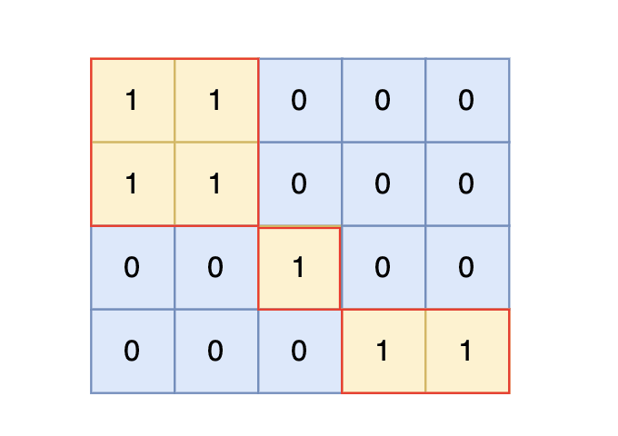
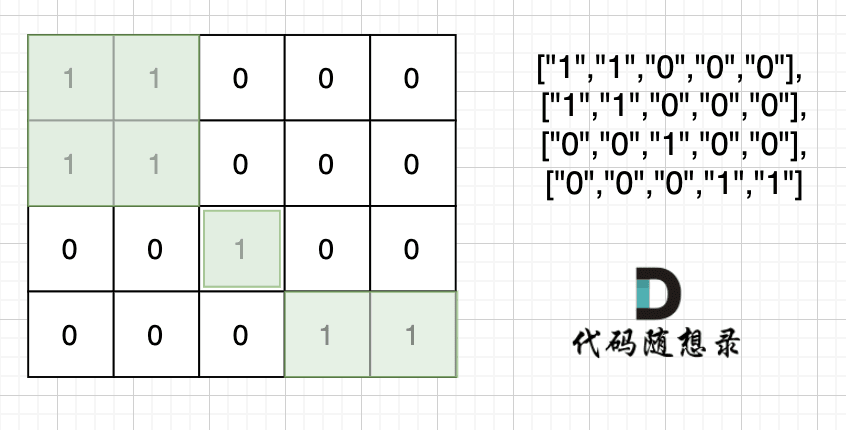
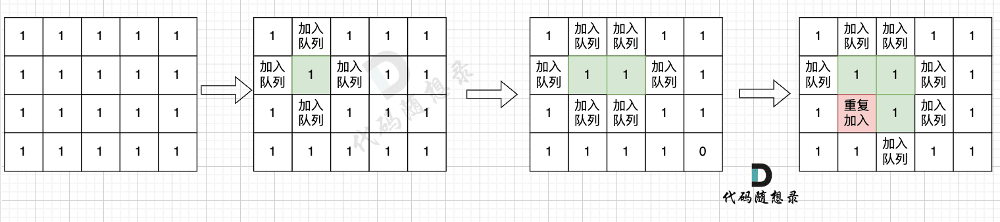

<p align="center"><strong><a href="./qita/join.md">參與本專案</a>，貢獻其他語言版本的程式碼，擁抱開放原始碼（open source），讓更多學習演算法的夥伴們受益！</strong></p>

# 99. 孤島計數

[KamaCoder 題目連結（ACM 模式）](https://kamacoder.com/problempage.php?pid=1171)

題目描述：

給定一個由 1（陸地）和 0（水）組成的矩陣（matrix），你需要計算島嶼的數量。島嶼由水平方向或垂直方向上相鄰的陸地連接而成，並且四周都是水域。你可以假設矩陣外均被水包圍。

輸入描述：

第一列（row）包含兩個整數（integer） N, M，表示矩陣的列數和行（column）數。

後續 N 列，每列包含 M 個數字，數字為 1 或者 0。

輸出描述：

輸出一個整數，表示島嶼的數量。如果不存在島嶼，則輸出 0。

輸入範例：

```
4 5
1 1 0 0 0
1 1 0 0 0
0 0 1 0 0
0 0 0 1 1
```

輸出範例：

3 

提示資訊 

 

根據測試案例（test case）中所展示，島嶼數量共有 3 個，所以輸出 3。 

資料範圍：

* 1 <= N, M <= 50


## 解題思路 

**[《代碼隨想錄》演算法影片公開課](https://programmercarl.com/other/gongkaike.html)：[圖論：廣搜有陷阱啊！！ | 廣度優先搜尋 | KamaCoder：99.島嶼數量](https://www.bilibili.com/video/BV18PRGYcEiB/)，相信結合影片再看本篇題解，更有助於大家對本題的理解**。

注意題目中每座島嶼只能由**水平方向和/或垂直方向上**相鄰的陸地連接形成。

也就是說斜角度連接是不算的，例如範例二，是三個島嶼，如圖：

 

這道題目是深度優先搜尋（depth-first search, DFS），廣度優先搜尋（breadth-first search, BFS），互斥集（disjoint set），基礎題目。

本題解題思路：遇到一個沒有遍歷（traversal）過的節點（node）陸地，計數器（counter）就加一，然後把該節點陸地所能遍歷到的陸地都標記上。 

再遇到標記過的陸地節點和海洋節點的時候直接跳過。這樣計數器就是最終島嶼的數量。

那麼如何把節點陸地所能遍歷到的陸地都標記上呢，就可以使用 DFS，BFS 或者互斥集。 

### 廣度優先搜尋（breadth-first search, BFS） 

如果不熟悉廣搜，建議先看 [廣搜理論基礎](./圖論廣搜理論基礎.md)。

不少同學用廣搜做這道題目的時候，逾時了。這裡有一個廣搜中很重要的細節：

根本原因是**只要加入佇列（queue）就代表走過，就需要標記，而不是從佇列拿出來的時候再去標記走過**。

很多同學可能感覺這有區別嗎？

如果從佇列拿出節點，再去標記這個節點走過，就會發生下圖所示的結果，會導致很多節點重複加入佇列。



逾時寫法（從佇列中取出節點再標記，注意程式碼註解的地方）

```CPP
int dir[4][2] = {0, 1, 1, 0, -1, 0, 0, -1}; // 四個方向
void bfs(vector<vector<char>>& grid, vector<vector<bool>>& visited, int x, int y) {
    queue<pair<int, int>> que;
    que.push({x, y});
    while(!que.empty()) {
        pair<int ,int> cur = que.front(); que.pop();
        int curx = cur.first;
        int cury = cur.second;
        visited[curx][cury] = true; // 從佇列中取出再標記走過
        for (int i = 0; i < 4; i++) {
            int nextx = curx + dir[i][0];
            int nexty = cury + dir[i][1];
            if (nextx < 0 || nextx >= grid.size() || nexty < 0 || nexty >= grid[0].size()) continue;  // 越界了，直接跳過
            if (!visited[nextx][nexty] && grid[nextx][nexty] == '1') {
                que.push({nextx, nexty});
            }
        }
    }

}
```


加入佇列就代表走過，立刻標記，正確寫法：（注意程式碼註解的地方）

```CPP
int dir[4][2] = {0, 1, 1, 0, -1, 0, 0, -1}; // 四個方向
void bfs(vector<vector<char>>& grid, vector<vector<bool>>& visited, int x, int y) {
    queue<pair<int, int>> que;
    que.push({x, y});
    visited[x][y] = true; // 只要加入佇列，立刻標記
    while(!que.empty()) {
        pair<int ,int> cur = que.front(); que.pop();
        int curx = cur.first;
        int cury = cur.second;
        for (int i = 0; i < 4; i++) {
            int nextx = curx + dir[i][0];
            int nexty = cury + dir[i][1];
            if (nextx < 0 || nextx >= grid.size() || nexty < 0 || nexty >= grid[0].size()) continue;  // 越界了，直接跳過
            if (!visited[nextx][nexty] && grid[nextx][nexty] == '1') {
                que.push({nextx, nexty});
                visited[nextx][nexty] = true; // 只要加入佇列立刻標記
            }
        }
    }

}
```

以上兩個版本其實只有細微區別，就是 `visited[x][y] = true;` 放的地方，這取決於我們對程式碼中佇列的定義，佇列中的節點就表示已經走過的節點。**所以只要加入佇列，立即標記該節點走過**。

本題完整廣搜程式碼： 

```CPP
#include <iostream>
#include <vector>
#include <queue>
using namespace std;

int dir[4][2] = {0, 1, 1, 0, -1, 0, 0, -1}; // 四個方向
void bfs(const vector<vector<int>>& grid, vector<vector<bool>>& visited, int x, int y) {
    queue<pair<int, int>> que;
    que.push({x, y});
    visited[x][y] = true; // 只要加入佇列，立刻標記
    while(!que.empty()) {
        pair<int ,int> cur = que.front(); que.pop();
        int curx = cur.first;
        int cury = cur.second;
        for (int i = 0; i < 4; i++) {
            int nextx = curx + dir[i][0];
            int nexty = cury + dir[i][1];
            if (nextx < 0 || nextx >= grid.size() || nexty < 0 || nexty >= grid[0].size()) continue;  // 越界了，直接跳過
            if (!visited[nextx][nexty] && grid[nextx][nexty] == 1) {
                que.push({nextx, nexty});
                visited[nextx][nexty] = true; // 只要加入佇列立刻標記
            }
        }
    }
}

int main() {
    int n, m;
    cin >> n >> m;
    vector<vector<int>> grid(n, vector<int>(m, 0));
    for (int i = 0; i < n; i++) {
        for (int j = 0; j < m; j++) {
            cin >> grid[i][j];
        }
    }

    vector<vector<bool>> visited(n, vector<bool>(m, false));

    int result = 0;
    for (int i = 0; i < n; i++) {
        for (int j = 0; j < m; j++) {
            if (!visited[i][j] && grid[i][j] == 1) {
                result++; // 遇到沒造訪過的陸地，+1
                bfs(grid, visited, i, j); // 將與其連接的陸地都標記上 true
            }
        }
    }


    cout << result << endl;
}

```


## 其他語言版本

### Java 

```java
import java.util.*;

public class Main {
    public static int[][] dir = {{0, 1}, {1, 0}, {0, -1}, {-1, 0}};//下右上左逆時針遍歷

    public static void bfs(int[][] grid, boolean[][] visited, int x, int y) {
        Queue<pair> queue = new LinkedList<pair>();//定義坐標佇列，沒有現成的pair類別，在下面自訂了
        queue.add(new pair(x, y));
        visited[x][y] = true;//遇到入佇列直接標記為已造訪，
        // 否則出佇列時才標記的話會導致重複造訪，比如下方節點會在右下順序的時候被第二次造訪入佇列
        while (!queue.isEmpty()) {
            int curX = queue.peek().first;
            int curY = queue.poll().second;//當前橫縱坐標
            for (int i = 0; i < 4; i++) {
                //順時針遍歷新節點next，下面記錄坐標
                int nextX = curX + dir[i][0];
                int nextY = curY + dir[i][1];
                if (nextX < 0 || nextX >= grid.length || nextY < 0 || nextY >= grid[0].length) {
                    continue;
                }//去除越界部分
                if (!visited[nextX][nextY] && grid[nextX][nextY] == 1) {
                    queue.add(new pair(nextX, nextY));
                    visited[nextX][nextY] = true;//邏輯同上
                }
            }
        }
    }

    public static void main(String[] args) {
        Scanner sc = new Scanner(System.in);
        int m = sc.nextInt();
        int n = sc.nextInt();
        int[][] grid = new int[m][n];
        boolean[][] visited = new boolean[m][n];
        int ans = 0;
        for (int i = 0; i < m; i++) {
            for (int j = 0; j < n; j++) {
                grid[i][j] = sc.nextInt();
            }
        }
        for (int i = 0; i < m; i++) {
            for (int j = 0; j < n; j++) {
                if (!visited[i][j] && grid[i][j] == 1) {
                    ans++;
                    bfs(grid, visited, i, j);
                }
            }
        }
        System.out.println(ans);
    }
}
```


### Python

```python

from collections import deque
directions = [[0, 1], [1, 0], [0, -1], [-1, 0]]
def bfs(grid, visited, x, y):
    que = deque([])
    que.append([x,y])
    visited[x][y] = True
    while que:
        cur_x, cur_y = que.popleft()
        for i, j in directions:
            next_x = cur_x + i
            next_y = cur_y + j
            if next_y < 0 or next_x < 0 or next_x >= len(grid) or next_y >= len(grid[0]):
                continue
            if not visited[next_x][next_y] and grid[next_x][next_y] == 1: 
                visited[next_x][next_y] = True
                que.append([next_x, next_y])


def main():
    n, m = map(int, input().split())
    grid = []
    for i in range(n):
        grid.append(list(map(int, input().split())))
    visited = [[False] * m for _ in range(n)]
    res = 0
    for i in range(n):
        for j in range(m):
            if grid[i][j] == 1 and not visited[i][j]:
                res += 1
                bfs(grid, visited, i, j)
    print(res)

if __name__ == "__main__":
    main()


```


### Go

```go

package main

import (
    "bufio"
    "fmt"
    "os"
    "strconv"
    "strings"
)

var dir = [4][2]int{{0, 1}, {1, 0}, {-1, 0}, {0, -1}} // 四個方向

func dfs(grid [][]int, visited [][]bool, x, y int) {
    for i := 0; i < 4; i++ {
        nextx := x + dir[i][0]
        nexty := y + dir[i][1]
        if nextx < 0 || nextx >= len(grid) || nexty < 0 || nexty >= len(grid[0]) {
            continue // 越界了，直接跳過
        }
        if !visited[nextx][nexty] && grid[nextx][nexty] == 1 { // 沒有造訪過的 同時 是陸地的
            visited[nextx][nexty] = true
            dfs(grid, visited, nextx, nexty)
        }
    }
}

func main() {
    reader := bufio.NewReader(os.Stdin)
    var n, m int
    fmt.Scanf("%d %d", &n, &m)

    grid := make([][]int, n)
    for i := 0; i < n; i++ {
        grid[i] = make([]int, m)
        line, _ := reader.ReadString('\n')
        line = strings.TrimSpace(line)
        elements := strings.Split(line, " ")
        for j := 0; j < m; j++ {
            grid[i][j], _ = strconv.Atoi(elements[j])
        }
    }

    visited := make([][]bool, n)
    for i := 0; i < n; i++ {
        visited[i] = make([]bool, m)
    }

    result := 0
    for i := 0; i < n; i++ {
        for j := 0; j < m; j++ {
            if !visited[i][j] && grid[i][j] == 1 {
                visited[i][j] = true
                result++ // 遇到沒造訪過的陸地，+1
                dfs(grid, visited, i, j) // 將與其連接的陸地都標記上 true
            }
        }
    }

    fmt.Println(result)
}


```


### Rust

### JavaScript

```javascript
const r1 = require('readline').createInterface({ input: process.stdin });
// 建立readline介面
let iter = r1[Symbol.asyncIterator]();
// 建立非同步疊代器
const readline = async () => (await iter.next()).value;

let graph
let N, M
let visited
let result = 0
const dir = [[0, 1], [1, 0], [0, -1], [-1, 0]]

// 讀取輸入，初始化地圖
const initGraph = async () => {
  let line = await readline();
  [N, M] = line.split(' ').map(Number);
  graph = new Array(N).fill(0).map(() => new Array(M).fill(0))
  visited = new Array(N).fill(false).map(() => new Array(M).fill(false))

  for (let i = 0; i < N; i++) {
    line = await readline()
    line = line.split(' ').map(Number)
    for (let j = 0; j < M; j++) {
      graph[i][j] = line[j]
    }
  }
}


/**
 * @description: 從(x, y)開始 breadth-first traversal
 * @param {*} graph 地圖
 * @param {*} visited 造訪過的節點
 * @param {*} x 開始搜尋節點的下標
 * @param {*} y 開始搜尋節點的下標
 * @return {*}
 */
const bfs = (graph, visited, x, y) => {
  let queue = []
  queue.push([x, y])
  visited[x][y] = true  //只要加入佇列就立刻標記為造訪過

  while (queue.length) {
    let [x, y] = queue.shift()
    for (let i = 0; i < 4; i++) {
      let nextx = x + dir[i][0]
      let nexty = y + dir[i][1]
      if(nextx < 0 || nextx >= N || nexty < 0 || nexty >= M) continue
      if(!visited[nextx][nexty] && graph[nextx][nexty] === 1){
        queue.push([nextx, nexty])
        visited[nextx][nexty] = true
      }
    }
  }

}

(async function () {

  // 讀取輸入，初始化地圖
  await initGraph()

  // 統計島嶼數
  for (let i = 0; i < N; i++) {
    for (let j = 0; j < M; j++) {
      if (!visited[i][j] && graph[i][j] === 1) {
        // 遇到沒造訪過的陸地，+1
        result++

        // breadth-first traversal，將相鄰陸地標記為已造訪
        bfs(graph, visited, i, j)
      }
    }
  }
  console.log(result);
})()
```


### TypeScript

### PhP

```PHP

<?php

function dfs($grid, &$visited, $x, $y) {
    $dir = [[0, 1], [1, 0], [-1, 0], [0, -1]]; // 四個方向
    foreach ($dir as $d) {
        $nextx = $x + $d[0];
        $nexty = $y + $d[1];
        if ($nextx < 0 || $nextx >= count($grid) || $nexty < 0 || $nexty >= count($grid[0])) {
            continue; // 越界了，直接跳過
        }
        if (!$visited[$nextx][$nexty] && $grid[$nextx][$nexty] == 1) { // 沒有造訪過的 同時 是陸地的
            $visited[$nextx][$nexty] = true;
            dfs($grid, $visited, $nextx, $nexty);
        }
    }
}

function main() {
    fscanf(STDIN, "%d %d", $n, $m);
    $grid = [];
    for ($i = 0; $i < $n; $i++) {
        $grid[$i] = array_map('intval', explode(' ', trim(fgets(STDIN))));
    }

    $visited = array_fill(0, $n, array_fill(0, $m, false));

    $result = 0;
    for ($i = 0; $i < $n; $i++) {
        for ($j = 0; $j < $m; $j++) {
            if (!$visited[$i][$j] && $grid[$i][$j] == 1) {
                $visited[$i][$j] = true;
                $result++; // 遇到沒造訪過的陸地，+1
                dfs($grid, $visited, $i, $j); // 將與其連接的陸地都標記上 true
            }
        }
    }

    echo $result . PHP_EOL;
}

main();
?>


```


### Swift

### Scala
```scala
import scala.collection.mutable.Queue
import util.control.Breaks._

// Dev on LeetCode: https://leetcode.com/problems/number-of-islands/description/
object Solution {
    def numIslands(grid: Array[Array[Char]]): Int = {
        val row = grid.length
        val col = grid(0).length
        val dir = List((-1,0), (0,-1), (1,0), (0,1)) // 四個方向
        var visited = Array.fill(row)(Array.fill(col)(false))
        var counter = 0
        var que = Queue.empty[Tuple2[Int, Int]]

        (0 until row).map{ r =>
            (0 until col).map{ c =>
                breakable {
                    if (!visited(r)(c) && grid(r)(c) == '1') {
                        que.enqueue((r, c))
                        visited(r)(c) // 只要加入佇列，立刻標記
                    } else break // 不是島嶼不進入queue，也不記錄

                    while (!que.isEmpty) {
                        val cur = que.head
                        que.dequeue()
                        val x = cur(0)
                        val y = cur(1)
                        dir.map{ d =>
                            val nextX = x + d(0)
                            val nextY = y + d(1)
                            breakable {
                                // 越界就跳過
                                if (nextX < 0 || nextX >= row || nextY < 0 || nextY >= col) break
                                if (!visited(nextX)(nextY) && grid(nextX)(nextY) == '1') {
                                    visited(nextX)(nextY) = true // 只要加入佇列，立刻標記
                                    que.enqueue((nextX, nextY))
                                }
                            }
                        }
                    }
                    counter = counter + 1 // 找完一個島嶼後記錄一下
                }
            }
        }
        
        counter
    }
}
```

### C#


### Dart

### C

