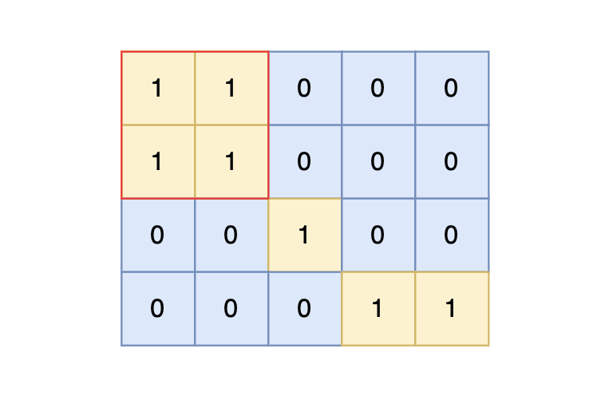
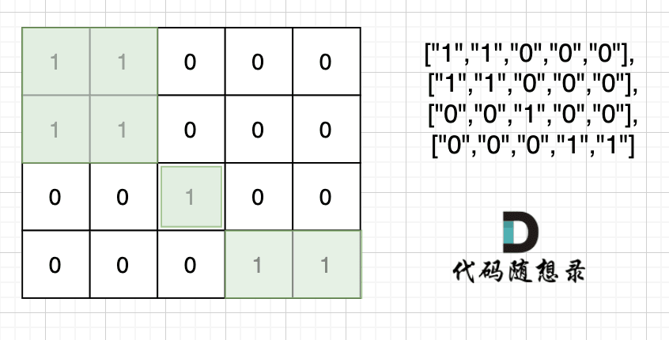

<p align="center"><strong><a href="./qita/join.md">參與本專案</a>，貢獻其他語言版本的程式碼，擁抱開放原始碼（open source），讓更多學習演算法的夥伴們受益！</strong></p>

# 100. 最大島嶼的面積 

[KamaCoder 題目連結（ACM 模式）](https://kamacoder.com/problempage.php?pid=1172)

題目描述

給定一個由 1（陸地）和 0（水）組成的矩陣（matrix），計算島嶼的最大面積。島嶼面積的計算方式為組成島嶼的陸地的總數。島嶼由水平方向或垂直方向上相鄰的陸地連接而成，並且四周都是水域。你可以假設矩陣外均被水包圍。

輸入描述

第一列（row）包含兩個整數（integer） N, M，表示矩陣的列數和行（column）數。後續 N 列，每列包含 M 個數字，數字為 1 或者 0，表示島嶼的單元格。

輸出描述

輸出一個整數，表示島嶼的最大面積。如果不存在島嶼，則輸出 0。

輸入範例

```
4 5
1 1 0 0 0
1 1 0 0 0
0 0 1 0 0
0 0 0 1 1
```

輸出範例

4

提示資訊



範例輸入中，島嶼的最大面積為 4。

資料範圍：

* 1 <= M, N <= 50。


## 解題思路 

**[《程式碼隨想錄》演算法影片公開課](https://programmercarl.com/other/gongkaike.html)：[圖論：深搜也有陷阱啊！！ | 深度優先搜尋 | KamaCoder：100.島嶼的最大面積](https://www.bilibili.com/video/BV1FzoyY5EXH)，相信結合影片再看本篇題解，更有助於大家對本題的理解**。

注意題目中每座島嶼只能由**水平方向和/或垂直方向上**相鄰的陸地連接形成。

也就是說斜角度連接是不算的，例如範例二，是三個島嶼，如圖：

 

這道題目也是 dfs bfs 基礎類題目，就是搜尋每個島嶼上「1」的數量，然後取一個最大的。

本題解題思路上比較簡單，難點其實都是 dfs 和 bfs 的理論基礎，關於理論基礎我在這裡都有詳細講解： 

* [DFS 理論基礎](./圖論深搜理論基礎.md)
* [BFS 理論基礎](./圖論廣搜理論基礎.md)

### DFS 

很多同學寫 dfs 其實也是憑感覺來的，有的時候 dfs 函數（function）中寫終止條件（termination condition）才能過，有的時候 dfs 函數不寫終止條件也能過！ 

這裡其實涉及到 dfs 的兩種寫法。

寫法一，dfs 處理當前節點（node）的相鄰節點，即在主函數遇到島嶼就計數為 1，dfs 處理接下來的相鄰陸地

```CPP 
// 版本一
#include <iostream>
#include <vector>
using namespace std;
int count;
int dir[4][2] = {0, 1, 1, 0, -1, 0, 0, -1}; // 四個方向
void dfs(vector<vector<int>>& grid, vector<vector<bool>>& visited, int x, int y) {
    for (int i = 0; i < 4; i++) {
        int nextx = x + dir[i][0];
        int nexty = y + dir[i][1];
        if (nextx < 0 || nextx >= grid.size() || nexty < 0 || nexty >= grid[0].size()) continue;  // 越界了，直接跳過
        if (!visited[nextx][nexty] && grid[nextx][nexty] == 1) { // 沒有造訪過的 同時 是陸地的
            visited[nextx][nexty] = true;
            count++;
            dfs(grid, visited, nextx, nexty);
        }
    }
}

int main() {
    int n, m;
    cin >> n >> m;
    vector<vector<int>> grid(n, vector<int>(m, 0));
    for (int i = 0; i < n; i++) {
        for (int j = 0; j < m; j++) {
            cin >> grid[i][j];
        }
    }
    vector<vector<bool>> visited(n, vector<bool>(m, false));
    int result = 0;
    for (int i = 0; i < n; i++) {
        for (int j = 0; j < m; j++) {
            if (!visited[i][j] && grid[i][j] == 1) {
                count = 1;  // 因為dfs處理下一個節點，所以這裡遇到陸地了就先計數，dfs處理接下來的相鄰陸地
                visited[i][j] = true;
                dfs(grid, visited, i, j); // 將與其連接的陸地都標記上 true
                result = max(result, count);
            }
        }
    }
    cout << result << endl;

}
```

寫法二，dfs 處理當前節點，即在主函數遇到島嶼就計數為 0，dfs 處理接下來的全部陸地

dfs 
```CPP 
// 版本二
#include <iostream>
#include <vector>
using namespace std;

int count;
int dir[4][2] = {0, 1, 1, 0, -1, 0, 0, -1}; // 四個方向
void dfs(vector<vector<int>>& grid, vector<vector<bool>>& visited, int x, int y) {
    if (visited[x][y] || grid[x][y] == 0) return; // 終止條件：造訪過的節點 或者 遇到海水
    visited[x][y] = true; // 標記造訪過
    count++;
    for (int i = 0; i < 4; i++) {
        int nextx = x + dir[i][0];
        int nexty = y + dir[i][1];
        if (nextx < 0 || nextx >= grid.size() || nexty < 0 || nexty >= grid[0].size()) continue;  // 越界了，直接跳過
        dfs(grid, visited, nextx, nexty);
    }
}

int main() {
    int n, m;
    cin >> n >> m;
    vector<vector<int>> grid(n, vector<int>(m, 0));
    for (int i = 0; i < n; i++) {
        for (int j = 0; j < m; j++) {
            cin >> grid[i][j];
        }
    }
    vector<vector<bool>> visited = vector<vector<bool>>(n, vector<bool>(m, false));
    int result = 0;
    for (int i = 0; i < n; i++) {
        for (int j = 0; j < m; j++) {
            if (!visited[i][j] && grid[i][j] == 1) {
                count = 0; // 因為dfs處理當前節點，所以遇到陸地計數為0，進dfs之後再開始從1計數
                dfs(grid, visited, i, j); // 將與其連接的陸地都標記上 true
                result = max(result, count);
            }
        }
    }
    cout << result << endl;
}
```

大家透過註解可以發現，兩種寫法，版本一，在主函數遇到陸地就計數為 1，接下來的相鄰陸地都在 dfs 中計算。 

版本二 在主函數遇到陸地計數為 0，也就是不計數，陸地數量都去 dfs 裡做計算。 

這也是為什麼大家看了很多 dfs 的寫法，發現寫法怎麼都不一樣呢？其實這就是根本原因。


### BFS 

關於廣度優先搜尋（breadth-first search, BFS），如果大家還不了解的話，看這裡：[廣度優先搜尋精講](./圖論廣搜理論基礎.md)

本題 BFS 程式碼如下：

```CPP 
class Solution {
private:
    int count;
    int dir[4][2] = {0, 1, 1, 0, -1, 0, 0, -1}; // 四個方向
    void bfs(vector<vector<int>>& grid, vector<vector<bool>>& visited, int x, int y) {
        queue<int> que;
        que.push(x);
        que.push(y);
        visited[x][y] = true; // 加入佇列就意味節點是陸地可到達的點
        count++;
        while(!que.empty()) {
            int xx = que.front();que.pop();
            int yy = que.front();que.pop();
            for (int i = 0 ;i < 4; i++) {
                int nextx = xx + dir[i][0];
                int nexty = yy + dir[i][1];
                if (nextx < 0 || nextx >= grid.size() || nexty < 0 || nexty >= grid[0].size()) continue; // 越界
                if (!visited[nextx][nexty] && grid[nextx][nexty] == 1) { // 節點沒有被造訪過且是陸地
                    visited[nextx][nexty] = true;
                    count++;
                    que.push(nextx);
                    que.push(nexty);
                }
            }
        }
    }

public:
    int maxAreaOfIsland(vector<vector<int>>& grid) {
        int n = grid.size(), m = grid[0].size();
        vector<vector<bool>> visited = vector<vector<bool>>(n, vector<bool>(m, false));
        int result = 0;
        for (int i = 0; i < n; i++) {
            for (int j = 0; j < m; j++) {
                if (!visited[i][j] && grid[i][j] == 1) {
                    count = 0;
                    bfs(grid, visited, i, j); // 將與其連接的陸地都標記上 true
                    result = max(result, count);
                }
            }
        }
        return result;
    }
};

```


## 其他語言版本

### Java

```java
import java.util.*;
import java.math.*;

/**
 * DFS版
 */
public class Main{

    static final int[][] dir={{0,1},{1,0},{0,-1},{-1,0}};
    static int result=0;
    static int count=0;

    public static void main(String[] args){
        Scanner scanner = new Scanner(System.in);
        int n = scanner.nextInt();
        int m = scanner.nextInt();
        int[][] map = new int[n][m];
        for (int i = 0; i < n; i++) {
            for (int j = 0; j < m; j++) {
                map[i][j]=scanner.nextInt();
            }
        }
        boolean[][] visited = new boolean[n][m];
        for (int i = 0; i < n; i++) {
            for (int j = 0; j < m; j++) {
                if(!visited[i][j]&&map[i][j]==1){
                    count=0;
                    dfs(map,visited,i,j);
                    result= Math.max(count, result);
                }
            }
        }
        System.out.println(result);
    }

    static void dfs(int[][] map,boolean[][] visited,int x,int y){
                count++;
                visited[x][y]=true;
                for (int i = 0; i < 4; i++) {
                    int nextX=x+dir[i][0];
                    int nextY=y+dir[i][1];
                    //水或者已經造訪過的跳過
                    if(nextX<0||nextY<0
                    ||nextX>=map.length||nextY>=map[0].length
                    ||visited[nextX][nextY]||map[nextX][nextY]==0)continue;
                    
                    dfs(map,visited,nextX,nextY);
                }
            }
}
```

```java
import java.util.*;
import java.math.*;

/**
 * 廣度優先搜尋（breadth-first search, BFS）版
 */
public class Main {
    static class Node {
        int x;
        int y;

        public Node(int x, int y) {
            this.x = x;
            this.y = y;
        }
    }

    static final int[][] dir = {{0, 1}, {1, 0}, {0, -1}, {-1, 0}};
    static int result = 0;
    static int count = 0;

    public static void main(String[] args) {
        Scanner scanner = new Scanner(System.in);
        int n = scanner.nextInt();
        int m = scanner.nextInt();
        int[][] map = new int[n][m];
        for (int i = 0; i < n; i++) {
            for (int j = 0; j < m; j++) {
                map[i][j] = scanner.nextInt();
            }
        }
        boolean[][] visited = new boolean[n][m];
        for (int i = 0; i < n; i++) {
            for (int j = 0; j < m; j++) {
                if (!visited[i][j] && map[i][j] == 1) {
                    count = 0;
                    bfs(map, visited, i, j);
                    result = Math.max(count, result);

                }
            }
        }
        System.out.println(result);
    }

    static void bfs(int[][] map, boolean[][] visited, int x, int y) {
        Queue<Node> q = new LinkedList<>();
        q.add(new Node(x, y));
        visited[x][y] = true;
        count++;
        while (!q.isEmpty()) {
            Node node = q.remove();
            for (int i = 0; i < 4; i++) {
                int nextX = node.x + dir[i][0];
                int nextY = node.y + dir[i][1];
                if (nextX < 0 || nextY < 0 || nextX >= map.length || nextY >= map[0].length || visited[nextX][nextY] || map[nextX][nextY] == 0)
                    continue;
                q.add(new Node(nextX, nextY));
                visited[nextX][nextY] = true;
                count++;
            }
        }
    }
}

```
### Python

深度優先搜尋（depth-first search, DFS）

```python
# 四個方向
position = [[0, 1], [1, 0], [0, -1], [-1, 0]]
count = 0


def dfs(grid, visited, x, y):
    """
    深度優先搜尋（depth-first search, DFS），對一整塊陸地進行標記
    """
    global count  # 定義全域變數，便於傳遞count值
    for i, j in position:
        cur_x = x + i
        cur_y = y + j
        # 下標越界，跳過
        if cur_x < 0 or cur_x >= len(grid) or cur_y < 0 or cur_y >= len(grid[0]):
            continue
        if not visited[cur_x][cur_y] and grid[cur_x][cur_y] == 1:
            visited[cur_x][cur_y] = True
            count += 1
            dfs(grid, visited, cur_x, cur_y)


n, m = map(int, input().split())
# 相鄰矩陣
grid = []
for i in range(n):
    grid.append(list(map(int, input().split())))
# 造訪表
visited = [[False] * m for _ in range(n)]

result = 0  # 記錄最終結果
for i in range(n):
    for j in range(m):
        if grid[i][j] == 1 and not visited[i][j]:
            count = 1
            visited[i][j] = True
            dfs(grid, visited, i, j)
            result = max(count, result)

print(result)
```

BFS

```python
from collections import deque

position = [[0, 1], [1, 0], [0, -1], [-1, 0]]  # 四個方向
count = 0


def bfs(grid, visited, x, y):
    """
    BFS對陸地進行標記
    """
    global count  # 宣告全域變數
    que = deque()
    que.append([x, y])
    while que:
        cur_x, cur_y = que.popleft()
        for i, j in position:
            next_x = cur_x + i
            next_y = cur_y + j
            # 下標越界，跳過
            if next_x < 0 or next_x >= len(grid) or next_y < 0 or next_y >= len(grid[0]):
                continue
            if grid[next_x][next_y] == 1 and not visited[next_x][next_y]:
                visited[next_x][next_y] = True
                count += 1
                que.append([next_x, next_y])


n, m = map(int, input().split())
# 相鄰矩陣
grid = []
for i in range(n):
    grid.append(list(map(int, input().split())))
visited = [[False] * m for _ in range(n)]  # 造訪表

result = 0  # 記錄最終結果
for i in range(n):
    for j in range(m):
        if grid[i][j] == 1 and not visited[i][j]:
            count = 1
            visited[i][j] = True
            bfs(grid, visited, i, j)
            res = max(result, count)

print(result)
```

### Go

``` go

package main

import (
	"fmt"
)

var count int
var dir = [][]int{{0, 1}, {1, 0}, {-1, 0}, {0, -1}} // 四個方向

func dfs(grid [][]int, visited [][]bool, x, y int) {
	for i := 0; i < 4; i++ {
		nextx := x + dir[i][0]
		nexty := y + dir[i][1]
		if nextx < 0 || nextx >= len(grid) || nexty < 0 || nexty >= len(grid[0]) {
			continue // 越界了，直接跳過
		}
		if !visited[nextx][nexty] && grid[nextx][nexty] == 1 { // 沒有造訪過的 同時 是陸地的
			visited[nextx][nexty] = true
			count++
			dfs(grid, visited, nextx, nexty)
		}
	}
}

func main() {
	var n, m int
	fmt.Scan(&n, &m)

	grid := make([][]int, n)
	for i := 0; i < n; i++ {
		grid[i] = make([]int, m)
		for j := 0; j < m; j++ {
			fmt.Scan(&grid[i][j])
		}
	}

	visited := make([][]bool, n)
	for i := 0; i < n; i++ {
		visited[i] = make([]bool, m)
	}

	result := 0
	for i := 0; i < n; i++ {
		for j := 0; j < m; j++ {
			if !visited[i][j] && grid[i][j] == 1 {
				count = 1 // 因為dfs處理下一個節點，所以這裡遇到陸地了就先計數，dfs處理接下來的相鄰陸地
				visited[i][j] = true
				dfs(grid, visited, i, j)
				if count > result {
					result = count
				}
			}
		}
	}

	fmt.Println(result)
}


```


### Rust
DFS

``` rust
use std::io;
use std::cmp;

// 定義四個方向
const DIRECTIONS: [(i32, i32); 4] = [(0, 1), (1, 0), (-1, 0), (0, -1)];

fn dfs(grid: &Vec<Vec<i32>>, visited: &mut Vec<Vec<bool>>, x: usize, y: usize, count: &mut i32) {
    if visited[x][y] || grid[x][y] == 0 {
        return; // 終止條件：已造訪或者遇到海水
    }
    visited[x][y] = true; // 標記已造訪
    *count += 1;

    for &(dx, dy) in DIRECTIONS.iter() {
        let new_x = x as i32 + dx;
        let new_y = y as i32 + dy;

        // 檢查邊界條件
        if new_x >= 0 && new_x < grid.len() as i32 && new_y >= 0 && new_y < grid[0].len() as i32 {
            dfs(grid, visited, new_x as usize, new_y as usize, count);
        }
    }
}

fn main() {
    let mut input = String::new();

    // 讀取 n 和 m
    io::stdin().read_line(&mut input);
    let dims: Vec<usize> = input.trim().split_whitespace().map(|s| s.parse().unwrap()).collect();
    let (n, m) = (dims[0], dims[1]);

    // 讀取 grid
    let mut grid = vec![];
    for _ in 0..n {
        input.clear();
        io::stdin().read_line(&mut input);
        let row: Vec<i32> = input.trim().split_whitespace().map(|s| s.parse().unwrap()).collect();
        grid.push(row);
    }

    // 初始化造訪記錄
    let mut visited = vec![vec![false; m]; n];
    let mut result = 0;

    // 遍歷所有格子
    for i in 0..n {
        for j in 0..m {
            if !visited[i][j] && grid[i][j] == 1 {
                let mut count = 0;
                dfs(&grid, &mut visited, i, j, &mut count);
                result = cmp::max(result, count);
            }
        }
    }

    // 輸出結果
    println!("{}", result);
}

```
BFS
```rust
use std::io;
use std::collections::VecDeque;

// 定義四個方向
const DIRECTIONS: [(i32, i32); 4] = [(0, 1), (1, 0), (-1, 0), (0, -1)];

fn bfs(grid: &Vec<Vec<i32>>, visited: &mut Vec<Vec<bool>>, x: usize, y: usize) -> i32 {
    let mut count = 0;
    let mut queue = VecDeque::new();
    queue.push_back((x, y));
    visited[x][y] = true; // 標記已造訪

    while let Some((cur_x, cur_y)) = queue.pop_front() {
        count += 1; // 增加計數

        for &(dx, dy) in DIRECTIONS.iter() {
            let new_x = cur_x as i32 + dx;
            let new_y = cur_y as i32 + dy;

            // 檢查邊界條件
            if new_x >= 0 && new_x < grid.len() as i32 && new_y >= 0 && new_y < grid[0].len() as i32 {
                let new_x_usize = new_x as usize;
                let new_y_usize = new_y as usize;

                // 如果未造訪且是陸地，加入佇列
                if !visited[new_x_usize][new_y_usize] && grid[new_x_usize][new_y_usize] == 1 {
                    visited[new_x_usize][new_y_usize] = true; // 標記已造訪
                    queue.push_back((new_x_usize, new_y_usize));
                }
            }
        }
    }

    count
}

fn main() {
    let mut input = String::new();

    // 讀取 n 和 m
    io::stdin().read_line(&mut input).expect("Failed to read line");
    let dims: Vec<usize> = input.trim().split_whitespace().map(|s| s.parse().unwrap()).collect();
    let (n, m) = (dims[0], dims[1]);

    // 讀取 grid
    let mut grid = vec![];
    for _ in 0..n {
        input.clear();
        io::stdin().read_line(&mut input).expect("Failed to read line");
        let row: Vec<i32> = input.trim().split_whitespace().map(|s| s.parse().unwrap()).collect();
        grid.push(row);
    }

    // 初始化造訪記錄
    let mut visited = vec![vec![false; m]; n];
    let mut result = 0;

    // 遍歷所有格子
    for i in 0..n {
        for j in 0..m {
            if !visited[i][j] && grid[i][j] == 1 {
                let count = bfs(&grid, &mut visited, i, j);
                result = result.max(count);
            }
        }
    }

    // 輸出結果
    println!("{}", result);
}

```

### JavaScript

```javascript
// 廣搜版

const r1 = require('readline').createInterface({ input: process.stdin });
// 建立readline介面
let iter = r1[Symbol.asyncIterator]();
// 建立非同步疊代器
const readline = async () => (await iter.next()).value;

let graph // 地圖
let N, M // 地圖大小
let visited // 造訪過的節點
let result = 0 // 最大島嶼面積
let count = 0 // 島嶼內節點數
const dir = [[0, 1], [1, 0], [0, -1], [-1, 0]] //方向


// 讀取輸入，初始化地圖
const initGraph = async () => {
  let line = await readline();
  [N, M] = line.split(' ').map(Number);
  graph = new Array(N).fill(0).map(() => new Array(M).fill(0))
  visited = new Array(N).fill(false).map(() => new Array(M).fill(false))

  for (let i = 0; i < N; i++) {
    line = await readline()
    line = line.split(' ').map(Number)
    for (let j = 0; j < M; j++) {
      graph[i][j] = line[j]
    }
  }
}


/**
 * @description: 從(x, y)開始 breadth-first traversal
 * @param {*} graph 地圖
 * @param {*} visited 造訪過的節點
 * @param {*} x 開始搜尋節點的下標
 * @param {*} y 開始搜尋節點的下標
 * @return {*}
 */
const bfs = (graph, visited, x, y) => {
  let queue = []
  queue.push([x, y])
  count++
  visited[x][y] = true  //只要加入佇列就立刻標記為造訪過

  while (queue.length) {
    let [xx, yy] = queue.shift()
    for (let i = 0; i < 4; i++) {
      let nextx = xx + dir[i][0]
      let nexty = yy + dir[i][1]
      if(nextx < 0 || nextx >= N || nexty < 0 || nexty >= M) continue
      if(!visited[nextx][nexty] && graph[nextx][nexty] === 1){
        queue.push([nextx, nexty])
        count++
        visited[nextx][nexty] = true
      }
    }
  }

}

(async function () {

  // 讀取輸入，初始化地圖
  await initGraph()

  // 統計最大島嶼面積
  for (let i = 0; i < N; i++) {
    for (let j = 0; j < M; j++) {
      if (!visited[i][j] && graph[i][j] === 1) { //遇到沒有造訪過的陸地
        // 重新計算面積
        count = 0

        // breadth-first traversal，統計島嶼內節點數，並將島嶼標記為已造訪
        bfs(graph, visited, i, j)

        // 更新最大島嶼面積
        result = Math.max(result, count)
      }
    }
  }
  console.log(result);
})()
```

```javascript

// 深搜版

const r1 = require('readline').createInterface({ input: process.stdin });
// 建立readline介面
let iter = r1[Symbol.asyncIterator]();
// 建立非同步疊代器
const readline = async () => (await iter.next()).value;

let graph // 地圖
let N, M // 地圖大小
let visited // 造訪過的節點
let result = 0 // 最大島嶼面積
let count = 0 // 島嶼內節點數
const dir = [[0, 1], [1, 0], [0, -1], [-1, 0]] //方向

// 讀取輸入，初始化地圖
const initGraph = async () => {
  let line = await readline();
  [N, M] = line.split(' ').map(Number);
  graph = new Array(N).fill(0).map(() => new Array(M).fill(0))
  visited = new Array(N).fill(false).map(() => new Array(M).fill(false))

  for (let i = 0; i < N; i++) {
    line = await readline()
    line = line.split(' ').map(Number)
    for (let j = 0; j < M; j++) {
      graph[i][j] = line[j]
    }
  }
}

/**
 * @description: 從(x, y)開始 depth-first traversal
 * @param {*} graph 地圖
 * @param {*} visited 造訪過的節點
 * @param {*} x 開始搜尋節點的下標
 * @param {*} y 開始搜尋節點的下標
 * @return {*}
 */
const dfs = (graph, visited, x, y) => {
  for (let i = 0; i < 4; i++) {
    let nextx = x + dir[i][0]
    let nexty = y + dir[i][1]
    if(nextx < 0 || nextx >= N || nexty < 0 || nexty >= M) continue
    if(!visited[nextx][nexty] && graph[nextx][nexty] === 1){
      count++
      visited[nextx][nexty] = true
      dfs(graph, visited, nextx, nexty)
    }
  }
}

(async function () {

  // 讀取輸入，初始化地圖
  await initGraph()

  // 統計最大島嶼面積
  for (let i = 0; i < N; i++) {
    for (let j = 0; j < M; j++) {
      if (!visited[i][j] && graph[i][j] === 1) { //遇到沒有造訪過的陸地
        // 重新計算面積
        count = 1
        visited[i][j] = true

        // depth-first traversal，統計島嶼內節點數，並將島嶼標記為已造訪
        dfs(graph, visited, i, j)

        // 更新最大島嶼面積
        result = Math.max(result, count)
      }
    }
  }
  console.log(result);
})()
```

### TypeScript

### PhP

``` php

<?php

function dfs(&$grid, &$visited, $x, $y, &$count, &$dir) {
    for ($i = 0; $i < 4; $i++) {
        $nextx = $x + $dir[$i][0];
        $nexty = $y + $dir[$i][1];
        if ($nextx < 0 || $nextx >= count($grid) || $nexty < 0 || $nexty >= count($grid[0])) continue;  // 越界了，直接跳過
        if (!$visited[$nextx][$nexty] && $grid[$nextx][$nexty] == 1) { // 沒有造訪過的 同時 是陸地的
            $visited[$nextx][$nexty] = true;
            $count++;
            dfs($grid, $visited, $nextx, $nexty, $count, $dir);
        }
    }
}

// Main function
function main() {
    $input = trim(fgets(STDIN));
    list($n, $m) = explode(' ', $input);
    
    $grid = [];
    for ($i = 0; $i < $n; $i++) {
        $input = trim(fgets(STDIN));
        $grid[] = array_map('intval', explode(' ', $input));
    }
    
    $visited = [];
    for ($i = 0; $i < $n; $i++) {
        $visited[] = array_fill(0, $m, false);
    }
    
    $result = 0;
    $count = 0;
    $dir = [[0, 1], [1, 0], [-1, 0], [0, -1]]; // 四個方向

    for ($i = 0; $i < $n; $i++) {
        for ($j = 0; $j < $m; $j++) {
            if (!$visited[$i][$j] && $grid[$i][$j] == 1) {
                $count = 1;  // 因為dfs處理下一個節點，所以這裡遇到陸地了就先計數，dfs處理接下來的相鄰陸地
                $visited[$i][$j] = true;
                dfs($grid, $visited, $i, $j, $count, $dir); // 將與其連接的陸地都標記上 true
                $result = max($result, $count);
            }
        }
    }
    
    echo $result . "\n";
}

main();

?>


```


### Swift

### Scala

### C#

### Dart

### C

