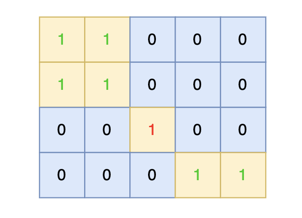
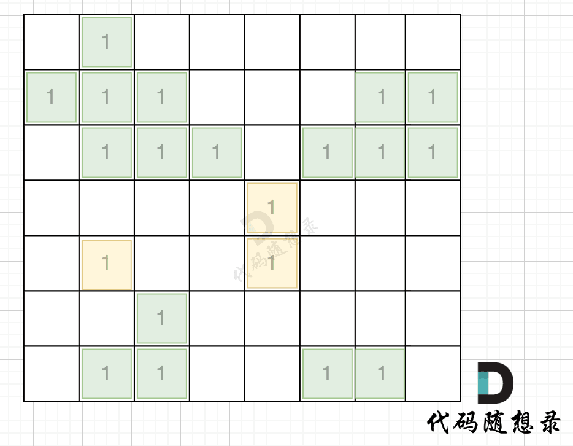
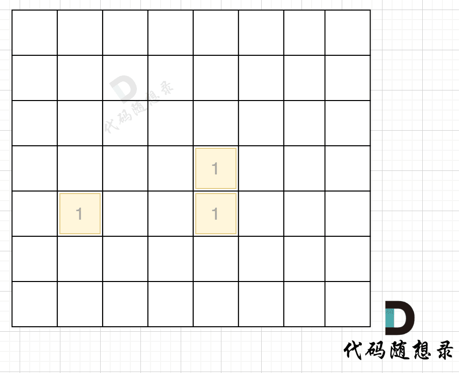

<p align="center"><strong><a href="./qita/join.md">參與本專案</a>，貢獻其他語言版本的程式碼，擁抱開放原始碼（open source），讓更多學習演算法（algorithm）的夥伴們受益！</strong></p>

# 101. 孤島的總面積 

[KamaCoder：101. 孤島的總面積](https://kamacoder.com/problempage.php?pid=1173)

題目描述

給定一個由 1（陸地）和 0（水）組成的矩陣（matrix），島嶼指的是由水平或垂直方向上相鄰的陸地單元格組成的區域，且完全被水域單元格包圍。孤島是那些位於矩陣內部、所有單元格都不接觸邊緣的島嶼。


現在你需要計算所有孤島的總面積，島嶼面積的計算方式為組成島嶼的陸地的總數。

輸入描述

第一列（row）包含兩個整數（integer） N, M，表示矩陣的列數和行（column）數。之後 N 列，每列包含 M 個數字，數字為 1 或者 0。

輸出描述

輸出一個整數，表示所有孤島的總面積，如果不存在孤島，則輸出 0。

輸入範例

```
4 5
1 1 0 0 0
1 1 0 0 0
0 0 1 0 0
0 0 0 1 1
```


輸出範例： 

1

提示資訊：

 

在矩陣中心部分的島嶼，因為沒有任何一個單元格接觸到矩陣邊緣，所以該島嶼屬於孤島，總面積為 1。


資料範圍：

1 <= M, N <= 50。

## 解題思路 

**[《代碼隨想錄》演算法影片公開課](https://programmercarl.com/other/gongkaike.html)：[圖論：島嶼問題再出新花樣 | 深度優先搜尋 | KamaCoder：101.孤島總面積](https://www.bilibili.com/video/BV1mmZJYRESc)，相信結合影片再看本篇題解，更有助於大家對本題的理解**。

本題使用 dfs，bfs，互斥集（disjoint set）都是可以的。 

本題要求找到不靠邊的陸地面積，那麼我們只要從周邊找到陸地然後透過 dfs 或者 bfs 將周邊靠邊且相鄰的陸地都變成海洋，然後再去重新遍歷（traversal）地圖，統計此時還剩下的陸地就可以了。

如圖，在遍歷地圖周圍四個邊，靠地圖四邊的陸地，都為綠色，



在遇到地圖周邊陸地的時候，將 1 都變為 0，此時地圖為這樣：



然後我們再去遍歷這個地圖，遇到有陸地的地方，去採用深搜或者廣搜，邊統計所有陸地。

如果對深搜或者廣搜不夠了解，建議先看這裡：[深度優先搜尋精講](./圖論深搜理論基礎.md)，[廣度優先搜尋精講](./圖論廣搜理論基礎.md)。


採用深度優先搜尋（depth-first search, DFS）的程式碼如下： 

```CPP 
#include <iostream>
#include <vector>
using namespace std;
int dir[4][2] = {-1, 0, 0, -1, 1, 0, 0, 1}; // 儲存四個方向
void dfs(vector<vector<int>>& grid, int x, int y) {
    grid[x][y] = 0;
    for (int i = 0; i < 4; i++) { // 向四個方向遍歷
        int nextx = x + dir[i][0];
        int nexty = y + dir[i][1];
        // 超過邊界
        if (nextx < 0 || nextx >= grid.size() || nexty < 0 || nexty >= grid[0].size()) continue;
        // 不符合條件，不繼續遍歷
        if (grid[nextx][nexty] == 0) continue;

        dfs (grid, nextx, nexty);
    }
    return;
}

int main() {
    int n, m;
    cin >> n >> m;
    vector<vector<int>> grid(n, vector<int>(m, 0));
    for (int i = 0; i < n; i++) {
        for (int j = 0; j < m; j++) {
            cin >> grid[i][j];
        }
    }

    // 從左側邊，和右側邊 向中間遍歷
    for (int i = 0; i < n; i++) {
        if (grid[i][0] == 1) dfs(grid, i, 0);
        if (grid[i][m - 1] == 1) dfs(grid, i, m - 1);
    }
    // 從上邊和下邊 向中間遍歷
    for (int j = 0; j < m; j++) {
        if (grid[0][j] == 1) dfs(grid, 0, j);
        if (grid[n - 1][j] == 1) dfs(grid, n - 1, j);
    }
    int count = 0;
    for (int i = 0; i < n; i++) {
        for (int j = 0; j < m; j++) {
            if (grid[i][j] == 1) count++;
        }
    }
    cout << count << endl;
}
```


採用廣度優先搜尋（breadth-first search, BFS）的程式碼如下：

```CPP 
#include <iostream>
#include <vector>
#include <queue>
using namespace std;
int dir[4][2] = {0, 1, 1, 0, -1, 0, 0, -1}; // 四個方向
void bfs(vector<vector<int>>& grid, int x, int y) {
    queue<pair<int, int>> que;
    que.push({x, y});
    grid[x][y] = 0; // 只要加入佇列，立刻標記
    while(!que.empty()) {
        pair<int ,int> cur = que.front(); que.pop();
        int curx = cur.first;
        int cury = cur.second;
        for (int i = 0; i < 4; i++) {
            int nextx = curx + dir[i][0];
            int nexty = cury + dir[i][1];
            if (nextx < 0 || nextx >= grid.size() || nexty < 0 || nexty >= grid[0].size()) continue;  // 越界了，直接跳過
            if (grid[nextx][nexty] == 1) {
                que.push({nextx, nexty});
                grid[nextx][nexty] = 0; // 只要加入佇列立刻標記
            }
        }
    }
}

int main() {
    int n, m;
    cin >> n >> m;
    vector<vector<int>> grid(n, vector<int>(m, 0));
    for (int i = 0; i < n; i++) {
        for (int j = 0; j < m; j++) {
            cin >> grid[i][j];
        }
    }
    // 從左側邊，和右側邊 向中間遍歷
    for (int i = 0; i < n; i++) {
        if (grid[i][0] == 1) bfs(grid, i, 0);
        if (grid[i][m - 1] == 1) bfs(grid, i, m - 1);
    }
    // 從上邊和下邊 向中間遍歷
    for (int j = 0; j < m; j++) {
        if (grid[0][j] == 1) bfs(grid, 0, j);
        if (grid[n - 1][j] == 1) bfs(grid, n - 1, j);
    }
    int count = 0;
    for (int i = 0; i < n; i++) {
        for (int j = 0; j < m; j++) {
            if (grid[i][j] == 1) count++;
        }
    }

    cout << count << endl;
}

```


## 其他語言版本

### Java 

``` java

import java.util.*;

public class Main {
    private static int count = 0;
    private static final int[][] dir = {{0, 1}, {1, 0}, {-1, 0}, {0, -1}}; // 四個方向

    private static void bfs(int[][] grid, int x, int y) {
        Queue<int[]> que = new LinkedList<>();
        que.add(new int[]{x, y});
        grid[x][y] = 0; // 只要加入佇列，立刻標記
        count++;
        while (!que.isEmpty()) {
            int[] cur = que.poll();
            int curx = cur[0];
            int cury = cur[1];
            for (int i = 0; i < 4; i++) {
                int nextx = curx + dir[i][0];
                int nexty = cury + dir[i][1];
                if (nextx < 0 || nextx >= grid.length || nexty < 0 || nexty >= grid[0].length) continue; // 越界了，直接跳過
                if (grid[nextx][nexty] == 1) {
                    que.add(new int[]{nextx, nexty});
                    count++;
                    grid[nextx][nexty] = 0; // 只要加入佇列立刻標記
                }
            }
        }
    }

    public static void main(String[] args) {
        Scanner scanner = new Scanner(System.in);
        int n = scanner.nextInt();
        int m = scanner.nextInt();
        int[][] grid = new int[n][m];
        
        // 讀取網格
        for (int i = 0; i < n; i++) {
            for (int j = 0; j < m; j++) {
                grid[i][j] = scanner.nextInt();
            }
        }
        
        // 從左側邊，和右側邊向中間遍歷
        for (int i = 0; i < n; i++) {
            if (grid[i][0] == 1) bfs(grid, i, 0);
            if (grid[i][m - 1] == 1) bfs(grid, i, m - 1);
        }
        
        // 從上邊和下邊向中間遍歷
        for (int j = 0; j < m; j++) {
            if (grid[0][j] == 1) bfs(grid, 0, j);
            if (grid[n - 1][j] == 1) bfs(grid, n - 1, j);
        }
        
        count = 0;
        for (int i = 0; i < n; i++) {
            for (int j = 0; j < m; j++) {
                if (grid[i][j] == 1) bfs(grid, i, j);
            }
        }

        System.out.println(count);
    }
}


```


### Python
#### 深搜版
```python
position = [[1, 0], [0, 1], [-1, 0], [0, -1]]
count = 0

def dfs(grid, x, y):
    global count
    grid[x][y] = 0
    count += 1
    for i, j in position:
        next_x = x + i
        next_y = y + j
        if next_x < 0 or next_y < 0 or next_x >= len(grid) or next_y >= len(grid[0]):
            continue
        if grid[next_x][next_y] == 1: 
            dfs(grid, next_x, next_y)
                
n, m = map(int, input().split())

# 相鄰矩陣
grid = []
for i in range(n):
    grid.append(list(map(int, input().split())))

# 清除邊界上的連接組件
for i in range(n):
    if grid[i][0] == 1: 
        dfs(grid, i, 0)
    if grid[i][m - 1] == 1: 
        dfs(grid, i, m - 1)

for j in range(m):
    if grid[0][j] == 1: 
        dfs(grid, 0, j)
    if grid[n - 1][j] == 1: 
        dfs(grid, n - 1, j)
    
count = 0 # 將count重置為0
# 統計內部所有剩餘的連接組件
for i in range(n):
    for j in range(m):
        if grid[i][j] == 1:
            dfs(grid, i, j)
            
print(count)
```

#### 廣搜版
```python
from collections import deque

# 處理輸入
n, m = list(map(int, input().split()))
g = []
for _ in range(n):
    row = list(map(int, input().split()))
    g.append(row)

# 定義四個方向、孤島面積（遍歷完邊緣後會被重置）
directions = [[0,1], [1,0], [-1,0], [0,-1]]
count = 0

# 廣搜
def bfs(r, c):
    global count
    q = deque()
    q.append((r, c))
    g[r][c] = 0
    count += 1

    while q:
        r, c = q.popleft()
        for di in directions:
            next_r = r + di[0]
            next_c = c + di[1]
            if next_c < 0 or next_c >= m or next_r < 0 or next_r >= n:
                continue
            if g[next_r][next_c] == 1:
                q.append((next_r, next_c))
                g[next_r][next_c] = 0
                count += 1


for i in range(n):
    if g[i][0] == 1: 
        bfs(i, 0)
    if g[i][m-1] == 1: 
        bfs(i, m-1)

for i in range(m):
    if g[0][i] == 1: 
        bfs(0, i)
    if g[n-1][i] == 1: 
        bfs(n-1, i)

count = 0
for i in range(n):
    for j in range(m):
        if g[i][j] == 1: 
            bfs(i, j)

print(count)
```

```python
direction = [[1, 0], [-1, 0], [0, 1], [0, -1]]
result = 0

# 深度搜尋
def dfs(grid, y, x):
    grid[y][x] = 0
    global result 
    result += 1
    
    for i, j in direction:
        next_x = x + j
        next_y = y + i
        if (next_x < 0 or next_y < 0 or
            next_x >= len(grid[0]) or next_y >= len(grid)
        ):
            continue
        if grid[next_y][next_x] == 1 and not visited[next_y][next_x]:
            visited[next_y][next_x] = True
            dfs(grid, next_y, next_x)    


# 讀取輸入值
n, m = map(int, input().split())
grid = []
visited = [[False] * m for _ in range(n)]

for i in range(n):
    grid.append(list(map(int, input().split())))

# 處理邊界
for j in range(m):
    # 上邊界
    if grid[0][j] == 1 and not visited[0][j]: 
        visited[0][j] = True
        dfs(grid, 0, j)
    # 下邊界
    if grid[n - 1][j] == 1 and not visited[n - 1][j]: 
        visited[n - 1][j] = True
        dfs(grid, n - 1, j)
    
for i in range(n):
    # 左邊界
    if grid[i][0] == 1 and not visited[i][0]: 
        visited[i][0] = True
        dfs(grid, i, 0)
    # 右邊界
    if grid[i][m - 1] == 1 and not visited[i][m - 1]: 
        visited[i][m - 1] = True
        dfs(grid, i, m - 1)
    
# 計算孤島總面積
result = 0  # 初始化，避免使用到處理邊界時所產生的累加值

for i in range(n):
    for j in range(m):
        if grid[i][j] == 1 and not visited[i][j]:
            visited[i][j] = True
            dfs(grid, i, j)

# 輸出孤島的總面積
print(result)
```

### Go

``` go

package main

import (
    "fmt"
)

var count int
var dir = [4][2]int{{0, 1}, {1, 0}, {-1, 0}, {0, -1}} // 四個方向

func bfs(grid [][]int, x, y int) {
    queue := [][2]int{{x, y}}
    grid[x][y] = 0 // 只要加入佇列，立刻標記
    count++
    
    for len(queue) > 0 {
        cur := queue[0]
        queue = queue[1:]
        curx, cury := cur[0], cur[1]
        
        for i := 0; i < 4; i++ {
            nextx := curx + dir[i][0]
            nexty := cury + dir[i][1]
            
            if nextx < 0 || nextx >= len(grid) || nexty < 0 || nexty >= len(grid[0]) {
                continue // 越界了，直接跳過
            }
            
            if grid[nextx][nexty] == 1 {
                queue = append(queue, [2]int{nextx, nexty})
                count++
                grid[nextx][nexty] = 0 // 只要加入佇列立刻標記
            }
        }
    }
}

func main() {
    var n, m int
    fmt.Scan(&n, &m)
    
    grid := make([][]int, n)
    for i := range grid {
        grid[i] = make([]int, m)
    }
    
    for i := 0; i < n; i++ {
        for j := 0; j < m; j++ {
            fmt.Scan(&grid[i][j])
        }
    }
    
    // 從左側邊，和右側邊向中間遍歷
    for i := 0; i < n; i++ {
        if grid[i][0] == 1 {
            bfs(grid, i, 0)
        }
        if grid[i][m-1] == 1 {
            bfs(grid, i, m-1)
        }
    }
    
    // 從上邊和下邊向中間遍歷
    for j := 0; j < m; j++ {
        if grid[0][j] == 1 {
            bfs(grid, 0, j)
        }
        if grid[n-1][j] == 1 {
            bfs(grid, n-1, j)
        }
    }
    
    // 清空之前的計數
    count = 0
    
    // 遍歷所有位置
    for i := 0; i < n; i++ {
        for j := 0; j < m; j++ {
            if grid[i][j] == 1 {
                bfs(grid, i, j)
            }
        }
    }
    
    fmt.Println(count)
}


```

### Rust

### JavaScript

#### 深搜版

```javascript
const r1 = require('readline').createInterface({ input: process.stdin });
// 建立readline介面
let iter = r1[Symbol.asyncIterator]();
// 建立非同步疊代器
const readline = async () => (await iter.next()).value;

let graph // 地圖
let N, M // 地圖大小
let count = 0 // 孤島的總面積
const dir = [[0, 1], [1, 0], [0, -1], [-1, 0]] //方向


// 讀取輸入，初始化地圖
const initGraph = async () => {
  let line = await readline();
  [N, M] = line.split(' ').map(Number);
  graph = new Array(N).fill(0).map(() => new Array(M).fill(0))

  for (let i = 0; i < N; i++) {
    line = await readline()
    line = line.split(' ').map(Number)
    for (let j = 0; j < M; j++) {
      graph[i][j] = line[j]
    }
  }
}


/**
 * @description: 從（x，y）開始 depth-first traversal 地圖
 * @param {*} graph 地圖
 * @param {*} x 開始搜尋節點的下標
 * @param {*} y 開始搜尋節點的下標
 * @return {*}
 */
const dfs = (graph, x, y) => {
  if(graph[x][y] === 0) return
  graph[x][y] = 0 // 標記為海洋
  for (let i = 0; i < 4; i++) {
    let nextx = x + dir[i][0]
    let nexty = y + dir[i][1]
    if (nextx < 0 || nextx >= N || nexty < 0 || nexty >= M) continue
    dfs(graph, nextx, nexty)
  }
}

(async function () {

  // 讀取輸入，初始化地圖
  await initGraph()

  // 遍歷地圖左右兩邊
  for (let i = 0; i < N; i++) {
    if (graph[i][0] === 1) dfs(graph, i, 0)
    if (graph[i][M - 1] === 1) dfs(graph, i, M - 1)
  }

  // 遍歷地圖上下兩邊
  for (let j = 0; j < M; j++) {
    if (graph[0][j] === 1) dfs(graph, 0, j)
    if (graph[N - 1][j] === 1) dfs(graph, N - 1, j)
  }

  count = 0
  // 統計孤島的總面積
  for (let i = 0; i < N; i++) {
    for (let j = 0; j < M; j++) {
      if (graph[i][j] === 1) count++
    }
  }
  console.log(count);
})()
```


#### 廣搜版

```javascript
const r1 = require('readline').createInterface({ input: process.stdin });
// 建立readline介面
let iter = r1[Symbol.asyncIterator]();
// 建立非同步疊代器
const readline = async () => (await iter.next()).value;

let graph // 地圖
let N, M // 地圖大小
let count = 0 // 孤島的總面積
const dir = [[0, 1], [1, 0], [0, -1], [-1, 0]] //方向


// 讀取輸入，初始化地圖
const initGraph = async () => {
  let line = await readline();
  [N, M] = line.split(' ').map(Number);
  graph = new Array(N).fill(0).map(() => new Array(M).fill(0))

  for (let i = 0; i < N; i++) {
    line = await readline()
    line = line.split(' ').map(Number)
    for (let j = 0; j < M; j++) {
      graph[i][j] = line[j]
    }
  }
}


/**
 * @description: 從（x，y）開始 breadth-first traversal 地圖
 * @param {*} graph 地圖
 * @param {*} x 開始搜尋節點的下標
 * @param {*} y 開始搜尋節點的下標
 * @return {*}
 */
const bfs = (graph, x, y) => {
  let queue = []
  queue.push([x, y])
  graph[x][y] = 0 // 只要加入佇列，立刻標記

  while (queue.length) {
    let [xx, yy] = queue.shift()
    for (let i = 0; i < 4; i++) {
      let nextx = xx + dir[i][0]
      let nexty = yy + dir[i][1]
      if (nextx < 0 || nextx >= N || nexty < 0 || nexty >= M) continue
      if (graph[nextx][nexty] === 1) {
        queue.push([nextx, nexty])
        graph[nextx][nexty] = 0 // 只要加入佇列，立刻標記
      }
    }
  }

}

(async function () {

  // 讀取輸入，初始化地圖
  await initGraph()

  // 遍歷地圖左右兩邊
  for (let i = 0; i < N; i++) {
    if (graph[i][0] === 1) bfs(graph, i, 0)
    if (graph[i][M - 1] === 1) bfs(graph, i, M - 1)
  }

  // 遍歷地圖上下兩邊
  for (let j = 0; j < M; j++) {
    if (graph[0][j] === 1) bfs(graph, 0, j)
    if (graph[N - 1][j] === 1) bfs(graph, N - 1, j)
  }

  count = 0
  // 統計孤島的總面積
  for (let i = 0; i < N; i++) {
    for (let j = 0; j < M; j++) {
      if (graph[i][j] === 1) count++
    }
  }
  console.log(count);
})()
```


### TypeScript

### PhP

### Swift

### Scala

### C#

### Dart

### C

