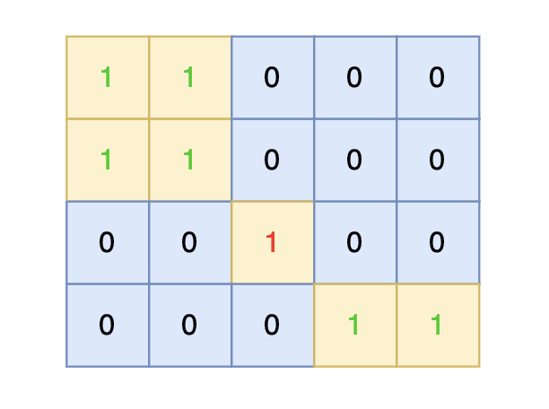
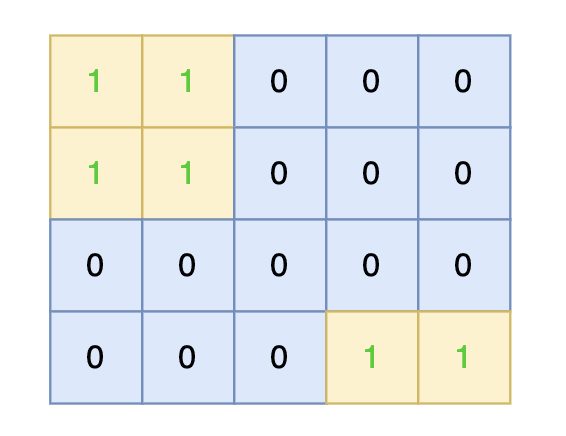
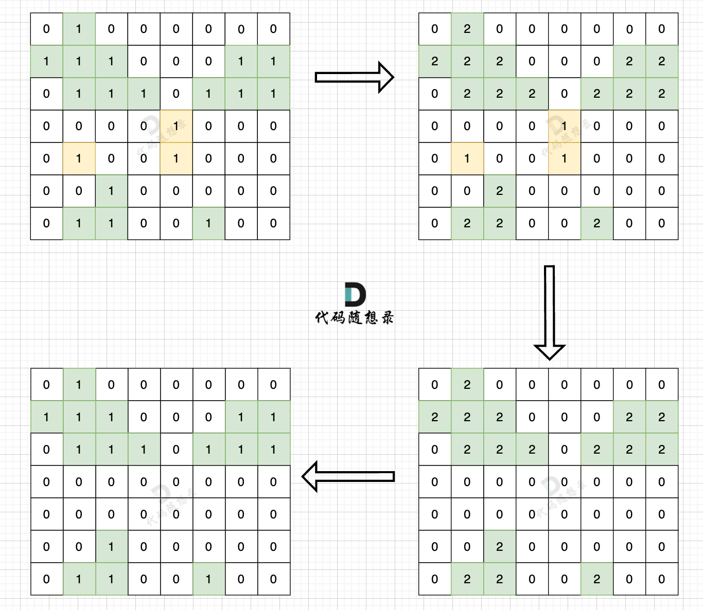

<p align="center"><strong><a href="./qita/join.md">參與本專案</a>，貢獻其他語言版本的程式碼，擁抱開放原始碼（open source），讓更多學習演算法（algorithm）的夥伴們受益！</strong></p>

# 102. 沉沒孤島 

[KamaCoder 題目連結（ACM 模式）](https://kamacoder.com/problempage.php?pid=1174)

題目描述：

給定一個由 1（陸地）和 0（水）組成的矩陣（matrix），島嶼指的是由水平或垂直方向上相鄰的陸地單元格組成的區域，且完全被水域單元格包圍。孤島是那些位於矩陣內部、所有單元格都不接觸邊緣的島嶼。


現在你需要將所有孤島「沉沒」，即將孤島中的所有陸地單元格（1）轉變為水域單元格（0）。

輸入描述：

第一列（row）包含兩個整數（integer） N, M，表示矩陣的列數和行（column）數。

之後 N 列，每列包含 M 個數字，數字為 1 或者 0，表示島嶼的單元格。

輸出描述

輸出將孤島「沉沒」之後的島嶼矩陣。

輸入範例：

```
4 5
1 1 0 0 0
1 1 0 0 0
0 0 1 0 0
0 0 0 1 1
```

輸出範例：

```
1 1 0 0 0
1 1 0 0 0
0 0 0 0 0
0 0 0 1 1
```

提示資訊： 

 

將孤島沉沒： 

 

資料範圍：

1 <= M, N <= 50 

## 解題思路

**[《代碼隨想錄》演算法影片公開課](https://programmercarl.com/other/gongkaike.html)：[圖論：島嶼問題也需要逆向思考 | 深度優先搜尋 DFS | KamaCoder：102.沉沒孤島](https://www.bilibili.com/video/BV1fjdWYyEGu)，相信結合影片再看本篇題解，更有助於大家對本題的理解**。

這道題目和[0101.孤島的總面積](https://kamacoder.com/problempage.php?pid=1173)正好反過來了，[0101.孤島的總面積](https://kamacoder.com/problempage.php?pid=1173)是求地圖中間的空格數，而本題是要把地圖中間的 1 都改成 0。 

那麼兩題在解題思路上也是差不多的。

解題思路依然是從地圖周邊出發，將周邊空格相鄰的陸地都做上標記，然後再遍歷（traversal）一遍地圖，遇到陸地且沒做過標記的，那麼都是地圖中間的陸地，全部改成水域就行。

有的錄友可能想，我再定義一個 visited 二維（2D）陣列（array），單獨標記周邊的陸地，然後遍歷地圖的時候同時對地圖陣列和陣列 visited 進行判斷，決定陸地是否變成水域。

這樣做其實就有點麻煩了，不用額外定義空間了，標記周邊的陸地，可以直接改陸地為其他特殊值作為標記。 

步驟一：深搜或者廣搜將地圖周邊的 1（陸地）全部改成 2（特殊標記）

步驟二：將水域中間 1（陸地）全部改成水域（0） 

步驟三：將之前標記的 2 改為 1（陸地）

如圖： 

 

整體 C++ 程式碼如下，以下使用 dfs 實作，其實遍歷方式 dfs，bfs 都是可以的。 

```CPP 
#include <iostream>
#include <vector>
using namespace std;
int dir[4][2] = {-1, 0, 0, -1, 1, 0, 0, 1}; // 儲存四個方向
void dfs(vector<vector<int>>& grid, int x, int y) {
    grid[x][y] = 2;
    for (int i = 0; i < 4; i++) { // 向四個方向遍歷
        int nextx = x + dir[i][0];
        int nexty = y + dir[i][1];
        // 超過邊界
        if (nextx < 0 || nextx >= grid.size() || nexty < 0 || nexty >= grid[0].size()) continue;
        // 不符合條件，不繼續遍歷
        if (grid[nextx][nexty] == 0 || grid[nextx][nexty] == 2) continue;
        dfs (grid, nextx, nexty);
    }
    return;
}

int main() {
    int n, m;
    cin >> n >> m;
    vector<vector<int>> grid(n, vector<int>(m, 0));
    for (int i = 0; i < n; i++) {
        for (int j = 0; j < m; j++) {
            cin >> grid[i][j];
        }
    }

    // 步驟一：
    // 從左側邊，和右側邊 向中間遍歷
    for (int i = 0; i < n; i++) {
        if (grid[i][0] == 1) dfs(grid, i, 0);
        if (grid[i][m - 1] == 1) dfs(grid, i, m - 1);
    }

    // 從上邊和下邊 向中間遍歷
    for (int j = 0; j < m; j++) {
        if (grid[0][j] == 1) dfs(grid, 0, j);
        if (grid[n - 1][j] == 1) dfs(grid, n - 1, j);
    }
    // 步驟二、步驟三
    for (int i = 0; i < n; i++) {
        for (int j = 0; j < m; j++) {
            if (grid[i][j] == 1) grid[i][j] = 0;
            if (grid[i][j] == 2) grid[i][j] = 1;
        }
    }
    for (int i = 0; i < n; i++) {
        for (int j = 0; j < m; j++) {
            cout << grid[i][j] << " ";
        }
        cout << endl;
    }
}
```

## 其他語言版本

### Java 

```JAVA

import java.util.Scanner;

public class Main {
    static int[][] dir = { {-1, 0}, {0, -1}, {1, 0}, {0, 1} }; // 儲存四個方向

    public static void dfs(int[][] grid, int x, int y) {
        grid[x][y] = 2;
        for (int[] d : dir) {
            int nextX = x + d[0];
            int nextY = y + d[1];
            // 超過邊界
            if (nextX < 0 || nextX >= grid.length || nextY < 0 || nextY >= grid[0].length) continue;
            // 不符合條件，不繼續遍歷
            if (grid[nextX][nextY] == 0 || grid[nextX][nextY] == 2) continue;
            dfs(grid, nextX, nextY);
        }
    }

    public static void main(String[] args) {
        Scanner scanner = new Scanner(System.in);
        int n = scanner.nextInt();
        int m = scanner.nextInt();
        int[][] grid = new int[n][m];

        for (int i = 0; i < n; i++) {
            for (int j = 0; j < m; j++) {
                grid[i][j] = scanner.nextInt();
            }
        }

        // 步驟一：
        // 從左側邊，和右側邊 向中間遍歷
        for (int i = 0; i < n; i++) {
            if (grid[i][0] == 1) dfs(grid, i, 0);
            if (grid[i][m - 1] == 1) dfs(grid, i, m - 1);
        }

        // 從上邊和下邊 向中間遍歷
        for (int j = 0; j < m; j++) {
            if (grid[0][j] == 1) dfs(grid, 0, j);
            if (grid[n - 1][j] == 1) dfs(grid, n - 1, j);
        }

        // 步驟二、步驟三
        for (int i = 0; i < n; i++) {
            for (int j = 0; j < m; j++) {
                if (grid[i][j] == 1) grid[i][j] = 0;
                if (grid[i][j] == 2) grid[i][j] = 1;
            }
        }

        for (int i = 0; i < n; i++) {
            for (int j = 0; j < m; j++) {
                System.out.print(grid[i][j] + " ");
            }
            System.out.println();
        }
        
        scanner.close();
    }
}


```


### Python


```python

def dfs(grid, x, y):
    grid[x][y] = 2
    directions = [(-1, 0), (0, -1), (1, 0), (0, 1)]  # 四個方向
    for dx, dy in directions:
        nextx, nexty = x + dx, y + dy
        # 超過邊界
        if nextx < 0 or nextx >= len(grid) or nexty < 0 or nexty >= len(grid[0]):
            continue
        # 不符合條件，不繼續遍歷
        if grid[nextx][nexty] == 0 or grid[nextx][nexty] == 2:
            continue
        dfs(grid, nextx, nexty)

def main():
    n, m = map(int, input().split())
    grid = [[int(x) for x in input().split()] for _ in range(n)]

    # 步驟一：
    # 從左側邊，和右側邊 向中間遍歷
    for i in range(n):
        if grid[i][0] == 1:
            dfs(grid, i, 0)
        if grid[i][m - 1] == 1:
            dfs(grid, i, m - 1)

    # 從上邊和下邊 向中間遍歷
    for j in range(m):
        if grid[0][j] == 1:
            dfs(grid, 0, j)
        if grid[n - 1][j] == 1:
            dfs(grid, n - 1, j)

    # 步驟二、步驟三
    for i in range(n):
        for j in range(m):
            if grid[i][j] == 1:
                grid[i][j] = 0
            if grid[i][j] == 2:
                grid[i][j] = 1

    # 印出結果
    for row in grid:
        print(' '.join(map(str, row)))

if __name__ == "__main__":
    main()
```


 廣搜版
```Python
from collections import deque

n, m = list(map(int, input().split()))
g = []
for _ in range(n):
    row = list(map(int,input().split()))
    g.append(row)
    
directions = [(1,0),(-1,0),(0,1),(0,-1)]
count = 0

def bfs(r,c,mode):
    global count 
    q = deque()
    q.append((r,c))
    count += 1
    
    while q:
        r, c = q.popleft()
        if mode:
            g[r][c] = 2
            
        for di in directions:
            next_r = r + di[0]
            next_c = c + di[1]
            if next_c < 0 or next_c >= m or next_r < 0 or next_r >= n:
                continue
            if g[next_r][next_c] == 1:
                q.append((next_r,next_c))
                if mode:
                    g[r][c] = 2
                    
                count += 1
    

for i in range(n):
    if g[i][0] == 1: bfs(i,0,True)
    if g[i][m-1] == 1: bfs(i, m-1,True)
    
for j in range(m):
    if g[0][j] == 1: bfs(0,j,1)
    if g[n-1][j] == 1: bfs(n-1,j,1)

for i in range(n):
    for j in range(m):
        if g[i][j] == 2:
            g[i][j] = 1
        else:
            g[i][j] = 0
            
for row in g:
    print(" ".join(map(str, row)))

```


### Go

### Rust

### JavaScript

#### 深搜版

```javascript
const r1 = require('readline').createInterface({ input: process.stdin });
// 建立readline介面
let iter = r1[Symbol.asyncIterator]();
// 建立非同步疊代器
const readline = async () => (await iter.next()).value;

let graph // 地圖
let N, M // 地圖大小
const dir = [[0, 1], [1, 0], [0, -1], [-1, 0]] //方向


// 讀取輸入，初始化地圖
const initGraph = async () => {
  let line = await readline();
  [N, M] = line.split(' ').map(Number);
  graph = new Array(N).fill(0).map(() => new Array(M).fill(0))

  for (let i = 0; i < N; i++) {
    line = await readline()
    line = line.split(' ').map(Number)
    for (let j = 0; j < M; j++) {
      graph[i][j] = line[j]
    }
  }
}


/**
 * @description: 從（x，y）開始 depth-first traversal 地圖
 * @param {*} graph 地圖
 * @param {*} x 開始搜尋節點的下標
 * @param {*} y 開始搜尋節點的下標
 * @return {*}
 */
const dfs = (graph, x, y) => {
  if (graph[x][y] !== 1) return
  graph[x][y] = 2 // 標記為非孤島陸地

  for (let i = 0; i < 4; i++) {
    let nextx = x + dir[i][0]
    let nexty = y + dir[i][1]
    if (nextx < 0 || nextx >= N || nexty < 0 || nexty >= M) continue
    dfs(graph, nextx, nexty)
  }
}

(async function () {

  // 讀取輸入，初始化地圖
  await initGraph()

  // 遍歷地圖左右兩邊
  for (let i = 0; i < N; i++) {
    if (graph[i][0] === 1) dfs(graph, i, 0)
    if (graph[i][M - 1] === 1) dfs(graph, i, M - 1)
  }

  // 遍歷地圖上下兩邊
  for (let j = 0; j < M; j++) {
    if (graph[0][j] === 1) dfs(graph, 0, j)
    if (graph[N - 1][j] === 1) dfs(graph, N - 1, j)
  }


  // 遍歷地圖，將孤島沉沒，即將陸地1標記為0；將非孤島陸地2標記為1
  for (let i = 0; i < N; i++) {
    for (let j = 0; j < M; j++) {
      if (graph[i][j] === 1) graph[i][j] = 0
      else if (graph[i][j] === 2) graph[i][j] = 1
    }
    console.log(graph[i].join(' '));
  }
})()
```


#### 廣搜版

```javascript
const r1 = require('readline').createInterface({ input: process.stdin });
// 建立readline介面
let iter = r1[Symbol.asyncIterator]();
// 建立非同步疊代器
const readline = async () => (await iter.next()).value;

let graph // 地圖
let N, M // 地圖大小
const dir = [[0, 1], [1, 0], [0, -1], [-1, 0]] //方向


// 讀取輸入，初始化地圖
const initGraph = async () => {
  let line = await readline();
  [N, M] = line.split(' ').map(Number);
  graph = new Array(N).fill(0).map(() => new Array(M).fill(0))

  for (let i = 0; i < N; i++) {
    line = await readline()
    line = line.split(' ').map(Number)
    for (let j = 0; j < M; j++) {
      graph[i][j] = line[j]
    }
  }
}


/**
 * @description: 從（x，y）開始 breadth-first traversal 地圖
 * @param {*} graph 地圖
 * @param {*} x 開始搜尋節點的下標
 * @param {*} y 開始搜尋節點的下標
 * @return {*}
 */
const bfs = (graph, x, y) => {
  let queue = []
  queue.push([x, y])
  graph[x][y] = 2 // 標記為非孤島陸地

  while (queue.length) {
    let [xx, yy] = queue.shift()

    for (let i = 0; i < 4; i++) {
      let nextx = xx + dir[i][0]
      let nexty = yy + dir[i][1]
      if (nextx < 0 || nextx >= N || nexty < 0 || nexty >= M) continue
      if (graph[nextx][nexty] === 1) bfs(graph, nextx, nexty)
    }
  }
}

(async function () {

  // 讀取輸入，初始化地圖
  await initGraph()

  // 遍歷地圖左右兩邊
  for (let i = 0; i < N; i++) {
    if (graph[i][0] === 1) bfs(graph, i, 0)
    if (graph[i][M - 1] === 1) bfs(graph, i, M - 1)
  }

  // 遍歷地圖上下兩邊
  for (let j = 0; j < M; j++) {
    if (graph[0][j] === 1) bfs(graph, 0, j)
    if (graph[N - 1][j] === 1) bfs(graph, N - 1, j)
  }


  // 遍歷地圖，將孤島沉沒，即將陸地1標記為0；將非孤島陸地2標記為1
  for (let i = 0; i < N; i++) {
    for (let j = 0; j < M; j++) {
      if (graph[i][j] === 1) graph[i][j] = 0
      else if (graph[i][j] === 2) graph[i][j] = 1
    }
    console.log(graph[i].join(' '));
  }
})()
```


### TypeScript

### PhP

### Swift

### Scala

### C#

### Dart

### C

